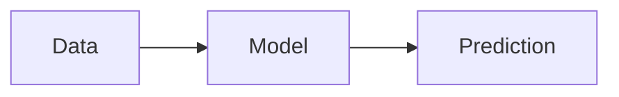

<div align="center">

# ML Graph Learning Handbook

A static handbook for Machine Learning and Graph Machine Learning notes.


[](./LICENSE)

</div>

## Overview

`ml-graph-learning-handbook` is a structured collection of Markdown notes for learning classical Machine Learning, deep learning foundations, and Graph Machine Learning.

The repository includes a browser-based reader in [`index.html`](./index.html). It renders the notes as a searchable book with collapsible sections, base and expanded views, equations, Mermaid diagrams, and light/dark mode.

## Table of Contents

- [Features](#features)
- [Quick Start](#quick-start)
- [Repository Structure](#repository-structure)
- [Topics Covered](#topics-covered)
- [Adding Notes](#adding-notes)
- [Contributing](#contributing)
- [License](#license)

## Features

- Book-style Markdown reader
- Collapsible `Overview`, `ML`, and `Graph ML` sections
- Expanded notes selected by default
- Base, expanded, and all-note views
- Searchable chapter sidebar
- Previous and next chapter navigation
- Table of contents generated from headings
- MathJax rendering for equations
- Mermaid rendering for diagrams
- Light and dark mode
- Plain HTML, CSS, and JavaScript
- No install step or build step required

## Quick Start

From the repository root, start a local static server:

```bash
python3 -m http.server 8000
```

Open the reader:

```text
http://localhost:8000/index.html
```

Opening `index.html` directly from the filesystem may block Markdown loading in some browsers, so a static server is recommended.

## Repository Structure

```text
.
|-- index.html
|-- README.md
|-- LICENSE
|-- ML Notes.md
|-- ml/
|   |-- 001-feature-scaling-normalization-standardization/
|   |-- 002-data-preprocessing-tools/
|   `-- ...
|-- graph-ml/
|   |-- 001-graph-neural-networks/
|   |-- 002-node-edge-graph-level-features-predictions/
|   `-- ...
`-- scripts/
```

Each topic folder follows this pattern:

```text
<topic>.md
<topic>-expanded.md
```

The base note is concise. The expanded note is more detailed and may include equations, diagrams, examples, and implementation notes.

## Topics Covered

### Machine Learning

- Data preprocessing
- Feature scaling
- Regression
- Classification
- Decision trees
- Random forests
- Support vector machines
- Naive Bayes
- Clustering
- Dimensionality reduction
- Model evaluation
- Ensemble learning
- Reinforcement learning
- Natural language processing
- Neural networks
- Convolutional neural networks
- Transformers

### Graph Machine Learning

- Graph neural networks
- Node, edge, and graph-level prediction
- Node embeddings
- PageRank and random walks
- Message passing
- GNN expressiveness
- Heterogeneous graphs
- Knowledge graph reasoning
- Neural subgraph matching
- Community detection
- Graph generative models
- GNN limitations
- Scaling GNNs
- Graph pretraining

## Adding Notes

Use numbered, lowercase, hyphen-separated folders.

For ML notes:

```text
ml/038-new-topic/038-new-topic.md
ml/038-new-topic/038-new-topic-expanded.md
```

For Graph ML notes:

```text
graph-ml/019-new-graph-topic/019-new-graph-topic.md
graph-ml/019-new-graph-topic/019-new-graph-topic-expanded.md
```

Recommended note structure:

```md
# Topic Name

Short explanation.

## Intuition

## Mathematical View

## Example

## Common Pitfalls

## Summary
```

Use fenced Mermaid blocks for diagrams:

````md

````

Use display math for important equations:

```tex
$$
\hat{R}_{\mathrm{test}}(\hat{f}) =
\frac{1}{m}\sum_{i=1}^{m}\ell(y_i^{\mathrm{test}}, \hat{f}(x_i^{\mathrm{test}}))
$$
```

## Contributing

Contributions are welcome. Useful contributions include:

- Fixing typos
- Improving explanations
- Adding examples
- Adding diagrams
- Adding equations
- Improving topic coverage
- Improving the static reader

Suggested workflow:

1. Fork the repository.
2. Create a branch.
3. Make focused changes.
4. Preview the reader locally.
5. Open a pull request with a clear description.

Please follow the existing note naming style.

## License

This project is licensed under the [MIT License](./LICENSE).

