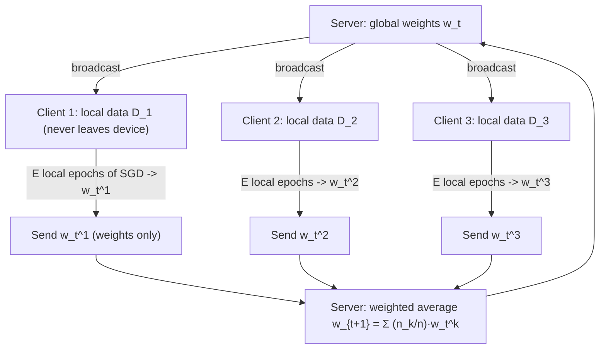

# **Federated Learning**

Every training procedure in your existing notes assumes training data is centralized — collected into one place (a data center, a single machine) before any gradient step is computed. Federated Learning (McMahan et al., 2017) removes this assumption: data stays **on the device that generated it** (a phone, a hospital's local server, a bank's private database), and only **model updates** (never raw data) are communicated to a central coordinator. This is a **training paradigm/systems architecture**, not a new model family — any of the models in your existing notes (a CNN, a Transformer, logistic regression) can be trained federatedly; what changes is *how* the optimization is distributed and *what* is allowed to leave each device.

---

## **1. Motivation and Setting**

### **1.1 Why Not Just Centralize the Data?**

Three practical reasons drive federated learning, distinct from ordinary distributed training (which also splits computation across machines but freely moves/shards data):

- **Privacy/regulatory constraints:** healthcare records, financial transactions, or personal keyboard input may be legally or contractually prohibited from leaving the originating device/institution.
- **Data volume/bandwidth:** millions of phones each generating megabytes of sensor/usage data daily makes centralizing raw data at a server prohibitively expensive compared to transmitting a compact model update.
- **Data ownership:** in cross-silo settings (hospitals, banks), each institution may want to benefit from a jointly-trained model without ever exposing its raw records to competitors or a central party.

### **1.2 Formal Setting**

$K$ clients (devices/institutions), each holding a local dataset $\mathcal D_k$ (of possibly very different size $n_k$ and very different underlying distribution — a critical departure from standard i.i.d. training data, elaborated in §3). The global objective is a weighted average of local objectives:

$$
\min_w\ F(w) = \sum_{k=1}^K \frac{n_k}{n}\,F_k(w), \qquad F_k(w) = \frac{1}{n_k}\sum_{i\in\mathcal D_k}\ell(w;x_i,y_i), \qquad n=\sum_kn_k
$$

Each client can compute $F_k$ and its gradient locally (their data never leaves the device), but no single machine ever has direct access to the full dataset needed to compute $F(w)$ or $\nabla F(w)$ directly.

---

## **2. Federated Averaging (FedAvg) — The Baseline Algorithm**

### **2.1 Why Not Just Send Gradients Every Step?**

A naive federated approach ("FedSGD") would have every client compute one gradient step on their local data and send that gradient to the server, which averages them and applies one global update — this requires one network round-trip **per single gradient step**, which is prohibitively slow given that mobile/cross-device communication is orders of magnitude slower than local compute. FedAvg's key efficiency idea: let each client perform **multiple local gradient steps** (a full local epoch or more) before communicating, trading some staleness/divergence risk for a drastic reduction in communication rounds.

### **2.2 The Algorithm**

1. Server initializes global model $w_0$.
2. For each communication round $t=0,1,2,\dots$:
   a. Server samples a subset $S_t$ of clients (not all $K$ clients participate every round — critical for scale, since millions of phones cannot all be online simultaneously).
   b. Server broadcasts current global weights $w_t$ to each client $k\in S_t$.
   c. Each client $k$ runs $E$ local epochs of SGD on its own data, starting from $w_t$, producing local weights $w_t^k$:
   $$
   w_t^k = w_t - \eta\sum_{\text{local steps}} \nabla F_k(w;\text{minibatch})
   $$
   d. Each client sends **only the updated weights** $w_t^k$ (or, equivalently, the weight *delta* $w_t^k - w_t$) back to the server — never any raw data.
   e. Server aggregates via a weighted average:
   $$
   w_{t+1} = \sum_{k\in S_t} \frac{n_k}{\sum_{k'\in S_t}n_{k'}}\,w_t^k
   $$
3. Repeat until convergence.



### **2.3 Why Weighted (Not Uniform) Averaging**

Weighting each client's update by $n_k$ (their local dataset size) makes the aggregated update an unbiased estimate of what a single centralized gradient step over the *pooled* dataset would have produced, in the special case $E=1$ local step — a direct generalization of ordinary minibatch SGD's implicit averaging, now averaging across clients' full local updates rather than across individual examples within one batch.

---

## **3. The Non-IID Data Challenge — Why This Is Harder Than Standard Distributed SGD**

### **3.1 Client Drift**

Standard distributed SGD assumes every worker's local minibatch is drawn from the same underlying distribution (data is merely sharded, not systematically different across workers). Federated clients' local data is frequently **non-IID** by nature — a given phone's keyboard usage reflects one person's vocabulary and writing style; one hospital's patient population differs systematically from another's. Under this non-IID setting, each client's local optimum $w^{k,\star} = \arg\min_wF_k(w)$ can be **very different** from the global optimum $w^\star = \arg\min_wF(w)$ — running many local epochs ($E>1$) on a client pulls $w_t^k$ toward that *client's own, systematically-biased* local optimum, a phenomenon called **client drift**. Averaging several drifted local models does not, in general, recover the same result as one global gradient step would have (unlike the IID, $E=1$ case in §2.3) — this divergence grows with both $E$ (more local steps, more drift) and the degree of non-IID-ness across clients.

### **3.2 FedProx: A Regularized Fix**

Li et al. (2018) address client drift by adding a **proximal term** to each client's local objective, explicitly penalizing local weights from moving too far from the current global weights $w_t$:

$$
\min_w\ F_k(w) + \frac{\mu}{2}\|w-w_t\|^2
$$

**Why this specifically helps:** this is structurally identical to the ridge-regression penalty (Ch. 039) or the RLHF chapter's KL-to-reference-policy term (RL Ch. 002, §4.2) — in all three cases, a squared/KL penalty toward a fixed reference point trades local objective improvement against staying close to a trusted anchor, directly limiting how far client drift can pull the local solution before it's averaged back in. Larger $\mu$ more aggressively limits drift (at the cost of slower local progress); $\mu=0$ recovers plain FedAvg.

---

## **4. Communication Efficiency**

Since network bandwidth (not local compute) is typically the bottleneck in cross-device federated settings, two complementary techniques reduce the size of what's transmitted:

- **Model compression:** quantizing weight updates to low precision (e.g., 8-bit or lower) before transmission, or transmitting only a sparse subset of significant weight changes, trading a small accuracy cost for substantially reduced upload bandwidth.
- **Structured/sketched updates:** constraining the local update to a lower-dimensional or structured subspace (e.g., a low-rank decomposition) that can be described far more compactly than the full weight delta.

---

## **5. Privacy: Why "Data Never Leaves the Device" Isn't the Full Story**

### **5.1 Gradient/Weight Updates Can Leak Information**

A subtle but critical point: even though raw data never leaves the client, the **weight updates themselves** can leak information about the underlying local data — gradient inversion attacks have demonstrated that, in some settings, an adversary observing a client's gradient update can partially reconstruct the training examples that produced it, particularly with small local batches. "Federated" alone is a *systems-level* privacy improvement (no raw data centralization), not a *cryptographic/information-theoretic* privacy guarantee.

### **5.2 Differential Privacy as a Formal Complement**

To get an actual quantifiable privacy guarantee, federated learning is frequently combined with **Differential Privacy (DP)**: clipping each client's update to a bounded norm and adding calibrated Gaussian noise before aggregation ensures that the presence or absence of any single training example (or, in user-level DP, any single client) changes the distribution of the aggregated output by only a bounded, quantifiable amount — this is an orthogonal, composable privacy mechanism layered on top of the federated communication pattern, not something FedAvg provides by default.

### **5.3 Secure Aggregation**

A complementary cryptographic technique (Bonawitz et al., 2017) lets the server compute the **sum** of all clients' updates without ever seeing any individual client's update in the clear — using secret-sharing-style protocols so that only the aggregate, not any individual contribution, is ever revealed to the server, protecting against a curious-but-honest server inspecting individual updates (though not against the gradient-leakage concern in §5.1 in isolation).

---

## **6. Worked Numeric Example (FedAvg Aggregation)**

Three clients with dataset sizes $n_1=100,\ n_2=50,\ n_3=350$ ($n=500$), returning local (scalar, toy) weight $w_t^1=2.0,\ w_t^2=3.0,\ w_t^3=1.0$ after local training:

$$
w_{t+1} = \frac{100}{500}(2.0)+\frac{50}{500}(3.0)+\frac{350}{500}(1.0) = 0.2(2.0)+0.1(3.0)+0.7(1.0) = 0.4+0.3+0.7 = 1.4
$$

Client 3's update (largest dataset, weight $0.7$) dominates the aggregate, exactly as the size-weighted average in §2.3 intends — a client with 7x more data than client 1 correspondingly has 3.5x more influence over the aggregated result.

---

## **7. Python Implementation From Scratch (Toy Federated Linear Regression)**

```python
import numpy as np


def local_sgd(w, X, y, lr, n_epochs):
    """One client's local training: E epochs of full-batch gradient descent on squared error."""
    n = X.shape[0]
    for _ in range(n_epochs):
        pred = X @ w
        grad = (X.T @ (pred - y)) / n
        w = w - lr * grad
    return w


def fedavg_round(global_w, client_data, lr, local_epochs):
    """One communication round of FedAvg (§2.2)."""
    local_weights = []
    sizes = []
    for X_k, y_k in client_data:
        w_k = local_sgd(global_w.copy(), X_k, y_k, lr, local_epochs)
        local_weights.append(w_k)
        sizes.append(len(X_k))

    sizes = np.array(sizes, dtype=np.float64)
    weights_matrix = np.stack(local_weights)  # (n_clients, d)
    aggregated = (sizes[:, None] * weights_matrix).sum(axis=0) / sizes.sum()
    return aggregated


def fedprox_local_sgd(w, X, y, w_global, lr, n_epochs, mu):
    """FedProx local step (§3.2): adds a proximal penalty toward the global weights."""
    n = X.shape[0]
    for _ in range(n_epochs):
        pred = X @ w
        grad = (X.T @ (pred - y)) / n + mu * (w - w_global)  # proximal term
        w = w - lr * grad
    return w


# Toy setup: 3 clients with non-IID data (different, shifted true relationships)
rng = np.random.default_rng(0)
d = 3
true_w_global = np.array([1.0, -2.0, 0.5])

client_data = []
for k, shift in enumerate([0.0, 0.5, -0.8]):  # each client's local data has a systematically shifted target
    X_k = rng.normal(size=(200, d))
    y_k = X_k @ (true_w_global + shift) + rng.normal(scale=0.1, size=200)
    client_data.append((X_k, y_k))

w = np.zeros(d)
for round_num in range(20):
    w = fedavg_round(w, client_data, lr=0.1, local_epochs=5)

print("FedAvg converged weights:", w)
print("(True global-average-ish weights):", true_w_global)
```

`shift` on each client's data simulates the non-IID condition from §3.1 — each client's *true* local optimum is systematically offset from the shared underlying `true_w_global`, illustrating exactly the client-drift risk that FedProx's proximal term is designed to control.

---

## **8. Equivalent Implementation With Flower / TensorFlow Federated**

```python
import flwr as fl


class FlowerClient(fl.client.NumPyClient):
    def __init__(self, model, X_local, y_local):
        self.model = model
        self.X_local, self.y_local = X_local, y_local

    def get_parameters(self, config):
        return self.model.get_weights()

    def fit(self, parameters, config):
        self.model.set_weights(parameters)
        self.model.fit(self.X_local, self.y_local, epochs=config.get("local_epochs", 1))
        return self.model.get_weights(), len(self.X_local), {}  # (weights, n_examples, metrics)

    def evaluate(self, parameters, config):
        self.model.set_weights(parameters)
        loss, accuracy = self.model.evaluate(self.X_local, self.y_local)
        return loss, len(self.X_local), {"accuracy": accuracy}


strategy = fl.server.strategy.FedAvg(
    fraction_fit=0.1,          # sample 10% of clients per round (§2.2a — not all clients participate)
    min_fit_clients=10,
)
fl.server.start_server(config=fl.server.ServerConfig(num_rounds=50), strategy=strategy)
```

**Internals:** `fit()` returning `len(self.X_local)` as the second element is exactly what lets Flower's `FedAvg` strategy perform the size-weighted aggregation from §2.2e/§2.3 automatically; `fraction_fit` controls client sampling per round (§2.2a), essential at real device-fleet scale where synchronizing every client every round is infeasible.

---

## **9. Complexity and Systems Considerations**

| Aspect | Cost driver |
|---|---|
| Communication per round | $O(|S_t|\cdot |w|)$ — proportional to sampled clients × model size, the typical bottleneck |
| Local compute per client | ordinary local training cost (§2.2c), same as any local SGD |
| Server aggregation | $O(|S_t|\cdot|w|)$ — a simple weighted average, cheap relative to communication |

Unlike standard data-center distributed training (where the bottleneck is usually compute, and communication is comparatively cheap over a fast interconnect), federated learning's bottleneck is typically the **reverse**: communication (especially upload bandwidth from resource-constrained devices over unreliable networks) dominates, which is precisely why FedAvg's "many local steps per communication round" design and the compression techniques in §4 matter so much more here than in ordinary distributed deep learning.

---

## **10. Pitfalls**

- **Client drift under high local-epoch counts** (§3.1): naively increasing $E$ to reduce communication rounds can *increase* divergence from the true global optimum under non-IID data — there's a genuine trade-off, not a free lunch, between communication efficiency and convergence quality.
- **Straggler and dropout handling:** real device fleets have clients that go offline mid-round, have wildly different compute/network speeds, or never respond — production federated systems must handle partial, delayed, or missing client updates gracefully, an operational concern absent from standard synchronous distributed training in a controlled data center.
- **Assuming "federated" alone guarantees privacy** (§5.1): a common and consequential misunderstanding — without differential privacy or secure aggregation layered on top, gradient/weight updates can still leak substantial information about local data.
- **Evaluation is harder:** there is no natural, centrally-held held-out test set in the purest cross-device setting — evaluating a federated model's true generalization performance requires either held-out client-side evaluation (aggregated similarly to training) or a separate, carefully-curated centralized benchmark.
- **Fairness across clients:** a single weighted-average aggregate can perform very well on average while performing poorly for clients with small or unusual local datasets (their contribution to $w_{t+1}$ is small precisely because $n_k$ is small) — algorithms explicitly targeting fairness across clients (e.g., q-FedAvg) exist as a direct response to this.
- **Choosing $\mu$ in FedProx, and $E$/learning-rate schedules generally:** these hyperparameters interact with the degree of non-IID-ness in ways that are hard to predict a priori and typically require empirical tuning per deployment.

---

## **11. Connections**

- **Distributed/parallel SGD:** federated learning is best understood as distributed SGD's non-IID, communication-constrained, privacy-motivated cousin — the aggregation mathematics (§2.3) generalizes ordinary minibatch averaging, but the non-IID data and communication-bottleneck assumptions are what make it a genuinely distinct sub-field with its own algorithms (FedAvg, FedProx) rather than a simple relabeling of standard distributed training.
- **Ridge regression (Ch. 039) and RLHF's KL penalty (RL Ch. 002):** FedProx's proximal term is the same "penalize distance from a trusted reference point" pattern seen in both of those chapters, here applied to keep local client updates from drifting too far from the global model.
- **Differential Privacy:** an orthogonal, composable formal privacy mechanism frequently layered on top of federated learning's systems-level data-locality property, addressing the gradient-leakage gap in §5.1.
- **Multi-task learning:** since each client's local distribution can be genuinely different (§3.1), some federated learning formulations (e.g., personalized federated learning) explicitly reframe the problem as learning a shared representation plus per-client personalization, conceptually related to multi-task learning's shared-versus-task-specific-parameter split.

---

## **12. References**

- H. Brendan McMahan et al., "Communication-Efficient Learning of Deep Networks from Decentralized Data" (the original FedAvg paper), AISTATS 2017. https://arxiv.org/abs/1602.05629
- Tian Li et al., "Federated Optimization in Heterogeneous Networks" (FedProx), MLSys 2020. https://arxiv.org/abs/1812.06127
- Keith Bonawitz et al., "Practical Secure Aggregation for Privacy-Preserving Machine Learning", CCS 2017.
- Peter Kairouz et al., "Advances and Open Problems in Federated Learning", Foundations and Trends in Machine Learning, 2021 (comprehensive survey). https://arxiv.org/abs/1912.04977
- Flower (federated learning framework) documentation. https://flower.ai/docs/
- TensorFlow Federated documentation. https://www.tensorflow.org/federated
