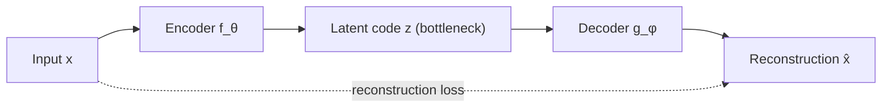
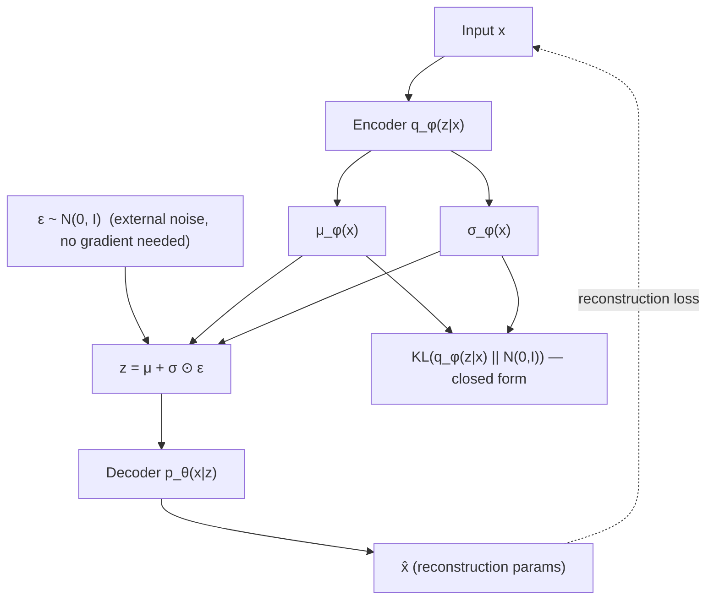

# **Autoencoders and Variational Autoencoders (VAEs)**

An autoencoder learns to compress data into a low-dimensional code and reconstruct it, using reconstruction error as the only training signal — no labels required. A vanilla autoencoder is a deterministic dimensionality-reduction tool; a **variational autoencoder (VAE)** reinterprets the same encoder–decoder shape as a **probabilistic latent-variable model** trained to maximize a tractable lower bound on data likelihood, which is what makes it a genuine *generative* model capable of sampling new data, unlike a vanilla autoencoder.

---

## **1. Vanilla Autoencoder**

### **1.1 Architecture and Objective**

$$
z = f_\theta(x) \quad \text{(encoder)}, \qquad \hat x = g_\phi(z) \quad \text{(decoder)}, \qquad z \in \mathbb{R}^{d_z},\ d_z \ll d_x
$$

$$
\min_{\theta,\phi} \; \mathbb{E}_{x \sim \mathcal{D}}\left[\|x - g_\phi(f_\theta(x))\|_2^2\right]
$$



The bottleneck $d_z \ll d_x$ forces the network to discard information, keeping only what's needed to reconstruct $x$ under the loss used — this is what prevents the trivial identity-function solution.

### **1.2 Relationship to PCA**

If $f_\theta, g_\phi$ are both linear (no nonlinearity) and the loss is squared error, the optimal autoencoder solution spans the same subspace as the top-$d_z$ principal components of $x$ (Baldi & Hornik, 1989) — a linear autoencoder is PCA up to an arbitrary invertible linear transform of the latent space. Nonlinear encoders/decoders generalize this to nonlinear manifolds, which is the entire point of using a deep autoencoder instead of PCA when the data lies on a curved manifold rather than a linear subspace.

### **1.3 Why Reconstruction Alone Isn't "Generative"**

Nothing constrains what the *latent space* looks like. After training, the set of codes $\{f_\theta(x) : x \in \mathcal{D}\}$ may occupy an arbitrarily shaped, disconnected region of $\mathbb{R}^{d_z}$ with holes and non-convex structure. Sampling a random $z \sim \mathcal N(0,I)$ and decoding it with $g_\phi$ will typically land in a region the decoder never saw during training and produce garbage. A vanilla autoencoder has no mechanism that makes the latent space *samplable* — this is exactly the gap the VAE closes.

### **1.4 Regularized Variants (Brief)**

- **Denoising autoencoder:** feed a corrupted $\tilde x$ (e.g., $\tilde x = x + \epsilon$) as input but require reconstruction of the clean $x$; forces the model to learn a robust manifold projection rather than memorizing an identity map.
- **Sparse autoencoder:** adds an activation-sparsity penalty on $z$ (e.g., KL divergence of average activation to a small target rate), encouraging a small number of active latent units per input.
- **Contractive autoencoder:** penalizes $\|\partial z/\partial x\|_F^2$, directly encouraging local robustness of the encoder to small input perturbations.

None of these make the model generative in the VAE sense — they improve representation quality, not samplability.

---

## **2. Variational Autoencoder: Probabilistic Setup**

### **2.1 The Generative Story**

Assume data is generated by a latent-variable process:

$$
z \sim p(z) = \mathcal{N}(0, I), \qquad x \mid z \sim p_\theta(x \mid z)
$$

i.e., first sample a latent code from a simple fixed prior, then generate $x$ from a (learned, neural-network-parameterized) conditional distribution. The marginal likelihood of the data is

$$
p_\theta(x) = \int p_\theta(x \mid z)\, p(z)\, dz
$$

**This integral is intractable** — it requires integrating over the entire latent space, and $p_\theta(x\mid z)$ is a complex neural network, so there is no closed form.

### **2.2 The Posterior Is Also Intractable**

Bayes' rule gives the true posterior

$$
p_\theta(z \mid x) = \frac{p_\theta(x \mid z)\,p(z)}{p_\theta(x)}
$$

which requires the same intractable $p_\theta(x)$ in the denominator. The VAE's core trick: introduce a learned **approximate posterior** $q_\phi(z \mid x)$ (the "encoder") and derive a tractable lower bound on $\log p_\theta(x)$ that can be optimized instead of the true (intractable) likelihood.

### **2.3 Deriving the Evidence Lower Bound (ELBO) From First Principles**

Start from the KL divergence between the approximate and true posterior (always $\ge 0$):

$$
D_{\mathrm{KL}}\big(q_\phi(z\mid x) \,\|\, p_\theta(z\mid x)\big)
=
\mathbb{E}_{q_\phi(z\mid x)}\left[\log q_\phi(z\mid x) - \log p_\theta(z\mid x)\right]
\ge 0
$$

Substitute $p_\theta(z\mid x) = p_\theta(x,z)/p_\theta(x)$:

$$
D_{\mathrm{KL}} = \mathbb{E}_{q_\phi}\left[\log q_\phi(z\mid x) - \log p_\theta(x,z) + \log p_\theta(x)\right]
$$

Since $\log p_\theta(x)$ does not depend on $z$, it comes out of the expectation:

$$
D_{\mathrm{KL}} = \log p_\theta(x) - \underbrace{\mathbb{E}_{q_\phi(z\mid x)}\left[\log p_\theta(x,z) - \log q_\phi(z\mid x)\right]}_{\displaystyle \triangleq\ \mathcal{L}_{\text{ELBO}}(x;\theta,\phi)}
$$

Rearranged:

$$
\log p_\theta(x) = \mathcal{L}_{\text{ELBO}}(x;\theta,\phi) + D_{\mathrm{KL}}\big(q_\phi(z\mid x)\,\|\,p_\theta(z\mid x)\big)
$$

Since $D_{\mathrm{KL}} \ge 0$ always,

$$
\boxed{\log p_\theta(x) \ge \mathcal{L}_{\text{ELBO}}(x;\theta,\phi)}
$$

This is the **evidence lower bound**: maximizing it maximizes a valid lower bound on the (otherwise intractable) data log-likelihood, and — because the gap between the two sides is exactly $D_{\mathrm{KL}}(q_\phi\|p_\theta)$ — maximizing the ELBO *simultaneously* pushes $q_\phi(z\mid x)$ toward the true posterior $p_\theta(z\mid x)$.

### **2.4 Decomposing the ELBO Into Reconstruction + Regularizer**

Expand $p_\theta(x,z) = p_\theta(x\mid z)p(z)$ inside the ELBO:

$$
\mathcal{L}_{\text{ELBO}} = \mathbb{E}_{q_\phi(z\mid x)}\left[\log p_\theta(x\mid z) + \log p(z) - \log q_\phi(z\mid x)\right]
$$

$$
= \mathbb{E}_{q_\phi(z\mid x)}\left[\log p_\theta(x\mid z)\right] - \mathbb{E}_{q_\phi(z\mid x)}\left[\log q_\phi(z\mid x) - \log p(z)\right]
$$

$$
\boxed{
\mathcal{L}_{\text{ELBO}}(x) = \underbrace{\mathbb{E}_{q_\phi(z\mid x)}\left[\log p_\theta(x\mid z)\right]}_{\text{reconstruction term}} \;-\; \underbrace{D_{\mathrm{KL}}\big(q_\phi(z\mid x)\,\|\,p(z)\big)}_{\text{regularizer}}
}
$$

**Term-by-term meaning:**
- **Reconstruction term:** the expected log-likelihood of $x$ under the decoder, given a code sampled from the encoder — this is exactly the reconstruction objective from §1.1 (for a Gaussian decoder with fixed variance, this reduces to negative squared error up to constants; for Bernoulli-valued pixels, it becomes binary cross-entropy).
- **KL regularizer:** pulls the approximate posterior $q_\phi(z\mid x)$ toward the fixed prior $p(z)=\mathcal N(0,I)$ for *every* input $x$. This is precisely the missing ingredient from §1.3: it forces the aggregate latent distribution to actually look like $\mathcal N(0,I)$, so that decoding a random $z\sim\mathcal N(0,I)$ at generation time lands in a region the decoder has seen densely during training.

The full training objective (maximize, or equivalently minimize the negative):

$$
\max_{\theta,\phi}\ \mathbb{E}_{x\sim\mathcal D}\left[\mathcal{L}_{\text{ELBO}}(x;\theta,\phi)\right]
$$

### **2.5 Gaussian Encoder and the Closed-Form KL Term**

In practice, $q_\phi(z\mid x) = \mathcal N\big(\mu_\phi(x), \operatorname{diag}(\sigma_\phi^2(x))\big)$, a diagonal Gaussian whose mean and (log-)variance are the outputs of the encoder network. With prior $p(z) = \mathcal N(0,I)$, the KL divergence between two diagonal Gaussians has a **closed form**, avoiding any Monte Carlo estimate for this term:

$$
D_{\mathrm{KL}}\big(\mathcal N(\mu,\operatorname{diag}(\sigma^2)) \,\|\, \mathcal N(0,I)\big)
=
\frac{1}{2}\sum_{j=1}^{d_z}\left(\mu_j^2 + \sigma_j^2 - \log \sigma_j^2 - 1\right)
$$

**Derivation sketch:** for two univariate Gaussians $\mathcal N(\mu,\sigma^2)$ and $\mathcal N(0,1)$,

$$
D_{\mathrm{KL}} = \mathbb{E}\left[\log\frac{\mathcal N(z;\mu,\sigma^2)}{\mathcal N(z;0,1)}\right]
= \mathbb{E}\left[-\tfrac12\log\sigma^2 - \tfrac{(z-\mu)^2}{2\sigma^2} + \tfrac{z^2}{2}\right]
$$

Using $\mathbb{E}[(z-\mu)^2] = \sigma^2$ (by definition of variance) and $\mathbb{E}[z^2] = \sigma^2+\mu^2$ (since $z\sim\mathcal N(\mu,\sigma^2)$):

$$
D_{\mathrm{KL}} = -\tfrac12\log\sigma^2 - \tfrac12 + \tfrac12(\sigma^2+\mu^2) = \tfrac12(\mu^2+\sigma^2-\log\sigma^2-1)
$$

Summing over $d_z$ independent dimensions gives the boxed formula above.

### **2.6 The Reparameterization Trick**

The reconstruction term requires backpropagating through a **sampling** operation $z \sim q_\phi(z\mid x)$, but sampling is not differentiable with respect to $\phi$ as written. The fix: rewrite the sample as a deterministic, differentiable function of $\phi$ and an independent noise source:

$$
z = \mu_\phi(x) + \sigma_\phi(x) \odot \epsilon, \qquad \epsilon \sim \mathcal N(0, I)
$$

Now $z$ is a deterministic function of $(\mu_\phi(x), \sigma_\phi(x), \epsilon)$; the randomness ($\epsilon$) is external and has no parameters, so $\partial z/\partial \phi$ is well-defined and ordinary backpropagation applies:

$$
\nabla_\phi \, \mathbb{E}_{q_\phi(z\mid x)}[\log p_\theta(x\mid z)] = \mathbb{E}_{\epsilon \sim \mathcal N(0,I)}\left[\nabla_\phi \log p_\theta\big(x \mid \mu_\phi(x)+\sigma_\phi(x)\odot\epsilon\big)\right]
$$

which is estimated with a single Monte Carlo sample of $\epsilon$ per training example in practice.



---

## **3. Worked Numeric Example**

Let $d_z = 1$. Suppose for a given input $x$, the encoder outputs $\mu_\phi(x) = 0.6$ and $\log\sigma_\phi^2(x) = -0.5$, so $\sigma_\phi^2(x) = e^{-0.5} = 0.6065$, $\sigma_\phi(x) = 0.7788$.

**KL term** (closed form, §2.5):

$$
D_{\mathrm{KL}} = \tfrac12\left(0.6^2 + 0.6065 - (-0.5) - 1\right) = \tfrac12(0.36 + 0.6065 + 0.5 - 1) = \tfrac12(0.4665) = 0.2333
$$

**Reparameterized sample** with drawn noise $\epsilon = 0.3$:

$$
z = 0.6 + 0.7788 \times 0.3 = 0.6 + 0.2336 = 0.8336
$$

**Reconstruction term** (assume a Gaussian decoder with fixed variance $1$, so $-\log p_\theta(x\mid z) \propto \tfrac12\|x-\hat x(z)\|_2^2$ up to a constant): if the decoder maps $z=0.8336$ to $\hat x = 0.9$ and the true $x = 1.0$,

$$
-\log p_\theta(x\mid z) \approx \tfrac12(1.0-0.9)^2 + \text{const} = 0.005 + \text{const}
$$

**Per-example negative ELBO** (loss to minimize) $\approx 0.005 + 0.2333 = 0.2383$ (up to the additive Gaussian normalizing constant, which does not affect gradients).

---

## **4. Step-by-Step Training Execution**

1. Sample a minibatch $\{x^{(i)}\}$.
2. Encoder forward pass: compute $\mu_\phi(x^{(i)}), \log\sigma_\phi^2(x^{(i)})$.
3. Sample $\epsilon^{(i)} \sim \mathcal N(0,I)$; form $z^{(i)} = \mu_\phi(x^{(i)}) + \sigma_\phi(x^{(i)})\odot\epsilon^{(i)}$ (reparameterization).
4. Decoder forward pass: compute reconstruction distribution parameters from $z^{(i)}$ (e.g., pixel means for Bernoulli/Gaussian likelihood).
5. Compute reconstruction loss ($-\log p_\theta(x^{(i)}\mid z^{(i)})$) and closed-form KL term.
6. Sum: $\mathcal{L}(x^{(i)}) = \text{reconstruction} + \beta \cdot D_{\mathrm{KL}}$ (the optional $\beta$ weight is the $\beta$-VAE knob, §6).
7. Backpropagate through decoder, through the reparameterized sampling step, through encoder.
8. Update $\theta,\phi$ jointly with Adam.
9. At generation time: discard the encoder; sample $z \sim \mathcal N(0,I)$ directly and decode with $g_\phi/p_\theta$.

---

## **5. Python Implementation From Scratch (NumPy Forward Pass)**

```python
import numpy as np


def relu(x):
    return np.maximum(x, 0.0)


class MLP:
    """Minimal 2-layer MLP used for both encoder trunk and decoder."""

    def __init__(self, in_dim, hidden_dim, out_dim, seed):
        rng = np.random.default_rng(seed)
        s1 = np.sqrt(2.0 / in_dim)
        s2 = np.sqrt(2.0 / hidden_dim)
        self.W1 = rng.normal(0, s1, size=(in_dim, hidden_dim))
        self.b1 = np.zeros(hidden_dim)
        self.W2 = rng.normal(0, s2, size=(hidden_dim, out_dim))
        self.b2 = np.zeros(out_dim)

    def forward(self, x):
        h = relu(x @ self.W1 + self.b1)
        return h @ self.W2 + self.b2


class VAE:
    def __init__(self, d_x, d_h, d_z, seed=0):
        self.encoder_trunk = MLP(d_x, d_h, 2 * d_z, seed=seed)      # outputs [mu, log_var]
        self.decoder = MLP(d_z, d_h, d_x, seed=seed + 1)             # outputs reconstruction (e.g., pixel logits)
        self.d_z = d_z

    def encode(self, x):
        out = self.encoder_trunk.forward(x)
        mu, log_var = out[:, :self.d_z], out[:, self.d_z:]
        return mu, log_var

    def reparameterize(self, mu, log_var, rng):
        std = np.exp(0.5 * log_var)
        eps = rng.normal(size=mu.shape)
        return mu + std * eps

    def decode(self, z):
        return self.decoder.forward(z)

    def forward(self, x, rng):
        mu, log_var = self.encode(x)
        z = self.reparameterize(mu, log_var, rng)
        x_hat = self.decode(z)
        return x_hat, mu, log_var, z


def kl_divergence_gaussian(mu, log_var):
    """Closed-form KL(N(mu, diag(exp(log_var))) || N(0, I)), summed over latent dims, per example."""
    return 0.5 * np.sum(mu ** 2 + np.exp(log_var) - log_var - 1.0, axis=1)


def gaussian_reconstruction_nll(x, x_hat):
    """-log p(x|z) for a unit-variance Gaussian decoder, up to an additive constant."""
    return 0.5 * np.sum((x - x_hat) ** 2, axis=1)


def vae_loss(x, x_hat, mu, log_var, beta=1.0):
    recon = gaussian_reconstruction_nll(x, x_hat)
    kl = kl_divergence_gaussian(mu, log_var)
    return np.mean(recon + beta * kl), np.mean(recon), np.mean(kl)


# Toy forward pass
rng = np.random.default_rng(42)
d_x, d_h, d_z, batch = 8, 16, 2, 5
x = rng.normal(size=(batch, d_x))

vae = VAE(d_x, d_h, d_z)
x_hat, mu, log_var, z = vae.forward(x, rng)
loss, recon, kl = vae_loss(x, x_hat, mu, log_var, beta=1.0)

print("Total loss:", loss, "| Reconstruction:", recon, "| KL:", kl)
```

This forward pass shows every piece derived above with no autograd: the encoder trunk splitting into $(\mu,\log\sigma^2)$, the reparameterized sample, the closed-form KL, and the reconstruction NLL — full end-to-end gradient computation would require either hand-derived backprop (mechanically identical to a standard MLP, plus the reparameterization Jacobian $\partial z/\partial\phi$ from §2.6) or an autograd framework, shown next.

---

## **6. Equivalent Implementation With PyTorch**

```python
import torch
import torch.nn.functional as F
from torch import nn


class Encoder(nn.Module):
    def __init__(self, d_x, d_h, d_z):
        super().__init__()
        self.trunk = nn.Sequential(nn.Linear(d_x, d_h), nn.ReLU())
        self.mu_head = nn.Linear(d_h, d_z)
        self.logvar_head = nn.Linear(d_h, d_z)

    def forward(self, x):
        h = self.trunk(x)
        return self.mu_head(h), self.logvar_head(h)


class Decoder(nn.Module):
    def __init__(self, d_z, d_h, d_x):
        super().__init__()
        self.net = nn.Sequential(nn.Linear(d_z, d_h), nn.ReLU(), nn.Linear(d_h, d_x))

    def forward(self, z):
        return self.net(z)  # returns logits for a Bernoulli decoder over pixels


class VAE(nn.Module):
    def __init__(self, d_x, d_h, d_z):
        super().__init__()
        self.encoder = Encoder(d_x, d_h, d_z)
        self.decoder = Decoder(d_z, d_h, d_x)

    def reparameterize(self, mu, logvar):
        std = torch.exp(0.5 * logvar)
        eps = torch.randn_like(std)  # external noise; no grad needed through randn_like
        return mu + std * eps

    def forward(self, x):
        mu, logvar = self.encoder(x)
        z = self.reparameterize(mu, logvar)
        x_logits = self.decoder(z)
        return x_logits, mu, logvar


def vae_loss(x, x_logits, mu, logvar, beta=1.0):
    # Bernoulli decoder: binary_cross_entropy_with_logits is the numerically stable
    # combination of sigmoid + BCE, avoiding explicit log(sigmoid(.)) under/overflow.
    recon = F.binary_cross_entropy_with_logits(x_logits, x, reduction="none").sum(dim=1)
    kl = 0.5 * torch.sum(mu.pow(2) + logvar.exp() - logvar - 1.0, dim=1)
    return (recon + beta * kl).mean()


d_x, d_h, d_z = 784, 400, 20
model = VAE(d_x, d_h, d_z)
optimizer = torch.optim.Adam(model.parameters(), lr=1e-3)

x = torch.rand(64, d_x).round()  # toy binary "pixels"
x_logits, mu, logvar = model(x)
loss = vae_loss(x, x_logits, mu, logvar)
loss.backward()
optimizer.step()
```

**Internals worth knowing:**
- `torch.randn_like(std)` creates noise with `requires_grad=False`; because `z = mu + std * eps` is an ordinary differentiable expression once `eps` is treated as a constant, PyTorch's autograd correctly computes $\partial z/\partial\mu = 1$ and $\partial z/\partial(\log\sigma^2)$ through the `torch.exp(0.5*logvar)` node — no special-cased "stochastic node" gradient is needed, which is the entire point of the reparameterization trick (§2.6).
- `binary_cross_entropy_with_logits` fuses sigmoid and BCE into one numerically stable op (same rationale as in the LSTM chapter's link-prediction loss), important because raw pixel-probability BCE can under/overflow at extreme logits.
- Generation after training: `z = torch.randn(n_samples, d_z); samples = torch.sigmoid(model.decoder(z))` — the encoder is not used at all at generation time; this only works because the KL term during training forced the **aggregate** posterior $\mathbb{E}_{x}[q_\phi(z\mid x)]$ to resemble $\mathcal N(0,I)$.

---

## **7. Complexity**

Let $d_x, d_h, d_z$ be input/hidden/latent dims, $B$ batch size, $L$ encoder/decoder depth.

- **Time:** $O(B \cdot L \cdot d_h^2)$ per forward/backward pass (dominated by dense layer matmuls, same as any MLP/CNN of that depth); the reparameterization step and KL computation add only $O(B \cdot d_z)$, negligible relative to the network matmuls.
- **Space:** $O(B \cdot L \cdot d_h)$ activations for backprop, plus $O(B \cdot d_z)$ for $\mu,\sigma,\epsilon,z$.
- Sampling at generation time is $O(d_z)$ (draw noise) plus one decoder forward pass — no iterative procedure is needed, unlike autoregressive or diffusion generative models, which is a major practical advantage of VAEs for fast sampling.

---

## **8. Numerical Stability, Edge Cases, Pitfalls**

- **Predict $\log\sigma^2$, never $\sigma^2$ directly.** Parameterizing the encoder's variance output in log-space guarantees positivity ($\sigma^2 = e^{\log\sigma^2} > 0$ for any real network output) without a constrained activation function, and avoids the numerical issues of differentiating through a hard positivity constraint (e.g., `softplus` near $0$).
- **Posterior collapse:** if the decoder is powerful enough to model $x$ well while ignoring $z$ almost entirely (e.g., a strong autoregressive decoder), the KL term can be driven to $0$ by simply setting $q_\phi(z\mid x) \approx p(z)$ for all $x$ — the model becomes a plain unconditional generator and $z$ carries no information. Mitigations: KL annealing (ramp $\beta$ from $0$ up during training), free bits (only penalize KL above a threshold per dimension), or weakening the decoder.
- **$\beta$-VAE trade-off:** scaling the KL term by $\beta > 1$ (Higgins et al., 2017) encourages a more disentangled, factorized latent representation at the cost of reconstruction fidelity; $\beta < 1$ favors sharper reconstructions at the cost of a less regularized (less samplable) latent space. This is a direct, tunable knob on the reconstruction/regularization trade-off derived in §2.4.
- **Blurry samples:** a Gaussian decoder with a fixed, shared variance implicitly uses a squared-error reconstruction loss, which is minimized in expectation by the *mean* of plausible reconstructions when the true data distribution is multimodal — this averaging is the classic cause of blurry VAE samples (in contrast to GANs, §next chapter, which have no such explicit per-pixel averaging objective).
- **KL term can go negative in buggy implementations:** if you mistakenly implement $-D_{\mathrm{KL}}$ with the wrong sign or omit the $-1$ inside the closed form, the "loss" can decrease by making $\sigma^2 \to \infty$; always sanity-check that the KL term is $\ge 0$ (it is, by construction, since it's a true KL divergence).
- **One-sample Monte Carlo estimate of the reconstruction term** is a valid unbiased estimator of the expectation, but is high-variance per example; averaging over a minibatch reduces variance in the gradient estimate as usual, and using more than one $\epsilon$ sample per $x$ is possible but rarely necessary in practice.
- **Latent dimension too small:** severely bottlenecks reconstruction quality (information-theoretic limit, independent of optimization); too large: weakens the regularization benefit of the bottleneck and can encourage posterior collapse in some latent dimensions while leaving others active.

---

## **9. Connections to Related ML Concepts**

- **PCA:** the linear-autoencoder special case (§1.2) situates autoencoders as a nonlinear generalization of PCA.
- **EM algorithm:** the ELBO/posterior-approximation structure in §2.3 is the same variational principle underlying variational EM for latent-variable models in general (mixture models, HMMs) — the VAE simply parameterizes both $p_\theta(x\mid z)$ and $q_\phi(z\mid x)$ with neural networks and optimizes both jointly via gradient descent instead of alternating exact E/M steps.
- **GANs:** both are latent-variable generative models mapping $z\sim p(z)$ to data space, but GANs replace the explicit likelihood/ELBO objective with an adversarial discriminator-based objective — no explicit reconstruction loss, no blurriness-inducing per-pixel averaging, but also no tractable likelihood and notoriously unstable training.
- **Normalizing flows:** another likelihood-based generative model family that, unlike the VAE, uses an *exactly invertible* encoder/decoder with a tractable Jacobian determinant, giving an exact (not lower-bounded) log-likelihood at the cost of architectural constraints (invertibility, easy-to-compute Jacobians).
- **Diffusion models:** can be derived as a hierarchical VAE with a fixed (non-learned), many-step Gaussian encoder (the forward noising process) and a learned reverse (denoising) decoder — the ELBO derivation in §2.3 generalizes directly to the multi-step diffusion training objective.
- **Information bottleneck:** the reconstruction-vs-KL trade-off (§6, $\beta$-VAE) is a direct instance of the information bottleneck principle — trading off how much information $z$ retains about $x$ against how compressed/regularized $z$ is.

---

## **10. References for Deeper Reading**

- Diederik P. Kingma and Max Welling, "Auto-Encoding Variational Bayes", ICLR 2014. https://arxiv.org/abs/1312.6114
- Danilo Jimenez Rezende, Shakir Mohamed, Daan Wierstra, "Stochastic Backpropagation and Approximate Inference in Deep Generative Models", ICML 2014. https://arxiv.org/abs/1401.4082
- Irina Higgins et al., "β-VAE: Learning Basic Visual Concepts with a Constrained Variational Framework", ICLR 2017.
- Pierre Baldi and Kurt Hornik, "Neural Networks and Principal Component Analysis: Learning from Examples Without Local Minima", Neural Networks, 1989.
- Carl Doersch, "Tutorial on Variational Autoencoders", 2016. https://arxiv.org/abs/1606.05908
- Samuel R. Bowman et al., "Generating Sentences from a Continuous Space" (posterior collapse discussion in sequence VAEs), CoNLL 2016. https://arxiv.org/abs/1511.06349
- PyTorch VAE example (official repo). https://github.com/pytorch/examples/tree/main/vae
