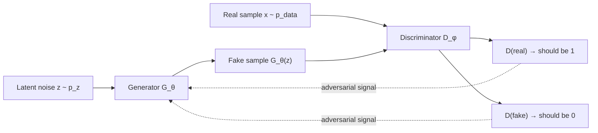

# **Generative Adversarial Networks (GANs)**

A VAE (previous chapter) trains a generator by maximizing a tractable likelihood lower bound, which structurally biases it toward blurry, averaged reconstructions. A GAN abandons likelihood entirely: two networks play a minimax game — a **generator** $G$ that tries to produce samples indistinguishable from real data, and a **discriminator** $D$ that tries to tell real from fake. Neither network ever sees an explicit reconstruction target; the training signal comes purely from the adversarial game, which is what allows GANs to produce far sharper samples than VAEs, at the cost of no tractable likelihood and characteristically unstable training.

---

## **1. Setup and the Minimax Objective**

$$
z \sim p_z(z) \quad \text{(simple prior, e.g., } \mathcal N(0,I)\text{)}, \qquad \hat x = G_\theta(z)
$$

$$
D_\phi(x) \in (0,1) \quad \text{= discriminator's estimate that } x \text{ is real}
$$

Goodfellow et al. (2014) formulate training as a two-player minimax game with value function

$$
\min_{\theta} \max_{\phi} \; V(D_\phi, G_\theta)
=
\mathbb{E}_{x \sim p_{\text{data}}}\left[\log D_\phi(x)\right]
+
\mathbb{E}_{z \sim p_z}\left[\log\big(1 - D_\phi(G_\theta(z))\big)\right]
$$



**Discriminator** wants to maximize $V$: push $D(x)\to 1$ for real $x$ and $D(G(z))\to 0$ for generated samples — ordinary binary classification (real vs. fake) trained with binary cross-entropy.

**Generator** wants to minimize $V$: push $D(G(z)) \to 1$, i.e., fool the discriminator into thinking fakes are real. The generator never sees real data directly — its only training signal is the gradient of the discriminator's output with respect to the generated sample.

### **1.1 Alternating Optimization**

In practice $\theta,\phi$ are updated by alternating gradient steps, not by fully solving the inner max at every outer step:

1. Sample a batch of real $x$ and noise $z$; compute fakes $G_\theta(z)$.
2. Update $\phi$ by ascending $V$ (one or more SGD/Adam steps), holding $\theta$ fixed:
   $$
   \nabla_\phi \left[\log D_\phi(x) + \log(1-D_\phi(G_\theta(z)))\right]
   $$
3. Sample fresh noise $z$; update $\theta$ by descending $V$ (or the non-saturating alternative, §1.3), holding $\phi$ fixed:
   $$
   \nabla_\theta \log\big(1-D_\phi(G_\theta(z))\big)
   $$
4. Repeat.

---

## **2. Optimal Discriminator — Derivation**

Fix $G$ (hence fix the induced generator distribution $p_g$). Rewrite the value function as an integral over $x$-space using the change of variables $x = G(z)$ for the second term:

$$
V(D,G) = \int_x \Big[ p_{\text{data}}(x)\log D(x) + p_g(x)\log(1-D(x)) \Big] dx
$$

For each fixed $x$, this integrand has the form $a\log y + b\log(1-y)$ with $a = p_{\text{data}}(x)$, $b=p_g(x)$, $y=D(x)$. Differentiate with respect to $y$ and set to zero:

$$
\frac{a}{y} - \frac{b}{1-y} = 0 \;\Longrightarrow\; a(1-y) = by \;\Longrightarrow\; y^\star = \frac{a}{a+b}
$$

$$
\boxed{D^\star(x) = \frac{p_{\text{data}}(x)}{p_{\text{data}}(x) + p_g(x)}}
$$

**Intuition:** the optimal discriminator, for each point $x$, simply reports the fraction of probability mass at $x$ that comes from the real distribution versus the mixture of real and fake — exactly what a Bayes-optimal classifier would output for a balanced two-class problem where the classes are $p_{\text{data}}$ and $p_g$.

---

## **3. Optimal Generator — the Jensen–Shannon Divergence**

Substitute $D^\star$ back into $V$:

$$
V(D^\star,G) = \mathbb{E}_{x\sim p_{\text{data}}}\left[\log\frac{p_{\text{data}}(x)}{p_{\text{data}}(x)+p_g(x)}\right] + \mathbb{E}_{x\sim p_g}\left[\log\frac{p_g(x)}{p_{\text{data}}(x)+p_g(x)}\right]
$$

Introduce the mixture $M = \tfrac12(p_{\text{data}}+p_g)$ and split each $\log$ term using $\log\frac{p}{p_{\text{data}}+p_g} = \log\frac{p}{2M} = \log\frac{p}{M} - \log 2$:

$$
V(D^\star,G) = -2\log 2 + \mathbb{E}_{p_{\text{data}}}\left[\log\frac{p_{\text{data}}}{M}\right] + \mathbb{E}_{p_g}\left[\log\frac{p_g}{M}\right]
$$

The two expectation terms are exactly the definitions of KL divergences to the mixture:

$$
V(D^\star,G) = -2\log 2 + D_{\mathrm{KL}}(p_{\text{data}}\,\|\,M) + D_{\mathrm{KL}}(p_g\,\|\,M) = -2\log2 + 2\,D_{\mathrm{JS}}(p_{\text{data}}\,\|\,p_g)
$$

using the definition of Jensen–Shannon divergence $D_{\mathrm{JS}}(p\|q) = \tfrac12 D_{\mathrm{KL}}(p\|M)+\tfrac12 D_{\mathrm{KL}}(q\|M)$. So:

$$
\boxed{V(D^\star,G) = 2\, D_{\mathrm{JS}}(p_{\text{data}} \,\|\, p_g) - 2\log 2}
$$

Since $D_{\mathrm{JS}} \ge 0$ with equality iff $p_{\text{data}} = p_g$, the global minimum over $G$ of $V(D^\star,G)$ is $-2\log 2$, attained **exactly** when the generator's distribution matches the data distribution. This is the theoretical justification for the GAN objective: at the (theoretical) equilibrium, training a GAN to convergence is equivalent to minimizing the Jensen–Shannon divergence between $p_g$ and $p_{\text{data}}$, and the unique optimum is $p_g = p_{\text{data}}$, at which point $D^\star(x) = \tfrac12$ everywhere (the discriminator can no longer distinguish real from fake at all).

---

## **4. Why the Naive Generator Loss Fails in Practice — Non-Saturating Loss**

Early in training, $G$ is poor and $D$ can distinguish fakes easily, so $D(G(z)) \approx 0$. The generator's minimax loss $\log(1-D(G(z)))$ is then evaluated near $\log(1) = 0$, in the **flat, saturated region** of $\log(1-y)$ (its derivative $-1/(1-y)$ is small when $y\approx 0$). This gives **weak gradients exactly when the generator most needs strong ones**.

The standard fix (Goodfellow et al., 2014) is to keep the same fixed point but replace the generator's objective with the **non-saturating loss**:

$$
\max_\theta\ \mathbb{E}_{z\sim p_z}\left[\log D_\phi(G_\theta(z))\right]
\quad\Longleftrightarrow\quad
\min_\theta\ -\mathbb{E}_{z\sim p_z}\left[\log D_\phi(G_\theta(z))\right]
$$

This has the same sign of gradient direction as the original minimax loss (both push $G$ to increase $D(G(z))$) but $-\log(y)$ has a **large** gradient ($-1/y$) exactly when $y=D(G(z))$ is small — i.e., early in training when the generator is weak, giving much stronger learning signal than the original. This is the loss used in essentially all practical GAN implementations, not the literal minimax form in §1.

---

## **5. Worked Numeric Example (Optimal Discriminator on a Toy Point)**

Suppose at some $x_0$, $p_{\text{data}}(x_0) = 0.3$ and the current generator's induced density $p_g(x_0) = 0.1$ (both evaluated via, e.g., a density estimate — this is a toy illustration of the formula, not a full training run).

$$
D^\star(x_0) = \frac{0.3}{0.3+0.1} = 0.75
$$

The discriminator correctly assigns $x_0$ a $75\%$ chance of being real, reflecting that real density there is $3\times$ the fake density. As $G$ improves and $p_g(x_0) \to 0.3 = p_{\text{data}}(x_0)$, $D^\star(x_0) \to 0.5$ — indistinguishable, consistent with the equilibrium derived in §3.

**Non-saturating loss gradient comparison** at $D(G(z)) = 0.05$ (generator currently fooling the discriminator rarely):

$$
\left|\frac{d}{dy}\log(1-y)\right|_{y=0.05} = \frac{1}{1-0.05} = 1.053
\qquad\text{vs.}\qquad
\left|\frac{d}{dy}\left[-\log y\right]\right|_{y=0.05} = \frac{1}{0.05} = 20.0
$$

The non-saturating loss's gradient magnitude is about $19\times$ larger at this operating point — this quantifies the "weak gradient early in training" problem from §4 and why the fix matters.

---

## **6. Step-by-Step Training Execution**

1. Sample minibatch of real data $\{x^{(i)}\}$ and noise $\{z^{(i)}\}$.
2. **Discriminator step:** compute $D_\phi(x^{(i)})$ and $D_\phi(G_\theta(z^{(i)}))$ (with $G_\theta$ frozen — no gradient to $\theta$); compute the binary cross-entropy loss for real-vs-fake; backprop and update $\phi$.
3. Sample fresh noise $\{z^{(i)}\}$ (standard practice — do not reuse the same fakes from step 2 for the generator update in some implementations, though many also reuse them; the important part is $D_\phi$ is frozen during this step).
4. **Generator step:** compute $D_\phi(G_\theta(z^{(i)}))$ (with $D_\phi$ frozen); compute the non-saturating loss $-\log D_\phi(G_\theta(z^{(i)}))$; backprop through $D_\phi$ into $G_\theta$ (gradient flows through the discriminator but only updates generator parameters) and update $\theta$.
5. Repeat, typically alternating 1:1 (or occasionally $k{:}1$ discriminator-to-generator steps if the discriminator is deliberately kept slightly ahead).
6. At generation time: sample $z\sim p_z$, forward through $G_\theta$ only — no discriminator needed.

---

## **7. Python Implementation From Scratch (NumPy Forward/Loss)**

```python
import numpy as np


def sigmoid(x):
    out = np.empty_like(x, dtype=np.float64)
    pos = x >= 0
    out[pos] = 1.0 / (1.0 + np.exp(-x[pos]))
    exp_x = np.exp(x[~pos])
    out[~pos] = exp_x / (1.0 + exp_x)
    return out


class MLP:
    def __init__(self, in_dim, hidden_dim, out_dim, seed):
        rng = np.random.default_rng(seed)
        s1, s2 = np.sqrt(2.0 / in_dim), np.sqrt(2.0 / hidden_dim)
        self.W1 = rng.normal(0, s1, size=(in_dim, hidden_dim))
        self.b1 = np.zeros(hidden_dim)
        self.W2 = rng.normal(0, s2, size=(hidden_dim, out_dim))
        self.b2 = np.zeros(out_dim)

    def forward(self, x):
        h = np.maximum(x @ self.W1 + self.b1, 0.0)  # ReLU
        return h @ self.W2 + self.b2


class GAN:
    def __init__(self, d_z, d_h, d_x, seed=0):
        self.G = MLP(d_z, d_h, d_x, seed=seed)          # generator: noise -> data space
        self.D = MLP(d_x, d_h, 1, seed=seed + 1)          # discriminator: data -> real/fake logit

    def generate(self, z):
        return self.G.forward(z)

    def discriminate_logits(self, x):
        return self.D.forward(x).ravel()


def discriminator_loss(real_logits, fake_logits):
    """
    Binary cross-entropy with logits, computed manually and stably:
    -log(sigmoid(real_logits)) - log(1 - sigmoid(fake_logits))
    Using the stable identity log(sigmoid(z)) = -softplus(-z).
    """
    def log_sigmoid(z):
        return -np.logaddexp(0, -z)  # numerically stable log(sigmoid(z))

    real_term = -log_sigmoid(real_logits)          # -log D(x)
    fake_term = -log_sigmoid(-fake_logits)          # -log(1 - D(G(z))) == -log(sigmoid(-fake_logits))
    return np.mean(real_term + fake_term)


def generator_loss_nonsaturating(fake_logits):
    """-log D(G(z)), the non-saturating generator loss (§4)."""
    def log_sigmoid(z):
        return -np.logaddexp(0, -z)

    return -np.mean(log_sigmoid(fake_logits))


# Toy forward pass
rng = np.random.default_rng(0)
d_z, d_h, d_x, batch = 4, 16, 2, 8
gan = GAN(d_z, d_h, d_x)

x_real = rng.normal(loc=1.0, scale=0.5, size=(batch, d_x))
z = rng.normal(size=(batch, d_z))
x_fake = gan.generate(z)

real_logits = gan.discriminate_logits(x_real)
fake_logits = gan.discriminate_logits(x_fake)

d_loss = discriminator_loss(real_logits, fake_logits)
g_loss = generator_loss_nonsaturating(fake_logits)
print("Discriminator loss:", d_loss, "| Generator (non-saturating) loss:", g_loss)
```

`np.logaddexp(0, -z)` computes $\log(1+e^{-z}) = \text{softplus}(-z)$ stably for any magnitude of $z$, which is the standard trick for avoiding overflow in $\log(\text{sigmoid}(z))$ — the same numerical-stability pattern as `binary_cross_entropy_with_logits` in the LSTM and VAE chapters.

---

## **8. Equivalent Implementation With PyTorch**

```python
import torch
import torch.nn.functional as F
from torch import nn


class Generator(nn.Module):
    def __init__(self, d_z, d_h, d_x):
        super().__init__()
        self.net = nn.Sequential(
            nn.Linear(d_z, d_h), nn.ReLU(),
            nn.Linear(d_h, d_x), nn.Tanh(),   # Tanh bounds output to match normalized image data in [-1, 1]
        )

    def forward(self, z):
        return self.net(z)


class Discriminator(nn.Module):
    def __init__(self, d_x, d_h):
        super().__init__()
        self.net = nn.Sequential(
            nn.Linear(d_x, d_h), nn.LeakyReLU(0.2),  # LeakyReLU avoids dead units from sparse discriminator gradients
            nn.Linear(d_h, 1),                        # raw logit; use BCEWithLogitsLoss, not Sigmoid+BCELoss
        )

    def forward(self, x):
        return self.net(x)


d_z, d_h, d_x = 64, 256, 2
G = Generator(d_z, d_h, d_x)
D = Discriminator(d_x, d_h)

opt_G = torch.optim.Adam(G.parameters(), lr=2e-4, betas=(0.5, 0.999))
opt_D = torch.optim.Adam(D.parameters(), lr=2e-4, betas=(0.5, 0.999))

x_real = torch.randn(128, d_x)  # stand-in for a real data batch

# --- Discriminator step ---
z = torch.randn(128, d_z)
x_fake = G(z).detach()  # detach: no gradient into G during the discriminator update
real_logits = D(x_real)
fake_logits = D(x_fake)
d_loss = F.binary_cross_entropy_with_logits(real_logits, torch.ones_like(real_logits)) \
       + F.binary_cross_entropy_with_logits(fake_logits, torch.zeros_like(fake_logits))
opt_D.zero_grad(); d_loss.backward(); opt_D.step()

# --- Generator step (non-saturating loss) ---
z = torch.randn(128, d_z)
fake_logits = D(G(z))  # no detach: gradient must flow D -> G
g_loss = F.binary_cross_entropy_with_logits(fake_logits, torch.ones_like(fake_logits))
opt_G.zero_grad(); g_loss.backward(); opt_G.step()
```

**Internals worth knowing:**
- `x_fake = G(z).detach()` in the discriminator step is critical: without `.detach()`, backpropagating `d_loss` would also compute (wasted, and semantically wrong per §6 step 2) gradients into $G$'s parameters even though only $\phi$ should update here.
- Labeling the generator step's target as `torch.ones_like(fake_logits)` and minimizing BCE against it is an equivalent, numerically convenient way to write $-\log D(G(z))$ — `BCEWithLogitsLoss(fake_logits, 1)` expands to exactly $-\log\sigma(\text{fake\_logits})$, the non-saturating loss from §4.
- `betas=(0.5, 0.999)` (lower first-moment decay than Adam's default $0.9$) is the standard GAN-training recommendation (Radford et al., DCGAN 2015) — high-momentum Adam tends to overshoot and destabilize the adversarial game more than in typical supervised training.
- `LeakyReLU` in the discriminator (rather than `ReLU`) avoids fully dead units, since discriminator gradients are already comparatively sparse/adversarial in nature.

---

## **9. Complexity**

Let $d_z,d_h,d_x$ be latent/hidden/data dims, $B$ batch size, $L$ depth of each network.

- **Time per step:** $O(B\cdot L\cdot d_h^2)$ for each of $G$ and $D$'s forward+backward passes — same order as any equivalently sized MLP/CNN; a full training iteration does roughly $2\times$ this work (one discriminator step, one generator step).
- **Space:** $O(B\cdot L\cdot d_h)$ activations for each network.
- **Sampling:** $O(1)$ forward pass through $G$ only — no iterative refinement needed, same fast-sampling advantage as VAEs, in contrast to diffusion models' many-step sampling.
- Unlike likelihood-based models, there is **no log-likelihood to compute or monitor** — evaluating a GAN's quality requires auxiliary metrics (Inception Score, FID) rather than reading a loss curve, since neither $d$-loss nor $g$-loss reliably tracks sample quality once training is past the initial phase.

---

## **10. Numerical Stability, Edge Cases, and Pitfalls**

- **Mode collapse:** the generator discovers a small set of outputs that reliably fool the current discriminator and collapses to producing (nearly) only those, sacrificing diversity for the adversarial objective's local optimum. Nothing in the vanilla minimax objective explicitly penalizes low diversity — it is a well-known failure mode, not a bug in a specific implementation. Mitigations: minibatch discrimination (let $D$ see summary statistics across the batch to detect low diversity directly), unrolled GANs, Wasserstein loss (§11), diversity-promoting regularizers.
- **Non-convergence / oscillation:** because training is a simultaneous (not sequential) two-player game, gradient descent on both players is not guaranteed to converge even in simple settings — the dynamics can cycle indefinitely around the equilibrium rather than converging to it, unlike single-objective minimization.
- **Vanishing generator gradients when $D$ is too strong:** if $D$ is trained to near-optimality against a poor $G$, $D(G(z))\to 0$ sharply and even the non-saturating loss's gradient can become small in the region the generator occupies — a persistent, more subtle version of the §4 saturation problem. Balancing $D$/$G$ learning rates and capacities is an ongoing practical concern, not a solved problem.
- **Discriminator overpowering generator:** using a discriminator far more expressive/well-trained than the generator can afford to catch up gives near-perfect real/fake separation everywhere, providing an almost-flat, uninformative loss landscape to the generator.
- **BatchNorm and adversarial training interact badly** in some configurations, since batch statistics differ between all-real and all-fake batches; many implementations use separate batches per step (as in §8) or alternatives like instance/spectral normalization.
- **Discrete data (e.g., text tokens):** the reparameterization-free path from $z$ through $G$ to a *discrete* sample is not differentiable (argmax over a vocabulary has zero gradient almost everywhere), so vanilla GANs do not directly apply to discrete-token generation without relaxations (Gumbel-softmax) or reinforcement-learning-style policy gradients — this is a fundamentally different obstacle from anything in continuous-data GAN training.
- **Evaluation is inherently harder** than for likelihood-based models: since there is no tractable $p_g(x)$, standard metrics (Inception Score, Fréchet Inception Distance) rely on a separately trained classifier's feature space as a proxy for sample quality/diversity, introducing their own biases.

---

## **11. Beyond the Vanilla Minimax GAN (Brief)**

- **Wasserstein GAN (WGAN):** replaces the JS-divergence-inducing objective (§3) with the Earth Mover's (Wasserstein-1) distance, whose dual form requires the discriminator (renamed "critic") to be 1-Lipschitz — enforced via weight clipping (original WGAN) or a gradient penalty (WGAN-GP). This gives a loss that correlates much better with visual sample quality and largely fixes the vanishing-gradient-from-strong-discriminator problem in §10, because the Wasserstein distance remains a useful, non-saturating training signal even when the two distributions have (nearly) disjoint support — a regime where JS divergence is famously locally constant (and thus gradient-free).
- **Conditional GANs (cGAN):** feed a label/condition $y$ into both $G(z,y)$ and $D(x,y)$, letting generation be controlled rather than unconditional.
- **DCGAN:** established the now-standard convolutional architecture template (strided convs, batch norm, LeakyReLU in $D$, ReLU/Tanh in $G$) for image GANs.

---

## **12. Connections to Related ML Concepts**

- **VAEs (previous chapter):** both map $z\sim p(z)$ to data space; VAEs optimize a tractable likelihood lower bound (blurrier, but stable single-objective training and exact inference of $z$ from $x$ via the encoder), GANs optimize an adversarial game (sharper samples, no encoder/inference network by default, unstable minimax training).
- **$f$-divergences and IPMs:** the JS-divergence result in §3 is one instance of a broader family — different discriminator loss formulations correspond to minimizing different $f$-divergences (Nowozin et al., $f$-GAN) or integral probability metrics like Wasserstein distance (§11), unifying many GAN variants under one lens.
- **Actor-critic reinforcement learning:** the generator/discriminator dynamic is structurally similar to actor-critic RL — the discriminator plays a role analogous to a learned critic/reward signal that the generator (actor) is trained to maximize, and both share the instability concerns of simultaneous two-network optimization.
- **Domain adversarial training:** the same discriminator-vs-feature-extractor adversarial structure is reused outside generative modeling, e.g., to learn domain-invariant features by training a feature extractor to fool a domain classifier.
- **Self-supervised discriminative pretraining:** the discriminator's real-vs-fake task is itself a free supervisory signal, related to the broader idea (also seen in contrastive learning) of manufacturing labels from data structure rather than requiring human annotation.

---

## **13. References for Deeper Reading**

- Ian J. Goodfellow et al., "Generative Adversarial Networks", NeurIPS 2014. https://arxiv.org/abs/1406.2661
- Alec Radford, Luke Metz, Soumith Chintala, "Unsupervised Representation Learning with Deep Convolutional Generative Adversarial Networks" (DCGAN), ICLR 2016. https://arxiv.org/abs/1511.06434
- Martin Arjovsky, Soumith Chintala, Léon Bottou, "Wasserstein GAN", ICML 2017. https://arxiv.org/abs/1701.07875
- Ishaan Gulrajani et al., "Improved Training of Wasserstein GANs" (WGAN-GP), NeurIPS 2017. https://arxiv.org/abs/1704.00028
- Mehdi Mirza, Simon Osindero, "Conditional Generative Adversarial Nets", 2014. https://arxiv.org/abs/1411.1784
- Sebastian Nowozin, Botond Cseke, Ryota Tomioka, "f-GAN: Training Generative Neural Samplers using Variational Divergence Minimization", NeurIPS 2016. https://arxiv.org/abs/1606.00709
- Tim Salimans et al., "Improved Techniques for Training GANs" (minibatch discrimination, Inception Score), NeurIPS 2016. https://arxiv.org/abs/1606.03498
- PyTorch DCGAN tutorial (official). https://pytorch.org/tutorials/beginner/dcgan_faces_tutorial.html
