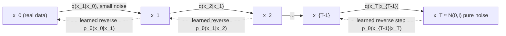
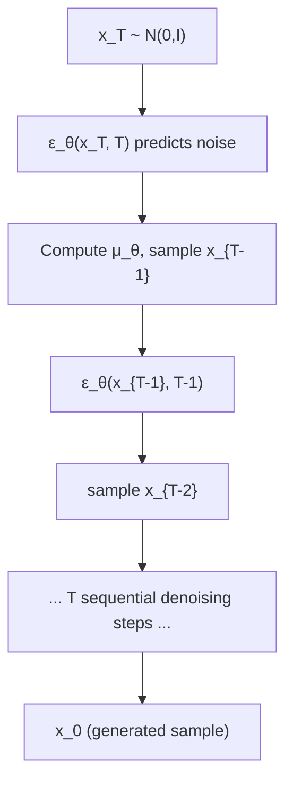

# **Diffusion Models**

VAEs (Ch. 001) give fast, single-pass sampling but characteristically blurry outputs; GANs (Ch. 002) give sharp samples but unstable, adversarial training prone to mode collapse. Diffusion models sidestep both problems with a strikingly simple idea: define a **fixed**, non-learned process that gradually destroys a data point into pure noise, then train a neural network to **reverse** that process one small step at a time. Training reduces to a stable, ordinary regression objective (no adversarial game, no min-max instability); the cost is that generation requires many sequential denoising steps rather than one forward pass — trading VAE/GAN's fast sampling for training stability and sample quality.

---

## **1. The Forward (Noising) Process**

### **1.1 Definition**

Fix a variance schedule $\beta_1,\dots,\beta_T \in (0,1)$ (small, increasing). Define a Markov chain that gradually adds Gaussian noise to a data point $x_0\sim q(x_0)$:

$$
q(x_t\mid x_{t-1}) = \mathcal N\big(x_t;\ \sqrt{1-\beta_t}\,x_{t-1},\ \beta_t I\big)
$$

Each step shrinks the signal slightly (multiplying by $\sqrt{1-\beta_t}<1$) and adds a small amount of independent noise. Critically, **this process has no learned parameters at all** — it is a fixed, hand-specified corruption schedule, unlike the VAE's learned encoder $q_\phi(z\mid x)$.

### **1.2 Closed-Form Sampling at Any Timestep — Derivation**

Naively, sampling $x_t$ requires simulating all $t$ intermediate noising steps. A closed form exists instead. Let $\alpha_t \triangleq 1-\beta_t$ and $\bar\alpha_t \triangleq \prod_{s=1}^t \alpha_s$. Using the reparameterization trick (VAE Ch. 001, §2.6) at each step, $x_t = \sqrt{\alpha_t}x_{t-1}+\sqrt{\beta_t}\,\epsilon_{t-1}$ with $\epsilon_{t-1}\sim\mathcal N(0,I)$. Substitute recursively:

$$
x_t = \sqrt{\alpha_t}\big(\sqrt{\alpha_{t-1}}x_{t-2}+\sqrt{1-\alpha_{t-1}}\,\epsilon_{t-2}\big) + \sqrt{1-\alpha_t}\,\epsilon_{t-1}
= \sqrt{\alpha_t\alpha_{t-1}}\,x_{t-2} + \underbrace{\sqrt{\alpha_t(1-\alpha_{t-1})}\,\epsilon_{t-2} + \sqrt{1-\alpha_t}\,\epsilon_{t-1}}_{\text{sum of two independent Gaussians}}
$$

Using the fact that a sum of two independent zero-mean Gaussians with variances $v_1,v_2$ is itself Gaussian with variance $v_1+v_2$, the combined noise term has variance $\alpha_t(1-\alpha_{t-1})+(1-\alpha_t) = 1-\alpha_t\alpha_{t-1}$, so it can be written as a single $\sqrt{1-\alpha_t\alpha_{t-1}}\,\bar\epsilon$ for a fresh $\bar\epsilon\sim\mathcal N(0,I)$. Repeating this collapsing step all the way down to $x_0$ gives, by induction:

$$
\boxed{q(x_t\mid x_0) = \mathcal N\big(x_t;\ \sqrt{\bar\alpha_t}\,x_0,\ (1-\bar\alpha_t)I\big)}
\qquad\Longleftrightarrow\qquad
x_t = \sqrt{\bar\alpha_t}\,x_0 + \sqrt{1-\bar\alpha_t}\,\epsilon,\quad \epsilon\sim\mathcal N(0,I)
$$

**This is the single most computationally important identity in diffusion models:** it lets training sample $x_t$ for **any** random $t$ directly from $x_0$ in one step, with no need to ever simulate the intermediate chain — essential for efficient, parallelizable training (§4). As $t\to T$ with a well-designed schedule, $\bar\alpha_T\to 0$, so $x_T \to \mathcal N(0,I)$ — pure noise, indistinguishable from the prior used for sampling.



---

## **2. The Reverse (Denoising) Process**

### **2.1 Why the Reverse Process Must Be Learned**

The true reverse conditional $q(x_{t-1}\mid x_t)$ (the Bayes-flip of the forward process) is intractable in general — computing it requires integrating over the entire data distribution $q(x_0)$, exactly analogous to the intractable true posterior in the VAE chapter (Ch. 001, §2.2). Diffusion models approximate it with a learned Gaussian:

$$
p_\theta(x_{t-1}\mid x_t) = \mathcal N\big(x_{t-1};\ \mu_\theta(x_t,t),\ \Sigma_\theta(x_t,t)\big)
$$

For sufficiently small $\beta_t$ (many steps, small per-step noise), the true reverse process is itself provably close to Gaussian (Sohl-Dickstein et al., 2015), which is what justifies restricting $p_\theta$ to the Gaussian family rather than needing a more flexible distribution.

### **2.2 Tractability of the Forward Posterior Given $x_0$**

Although $q(x_{t-1}\mid x_t)$ alone is intractable, $q(x_{t-1}\mid x_t,x_0)$ **is** tractable in closed form (Bayes' rule on three jointly Gaussian variables — the forward process is entirely linear-Gaussian):

$$
q(x_{t-1}\mid x_t,x_0) = \mathcal N\big(x_{t-1};\ \tilde\mu_t(x_t,x_0),\ \tilde\beta_tI\big)
$$

$$
\tilde\mu_t(x_t,x_0) = \frac{\sqrt{\alpha_t}(1-\bar\alpha_{t-1})}{1-\bar\alpha_t}x_t + \frac{\sqrt{\bar\alpha_{t-1}}\beta_t}{1-\bar\alpha_t}x_0, \qquad \tilde\beta_t = \frac{1-\bar\alpha_{t-1}}{1-\bar\alpha_t}\beta_t
$$

This closed form (given the otherwise-unknown $x_0$) is exactly what makes the ELBO in §3 tractable term-by-term: training compares the *learned* reverse step $p_\theta(x_{t-1}\mid x_t)$ against this *exact* forward-derived posterior, rather than against the intractable true $q(x_{t-1}\mid x_t)$.

---

## **3. Deriving the Training Objective — A Hierarchical VAE**

### **3.1 The ELBO, Generalized to $T$ Latent Steps**

A diffusion model is precisely a **hierarchical VAE** (Ch. 001, §9) with latents $x_1,\dots,x_T$, a fixed (non-learned) "encoder" $q$ (the forward process, §1), and a learned "decoder" $p_\theta$ (the reverse process, §2). Applying the identical ELBO derivation from the VAE chapter (Ch. 001, §2.3), but now with a chain of $T$ latents instead of one:

$$
\log p_\theta(x_0) \ge \mathbb E_q\left[\log\frac{p_\theta(x_{0:T})}{q(x_{1:T}\mid x_0)}\right] = \mathcal L_{\text{ELBO}}
$$

Expanding both the joint $p_\theta(x_{0:T}) = p(x_T)\prod_{t=1}^Tp_\theta(x_{t-1}\mid x_t)$ and $q(x_{1:T}\mid x_0)=\prod_{t=1}^Tq(x_t\mid x_{t-1})$, and rewriting each forward-process factor using Bayes' rule in terms of the tractable posterior from §2.2, the ELBO decomposes into a sum of KL divergences between two Gaussians at every step:

$$
\mathcal L_{\text{ELBO}} = \underbrace{\mathbb E_q\big[\log p_\theta(x_0\mid x_1)\big]}_{L_0:\text{ reconstruction}} - \sum_{t=2}^{T}\underbrace{D_{\mathrm{KL}}\big(q(x_{t-1}\mid x_t,x_0)\,\|\,p_\theta(x_{t-1}\mid x_t)\big)}_{L_{t-1}:\text{ denoising-step match}} - \underbrace{D_{\mathrm{KL}}\big(q(x_T\mid x_0)\,\|\,p(x_T)\big)}_{L_T:\text{ prior match, }\approx 0\text{ by schedule design}}
$$

Every term is a **closed-form KL divergence between two Gaussians** (identical computation to the VAE chapter's closed-form KL, Ch. 001, §2.5), because both $q(x_{t-1}\mid x_t,x_0)$ (§2.2) and $p_\theta(x_{t-1}\mid x_t)$ (§2.1) are Gaussian by construction — no sampling-based Monte Carlo estimate of the KL term is needed at any step.

### **3.2 Reparameterizing the Mean as Noise Prediction**

Since $\tilde\mu_t(x_t,x_0)$ (§2.2) is a known linear function of $x_t$ and $x_0$, and $x_0$ can itself be expressed in terms of $x_t$ and the noise $\epsilon$ used to generate it (inverting §1.2's identity, $x_0 = \frac{1}{\sqrt{\bar\alpha_t}}(x_t-\sqrt{1-\bar\alpha_t}\,\epsilon)$), substituting this back into $\tilde\mu_t$ yields (after algebra):

$$
\tilde\mu_t(x_t,x_0) = \frac{1}{\sqrt{\alpha_t}}\left(x_t - \frac{\beta_t}{\sqrt{1-\bar\alpha_t}}\epsilon\right)
$$

This says the target mean is fully determined by $x_t$ and **the specific noise $\epsilon$ that was added to create it** — so instead of training a network $\mu_\theta(x_t,t)$ to predict the mean directly, Ho et al. (2020, DDPM) reparameterize the network to predict the **noise** $\epsilon_\theta(x_t,t)$ that was added, and set

$$
\mu_\theta(x_t,t) = \frac{1}{\sqrt{\alpha_t}}\left(x_t - \frac{\beta_t}{\sqrt{1-\bar\alpha_t}}\epsilon_\theta(x_t,t)\right)
$$

Substituting this parameterization into the KL term $L_{t-1}$ (a KL between two Gaussians with the same variance $\tilde\beta_t$ differs only in mean, so it reduces to squared distance between the means) collapses the entire per-step loss into a simple noise-prediction squared error:

$$
L_{t-1} = \frac{\beta_t^2}{2\alpha_t(1-\bar\alpha_t)\Sigma_\theta}\,\big\|\epsilon - \epsilon_\theta(x_t,t)\big\|^2 + \text{const}
$$

### **3.3 The Simplified Training Objective ($L_{\text{simple}}$)**

Ho et al. found that **dropping the timestep-dependent weighting** in front of the squared-error term (i.e., just using unweighted MSE across all $t$) both simplifies implementation and empirically improves sample quality — likely because it implicitly reweights training toward harder, more perceptually-important timesteps rather than following the ELBO's exact weighting, which over-emphasizes very-low-noise steps:

$$
\boxed{L_{\text{simple}}(\theta) = \mathbb E_{t\sim\mathcal U(1,T),\,x_0,\,\epsilon\sim\mathcal N(0,I)}\left[\big\|\epsilon - \epsilon_\theta(\sqrt{\bar\alpha_t}x_0+\sqrt{1-\bar\alpha_t}\epsilon,\ t)\big\|^2\right]}
$$

This is now nothing more than an ordinary supervised regression: the network sees a noised image and the timestep, and must predict exactly which noise vector was added — a single, stable, non-adversarial loss with none of the GAN chapter's minimax instability and none of the VAE's need to explicitly balance reconstruction against a KL term (that balance has been absorbed entirely into the fixed noise schedule $\beta_t$, chosen ahead of time rather than learned).

---

## **4. Training and Sampling Algorithms**

### **4.1 Training (DDPM)**

1. Sample $x_0$ from the training data.
2. Sample $t\sim\mathcal U(1,T)$ uniformly at random.
3. Sample $\epsilon\sim\mathcal N(0,I)$.
4. Form the noised input directly via the closed form (§1.2): $x_t = \sqrt{\bar\alpha_t}x_0+\sqrt{1-\bar\alpha_t}\epsilon$ — **no sequential simulation needed**.
5. Compute $\|\epsilon-\epsilon_\theta(x_t,t)\|^2$ and take a gradient step.
6. Repeat.

Every training step touches only one randomly chosen $t$, and the closed-form shortcut in step 4 means training cost per step is **independent of $T$** — the choice of $T$ (often $1000$+) only affects sampling cost (§4.2), not training cost.

### **4.2 Sampling**

1. Sample $x_T \sim \mathcal N(0,I)$.
2. For $t=T,\dots,1$: sample $x_{t-1}\sim p_\theta(x_{t-1}\mid x_t)$ using $\mu_\theta(x_t,t)$ from §3.2 (plus a small amount of injected noise for $t>1$, matching the variance $\Sigma_\theta$; often fixed to $\tilde\beta_t$ or $\beta_t$ rather than learned).
3. Return $x_0$.



Sampling requires $T$ **sequential** neural-network evaluations — this is the direct structural cost of generation, in contrast to a VAE or GAN's single forward pass, and is the primary practical disadvantage of diffusion models (§7).

---

## **5. Worked Numeric Example**

Let $\beta_1=0.1,\ \beta_2=0.2$, so $\alpha_1=0.9,\ \alpha_2=0.8$, $\bar\alpha_1=0.9$, $\bar\alpha_2 = 0.9\times0.8=0.72$.

**Forward closed-form sample at $t=2$** for $x_0=2.0$, drawn noise $\epsilon=0.5$:

$$
x_2 = \sqrt{0.72}(2.0) + \sqrt{1-0.72}(0.5) = 0.8485(2.0)+0.5292(0.5) = 1.6971+0.2646 = 1.9617
$$

**Reverse posterior mean** $\tilde\mu_2(x_2,x_0)$, using the §2.2 formula with $\bar\alpha_1=0.9$:

$$
\tilde\mu_2 = \frac{\sqrt{0.8}(1-0.9)}{1-0.72}x_2 + \frac{\sqrt{0.9}(0.2)}{1-0.72}x_0 = \frac{0.8944(0.1)}{0.28}(1.9617) + \frac{0.9487(0.2)}{0.28}(2.0)
$$

$$
= 0.3194(1.9617) + 0.6776(2.0) = 0.6266+1.3552 = 1.9818
$$

$$
\tilde\beta_2 = \frac{1-0.9}{1-0.72}(0.2) = \frac{0.1}{0.28}(0.2) = 0.0714
$$

This is the exact target $q(x_1\mid x_2,x_0) = \mathcal N(1.9818, 0.0714)$ that the noise-prediction network $\epsilon_\theta$ is (indirectly, via §3.2's reparameterization) trained to reproduce at this specific $(x_2,x_0,\epsilon)$ combination — the training loss at this example reduces to comparing $\epsilon_\theta(x_2=1.9617,\ t=2)$ against the true injected noise $\epsilon=0.5$.

---

## **6. Python Implementation From Scratch (Toy 1D Diffusion)**

```python
import numpy as np


def make_schedule(T, beta_start=1e-4, beta_end=0.02):
    betas = np.linspace(beta_start, beta_end, T)
    alphas = 1.0 - betas
    alpha_bars = np.cumprod(alphas)
    return betas, alphas, alpha_bars


def forward_sample(x0, t, alpha_bars, rng):
    """Closed-form q(x_t | x_0), §1.2 — no sequential simulation needed."""
    eps = rng.normal(size=x0.shape)
    x_t = np.sqrt(alpha_bars[t]) * x0 + np.sqrt(1 - alpha_bars[t]) * eps
    return x_t, eps


class TinyDenoiser:
    """A minimal MLP predicting the noise eps_theta(x_t, t)."""

    def __init__(self, hidden=64, seed=0):
        rng = np.random.default_rng(seed)
        self.W1 = rng.normal(0, 0.1, size=(2, hidden))   # input: [x_t, t/T]
        self.b1 = np.zeros(hidden)
        self.W2 = rng.normal(0, 0.1, size=(hidden, 1))
        self.b2 = np.zeros(1)

    def forward(self, x_t, t_norm):
        inp = np.stack([x_t, np.full_like(x_t, t_norm)], axis=-1)
        h = np.maximum(inp @ self.W1 + self.b1, 0.0)
        return (h @ self.W2 + self.b2).squeeze(-1)


def training_step_loss(model, x0_batch, T, alpha_bars, rng):
    """One L_simple loss evaluation (§3.3) for a batch, forward pass only (no backprop shown here)."""
    t = rng.integers(0, T, size=x0_batch.shape[0])
    x_t, eps = forward_sample(x0_batch, t, alpha_bars, rng)
    eps_pred = model.forward(x_t, t / T)
    return np.mean((eps - eps_pred) ** 2)


def sample(model, T, betas, alphas, alpha_bars, n_samples, rng):
    """DDPM sampling loop, §4.2."""
    x = rng.normal(size=n_samples)
    for t in reversed(range(T)):
        eps_pred = model.forward(x, t / T)
        mu = (1 / np.sqrt(alphas[t])) * (x - (betas[t] / np.sqrt(1 - alpha_bars[t])) * eps_pred)
        if t > 0:
            noise = rng.normal(size=n_samples)
            x = mu + np.sqrt(betas[t]) * noise  # inject noise except at the final step
        else:
            x = mu
    return x


# Toy run
rng = np.random.default_rng(0)
T = 100
betas, alphas, alpha_bars = make_schedule(T)
x0_data = rng.normal(loc=3.0, scale=0.5, size=256)  # toy 1D "data distribution"

model = TinyDenoiser(seed=1)
loss = training_step_loss(model, x0_data, T, alpha_bars, rng)
print("Toy L_simple loss (untrained network):", loss)

generated = sample(model, T, betas, alphas, alpha_bars, n_samples=10, rng=rng)
print("Generated samples (untrained network, will look like noise):", generated)
```

This shows every mathematical piece — the closed-form forward jump (§1.2), the noise-prediction reparameterization of $\mu_\theta$ (§3.2), and the sequential sampling loop (§4.2) — end to end; a real training loop would backpropagate `training_step_loss` through `model.forward` (via autograd, shown next) rather than only evaluating it forward.

---

## **7. Equivalent Implementation With PyTorch**

```python
import torch
import torch.nn.functional as F
from torch import nn


class SimpleDenoiser(nn.Module):
    """Stand-in for a UNet: takes (x_t, t) and predicts eps."""

    def __init__(self, dim, hidden=256, time_embed_dim=32):
        super().__init__()
        self.time_embed = nn.Sequential(nn.Linear(1, time_embed_dim), nn.ReLU())
        self.net = nn.Sequential(
            nn.Linear(dim + time_embed_dim, hidden), nn.ReLU(),
            nn.Linear(hidden, hidden), nn.ReLU(),
            nn.Linear(hidden, dim),
        )

    def forward(self, x_t, t_norm):
        t_emb = self.time_embed(t_norm.unsqueeze(-1))
        return self.net(torch.cat([x_t, t_emb], dim=-1))


def make_ddpm_schedule(T, device):
    betas = torch.linspace(1e-4, 0.02, T, device=device)
    alphas = 1.0 - betas
    alpha_bars = torch.cumprod(alphas, dim=0)
    return betas, alphas, alpha_bars


def ddpm_loss(model, x0, betas, alphas, alpha_bars, T):
    batch = x0.shape[0]
    t = torch.randint(0, T, (batch,), device=x0.device)
    eps = torch.randn_like(x0)

    sqrt_ab = alpha_bars[t].sqrt().unsqueeze(-1)
    sqrt_1m_ab = (1 - alpha_bars[t]).sqrt().unsqueeze(-1)
    x_t = sqrt_ab * x0 + sqrt_1m_ab * eps          # closed-form forward jump, §1.2

    eps_pred = model(x_t, t.float() / T)
    return F.mse_loss(eps_pred, eps)                # L_simple, §3.3


@torch.no_grad()
def ddpm_sample(model, shape, betas, alphas, alpha_bars, T, device):
    x = torch.randn(shape, device=device)
    for t in reversed(range(T)):
        t_batch = torch.full((shape[0],), t, device=device, dtype=torch.float32)
        eps_pred = model(x, t_batch / T)
        mu = (1 / alphas[t].sqrt()) * (x - (betas[t] / (1 - alpha_bars[t]).sqrt()) * eps_pred)
        if t > 0:
            x = mu + betas[t].sqrt() * torch.randn_like(x)
        else:
            x = mu
    return x


dim, T = 2, 1000
device = "cpu"
model = SimpleDenoiser(dim=dim)
betas, alphas, alpha_bars = make_ddpm_schedule(T, device)
optimizer = torch.optim.Adam(model.parameters(), lr=2e-4)

x0_batch = torch.randn(128, dim)  # stand-in for real data
loss = ddpm_loss(model, x0_batch, betas, alphas, alpha_bars, T)
loss.backward()
optimizer.step()

samples = ddpm_sample(model, (16, dim), betas, alphas, alpha_bars, T, device)
```

**Internals worth knowing:**
- The time embedding (`time_embed`) is essential — the same network must behave very differently at $t\approx0$ (fine detail refinement, image is nearly clean) versus $t\approx T$ (recovering coarse structure from near-pure noise); real implementations (UNets, DDPM/Stable Diffusion) use sinusoidal position-style embeddings for $t$, analogous to the positional encodings in your Transformer chapter.
- `torch.randint(0, T, ...)` sampling a **different random $t$ per example in the batch** (not one fixed $t$ per batch) is standard and important — it ensures every gradient step sees a mix of noise levels, matching the $t\sim\mathcal U(1,T)$ expectation in $L_{\text{simple}}$ (§3.3).
- `ddpm_sample`'s `@torch.no_grad()` decorator reflects that sampling is pure inference — no gradients are needed, only $T$ sequential forward passes.

---

## **8. Complexity**

| Phase | Cost |
|---|---|
| Training, per step | one forward+backward pass through the denoiser network, **independent of $T$** (thanks to the closed-form forward jump, §1.2) |
| Sampling, per sample | $T$ **sequential** forward passes through the denoiser network — cannot be parallelized across $t$, since $x_{t-1}$ depends on $x_t$ |
| Space | one denoiser network's parameters (shared across all $t$, via the time-conditioning input) |

This $O(T)$ sequential sampling cost — often $T=1000$ in the original DDPM, though modern samplers (§9) reduce this to tens of steps — is the direct structural trade-off against VAE/GAN's $O(1)$ sampling, in exchange for training stability and typically superior sample fidelity/diversity.

---

## **9. Numerical Stability, Edge Cases, and Pitfalls**

- **Noise schedule choice matters substantially:** a linear $\beta_t$ schedule (as used above) was the original DDPM choice, but a **cosine schedule** (Nichol & Dhariwal, 2021) that adds noise more gradually near $t=0$ and $t=T$ was found to noticeably improve sample quality — the schedule is a real, non-trivial hyperparameter, not an arbitrary implementation detail.
- **Slow sampling is the primary practical limitation:** $T$ sequential network evaluations per sample makes vanilla DDPM sampling far slower than a GAN's single forward pass; **DDIM** (Song, Meng, Ermon, 2020) reformulates sampling as a non-Markovian, deterministic process that reuses the *same trained model* but allows skipping steps, reducing sampling to tens of steps with limited quality loss — a sampling-time-only change, requiring no retraining.
- **Variance choice in the reverse step ($\Sigma_\theta$):** DDPM originally fixed $\Sigma_\theta=\beta_tI$ or $\tilde\beta_tI$ (untrained, a design choice, §4.2) rather than learning it; later work (Nichol & Dhariwal, "Improved DDPM") found learning the variance alongside the mean further improves sample quality and enables lower-step sampling.
- **Conflating training cost with sampling cost:** it's easy to assume a $T=1000$-step diffusion model is $1000\times$ more expensive to train than a single-pass generator — in fact, training cost per step is $T$-independent (§8); only sampling pays the $O(T)$ price.
- **Mode coverage versus GANs:** the likelihood-based (ELBO) training objective in §3 tends to produce better mode coverage (less mode collapse, Ch. 002 §10) than adversarial GAN training, at the empirical cost of requiring far more sampling compute per generated example.
- **Classifier(-free) guidance for conditional generation:** to steer generation toward a class or text prompt, practical systems either train a separate classifier on noisy $x_t$ and use its gradient to nudge $\epsilon_\theta$'s prediction (classifier guidance), or train the same $\epsilon_\theta$ network on both conditional and unconditional objectives jointly and interpolate between the two at sampling time (classifier-free guidance, now the dominant approach) — omitting this and only training an unconditional model gives no direct mechanism for controllable generation.
- **High-dimensional data (images) needs a UNet, not an MLP:** the toy denoiser above works for illustrating the math on low-dimensional data; real image diffusion models use a UNet architecture (convolutional, with skip connections and often self-attention blocks) as $\epsilon_\theta$, since it must operate at the same spatial resolution as the image and preserve fine local detail while also reasoning globally.

---

## **10. Connections to Related ML Concepts**

- **VAEs (Ch. 001):** diffusion models are, precisely, hierarchical VAEs with a fixed (non-learned) multi-step Gaussian forward "encoder" and a learned multi-step reverse "decoder" — every derivation in §3 is a direct, mechanical generalization of the single-step VAE ELBO (Ch. 001, §2.3–2.5) to $T$ chained latents.
- **GANs (Ch. 002):** the two dominant modern deep generative paradigms, contrasted directly throughout this chapter — adversarial instability and mode collapse (GAN) versus stable likelihood-based training and slow iterative sampling (diffusion).
- **Score-based generative modeling / Langevin dynamics:** an equivalent formulation (Song & Ermon, 2019) trains a network to estimate the **score function** $\nabla_x\log p(x)$ directly (rather than predicting noise), and samples via Langevin-dynamics-style iterative updates; Ho et al. (2020) showed the DDPM noise-prediction objective is mathematically equivalent to a (weighted) score-matching objective, unifying the two derivations of essentially the same model class.
- **Markov chains (HMM chapter, Ch. 045):** both the forward and reverse diffusion processes are literally Markov chains over a continuous state space — the same Markov-property structure as HMMs, just with Gaussian transitions over continuous $x_t\in\mathbb R^d$ instead of transitions over a small discrete state set.
- **Autoregressive models:** a third major likelihood-based generative family (e.g., PixelRNN, GPT-style token-by-token generation) that factorizes $p(x)$ via the chain rule over individual dimensions/tokens rather than over noise levels — diffusion's $T$ sequential denoising steps and an autoregressive model's sequential token generation share the same core structural trade-off (sequential generation cost) for different reasons.

---

## **11. References for Deeper Reading**

- Jascha Sohl-Dickstein et al., "Deep Unsupervised Learning using Nonequilibrium Thermodynamics", ICML 2015 (the original diffusion probabilistic model formulation).
- Jonathan Ho, Ajay Jain, Pieter Abbeel, "Denoising Diffusion Probabilistic Models" (DDPM), NeurIPS 2020. https://arxiv.org/abs/2006.11239
- Jiaming Song, Chenlin Meng, Stefano Ermon, "Denoising Diffusion Implicit Models" (DDIM), ICLR 2021. https://arxiv.org/abs/2010.02502
- Alex Nichol and Prafulla Dhariwal, "Improved Denoising Diffusion Probabilistic Models", ICML 2021. https://arxiv.org/abs/2102.09672
- Yang Song and Stefano Ermon, "Generative Modeling by Estimating Gradients of the Data Distribution" (score-based models), NeurIPS 2019. https://arxiv.org/abs/1907.05600
- Jonathan Ho, Tim Salimans, "Classifier-Free Diffusion Guidance", NeurIPS Workshop 2021. https://arxiv.org/abs/2207.12598
- Robin Rombach et al., "High-Resolution Image Synthesis with Latent Diffusion Models" (Stable Diffusion), CVPR 2022. https://arxiv.org/abs/2112.10752
- Calvin Luo, "Understanding Diffusion Models: A Unified Perspective" (tutorial). https://arxiv.org/abs/2208.11970
