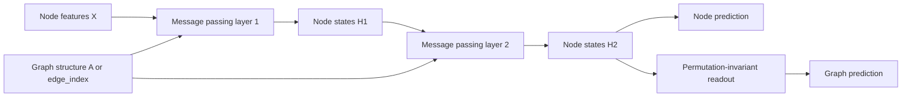
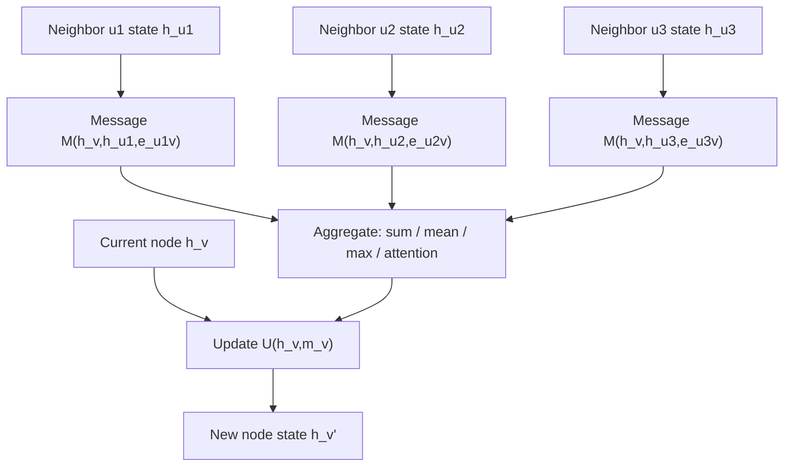
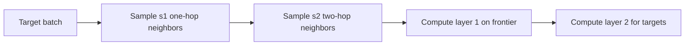
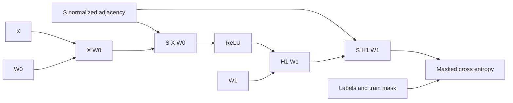

# Graph Neural Networks

Graph Neural Networks (GNNs) are neural architectures for functions whose inputs are graphs:

$$
G=(V,E),
\qquad
|V|=n,
\qquad
|E|=m.
$$

Each node $v\in V$ may have a feature vector $x_v\in\mathbb{R}^{F}$, each edge $(u,v)\in E$ may have an edge feature vector $e_{uv}\in\mathbb{R}^{P}$, and the graph itself may have global features $g\in\mathbb{R}^{Q}$. A GNN learns representations that depend on both attributes and connectivity:

$$
h_v^{(0)} = x_v,
\qquad
h_v^{(k)} = \operatorname{GNNLayer}^{(k)}\left(v,G,\{h_u^{(k-1)}\}_{u\in V}\right).
$$

The central constraint is symmetry. Node order in memory is arbitrary, so graph models must be permutation-equivariant for node-level outputs and permutation-invariant for graph-level outputs.



## 1. Graph Objects and Algebraic Representation

### 1.1 Basic Graph Types

A graph contains nodes and edges. Edges may be undirected, directed, weighted, typed, or attributed.

For an unweighted undirected graph:

$$
A_{ij}
=
\begin{cases}
1, & (i,j)\in E,\\
0, & \text{otherwise}.
\end{cases}
$$

For a weighted graph:

$$
A_{ij}=w_{ij}.
$$

For a directed graph, $A_{ij}$ conventionally means an edge from $i$ to $j$, although libraries differ in whether message passing uses incoming or outgoing edges by default. This convention must be checked in implementation.

### 1.2 Adjacency Matrix, Degree Matrix, and Laplacian

The adjacency matrix is $A\in\mathbb{R}^{n\times n}$. The degree of node $i$ in an undirected weighted graph is

$$
d_i=\sum_{j=1}^{n}A_{ij}.
$$

The degree matrix is diagonal:

$$
D=\operatorname{diag}(d_1,\ldots,d_n).
$$

The combinatorial graph Laplacian is

$$
L=D-A.
$$

The symmetric normalized Laplacian is

$$
L_{\mathrm{sym}}=I-D^{-1/2}AD^{-1/2}.
$$

The random-walk normalized Laplacian is

$$
L_{\mathrm{rw}}=I-D^{-1}A.
$$

The matrix $D^{-1}A$ averages neighbor values row-wise. The matrix $D^{-1/2}AD^{-1/2}$ is symmetric for undirected graphs and is the normalization used by the canonical GCN layer after adding self-loops.

### 1.3 Adjacency List and Sparse Edge Index

Real graphs are usually sparse: $m\ll n^2$. Dense adjacency matrices cost $O(n^2)$ memory, while edge lists cost $O(m)$ memory.

A common deep-learning representation is

$$
\texttt{edge\_index}\in\mathbb{N}^{2\times m},
$$

where each column stores one directed edge:

$$
\texttt{edge\_index}_{:,r} =
\begin{bmatrix}
\text{source}_r\\
\text{target}_r
\end{bmatrix}.
$$

Undirected graphs are typically stored as two directed edges:

$$
(u,v)\in E
\quad\Rightarrow\quad
u\rightarrow v
\text{ and }
v\rightarrow u.
$$

## 2. Prediction Tasks

### 2.1 Node-Level Prediction

For node classification, a GNN outputs logits

$$
Z\in\mathbb{R}^{n\times C},
$$

where $C$ is the number of classes. The supervised loss is usually evaluated only on labeled nodes:

$$
\mathcal{L}
=
-\sum_{i\in \mathcal{V}_{\mathrm{train}}}
\sum_{c=1}^{C}Y_{ic}\log \operatorname{softmax}(Z_i)_c.
$$

This is common in semi-supervised transductive settings: the full graph is visible during training, but labels are known for only part of it.

### 2.2 Edge-Level Prediction

For link prediction, compute node embeddings $h_u,h_v$ and a decoder score:

$$
s(u,v)=h_u^\top h_v
$$

or

$$
s(u,v)=\operatorname{MLP}([h_u,h_v,h_u\odot h_v,|h_u-h_v|]).
$$

For binary link existence:

$$
p((u,v)\in E\mid G)=\sigma(s(u,v)).
$$

Negative sampling is usually required because the set of non-edges has size $O(n^2-m)$.

### 2.3 Graph-Level Prediction

For graph classification or regression, node embeddings are pooled:

$$
h_G=\operatorname{READOUT}\left(\{h_v^{(K)}:v\in V\}\right).
$$

The readout must be permutation-invariant. Common choices:

$$
h_G=\sum_{v\in V}h_v,
\qquad
h_G=\frac{1}{n}\sum_{v\in V}h_v,
\qquad
h_G=\max_{v\in V}h_v.
$$

Sum pooling preserves graph size information; mean pooling normalizes it away; max pooling detects whether a feature appears anywhere.

## 3. Permutation Equivariance and Invariance

Let $P\in\{0,1\}^{n\times n}$ be a permutation matrix. Reordering nodes transforms features and adjacency as

$$
X' = PX,
\qquad
A' = PAP^\top.
$$

A node-level GNN layer $f$ should be permutation-equivariant:

$$
f(PX,PAP^\top)=P f(X,A).
$$

A graph-level readout $\rho$ should be permutation-invariant:

$$
\rho(PH)=\rho(H).
$$

This is why GNNs aggregate neighbor messages with symmetric operators such as sum, mean, max, or attention normalized over an unordered neighborhood.

### 3.1 Why a Fixed MLP on Flattened Adjacency Fails

If a model consumes $\operatorname{vec}(A)$ with fixed node order, then two isomorphic graphs with different node labels produce different inputs. The model must relearn the same structure under many permutations. Message passing avoids this by sharing functions across nodes and using permutation-invariant aggregation.

## 4. Message Passing Neural Networks

The Message Passing Neural Network (MPNN) abstraction defines each layer with a message function, aggregation function, and update function.

For node $v$ at layer $k$:

$$
m_v^{(k)}
=
\operatorname{AGG}^{(k)}
\left(
\left\{
M^{(k)}(h_v^{(k)},h_u^{(k)},e_{uv})
:u\in\mathcal{N}(v)
\right\}
\right),
$$

$$
h_v^{(k+1)}
=
U^{(k)}(h_v^{(k)},m_v^{(k)}).
$$

Terms:

- $h_v^{(k)}$ is the representation of node $v$ after $k$ layers.
- $\mathcal{N}(v)$ is the neighbor set whose messages are sent to $v$.
- $M^{(k)}$ is a learnable or fixed message function.
- $\operatorname{AGG}^{(k)}$ must be permutation-invariant over neighbors.
- $U^{(k)}$ updates the node state using its old representation and aggregated message.



### 4.1 Step-by-Step Execution

For one message passing layer:

1. Initialize node states with the current feature matrix $H^{(k)}$.
2. For every directed edge $u\rightarrow v$, compute a message $m_{u\rightarrow v}$.
3. Group messages by target node $v$.
4. Aggregate all messages arriving at $v$.
5. Combine the aggregate with $h_v^{(k)}$.
6. Apply a trainable transformation, nonlinearity, normalization, or residual connection.
7. Return $H^{(k+1)}$.

After $K$ layers, $h_v^{(K)}$ can depend only on nodes within the $K$-hop neighborhood of $v$, assuming no global attention or virtual node is used.

## 5. Graph Convolutional Network

The canonical Graph Convolutional Network (GCN) layer is

$$
H^{(k+1)}
=
\sigma\left(\hat{D}^{-1/2}\hat{A}\hat{D}^{-1/2}H^{(k)}W^{(k)}\right),
$$

where

$$
\hat{A}=A+I,
\qquad
\hat{D}_{ii}=\sum_{j=1}^{n}\hat{A}_{ij}.
$$

The self-loop $I$ lets each node retain and transform its own features. Without it, isolated nodes would receive no messages, and non-isolated nodes would discard their own state at every layer.

### 5.1 Node-Wise Form

For node $i$:

$$
h_i^{(k+1)}
=
\sigma
\left(
\sum_{j\in \mathcal{N}(i)\cup\{i\}}
\frac{1}{\sqrt{\hat{d}_i\hat{d}_j}}
h_j^{(k)}W^{(k)}
\right).
$$

The coefficient

$$
\frac{1}{\sqrt{\hat{d}_i\hat{d}_j}}
$$

prevents high-degree nodes from dominating and keeps the operator symmetric for undirected graphs.

### 5.2 Spectral Motivation

For an undirected graph, the normalized Laplacian has eigendecomposition

$$
L_{\mathrm{sym}}=U\Lambda U^\top,
$$

where $U$ contains orthonormal graph Fourier modes and $\Lambda$ contains nonnegative eigenvalues. A spectral graph convolution applies a filter $g_\theta$:

$$
g_\theta * x
=
Ug_\theta(\Lambda)U^\top x.
$$

This is expensive because eigendecomposition costs $O(n^3)$ in general and the filter is not localized unless constrained. Chebyshev polynomial filters approximate $g_\theta(\Lambda)$ by a polynomial in $L$:

$$
g_\theta * x
\approx
\sum_{r=0}^{R}\theta_r T_r(\tilde{L})x.
$$

With a first-order approximation $R=1$ and a parameter tying step, the operation can be simplified to a local propagation involving $I + D^{-1/2}AD^{-1/2}$. The "renormalization trick" replaces this unstable operator with

$$
\hat{D}^{-1/2}\hat{A}\hat{D}^{-1/2},
$$

which adds self-loops and normalizes degrees.

### 5.3 Intuition

GCN performs a normalized local average followed by a learned linear map. It is similar to low-pass smoothing on the graph: connected nodes are encouraged to have similar representations. This is useful under homophily, where linked nodes often share labels or semantic properties. It is weaker under heterophily, where linked nodes are systematically different.

### 5.4 Worked Example

Consider an undirected path graph with three nodes:

$$
1-2-3.
$$

Let scalar features be

$$
H^{(0)}
=
\begin{bmatrix}
1\\
2\\
4
\end{bmatrix},
\qquad
W=1,
\qquad
\sigma(x)=x.
$$

The adjacency and self-looped adjacency are

$$
A=
\begin{bmatrix}
0&1&0\\
1&0&1\\
0&1&0
\end{bmatrix},
\qquad
\hat{A}=A+I=
\begin{bmatrix}
1&1&0\\
1&1&1\\
0&1&1
\end{bmatrix}.
$$

Degrees:

$$
\hat{d}_1=2,
\qquad
\hat{d}_2=3,
\qquad
\hat{d}_3=2.
$$

The normalized coefficient from $j$ to $i$ is

$$
\hat{S}_{ij}=\frac{\hat{A}_{ij}}{\sqrt{\hat{d}_i\hat{d}_j}}.
$$

Thus

$$
\hat{S}
=
\begin{bmatrix}
\frac{1}{2} & \frac{1}{\sqrt{6}} & 0\\
\frac{1}{\sqrt{6}} & \frac{1}{3} & \frac{1}{\sqrt{6}}\\
0 & \frac{1}{\sqrt{6}} & \frac{1}{2}
\end{bmatrix}.
$$

Numerically,

$$
\hat{S}
\approx
\begin{bmatrix}
0.5000 & 0.4082 & 0\\
0.4082 & 0.3333 & 0.4082\\
0 & 0.4082 & 0.5000
\end{bmatrix}.
$$

The new node states are

$$
H^{(1)}=\hat{S}H^{(0)}
\approx
\begin{bmatrix}
0.5000(1)+0.4082(2)\\
0.4082(1)+0.3333(2)+0.4082(4)\\
0.4082(2)+0.5000(4)
\end{bmatrix}
=
\begin{bmatrix}
1.3164\\
2.7077\\
2.8164
\end{bmatrix}.
$$

Node $2$ receives information from both endpoints; nodes $1$ and $3$ mix their own values with node $2$.

## 6. GraphSAGE

GraphSAGE is designed for inductive learning: it learns aggregator functions that can generate embeddings for unseen nodes or newly sampled graphs, as long as features and local neighborhoods are available.

A common mean-aggregator layer is

$$
m_v^{(k)}
=
\frac{1}{|\mathcal{S}(v)|}
\sum_{u\in \mathcal{S}(v)}h_u^{(k)},
$$

$$
h_v^{(k+1)}
=
\sigma
\left(
W^{(k)}
\left[
h_v^{(k)}
\Vert
m_v^{(k)}
\right]
\right),
$$

where $\mathcal{S}(v)$ is either all neighbors or a sampled subset, and $\Vert$ denotes concatenation.

### 6.1 Neighbor Sampling

If every node has many neighbors, full-batch message passing can be too expensive. GraphSAGE samples a fixed fanout per layer. For a two-layer model with fanouts $s_1$ and $s_2$, computing embeddings for $b$ target nodes touches roughly

$$
O(b s_1 s_2)
$$

nodes in the worst case before deduplication.



Sampling reduces memory and computation but introduces estimator variance. The sampled aggregate

$$
\hat{m}_v=\frac{1}{s}\sum_{u\in\mathcal{S}(v)}h_u
$$

is an unbiased estimate of the full neighbor mean if sampling is uniform without replacement.

## 7. Graph Attention Network

Graph Attention Networks (GATs) learn different weights for different neighbors.

First transform node states:

$$
z_i=Wh_i.
$$

Compute unnormalized attention logits on edges:

$$
e_{ij}
=
\operatorname{LeakyReLU}
\left(
a^\top[z_i\Vert z_j]
\right),
\qquad
j\in\mathcal{N}(i)\cup\{i\}.
$$

Normalize over node $i$'s neighborhood:

$$
\alpha_{ij}
=
\frac{\exp(e_{ij})}
{\sum_{\ell\in\mathcal{N}(i)\cup\{i\}}\exp(e_{i\ell})}.
$$

Update:

$$
h_i'
=
\sigma
\left(
\sum_{j\in\mathcal{N}(i)\cup\{i\}}
\alpha_{ij}z_j
\right).
$$

With $R$ attention heads:

$$
h_i'
=
\Vert_{r=1}^{R}
\sigma
\left(
\sum_{j\in\mathcal{N}(i)\cup\{i\}}
\alpha_{ij}^{(r)}W^{(r)}h_j
\right)
$$

for hidden layers, or average heads for final logits.

### 7.1 Intuition

GCN uses degree-based fixed coefficients. GAT makes the coefficients input-dependent. This helps when some neighbors are more relevant than others, but it costs more memory and compute because attention logits must be materialized per edge and per head.

### 7.2 Stable Softmax Over Neighborhoods

For each target node $i$, compute

$$
\alpha_{ij}
=
\frac{\exp(e_{ij}-c_i)}
{\sum_{\ell}\exp(e_{i\ell}-c_i)},
\qquad
c_i=\max_{\ell\in\mathcal{N}(i)}e_{i\ell}.
$$

Subtracting $c_i$ does not change the softmax but prevents overflow.

## 8. Graph Isomorphism Network and Expressiveness

The Graph Isomorphism Network (GIN) was motivated by the expressiveness of the Weisfeiler-Lehman (WL) graph isomorphism test. Its layer is

$$
h_v^{(k+1)}
=
\operatorname{MLP}^{(k)}
\left(
(1+\epsilon^{(k)})h_v^{(k)}
+
\sum_{u\in\mathcal{N}(v)}h_u^{(k)}
\right).
$$

The sum aggregator is important. Mean aggregation cannot distinguish some multisets with different cardinalities:

$$
\operatorname{mean}\{1,3\}=2,
\qquad
\operatorname{mean}\{2,2\}=2.
$$

Sum aggregation can preserve multiset count information under suitable feature maps:

$$
\sum\{1,3\}=4,
\qquad
\sum\{2,2\}=4,
$$

but with learned nonlinear maps before summation, sum-based architectures can be injective over bounded multisets more broadly than mean or max.

Limit: standard message-passing GNNs are at most as expressive as the 1-WL test under typical assumptions. Graphs indistinguishable by 1-WL can remain indistinguishable to these GNNs unless extra positional, structural, higher-order, or subgraph features are added.

## 9. Training Objective and Backpropagation

For a two-layer GCN:

$$
H^{(1)}
=
\operatorname{ReLU}(\hat{S}XW^{(0)}),
\qquad
Z
=
\hat{S}H^{(1)}W^{(1)},
$$

where

$$
\hat{S}=\hat{D}^{-1/2}\hat{A}\hat{D}^{-1/2}.
$$

For node classification:

$$
P_{ic}
=
\frac{\exp(Z_{ic})}
{\sum_{r=1}^{C}\exp(Z_{ir})}.
$$

Cross-entropy over labeled nodes:

$$
\mathcal{L}
=
-\sum_{i\in \mathcal{V}_{\mathrm{train}}}
\sum_{c=1}^{C}
Y_{ic}\log P_{ic}.
$$

The gradient with respect to logits for labeled nodes is

$$
\frac{\partial\mathcal{L}}{\partial Z_{ic}}
=
P_{ic}-Y_{ic}.
$$

For unlabeled nodes not in the loss mask, this direct gradient is zero. However, their features may still affect labeled nodes through message passing if they are neighbors, so gradients can flow through their hidden representations into shared weights.

### 9.1 Computational Graph



## 10. Implementation From Scratch

### 10.1 NumPy GCN Forward Pass

```python
import numpy as np


def add_self_loops(A: np.ndarray) -> np.ndarray:
    """Return A + I for a dense square adjacency matrix."""
    if A.ndim != 2 or A.shape[0] != A.shape[1]:
        raise ValueError("A must be a square matrix")
    return A + np.eye(A.shape[0], dtype=A.dtype)


def normalize_adjacency(A: np.ndarray, eps: float = 1e-12) -> np.ndarray:
    """
    Compute D^{-1/2} A D^{-1/2}.

    eps prevents division by zero. If self-loops have already been added,
    isolated nodes have degree 1 rather than 0.
    """
    degree = A.sum(axis=1)
    inv_sqrt_degree = 1.0 / np.sqrt(np.maximum(degree, eps))
    return inv_sqrt_degree[:, None] * A * inv_sqrt_degree[None, :]


def relu(X: np.ndarray) -> np.ndarray:
    return np.maximum(X, 0.0)


def softmax_logits(Z: np.ndarray) -> np.ndarray:
    shifted = Z - Z.max(axis=1, keepdims=True)
    exp_Z = np.exp(shifted)
    return exp_Z / exp_Z.sum(axis=1, keepdims=True)


def gcn_forward(A: np.ndarray, X: np.ndarray, W0: np.ndarray, W1: np.ndarray) -> np.ndarray:
    """
    Two-layer dense GCN:
        H = ReLU(S X W0)
        Z = S H W1
    """
    A_hat = add_self_loops(A)
    S = normalize_adjacency(A_hat)
    H = relu(S @ X @ W0)
    Z = S @ H @ W1
    return Z


def masked_cross_entropy(logits: np.ndarray, labels: np.ndarray, mask: np.ndarray) -> float:
    """
    labels is an integer vector of shape [num_nodes].
    mask is a boolean vector selecting supervised nodes.
    """
    probs = softmax_logits(logits)
    selected = np.where(mask)[0]
    nll = -np.log(probs[selected, labels[selected]] + 1e-12)
    return float(nll.mean())


# Small example
A = np.array(
    [
        [0, 1, 0],
        [1, 0, 1],
        [0, 1, 0],
    ],
    dtype=np.float64,
)
X = np.array(
    [
        [1.0, 0.0],
        [0.0, 1.0],
        [1.0, 1.0],
    ]
)
W0 = np.array([[0.5, -0.2], [0.3, 0.8]])
W1 = np.array([[1.0, -1.0], [0.5, 0.25]])

logits = gcn_forward(A, X, W0, W1)
print(logits)
```

This implementation is useful pedagogically but not scalable because dense matrix multiplication with $A\in\mathbb{R}^{n\times n}$ costs $O(n^2)$ memory.

### 10.2 PyTorch Sparse GCN Layer From Scratch

```python
import torch
from torch import nn


def gcn_norm(edge_index: torch.Tensor, num_nodes: int, edge_weight: torch.Tensor | None = None):
    """
    Normalize edges for S = D^{-1/2} (A + I) D^{-1/2}.

    edge_index has shape [2, num_edges] with source row then target row.
    The returned weights correspond to messages source -> target.
    """
    device = edge_index.device
    if edge_weight is None:
        edge_weight = torch.ones(edge_index.size(1), device=device)

    loop = torch.arange(num_nodes, device=device)
    loop_index = torch.stack([loop, loop], dim=0)
    edge_index = torch.cat([edge_index, loop_index], dim=1)
    edge_weight = torch.cat([edge_weight, torch.ones(num_nodes, device=device)])

    src, dst = edge_index
    degree = torch.zeros(num_nodes, device=device).scatter_add_(0, dst, edge_weight)
    degree_inv_sqrt = degree.clamp(min=1).pow(-0.5)
    norm_weight = degree_inv_sqrt[src] * edge_weight * degree_inv_sqrt[dst]
    return edge_index, norm_weight


class ScratchGCNLayer(nn.Module):
    def __init__(self, in_channels: int, out_channels: int):
        super().__init__()
        self.linear = nn.Linear(in_channels, out_channels, bias=False)

    def forward(self, x: torch.Tensor, edge_index: torch.Tensor) -> torch.Tensor:
        num_nodes = x.size(0)
        edge_index, norm = gcn_norm(edge_index, num_nodes)
        src, dst = edge_index

        messages = self.linear(x[src]) * norm.unsqueeze(-1)
        out = torch.zeros(num_nodes, messages.size(-1), device=x.device, dtype=x.dtype)
        out.scatter_add_(0, dst.unsqueeze(-1).expand_as(messages), messages)
        return out


class ScratchGCN(nn.Module):
    def __init__(self, in_channels: int, hidden_channels: int, out_channels: int):
        super().__init__()
        self.conv1 = ScratchGCNLayer(in_channels, hidden_channels)
        self.conv2 = ScratchGCNLayer(hidden_channels, out_channels)

    def forward(self, x: torch.Tensor, edge_index: torch.Tensor) -> torch.Tensor:
        x = self.conv1(x, edge_index).relu()
        x = self.conv2(x, edge_index)
        return x
```

Important detail: `scatter_add_` implements aggregation by summing messages with the same destination node. This is the sparse equivalent of multiplying by a normalized adjacency matrix.

### 10.3 PyTorch Geometric Equivalent

```python
import torch
import torch.nn.functional as F
from torch import nn
from torch_geometric.nn import GCNConv


class PyGGCN(nn.Module):
    def __init__(self, in_channels: int, hidden_channels: int, out_channels: int):
        super().__init__()
        self.conv1 = GCNConv(in_channels, hidden_channels)
        self.conv2 = GCNConv(hidden_channels, out_channels)

    def forward(self, data):
        x, edge_index = data.x, data.edge_index
        x = self.conv1(x, edge_index)
        x = F.relu(x)
        x = F.dropout(x, p=0.5, training=self.training)
        x = self.conv2(x, edge_index)
        return x
```

Internally, `GCNConv` computes a variant of

$$
X'=\hat{D}^{-1/2}\hat{A}\hat{D}^{-1/2}X\Theta,
$$

adds self-loops by default for the usual normalization path, computes per-edge normalization coefficients from degrees, sends transformed source-node features along edges, and aggregates them at target nodes using a sparse scatter operation.

### 10.4 DGL Equivalent

```python
import torch.nn.functional as F
from torch import nn
from dgl.nn import GraphConv


class DGLGCN(nn.Module):
    def __init__(self, in_channels: int, hidden_channels: int, out_channels: int):
        super().__init__()
        self.conv1 = GraphConv(in_channels, hidden_channels, activation=F.relu)
        self.conv2 = GraphConv(hidden_channels, out_channels)

    def forward(self, graph, features):
        h = self.conv1(graph, features)
        h = self.conv2(graph, h)
        return h
```

DGL's `GraphConv` also implements normalized neighborhood aggregation. Its graph object stores sparse connectivity and dispatches message and reduce functions efficiently over edges.

### 10.5 NetworkX for Preprocessing

```python
import networkx as nx
import numpy as np


G = nx.Graph()
G.add_edges_from([(0, 1), (1, 2), (2, 3), (0, 3)])

A = nx.to_numpy_array(G, nodelist=sorted(G.nodes()), dtype=np.float32)
degrees = dict(G.degree())
components = list(nx.connected_components(G))

print(A)
print(degrees)
print(components)
```

NetworkX is convenient for graph construction and classical algorithms, but it is not designed for high-throughput neural message passing. For large-scale training, use sparse tensors, PyTorch Geometric, DGL, or specialized graph sampling systems.

## 11. Edge Features and Directed Graphs

For edge-attributed graphs, messages should depend on $e_{uv}$:

$$
m_{u\rightarrow v}
=
M_\theta(h_u,h_v,e_{uv}).
$$

Examples:

$$
m_{u\rightarrow v}
=
\phi_\theta([h_u\Vert e_{uv}]),
$$

or an edge-conditioned linear map:

$$
m_{u\rightarrow v}
=
W_\theta(e_{uv})h_u.
$$

For directed graphs, distinguish incoming and outgoing neighborhoods:

$$
\mathcal{N}_{\mathrm{in}}(v)=\{u:(u,v)\in E\},
\qquad
\mathcal{N}_{\mathrm{out}}(v)=\{u:(v,u)\in E\}.
$$

A direction-aware update can use separate parameters:

$$
h_v'
=
\sigma
\left(
W_{\mathrm{self}}h_v
+
\sum_{u\in\mathcal{N}_{\mathrm{in}}(v)}W_{\mathrm{in}}h_u
+
\sum_{u\in\mathcal{N}_{\mathrm{out}}(v)}W_{\mathrm{out}}h_u
\right).
$$

This is essential in citation, transaction, dependency, and knowledge graphs, where edge direction changes semantics.

## 12. Heterogeneous and Bipartite Graphs

A heterogeneous graph has node types and edge types:

$$
\tau_V(v)\in\mathcal{T}_V,
\qquad
\tau_E(u,v)\in\mathcal{T}_E.
$$

A relation-specific message passing layer can be written as

$$
h_v'
=
\sigma
\left(
W_0h_v
+
\sum_{r\in\mathcal{T}_E}
\sum_{u\in\mathcal{N}_r(v)}
\frac{1}{c_{v,r}}W_r h_u
\right).
$$

This is the basis of relational GCN-style models. For bipartite recommendation graphs, users and items have different feature spaces, so source and target transformations often differ:

$$
m_{u\rightarrow i}=W_{\mathrm{user}}x_u,
\qquad
m_{i\rightarrow u}=W_{\mathrm{item}}x_i.
$$

## 13. Complexity

For one dense GCN layer:

$$
H'=\hat{S}HW,
$$

with $H\in\mathbb{R}^{n\times F}$ and $W\in\mathbb{R}^{F\times F'}$:

- Dense propagation $\hat{S}H$ costs $O(n^2F)$.
- Feature transform $HW$ costs $O(nFF')$.
- Memory for $\hat{S}$ costs $O(n^2)$.

For sparse message passing:

- Per-edge propagation costs $O(mF')$ after transformation.
- Feature transform costs $O(nFF')$.
- Edge index and weights cost $O(m)$ memory.
- Activations cost $O(nF')$ per layer and must often be retained for backpropagation.

For multi-head GAT with $R$ heads and output per head $F'$:

$$
O(nFR + mRF')
$$

up to constants, plus memory for attention logits and coefficients:

$$
O(mR).
$$

Neighbor sampling changes per-batch cost from full-graph $O(m)$ to roughly the number of sampled edges in the computation block.

## 14. Numerical Stability and Implementation Pitfalls

### 14.1 Zero-Degree Nodes

Without self-loops, isolated nodes have degree zero:

$$
d_i=0
\quad\Rightarrow\quad
d_i^{-1/2}
\text{ is undefined}.
$$

Add self-loops or clamp degrees:

$$
d_i \leftarrow \max(d_i,\epsilon).
$$

Self-loops are usually preferable because they also preserve node information.

### 14.2 Oversmoothing

Repeated multiplication by a normalized adjacency operator makes node representations increasingly similar within connected components. In the linearized case:

$$
H^{(K)}=\hat{S}^KXW_{\mathrm{eff}}.
$$

As $K$ grows, $\hat{S}^K$ suppresses high-frequency graph components, causing embeddings to converge toward a low-dimensional subspace. Mitigations include residual connections, normalization, jumping knowledge, personalized propagation, shallow architectures, and decoupled propagation.

### 14.3 Oversquashing

A $K$-layer GNN compresses information from an exponentially growing $K$-hop neighborhood into a fixed-size vector:

$$
h_v^{(K)}\in\mathbb{R}^{F_K}.
$$

Long-range dependencies can be lost because too many signals are squeezed through small graph separators. Rewiring, positional encodings, attention, virtual nodes, and hierarchical pooling can help.

### 14.4 Self-Loop Duplication

Libraries may add self-loops automatically. If the input graph already contains self-loops, adding them again changes degrees and message weights. Check default arguments such as `add_self_loops`.

### 14.5 Edge Direction Convention

If `edge_index[0]` is source and `edge_index[1]` is target, aggregation should scatter messages into the target. Reversing this silently changes the model from incoming-neighbor aggregation to outgoing-neighbor aggregation.

### 14.6 Train, Validation, and Test Leakage

In transductive node classification, the full graph may be visible, but only training labels should contribute to the loss. In inductive evaluation, validation and test nodes or graphs may need to be removed from the training graph entirely. The correct split depends on the problem definition.

### 14.7 Feature Leakage Through Graph Construction

If edges are constructed using labels or future information, message passing can leak target information. Examples include temporal fraud graphs where future transactions are included when predicting past fraud labels.

### 14.8 Normalization with Weighted Edges

For weighted graphs:

$$
\hat{d}_i=\sum_j\hat{A}_{ij}.
$$

Negative edge weights can make degree normalization invalid or semantically ambiguous. If signed edges matter, use a model designed for signed graphs or split positive and negative relations.

## 15. Limitations

Standard message-passing GNNs have several structural limitations:

- They are local: $K$ layers see at most $K$ hops.
- They can oversmooth with depth.
- They can oversquash long-range information.
- They are limited by 1-WL expressiveness in distinguishing graph structures.
- They often assume homophily.
- They can be sensitive to graph noise, missing edges, and adversarial edge perturbations.
- Full-batch training is difficult on web-scale graphs.
- Dynamic graphs require temporal modeling rather than static aggregation alone.

## 16. Connections to Related Concepts

### 16.1 CNNs

CNNs aggregate over fixed grid neighborhoods with shared kernels. GNNs aggregate over irregular graph neighborhoods with shared message functions. A grid image can be viewed as a graph where pixels are nodes and local pixel adjacencies are edges.

### 16.2 Transformers

Self-attention can be viewed as message passing over a complete graph:

$$
\mathcal{N}(i)=V.
$$

Graph attention restricts attention to edges:

$$
\mathcal{N}(i)=\{j:(j,i)\in E\}.
$$

Graph Transformers combine structural bias from graphs with global attention or learned positional encodings.

### 16.3 Label Propagation

GCN propagation resembles differentiable, feature-aware label propagation. Label propagation spreads labels directly; GCN spreads hidden features and learns transformations with supervised loss.

### 16.4 Matrix Factorization and Node Embeddings

Methods such as DeepWalk, node2vec, and matrix factorization learn static node embeddings. GNNs learn functions of features and neighborhoods, which enables inductive generalization when node features are available.

### 16.5 Probabilistic Graphical Models

Both GNNs and graphical models pass local information along edges. Belief propagation sends probabilistic messages derived from factorization assumptions. GNN message passing sends learned vector messages optimized end-to-end for predictive tasks.

## 17. End-to-End Worked Training Skeleton

```python
import torch
import torch.nn.functional as F


def train_node_classifier(model, data, optimizer):
    """
    data.x: node features [num_nodes, num_features]
    data.edge_index: sparse edges [2, num_edges]
    data.y: integer labels [num_nodes]
    data.train_mask: boolean mask [num_nodes]
    """
    model.train()
    optimizer.zero_grad()

    logits = model(data)
    loss = F.cross_entropy(logits[data.train_mask], data.y[data.train_mask])

    loss.backward()
    optimizer.step()
    return float(loss.detach())


@torch.no_grad()
def evaluate_node_classifier(model, data, mask_name: str = "val_mask"):
    model.eval()
    logits = model(data)
    pred = logits.argmax(dim=-1)
    mask = getattr(data, mask_name)
    acc = (pred[mask] == data.y[mask]).float().mean()
    return float(acc)
```

Internally, automatic differentiation stores enough intermediate tensors to compute vector-Jacobian products through matrix multiplications, nonlinearities, scatter aggregations, and loss operations. Scatter aggregation is differentiable with respect to message values, but not with respect to discrete edge indices.

## 18. Practical Checklist

- Add self-loops when using GCN-style normalization unless the library already does it.
- Use sparse representations for nontrivial graphs.
- Verify edge direction with a tiny graph before training.
- Keep train/validation/test masks explicit.
- Normalize or standardize input features when their scales differ strongly.
- Watch for high-degree hubs dominating memory and computation.
- Use neighbor sampling or graph clustering for large graphs.
- Prefer residual connections and normalization for deeper models.
- Match architecture to graph assumptions: GCN for homophily, GAT for variable neighbor importance, GraphSAGE for inductive sampled learning, GIN for graph classification expressiveness.

## 19. References and Deeper Reading

- Thomas N. Kipf and Max Welling, "Semi-Supervised Classification with Graph Convolutional Networks", ICLR 2017. https://arxiv.org/abs/1609.02907
- Justin Gilmer, Samuel S. Schoenholz, Patrick F. Riley, Oriol Vinyals, and George E. Dahl, "Neural Message Passing for Quantum Chemistry", ICML 2017. https://proceedings.mlr.press/v70/gilmer17a.html
- William L. Hamilton, Rex Ying, and Jure Leskovec, "Inductive Representation Learning on Large Graphs", NeurIPS 2017. https://arxiv.org/abs/1706.02216
- Petar Velickovic, Guillem Cucurull, Arantxa Casanova, Adriana Romero, Pietro Lio, and Yoshua Bengio, "Graph Attention Networks", ICLR 2018. https://arxiv.org/abs/1710.10903
- Keyulu Xu, Weihua Hu, Jure Leskovec, and Stefanie Jegelka, "How Powerful are Graph Neural Networks?", ICLR 2019. https://arxiv.org/abs/1810.00826
- PyTorch Geometric `GCNConv` documentation. https://pytorch-geometric.readthedocs.io/en/latest/generated/torch_geometric.nn.conv.GCNConv.html
- DGL `GraphConv` documentation. https://www.dgl.ai/dgl_docs/generated/dgl.nn.pytorch.conv.GraphConv.html
- NetworkX adjacency matrix documentation. https://networkx.org/documentation/stable/reference/generated/networkx.linalg.graphmatrix.adjacency_matrix.html
