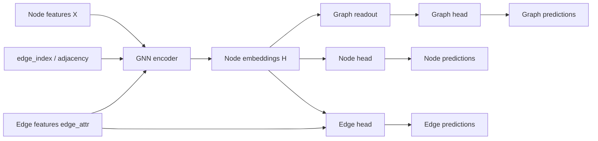
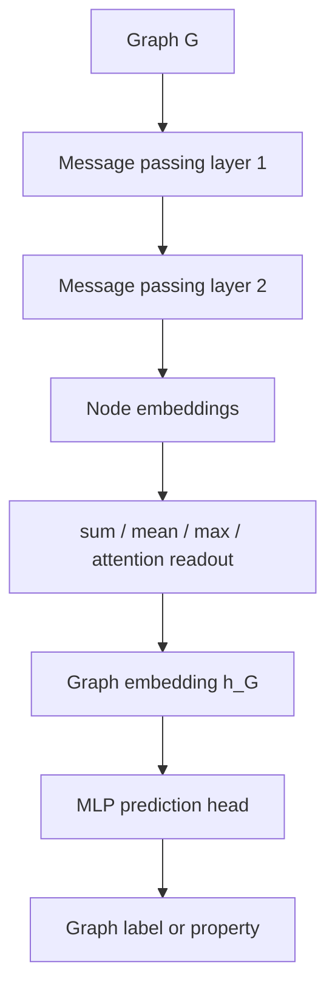
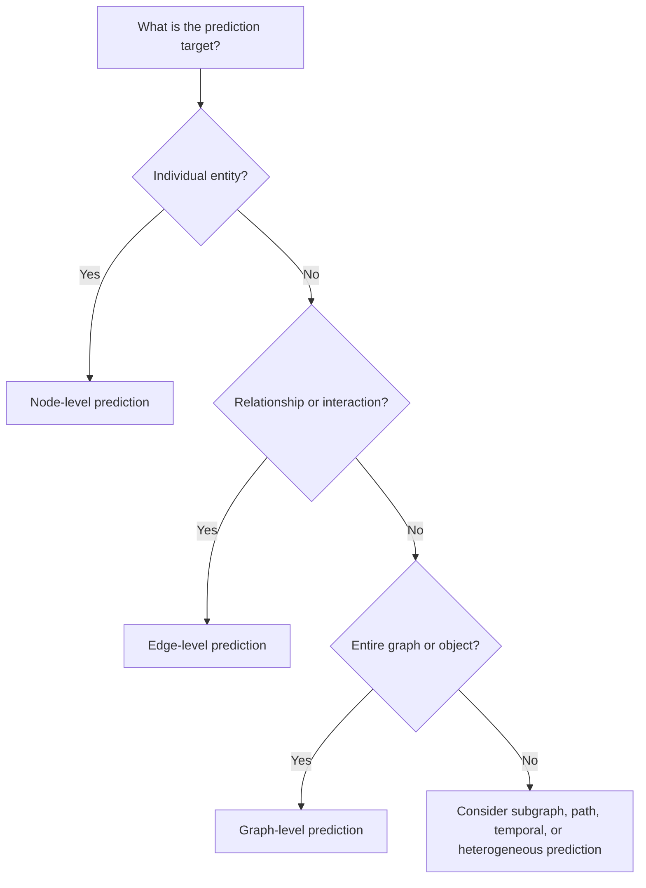

# **Node-Level, Edge-Level, and Graph-Level Features and Predictions in GNNs**

Graph neural networks learn representations at three coupled resolutions:

1. **Node level:** one embedding and prediction per node.
2. **Edge or link level:** one embedding and prediction per observed or candidate edge.
3. **Graph level:** one embedding and prediction for an entire graph.

The same message-passing backbone can serve all three tasks. What changes is the **readout head**: a node head reads node embeddings, an edge head reads endpoint and edge embeddings, and a graph head pools node/edge information into a permutation-invariant graph representation.

---

## **1. Formal Setup**

Let a graph be

$$
G = (V, E)
$$

where $V = \{1,\dots,n\}$ is the node set and $E \subseteq V \times V$ is the edge set. For an undirected graph, $(u,v) \in E$ implies $(v,u) \in E$ if we store edges as directed message-passing arcs.

Node features are collected in

$$
X \in \mathbb{R}^{n \times d_x}
$$

where row $x_v \in \mathbb{R}^{d_x}$ is the feature vector of node $v$.

Edge features are collected as

$$
e_{uv} \in \mathbb{R}^{d_e}
$$

for each edge $(u,v) \in E$. In implementation, these are usually stored in an array

$$
E_{\text{attr}} \in \mathbb{R}^{m \times d_e}
$$

where $m = |E|$ is the number of stored edge records.

The adjacency matrix is

$$
A_{uv}
=
\begin{cases}
1, & (u,v) \in E, \\
0, & \text{otherwise}.
\end{cases}
$$

For weighted graphs, $A_{uv}$ may store a nonnegative edge weight instead of a binary indicator.

---

## **2. What Changes Across Node, Edge, and Graph Tasks?**

The encoder produces node embeddings

$$
H^{(L)} = [h_1^{(L)}, \dots, h_n^{(L)}]^\top \in \mathbb{R}^{n \times d_h}
$$

after $L$ message-passing layers. Then a task-specific head maps these embeddings to predictions.

| Task Level | Input to Prediction Head | Output Shape | Example |
|---|---:|---:|---|
| Node | $h_v^{(L)}$ | one output per node | paper topic, fraud label |
| Edge | $h_u^{(L)}, h_v^{(L)}, e_{uv}$ | one output per edge or candidate edge | link probability, transaction type |
| Graph | $\operatorname{READOUT}(\{h_v^{(L)}\}_{v \in V})$ | one output per graph | molecular property, graph class |

The encoder is usually shared:

$$
H^{(L)} = \operatorname{GNN}_\theta(G, X, E_{\text{attr}})
$$

The prediction head determines the target granularity:

$$
\hat{y}_v = f_{\text{node}}(h_v^{(L)})
$$

$$
\hat{y}_{uv} = f_{\text{edge}}(h_u^{(L)}, h_v^{(L)}, e_{uv})
$$

$$
\hat{y}_G = f_{\text{graph}}\left(\operatorname{READOUT}\left(\{h_v^{(L)} : v \in V\}\right)\right)
$$

---

## **3. Message Passing Backbone**

Most modern GNNs can be written as message passing:

$$
m_{u \to v}^{(k)}
=
\phi^{(k)}
\left(
h_u^{(k)},
h_v^{(k)},
e_{uv}
\right)
$$

$$
a_v^{(k)}
=
\operatorname{AGG}^{(k)}
\left(
\{m_{u \to v}^{(k)} : u \in \mathcal{N}(v)\}
\right)
$$

$$
h_v^{(k+1)}
=
\psi^{(k)}
\left(
h_v^{(k)},
a_v^{(k)}
\right)
$$

where:

- $h_v^{(k)}$ is the embedding of node $v$ at layer $k$.
- $\mathcal{N}(v)$ is the incoming neighborhood of $v$.
- $\phi^{(k)}$ is a learnable message function.
- $\operatorname{AGG}^{(k)}$ is a permutation-invariant aggregation function such as sum, mean, max, or attention-weighted sum.
- $\psi^{(k)}$ is a learnable update function.

The initial embedding is usually

$$
h_v^{(0)} = x_v
$$

or

$$
h_v^{(0)} = W_{\text{in}} x_v
$$

when a learned projection is needed.

### **Execution Diagram**



### **Permutation Equivariance and Invariance**

Graphs do not have a canonical node order. If $P$ is a permutation matrix that reorders nodes, then a node-level GNN encoder should satisfy

$$
\operatorname{GNN}(PAP^\top, PX) = P \operatorname{GNN}(A, X)
$$

This is **permutation equivariance**: permuting the input nodes permutes the output node embeddings in the same way.

Graph-level predictions should be invariant:

$$
f_{\text{graph}}(PAP^\top, PX) = f_{\text{graph}}(A, X)
$$

This is why graph-level models use symmetric readout functions:

$$
\operatorname{sum}, \quad \operatorname{mean}, \quad \operatorname{max}, \quad \operatorname{attention\ pooling}
$$

The key assumption is that node identities are arbitrary unless the problem explicitly supplies identity, positional, or structural encodings.

---

## **4. Node-Level Features and Predictions**

Node features describe individual entities:

- Social network: age, account age, location embedding, interests.
- Banking graph: balance, number of transactions, account type, device count.
- Molecular graph: atomic number, formal charge, aromaticity, hybridization.
- Citation graph: bag-of-words, transformer embedding, publication year.

The node prediction target is one label or value per node:

$$
y_v \in \mathcal{Y}
$$

For classification with $C$ classes:

$$
y_v \in \{1,\dots,C\}
$$

For regression:

$$
y_v \in \mathbb{R}^{d_y}
$$

### **Node Prediction Head**

Given final node embedding $h_v^{(L)}$, a linear classifier computes logits:

$$
z_v = W_{\text{node}} h_v^{(L)} + b_{\text{node}}
$$

where

$$
W_{\text{node}} \in \mathbb{R}^{C \times d_h},
\quad
b_{\text{node}} \in \mathbb{R}^{C}
$$

The predicted class probabilities are

$$
p(y_v = c \mid G, X)
=
\frac{\exp(z_{vc})}{\sum_{j=1}^{C} \exp(z_{vj})}
$$

For semi-supervised node classification, labels may only be available for a subset

$$
\mathcal{V}_{\text{train}} \subset V
$$

The cross-entropy loss is computed only on labeled training nodes:

$$
\mathcal{L}_{\text{node}}
=
-\sum_{v \in \mathcal{V}_{\text{train}}}
\sum_{c=1}^{C}
\mathbb{1}[y_v = c]
\log p(y_v = c \mid G, X)
$$

The graph can include unlabeled validation/test nodes during message passing in transductive settings. The model does not use their labels, but it may use their features and edges.

### **GCN Layer From First Principles**

A simple neighborhood mean update is

$$
h_v^{(k+1)}
=
\sigma
\left(
W^{(k)}
\left(
h_v^{(k)}
+
\frac{1}{|\mathcal{N}(v)|}
\sum_{u \in \mathcal{N}(v)}
h_u^{(k)}
\right)
\right)
$$

This treats the node's own state and the neighbor average separately only through addition. A common GCN variant adds self-loops and averages all nodes in the closed neighborhood:

$$
\tilde{A} = A + I
$$

$$
\tilde{D}_{vv} = \sum_{u=1}^{n} \tilde{A}_{vu}
$$

The row-normalized update is

$$
H^{(k+1)}
=
\sigma
\left(
\tilde{D}^{-1}
\tilde{A}
H^{(k)}
W^{(k)}
\right)
$$

However, for undirected graphs this normalization is not symmetric and can scale features differently for high-degree and low-degree nodes. The common GCN normalization uses

$$
S
=
\tilde{D}^{-\frac{1}{2}}
\tilde{A}
\tilde{D}^{-\frac{1}{2}}
$$

and the layer becomes

$$
H^{(k+1)}
=
\sigma
\left(
S H^{(k)} W^{(k)}
\right)
$$

For one node $v$, this is

$$
h_v^{(k+1)}
=
\sigma
\left(
\sum_{u \in \mathcal{N}(v) \cup \{v\}}
\frac{1}{\sqrt{\tilde{d}_v \tilde{d}_u}}
h_u^{(k)}
W^{(k)}
\right)
$$

where $\tilde{d}_v$ is the degree after adding self-loops.

#### **Intuition**

The factor

$$
\frac{1}{\sqrt{\tilde{d}_v \tilde{d}_u}}
$$

downweights messages involving high-degree nodes. Without normalization, high-degree nodes can produce embeddings with larger magnitude simply because they receive more messages. With symmetric normalization, the layer behaves like a stable smoothing operator over the graph.

### **Worked Node-Level Example**

Consider a path graph with three nodes:

$$
1 - 2 - 3
$$

Use scalar features:

$$
H^{(0)}
=
\begin{bmatrix}
1 \\
2 \\
4
\end{bmatrix}
$$

The adjacency matrix is

$$
A
=
\begin{bmatrix}
0 & 1 & 0 \\
1 & 0 & 1 \\
0 & 1 & 0
\end{bmatrix}
$$

Add self-loops:

$$
\tilde{A}
=
\begin{bmatrix}
1 & 1 & 0 \\
1 & 1 & 1 \\
0 & 1 & 1
\end{bmatrix}
$$

The degrees are

$$
\tilde{d}_1 = 2,
\quad
\tilde{d}_2 = 3,
\quad
\tilde{d}_3 = 2
$$

For node $2$, the normalized pre-activation with $W=1$ is

$$
z_2
=
\frac{1}{\sqrt{3 \cdot 2}} h_1
+
\frac{1}{\sqrt{3 \cdot 3}} h_2
+
\frac{1}{\sqrt{3 \cdot 2}} h_3
$$

Substitute values:

$$
z_2
=
\frac{1}{\sqrt{6}} \cdot 1
+
\frac{1}{3} \cdot 2
+
\frac{1}{\sqrt{6}} \cdot 4
$$

$$
z_2
\approx
0.4082 + 0.6667 + 1.6330
=
2.7079
$$

If $\sigma$ is ReLU, then

$$
h_2^{(1)} = 2.7079
$$

Node $2$ has mixed its own feature with both neighbors, while preserving degree-aware scaling.

---

## **5. Edge-Level Features and Predictions**

Edges describe relationships or interactions:

- Social graph: friendship duration, interaction count, relationship type.
- Transaction graph: amount, currency, timestamp, merchant category.
- Road network: distance, speed limit, travel time, congestion.
- Molecular graph: bond type, conjugation, ring membership, bond length.

Edge-level tasks include:

- **Link prediction:** does an edge exist?
- **Edge classification:** what type is this edge?
- **Edge regression:** what value is associated with this edge?
- **Edge anomaly detection:** is this interaction suspicious?

### **Observed Edges Versus Candidate Edges**

There are two distinct edge prediction regimes.

In **edge property prediction**, the edge already exists:

$$
(u,v) \in E
$$

The model predicts an attribute:

$$
\hat{y}_{uv} = f_{\text{edge}}(h_u, h_v, e_{uv})
$$

In **link prediction**, the edge may not exist:

$$
(u,v) \in V \times V
$$

The model predicts existence:

$$
\hat{p}_{uv}
=
p(A_{uv}=1 \mid G, X)
$$

The candidate set is often much larger than the observed edge set, because there are $O(n^2)$ possible node pairs.

### **Edge Embedding Construction**

A common edge embedding is formed by combining endpoint embeddings and edge attributes:

$$
g_{uv}
=
\rho
\left(
h_u,
h_v,
e_{uv}
\right)
$$

Typical choices are:

$$
g_{uv}
=
[h_u \Vert h_v \Vert e_{uv}]
$$

$$
g_{uv}
=
[h_u \Vert h_v \Vert |h_u - h_v| \Vert h_u \odot h_v \Vert e_{uv}]
$$

$$
g_{uv}
=
h_u^\top R h_v
$$

where $\Vert$ denotes concatenation, $\odot$ denotes elementwise multiplication, and $R$ is a learned bilinear relation matrix.

For undirected graphs, the edge decoder should be symmetric:

$$
f_{\text{edge}}(h_u,h_v) = f_{\text{edge}}(h_v,h_u)
$$

Dot-product and absolute-difference decoders are symmetric:

$$
s_{uv} = h_u^\top h_v
$$

$$
s_{uv} = w^\top |h_u - h_v| + b
$$

Concatenation $[h_u \Vert h_v]$ is not symmetric unless both orders are included or the architecture enforces symmetry.

### **Link Prediction Likelihood**

For binary link prediction, define a score

$$
s_{uv} = f_{\text{score}}(h_u, h_v)
$$

and convert it to probability:

$$
\hat{p}_{uv} = \sigma(s_{uv}) = \frac{1}{1 + \exp(-s_{uv})}
$$

For a set of positive edges $\mathcal{E}^{+}$ and sampled negative edges $\mathcal{E}^{-}$, the binary cross-entropy objective is

$$
\mathcal{L}_{\text{link}}
=
-
\sum_{(u,v) \in \mathcal{E}^{+}}
\log \sigma(s_{uv})
-
\sum_{(u,v) \in \mathcal{E}^{-}}
\log \left(1 - \sigma(s_{uv})\right)
$$

Using

$$
1 - \sigma(s) = \sigma(-s)
$$

the loss can be written as

$$
\mathcal{L}_{\text{link}}
=
-
\sum_{(u,v) \in \mathcal{E}^{+}}
\log \sigma(s_{uv})
-
\sum_{(u,v) \in \mathcal{E}^{-}}
\log \sigma(-s_{uv})
$$

This form is numerically stable when implemented with a logits-based binary cross-entropy function.

### **Negative Sampling**

For a graph with $n$ nodes, possible directed pairs are

$$
n(n-1)
$$

excluding self-loops. Possible undirected pairs are

$$
\frac{n(n-1)}{2}
$$

Most real graphs are sparse, so enumerating every non-edge is infeasible and class-imbalanced. Negative sampling approximates the full non-edge loss by sampling a subset:

$$
\mathcal{E}^{-}
\sim
q(u,v)
$$

where $q$ is often uniform over unobserved pairs, but can be degree-aware, time-aware, or restricted by domain constraints.

The training objective becomes a stochastic approximation to a weighted full objective. The choice of $q$ matters: easy random negatives can overstate performance, while hard negatives can make optimization more realistic but noisier.

### **Worked Edge-Level Example**

Suppose final embeddings are

$$
h_1 =
\begin{bmatrix}
1 \\
2
\end{bmatrix},
\quad
h_2 =
\begin{bmatrix}
0.5 \\
1
\end{bmatrix},
\quad
h_3 =
\begin{bmatrix}
2 \\
-1
\end{bmatrix}
$$

Use a dot-product link predictor:

$$
s_{uv} = h_u^\top h_v
$$

For candidate edge $(1,2)$:

$$
s_{12}
=
1 \cdot 0.5 + 2 \cdot 1
=
2.5
$$

$$
\hat{p}_{12}
=
\sigma(2.5)
=
\frac{1}{1+\exp(-2.5)}
\approx
0.9241
$$

For candidate edge $(1,3)$:

$$
s_{13}
=
1 \cdot 2 + 2 \cdot (-1)
=
0
$$

$$
\hat{p}_{13}
=
\sigma(0)
=
0.5
$$

The model considers nodes $1$ and $2$ much more compatible than nodes $1$ and $3$ under this decoder.

---

## **6. Graph-Level Features and Predictions**

Graph-level tasks predict one label or value for an entire graph:

- Molecule: toxicity, solubility, binding affinity.
- Social network: community type, bot-network probability.
- Program graph: vulnerability class.
- Document graph: document topic.

The challenge is that graphs have variable size. A graph with $7$ nodes and a graph with $7000$ nodes must both map to a fixed-size vector.

### **Readout Functions**

A graph readout maps a multiset of node embeddings to a graph embedding:

$$
h_G
=
\operatorname{READOUT}
\left(
\{h_v^{(L)} : v \in V\}
\right)
$$

Common readouts:

$$
h_G = \sum_{v \in V} h_v^{(L)}
$$

$$
h_G = \frac{1}{|V|}\sum_{v \in V} h_v^{(L)}
$$

$$
h_G[j] = \max_{v \in V} h_v^{(L)}[j]
$$

The sum readout preserves graph size information, while mean readout normalizes graph size away. This matters:

- Use **sum** when counts matter, such as molecular substructure counts.
- Use **mean** when size should not dominate, such as average user behavior.
- Use **max** when the existence of a pattern matters.

### **Attention Readout**

Attention pooling learns node weights:

$$
\alpha_v
=
\frac{\exp(a^\top \tanh(W h_v))}
{\sum_{u \in V} \exp(a^\top \tanh(W h_u))}
$$

Then

$$
h_G
=
\sum_{v \in V}
\alpha_v h_v
$$

The weights satisfy

$$
\sum_{v \in V} \alpha_v = 1
$$

This lets the model focus on important nodes, but the softmax can become sharply peaked and ignore distributed evidence.

### **Graph Prediction Head**

For graph classification:

$$
z_G = W_G h_G + b_G
$$

$$
p(y_G = c \mid G)
=
\frac{\exp(z_{Gc})}{\sum_{j=1}^{C} \exp(z_{Gj})}
$$

For a dataset of graphs $\mathcal{D} = \{(G_i,y_i)\}_{i=1}^{N}$:

$$
\mathcal{L}_{\text{graph}}
=
-
\sum_{i=1}^{N}
\sum_{c=1}^{C}
\mathbb{1}[y_i = c]
\log p(y_i = c \mid G_i)
$$

### **Graph-Level Diagram**



### **Worked Graph-Level Example**

Suppose a graph has three final node embeddings:

$$
h_1 =
\begin{bmatrix}
1 \\
0
\end{bmatrix},
\quad
h_2 =
\begin{bmatrix}
2 \\
1
\end{bmatrix},
\quad
h_3 =
\begin{bmatrix}
0 \\
3
\end{bmatrix}
$$

Mean pooling gives

$$
h_G
=
\frac{1}{3}
\left(
\begin{bmatrix}
1 \\
0
\end{bmatrix}
+
\begin{bmatrix}
2 \\
1
\end{bmatrix}
+
\begin{bmatrix}
0 \\
3
\end{bmatrix}
\right)
$$

$$
h_G
=
\frac{1}{3}
\begin{bmatrix}
3 \\
4
\end{bmatrix}
=
\begin{bmatrix}
1 \\
1.3333
\end{bmatrix}
$$

Let a binary graph classifier use

$$
s_G = w^\top h_G + b
$$

with

$$
w =
\begin{bmatrix}
0.8 \\
-0.3
\end{bmatrix},
\quad
b = 0.1
$$

Then

$$
s_G
=
0.8 \cdot 1 - 0.3 \cdot 1.3333 + 0.1
\approx
0.5
$$

$$
\hat{p}_G
=
\sigma(0.5)
\approx
0.6225
$$

---

## **7. Step-by-Step Execution**

For a full GNN pipeline:

1. Build graph tensors:

$$
X,\quad \text{edge\_index},\quad E_{\text{attr}},\quad y
$$

2. Initialize node states:

$$
H^{(0)} = X
$$

or project them to hidden dimension:

$$
H^{(0)} = X W_{\text{in}}
$$

3. For each layer $k = 0,\dots,L-1$:

$$
m_{u \to v}^{(k)} = \phi^{(k)}(h_u^{(k)}, h_v^{(k)}, e_{uv})
$$

$$
a_v^{(k)} = \operatorname{AGG}(\{m_{u \to v}^{(k)}\})
$$

$$
h_v^{(k+1)} = \psi^{(k)}(h_v^{(k)}, a_v^{(k)})
$$

4. Apply the task head:

$$
\hat{y}_v = f_{\text{node}}(h_v^{(L)})
$$

or

$$
\hat{y}_{uv} = f_{\text{edge}}(h_u^{(L)}, h_v^{(L)}, e_{uv})
$$

or

$$
\hat{y}_{G} = f_{\text{graph}}(\operatorname{READOUT}(\{h_v^{(L)}\}))
$$

5. Compute loss only over valid training targets.

6. Backpropagate through the head, readout, message-passing layers, and feature projections.

7. Update parameters with SGD, Adam, or another optimizer.

---

## **8. Python Implementation From Scratch**

The implementation below uses NumPy to show the internal mechanics. It is intentionally small and avoids autograd so the forward computation is explicit.

### **Graph Utilities and GCN Encoder**

```python
import numpy as np


def add_self_loops(edge_index, num_nodes):
    """Append (v, v) for every node v."""
    self_loops = np.arange(num_nodes)
    self_edges = np.stack([self_loops, self_loops], axis=0)
    return np.concatenate([edge_index, self_edges], axis=1)


def gcn_norm(edge_index, num_nodes, edge_weight=None):
    """
    Compute symmetric GCN normalization coefficients.

    edge_index has shape [2, num_edges], where edge_index[0] is source
    and edge_index[1] is destination.
    """
    if edge_weight is None:
        edge_weight = np.ones(edge_index.shape[1], dtype=np.float64)

    src, dst = edge_index
    degree = np.zeros(num_nodes, dtype=np.float64)

    # In message passing, degree is accumulated at destinations.
    np.add.at(degree, dst, edge_weight)

    deg_inv_sqrt = np.zeros_like(degree)
    nonzero = degree > 0
    deg_inv_sqrt[nonzero] = 1.0 / np.sqrt(degree[nonzero])

    norm = deg_inv_sqrt[src] * edge_weight * deg_inv_sqrt[dst]
    return norm


def aggregate_sum(edge_index, messages, num_nodes):
    """Sum messages into destination nodes."""
    _, dst = edge_index
    out = np.zeros((num_nodes, messages.shape[1]), dtype=messages.dtype)
    np.add.at(out, dst, messages)
    return out


def relu(x):
    return np.maximum(x, 0.0)


class GCNLayer:
    def __init__(self, in_dim, out_dim, rng):
        limit = np.sqrt(6.0 / (in_dim + out_dim))
        self.W = rng.uniform(-limit, limit, size=(in_dim, out_dim))
        self.b = np.zeros(out_dim)

    def forward(self, x, edge_index, norm, activation=True):
        src, _ = edge_index

        # Transform source node features, scale by normalized edge weights,
        # then sum messages at each destination.
        transformed = x @ self.W
        messages = transformed[src] * norm[:, None]
        out = aggregate_sum(edge_index, messages, x.shape[0]) + self.b

        if activation:
            out = relu(out)
        return out


class GCNEncoder:
    def __init__(self, in_dim, hidden_dim, out_dim, seed=0):
        rng = np.random.default_rng(seed)
        self.layer1 = GCNLayer(in_dim, hidden_dim, rng)
        self.layer2 = GCNLayer(hidden_dim, out_dim, rng)

    def forward(self, x, edge_index):
        edge_index_loop = add_self_loops(edge_index, x.shape[0])
        norm = gcn_norm(edge_index_loop, x.shape[0])
        h = self.layer1.forward(x, edge_index_loop, norm, activation=True)
        h = self.layer2.forward(h, edge_index_loop, norm, activation=False)
        return h
```

### **Node, Edge, and Graph Heads**

```python
def softmax_logits(logits):
    """Numerically stable row-wise softmax."""
    shifted = logits - logits.max(axis=1, keepdims=True)
    exp_logits = np.exp(shifted)
    return exp_logits / exp_logits.sum(axis=1, keepdims=True)


def sigmoid_logits(logits):
    """Numerically stable sigmoid."""
    out = np.empty_like(logits, dtype=np.float64)
    positive = logits >= 0
    out[positive] = 1.0 / (1.0 + np.exp(-logits[positive]))
    exp_x = np.exp(logits[~positive])
    out[~positive] = exp_x / (1.0 + exp_x)
    return out


class LinearHead:
    def __init__(self, in_dim, out_dim, seed=1):
        rng = np.random.default_rng(seed)
        limit = np.sqrt(6.0 / (in_dim + out_dim))
        self.W = rng.uniform(-limit, limit, size=(in_dim, out_dim))
        self.b = np.zeros(out_dim)

    def forward(self, x):
        return x @ self.W + self.b


def node_classification_forward(encoder, node_head, x, edge_index):
    h = encoder.forward(x, edge_index)
    logits = node_head.forward(h)
    probabilities = softmax_logits(logits)
    return probabilities, h


def dot_product_link_prediction(h, candidate_edges):
    src, dst = candidate_edges
    scores = np.sum(h[src] * h[dst], axis=1)
    probabilities = sigmoid_logits(scores)
    return probabilities


def graph_mean_pool(h, batch=None):
    """
    Mean-pool node embeddings.

    If batch is None, all nodes belong to one graph.
    Otherwise, batch[v] gives the graph id for node v.
    """
    if batch is None:
        return h.mean(axis=0, keepdims=True)

    num_graphs = int(batch.max()) + 1
    out = np.zeros((num_graphs, h.shape[1]), dtype=h.dtype)
    counts = np.zeros(num_graphs, dtype=np.float64)

    np.add.at(out, batch, h)
    np.add.at(counts, batch, 1.0)

    return out / np.maximum(counts[:, None], 1.0)


def graph_classification_forward(encoder, graph_head, x, edge_index, batch=None):
    h = encoder.forward(x, edge_index)
    graph_embeddings = graph_mean_pool(h, batch=batch)
    logits = graph_head.forward(graph_embeddings)
    probabilities = softmax_logits(logits)
    return probabilities, graph_embeddings
```

### **End-to-End Toy Run**

```python
# Undirected path graph: 0 -- 1 -- 2
edge_index = np.array(
    [
        [0, 1, 1, 2],  # source
        [1, 0, 2, 1],  # destination
    ],
    dtype=np.int64,
)

x = np.array(
    [
        [1.0, 0.0],
        [0.0, 1.0],
        [1.0, 1.0],
    ],
    dtype=np.float64,
)

encoder = GCNEncoder(in_dim=2, hidden_dim=4, out_dim=3, seed=42)
node_head = LinearHead(in_dim=3, out_dim=2, seed=43)
graph_head = LinearHead(in_dim=3, out_dim=2, seed=44)

node_probs, h = node_classification_forward(
    encoder=encoder,
    node_head=node_head,
    x=x,
    edge_index=edge_index,
)

candidate_edges = np.array(
    [
        [0, 0, 1],
        [1, 2, 2],
    ],
    dtype=np.int64,
)
link_probs = dot_product_link_prediction(h, candidate_edges)

graph_probs, graph_embedding = graph_classification_forward(
    encoder=encoder,
    graph_head=graph_head,
    x=x,
    edge_index=edge_index,
)

print("Node probabilities:")
print(node_probs)
print("Candidate link probabilities:")
print(link_probs)
print("Graph probabilities:")
print(graph_probs)
```

Important implementation details:

- `edge_index[0]` stores source nodes and `edge_index[1]` stores destination nodes.
- Undirected graphs are usually represented by two directed records per undirected edge.
- Self-loops are added so a node retains its own information.
- `np.add.at` implements scatter-add aggregation.
- Stable softmax subtracts the maximum logit before exponentiation.
- Stable sigmoid avoids overflow when logits have large magnitude.

---

## **9. Equivalent Implementation With PyTorch Geometric**

PyTorch Geometric represents a homogeneous graph using a `Data` object. The main fields are:

- `x`: node feature matrix with shape `[num_nodes, num_node_features]`.
- `edge_index`: sparse COO connectivity with shape `[2, num_edges]`.
- `edge_attr`: optional edge feature matrix with shape `[num_edges, num_edge_features]`.
- `y`: node-level, edge-level, or graph-level labels depending on task.
- `batch`: graph assignment vector used when multiple graphs are batched.

Internally, message-passing layers use `edge_index` to gather source node states, compute messages, and scatter them into destination nodes.

### **Node Classification With `GCNConv`**

```python
import torch
import torch.nn.functional as F
from torch import nn
from torch_geometric.data import Data
from torch_geometric.nn import GCNConv


class NodeGCN(nn.Module):
    def __init__(self, in_dim, hidden_dim, num_classes):
        super().__init__()
        self.conv1 = GCNConv(in_dim, hidden_dim)
        self.conv2 = GCNConv(hidden_dim, num_classes)

    def forward(self, x, edge_index):
        x = self.conv1(x, edge_index)
        x = F.relu(x)
        x = F.dropout(x, p=0.5, training=self.training)
        x = self.conv2(x, edge_index)
        return x


x = torch.tensor(
    [[1.0, 0.0], [0.0, 1.0], [1.0, 1.0]],
    dtype=torch.float,
)
edge_index = torch.tensor(
    [[0, 1, 1, 2], [1, 0, 2, 1]],
    dtype=torch.long,
)
y = torch.tensor([0, 1, 0], dtype=torch.long)
train_mask = torch.tensor([True, True, False])

data = Data(x=x, edge_index=edge_index, y=y, train_mask=train_mask)

model = NodeGCN(in_dim=2, hidden_dim=16, num_classes=2)
logits = model(data.x, data.edge_index)
loss = F.cross_entropy(logits[data.train_mask], data.y[data.train_mask])
```

`GCNConv` implements the normalized neighborhood propagation

$$
X'
=
\hat{D}^{-\frac{1}{2}}
\hat{A}
\hat{D}^{-\frac{1}{2}}
X
\Theta
$$

where $\hat{A} = A + I$ by default. In sparse form, it computes normalization coefficients per edge, multiplies source node features by those coefficients, and scatter-adds messages into destination nodes.

### **Link Prediction With a Dot-Product Decoder**

```python
class LinkPredictor(nn.Module):
    def __init__(self, in_dim, hidden_dim, out_dim):
        super().__init__()
        self.encoder = nn.ModuleList(
            [
                GCNConv(in_dim, hidden_dim),
                GCNConv(hidden_dim, out_dim),
            ]
        )

    def encode(self, x, edge_index):
        h = self.encoder[0](x, edge_index)
        h = F.relu(h)
        h = self.encoder[1](h, edge_index)
        return h

    def decode(self, h, edge_label_index):
        src, dst = edge_label_index
        return (h[src] * h[dst]).sum(dim=-1)

    def forward(self, x, edge_index, edge_label_index):
        h = self.encode(x, edge_index)
        return self.decode(h, edge_label_index)


edge_label_index = torch.tensor(
    [[0, 0, 1, 2], [1, 2, 2, 0]],
    dtype=torch.long,
)
edge_label = torch.tensor([1.0, 0.0, 1.0, 0.0])

model = LinkPredictor(in_dim=2, hidden_dim=16, out_dim=8)
scores = model(data.x, data.edge_index, edge_label_index)
loss = F.binary_cross_entropy_with_logits(scores, edge_label)
```

`binary_cross_entropy_with_logits` combines sigmoid and binary cross-entropy in one numerically stable operation. This avoids explicitly computing $\log(\sigma(s))$ and $\log(1-\sigma(s))$, which can underflow for large positive or negative scores.

### **Graph Classification With Global Pooling**

```python
from torch_geometric.loader import DataLoader
from torch_geometric.nn import global_mean_pool


class GraphGCN(nn.Module):
    def __init__(self, in_dim, hidden_dim, num_classes):
        super().__init__()
        self.conv1 = GCNConv(in_dim, hidden_dim)
        self.conv2 = GCNConv(hidden_dim, hidden_dim)
        self.classifier = nn.Linear(hidden_dim, num_classes)

    def forward(self, x, edge_index, batch):
        h = self.conv1(x, edge_index)
        h = F.relu(h)
        h = self.conv2(h, edge_index)
        h = F.relu(h)
        graph_h = global_mean_pool(h, batch)
        return self.classifier(graph_h)


graphs = [
    Data(x=x, edge_index=edge_index, y=torch.tensor([0])),
    Data(x=x + 0.5, edge_index=edge_index, y=torch.tensor([1])),
]
loader = DataLoader(graphs, batch_size=2)

model = GraphGCN(in_dim=2, hidden_dim=16, num_classes=2)

for batch in loader:
    logits = model(batch.x, batch.edge_index, batch.batch)
    loss = F.cross_entropy(logits, batch.y)
```

`DataLoader` batches multiple graphs by concatenating node feature matrices, shifting edge indices by cumulative node counts, and creating a `batch` vector. `global_mean_pool(h, batch)` then averages node embeddings separately for each graph id in `batch`.

---

## **10. Incorporating Edge Features**

The basic GCN layer above uses only topology. To use edge features, the message function must depend on $e_{uv}$:

$$
m_{u \to v}^{(k)}
=
\phi^{(k)}
\left(
h_u^{(k)},
e_{uv}
\right)
$$

One simple edge-conditioned message is

$$
m_{u \to v}^{(k)}
=
W_m^{(k)}
\left[
h_u^{(k)}
\Vert
e_{uv}
\right]
$$

Then

$$
h_v^{(k+1)}
=
\sigma
\left(
W_s^{(k)}h_v^{(k)}
+
\sum_{u \in \mathcal{N}(v)}
m_{u \to v}^{(k)}
\right)
$$

For molecules, this lets bond type influence how atom information flows. For transaction graphs, it lets amount, time, or currency affect the message.

### **Edge-Feature MPNN Layer in PyTorch**

```python
import torch
from torch import nn
from torch_geometric.nn import MessagePassing


class EdgeFeatureConv(MessagePassing):
    def __init__(self, node_dim, edge_dim, out_dim):
        super().__init__(aggr="add")
        self.message_mlp = nn.Sequential(
            nn.Linear(node_dim + edge_dim, out_dim),
            nn.ReLU(),
            nn.Linear(out_dim, out_dim),
        )
        self.self_linear = nn.Linear(node_dim, out_dim)

    def forward(self, x, edge_index, edge_attr):
        return self.propagate(edge_index, x=x, edge_attr=edge_attr)

    def message(self, x_j, edge_attr):
        # x_j is the source node feature for each edge.
        return self.message_mlp(torch.cat([x_j, edge_attr], dim=-1))

    def update(self, aggr_out, x):
        return aggr_out + self.self_linear(x)
```

Internally, `MessagePassing.propagate` does three things:

1. Lifts node tensors to edge tensors, such as `x_j` for source nodes and `x_i` for destination nodes.
2. Calls `message(...)` once per stored edge in vectorized form.
3. Aggregates messages into destination nodes using the configured reducer.

---

## **11. Batching Multiple Graphs**

For graph-level tasks, each training example is a graph. A batch of graphs can be represented as a block-diagonal adjacency matrix:

$$
A_{\text{batch}}
=
\begin{bmatrix}
A_1 & 0 & \cdots & 0 \\
0 & A_2 & \cdots & 0 \\
\vdots & \vdots & \ddots & \vdots \\
0 & 0 & \cdots & A_B
\end{bmatrix}
$$

and concatenated node features:

$$
X_{\text{batch}}
=
\begin{bmatrix}
X_1 \\
X_2 \\
\vdots \\
X_B
\end{bmatrix}
$$

No messages pass between graphs because off-diagonal adjacency blocks are zero.

The `batch` vector records graph membership:

$$
\operatorname{batch}[v] = i
$$

if node $v$ belongs to graph $G_i$.

This representation is efficient because sparse `edge_index` stores only actual edges, not the zero off-diagonal blocks.

---

## **12. Computational Complexity**

Let:

- $n = |V|$
- $m = |E|$
- $d_k$ be hidden dimension at layer $k$
- $L$ be number of layers

For a sparse message-passing layer with linear message transform:

$$
O(n d_k d_{k+1})
$$

for node feature transformation, plus

$$
O(m d_{k+1})
$$

for message aggregation.

Thus the total per-layer complexity is approximately

$$
O(n d_k d_{k+1} + m d_{k+1})
$$

If the model computes edge messages with an MLP on concatenated node and edge features, the edge term can become

$$
O(m \cdot C_{\phi})
$$

where $C_{\phi}$ is the cost of the message network.

Memory complexity is dominated by:

$$
O(n d_h)
$$

for node activations and

$$
O(m)
$$

for sparse connectivity, plus edge features:

$$
O(m d_e)
$$

During training, activations for all layers may be stored:

$$
O(L n d_h + L m d_m)
$$

depending on whether edge messages are materialized.

For link prediction, scoring all candidate pairs is

$$
O(n^2 d_h)
$$

with a dot-product decoder, so practical systems score sampled candidates or use approximate retrieval.

---

## **13. Numerical Stability and Implementation Pitfalls**

### **Softmax and Cross-Entropy**

Do not compute softmax and then take log manually for training. Use logits-based cross-entropy. The stable identity is

$$
\log
\sum_j \exp(z_j)
=
\alpha
+
\log
\sum_j \exp(z_j - \alpha)
$$

where

$$
\alpha = \max_j z_j
$$

This prevents exponent overflow.

### **Sigmoid and Binary Cross-Entropy**

For link prediction, prefer logits:

$$
\operatorname{BCEWithLogits}(s,y)
$$

instead of

$$
\operatorname{BCE}(\sigma(s),y)
$$

The logits form avoids underflow when $s$ is very negative and avoids saturation when $s$ is very positive.

### **Self-Loops**

Without self-loops, a node update may discard the node's own features:

$$
h_v^{(k+1)}
\leftarrow
\operatorname{AGG}(\{h_u^{(k)} : u \in \mathcal{N}(v)\})
$$

This is often undesirable for node classification, especially when node attributes are predictive.

### **Isolated Nodes**

If a node has degree zero and no self-loop, mean aggregation divides by zero or produces an all-zero message. Adding self-loops gives every node at least one incoming message.

### **Directed Graphs**

For directed graphs, incoming and outgoing neighborhoods may carry different semantics. A directed GNN may use separate parameters:

$$
a_v^{\text{in}}
=
\sum_{u : (u,v) \in E}
W_{\text{in}} h_u
$$

$$
a_v^{\text{out}}
=
\sum_{u : (v,u) \in E}
W_{\text{out}} h_u
$$

Then

$$
h_v'
=
\psi(h_v, a_v^{\text{in}}, a_v^{\text{out}})
$$

Treating directed edges as undirected can leak information or destroy causal direction.

### **Train/Test Leakage in Link Prediction**

For link prediction, the graph used for message passing must not include held-out positive test edges if the task is to predict those edges. Otherwise, the encoder directly sees the answer through adjacency.

The usual split is:

- `train_edge_index`: edges available for message passing during training.
- `edge_label_index`: candidate edges to score.
- `edge_label`: labels for candidate edges.

### **Negative Sampling Bias**

Uniformly sampled negatives are often too easy. In recommender systems, for example, a random user-item pair may be obviously invalid. Evaluation should include realistic negatives when possible.

### **Class Imbalance**

Fraud, anomaly, and link prediction tasks are frequently imbalanced. Accuracy can be misleading. Prefer metrics such as:

$$
\operatorname{ROC\text{-}AUC},
\quad
\operatorname{Average\ Precision},
\quad
F_1,
\quad
\operatorname{Recall@K}
$$

### **Oversmoothing**

Repeated neighborhood averaging can make node embeddings converge toward similar values:

$$
h_u^{(L)} \approx h_v^{(L)}
$$

for many nodes as $L$ grows. Residual connections, normalization, jumping knowledge, attention, and shallow architectures can help.

### **Oversquashing**

Information from exponentially many distant nodes may be compressed into fixed-width vectors. This limits long-range reasoning even when many layers are stacked.

### **Feature Scaling**

Continuous node and edge features should usually be standardized. Large-magnitude features can dominate messages, attention scores, or MLP activations.

### **Categorical Features**

Categorical node and edge features should be embedded or one-hot encoded. Ordinal integer IDs should not be treated as continuous magnitudes unless the ordering is meaningful.

### **Multigraphs**

Multiple edges between the same node pair can represent repeated interactions. Collapsing them into one edge may lose count, timing, and type information. Options include:

- keep parallel edges,
- aggregate edge features,
- model events temporally,
- use heterogeneous graph types.

---

## **14. Choosing the Right Prediction Level**



Use node-level prediction when labels attach to entities. Use edge-level prediction when labels attach to relationships or candidate relationships. Use graph-level prediction when each graph is an example.

Some systems combine levels. For example, a fraud model may predict:

- suspicious accounts at node level,
- suspicious transactions at edge level,
- suspicious connected components at graph or subgraph level.

---

## **15. Connections to Related ML Concepts**

### **Message Passing and Convolution**

GCN layers are graph analogues of convolution. In images, the neighborhood is a fixed grid window. In graphs, the neighborhood is irregular and node-specific:

$$
\mathcal{N}(v) = \{u : (u,v) \in E\}
$$

Aggregation replaces the fixed ordering of pixels.

### **Kernel Smoothing**

GCN propagation resembles feature smoothing over a graph:

$$
H' = S H
$$

where $S$ is a normalized adjacency operator. This connects GNNs to label propagation, graph Laplacian regularization, and spectral graph methods.

### **Representation Learning**

Node embeddings are learned task-adaptive features. In transductive methods, embeddings may be tied to a fixed graph. In inductive GNNs, the model learns functions that can embed new nodes or new graphs from features and neighborhoods.

### **Metric Learning and Link Prediction**

Dot-product link prediction is closely related to matrix factorization. If $Z$ is the node embedding matrix, then

$$
\hat{A} = \sigma(ZZ^\top)
$$

This is a low-rank reconstruction of adjacency.

### **Set Functions**

Graph-level readout is a learned function over a set or multiset. Sum pooling plus an MLP is connected to Deep Sets:

$$
f(\{x_1,\dots,x_n\})
=
\rho
\left(
\sum_{i=1}^{n}
\phi(x_i)
\right)
$$

This form is permutation-invariant.

---

## **16. Practical Checklist**

For node-level tasks:

- Confirm whether the setting is transductive or inductive.
- Use masks for train/validation/test nodes.
- Avoid using labels as node features unless intentionally doing label propagation.
- Check whether isolated nodes need self-loops or fallback features.

For edge-level tasks:

- Separate message-passing edges from supervised edge-label candidates.
- Use realistic negative sampling.
- Preserve direction when direction is meaningful.
- Use symmetric decoders only for undirected relations.
- Include edge attributes in message passing when they affect the relationship semantics.

For graph-level tasks:

- Choose sum, mean, max, or attention pooling based on whether graph size should matter.
- Batch graphs with a graph-membership vector.
- Standardize graph-level labels for regression.
- Watch for dataset leakage from scaffold, time, user, molecule family, or connected component splits.

---

## **17. References for Deeper Reading**

- Thomas N. Kipf and Max Welling, "Semi-Supervised Classification with Graph Convolutional Networks", ICLR 2017. https://arxiv.org/abs/1609.02907
- William L. Hamilton, Rex Ying, and Jure Leskovec, "Inductive Representation Learning on Large Graphs", NeurIPS 2017. https://arxiv.org/abs/1706.02216
- Justin Gilmer et al., "Neural Message Passing for Quantum Chemistry", ICML 2017. https://arxiv.org/abs/1704.01212
- PyTorch Geometric documentation, `torch_geometric.data.Data`. https://pytorch-geometric.readthedocs.io/en/latest/generated/torch_geometric.data.Data.html
- PyTorch Geometric documentation, `torch_geometric.nn.conv.GCNConv`. https://pytorch-geometric.readthedocs.io/
- Petar Velickovic et al., "Graph Attention Networks", ICLR 2018. https://arxiv.org/abs/1710.10903
- Keyulu Xu et al., "How Powerful are Graph Neural Networks?", ICLR 2019. https://arxiv.org/abs/1810.00826
