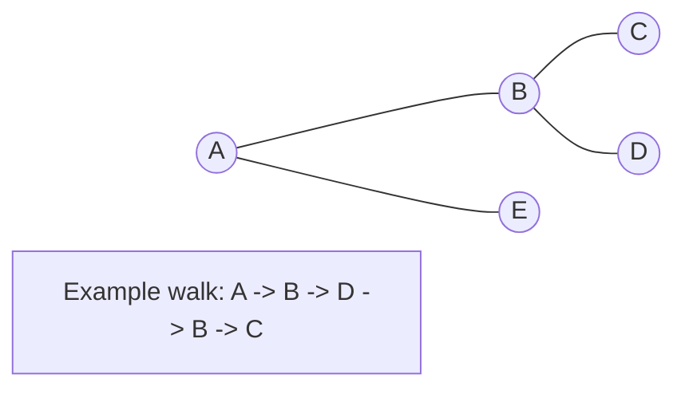
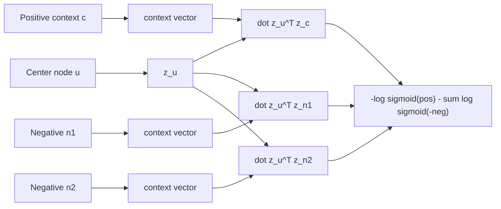
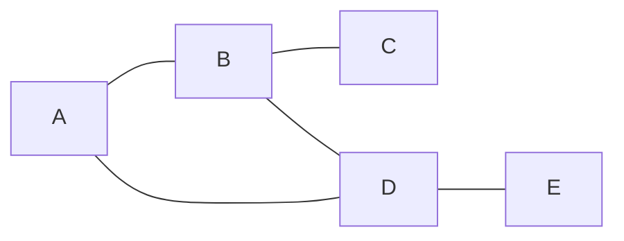
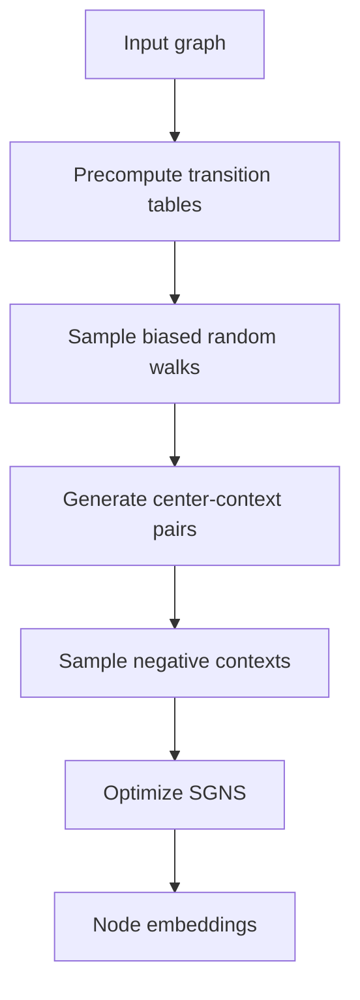

# **Node Embeddings**

Node embeddings map each node $v \in V$ in a graph $G=(V,E)$ to a dense vector

$$
z_v \in \mathbb{R}^d
$$

with $d \ll |V|$. The embedding should preserve the graph information that is useful for downstream tasks: local neighborhoods, structural roles, communities, attributes, edge weights, directions, labels, or temporal behavior.

The central modeling question is not merely "how do we represent a node as a vector?" It is:

> Which notion of graph similarity should become geometric similarity in the embedding space?

DeepWalk, Node2Vec, LINE, graph autoencoders, and supervised GNN embeddings answer this question differently.

---

## **1. Formal Setup**

Let

$$
G=(V,E)
$$

where $|V|=n$ and $|E|=m$. For an unweighted graph, the adjacency matrix is

$$
A_{uv}
=
\begin{cases}
1, & (u,v)\in E,\\
0, & \text{otherwise}.
\end{cases}
$$

For a weighted graph, $A_{uv} \ge 0$ stores edge weight. For an undirected graph, $A=A^\top$. The degree of node $u$ is

$$
d_u = \sum_{v=1}^n A_{uv}
$$

and the diagonal degree matrix is

$$
D = \operatorname{diag}(d_1,\dots,d_n).
$$

A node embedding method learns an encoder

$$
f_\theta: V \rightarrow \mathbb{R}^d
$$

or, with node attributes $X \in \mathbb{R}^{n \times d_x}$,

$$
f_\theta: (G,X,v) \rightarrow \mathbb{R}^d.
$$

The learned embedding matrix is

$$
Z
=
\begin{bmatrix}
z_1^\top\\
\vdots\\
z_n^\top
\end{bmatrix}
\in \mathbb{R}^{n \times d}.
$$

Most node embedding methods can be written as an encoder-decoder system:

$$
z_v = \operatorname{ENC}_\theta(v,G,X)
$$

$$
\hat{s}(u,v)=\operatorname{DEC}_\phi(z_u,z_v)
$$

where $\hat{s}(u,v)$ estimates some graph-derived relationship between $u$ and $v$: adjacency, co-occurrence in random walks, second-order neighborhood similarity, label compatibility, or link probability.

```mermaid
flowchart LR
    G[Graph G = (V,E)] --> Enc[Encoder]
    X[Optional node features X] --> Enc
    Enc --> Z[Node embeddings Z]
    Z --> Dec[Decoder / Task head]
    Dec --> T1[Node classification]
    Dec --> T2[Link prediction]
    Dec --> T3[Clustering]
    Dec --> T4[Recommendation]
```

---

## **2. What Should a Node Embedding Preserve?**

Different graph tasks require different similarity notions.

| Similarity Type | Meaning | Typical Methods | Useful For |
|---|---|---|---|
| First-order proximity | Directly connected nodes should be close | LINE first-order, Laplacian embeddings | link prediction, homophily |
| Second-order proximity | Nodes with similar neighborhoods should be close | LINE second-order, matrix factorization | role/neighborhood similarity |
| Higher-order proximity | Nodes co-occurring in multi-hop contexts should be close | DeepWalk, Node2Vec, PPR embeddings | communities, recommendation |
| Structural role similarity | Nodes with similar graph roles should be close even if far apart | Node2Vec with DFS-like walks, role embeddings | role discovery |
| Attribute-task similarity | Nodes useful for the same prediction should be close | supervised GNNs | node classification |

The phrase "similar nodes should have similar embeddings" is incomplete unless we specify the similarity operator. For example, in a company graph, employees in the same team are community-similar, while managers from different teams are structurally similar. A single embedding objective may not capture both equally well.

---

## **3. Decoders and Similarity Scores**

After embeddings are learned, common similarity decoders include dot product, cosine similarity, Euclidean distance, bilinear scores, and neural decoders.

### **3.1 Dot Product**

$$
\operatorname{score}(u,v)=z_u^\top z_v
$$

Large positive dot products indicate alignment and large vector norms. Dot product is common during training because it is cheap and differentiable.

If

$$
z_u = [0.4, 0.8]^\top
$$

and

$$
z_v = [0.5, 0.7]^\top,
$$

then

$$
z_u^\top z_v = 0.4 \cdot 0.5 + 0.8 \cdot 0.7 = 0.2 + 0.56 = 0.76.
$$

### **3.2 Cosine Similarity**

$$
\cos(z_u,z_v)
=
\frac{z_u^\top z_v}{\|z_u\|_2\|z_v\|_2}
$$

Cosine similarity removes the effect of vector norms and measures angular similarity. For the same vectors:

$$
\|z_u\|_2 = \sqrt{0.4^2 + 0.8^2} = \sqrt{0.8} \approx 0.8944
$$

$$
\|z_v\|_2 = \sqrt{0.5^2 + 0.7^2} = \sqrt{0.74} \approx 0.8602
$$

$$
\cos(z_u,z_v)
=
\frac{0.76}{0.8944 \cdot 0.8602}
\approx
0.9878.
$$

### **3.3 Euclidean Distance**

$$
d(u,v)=\|z_u-z_v\|_2
$$

For the same example:

$$
z_u-z_v=[-0.1,0.1]^\top
$$

$$
\|z_u-z_v\|_2 = \sqrt{(-0.1)^2 + 0.1^2} = \sqrt{0.02} \approx 0.1414.
$$

Euclidean distance is useful after embeddings have comparable scales. Without norm control, nearest neighbors under Euclidean distance may be dominated by vector magnitude artifacts.

### **3.4 Logistic Link Decoder**

For link prediction, a common probabilistic decoder is

$$
p((u,v)\in E \mid z_u,z_v)
=
\sigma(z_u^\top z_v)
$$

where

$$
\sigma(x)=\frac{1}{1+\exp(-x)}.
$$

This decoder assumes symmetric compatibility. Directed graphs often need asymmetric embeddings:

$$
p((u,v)\in E)
=
\sigma((z_u^{\text{src}})^\top z_v^{\text{dst}}).
$$

---

## **4. Unsupervised vs Supervised Node Embeddings**

### **4.1 Unsupervised Embeddings**

Unsupervised methods learn from graph structure without task labels. Typical training signals are:

1. observed edges are positive pairs;
2. random-walk co-occurrences are positive pairs;
3. unobserved or sampled non-edges are negative pairs;
4. the adjacency matrix should be reconstructed from embeddings.

Examples include DeepWalk, Node2Vec, LINE, Laplacian Eigenmaps, Graph Autoencoders, and Variational Graph Autoencoders.

### **4.2 Supervised Embeddings**

Supervised methods learn embeddings that are useful for labels:

$$
\hat{y}_v = g_\phi(z_v)
$$

$$
\mathcal{L}_{\text{sup}}
=
\sum_{v \in V_{\text{train}}}
\ell(\hat{y}_v,y_v).
$$

GNNs such as GCN, GraphSAGE, and GAT produce node embeddings as intermediate hidden states. The embeddings are optimized for prediction, not necessarily for faithful reconstruction of graph structure.

### **4.3 Semi-Supervised and Multi-Task Embeddings**

Many practical systems combine structural and supervised objectives:

$$
\mathcal{L}
=
\mathcal{L}_{\text{sup}}
+
\lambda \mathcal{L}_{\text{struct}}
+
\gamma \|\theta\|_2^2.
$$

Here $\lambda$ controls how strongly embeddings preserve graph structure and $\gamma$ controls weight decay. This is useful when labels are sparse but graph structure is abundant.

---

## **5. Random Walks on Graphs**

Random walks are the bridge between graph structure and sequence models.

For an unweighted graph, the one-step transition probability from node $u$ to node $v$ is

$$
P_{uv}
=
\Pr(X_{t+1}=v \mid X_t=u)
=
\begin{cases}
\frac{1}{d_u}, & (u,v)\in E,\\
0, & \text{otherwise}.
\end{cases}
$$

In matrix form:

$$
P = D^{-1}A.
$$

For a weighted graph:

$$
P_{uv}=\frac{A_{uv}}{\sum_{x \in \mathcal{N}(u)} A_{ux}}.
$$

A length-$L$ random walk starting at $v_0$ generates a sequence

$$
(v_0,v_1,\dots,v_L)
$$

where

$$
v_{t+1} \sim P_{v_t,:}.
$$



Random-walk node embedding methods treat walks like sentences:

$$
\text{node} \leftrightarrow \text{word}
$$

$$
\text{walk} \leftrightarrow \text{sentence}
$$

$$
\text{nearby nodes in walk} \leftrightarrow \text{context words}
$$

### **5.1 Worked Random Walk Example**

Consider the graph:

$$
E = \{(A,B),(A,D),(B,C),(B,D)\}
$$

Assume it is undirected. Degrees are:

$$
d_A=2,\quad d_B=3,\quad d_C=1,\quad d_D=2.
$$

If the current node is $B$, then

$$
\Pr(A \mid B)=\frac{1}{3}
$$

$$
\Pr(C \mid B)=\frac{1}{3}
$$

$$
\Pr(D \mid B)=\frac{1}{3}.
$$

If a walk starts at $A$, one possible path is

$$
A \rightarrow B \rightarrow D \rightarrow A \rightarrow B.
$$

With context window $w=1$, the positive center-context pairs are:

$$
(A,B), (B,A), (B,D), (D,B), (D,A), (A,D), (A,B), (B,A).
$$

With $w=2$, additional pairs include:

$$
(A,D), (B,A), (B,A), (D,B), \dots
$$

larger windows therefore encode broader graph proximity.

---

## **6. Skip-Gram for Node Co-Occurrences**

DeepWalk and Node2Vec use the skip-gram idea from word2vec. Given a sequence of nodes, the model predicts nearby context nodes from a center node.

Let $\mathcal{D}$ be the multiset of positive node-context pairs generated from random walks:

$$
\mathcal{D}
=
\{(u,c): c \in \operatorname{context}(u)\}.
$$

Each node has two embedding vectors:

1. input/source embedding $z_u \in \mathbb{R}^d$;
2. output/context embedding $\tilde{z}_c \in \mathbb{R}^d$.

The full softmax model is

$$
p(c \mid u)
=
\frac{\exp(\tilde{z}_c^\top z_u)}
{\sum_{x \in V} \exp(\tilde{z}_x^\top z_u)}.
$$

The maximum-likelihood objective is

$$
\max_{\theta}
\sum_{(u,c)\in \mathcal{D}}
\log p(c \mid u).
$$

Equivalently, the loss is

$$
\mathcal{L}_{\text{softmax}}
=
-
\sum_{(u,c)\in \mathcal{D}}
\left[
\tilde{z}_c^\top z_u
-
\log \sum_{x \in V}\exp(\tilde{z}_x^\top z_u)
\right].
$$

The denominator costs $O(n)$ per positive pair, which is too expensive for large graphs.

---

## **7. Negative Sampling Objective**

Negative sampling replaces multiclass softmax with binary classification: observed pairs should score high, randomly sampled pairs should score low.

For one positive pair $(u,c)$ and $K$ negative context nodes $n_1,\dots,n_K \sim P_n$, the objective is

$$
\ell(u,c)
=
\log \sigma(\tilde{z}_c^\top z_u)
+
\sum_{i=1}^{K}
\log \sigma(-\tilde{z}_{n_i}^\top z_u).
$$

The corresponding loss to minimize is

$$
\mathcal{L}_{\text{NS}}(u,c)
=
-
\log \sigma(\tilde{z}_c^\top z_u)
-
\sum_{i=1}^{K}
\log \sigma(-\tilde{z}_{n_i}^\top z_u).
$$

The usual negative distribution is a smoothed frequency distribution:

$$
P_n(v)
=
\frac{f(v)^\alpha}{\sum_{x \in V} f(x)^\alpha}
$$

with $\alpha=3/4$ in word2vec-style implementations. Here $f(v)$ is the frequency of node $v$ in random-walk contexts.

### **7.1 Gradient Derivation**

Let

$$
s_{uv}=\tilde{z}_v^\top z_u.
$$

For a positive pair, the loss is

$$
L_+(u,c)=-\log \sigma(s_{uc}).
$$

Using

$$
\frac{d}{dx}\sigma(x)=\sigma(x)(1-\sigma(x)),
$$

we get

$$
\frac{d}{ds}
[-\log \sigma(s)]
=
-
\frac{1}{\sigma(s)}
\sigma(s)(1-\sigma(s))
=
\sigma(s)-1.
$$

Therefore

$$
\frac{\partial L_+}{\partial z_u}
=
(\sigma(s_{uc})-1)\tilde{z}_c
$$

and

$$
\frac{\partial L_+}{\partial \tilde{z}_c}
=
(\sigma(s_{uc})-1)z_u.
$$

For one negative pair $(u,n)$, the loss is

$$
L_-(u,n)=-\log \sigma(-s_{un}).
$$

Then

$$
\frac{d}{ds}
[-\log \sigma(-s)]
=
\sigma(s).
$$

Thus

$$
\frac{\partial L_-}{\partial z_u}
=
\sigma(s_{un})\tilde{z}_n
$$

and

$$
\frac{\partial L_-}{\partial \tilde{z}_n}
=
\sigma(s_{un})z_u.
$$

The positive update pulls $z_u$ and $\tilde{z}_c$ together. The negative update pushes $z_u$ away from sampled negative contexts.

### **7.2 Worked Negative Sampling Calculation**

Let

$$
z_u=[0.2,-0.1]^\top
$$

$$
\tilde{z}_c=[0.4,0.3]^\top
$$

$$
\tilde{z}_n=[-0.5,0.2]^\top.
$$

Positive score:

$$
s_{uc}
=
0.2 \cdot 0.4 + (-0.1)\cdot 0.3
=
0.08 - 0.03
=
0.05.
$$

Positive probability:

$$
\sigma(0.05)
=
\frac{1}{1+\exp(-0.05)}
\approx
0.5125.
$$

Positive loss:

$$
-\log \sigma(0.05)
\approx
0.6685.
$$

Negative score:

$$
s_{un}
=
0.2 \cdot (-0.5) + (-0.1)\cdot 0.2
=
-0.1 - 0.02
=
-0.12.
$$

Negative term:

$$
-\log \sigma(-s_{un})
=
-\log \sigma(0.12)
\approx
0.6349.
$$

Total loss for one positive and one negative:

$$
L \approx 0.6685 + 0.6349 = 1.3034.
$$

The gradient factor for the positive pair is

$$
\sigma(0.05)-1 \approx -0.4875.
$$

The gradient factor for the negative pair is

$$
\sigma(-0.12) \approx 0.4700.
$$

So the update strongly increases the positive score and decreases the negative score.



---

## **8. DeepWalk**

DeepWalk learns node embeddings by:

1. sampling many truncated random walks from each node;
2. treating each walk as a sentence;
3. generating skip-gram center-context pairs;
4. optimizing skip-gram with hierarchical softmax or negative sampling;
5. using the learned input embedding $z_v$ as the node representation.

The original DeepWalk paper introduced this transfer of language-modeling machinery to graphs and showed that truncated random walks provide local graph contexts for representation learning.

### **8.1 DeepWalk Algorithm**

Let:

1. $r$ be the number of walks per node;
2. $L$ be the walk length;
3. $w$ be the context window size;
4. $d$ be the embedding dimension;
5. $K$ be the number of negative samples.

Algorithm:

```text
for each epoch:
    shuffle nodes
    for each node v:
        repeat r times:
            walk = RandomWalk(G, start=v, length=L)
            for each position i in walk:
                center = walk[i]
                contexts = nodes within distance w from i
                update skip-gram objective for (center, context)
```

### **8.2 What DeepWalk Is Actually Estimating**

A random walk induces a co-occurrence distribution over node pairs. If node $c$ often appears near node $u$ in walks, DeepWalk increases $z_u^\top \tilde{z}_c$.

For a stationary random walk, the $k$-step probability of reaching $c$ from $u$ is

$$
(P^k)_{uc}.
$$

With a context window $w$, the expected co-occurrence mass is related to

$$
\sum_{k=1}^{w} (P^k)_{uc}.
$$

This explains why DeepWalk captures higher-order proximity rather than only direct edges.

The matrix factorization view shows that skip-gram-based network embeddings implicitly factorize a shifted pointwise mutual information matrix. A simplified form is:

$$
z_u^\top \tilde{z}_c
\approx
\operatorname{PMI}(u,c) - \log K
$$

where

$$
\operatorname{PMI}(u,c)
=
\log
\frac{p(u,c)}{p(u)p(c)}.
$$

The term $-\log K$ comes from using $K$ negative samples. Intuitively, embeddings become large when $u$ and $c$ co-occur more often than chance.

### **8.3 DeepWalk Intuition**

DeepWalk is not explicitly told about communities. It repeatedly observes that nodes in the same dense region appear in similar random-walk contexts. The skip-gram objective then assigns nearby vectors to nodes with overlapping contexts.

However, because simple random walks are degree-biased, high-degree nodes appear often. Negative sampling, subsampling, and frequency smoothing help prevent hubs from dominating the representation.

---

## **9. Node2Vec**

Node2Vec extends DeepWalk by replacing first-order random walks with biased second-order random walks. The next node depends not only on the current node, but also on the previous node.

Suppose the walk just moved from $t$ to $v$. The next node $x \in \mathcal{N}(v)$ is sampled with unnormalized probability

$$
\pi_{vx} = \alpha_{pq}(t,x) \cdot w_{vx}
$$

where $w_{vx}$ is the edge weight and

$$
\alpha_{pq}(t,x)
=
\begin{cases}
\frac{1}{p}, & d_{tx}=0,\\
1, & d_{tx}=1,\\
\frac{1}{q}, & d_{tx}=2.
\end{cases}
$$

Here $d_{tx}$ is the shortest-path distance between previous node $t$ and candidate next node $x$. Since $x$ is a neighbor of $v$, $d_{tx}$ can only be $0$, $1$, or $2$ in an unweighted graph:

1. $d_{tx}=0$: $x=t$, so the walk immediately returns.
2. $d_{tx}=1$: $x$ is adjacent to $t$, so the walk stays near the previous neighborhood.
3. $d_{tx}=2$: $x$ is not adjacent to $t$, so the walk moves outward.

The normalized transition probability is

$$
\Pr(X_{i+1}=x \mid X_i=v, X_{i-1}=t)
=
\frac{\pi_{vx}}{\sum_{y \in \mathcal{N}(v)} \pi_{vy}}.
$$

### **9.1 Meaning of p and q**

The return parameter $p$ controls backtracking:

1. small $p$: returning to $t$ is likely;
2. large $p$: immediate return is discouraged.

The in-out parameter $q$ controls local versus outward exploration:

1. small $q$: outward moves get weight $1/q$, so DFS-like exploration is encouraged;
2. large $q$: outward moves are penalized, so BFS-like local exploration is encouraged.

The common summary is:

| Parameter Setting | Walk Behavior | Embedding Bias |
|---|---|---|
| $p$ small | immediate returns likely | conservative local sampling |
| $p$ large | immediate returns unlikely | avoids two-step oscillation |
| $q$ small | outward moves likely | structural-role similarity |
| $q$ large | outward moves unlikely | community/homophily similarity |

### **9.2 Worked Node2Vec Transition Example**

Consider this graph:



Suppose the walk just moved from $A$ to $B$. Candidate next nodes from $B$ are:

$$
\mathcal{N}(B)=\{A,C,D\}.
$$

Distances from previous node $A$:

$$
d(A,A)=0
$$

$$
d(A,D)=1
$$

$$
d(A,C)=2
$$

Assume all edge weights are $1$, $p=2$, and $q=0.5$. Then unnormalized weights are:

$$
\pi_{BA} = \frac{1}{p} = \frac{1}{2}=0.5
$$

$$
\pi_{BD}=1
$$

$$
\pi_{BC} = \frac{1}{q} = \frac{1}{0.5}=2.
$$

The normalizer is

$$
0.5+1+2=3.5.
$$

Thus

$$
\Pr(A \mid A,B)=\frac{0.5}{3.5}\approx 0.1429
$$

$$
\Pr(D \mid A,B)=\frac{1}{3.5}\approx 0.2857
$$

$$
\Pr(C \mid A,B)=\frac{2}{3.5}\approx 0.5714.
$$

Because $q<1$, the walk prefers the outward move to $C$.

If instead $q=2$, then

$$
\pi_{BC}=\frac{1}{2}=0.5
$$

and the probabilities become:

$$
\Pr(A \mid A,B)=\frac{0.5}{0.5+1+0.5}=0.25
$$

$$
\Pr(D \mid A,B)=\frac{1}{2}=0.5
$$

$$
\Pr(C \mid A,B)=0.25.
$$

Now the walk is more local.

### **9.3 Under-the-Hood Execution**

Node2Vec training has two distinct phases:

1. **Sampling phase:** generate biased random walks using second-order transition probabilities.
2. **Optimization phase:** train skip-gram negative sampling on the sampled walks.

For efficiency, implementations often precompute alias tables for transitions. The challenge is that the transition distribution depends on the previous node $t$ and current node $v$, so the table is associated with directed edge state $(t,v)$ rather than only node $v$.



---

## **10. LINE**

LINE learns embeddings by preserving first-order and second-order proximity. Unlike DeepWalk and Node2Vec, it does not require generating walks.

### **10.1 First-Order Proximity**

First-order proximity models observed edges directly. For an undirected edge $(u,v)$, define

$$
p_1(u,v)
=
\sigma(z_u^\top z_v).
$$

The empirical distribution over edges is

$$
\hat{p}_1(u,v)
=
\frac{w_{uv}}{W}
$$

where

$$
W=\sum_{(i,j)\in E} w_{ij}.
$$

LINE minimizes KL divergence between empirical and model distributions. Ignoring constants, this gives the weighted edge loss

$$
\mathcal{L}_1
=
-
\sum_{(u,v)\in E}
w_{uv}
\log \sigma(z_u^\top z_v).
$$

With negative sampling:

$$
\mathcal{L}_1(u,v)
=
-
\log \sigma(z_u^\top z_v)
-
\sum_{i=1}^{K}
\log \sigma(-z_u^\top z_{n_i}).
$$

### **10.2 Second-Order Proximity**

Second-order proximity says two nodes are similar if they have similar neighbors. LINE gives each node a source embedding $z_u$ and context embedding $\tilde{z}_v$. The conditional probability that node $v$ appears as context of $u$ is

$$
p_2(v \mid u)
=
\frac{\exp(\tilde{z}_v^\top z_u)}
{\sum_{x \in V}\exp(\tilde{z}_x^\top z_u)}.
$$

The empirical distribution is

$$
\hat{p}_2(v \mid u)
=
\frac{w_{uv}}{d_u}.
$$

The KL objective becomes

$$
\mathcal{L}_2
=
-
\sum_{(u,v)\in E}
w_{uv}
\log p_2(v \mid u).
$$

Again, negative sampling is used to avoid the full softmax.

### **10.3 LINE vs DeepWalk vs Node2Vec**

| Method | Positive Pairs | Main Bias | Strength | Limitation |
|---|---|---|---|---|
| LINE first-order | edges | direct adjacency | scalable edge modeling | shallow local structure |
| LINE second-order | node-neighbor pairs | shared neighborhoods | directed/weighted graphs | no long walk contexts |
| DeepWalk | random-walk contexts | higher-order proximity | simple and strong baseline | fixed unbiased walks |
| Node2Vec | biased walk contexts | tunable BFS/DFS behavior | flexible neighborhoods | more preprocessing |

---

## **11. Graph Autoencoders for Node Embeddings**

Graph autoencoders learn embeddings by reconstructing graph structure.

An encoder maps nodes to embeddings:

$$
Z = \operatorname{ENC}_\theta(G,X).
$$

A simple inner-product decoder reconstructs adjacency:

$$
\hat{A}_{uv}
=
\sigma(z_u^\top z_v).
$$

The binary cross-entropy reconstruction loss is

$$
\mathcal{L}_{\text{GAE}}
=
-
\sum_{u=1}^{n}
\sum_{v=1}^{n}
\left[
A_{uv}\log \hat{A}_{uv}
+
(1-A_{uv})\log(1-\hat{A}_{uv})
\right].
$$

For sparse graphs this full loss is usually replaced with negative sampling over non-edges:

$$
\mathcal{L}_{\text{GAE-sampled}}
=
-
\sum_{(u,v)\in E}
\log \sigma(z_u^\top z_v)
-
\sum_{(u,n)\in \mathcal{N}^{-}}
\log \sigma(-z_u^\top z_n).
$$

### **11.1 Variational Graph Autoencoder**

A variational graph autoencoder places a distribution over each node embedding:

$$
q_\theta(z_v \mid G,X)
=
\mathcal{N}
\left(
z_v \mid \mu_v,\operatorname{diag}(\sigma_v^2)
\right).
$$

The encoder predicts $\mu_v$ and $\log \sigma_v$. The reparameterization trick samples

$$
z_v = \mu_v + \sigma_v \odot \epsilon_v
$$

where

$$
\epsilon_v \sim \mathcal{N}(0,I).
$$

The evidence lower bound is

$$
\mathcal{L}_{\text{VGAE}}
=
\mathbb{E}_{q_\theta(Z \mid G,X)}
\left[
\log p_\phi(A \mid Z)
\right]
-
\operatorname{KL}
\left(
q_\theta(Z \mid G,X)
\| p(Z)
\right).
$$

With a standard normal prior

$$
p(Z)=\prod_v \mathcal{N}(z_v \mid 0,I),
$$

the KL term for one node is

$$
\operatorname{KL}
\left(
\mathcal{N}(\mu_v,\operatorname{diag}(\sigma_v^2))
\|
\mathcal{N}(0,I)
\right)
=
\frac{1}{2}
\sum_{j=1}^{d}
\left(
\mu_{vj}^2 + \sigma_{vj}^2 - \log \sigma_{vj}^2 - 1
\right).
$$

```mermaid
flowchart LR
    X[Node features X] --> Enc[GCN Encoder]
    A[Adjacency A] --> Enc
    Enc --> Mu[mu]
    Enc --> LogVar[log variance]
    Mu --> Sample[Reparameterize]
    LogVar --> Sample
    Eps[epsilon ~ N(0,I)] --> Sample
    Sample --> Z[Z]
    Z --> Dec[Inner product decoder]
    Dec --> Ahat[Reconstructed adjacency]
```

Graph autoencoders are transductive unless the encoder can compute embeddings for new nodes from features and neighborhoods. A shallow embedding table cannot embed unseen nodes without retraining.

---

## **12. Graph-Level Embeddings from Node Embeddings**

Sometimes each graph is one data point, as in molecules, proteins, or ego networks. A graph embedding can be produced by pooling node embeddings:

$$
z_G
=
\operatorname{READOUT}
\left(
\{z_v : v \in V\}
\right).
$$

The readout must be permutation-invariant. Common choices:

$$
z_G = \frac{1}{n}\sum_{v \in V} z_v
$$

$$
z_G = \sum_{v \in V} z_v
$$

$$
z_G = \max_{v \in V} z_v
$$

where max is applied elementwise.

Mean pooling is scale-stable but may hide graph size. Sum pooling preserves size information but can create large norms for large graphs. Attention pooling learns importance weights:

$$
\alpha_v
=
\frac{\exp(a^\top \tanh(Wz_v))}
{\sum_{u \in V}\exp(a^\top \tanh(Wz_u))}
$$

$$
z_G = \sum_{v \in V}\alpha_v z_v.
$$

---

## **13. Python Implementation from Scratch**

The following implementation uses only NumPy and standard Python. It implements:

1. graph storage as adjacency lists;
2. random-walk sampling;
3. skip-gram pair generation;
4. negative sampling;
5. stochastic gradient descent for SGNS.

It is intentionally small and explicit rather than fully optimized.

```python
import math
import random
from collections import Counter, defaultdict

import numpy as np


class DeepWalkSGNS:
    def __init__(
        self,
        embedding_dim=16,
        walk_length=20,
        walks_per_node=10,
        window_size=5,
        negative_samples=5,
        lr=0.025,
        epochs=1,
        seed=0,
    ):
        self.embedding_dim = embedding_dim
        self.walk_length = walk_length
        self.walks_per_node = walks_per_node
        self.window_size = window_size
        self.negative_samples = negative_samples
        self.lr = lr
        self.epochs = epochs
        self.rng = random.Random(seed)
        self.np_rng = np.random.default_rng(seed)

    def _build_vocab(self, graph):
        self.nodes_ = sorted(graph)
        self.node_to_idx_ = {node: i for i, node in enumerate(self.nodes_)}
        self.idx_to_node_ = {i: node for node, i in self.node_to_idx_.items()}
        self.n_nodes_ = len(self.nodes_)

    def _random_walk(self, graph, start):
        walk = [start]
        current = start

        for _ in range(self.walk_length - 1):
            neighbors = graph[current]
            if not neighbors:
                break
            current = self.rng.choice(neighbors)
            walk.append(current)

        return walk

    def _generate_walks(self, graph):
        walks = []
        nodes = list(graph.keys())

        for _ in range(self.walks_per_node):
            self.rng.shuffle(nodes)
            for node in nodes:
                walks.append(self._random_walk(graph, node))

        return walks

    def _positive_pairs(self, walks):
        for walk in walks:
            idx_walk = [self.node_to_idx_[node] for node in walk]
            for i, center in enumerate(idx_walk):
                left = max(0, i - self.window_size)
                right = min(len(idx_walk), i + self.window_size + 1)
                for j in range(left, right):
                    if i == j:
                        continue
                    yield center, idx_walk[j]

    def _make_negative_distribution(self, walks, power=0.75):
        counts = Counter()
        for walk in walks:
            for node in walk:
                counts[self.node_to_idx_[node]] += 1

        freqs = np.array(
            [counts[i] for i in range(self.n_nodes_)],
            dtype=np.float64,
        )
        probs = np.power(freqs, power)

        # Avoid division by zero for pathological empty graphs.
        if probs.sum() == 0:
            probs = np.ones(self.n_nodes_, dtype=np.float64)

        probs /= probs.sum()
        return probs

    @staticmethod
    def _sigmoid(x):
        # Numerically stable sigmoid.
        if x >= 0:
            z = math.exp(-x)
            return 1.0 / (1.0 + z)
        z = math.exp(x)
        return z / (1.0 + z)

    def _sgd_update(self, center, context, negatives):
        z_u = self.in_embed_[center]

        # Positive update.
        z_c = self.out_embed_[context]
        score = float(np.dot(z_u, z_c))
        grad_factor = self._sigmoid(score) - 1.0

        grad_u = grad_factor * z_c
        grad_c = grad_factor * z_u

        self.in_embed_[center] -= self.lr * grad_u
        self.out_embed_[context] -= self.lr * grad_c

        # Refresh center vector after the positive update.
        z_u = self.in_embed_[center]

        # Negative updates.
        for neg in negatives:
            if neg == context:
                continue

            z_n = self.out_embed_[neg]
            score = float(np.dot(z_u, z_n))
            grad_factor = self._sigmoid(score)

            grad_u = grad_factor * z_n
            grad_n = grad_factor * z_u

            self.in_embed_[center] -= self.lr * grad_u
            self.out_embed_[neg] -= self.lr * grad_n

    def fit(self, graph):
        """
        graph: dict[node, list[node]]
            Undirected or directed adjacency list. Nodes with no outgoing
            neighbors should still appear with an empty list.
        """
        self._build_vocab(graph)

        scale = 0.5 / self.embedding_dim
        self.in_embed_ = self.np_rng.uniform(
            low=-scale,
            high=scale,
            size=(self.n_nodes_, self.embedding_dim),
        )
        self.out_embed_ = np.zeros((self.n_nodes_, self.embedding_dim))

        walks = self._generate_walks(graph)
        neg_probs = self._make_negative_distribution(walks)
        pairs = list(self._positive_pairs(walks))

        for _ in range(self.epochs):
            self.rng.shuffle(pairs)
            for center, context in pairs:
                negatives = self.np_rng.choice(
                    self.n_nodes_,
                    size=self.negative_samples,
                    replace=True,
                    p=neg_probs,
                )
                self._sgd_update(center, context, negatives)

        return self

    def embedding(self, node):
        return self.in_embed_[self.node_to_idx_[node]]

    def embeddings(self):
        return {
            node: self.in_embed_[idx].copy()
            for node, idx in self.node_to_idx_.items()
        }


def make_undirected_graph(edges):
    graph = defaultdict(list)
    for u, v in edges:
        graph[u].append(v)
        graph[v].append(u)
    for u, v in edges:
        graph.setdefault(u, [])
        graph.setdefault(v, [])
    return dict(graph)


edges = [
    ("Alice", "Bob"),
    ("Alice", "David"),
    ("Bob", "Charlie"),
    ("Bob", "David"),
    ("Charlie", "Eve"),
]

graph = make_undirected_graph(edges)

model = DeepWalkSGNS(
    embedding_dim=8,
    walk_length=10,
    walks_per_node=20,
    window_size=2,
    negative_samples=5,
    lr=0.03,
    epochs=3,
    seed=42,
)

model.fit(graph)

for node, emb in model.embeddings().items():
    print(node, np.round(emb, 4))
```

### **13.1 Important Implementation Notes**

The code uses two embedding matrices. This mirrors word2vec implementations:

$$
Z_{\text{in}} \in \mathbb{R}^{n \times d}
$$

$$
Z_{\text{out}} \in \mathbb{R}^{n \times d}.
$$

After training, common choices are:

$$
Z = Z_{\text{in}}
$$

or

$$
Z = \frac{1}{2}(Z_{\text{in}} + Z_{\text{out}}).
$$

The implementation materializes all positive pairs for clarity. Production systems stream pairs to avoid memory blowup:

$$
O(r n L w)
$$

positive pair storage can be prohibitive for large $n$.

---

## **14. Node2Vec Sampling from Scratch**

The following function implements the second-order Node2Vec transition rule without alias sampling.

```python
def node2vec_walk(graph, start, walk_length, p=1.0, q=1.0, rng=None):
    """
    graph: dict[node, list[node]]
        Unweighted adjacency list.
    p: float
        Return parameter.
    q: float
        In-out parameter.
    """
    if rng is None:
        rng = random.Random()

    walk = [start]

    for _ in range(walk_length - 1):
        current = walk[-1]
        neighbors = graph[current]
        if not neighbors:
            break

        if len(walk) == 1:
            walk.append(rng.choice(neighbors))
            continue

        previous = walk[-2]
        previous_neighbors = set(graph[previous])

        weights = []
        for candidate in neighbors:
            if candidate == previous:
                weight = 1.0 / p
            elif candidate in previous_neighbors:
                weight = 1.0
            else:
                weight = 1.0 / q
            weights.append(weight)

        total = sum(weights)
        probs = [weight / total for weight in weights]
        walk.append(rng.choices(neighbors, weights=probs, k=1)[0])

    return walk
```

This is $O(d_v)$ per step, where $d_v$ is the degree of the current node. Alias preprocessing reduces sampling to $O(1)$ after building transition tables, but can require memory proportional to the number of directed edge states and their outgoing choices:

$$
O\left(\sum_{(t,v)\in E} d_v\right).
$$

For high-degree graphs this can be much larger than $O(m)$.

---

## **15. Library Implementations**

### **15.1 DeepWalk with NetworkX and Gensim**

Gensim's `Word2Vec` implements skip-gram or CBOW training with hierarchical softmax or negative sampling. For DeepWalk, random walks are passed as tokenized sentences where each node ID is a token.

```python
import random

import networkx as nx
from gensim.models import Word2Vec


def random_walk_nx(G, start, walk_length, rng):
    walk = [str(start)]
    current = start

    for _ in range(walk_length - 1):
        neighbors = list(G.neighbors(current))
        if not neighbors:
            break
        current = rng.choice(neighbors)
        walk.append(str(current))

    return walk


def deepwalk_with_gensim(
    G,
    dimensions=128,
    walk_length=80,
    walks_per_node=10,
    window=10,
    negative=5,
    workers=4,
    seed=0,
):
    rng = random.Random(seed)
    nodes = list(G.nodes())
    walks = []

    for _ in range(walks_per_node):
        rng.shuffle(nodes)
        for node in nodes:
            walks.append(random_walk_nx(G, node, walk_length, rng))

    model = Word2Vec(
        sentences=walks,
        vector_size=dimensions,
        window=window,
        min_count=0,
        sg=1,              # 1 = skip-gram, 0 = CBOW
        hs=0,              # 0 = do not use hierarchical softmax
        negative=negative, # >0 enables negative sampling
        workers=workers,
        epochs=5,
        seed=seed,
    )

    embeddings = {
        node: model.wv[str(node)]
        for node in G.nodes()
    }
    return embeddings, model


G = nx.Graph()
G.add_edges_from([
    ("Alice", "Bob"),
    ("Alice", "David"),
    ("Bob", "Charlie"),
    ("Bob", "David"),
    ("Charlie", "Eve"),
])

embeddings, w2v = deepwalk_with_gensim(G, dimensions=16)
print(embeddings["Alice"].shape)
```

Under the hood, `Word2Vec` builds a vocabulary, initializes embedding tables, creates skip-gram training examples from token windows, samples negative tokens from a smoothed unigram table, and applies optimized SGD updates in compiled code. Setting `sg=1` selects skip-gram; setting `negative > 0` selects negative sampling; setting `hs=1` uses a Huffman-tree hierarchical softmax instead.

### **15.2 Node2Vec with PyTorch Geometric**

PyTorch Geometric provides a `Node2Vec` model that samples random walks from an `edge_index` tensor and optimizes embeddings with negative sampling.

```python
import torch
from torch_geometric.nn import Node2Vec


edge_index = torch.tensor(
    [
        [0, 0, 1, 1, 2, 3],
        [1, 3, 0, 2, 1, 0],
    ],
    dtype=torch.long,
)

model = Node2Vec(
    edge_index=edge_index,
    embedding_dim=64,
    walk_length=20,
    context_size=10,
    walks_per_node=10,
    p=1.0,
    q=0.5,
    num_negative_samples=5,
    sparse=True,
)

loader = model.loader(batch_size=128, shuffle=True, num_workers=0)
optimizer = torch.optim.SparseAdam(model.parameters(), lr=0.01)

model.train()
for epoch in range(10):
    total_loss = 0.0
    for pos_rw, neg_rw in loader:
        optimizer.zero_grad()
        loss = model.loss(pos_rw, neg_rw)
        loss.backward()
        optimizer.step()
        total_loss += float(loss)
    print(epoch, total_loss / len(loader))

z = model.embedding.weight.detach()
print(z.shape)
```

Internally, PyG stores the embedding matrix as a trainable `torch.nn.Embedding`. The data loader samples positive random walks and negative random walks. The model's loss computes positive dot products for node pairs appearing within sampled contexts and negative dot products for sampled non-context nodes, then applies the same logistic negative sampling objective described earlier. With `sparse=True`, gradients are sparse, so only touched node rows are updated; this is why `SparseAdam` is used.

---

## **16. Numerical Stability**

### **16.1 Stable Sigmoid Loss**

Computing

$$
\log \sigma(x)
$$

naively can underflow when $x$ is very negative. A stable identity is:

$$
-\log \sigma(x)=\operatorname{softplus}(-x)
$$

where

$$
\operatorname{softplus}(x)=\log(1+\exp(x)).
$$

Similarly,

$$
-\log \sigma(-x)=\operatorname{softplus}(x).
$$

In PyTorch:

```python
import torch.nn.functional as F

positive_loss = F.softplus(-positive_scores).mean()
negative_loss = F.softplus(negative_scores).mean()
loss = positive_loss + negative_loss
```

### **16.2 Embedding Norm Explosion**

The SGNS objective can increase vector norms when positives are easy and negatives are insufficient. Common controls:

1. lower learning rate;
2. more negative samples;
3. gradient clipping;
4. weight decay;
5. embedding normalization for retrieval;
6. early stopping on validation link prediction or classification.

### **16.3 Randomness and Reproducibility**

Node embeddings are not unique. If $Z$ is a good embedding, then for any orthogonal matrix $R$,

$$
ZR
$$

preserves all dot products and Euclidean distances. Therefore different seeds may rotate or reflect embeddings while preserving performance. Compare embeddings through downstream metrics, pairwise similarities, or Procrustes alignment rather than raw coordinates.

---

## **17. Complexity**

Let:

1. $n=|V|$;
2. $m=|E|$;
3. $d$ be embedding dimension;
4. $r$ be walks per node;
5. $L$ be walk length;
6. $w$ be context window;
7. $K$ be negative samples.

### **17.1 DeepWalk**

Number of sampled walk tokens:

$$
O(rnL).
$$

Number of positive pairs:

$$
O(rnLw).
$$

Each positive pair update with $K$ negatives costs:

$$
O((K+1)d).
$$

Total training cost:

$$
O(rnLw(K+1)d).
$$

Embedding memory:

$$
O(nd)
$$

or

$$
O(2nd)
$$

if storing input and output embeddings separately.

### **17.2 Node2Vec**

The optimization cost is the same order as DeepWalk after walks are generated:

$$
O(rnLw(K+1)d).
$$

Sampling cost without alias tables is:

$$
O(rnL\bar{d})
$$

where $\bar{d}$ is the average degree inspected during transition normalization.

With alias tables, sampling can be $O(rnL)$ after preprocessing, but preprocessing memory may be:

$$
O\left(\sum_{(t,v)\in E} d_v\right).
$$

### **17.3 LINE**

LINE samples edges and negatives directly. If $S$ positive edge samples are trained, cost is:

$$
O(S(K+1)d).
$$

It avoids storing walks and is often attractive for very large weighted graphs.

### **17.4 Graph Autoencoders**

Full adjacency reconstruction costs:

$$
O(n^2d)
$$

because all node pairs are decoded. Sparse negative sampling reduces this to:

$$
O((m+S^-)d)
$$

where $S^-$ is the number of sampled non-edges.

---

## **18. Edge Cases and Pitfalls**

### **18.1 Isolated Nodes**

Random-walk methods cannot learn meaningful structural embeddings for isolated nodes because no contexts are generated. Options:

1. use node attributes with an inductive encoder;
2. assign a learned default vector;
3. use metadata features;
4. remove isolated nodes if irrelevant.

### **18.2 Hubs**

High-degree nodes dominate random walks and negative sampling frequencies. This can cause embeddings to encode popularity more than semantic similarity. Mitigations:

1. subsample frequent nodes;
2. tune negative sampling distribution;
3. use personalized random walks;
4. normalize scores during retrieval;
5. evaluate separately on high-degree and low-degree nodes.

### **18.3 Directed Graphs**

Converting a directed graph to undirected may destroy important information. Use source and target embeddings:

$$
p(v \mid u)
\propto
\exp((z_u^{\text{src}})^\top z_v^{\text{dst}}).
$$

LINE second-order and graph autoencoders with asymmetric decoders are natural choices.

### **18.4 Weighted Graphs**

Weights should affect transition probabilities or edge sampling. A common random-walk transition is:

$$
P_{uv}
=
\frac{w_{uv}}{\sum_{x \in \mathcal{N}(u)} w_{ux}}.
$$

Large raw weights may need clipping or logarithmic scaling:

$$
w'_{uv}=\log(1+w_{uv}).
$$

### **18.5 Negative Sampling False Negatives**

In sparse graphs, a sampled "negative" pair may be an unobserved positive relationship. This is especially common in recommendation and biological graphs. Mitigations:

1. sample negatives from nodes unlikely to interact;
2. use typed constraints;
3. evaluate with time-based splits;
4. treat missing edges as unknown rather than definitely negative.

### **18.6 Transductive Limitation**

Embedding-table methods learn one parameter vector per training node. They do not naturally handle new nodes. For inductive inference, use an encoder based on features and neighborhoods:

$$
z_v=f_\theta(x_v,\{x_u:u\in \mathcal{N}(v)\}).
$$

GraphSAGE is the standard example of this pattern.

### **18.7 Evaluation Leakage**

For link prediction, generating walks on the full graph before removing validation/test edges leaks information. Correct workflow:

1. split edges into train/validation/test;
2. build the training graph only from train edges;
3. learn embeddings on the training graph;
4. evaluate candidate validation/test edges with a decoder.

---

## **19. Practical Hyperparameter Guidance**

| Hyperparameter | Effect | Typical Range |
|---|---|---|
| embedding dimension $d$ | capacity of representation | 64 to 256 |
| walk length $L$ | depth of sampled context | 20 to 100 |
| walks per node $r$ | sampling coverage | 5 to 20 |
| context window $w$ | local vs broad proximity | 5 to 10 |
| negative samples $K$ | contrastive strength | 5 to 20 |
| Node2Vec $p$ | return probability | 0.25 to 4 |
| Node2Vec $q$ | BFS/DFS bias | 0.25 to 4 |
| learning rate | SGD step size | 0.001 to 0.05 |

Useful tuning rules:

1. Increase $r$ before increasing $d$ if the graph is under-sampled.
2. Increase $K$ when embeddings collapse around hubs.
3. Use smaller $q$ for structural role discovery.
4. Use larger $q$ for homophilic community embeddings.
5. Normalize embeddings before approximate nearest-neighbor retrieval when vector norms encode degree.

---

## **20. Connections to Related ML Concepts**

### **20.1 Matrix Factorization**

DeepWalk, Node2Vec, and LINE with negative sampling can be interpreted as implicitly factorizing shifted PMI-like matrices. This connects graph embeddings to latent semantic analysis, collaborative filtering, and spectral methods.

### **20.2 Contrastive Learning**

Negative sampling is a contrastive objective. Positive pairs come from graph neighborhoods; negative pairs come from a noise distribution. Modern graph contrastive learning generalizes this by constructing augmented graph views and maximizing agreement between corresponding nodes or graphs.

### **20.3 Spectral Graph Theory**

Random walk transition matrices, graph Laplacians, and matrix powers connect node embeddings to spectral decompositions. Laplacian Eigenmaps directly optimize smoothness:

$$
\min_Z
\sum_{(u,v)\in E}
A_{uv}\|z_u-z_v\|_2^2
$$

subject to constraints that prevent the trivial all-zero solution.

Using the graph Laplacian

$$
L=D-A,
$$

the objective can be written as

$$
\sum_{(u,v)\in E}
A_{uv}\|z_u-z_v\|_2^2
=
2\operatorname{tr}(Z^\top L Z).
$$

### **20.4 GNNs**

Shallow embedding methods assign parameters directly to nodes:

$$
Z \in \mathbb{R}^{n \times d}.
$$

GNNs compute embeddings through shared functions:

$$
h_v^{(k+1)}
=
\operatorname{UPDATE}^{(k)}
\left(
h_v^{(k)},
\operatorname{AGG}^{(k)}
\left(
\{h_u^{(k)}:u\in\mathcal{N}(v)\}
\right)
\right).
$$

This makes GNNs more suitable for attributed, inductive, and supervised settings.

### **20.5 Knowledge Graph Embeddings**

Knowledge graph embeddings model typed directed edges:

$$
(h,r,t)
$$

where $h$ is head entity, $r$ is relation, and $t$ is tail entity. Methods such as TransE, DistMult, ComplEx, and RotatE learn relation-aware decoders rather than a single untyped node similarity function.

---

## **21. Minimal End-to-End Link Prediction Example**

After learning embeddings, link prediction usually trains or applies a decoder over candidate pairs.

```python
import numpy as np
from sklearn.linear_model import LogisticRegression
from sklearn.metrics import roc_auc_score


def edge_features(z_u, z_v):
    # Hadamard product is a common symmetric edge feature.
    return z_u * z_v


def build_edge_dataset(embeddings, positive_edges, negative_edges):
    X = []
    y = []

    for u, v in positive_edges:
        X.append(edge_features(embeddings[u], embeddings[v]))
        y.append(1)

    for u, v in negative_edges:
        X.append(edge_features(embeddings[u], embeddings[v]))
        y.append(0)

    return np.asarray(X), np.asarray(y)


train_pos = [("Alice", "Bob"), ("Alice", "David"), ("Bob", "Charlie")]
train_neg = [("Alice", "Eve"), ("David", "Charlie"), ("Bob", "Eve")]

test_pos = [("Bob", "David")]
test_neg = [("David", "Eve")]

X_train, y_train = build_edge_dataset(model.embeddings(), train_pos, train_neg)
X_test, y_test = build_edge_dataset(model.embeddings(), test_pos, test_neg)

clf = LogisticRegression()
clf.fit(X_train, y_train)

scores = clf.predict_proba(X_test)[:, 1]
print("AUC:", roc_auc_score(y_test, scores))
```

Common edge feature operators:

$$
\text{Hadamard}(u,v)=z_u \odot z_v
$$

$$
\text{Average}(u,v)=\frac{z_u+z_v}{2}
$$

$$
\text{L1}(u,v)=|z_u-z_v|
$$

$$
\text{L2}(u,v)=(z_u-z_v)^2.
$$

The decoder choice matters. Dot products are simple, but learned decoders can compensate for embedding limitations.

---

## **22. Summary**

Node embeddings turn graph position, context, or task information into vectors. The main families differ in how they define positive relationships:

1. DeepWalk uses unbiased random-walk co-occurrences.
2. Node2Vec uses biased second-order walks controlled by $p$ and $q$.
3. LINE uses direct edge and neighborhood proximity.
4. Graph autoencoders reconstruct adjacency from encoded node vectors.
5. Supervised GNNs learn embeddings optimized for task labels.

The core mathematical machinery is usually one of:

1. softmax likelihood over contexts;
2. negative sampling as binary logistic discrimination;
3. matrix factorization of proximity matrices;
4. adjacency reconstruction;
5. supervised prediction loss.

In practice, the most important decisions are the similarity notion, split protocol, negative sampling strategy, inductive versus transductive requirement, and whether graph structure alone is sufficient or node attributes and labels must be part of the encoder.

---

## **23. References and Deeper Reading**

1. Perozzi, Al-Rfou, and Skiena, **DeepWalk: Online Learning of Social Representations**, KDD 2014. https://arxiv.org/abs/1403.6652
2. Grover and Leskovec, **node2vec: Scalable Feature Learning for Networks**, KDD 2016. https://arxiv.org/abs/1607.00653
3. Tang et al., **LINE: Large-scale Information Network Embedding**, WWW 2015. https://arxiv.org/abs/1503.03578
4. Mikolov et al., **Distributed Representations of Words and Phrases and their Compositionality**, NeurIPS 2013. https://arxiv.org/abs/1310.4546
5. Qiu et al., **Network Embedding as Matrix Factorization: Unifying DeepWalk, LINE, PTE, and node2vec**, WSDM 2018. https://arxiv.org/abs/1710.02971
6. Kipf and Welling, **Variational Graph Auto-Encoders**, Bayesian Deep Learning Workshop 2016. https://arxiv.org/abs/1611.07308
7. PyTorch Geometric documentation, **Node2Vec**. https://pytorch-geometric.readthedocs.io/en/latest/generated/torch_geometric.nn.models.Node2Vec.html
8. Gensim documentation, **Word2Vec embeddings**. https://radimrehurek.com/gensim/models/word2vec.html
