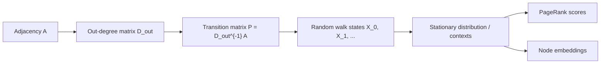
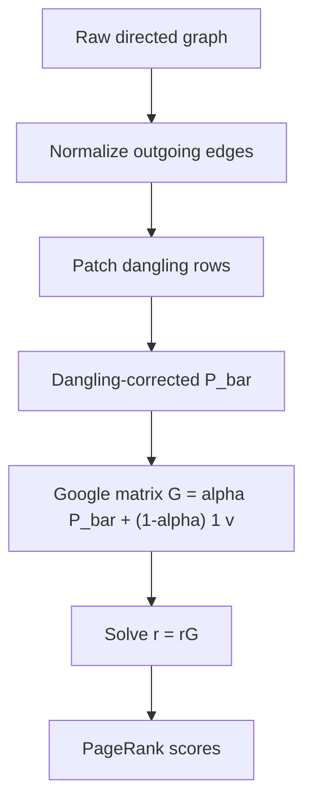
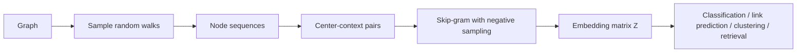
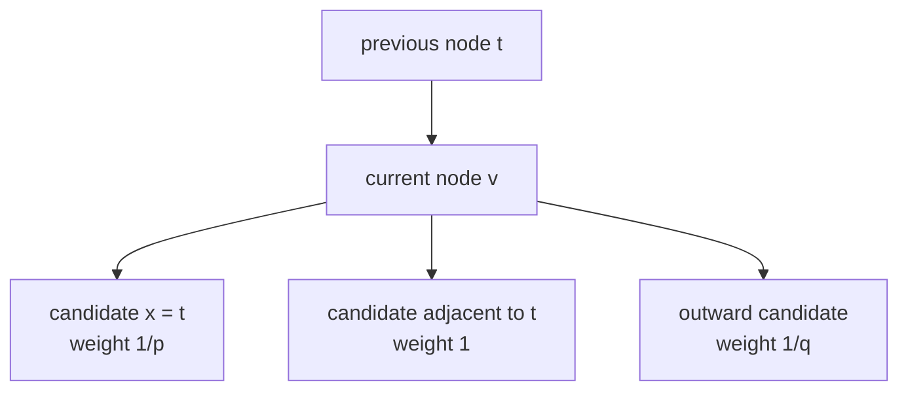

# **PageRank, Random Walks, and Graph Embeddings**

PageRank and random-walk graph embeddings are two expressions of the same central idea: graph structure can be understood through the long-run behavior of stochastic processes on nodes. PageRank converts random-walk visitation probabilities into a centrality score. DeepWalk and Node2Vec convert short random-walk traces into node-context pairs and learn vectors by the same machinery used in word embeddings.

This chapter focuses on the internal mechanics: Markov chains, stochastic matrices, PageRank as a linear system and eigenvector problem, power iteration, dangling-node handling, personalized PageRank, random-walk sampling, skip-gram with negative sampling, DeepWalk, Node2Vec, implementation details, and failure modes.

---

## **1. Graph and Markov-Chain Setup**

Let

$$
G=(V,E)
$$

be a graph with

$$
|V|=n,\qquad |E|=m.
$$

For a weighted directed graph, define the adjacency matrix

$$
A \in \mathbb{R}_{\ge 0}^{n \times n},
$$

where

$$
A_{ij} > 0
$$

means there is an edge from node $i$ to node $j$ with weight $A_{ij}$. For an unweighted graph, $A_{ij}\in\{0,1\}$.

The outgoing weighted degree of node $i$ is

$$
d_i^{\text{out}}=\sum_{j=1}^{n} A_{ij}.
$$

For nodes with positive out-degree, the natural random-walk transition probability is

$$
P_{ij}
=
\Pr(X_{t+1}=j \mid X_t=i)
=
\frac{A_{ij}}{d_i^{\text{out}}}.
$$

In matrix form,

$$
P = D_{\text{out}}^{-1} A,
$$

where

$$
D_{\text{out}}=\operatorname{diag}(d_1^{\text{out}},\dots,d_n^{\text{out}}).
$$

With this convention, $P$ is row-stochastic:

$$
\sum_{j=1}^{n} P_{ij}=1.
$$

A probability row vector

$$
\pi_t \in \mathbb{R}^{1 \times n}
$$

evolves as

$$
\pi_{t+1}=\pi_t P.
$$

If using column probability vectors instead, the transition matrix is usually column-stochastic and the update becomes

$$
p_{t+1}=M p_t.
$$

Both conventions are equivalent after transposition. This chapter uses row-stochastic $P$ for random walks and explicitly notes when a column-vector form is useful.



---

## **2. Ordinary Random Walks**

### **2.1 Execution**

Given a current node $i$:

1. Read its outgoing neighbors

$$
\mathcal{N}^{+}(i)=\{j : A_{ij}>0\}.
$$

2. Normalize outgoing edge weights:

$$
P_{ij}=\frac{A_{ij}}{\sum_{k}A_{ik}}.
$$

3. Sample one next node:

$$
X_{t+1}\sim \operatorname{Categorical}(P_{i1},\dots,P_{in}).
$$

4. Repeat for the desired walk length.

For an unweighted graph, this reduces to choosing uniformly among outgoing neighbors:

$$
P_{ij}=
\begin{cases}
\frac{1}{d_i^{\text{out}}}, & (i,j)\in E,\\
0, & \text{otherwise}.
\end{cases}
$$

### **2.2 Stationary Distribution**

A stationary distribution is a probability vector $\pi$ satisfying

$$
\pi = \pi P,
$$

with

$$
\pi_i \ge 0,\qquad \sum_{i=1}^{n}\pi_i=1.
$$

This means that if $X_t\sim \pi$, then $X_{t+1}\sim \pi$ as well.

For a finite Markov chain, uniqueness and convergence to a stationary distribution are guaranteed when the chain is:

- **irreducible:** every state can reach every other state.
- **aperiodic:** the chain is not trapped in deterministic cyclic timing.
- **positive recurrent:** automatic for finite irreducible chains.

Web graphs and many real directed graphs violate these assumptions because they contain disconnected components, sinks, periodic structures, and dangling nodes. PageRank modifies the random walk to force a well-behaved Markov chain.

### **2.3 Worked Example: Simple Random Walk**

Consider the directed graph

$$
A\to B,\qquad A\to C,\qquad B\to C,\qquad C\to A.
$$

With node order $(A,B,C)$, the adjacency matrix is

$$
A =
\begin{bmatrix}
0 & 1 & 1\\
0 & 0 & 1\\
1 & 0 & 0
\end{bmatrix}.
$$

The outgoing degrees are

$$
d_A^{\text{out}}=2,\qquad d_B^{\text{out}}=1,\qquad d_C^{\text{out}}=1.
$$

Therefore

$$
P =
\begin{bmatrix}
0 & \frac{1}{2} & \frac{1}{2}\\
0 & 0 & 1\\
1 & 0 & 0
\end{bmatrix}.
$$

If

$$
\pi_0 = [1,0,0],
$$

then

$$
\pi_1=\pi_0P=[0,\frac{1}{2},\frac{1}{2}],
$$

and

$$
\pi_2=\pi_1P
=
[0,\frac{1}{2},\frac{1}{2}]
\begin{bmatrix}
0 & \frac{1}{2} & \frac{1}{2}\\
0 & 0 & 1\\
1 & 0 & 0
\end{bmatrix}
=
[\frac{1}{2},0,\frac{1}{2}].
$$

The stationary distribution solves

$$
\pi = \pi P.
$$

Let

$$
\pi=[a,b,c].
$$

Then

$$
[a,b,c]
=
[a,b,c]
\begin{bmatrix}
0 & \frac{1}{2} & \frac{1}{2}\\
0 & 0 & 1\\
1 & 0 & 0
\end{bmatrix}
=
\left[c,\frac{a}{2},\frac{a}{2}+b\right].
$$

Thus

$$
a=c,
$$

$$
b=\frac{a}{2},
$$

$$
c=\frac{a}{2}+b.
$$

The third equation is redundant after substituting $b=a/2$. The normalization condition gives

$$
a+b+c
=
a+\frac{a}{2}+a
=
\frac{5a}{2}
=
1,
$$

so

$$
a=\frac{2}{5},\qquad b=\frac{1}{5},\qquad c=\frac{2}{5}.
$$

Therefore

$$
\pi=\left[\frac{2}{5},\frac{1}{5},\frac{2}{5}\right].
$$

---

## **3. PageRank**

PageRank assigns node importance by the probability that a random surfer occupies each node in the long run. The key modeling choice is recursive:

> A node is important if it is linked to by important nodes, and a linking node distributes its importance across its outgoing links.

For web pages, hyperlinks are directed endorsements. For citation graphs, references are citations. For recommendation graphs, transitions may represent user-item interactions. The same machinery applies whenever edge-following behavior is meaningful.

### **3.1 The Idealized Formula**

For a page $i$, let

$$
\operatorname{In}(i)=\{j:(j,i)\in E\}.
$$

If every node has positive out-degree, the idealized PageRank recursion is

$$
r_i
=
\sum_{j\in \operatorname{In}(i)}
\frac{r_j}{d_j^{\text{out}}}.
$$

In vector form, using row-stochastic $P$ and row vector $r$:

$$
r=rP.
$$

Equivalently, using a column vector $p=r^\top$:

$$
p=P^\top p.
$$

Thus PageRank is the stationary distribution of the link-following Markov chain.

### **3.2 Why Damping Is Needed**

The raw random walk may fail in three common ways.

**Dangling nodes:** a node has no outgoing links:

$$
d_i^{\text{out}}=0.
$$

Then row $i$ of $P$ is undefined.

**Reducibility:** the graph may contain closed components. Once the walk enters a sink strongly connected component, it cannot leave.

**Periodicity:** a graph such as a directed 2-cycle alternates deterministically, preventing convergence of $\pi_t$ even when a stationary distribution exists.

PageRank fixes this by adding teleportation. At each step:

- with probability $\alpha$, follow an outgoing link;
- with probability $1-\alpha$, jump to a node sampled from a teleportation distribution $v$.

Usually

$$
\alpha=0.85.
$$

The teleportation vector satisfies

$$
v_i\ge 0,\qquad \sum_{i=1}^{n}v_i=1.
$$

Uniform PageRank uses

$$
v_i=\frac{1}{n}.
$$

Personalized PageRank uses a nonuniform $v$ concentrated on seed nodes or user preferences.

### **3.3 Dangling-Node Correction**

Let

$$
s_i =
\begin{cases}
1, & d_i^{\text{out}}=0,\\
0, & d_i^{\text{out}}>0.
\end{cases}
$$

The dangling indicator row vector is

$$
s \in \{0,1\}^{1\times n}.
$$

For dangling rows, replace the undefined transition row by a dangling distribution $w$:

$$
w_i\ge 0,\qquad \sum_i w_i=1.
$$

Commonly

$$
w=v.
$$

Define the dangling-corrected transition matrix

$$
\bar{P}=P+s^\top w.
$$

Here $P$ has zero rows for dangling nodes. For a dangling node $i$, $s_i=1$, so row $i$ of $\bar{P}$ becomes $w$. For a non-dangling node, $s_i=0$, so its row is unchanged.

### **3.4 Google Matrix**

The full PageRank transition matrix is

$$
G = \alpha \bar{P} + (1-\alpha)\mathbf{1}v,
$$

where $\mathbf{1}$ is an $n\times 1$ column vector of ones, so $\mathbf{1}v$ is an $n\times n$ matrix whose every row is $v$.

Each row of $G$ sums to one:

$$
\sum_{j=1}^{n}G_{ij}
=
\alpha \sum_j \bar{P}_{ij}
+(1-\alpha)\sum_j v_j
=
\alpha +(1-\alpha)
=
1.
$$

If $v_j>0$ for every $j$ and $0<\alpha<1$, then every entry of $G$ is positive:

$$
G_{ij}\ge (1-\alpha)v_j>0.
$$

This makes the Markov chain irreducible and aperiodic. Therefore the stationary distribution is unique and power iteration converges.

### **3.5 PageRank Equation**

The PageRank row vector $r$ satisfies

$$
r=rG.
$$

Substituting $G$:

$$
r
=
r\left(\alpha \bar{P}+(1-\alpha)\mathbf{1}v\right).
$$

Because $r$ is a probability vector,

$$
r\mathbf{1}=1.
$$

Therefore

$$
r
=
\alpha r\bar{P}+(1-\alpha)v.
$$

This is the standard PageRank fixed-point equation:

$$
r = (1-\alpha)v + \alpha r\bar{P}.
$$

For uniform teleportation,

$$
r_i
=
\frac{1-\alpha}{n}
+\alpha
\sum_{j\in \operatorname{In}(i)}
\frac{r_j}{d_j^{\text{out}}},
$$

after accounting for dangling-node mass separately.

More precisely, with dangling mass

$$
\delta = \sum_{j:d_j^{\text{out}}=0} r_j,
$$

the coordinate update is

$$
r_i^{\text{new}}
=
(1-\alpha)v_i
+\alpha
\left(
\sum_{j:d_j^{\text{out}}>0}
r_j P_{ji}
+
\delta w_i
\right).
$$

### **3.6 Linear-System Form**

From

$$
r = (1-\alpha)v+\alpha r\bar{P},
$$

move the recursive term to the left:

$$
r(I-\alpha \bar{P})=(1-\alpha)v.
$$

As a column vector $p=r^\top$:

$$
(I-\alpha \bar{P}^\top)p=(1-\alpha)v^\top.
$$

This makes PageRank a sparse linear solve. Direct factorization is usually impractical for web-scale graphs, but the form is useful for analysis, personalized PageRank, and small graphs.

### **3.7 Eigenvector Form**

Because

$$
r=rG,
$$

$r$ is a left eigenvector of $G$ with eigenvalue $1$. Equivalently,

$$
G^\top p=p.
$$

Thus $p$ is the dominant right eigenvector of $G^\top$ under the probability simplex constraint.

Teleportation controls the spectral gap. If $\lambda_2(\bar{P})$ is a non-principal eigenvalue, the corresponding eigenvalues of $G$ are scaled approximately by $\alpha$ in the subspace orthogonal to the teleportation direction. Smaller $\alpha$ usually converges faster but makes scores more dominated by teleportation; larger $\alpha$ follows graph structure more faithfully but converges more slowly and can be more sensitive to graph artifacts.



---

## **4. Power Iteration for PageRank**

### **4.1 Algorithm**

Initialize

$$
r^{(0)}=v
$$

or

$$
r_i^{(0)}=\frac{1}{n}.
$$

Repeat:

$$
r^{(t+1)}
=
(1-\alpha)v+\alpha r^{(t)}\bar{P}.
$$

Stop when

$$
\|r^{(t+1)}-r^{(t)}\|_1 < \varepsilon.
$$

NetworkX uses an error tolerance proportional to $n\cdot \text{tol}$; this matters because the $\ell_1$ difference sums over nodes.

### **4.2 Sparse Execution**

Do not materialize $G$. It is dense because of teleportation. Instead:

1. Keep the graph as adjacency lists or CSR sparse arrays.
2. Push each node's rank mass across outgoing edges.
3. Accumulate dangling mass separately.
4. Add teleportation and dangling redistribution after sparse propagation.
5. Normalize defensively to compensate for floating-point drift.

The iteration is

$$
r_i^{(t+1)}
=
(1-\alpha)v_i
+\alpha\delta^{(t)}w_i
+\alpha\sum_{j:d_j^{\text{out}}>0}r_j^{(t)}P_{ji},
$$

where

$$
\delta^{(t)}
=
\sum_{j:d_j^{\text{out}}=0} r_j^{(t)}.
$$

### **4.3 Worked Example with Damping**

Use the graph

$$
A\to B,\qquad A\to C,\qquad B\to C,\qquad C\to A.
$$

There are no dangling nodes. Let

$$
\alpha=0.85,\qquad v=\left[\frac{1}{3},\frac{1}{3},\frac{1}{3}\right].
$$

Start with

$$
r^{(0)}=\left[\frac{1}{3},\frac{1}{3},\frac{1}{3}\right].
$$

The raw transition contribution is

$$
r^{(0)}P
=
\left[\frac{1}{3},\frac{1}{3},\frac{1}{3}\right]
\begin{bmatrix}
0 & \frac{1}{2} & \frac{1}{2}\\
0 & 0 & 1\\
1 & 0 & 0
\end{bmatrix}
=
\left[
\frac{1}{3},
\frac{1}{6},
\frac{1}{2}
\right].
$$

The teleportation term is

$$
(1-\alpha)v
=
0.15\left[\frac{1}{3},\frac{1}{3},\frac{1}{3}\right]
=
[0.05,0.05,0.05].
$$

Therefore

$$
r^{(1)}
=
[0.05,0.05,0.05]
+0.85\left[
\frac{1}{3},
\frac{1}{6},
\frac{1}{2}
\right].
$$

So

$$
r^{(1)}
=
[0.3333,0.1917,0.4750].
$$

Next,

$$
r^{(1)}P
=
[0.3333,0.1917,0.4750]
\begin{bmatrix}
0 & \frac{1}{2} & \frac{1}{2}\\
0 & 0 & 1\\
1 & 0 & 0
\end{bmatrix}
=
[0.4750,0.1667,0.3584].
$$

Thus

$$
r^{(2)}
=
[0.05,0.05,0.05]
+0.85[0.4750,0.1667,0.3584]
=
[0.4538,0.1917,0.3546].
$$

The stationary solution for this example is approximately

$$
r\approx [0.3878,0.2148,0.3974].
$$

Compared with the undamped stationary distribution

$$
\left[\frac{2}{5},\frac{1}{5},\frac{2}{5}\right],
$$

teleportation pulls the distribution toward uniform.

### **4.4 Example with a Dangling Node**

Consider

$$
A\to B,\qquad B\to C,
$$

where $C$ is dangling. With node order $(A,B,C)$,

$$
P=
\begin{bmatrix}
0 & 1 & 0\\
0 & 0 & 1\\
0 & 0 & 0
\end{bmatrix}.
$$

Let

$$
v=w=\left[\frac{1}{3},\frac{1}{3},\frac{1}{3}\right],
\qquad
\alpha=0.85.
$$

Start with

$$
r^{(0)}=\left[\frac{1}{3},\frac{1}{3},\frac{1}{3}\right].
$$

The dangling mass is

$$
\delta^{(0)}=r_C^{(0)}=\frac{1}{3}.
$$

Sparse link-following gives

$$
r^{(0)}P
=
\left[0,\frac{1}{3},\frac{1}{3}\right].
$$

Dangling redistribution gives

$$
\delta^{(0)}w
=
\frac{1}{3}
\left[\frac{1}{3},\frac{1}{3},\frac{1}{3}\right]
=
\left[\frac{1}{9},\frac{1}{9},\frac{1}{9}\right].
$$

Therefore

$$
r^{(1)}
=
(1-\alpha)v
+\alpha(r^{(0)}P+\delta^{(0)}w).
$$

Substitute values:

$$
r^{(1)}
=
[0.05,0.05,0.05]
+0.85
\left[
\frac{1}{9},
\frac{4}{9},
\frac{4}{9}
\right].
$$

So

$$
r^{(1)}
=
[0.1444,0.4278,0.4278].
$$

Without dangling redistribution, probability mass would disappear from the chain and the vector would no longer sum to one.

---

## **5. Personalized PageRank**

Personalized PageRank replaces uniform teleportation with a distribution $v$ that encodes a query, user, seed node, topic, or known positive examples.

For seed node $s$,

$$
v_i=
\begin{cases}
1, & i=s,\\
0, & i\ne s.
\end{cases}
$$

Then the fixed point is

$$
r_s = (1-\alpha)e_s+\alpha r_s\bar{P}.
$$

This distribution assigns large mass to nodes frequently reached by random walks that restart at $s$. It is therefore local: unlike global PageRank, it measures relevance to a source.

### **5.1 Random-Walk-with-Restart Interpretation**

At every step:

$$
X_{t+1}
=
\begin{cases}
\text{neighbor sampled from } \bar{P}_{X_t,:}, & \text{with probability } \alpha,\\
\text{restart node sampled from } v, & \text{with probability } 1-\alpha.
\end{cases}
$$

The expected length of a link-following segment before restart is

$$
\mathbb{E}[L]
=
\frac{\alpha}{1-\alpha},
$$

if $L$ counts the number of successful link-following steps before the first restart. For $\alpha=0.85$,

$$
\mathbb{E}[L]
=
\frac{0.85}{0.15}
\approx
5.67.
$$

This explains why personalized PageRank captures multi-hop locality without diffusing uniformly across the whole graph.

### **5.2 Uses**

- recommendation from user/item seed nodes.
- local community detection via sweeping over normalized personalized PageRank scores.
- graph neural network propagation variants such as APPNP and PPRGo.
- feature diffusion on sparse graphs.
- query-dependent ranking.

---

## **6. PageRank from Scratch**

The implementation below uses adjacency lists and does not build a dense Google matrix.

```python
from __future__ import annotations

from collections import defaultdict
from typing import Hashable, Mapping


def pagerank_from_scratch(
    graph: Mapping[Hashable, Mapping[Hashable, float] | list[Hashable] | tuple[Hashable, ...]],
    alpha: float = 0.85,
    personalization: Mapping[Hashable, float] | None = None,
    dangling: Mapping[Hashable, float] | None = None,
    max_iter: int = 100,
    tol: float = 1e-12,
) -> dict[Hashable, float]:
    """Compute PageRank by sparse power iteration.

    graph maps node -> outgoing neighbors. If the value is a mapping, values
    are treated as nonnegative weights. If it is a list/tuple, edges are
    unweighted.
    """
    if not (0.0 < alpha < 1.0):
        raise ValueError("alpha must be in (0, 1)")

    nodes = set(graph.keys())
    for nbrs in graph.values():
        if isinstance(nbrs, Mapping):
            nodes.update(nbrs.keys())
        else:
            nodes.update(nbrs)

    nodes = list(nodes)
    n = len(nodes)
    if n == 0:
        return {}

    # Convert all rows to normalized transition lists.
    out: dict[Hashable, list[tuple[Hashable, float]]] = {}
    for u in nodes:
        nbrs = graph.get(u, {})
        if isinstance(nbrs, Mapping):
            items = [(v, float(w)) for v, w in nbrs.items() if w > 0.0]
        else:
            counts: dict[Hashable, float] = defaultdict(float)
            for v in nbrs:
                counts[v] += 1.0
            items = list(counts.items())

        total = sum(w for _, w in items)
        if total > 0.0:
            out[u] = [(v, w / total) for v, w in items]
        else:
            out[u] = []

    def normalize_distribution(
        dist: Mapping[Hashable, float] | None,
        default_uniform: bool = True,
    ) -> dict[Hashable, float]:
        if dist is None:
            if not default_uniform:
                raise ValueError("distribution is required")
            return {u: 1.0 / n for u in nodes}

        clean = {u: max(float(dist.get(u, 0.0)), 0.0) for u in nodes}
        total = sum(clean.values())
        if total <= 0.0:
            raise ValueError("distribution must have positive mass on graph nodes")
        return {u: clean[u] / total for u in nodes}

    v = normalize_distribution(personalization)
    w = normalize_distribution(dangling) if dangling is not None else v

    rank = dict(v)

    for _ in range(max_iter):
        new_rank = {u: (1.0 - alpha) * v[u] for u in nodes}

        dangling_mass = 0.0
        for u in nodes:
            if out[u]:
                mass = alpha * rank[u]
                for nbr, prob in out[u]:
                    new_rank[nbr] += mass * prob
            else:
                dangling_mass += rank[u]

        if dangling_mass:
            mass = alpha * dangling_mass
            for u in nodes:
                new_rank[u] += mass * w[u]

        # Floating-point drift should be tiny, but normalization keeps the
        # vector on the probability simplex after many iterations.
        total = sum(new_rank.values())
        new_rank = {u: score / total for u, score in new_rank.items()}

        error = sum(abs(new_rank[u] - rank[u]) for u in nodes)
        rank = new_rank
        if error < tol:
            break
    else:
        raise RuntimeError("PageRank did not converge within max_iter")

    return rank


if __name__ == "__main__":
    graph = {
        "A": ["B", "C"],
        "B": ["C"],
        "C": ["A"],
    }
    print(pagerank_from_scratch(graph))
```

Important implementation details:

- Never divide by zero for dangling nodes; handle them explicitly.
- Include nodes that only appear as destinations.
- Normalize edge weights row-wise.
- Reject negative weights unless the model explicitly supports signed transitions.
- Use $\ell_1$ convergence for probability distributions.
- Avoid constructing the dense Google matrix for large graphs.

### **6.1 Equivalent NetworkX Implementation**

```python
import networkx as nx

G = nx.DiGraph()
G.add_edges_from([
    ("A", "B"),
    ("A", "C"),
    ("B", "C"),
    ("C", "A"),
])

scores = nx.pagerank(
    G,
    alpha=0.85,
    personalization=None,
    max_iter=100,
    tol=1e-12,
    weight="weight",
    dangling=None,
)

print(scores)
```

Under the hood, `networkx.pagerank`:

- converts undirected graphs into directed graphs with reciprocal arcs.
- builds a stochastic graph by normalizing outgoing edge weights.
- uses power iteration.
- redistributes dangling-node mass according to the dangling dictionary, commonly the personalization distribution.
- stops when the iteration error is below approximately $n\cdot \text{tol}$.
- raises a convergence exception if `max_iter` is exhausted.

NetworkX is convenient and correct for small-to-medium graphs, but its pure-Python graph representation is not the right backend for very large PageRank jobs. For large graphs, use sparse matrix libraries, graph processing systems, or approximate personalized PageRank methods.

---

## **7. Random Walks as Graph Corpora**

DeepWalk and Node2Vec use random walks to produce node sequences:

$$
(v_1,v_2,\dots,v_T).
$$

These sequences are treated like sentences. A node is treated like a token. Nearby nodes in a walk are treated like context.

For a window size $c$, a walk produces training pairs

$$
(v_t, v_{t+j})
\quad
\text{for}
\quad
-c\le j\le c,\quad j\ne 0.
$$

The learning problem is:

> Find embeddings such that nodes appearing in similar random-walk contexts have high compatibility.



### **7.1 Why Walks Capture Higher-Order Proximity**

A one-step random walk samples direct neighbors. A $k$-step random walk samples from

$$
P^k.
$$

Windowed co-occurrences pool several powers:

$$
P + P^2 + \cdots + P^c.
$$

Thus DeepWalk does not merely preserve adjacency. It preserves a distributional notion of graph proximity: two nodes are similar if they appear in similar multi-hop random-walk contexts.

This explains why random-walk embeddings often recover communities. In a graph with high within-community conductance barriers, a short random walk tends to stay inside the same community, so nodes in the same community co-occur frequently.

### **7.2 Random-Walk Sampling from Scratch**

```python
from __future__ import annotations

import random
from collections import defaultdict
from typing import Hashable, Iterable, Mapping


def build_unweighted_adjacency(edges: Iterable[tuple[Hashable, Hashable]], directed: bool = False):
    adj: dict[Hashable, list[Hashable]] = defaultdict(list)
    for u, v in edges:
        adj[u].append(v)
        adj.setdefault(v, [])
        if not directed:
            adj[v].append(u)
    return dict(adj)


def random_walk(
    adj: Mapping[Hashable, list[Hashable]],
    start: Hashable,
    walk_length: int,
    rng: random.Random,
) -> list[Hashable]:
    walk = [start]
    current = start

    for _ in range(walk_length - 1):
        nbrs = adj.get(current, [])
        if not nbrs:
            break
        current = rng.choice(nbrs)
        walk.append(current)

    return walk


def generate_deepwalk_walks(
    adj: Mapping[Hashable, list[Hashable]],
    num_walks: int,
    walk_length: int,
    seed: int = 0,
) -> list[list[str]]:
    rng = random.Random(seed)
    nodes = list(adj.keys())
    walks: list[list[str]] = []

    for _ in range(num_walks):
        rng.shuffle(nodes)
        for node in nodes:
            # Gensim expects string tokens unless the vocabulary is managed
            # carefully. Converting here also makes serialization simple.
            walks.append([str(x) for x in random_walk(adj, node, walk_length, rng)])

    return walks
```

---

## **8. Skip-Gram with Negative Sampling**

DeepWalk and Node2Vec usually train embeddings with skip-gram with negative sampling (SGNS).

Let:

- $z_u\in\mathbb{R}^d$ be the input embedding of center node $u$.
- $\tilde{z}_v\in\mathbb{R}^d$ be the output embedding of context node $v$.
- $\mathcal{D}$ be the multiset of positive center-context pairs generated from walks.
- $P_n(v)$ be the negative-sampling distribution.
- $K$ be the number of negatives per positive pair.

For a positive pair $(u,v)$, SGNS maximizes

$$
\log \sigma(z_u^\top \tilde{z}_v)
+
\sum_{k=1}^{K}
\mathbb{E}_{v_k^- \sim P_n}
\left[
\log \sigma(-z_u^\top \tilde{z}_{v_k^-})
\right],
$$

where

$$
\sigma(x)=\frac{1}{1+\exp(-x)}.
$$

Equivalently, minimize the negative objective:

$$
\mathcal{L}(u,v,\{v_k^-\}_{k=1}^{K})
=
-\log \sigma(z_u^\top \tilde{z}_v)
-
\sum_{k=1}^{K}
\log \sigma(-z_u^\top \tilde{z}_{v_k^-}).
$$

### **8.1 Gradients**

For one labeled pair $(u,c,y)$, where $y=1$ for a positive context and $y=0$ for a negative context, define

$$
x = z_u^\top \tilde{z}_c,
$$

and binary logistic loss

$$
\ell(x,y)
=
-y\log \sigma(x) -(1-y)\log(1-\sigma(x)).
$$

Using

$$
\frac{\partial \ell}{\partial x}
=
\sigma(x)-y,
$$

we get

$$
\frac{\partial \ell}{\partial z_u}
=
(\sigma(x)-y)\tilde{z}_c,
$$

and

$$
\frac{\partial \ell}{\partial \tilde{z}_c}
=
(\sigma(x)-y)z_u.
$$

For one positive pair and $K$ negatives, accumulate these gradients over $K+1$ binary classification terms.

### **8.2 Intuition**

The positive term increases

$$
z_u^\top \tilde{z}_v
$$

for observed walk co-occurrences. The negative terms decrease

$$
z_u^\top \tilde{z}_{v^-}
$$

for randomly sampled non-context nodes. The model therefore learns an embedding geometry where random-walk context is linearly predictable.

Because the full softmax over all nodes would cost $O(n)$ per training pair, negative sampling replaces it with $O(K)$ sampled binary comparisons.

### **8.3 Numerical Stability**

Compute log-sigmoid terms using stable identities:

$$
\log\sigma(x)=-\operatorname{softplus}(-x),
$$

and

$$
\log\sigma(-x)=-\operatorname{softplus}(x),
$$

where

$$
\operatorname{softplus}(x)=\log(1+\exp(x)).
$$

Directly computing $\log(1+\exp(x))$ can overflow for large $x$. Stable implementations use branching or library functions such as `numpy.logaddexp`.

### **8.4 SGNS from Scratch with NumPy**

This implementation is intentionally compact and explicit. It is suitable for understanding mechanics, not for large-scale training.

```python
from __future__ import annotations

from collections import Counter
from typing import Sequence

import numpy as np


def sigmoid(x: np.ndarray) -> np.ndarray:
    # Stable sigmoid for moderate educational workloads.
    return np.where(
        x >= 0,
        1.0 / (1.0 + np.exp(-x)),
        np.exp(x) / (1.0 + np.exp(x)),
    )


def walk_pairs(walks: Sequence[Sequence[str]], window_size: int) -> list[tuple[str, str]]:
    pairs: list[tuple[str, str]] = []
    for walk in walks:
        for i, center in enumerate(walk):
            left = max(0, i - window_size)
            right = min(len(walk), i + window_size + 1)
            for j in range(left, right):
                if i != j:
                    pairs.append((center, walk[j]))
    return pairs


def train_sgns(
    walks: Sequence[Sequence[str]],
    embedding_dim: int = 32,
    window_size: int = 5,
    negative_samples: int = 5,
    epochs: int = 3,
    lr: float = 0.025,
    seed: int = 0,
) -> tuple[dict[str, np.ndarray], dict[str, int]]:
    rng = np.random.default_rng(seed)

    counts = Counter(token for walk in walks for token in walk)
    vocab = sorted(counts)
    token_to_id = {token: i for i, token in enumerate(vocab)}
    n = len(vocab)

    # Word2Vec commonly samples negatives from unigram_count^0.75.
    freqs = np.array([counts[token] for token in vocab], dtype=np.float64)
    neg_probs = freqs ** 0.75
    neg_probs /= neg_probs.sum()

    scale = 0.5 / embedding_dim
    Z_in = rng.uniform(-scale, scale, size=(n, embedding_dim))
    Z_out = np.zeros((n, embedding_dim), dtype=np.float64)

    pairs = [(token_to_id[u], token_to_id[v]) for u, v in walk_pairs(walks, window_size)]

    for _ in range(epochs):
        rng.shuffle(pairs)
        for center_id, context_id in pairs:
            neg_ids = rng.choice(n, size=negative_samples, replace=True, p=neg_probs)

            target_ids = np.concatenate([[context_id], neg_ids])
            labels = np.concatenate([[1.0], np.zeros(negative_samples)])

            center_vec = Z_in[center_id].copy()
            context_vecs = Z_out[target_ids].copy()

            logits = context_vecs @ center_vec
            probs = sigmoid(logits)
            errors = probs - labels

            # Gradient for input vector is sum_j error_j * output_j.
            grad_center = errors @ context_vecs

            # Gradient for each output vector is error_j * center_vec.
            grad_context = errors[:, None] * center_vec[None, :]

            Z_in[center_id] -= lr * grad_center

            # np.add.at correctly handles repeated negative samples.
            np.add.at(Z_out, target_ids, -lr * grad_context)

    embeddings = {token: Z_in[idx] for token, idx in token_to_id.items()}
    return embeddings, token_to_id
```

Common training details omitted here but used in production systems:

- subsampling frequent nodes/tokens.
- dynamic context windows.
- learning-rate schedules.
- multi-threaded Hogwild-style updates.
- alias sampling for fast negative sampling.
- vectorized minibatches on accelerators.

---

## **9. DeepWalk**

DeepWalk combines truncated random walks with SGNS:

1. For each node, run several random walks of fixed length.
2. Treat each walk as a sentence.
3. Train skip-gram embeddings on node-context pairs.

### **9.1 Objective**

Let $\mathcal{N}_S(u)$ be the multiset of context nodes observed around $u$ in sampled walks under sampling strategy $S$. DeepWalk maximizes

$$
\max_{\theta}
\sum_{u\in V}
\sum_{v\in \mathcal{N}_S(u)}
\log \Pr(v\mid u;\theta).
$$

With a full softmax decoder,

$$
\Pr(v\mid u)
=
\frac{\exp(z_u^\top \tilde{z}_v)}
{\sum_{x\in V}\exp(z_u^\top \tilde{z}_x)}.
$$

Because the denominator costs $O(n)$ per pair, implementations usually use hierarchical softmax or negative sampling. With negative sampling, the optimized surrogate is SGNS.

### **9.2 Matrix-Factorization View**

SGNS implicitly factorizes a shifted pointwise mutual information matrix. For random-walk embeddings, the co-occurrence distribution is induced by powers of $P$.

Ignoring implementation details such as dynamic windows, finite samples, and boundary effects, the expected context distribution for window size $c$ depends on

$$
\frac{1}{c}\sum_{k=1}^{c}P^k.
$$

Thus DeepWalk can be understood as factorizing a transformed matrix of multi-step transition probabilities. This connects DeepWalk to spectral embeddings, matrix factorization, and diffusion kernels.

### **9.3 DeepWalk from Scratch**

```python
edges = [
    ("A", "B"),
    ("B", "C"),
    ("B", "D"),
    ("C", "D"),
    ("D", "E"),
]

adj = build_unweighted_adjacency(edges, directed=False)

walks = generate_deepwalk_walks(
    adj,
    num_walks=10,
    walk_length=20,
    seed=7,
)

embeddings, token_to_id = train_sgns(
    walks,
    embedding_dim=16,
    window_size=3,
    negative_samples=5,
    epochs=10,
    lr=0.025,
    seed=7,
)

print(embeddings["B"])
```

This is the complete conceptual pipeline. The generated walks approximate graph-context statistics; SGNS converts those statistics into vectors.

### **9.4 Equivalent Gensim Implementation**

```python
from gensim.models import Word2Vec

model = Word2Vec(
    sentences=walks,
    vector_size=128,
    window=5,
    sg=1,          # 1 = skip-gram, 0 = CBOW
    negative=5,    # number of negative samples
    hs=0,          # 0 = do not use hierarchical softmax
    min_count=0,   # keep all nodes
    workers=4,
    epochs=5,
)

embedding_B = model.wv["B"]
similar_to_B = model.wv.most_similar("B", topn=5)
```

Internally, `Word2Vec`:

- builds a token vocabulary and integer ids.
- counts token frequencies.
- constructs a negative-sampling table or sampler from frequency-smoothed unigram probabilities.
- slides a context window over each sentence.
- for `sg=1`, trains center-to-context predictions.
- updates input and output embedding tables.
- exposes the input embedding table through `model.wv`.

For graph embeddings, the "sentences" are random walks and the "words" are node ids.

---

## **10. Node2Vec**

DeepWalk uses unbiased first-order random walks. Node2Vec introduces a second-order biased walk controlled by two parameters:

- $p$: return parameter.
- $q$: in-out parameter.

The transition probability depends on the previous node $t$, current node $v$, and candidate next node $x$.

Suppose the walk just traversed

$$
t\to v.
$$

For candidate next node

$$
x\in \mathcal{N}(v),
$$

Node2Vec defines unnormalized probability

$$
\pi_{vx}
=
\alpha_{pq}(t,x)w_{vx},
$$

where $w_{vx}$ is the edge weight and

$$
\alpha_{pq}(t,x)
=
\begin{cases}
\frac{1}{p}, & d(t,x)=0,\\
1, & d(t,x)=1,\\
\frac{1}{q}, & d(t,x)=2.
\end{cases}
$$

Here $d(t,x)$ is the shortest-path distance between $t$ and $x$, but because both $t$ and $x$ are neighbors of $v$, only distances $0$, $1$, and $2$ are possible in an unweighted graph:

- $d(t,x)=0$: immediately return to $t$.
- $d(t,x)=1$: stay close to the previous node's neighborhood.
- $d(t,x)=2$: move outward to a node not adjacent to $t$.

Normalize over $x\in\mathcal{N}(v)$:

$$
\Pr(X_{i+1}=x\mid X_i=v,X_{i-1}=t)
=
\frac{\pi_{vx}}{\sum_{z\in\mathcal{N}(v)}\pi_{vz}}.
$$

### **10.1 BFS vs DFS Bias**

Small $q$ increases the probability of outward moves:

$$
\frac{1}{q}\text{ is large when }q<1.
$$

This encourages DFS-like exploration and can capture structural roles.

Large $q$ penalizes outward moves:

$$
\frac{1}{q}\text{ is small when }q>1.
$$

This encourages BFS-like local exploration and tends to capture homophily/community similarity.

Small $p$ encourages immediate backtracking. Large $p$ discourages immediate backtracking.



### **10.2 Worked Node2Vec Transition Example**

Assume the walk traversed

$$
A\to B.
$$

The neighbors of $B$ are

$$
\mathcal{N}(B)=\{A,C,D\}.
$$

Assume edges

$$
A-B,\qquad B-C,\qquad B-D,\qquad A-C,
$$

but no edge $A-D$.

Then:

$$
d(A,A)=0,
$$

$$
d(A,C)=1,
$$

$$
d(A,D)=2.
$$

Let

$$
p=2,\qquad q=0.5,
$$

and all edge weights be $1$. The unnormalized transition weights are

$$
\pi_{BA}=\frac{1}{p}=\frac{1}{2}=0.5,
$$

$$
\pi_{BC}=1,
$$

$$
\pi_{BD}=\frac{1}{q}=2.
$$

The normalizer is

$$
Z=0.5+1+2=3.5.
$$

Therefore

$$
\Pr(A\mid A,B)=\frac{0.5}{3.5}\approx 0.1429,
$$

$$
\Pr(C\mid A,B)=\frac{1}{3.5}\approx 0.2857,
$$

$$
\Pr(D\mid A,B)=\frac{2}{3.5}\approx 0.5714.
$$

Because $q<1$, the outward node $D$ receives the highest probability.

### **10.3 Node2Vec Walks from Scratch**

```python
from __future__ import annotations

import random
from typing import Hashable, Mapping


def node2vec_next(
    adj: Mapping[Hashable, list[Hashable]],
    prev: Hashable,
    current: Hashable,
    p: float,
    q: float,
    rng: random.Random,
) -> Hashable:
    if p <= 0.0 or q <= 0.0:
        raise ValueError("p and q must be positive")

    nbrs = adj[current]
    prev_neighbors = set(adj.get(prev, []))

    weights = []
    for x in nbrs:
        if x == prev:
            bias = 1.0 / p
        elif x in prev_neighbors:
            bias = 1.0
        else:
            bias = 1.0 / q
        weights.append(bias)

    total = sum(weights)
    threshold = rng.random() * total
    cumulative = 0.0
    for x, weight in zip(nbrs, weights):
        cumulative += weight
        if cumulative >= threshold:
            return x

    return nbrs[-1]


def node2vec_walk(
    adj: Mapping[Hashable, list[Hashable]],
    start: Hashable,
    walk_length: int,
    p: float,
    q: float,
    rng: random.Random,
) -> list[Hashable]:
    walk = [start]
    if walk_length == 1:
        return walk

    nbrs = adj.get(start, [])
    if not nbrs:
        return walk

    walk.append(rng.choice(nbrs))

    while len(walk) < walk_length:
        prev, current = walk[-2], walk[-1]
        if not adj.get(current):
            break
        walk.append(node2vec_next(adj, prev, current, p, q, rng))

    return walk
```

Efficient Node2Vec implementations precompute alias samplers for each directed edge $(t,v)$ because the transition distribution depends on both the previous and current node. This reduces each transition sample to amortized $O(1)$ time after preprocessing, at the cost of additional memory.

### **10.4 Library Implementation with `node2vec`**

```python
import networkx as nx
from node2vec import Node2Vec

G = nx.Graph()
G.add_edges_from([
    ("A", "B"),
    ("B", "C"),
    ("B", "D"),
    ("C", "D"),
    ("D", "E"),
])

node2vec = Node2Vec(
    G,
    dimensions=128,
    walk_length=80,
    num_walks=10,
    p=1.0,
    q=0.5,
    workers=4,
)

model = node2vec.fit(
    window=10,
    min_count=1,
    batch_words=128,
    sg=1,
    negative=5,
)

embedding = model.wv["B"]
```

Most Node2Vec libraries perform two separate phases:

1. **Walk simulation:** generate biased second-order walks using $p$ and $q$.
2. **Embedding training:** call Word2Vec/SGNS over the generated walks.

Thus, if two Node2Vec implementations produce different embeddings, the cause may be walk sampling, windowing, negative sampling, random seeds, node id ordering, or Word2Vec hyperparameters.

---

## **11. PageRank vs DeepWalk vs Node2Vec**

| Method | Output | Random Process | Optimization | Captures | Typical Use |
|---|---:|---|---|---|---|
| PageRank | scalar per node | random walk with teleportation | fixed-point/eigenvector solve | global importance | ranking, centrality |
| Personalized PageRank | scalar per node per seed distribution | random walk with restart | fixed-point/linear solve | seed-relative relevance | recommendation, local clustering |
| DeepWalk | vector per node | unbiased truncated random walks | SGNS / hierarchical softmax | higher-order co-occurrence | node classification, link prediction |
| Node2Vec | vector per node | biased second-order walks | SGNS / hierarchical softmax | tunable homophily vs role similarity | classification, link prediction, retrieval |

The methods are closely related:

- PageRank uses the limiting distribution of a modified random walk.
- Personalized PageRank uses restart-biased limiting distributions.
- DeepWalk samples finite random-walk windows and factorizes their co-occurrence statistics.
- Node2Vec changes the walk transition law before applying the same embedding training idea.

---

## **12. Complexity**

### **12.1 PageRank**

For sparse power iteration:

$$
T_{\text{iter}}=O(m+n).
$$

If $K$ iterations are required:

$$
T=O(K(m+n)).
$$

Memory is

$$
O(m+n),
$$

including graph storage and two rank vectors.

The number of iterations depends on $\alpha$, tolerance, graph structure, and initialization. Larger $\alpha$ typically means slower convergence.

### **12.2 DeepWalk**

Let:

- $\gamma$ be walks per node.
- $L$ be walk length.
- $c$ be window size.
- $d$ be embedding dimension.
- $K$ be negative samples per positive pair.

The number of sampled walk tokens is

$$
N_{\text{tokens}}=\gamma n L.
$$

The number of center-context pairs is approximately

$$
N_{\text{pairs}}\approx 2c\gamma n L,
$$

ignoring boundary effects.

SGNS training cost is

$$
O(N_{\text{pairs}} K d).
$$

Memory is

$$
O(nd)
$$

for embeddings, plus graph storage and sampled walks if they are materialized. Streaming walks can reduce walk memory.

### **12.3 Node2Vec**

Naive transition sampling requires checking whether candidate $x$ is adjacent to previous node $t$. With hash sets, each candidate check is $O(1)$, but computing a distribution over all neighbors of current node $v$ costs

$$
O(d_v).
$$

Alias precomputation for each directed edge can cost roughly

$$
O\left(\sum_{(t,v)\in E}d_v\right),
$$

which may be large for graphs with high-degree hubs. Sampling then becomes amortized $O(1)$ per step. The SGNS training cost remains similar to DeepWalk.

---

## **13. Numerical Stability and Edge Cases**

### **13.1 PageRank**

**Dangling nodes:** handle zero out-degree explicitly. Otherwise the transition matrix is invalid.

**Disconnected directed graphs:** teleportation ensures irreducibility only if the teleportation vector has positive support over all nodes. If $v_i=0$ for some nodes, those nodes may receive zero mass unless reachable from the support.

**Non-normalized personalization:** normalize the vector before use. Scaling a personalization vector by a positive constant should not change PageRank.

**Negative weights:** standard PageRank assumes nonnegative transition weights. Negative edge weights break the Markov-chain interpretation.

**Convergence tolerance:** too loose a tolerance can perturb rankings of near-tied nodes. Too strict a tolerance wastes iterations and may fail under floating-point noise.

**Rank sinks without teleportation:** if $\alpha=1$, PageRank reduces to ordinary stationary distribution and may be nonunique or fail to converge.

**Dense Google matrix:** materializing $G$ costs $O(n^2)$ memory. Sparse propagation avoids this.

### **13.2 Random-Walk Embeddings**

**High-degree nodes:** frequent hubs dominate co-occurrences. Subsampling and degree-aware negative sampling can help.

**Small components:** nodes in tiny components have limited contexts and may get poor embeddings.

**Directed graphs:** treating directed graphs as undirected changes the semantics. For citation or hyperlink graphs, direction often matters.

**Isolated nodes:** no walk context exists. Their embeddings are untrained unless initialized from features or handled specially.

**Random seed sensitivity:** embeddings are identifiable only up to rotation/reflection and can vary across runs.

**SGNS saturation:** large dot products make sigmoid gradients vanish. Learning-rate schedules and stable log-sigmoid calculations matter.

**Evaluation leakage:** for link prediction, generating walks on the full graph before splitting edges leaks test edges into embeddings.

**Node id handling:** libraries often expect string tokens. Inconsistent conversion between integer ids and strings can silently corrupt downstream joins.

---

## **14. Common Implementation Pitfalls**

1. **Using incoming degree instead of outgoing degree in PageRank.** Rank flows through outgoing links of the source node.
2. **Updating PageRank in-place.** Power iteration should use the old vector for all updates in an iteration.
3. **Forgetting destination-only nodes.** Nodes that only receive edges still need rank entries.
4. **Dropping dangling mass.** This makes total rank less than one.
5. **Building a dense Google matrix.** This is unnecessary and infeasible for large graphs.
6. **Comparing embeddings by raw coordinates across runs.** Compare pairwise similarities or align embeddings first.
7. **Confusing Node2Vec's $p$ and $q$.** $p$ controls return probability; $q$ controls outward exploration.
8. **Using default `min_count` in Word2Vec.** The default may drop rare node ids; set `min_count=0` or `min_count=1`.
9. **Training embeddings before train/test edge removal.** This leaks structural information.
10. **Assuming PageRank is causal importance.** PageRank is graph-centrality under a random-surfer model, not a causal attribution score.

---

## **15. Connections to Related ML Concepts**

### **15.1 Spectral Graph Theory**

PageRank is an eigenvector method on a stochastic matrix. Spectral clustering uses eigenvectors of graph Laplacians. Both study diffusion over graphs, but PageRank uses a directed random-walk operator with teleportation, while spectral clustering usually uses symmetric or normalized Laplacians.

### **15.2 Matrix Factorization**

DeepWalk and Node2Vec can be interpreted as factorizing transformed random-walk co-occurrence matrices. This connects them to SVD, PMI factorization, and representation learning.

### **15.3 Graph Neural Networks**

Many GNN layers perform feature diffusion:

$$
H^{(k+1)}=\sigma(\hat{P}H^{(k)}W^{(k)}).
$$

PageRank-style propagation appears in APPNP, PPRGo, and graph diffusion preprocessing. Random-walk embeddings can also be used as input features for GNNs, especially when raw node attributes are weak.

### **15.4 Recommendation Systems**

Personalized PageRank is a classic graph-based recommender: seed a user or item and rank nearby nodes by restart-biased relevance. Node2Vec embeddings can support approximate nearest-neighbor retrieval, candidate generation, and link prediction.

### **15.5 Contrastive Learning**

SGNS is a contrastive objective: observed center-context pairs are positives, sampled random nodes are negatives. Modern graph contrastive learning generalizes this idea with learned augmentations, mutual-information estimators, and encoder networks.

---

## **16. Additional Worked Example: Link Prediction with Embeddings**

Suppose embeddings are

$$
z_A=[0.4,0.8],
\qquad
z_B=[0.5,0.7],
\qquad
z_C=[-0.2,0.1].
$$

A dot-product link score is

$$
s(u,v)=z_u^\top z_v.
$$

For $(A,B)$:

$$
s(A,B)=0.4\cdot 0.5 + 0.8\cdot 0.7 = 0.2+0.56=0.76.
$$

For $(A,C)$:

$$
s(A,C)=0.4\cdot (-0.2)+0.8\cdot 0.1=-0.08+0.08=0.
$$

With logistic decoder

$$
\Pr((u,v)\in E)=\sigma(z_u^\top z_v),
$$

we get

$$
\Pr((A,B)\in E)=\sigma(0.76)\approx 0.6814,
$$

and

$$
\Pr((A,C)\in E)=\sigma(0)=0.5.
$$

If embeddings were trained from undirected random walks, this decoder is symmetric:

$$
s(u,v)=s(v,u).
$$

For directed link prediction, use separate source and destination embeddings:

$$
s(u,v)=(z_u^{\text{src}})^\top z_v^{\text{dst}}.
$$

---

## **17. Practical Hyperparameter Guidance**

| Component | Hyperparameter | Effect |
|---|---:|---|
| PageRank | $\alpha$ | Higher values follow graph links longer; lower values emphasize teleportation and converge faster |
| PageRank | `tol` | Smaller values give more precise ranks but require more iterations |
| DeepWalk | walk length | Longer walks capture broader graph context but may blur communities |
| DeepWalk | walks per node | More walks reduce sampling variance |
| DeepWalk/Node2Vec | window size | Larger windows capture higher-order proximity |
| SGNS | negative samples | More negatives improve discrimination but increase cost |
| SGNS | embedding dimension | Higher dimension increases capacity and overfitting risk |
| Node2Vec | $p$ | Low $p$ encourages backtracking; high $p$ discourages it |
| Node2Vec | $q$ | Low $q$ encourages outward DFS-like walks; high $q$ encourages local BFS-like walks |

For node classification under homophily, start with DeepWalk or Node2Vec with $q>1$. For role discovery, try $q<1$. For recommendation from seeds, personalized PageRank is often a strong baseline before training embeddings.

---

## **18. References and Deeper Reading**

- Lawrence Page, Sergey Brin, Rajeev Motwani, Terry Winograd. **The PageRank Citation Ranking: Bringing Order to the Web**. Stanford InfoLab, 1998. https://infolab.stanford.edu/~page/papers/pagerank/
- Sergey Brin, Lawrence Page. **The Anatomy of a Large-Scale Hypertextual Web Search Engine**. Computer Networks and ISDN Systems, 1998.
- Amy N. Langville, Carl D. Meyer. **Google's PageRank and Beyond: The Science of Search Engine Rankings**. Princeton University Press, 2006.
- Reid Andersen, Fan Chung, Kevin Lang. **Local Graph Partitioning using PageRank Vectors**. FOCS, 2006. https://fanchung.ucsd.edu/wp/localpartition.pdf
- Bryan Perozzi, Rami Al-Rfou, Steven Skiena. **DeepWalk: Online Learning of Social Representations**. KDD, 2014. https://arxiv.org/abs/1403.6652
- Aditya Grover, Jure Leskovec. **node2vec: Scalable Feature Learning for Networks**. KDD, 2016. https://cs.stanford.edu/~jure/pubs/node2vec-kdd16.pdf
- Tomas Mikolov, Ilya Sutskever, Kai Chen, Greg Corrado, Jeffrey Dean. **Distributed Representations of Words and Phrases and their Compositionality**. NeurIPS, 2013.
- Jie Tang, Meng Qu, Mingzhe Wang, Ming Zhang, Jun Yan, Qiaozhu Mei. **LINE: Large-scale Information Network Embedding**. WWW, 2015.
- NetworkX documentation: `pagerank`. https://networkx.org/documentation/stable/reference/algorithms/generated/networkx.algorithms.link_analysis.pagerank_alg.pagerank.html
- Gensim documentation: `Word2Vec`. https://radimrehurek.com/gensim/models/word2vec.html
