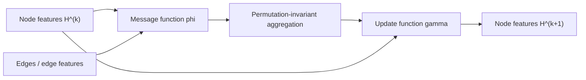
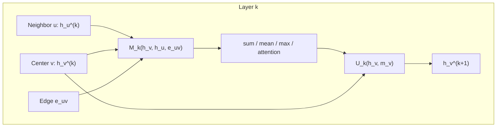
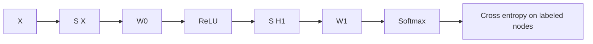
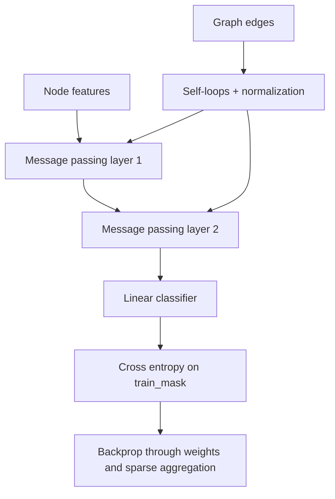

# **Message Passing in Graph Neural Networks**

Message passing is the computational primitive behind most graph neural networks (GNNs). A node representation is updated by receiving edge-indexed messages from its neighbors, aggregating those messages with a permutation-invariant operator, and combining the aggregate with the node's previous state.

The useful abstraction is:

$$
h_v^{(k+1)}
=
\operatorname{UPDATE}^{(k)}
\left(
h_v^{(k)},
\operatorname{AGG}^{(k)}
\left(
\left\{
\operatorname{MESSAGE}^{(k)}(h_v^{(k)},h_u^{(k)},e_{uv})
:
u \in \mathcal{N}(v)
\right\}
\right)
\right).
$$

Here $h_v^{(k)}$ is the representation of node $v$ at layer $k$, $\mathcal{N}(v)$ is the neighborhood that sends messages to $v$, and $e_{uv}$ is an optional edge feature. This chapter focuses on how this computation works internally, how common layers such as GCN, GraphSAGE, GAT, and GIN fit into it, and what implementation details matter in practice.

---

## **1. Formal Setup**

Let

$$
G=(V,E)
$$

be a graph with

$$
|V|=n,\qquad |E|=m.
$$

The node feature matrix is

$$
X \in \mathbb{R}^{n \times d_0},
$$

where row $x_v^\top$ stores the feature vector of node $v$. The hidden representation matrix at layer $k$ is

$$
H^{(k)}
=
\begin{bmatrix}
(h_1^{(k)})^\top\\
\vdots\\
(h_n^{(k)})^\top
\end{bmatrix}
\in \mathbb{R}^{n \times d_k},
$$

with

$$
H^{(0)}=X.
$$

For an unweighted graph, the adjacency matrix is

$$
A_{uv}
=
\begin{cases}
1, & (u,v)\in E,\\
0, & \text{otherwise}.
\end{cases}
$$

For a weighted graph, $A_{uv}\ge 0$ stores the edge weight. In an undirected graph, $A=A^\top$. In a directed graph, one must choose whether messages flow along incoming edges, outgoing edges, both directions, or typed direction-specific edges.

The degree of node $v$ in an undirected unweighted graph is

$$
d_v = \sum_{u=1}^{n} A_{vu}.
$$

The degree matrix is

$$
D=\operatorname{diag}(d_1,\dots,d_n).
$$

When adding self-loops, define

$$
\tilde{A}=A+I_n,
$$

and

$$
\tilde{D}_{vv}=\sum_{u=1}^{n}\tilde{A}_{vu}.
$$

Self-loops matter because, without them, a node's next representation may be computed only from neighbors and can lose its own previous state.



---

## **2. Why Aggregation Must Be Permutation-Invariant**

Graphs do not have a canonical ordering of neighbors. If node $v$ has neighbors

$$
\mathcal{N}(v)=\{u_1,u_2,u_3\},
$$

then the model should produce the same aggregate whether the neighbors are enumerated as $(u_1,u_2,u_3)$ or $(u_3,u_1,u_2)$.

An aggregation function $\rho$ is permutation-invariant if, for every permutation $\pi$,

$$
\rho(\{z_1,\dots,z_r\})
=
\rho(\{z_{\pi(1)},\dots,z_{\pi(r)}\}).
$$

Common choices are:

$$
\rho_{\text{sum}}(\{z_i\}_{i=1}^{r})=\sum_{i=1}^{r} z_i,
$$

$$
\rho_{\text{mean}}(\{z_i\}_{i=1}^{r})=\frac{1}{r}\sum_{i=1}^{r} z_i,
$$

$$
\rho_{\text{max}}(\{z_i\}_{i=1}^{r})_j=\max_{i=1,\dots,r}(z_i)_j.
$$

Attention aggregation is also invariant if the attention weights are computed independently for each neighbor and normalized over the set:

$$
\rho_{\text{attn}}(\{z_u\}_{u\in \mathcal{N}(v)})
=
\sum_{u\in \mathcal{N}(v)} \alpha_{vu} z_u,
$$

where

$$
\alpha_{vu}
=
\frac{\exp(s_{vu})}
{\sum_{w\in \mathcal{N}(v)}\exp(s_{vw})}.
$$

The order of evaluating the sum does not change the result.

### **Permutation Equivariance**

A node-level GNN should be permutation-equivariant. If we relabel nodes by a permutation matrix $P$, then the output should be relabeled in the same way:

$$
f(PAP^\top,PX)=P f(A,X).
$$

For a simple linear message passing layer

$$
H^{(k+1)}
=
\sigma(AH^{(k)}W),
$$

permutation equivariance follows directly:

$$
\begin{aligned}
f(PAP^\top,PH)
&=
\sigma\left((PAP^\top)(PH)W\right)\\
&=
\sigma\left(PA(P^\top P)HW\right)\\
&=
\sigma\left(PAHW\right)\\
&=
P\sigma(AHW)\\
&=
P f(A,H).
\end{aligned}
$$

The equality $\sigma(PZ)=P\sigma(Z)$ holds because common activations such as ReLU, GELU, sigmoid, and tanh are applied row-wise and element-wise.

---

## **3. Generic Message Passing Layer**

A broad message passing neural network (MPNN) layer can be written as

$$
m_v^{(k+1)}
=
\sum_{u\in \mathcal{N}(v)}
M_k(h_v^{(k)},h_u^{(k)},e_{uv}),
$$

$$
h_v^{(k+1)}
=
U_k(h_v^{(k)},m_v^{(k+1)}).
$$

For graph-level prediction, a readout aggregates final node states:

$$
h_G
=
R\left(\{h_v^{(K)}:v\in V\}\right),
$$

where $R$ is permutation-invariant, for example sum, mean, attention pooling, or Set2Set-like pooling.



### **Step-by-Step Execution**

For one layer and one target node $v$:

1. Gather all source nodes $u$ satisfying $u\in \mathcal{N}(v)$.
2. For each edge $(u,v)$, compute a message

$$
\mu_{uv}^{(k)}
=
M_k(h_v^{(k)},h_u^{(k)},e_{uv}).
$$

3. Aggregate incoming messages:

$$
m_v^{(k)}
=
\operatorname{AGG}
\left(
\{\mu_{uv}^{(k)}:u\in \mathcal{N}(v)\}
\right).
$$

4. Update the state:

$$
h_v^{(k+1)}
=
U_k(h_v^{(k)},m_v^{(k)}).
$$

5. Repeat for every node. In vectorized implementations, steps 1-4 are executed over all edges and nodes using sparse matrix multiplication or scatter operations.

After $K$ layers, $h_v^{(K)}$ depends only on nodes within the $K$-hop computational neighborhood of $v$, assuming no global attention or graph-level feedback.

---

## **4. Matrix View: From Edge Messages to Sparse Operations**

For an unweighted graph with simple messages

$$
\mu_{uv}=h_uW,
$$

and sum aggregation,

$$
m_v=\sum_{u\in \mathcal{N}(v)}h_uW.
$$

The matrix form is

$$
M=AHW,
$$

if $A_{vu}=1$ means node $u$ sends to node $v$. Many libraries store edges as source-target pairs and avoid explicitly forming dense $A$.

For mean aggregation,

$$
m_v
=
\frac{1}{d_v}\sum_{u\in \mathcal{N}(v)}h_uW.
$$

The matrix form is

$$
M=D^{-1}AHW.
$$

For symmetric normalization,

$$
M=D^{-\frac{1}{2}}AD^{-\frac{1}{2}}HW,
$$

so each edge contribution from $u$ to $v$ is scaled by

$$
\frac{1}{\sqrt{d_vd_u}}.
$$

This scaling reduces the dominance of high-degree nodes and gives a symmetric linear operator for undirected graphs.

---

## **5. GCN as Message Passing**

The graph convolutional network (GCN) layer commonly associated with Kipf and Welling is

$$
H^{(k+1)}
=
\sigma
\left(
\tilde{D}^{-\frac{1}{2}}
\tilde{A}
\tilde{D}^{-\frac{1}{2}}
H^{(k)}
W^{(k)}
\right),
$$

where

$$
\tilde{A}=A+I_n,
$$

and

$$
\tilde{D}_{vv}=\sum_{u=1}^{n}\tilde{A}_{vu}.
$$

For node $v$, this is

$$
h_v^{(k+1)}
=
\sigma
\left(
\sum_{u\in \mathcal{N}(v)\cup\{v\}}
\frac{1}{\sqrt{\tilde{d}_v\tilde{d}_u}}
h_u^{(k)}W^{(k)}
\right).
$$

Thus the GCN message from $u$ to $v$ is

$$
\mu_{uv}^{(k)}
=
\frac{1}{\sqrt{\tilde{d}_v\tilde{d}_u}}
h_u^{(k)}W^{(k)}.
$$

The aggregation is sum, and the update is a nonlinearity.

### **Derivation from Laplacian Smoothing**

The normalized graph Laplacian is

$$
L_{\text{sym}}
=
I_n-D^{-\frac{1}{2}}AD^{-\frac{1}{2}}.
$$

The corresponding normalized adjacency is

$$
S
=
D^{-\frac{1}{2}}AD^{-\frac{1}{2}}
=
I_n-L_{\text{sym}}.
$$

Multiplying by $S$ averages each node with normalized neighbor contributions. A linear smoothing step is

$$
H' = SH.
$$

Adding learnable feature mixing gives

$$
H' = SHW.
$$

However, if $A$ has no self-loops, a node's own features are omitted. Add self-loops:

$$
\tilde{S}
=
\tilde{D}^{-\frac{1}{2}}\tilde{A}\tilde{D}^{-\frac{1}{2}}.
$$

Then apply a nonlinearity:

$$
H^{(k+1)}=\sigma(\tilde{S}H^{(k)}W^{(k)}).
$$

### **Intuition**

GCN is a learnable local smoothing operator:

- $\tilde{A}$ chooses which nodes exchange information.
- $\tilde{D}^{-\frac{1}{2}}\tilde{A}\tilde{D}^{-\frac{1}{2}}$ controls the scale of each neighbor contribution.
- $W^{(k)}$ mixes feature channels.
- $\sigma$ composes nonlinear transformations across hops.

With too many layers, repeated smoothing can make connected-node representations increasingly similar. This is the over-smoothing failure mode.

---

## **6. Worked Example: One GCN Layer**

Consider an undirected path with three nodes:

$$
1 - 2 - 3.
$$

The adjacency matrix is

$$
A=
\begin{bmatrix}
0 & 1 & 0\\
1 & 0 & 1\\
0 & 1 & 0
\end{bmatrix}.
$$

Add self-loops:

$$
\tilde{A}=A+I_3=
\begin{bmatrix}
1 & 1 & 0\\
1 & 1 & 1\\
0 & 1 & 1
\end{bmatrix}.
$$

The self-loop degrees are

$$
\tilde{d}_1=2,\qquad \tilde{d}_2=3,\qquad \tilde{d}_3=2.
$$

So

$$
\tilde{D}^{-\frac{1}{2}}
=
\operatorname{diag}
\left(
\frac{1}{\sqrt{2}},
\frac{1}{\sqrt{3}},
\frac{1}{\sqrt{2}}
\right).
$$

The normalized adjacency is

$$
\tilde{S}
=
\tilde{D}^{-\frac{1}{2}}
\tilde{A}
\tilde{D}^{-\frac{1}{2}}
=
\begin{bmatrix}
\frac{1}{2} & \frac{1}{\sqrt{6}} & 0\\
\frac{1}{\sqrt{6}} & \frac{1}{3} & \frac{1}{\sqrt{6}}\\
0 & \frac{1}{\sqrt{6}} & \frac{1}{2}
\end{bmatrix}.
$$

Let scalar node features be

$$
H^{(0)}
=
\begin{bmatrix}
1\\
2\\
4
\end{bmatrix},
$$

and let $W=2$. Ignore the nonlinearity for this calculation.

First aggregate:

$$
\tilde{S}H^{(0)}
=
\begin{bmatrix}
\frac{1}{2}\cdot 1+\frac{1}{\sqrt{6}}\cdot 2\\
\frac{1}{\sqrt{6}}\cdot 1+\frac{1}{3}\cdot 2+\frac{1}{\sqrt{6}}\cdot 4\\
\frac{1}{\sqrt{6}}\cdot 2+\frac{1}{2}\cdot 4
\end{bmatrix}.
$$

Using

$$
\frac{1}{\sqrt{6}}\approx 0.408248,
$$

we get

$$
\tilde{S}H^{(0)}
\approx
\begin{bmatrix}
0.5+0.816496\\
0.408248+0.666667+1.632993\\
0.816496+2
\end{bmatrix}
=
\begin{bmatrix}
1.316496\\
2.707908\\
2.816496
\end{bmatrix}.
$$

Then apply $W=2$:

$$
H^{(1)}
\approx
\begin{bmatrix}
2.632993\\
5.415816\\
5.632993
\end{bmatrix}.
$$

Node $2$ receives from both endpoints and itself. Nodes $1$ and $3$ receive from themselves and node $2$ only.

---

## **7. GraphSAGE as Message Passing**

GraphSAGE learns an inductive aggregation function rather than a node-specific embedding table. A common mean-aggregator layer is

$$
m_v^{(k)}
=
\frac{1}{|\mathcal{N}(v)|}
\sum_{u\in \mathcal{N}(v)}
h_u^{(k)},
$$

$$
h_v^{(k+1)}
=
\sigma
\left(
W^{(k)}
\left[
h_v^{(k)} \Vert m_v^{(k)}
\right]
\right),
$$

where $\Vert$ denotes concatenation.

GraphSAGE often samples a fixed number of neighbors per layer. For target node set $\mathcal{B}$ and fanouts $(s_1,\dots,s_K)$, the computational neighborhood size is bounded by

$$
|\mathcal{B}|\prod_{k=1}^{K}s_k,
$$

instead of depending on the full graph degree expansion.

### **Intuition**

GCN normalizes and sums all available neighbors. GraphSAGE emphasizes scalability and inductive generalization:

- The same aggregator can be applied to unseen nodes if their features and neighbors are available.
- Neighbor sampling makes mini-batch training feasible on large graphs.
- Concatenating $h_v^{(k)}$ and $m_v^{(k)}$ preserves a stronger distinction between self-information and neighborhood information.

---

## **8. GAT as Attention-Based Message Passing**

Graph attention networks assign learnable importance weights to neighbors. A single-head GAT layer first computes transformed node features:

$$
z_v = Wh_v.
$$

For edge $(u,v)$, compute an attention score:

$$
e_{vu}
=
\operatorname{LeakyReLU}
\left(
a^\top [z_v \Vert z_u]
\right).
$$

Normalize over incoming neighbors:

$$
\alpha_{vu}
=
\frac{\exp(e_{vu})}
{\sum_{w\in \mathcal{N}(v)}\exp(e_{vw})}.
$$

Then update:

$$
h_v'
=
\sigma
\left(
\sum_{u\in \mathcal{N}(v)}
\alpha_{vu}z_u
\right).
$$

For multi-head attention with $R$ heads, intermediate layers commonly concatenate:

$$
h_v'
=
\mathop{\Vert}_{r=1}^{R}
\sigma
\left(
\sum_{u\in \mathcal{N}(v)}
\alpha_{vu}^{(r)}W^{(r)}h_u
\right).
$$

The final layer often averages heads:

$$
h_v'
=
\frac{1}{R}
\sum_{r=1}^{R}
\sum_{u\in \mathcal{N}(v)}
\alpha_{vu}^{(r)}W^{(r)}h_u.
$$

### **Numerical Stability in Attention**

The softmax should be computed as

$$
\alpha_{vu}
=
\frac{\exp(e_{vu}-c_v)}
{\sum_{w\in \mathcal{N}(v)}\exp(e_{vw}-c_v)},
$$

where

$$
c_v=\max_{w\in\mathcal{N}(v)} e_{vw}.
$$

Subtracting $c_v$ does not change the softmax result, but avoids overflow when attention logits are large.

---

## **9. GIN and Expressive Sum Aggregation**

The graph isomorphism network (GIN) uses a sum aggregator followed by an MLP:

$$
h_v^{(k+1)}
=
\operatorname{MLP}^{(k)}
\left(
(1+\epsilon^{(k)})h_v^{(k)}
+
\sum_{u\in\mathcal{N}(v)}h_u^{(k)}
\right).
$$

The parameter $\epsilon^{(k)}$ may be fixed or learnable. The important design choice is sum aggregation. Mean aggregation can map different multisets to the same value. For example:

$$
\operatorname{mean}(\{1,3\})=2,
$$

and

$$
\operatorname{mean}(\{2,2\})=2.
$$

The sum differs:

$$
\operatorname{sum}(\{1,3\})=4,
$$

$$
\operatorname{sum}(\{2,2\})=4.
$$

This scalar example still collides, but with sufficiently expressive feature maps before summation, sum aggregation can represent multisets more discriminatively than mean or max. This is why GIN is closely connected to the Weisfeiler-Lehman color refinement view of message passing.

---

## **10. Computational Graph and Backpropagation**

For a two-layer node classifier:

$$
Z^{(1)}=\tilde{S}XW^{(0)},
$$

$$
H^{(1)}=\operatorname{ReLU}(Z^{(1)}),
$$

$$
Z^{(2)}=\tilde{S}H^{(1)}W^{(1)},
$$

$$
\hat{Y}=\operatorname{softmax}(Z^{(2)}).
$$

For labeled node set $\mathcal{L}$, the cross-entropy loss is

$$
\mathcal{L}
=
-\sum_{v\in\mathcal{L}}
\sum_{c=1}^{C}
Y_{vc}\log \hat{Y}_{vc}.
$$

The gradient with respect to the final logits is

$$
\frac{\partial \mathcal{L}}{\partial Z^{(2)}_{vc}}
=
\hat{Y}_{vc}-Y_{vc},
\qquad v\in\mathcal{L}.
$$

For unlabeled nodes, the direct loss gradient is zero, but they can still affect labeled nodes through message passing because their hidden states participate in neighbors' aggregates.

Let

$$
G^{(2)}=\frac{\partial \mathcal{L}}{\partial Z^{(2)}}.
$$

Then

$$
\frac{\partial \mathcal{L}}{\partial W^{(1)}}
=
(H^{(1)})^\top \tilde{S}^\top G^{(2)}.
$$

If $\tilde{S}$ is symmetric, this becomes

$$
\frac{\partial \mathcal{L}}{\partial W^{(1)}}
=
(H^{(1)})^\top \tilde{S}G^{(2)}.
$$

The gradient into the hidden layer is

$$
\frac{\partial \mathcal{L}}{\partial H^{(1)}}
=
\tilde{S}^\top G^{(2)}(W^{(1)})^\top.
$$

This shows that gradients also propagate along graph edges. Message passing affects both the forward flow of information and the backward flow of credit assignment.



---

## **11. Worked Example: Attention Aggregation**

Suppose node $v$ has two incoming neighbors $a$ and $b$. Let transformed neighbor features be

$$
z_a=
\begin{bmatrix}
1\\
2
\end{bmatrix},
\qquad
z_b=
\begin{bmatrix}
3\\
0
\end{bmatrix}.
$$

Assume attention logits are

$$
e_{va}=1.2,\qquad e_{vb}=0.2.
$$

The softmax denominator is

$$
\exp(1.2)+\exp(0.2)
\approx
3.3201+1.2214
=
4.5415.
$$

Thus

$$
\alpha_{va}
=
\frac{3.3201}{4.5415}
\approx
0.7311,
$$

and

$$
\alpha_{vb}
=
\frac{1.2214}{4.5415}
\approx
0.2689.
$$

The aggregate is

$$
m_v
=
0.7311
\begin{bmatrix}
1\\
2
\end{bmatrix}
+
0.2689
\begin{bmatrix}
3\\
0
\end{bmatrix}
=
\begin{bmatrix}
0.7311+0.8067\\
1.4622+0
\end{bmatrix}
=
\begin{bmatrix}
1.5378\\
1.4622
\end{bmatrix}.
$$

Neighbor $a$ dominates the second coordinate because it has both a larger attention weight and nonzero second feature.

---

## **12. From-Scratch Python Implementation**

The following implementation uses PyTorch tensors but avoids GNN libraries. It shows the internal mechanics: building normalized adjacency, applying sparse-dense matrix multiplication, and training a small node classifier.

```python
import torch
import torch.nn as nn
import torch.nn.functional as F


def normalize_gcn_adjacency(num_nodes, edge_index, add_self_loops=True):
    """
    Build sparse GCN normalization:

        S = D_tilde^{-1/2} A_tilde D_tilde^{-1/2}

    edge_index has shape [2, num_edges], with rows [source, target].
    This function returns a torch sparse COO tensor S where S[target, source]
    stores the coefficient used to aggregate source into target.
    """
    device = edge_index.device
    src, dst = edge_index

    if add_self_loops:
        loops = torch.arange(num_nodes, device=device)
        loop_edges = torch.stack([loops, loops], dim=0)
        edge_index = torch.cat([edge_index, loop_edges], dim=1)
        src, dst = edge_index

    edge_weight = torch.ones(edge_index.size(1), device=device)

    # Degree is computed over target rows of the aggregation matrix.
    deg = torch.zeros(num_nodes, device=device)
    deg.index_add_(0, dst, edge_weight)

    deg_inv_sqrt = deg.clamp(min=1).pow(-0.5)
    norm = deg_inv_sqrt[dst] * edge_weight * deg_inv_sqrt[src]

    indices = torch.stack([dst, src], dim=0)
    return torch.sparse_coo_tensor(
        indices=indices,
        values=norm,
        size=(num_nodes, num_nodes),
        device=device,
    ).coalesce()


class GCNLayer(nn.Module):
    def __init__(self, in_channels, out_channels, bias=True):
        super().__init__()
        self.weight = nn.Parameter(torch.empty(in_channels, out_channels))
        if bias:
            self.bias = nn.Parameter(torch.zeros(out_channels))
        else:
            self.register_parameter("bias", None)
        nn.init.xavier_uniform_(self.weight)

    def forward(self, x, adj_norm):
        support = x @ self.weight
        out = torch.sparse.mm(adj_norm, support)
        if self.bias is not None:
            out = out + self.bias
        return out


class TwoLayerGCN(nn.Module):
    def __init__(self, in_channels, hidden_channels, out_channels, dropout=0.5):
        super().__init__()
        self.conv1 = GCNLayer(in_channels, hidden_channels)
        self.conv2 = GCNLayer(hidden_channels, out_channels)
        self.dropout = dropout

    def forward(self, x, adj_norm):
        x = self.conv1(x, adj_norm)
        x = F.relu(x)
        x = F.dropout(x, p=self.dropout, training=self.training)
        x = self.conv2(x, adj_norm)
        return x


def train_step(model, x, adj_norm, y, train_mask, optimizer):
    model.train()
    optimizer.zero_grad()
    logits = model(x, adj_norm)
    loss = F.cross_entropy(logits[train_mask], y[train_mask])
    loss.backward()
    optimizer.step()
    return float(loss.detach())
```

### **Manual Scatter Implementation**

Sparse matrix multiplication hides the edge-level execution. The equivalent scatter implementation is:

```python
def gcn_scatter_forward(x, edge_index, weight, num_nodes):
    """
    Compute one GCN layer by explicitly forming edge messages.
    """
    src, dst = edge_index

    # Add self-loops.
    loops = torch.arange(num_nodes, device=x.device)
    src = torch.cat([src, loops])
    dst = torch.cat([dst, loops])

    h = x @ weight

    deg = torch.zeros(num_nodes, device=x.device)
    deg.index_add_(0, dst, torch.ones_like(dst, dtype=x.dtype))

    norm = deg.clamp(min=1).pow(-0.5)
    coeff = norm[dst] * norm[src]

    messages = coeff.unsqueeze(-1) * h[src]

    out = torch.zeros(num_nodes, h.size(1), device=x.device, dtype=x.dtype)
    out.index_add_(0, dst, messages)
    return out
```

Important internal detail: `index_add_` is a scatter-add operation. It accumulates all edge messages with the same destination node. This is the imperative equivalent of multiplying by a sparse adjacency matrix.

### **From-Scratch GAT Attention**

```python
def segment_softmax(scores, dst, num_nodes):
    """
    Numerically stable softmax over incoming edges grouped by dst.
    """
    max_per_dst = torch.full(
        (num_nodes,),
        -torch.inf,
        device=scores.device,
        dtype=scores.dtype,
    )
    max_per_dst.scatter_reduce_(0, dst, scores, reduce="amax", include_self=True)

    exp_scores = torch.exp(scores - max_per_dst[dst])

    denom = torch.zeros(num_nodes, device=scores.device, dtype=scores.dtype)
    denom.index_add_(0, dst, exp_scores)

    return exp_scores / denom[dst].clamp_min(1e-12)


class GATLayer(nn.Module):
    def __init__(self, in_channels, out_channels, negative_slope=0.2):
        super().__init__()
        self.weight = nn.Parameter(torch.empty(in_channels, out_channels))
        self.attn = nn.Parameter(torch.empty(2 * out_channels))
        self.negative_slope = negative_slope
        nn.init.xavier_uniform_(self.weight)
        nn.init.xavier_uniform_(self.attn.view(1, -1))

    def forward(self, x, edge_index):
        num_nodes = x.size(0)
        src, dst = edge_index

        loops = torch.arange(num_nodes, device=x.device)
        src = torch.cat([src, loops])
        dst = torch.cat([dst, loops])

        z = x @ self.weight
        pair = torch.cat([z[dst], z[src]], dim=-1)
        scores = F.leaky_relu(pair @ self.attn, negative_slope=self.negative_slope)
        alpha = segment_softmax(scores, dst, num_nodes)

        messages = alpha.unsqueeze(-1) * z[src]
        out = torch.zeros(num_nodes, z.size(1), device=x.device, dtype=x.dtype)
        out.index_add_(0, dst, messages)
        return out
```

Pitfall: a standard `torch.softmax(scores, dim=0)` would normalize over all graph edges, not over each node's incoming edges. GAT needs a segmented softmax grouped by destination node.

---

## **13. Equivalent Library Implementations**

### **PyTorch Geometric**

PyTorch Geometric (PyG) represents graph connectivity with `edge_index`:

```python
from torch_geometric.nn import GCNConv, GATConv, SAGEConv, GINConv
import torch.nn as nn
import torch.nn.functional as F


class PyGGCN(nn.Module):
    def __init__(self, in_channels, hidden_channels, out_channels):
        super().__init__()
        self.conv1 = GCNConv(in_channels, hidden_channels)
        self.conv2 = GCNConv(hidden_channels, out_channels)

    def forward(self, x, edge_index):
        x = self.conv1(x, edge_index)
        x = F.relu(x)
        x = F.dropout(x, p=0.5, training=self.training)
        x = self.conv2(x, edge_index)
        return x


class PyGGAT(nn.Module):
    def __init__(self, in_channels, hidden_channels, out_channels, heads=4):
        super().__init__()
        self.conv1 = GATConv(in_channels, hidden_channels, heads=heads)
        self.conv2 = GATConv(hidden_channels * heads, out_channels, heads=1)

    def forward(self, x, edge_index):
        x = self.conv1(x, edge_index)
        x = F.elu(x)
        x = self.conv2(x, edge_index)
        return x


class PyGGraphSAGE(nn.Module):
    def __init__(self, in_channels, hidden_channels, out_channels):
        super().__init__()
        self.conv1 = SAGEConv(in_channels, hidden_channels, aggr="mean")
        self.conv2 = SAGEConv(hidden_channels, out_channels, aggr="mean")

    def forward(self, x, edge_index):
        x = F.relu(self.conv1(x, edge_index))
        x = self.conv2(x, edge_index)
        return x


class PyGGIN(nn.Module):
    def __init__(self, in_channels, hidden_channels, out_channels):
        super().__init__()
        mlp1 = nn.Sequential(
            nn.Linear(in_channels, hidden_channels),
            nn.ReLU(),
            nn.Linear(hidden_channels, hidden_channels),
        )
        mlp2 = nn.Sequential(
            nn.Linear(hidden_channels, hidden_channels),
            nn.ReLU(),
            nn.Linear(hidden_channels, out_channels),
        )
        self.conv1 = GINConv(mlp1)
        self.conv2 = GINConv(mlp2)

    def forward(self, x, edge_index):
        x = F.relu(self.conv1(x, edge_index))
        x = self.conv2(x, edge_index)
        return x
```

Internally, PyG's `MessagePassing` abstraction organizes computation around:

```python
propagate(edge_index, **kwargs)
message(...)
aggregate(...)
update(...)
```

At a high level:

1. `propagate` inspects the arguments and lifts node tensors to edge tensors, for example `x_j` for source-node features and `x_i` for target-node features.
2. `message` computes per-edge messages.
3. `aggregate` groups messages by destination node using add, mean, max, or a custom reducer.
4. `update` post-processes the aggregated result.

For some layers and sparse formats, `message_and_aggregate` can fuse message creation and aggregation to avoid materializing an explicit message tensor of shape

$$
m \times d.
$$

This reduces memory pressure on large graphs.

### **DGL**

DGL exposes message passing through built-in or user-defined message and reduce functions:

```python
import dgl
import dgl.function as fn
import torch.nn as nn


class DGLMeanLayer(nn.Module):
    def __init__(self, in_channels, out_channels):
        super().__init__()
        self.linear = nn.Linear(in_channels, out_channels)

    def forward(self, graph, x):
        with graph.local_scope():
            graph.ndata["h"] = self.linear(x)
            graph.update_all(
                fn.copy_u("h", "m"),
                fn.mean("m", "h_neigh"),
            )
            return graph.ndata["h_neigh"]
```

Here `copy_u` copies source-node features into messages, and `mean` averages incoming messages at each destination node. `local_scope` prevents temporary node data from leaking into the graph object after the forward pass.

---

## **14. Complexity**

Let:

$$
n=|V|,\qquad m=|E|,
$$

and let one layer map $d_{\text{in}}$ features to $d_{\text{out}}$ features.

### **GCN**

Feature projection:

$$
O(nd_{\text{in}}d_{\text{out}}).
$$

Sparse aggregation:

$$
O(md_{\text{out}}).
$$

Activation and bias:

$$
O(nd_{\text{out}}).
$$

Total:

$$
O(nd_{\text{in}}d_{\text{out}}+md_{\text{out}}).
$$

Memory:

$$
O(nd_{\text{out}}+m)
$$

if messages are fused through sparse matrix multiplication. If explicit edge messages are materialized, memory becomes

$$
O(md_{\text{out}}).
$$

### **GAT**

Projection:

$$
O(nd_{\text{in}}d_{\text{out}}).
$$

Attention score computation:

$$
O(md_{\text{out}}).
$$

Segmented softmax:

$$
O(m).
$$

Weighted aggregation:

$$
O(md_{\text{out}}).
$$

With $R$ attention heads, multiply the projection and edge costs by $R$.

### **Neighbor Sampling**

For a $K$-layer sampled GNN with batch size $B$ and fanout $s$ per layer, the sampled computational graph has size approximately

$$
O(Bs^K)
$$

in the worst case. This exponential-in-depth term is why production sampled GNNs are usually shallow, commonly two or three layers, unless additional architecture tricks are used.

---

## **15. Numerical Stability and Implementation Pitfalls**

### **Degree-Zero Nodes**

If a node has no neighbors and no self-loop, mean aggregation divides by zero:

$$
\frac{1}{|\mathcal{N}(v)|}\sum_{u\in\mathcal{N}(v)}h_u.
$$

Common fixes:

- Add self-loops.
- Clamp degrees with a small lower bound.
- Use an update that can handle empty neighborhoods explicitly.

### **Duplicate Edges**

If `edge_index` contains duplicates, sum aggregation counts each duplicate separately. This may be intended for multigraphs or weighted events, but accidental duplicates change the effective adjacency. Coalesce duplicate sparse entries when the graph is meant to be simple.

### **Directed Edge Semantics**

For directed graphs, edge direction must match the task:

- Transaction fraud may require money-flow direction.
- Citation graphs may use cited-to-citing, citing-to-cited, or both.
- Knowledge graphs usually require relation-specific direction and type.

Blindly symmetrizing a directed graph can erase important causal or temporal semantics.

### **Self-Loops**

Some libraries add self-loops inside convolution layers by default. Adding them manually and letting the layer add them again can duplicate self-messages. Check the layer's `add_self_loops` behavior.

### **Normalization Mismatch**

GCN-style symmetric normalization is not the same as row-normalized random-walk normalization:

$$
D^{-\frac{1}{2}}AD^{-\frac{1}{2}}
\ne
D^{-1}A.
$$

The former is symmetric for undirected graphs; the latter is row-stochastic. They have different spectral and scale properties.

### **Attention Overflow**

Compute attention softmax with max-subtraction per target node:

$$
\operatorname{softmax}(e_i)
=
\frac{\exp(e_i-\max_j e_j)}
{\sum_j \exp(e_j-\max_j e_j)}.
$$

This avoids overflow while preserving exact softmax values in real arithmetic.

### **Over-Smoothing**

Repeated normalized aggregation tends to mix representations. In the linear case,

$$
H^{(K)}=\tilde{S}^{K}XW,
$$

ignoring intermediate nonlinearities and weights. For connected non-bipartite graphs, repeated smoothing moves features toward low-frequency eigenspaces of $\tilde{S}$, making node representations less distinguishable.

Mitigations include residual connections, normalization layers, jumping knowledge, APPNP-style propagation, PairNorm, DropEdge, decoupled propagation, and limiting depth.

### **Over-Squashing**

After $K$ layers, exponentially many distant nodes may need to compress information through a fixed-dimensional vector and through graph bottlenecks. This is over-squashing. It is especially harmful when the target depends on long-range interactions.

Mitigations include graph rewiring, positional encodings, virtual nodes, global attention, larger hidden dimensions, subgraph methods, and architectures that separate local message passing from long-range communication.

### **Heterophily**

Message passing works naturally when connected nodes tend to share labels or useful attributes. In heterophilous graphs, neighbors may systematically differ. Naive smoothing can hurt.

Mitigations include signed or direction-aware aggregation, ego-neighbor separation, higher-order neighborhoods, label-independent structural features, and models designed for heterophily.

---

## **16. Edge Features and Relation Types**

When edges have features, the message function should use them:

$$
\mu_{uv}^{(k)}
=
M_k(h_u^{(k)},h_v^{(k)},e_{uv}).
$$

A simple edge-conditioned message is

$$
\mu_{uv}^{(k)}
=
\phi_e(e_{uv}) h_u^{(k)},
$$

where $\phi_e(e_{uv})$ outputs a matrix or a low-rank factorization of a matrix. A cheaper alternative concatenates features:

$$
\mu_{uv}^{(k)}
=
\operatorname{MLP}
\left(
[h_u^{(k)} \Vert h_v^{(k)} \Vert e_{uv}]
\right).
$$

For relation types $r\in\mathcal{R}$, a relational GCN-style update is

$$
h_v^{(k+1)}
=
\sigma
\left(
\sum_{r\in\mathcal{R}}
\sum_{u\in\mathcal{N}_r(v)}
\frac{1}{c_{v,r}}
W_r^{(k)}h_u^{(k)}
+
W_0^{(k)}h_v^{(k)}
\right).
$$

Here $W_r^{(k)}$ is relation-specific, and $c_{v,r}$ is a normalization constant, often $|\mathcal{N}_r(v)|$.

The issue is parameter growth:

$$
O(|\mathcal{R}|d_{\text{in}}d_{\text{out}}).
$$

Basis decomposition and block diagonal decomposition reduce this cost.

---

## **17. Readout for Graph-Level Prediction**

For graph classification or regression, node states must be pooled into a graph representation:

$$
h_G = R(\{h_v^{(K)}:v\in V\}).
$$

Common readouts:

$$
h_G^{\text{sum}}=\sum_{v\in V}h_v^{(K)},
$$

$$
h_G^{\text{mean}}=\frac{1}{n}\sum_{v\in V}h_v^{(K)},
$$

$$
h_G^{\text{max}}=\max_{v\in V}h_v^{(K)}.
$$

Sum readout preserves graph size information; mean readout normalizes it away. For molecular property prediction, size may be predictive. For comparing graphs of very different sizes where size is a nuisance variable, mean pooling may be preferable.

Attention readout uses

$$
\alpha_v
=
\frac{\exp(q^\top \tanh(Wh_v))}
{\sum_{u\in V}\exp(q^\top \tanh(Wh_u))},
$$

and

$$
h_G=\sum_{v\in V}\alpha_v h_v.
$$

---

## **18. End-to-End Training Workflow**

For node classification:

1. Prepare graph connectivity `edge_index` or sparse adjacency.
2. Prepare node features $X$.
3. Add or verify self-loops if the layer requires them.
4. Normalize adjacency if using GCN-like propagation.
5. Run $K$ message passing layers.
6. Apply a node-level classifier head.
7. Compute loss only on training nodes.
8. Backpropagate through both feature transformations and graph aggregation.



For graph classification:

1. Batch multiple graphs with disconnected components.
2. Run message passing over the batched graph.
3. Pool nodes per graph using a batch vector.
4. Apply a graph-level prediction head.

---

## **19. Common Edge Cases**

| Case | Failure Mode | Practical Handling |
|---|---|---|
| Isolated node | Empty aggregation or zero representation | Add self-loop; use self-update path |
| Very high-degree node | Dominates neighbors or causes memory spikes | Degree normalization; neighbor sampling; cap fanout |
| Multigraph edges | Duplicate messages | Coalesce or treat as weights/events intentionally |
| Directed graph | Wrong information flow | Use incoming, outgoing, reverse, or relation-specific edges explicitly |
| Heterophily | Smoothing hurts labels | Use ego-neighbor separation, higher-order filters, heterophily-aware models |
| Large graph | Full-batch training impossible | Neighbor sampling, cluster sampling, subgraph sampling |
| Deep GNN | Over-smoothing and over-squashing | Residuals, normalization, rewiring, positional/global mechanisms |
| Attention with large logits | Overflow or NaN weights | Segmented stable softmax |

---

## **20. Connections to Related Concepts**

- **CNNs:** GCNs resemble convolution with a graph-defined receptive field, but graph neighborhoods are irregular and unordered.
- **Transformers:** GAT is masked self-attention where each node attends only to graph neighbors instead of all tokens.
- **Random walks and PageRank:** Propagation operators such as $D^{-1}A$ and personalized PageRank are diffusion operators; GNN layers learn transformations around these diffusions.
- **Spectral graph theory:** GCN normalization is connected to Laplacian smoothing and low-pass graph filtering.
- **Weisfeiler-Lehman tests:** Message passing can be viewed as differentiable color refinement over neighborhoods. Expressivity depends heavily on the injectivity of aggregation and update functions.
- **Belief propagation:** Both propagate local messages on graph edges, but GNN messages are learned differentiable functions rather than explicit probabilistic factors.
- **Kernel methods on graphs:** Repeated neighborhood aggregation resembles iterative feature refinement used in graph kernels.
- **Relational learning:** Typed-edge message passing generalizes matrix factorization and relation-specific linear transformations used in knowledge graphs.

---

## **21. References and Deeper Reading**

1. Justin Gilmer, Samuel S. Schoenholz, Patrick F. Riley, Oriol Vinyals, George E. Dahl. "Neural Message Passing for Quantum Chemistry." ICML 2017. https://proceedings.mlr.press/v70/gilmer17a.html
2. Thomas N. Kipf, Max Welling. "Semi-Supervised Classification with Graph Convolutional Networks." ICLR 2017. https://arxiv.org/abs/1609.02907
3. Petar Velickovic et al. "Graph Attention Networks." ICLR 2018. https://arxiv.org/abs/1710.10903
4. William L. Hamilton, Rex Ying, Jure Leskovec. "Inductive Representation Learning on Large Graphs." NeurIPS 2017. https://arxiv.org/abs/1706.02216
5. Keyulu Xu, Weihua Hu, Jure Leskovec, Stefanie Jegelka. "How Powerful are Graph Neural Networks?" ICLR 2019. https://arxiv.org/abs/1810.00826
6. Qimai Li, Zhichao Han, Xiao-Ming Wu. "Deeper Insights into Graph Convolutional Networks for Semi-Supervised Learning." AAAI 2018. https://arxiv.org/abs/1801.07606
7. Francesco Di Giovanni et al. "On Over-Squashing in Message Passing Neural Networks." ICML 2023. https://proceedings.mlr.press/v202/di-giovanni23a.html
8. PyTorch Geometric documentation. "Creating Message Passing Networks." https://pytorch-geometric.readthedocs.io/en/latest/notes/create_gnn.html
9. PyTorch Geometric documentation. "`torch_geometric.nn.conv.MessagePassing`." https://pytorch-geometric.readthedocs.io/en/latest/generated/torch_geometric.nn.conv.MessagePassing.html

