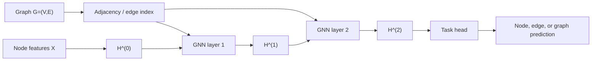
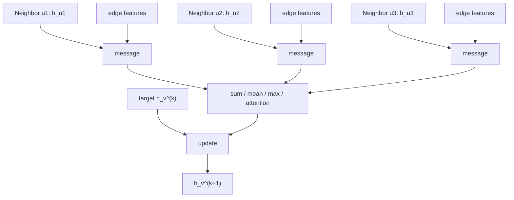
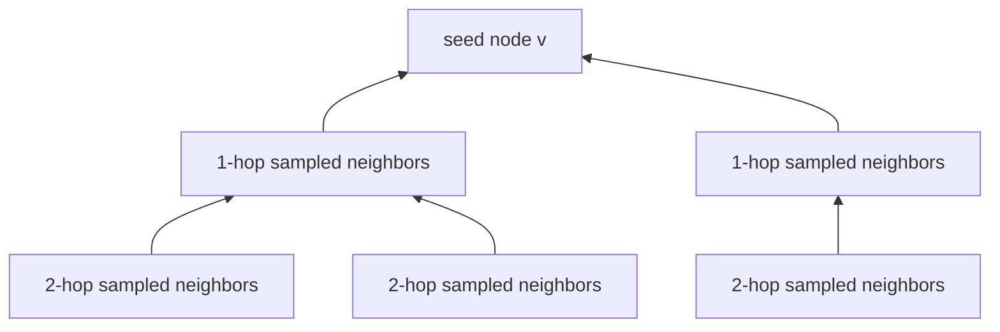

# **Introduction to Graph Neural Networks**

Graph neural networks are neural architectures for data whose primitive structure is a graph:

$$
G=(V,E).
$$

Nodes represent entities, edges represent relationships, and optional node, edge, and graph-level attributes carry observed features. The central idea is not merely that "connected nodes are similar." That assumption, called homophily, is common but not universal. The more general idea is that a node, edge, or graph prediction often depends on a local relational computation over neighboring entities.

A GNN learns this computation by repeatedly sending messages over edges, aggregating those messages at receiving nodes, and updating node states. After $K$ layers, a node representation can depend on information from its $K$-hop computational neighborhood.

---

## **1. Motivation**

Classical neural networks assume an input domain with a regular coordinate system:

| Domain | Regularity | Typical Model |
|---|---:|---|
| Images | Fixed 2D grid | CNN |
| Text | Ordered sequence | RNN, Transformer |
| Tabular data | Fixed feature vector | MLP, trees |
| Graphs | Irregular neighborhoods | GNN |

Graphs break several assumptions used by standard architectures:

- Nodes have variable numbers of neighbors.
- Neighbor order is arbitrary.
- The same graph can be represented by many equivalent node orderings.
- Graphs can be sparse, directed, weighted, temporal, heterogeneous, or enormous.
- Predictions may be node-level, edge-level, graph-level, or subgraph-level.

For example, in fraud detection, the feature vector of an account may be insufficient. Risk can depend on transfers, shared devices, communities, and paths through other accounts. A model that ignores $E$ discards much of the signal.

---

## **2. Formal Graph Setup**

Let

$$
G=(V,E)
$$

with

$$
|V|=n,\qquad |E|=m.
$$

The node feature matrix is

$$
X \in \mathbb{R}^{n \times d_0},
$$

where row $x_v^\top$ is the feature vector of node $v$. The hidden representation at layer $k$ is

$$
H^{(k)}
=
\begin{bmatrix}
(h_1^{(k)})^\top \\
\vdots \\
(h_n^{(k)})^\top
\end{bmatrix}
\in \mathbb{R}^{n \times d_k},
$$

with

$$
H^{(0)}=X.
$$

For an unweighted graph, the adjacency matrix is

$$
A_{uv}
=
\begin{cases}
1, & (u,v)\in E,\\
0, & \text{otherwise}.
\end{cases}
$$

For weighted graphs, $A_{uv}$ stores an edge weight. For undirected graphs,

$$
A=A^\top.
$$

The degree of node $v$ is

$$
d_v=\sum_{u=1}^{n} A_{vu},
$$

and the degree matrix is

$$
D=\operatorname{diag}(d_1,\dots,d_n).
$$

Many GNN layers add self-loops:

$$
\tilde{A}=A+I_n,
$$

with

$$
\tilde{D}_{vv}=\sum_{u=1}^{n}\tilde{A}_{vu}.
$$

Self-loops preserve each node's previous representation during neighborhood aggregation. Without self-loops, a node can be updated entirely from its neighbors and lose direct access to its own features.



---

## **3. Permutation Equivariance and Invariance**

Graphs do not have a canonical node ordering. If a graph is represented with a different node index permutation, a node-level model should permute its outputs in the same way.

Let $P \in \{0,1\}^{n \times n}$ be a permutation matrix. Reordering nodes transforms

$$
X' = PX,
$$

and

$$
A'=PAP^\top.
$$

A node-level GNN layer $f$ should be permutation equivariant:

$$
f(PAP^\top, PX)=P f(A,X).
$$

Graph-level prediction should be permutation invariant:

$$
g(PAP^\top,PX)=g(A,X).
$$

This is why neighborhood aggregation must be independent of the arbitrary order in which neighbors are enumerated. For a multiset of neighbor messages

$$
\mathcal{M}_v=\{m_{uv}:u\in \mathcal{N}(v)\},
$$

the aggregation function $\rho$ should satisfy

$$
\rho(\{m_1,\dots,m_r\})
=
\rho(\{m_{\pi(1)},\dots,m_{\pi(r)}\})
$$

for every permutation $\pi$.

Common permutation-invariant aggregators are

$$
\rho_{\text{sum}}(\{z_i\}_{i=1}^{r})=\sum_{i=1}^{r} z_i,
$$

$$
\rho_{\text{mean}}(\{z_i\}_{i=1}^{r})=\frac{1}{r}\sum_{i=1}^{r} z_i,
$$

and

$$
\rho_{\text{max}}(\{z_i\}_{i=1}^{r})_j=\max_{i=1,\dots,r}(z_i)_j.
$$

Sum aggregation preserves multiplicity. Mean aggregation normalizes degree but loses count information. Max aggregation captures the most activated feature but discards most distributional information. These choices directly affect expressiveness and optimization.

---

## **4. The Message-Passing Framework**

Most spatial GNN layers can be written as message passing:

$$
m_v^{(k)}
=
\operatorname{AGG}^{(k)}
\left(
\left\{
\operatorname{MSG}^{(k)}
\left(
h_v^{(k)}, h_u^{(k)}, e_{uv}
\right)
: u\in\mathcal{N}(v)
\right\}
\right),
$$

followed by

$$
h_v^{(k+1)}
=
\operatorname{UPD}^{(k)}
\left(
h_v^{(k)},m_v^{(k)}
\right).
$$

Here:

- $h_v^{(k)}$ is the representation of node $v$ at layer $k$.
- $e_{uv}$ is an optional edge feature.
- $\operatorname{MSG}$ computes edge-wise messages.
- $\operatorname{AGG}$ pools incoming messages into a fixed-size vector.
- $\operatorname{UPD}$ combines old node state and aggregated neighborhood information.



### **Step-by-Step Execution**

For one GNN layer:

1. Start with $H^{(k)} \in \mathbb{R}^{n \times d_k}$.
2. For each edge $(u,v)$, construct a message from source node $u$ to target node $v$.
3. For each target node $v$, collect all incoming messages.
4. Aggregate messages with a permutation-invariant operator.
5. Combine the aggregate with $h_v^{(k)}$.
6. Apply a learned linear map, nonlinearity, normalization, dropout, residual connection, or gating depending on the architecture.
7. Return $H^{(k+1)} \in \mathbb{R}^{n \times d_{k+1}}$.

After $K$ layers, $h_v^{(K)}$ depends only on nodes reachable within $K$ message-passing steps, unless the architecture adds global attention, virtual nodes, positional encodings, rewiring, or external memory.

---

## **5. Graph Convolutional Networks**

The standard GCN layer popularized by Kipf and Welling is

$$
H^{(k+1)}
=
\sigma
\left(
\tilde{D}^{-\frac{1}{2}}
\tilde{A}
\tilde{D}^{-\frac{1}{2}}
H^{(k)}
W^{(k)}
\right),
$$

where:

- $\tilde{A}=A+I_n$ adds self-loops.
- $\tilde{D}_{vv}=\sum_u \tilde{A}_{vu}$ is the self-loop degree matrix.
- $W^{(k)}\in\mathbb{R}^{d_k\times d_{k+1}}$ is trainable.
- $\sigma$ is a nonlinearity such as ReLU.

Define

$$
S=
\tilde{D}^{-\frac{1}{2}}
\tilde{A}
\tilde{D}^{-\frac{1}{2}}.
$$

Then a GCN layer is simply

$$
H^{(k+1)}=\sigma(SH^{(k)}W^{(k)}).
$$

### **Node-Wise Form**

The node-wise update is

$$
h_v^{(k+1)}
=
\sigma
\left(
\sum_{u\in \mathcal{N}(v)\cup\{v\}}
\frac{1}{\sqrt{\tilde{d}_v\tilde{d}_u}}
h_u^{(k)} W^{(k)}
\right).
$$

The term

$$
\frac{1}{\sqrt{\tilde{d}_v\tilde{d}_u}}
$$

normalizes messages by the degrees of the sender and receiver. This prevents high-degree nodes from dominating the representation scale and corresponds to symmetric normalization.

### **Spectral Derivation**

For an undirected graph, the normalized graph Laplacian is

$$
L=I_n-D^{-\frac{1}{2}}AD^{-\frac{1}{2}}.
$$

Since $L$ is real and symmetric, it has an eigendecomposition

$$
L=U\Lambda U^\top,
$$

where $U$ contains orthonormal eigenvectors and $\Lambda$ contains eigenvalues. A spectral graph convolution of signal $x\in\mathbb{R}^{n}$ with filter $g_\theta$ is

$$
g_\theta *_G x
=
U g_\theta(\Lambda) U^\top x.
$$

This is expensive because computing $U$ costs $O(n^3)$ in general and the filter is tied to a fixed graph basis. Chebyshev networks approximate $g_\theta(\Lambda)$ by a polynomial in the Laplacian:

$$
g_\theta *_G x
\approx
\sum_{r=0}^{K}
\theta_r T_r(\tilde{L})x,
$$

where $T_r$ is the Chebyshev polynomial of order $r$ and

$$
\tilde{L}
=
\frac{2}{\lambda_{\max}}L-I_n.
$$

For a first-order approximation, set $K=1$ and approximate $\lambda_{\max}\approx 2$. Then

$$
\tilde{L}\approx L-I_n.
$$

Using

$$
L=I_n-D^{-\frac{1}{2}}AD^{-\frac{1}{2}},
$$

we get

$$
\tilde{L}
\approx
-D^{-\frac{1}{2}}AD^{-\frac{1}{2}}.
$$

The first-order filter becomes

$$
g_\theta *_G x
\approx
\theta_0 x
-
\theta_1 D^{-\frac{1}{2}}AD^{-\frac{1}{2}}x.
$$

Constrain parameters with $\theta=\theta_0=-\theta_1$:

$$
g_\theta *_G x
\approx
\theta
\left(
I_n+D^{-\frac{1}{2}}AD^{-\frac{1}{2}}
\right)x.
$$

Directly stacking this operator can be numerically unstable because eigenvalues can become too large. The GCN renormalization trick replaces

$$
I_n+D^{-\frac{1}{2}}AD^{-\frac{1}{2}}
$$

with

$$
\tilde{D}^{-\frac{1}{2}}\tilde{A}\tilde{D}^{-\frac{1}{2}}.
$$

For multiple input and output channels, the scalar filter parameter becomes a trainable matrix $W^{(k)}$, giving the familiar layer

$$
H^{(k+1)}
=
\sigma
\left(
\tilde{D}^{-\frac{1}{2}}
\tilde{A}
\tilde{D}^{-\frac{1}{2}}
H^{(k)}
W^{(k)}
\right).
$$

### **Intuition**

The multiplication $SH^{(k)}$ performs degree-normalized neighborhood averaging. The multiplication by $W^{(k)}$ learns feature mixing across channels. ReLU or another nonlinearity lets stacked layers compose relational features. A two-layer GCN for node classification can be read as:

1. Smooth raw features over each node's local neighborhood.
2. Transform smoothed features into hidden channels.
3. Smooth hidden channels again.
4. Map hidden channels to class logits.

This smoothing is useful under homophily but can be harmful under heterophily, where connected nodes tend to have different labels or roles.

---

## **6. Worked GCN Forward Pass**

Consider the path graph

$$
0 - 1 - 2.
$$

Its adjacency matrix is

$$
A=
\begin{bmatrix}
0 & 1 & 0\\
1 & 0 & 1\\
0 & 1 & 0
\end{bmatrix}.
$$

Add self-loops:

$$
\tilde{A}
=
A+I_3
=
\begin{bmatrix}
1 & 1 & 0\\
1 & 1 & 1\\
0 & 1 & 1
\end{bmatrix}.
$$

The self-loop degrees are

$$
\tilde{d}_0=2,\qquad
\tilde{d}_1=3,\qquad
\tilde{d}_2=2.
$$

Thus

$$
\tilde{D}^{-\frac{1}{2}}
=
\operatorname{diag}
\left(
\frac{1}{\sqrt{2}},
\frac{1}{\sqrt{3}},
\frac{1}{\sqrt{2}}
\right).
$$

The normalized adjacency is

$$
S=
\tilde{D}^{-\frac{1}{2}}\tilde{A}\tilde{D}^{-\frac{1}{2}}
=
\begin{bmatrix}
0.5000 & 0.4082 & 0\\
0.4082 & 0.3333 & 0.4082\\
0 & 0.4082 & 0.5000
\end{bmatrix}.
$$

Let the input features be

$$
X=
\begin{bmatrix}
1 & 0\\
0 & 1\\
1 & 1
\end{bmatrix}
$$

and choose

$$
W=
\begin{bmatrix}
1 & 2\\
-1 & 1
\end{bmatrix}.
$$

First transform features:

$$
XW
=
\begin{bmatrix}
1 & 2\\
-1 & 1\\
0 & 3
\end{bmatrix}.
$$

Then propagate:

$$
SXW
=
\begin{bmatrix}
0.0918 & 1.4082\\
0.0749 & 2.3746\\
-0.4082 & 1.9082
\end{bmatrix}.
$$

After ReLU:

$$
H^{(1)}
=
\operatorname{ReLU}(SXW)
=
\begin{bmatrix}
0.0918 & 1.4082\\
0.0749 & 2.3746\\
0 & 1.9082
\end{bmatrix}.
$$

For node $1$, the first output channel is

$$
0.4082(1)+0.3333(-1)+0.4082(0)=0.0749.
$$

The second output channel is

$$
0.4082(2)+0.3333(1)+0.4082(3)=2.3746.
$$

The computation is not a simple average: each neighbor is weighted by both source and target degrees.

---

## **7. Forward and Backward Propagation**

For supervised node classification with labels $y_v\in\{1,\dots,C\}$ on a labeled subset $\mathcal{V}_{\text{train}}\subseteq V$, a two-layer GCN is

$$
Z
=
S\,\sigma(SXW^{(0)})W^{(1)}
\in\mathbb{R}^{n\times C}.
$$

Class probabilities are

$$
P_{vc}
=
\frac{\exp(Z_{vc})}
{\sum_{j=1}^{C}\exp(Z_{vj})}.
$$

The masked cross-entropy loss is

$$
\mathcal{L}
=
-
\frac{1}{|\mathcal{V}_{\text{train}}|}
\sum_{v\in\mathcal{V}_{\text{train}}}
\log P_{v,y_v}.
$$

For numerical stability, compute softmax through log-sum-exp:

$$
\log P_{v,y_v}
=
Z_{v,y_v}
-
\log
\left(
\sum_{c=1}^{C}\exp(Z_{vc})
\right),
$$

and evaluate

$$
\log
\left(
\sum_{c=1}^{C}\exp(Z_{vc})
\right)
=
\alpha_v
+
\log
\left(
\sum_{c=1}^{C}\exp(Z_{vc}-\alpha_v)
\right),
$$

where

$$
\alpha_v=\max_c Z_{vc}.
$$

### **Gradient Structure**

Let

$$
Q=SX,
$$

$$
R=QW^{(0)},
$$

$$
H=\sigma(R),
$$

$$
B=SH,
$$

and

$$
Z=BW^{(1)}.
$$

For the train mask, the gradient of cross-entropy with respect to logits is

$$
\frac{\partial \mathcal{L}}{\partial Z_{vc}}
=
\frac{1}{|\mathcal{V}_{\text{train}}|}
\left(
P_{vc}-\mathbb{1}[c=y_v]
\right)
$$

for $v\in\mathcal{V}_{\text{train}}$, and zero for unlabeled nodes.

Then

$$
\frac{\partial \mathcal{L}}{\partial W^{(1)}}
=
B^\top
\frac{\partial \mathcal{L}}{\partial Z}.
$$

The gradient entering $H$ is

$$
\frac{\partial \mathcal{L}}{\partial H}
=
S^\top
\left(
\frac{\partial \mathcal{L}}{\partial Z}
(W^{(1)})^\top
\right).
$$

If $\sigma=\operatorname{ReLU}$, then

$$
\frac{\partial \mathcal{L}}{\partial R}
=
\frac{\partial \mathcal{L}}{\partial H}
\odot
\mathbb{1}[R>0].
$$

Finally,

$$
\frac{\partial \mathcal{L}}{\partial W^{(0)}}
=
Q^\top
\frac{\partial \mathcal{L}}{\partial R}.
$$

If the graph is undirected and $S$ is symmetric, $S^\top=S$. For directed graphs, the transpose matters because backward propagation follows the reverse computational dependencies.

---

## **8. GraphSAGE**

GraphSAGE was designed for inductive representation learning: computing embeddings for unseen nodes or graphs using node features and sampled neighborhoods rather than learning one embedding vector per training node.

A common mean GraphSAGE layer is

$$
h_v^{(k+1)}
=
\sigma
\left(
W^{(k)}
\cdot
\operatorname{CONCAT}
\left(
h_v^{(k)},
\frac{1}{|\mathcal{S}(v)|}
\sum_{u\in\mathcal{S}(v)} h_u^{(k)}
\right)
\right),
$$

where $\mathcal{S}(v)$ is a sampled subset of neighbors.

### **Execution**

1. For each seed node in a mini-batch, sample at most $s_K$ neighbors for layer $K$.
2. Recursively sample $s_{K-1}$ neighbors for the previous layer, and so on.
3. Compute bottom-up representations from sampled frontier nodes to seed nodes.
4. Use only the sampled computation graph in that mini-batch.



If every node has fanout $s$ and the model has $K$ layers, the sampled neighborhood size is roughly

$$
O(s^K)
$$

per seed node, before accounting for overlap. This controls cost compared with full-neighborhood aggregation on large graphs, but neighbor sampling introduces variance and can miss important rare neighbors.

---

## **9. Graph Attention Networks**

GCN assigns fixed degree-based weights to neighbors. GAT learns data-dependent attention weights.

For a single attention head:

$$
z_v^{(k)}=W^{(k)}h_v^{(k)}.
$$

For edge $(u,v)$, compute an unnormalized attention score

$$
e_{vu}
=
\operatorname{LeakyReLU}
\left(
a^\top
\left[
z_v^{(k)} \Vert z_u^{(k)}
\right]
\right),
$$

where $\Vert$ denotes concatenation. Normalize across incoming neighbors:

$$
\alpha_{vu}
=
\frac{\exp(e_{vu})}
{\sum_{r\in\mathcal{N}(v)\cup\{v\}}\exp(e_{vr})}.
$$

Then update

$$
h_v^{(k+1)}
=
\sigma
\left(
\sum_{u\in\mathcal{N}(v)\cup\{v\}}
\alpha_{vu} z_u^{(k)}
\right).
$$

Multi-head attention either concatenates heads,

$$
h_v^{(k+1)}
=
\mathop{\Vert}_{q=1}^{Q}
\sigma
\left(
\sum_{u}
\alpha_{vu}^{(q)} W^{(q)}h_u^{(k)}
\right),
$$

or averages them in the final layer:

$$
h_v^{(k+1)}
=
\sigma
\left(
\frac{1}{Q}
\sum_{q=1}^{Q}
\sum_u
\alpha_{vu}^{(q)} W^{(q)}h_u^{(k)}
\right).
$$

Attention improves flexibility but does not make the model immune to oversmoothing, oversquashing, sampling bias, or poor graph construction.

---

## **10. GIN and Expressiveness**

The Graph Isomorphism Network uses sum aggregation and an MLP:

$$
h_v^{(k+1)}
=
\operatorname{MLP}^{(k)}
\left(
(1+\epsilon^{(k)})h_v^{(k)}
+
\sum_{u\in\mathcal{N}(v)}
h_u^{(k)}
\right).
$$

The important point is that GIN treats the neighborhood as a multiset. Sum aggregation can distinguish some multisets that mean and max cannot. For example,

$$
\{1,1,1,1\}
$$

and

$$
\{2,2\}
$$

have the same mean but different sums. This is why sum aggregation is central in expressiveness analyses relating message-passing GNNs to the Weisfeiler-Lehman graph isomorphism test.

Message-passing GNNs are still limited: if two nodes or graphs cannot be distinguished by the corresponding Weisfeiler-Lehman refinement under the available initial features, standard message passing will not distinguish them either.

---

## **11. Tasks and Readout Functions**

### **Node Classification**

Use node embeddings directly:

$$
\hat{y}_v=\operatorname{softmax}(h_v^{(K)}W_{\text{out}}).
$$

Only labeled nodes contribute to the loss in semi-supervised transductive training:

$$
\mathcal{L}_{\text{node}}
=
-
\sum_{v\in\mathcal{V}_{\text{train}}}
\sum_{c=1}^{C}
y_{vc}\log \hat{y}_{vc}.
$$

### **Graph Classification**

Pool node embeddings into a graph embedding:

$$
h_G
=
\operatorname{READOUT}
\left(
\{h_v^{(K)}:v\in V\}
\right).
$$

Typical readouts are sum, mean, max, attention pooling, hierarchical pooling, or a virtual-node representation. Then

$$
\hat{y}_G=\operatorname{softmax}(h_GW_{\text{out}}).
$$

### **Link Prediction**

For pair $(u,v)$, decode from node embeddings:

$$
s(u,v)=z_u^\top z_v,
$$

or use a bilinear decoder:

$$
s(u,v)=z_u^\top R z_v.
$$

The binary edge probability is

$$
\hat{p}_{uv}=\sigma(s(u,v)).
$$

With negative sampling, the loss is

$$
\mathcal{L}_{\text{link}}
=
-
\sum_{(u,v)\in E^+}\log \sigma(s(u,v))
-
\sum_{(u,v)\in E^-}\log \sigma(-s(u,v)).
$$

Negative sampling must match the evaluation protocol. Random non-edges can be too easy in sparse graphs, while hard negatives can substantially change model behavior.

---

## **12. Python Implementation from Scratch**

The following implementation trains a two-layer dense GCN on a small synthetic graph. It is intentionally explicit: normalized adjacency, masked loss, softmax stability, and manual backpropagation are all visible.

```python
import numpy as np


def normalized_adjacency(num_nodes, edges, add_self_loops=True):
    """Return S = D^{-1/2} A D^{-1/2} as a dense NumPy array."""
    A = np.zeros((num_nodes, num_nodes), dtype=np.float64)

    for u, v in edges:
        A[u, v] = 1.0
        A[v, u] = 1.0

    if add_self_loops:
        A += np.eye(num_nodes, dtype=np.float64)

    deg = A.sum(axis=1)
    deg_inv_sqrt = np.zeros_like(deg)
    nonzero = deg > 0
    deg_inv_sqrt[nonzero] = 1.0 / np.sqrt(deg[nonzero])

    # Broadcasting implements D^{-1/2} A D^{-1/2}.
    return deg_inv_sqrt[:, None] * A * deg_inv_sqrt[None, :]


def relu(x):
    return np.maximum(x, 0.0)


def log_softmax(logits):
    shifted = logits - logits.max(axis=1, keepdims=True)
    log_z = np.log(np.exp(shifted).sum(axis=1, keepdims=True))
    return shifted - log_z


def cross_entropy_with_logits(logits, labels, mask):
    """Return masked mean loss and dL/dlogits."""
    log_probs = log_softmax(logits)
    probs = np.exp(log_probs)

    idx = np.where(mask)[0]
    loss = -log_probs[idx, labels[idx]].mean()

    grad = np.zeros_like(logits)
    grad[idx] = probs[idx]
    grad[idx, labels[idx]] -= 1.0
    grad[idx] /= len(idx)
    return loss, grad


def accuracy(logits, labels, mask):
    idx = np.where(mask)[0]
    pred = logits[idx].argmax(axis=1)
    return np.mean(pred == labels[idx])


rng = np.random.default_rng(7)

num_nodes = 6
edges = [
    (0, 1), (1, 2), (2, 0),  # class-0 triangle
    (3, 4), (4, 5), (5, 3),  # class-1 triangle
    (2, 3),                  # bridge
]
S = normalized_adjacency(num_nodes, edges)

X = np.array(
    [
        [1.0, 0.0, 0.2],
        [0.9, 0.1, 0.0],
        [1.0, 0.2, 0.1],
        [0.0, 1.0, 0.2],
        [0.1, 0.9, 0.0],
        [0.2, 1.0, 0.1],
    ],
    dtype=np.float64,
)
y = np.array([0, 0, 0, 1, 1, 1], dtype=np.int64)
train_mask = np.array([True, True, False, True, True, False])
test_mask = ~train_mask

hidden_dim = 5
num_classes = 2
W0 = rng.normal(scale=0.2, size=(X.shape[1], hidden_dim))
W1 = rng.normal(scale=0.2, size=(hidden_dim, num_classes))

lr = 0.2
weight_decay = 5e-4

for epoch in range(301):
    # Forward pass.
    Q = S @ X
    R = Q @ W0
    H = relu(R)
    B = S @ H
    logits = B @ W1

    data_loss, dlogits = cross_entropy_with_logits(logits, y, train_mask)
    reg_loss = 0.5 * weight_decay * (np.sum(W0 * W0) + np.sum(W1 * W1))
    loss = data_loss + reg_loss

    # Backward pass.
    dW1 = B.T @ dlogits + weight_decay * W1
    dB = dlogits @ W1.T
    dH = S.T @ dB
    dR = dH * (R > 0.0)
    dW0 = Q.T @ dR + weight_decay * W0

    W0 -= lr * dW0
    W1 -= lr * dW1

    if epoch % 100 == 0:
        train_acc = accuracy(logits, y, train_mask)
        test_acc = accuracy(logits, y, test_mask)
        print(
            f"epoch={epoch:03d} "
            f"loss={loss:.4f} "
            f"train_acc={train_acc:.3f} "
            f"test_acc={test_acc:.3f}"
        )
```

### **What This Code Implements Internally**

The line

```python
S = deg_inv_sqrt[:, None] * A * deg_inv_sqrt[None, :]
```

constructs

$$
S_{uv}
=
\frac{A_{uv}}{\sqrt{d_ud_v}}.
$$

The first propagation

```python
Q = S @ X
```

aggregates raw features. The hidden layer

```python
R = Q @ W0
H = relu(R)
```

mixes channels and applies a nonlinearity. The second propagation

```python
B = S @ H
```

aggregates hidden features. The final matrix product computes class logits.

This dense implementation is $O(n^2d)$ and is not suitable for large sparse graphs. Production GNN libraries use sparse edge lists, sparse matrix multiplication, or fused message-passing kernels to obtain $O(md)$ behavior for sparse graphs.

---

## **13. PyTorch Implementation**

This version keeps the same dense normalized adjacency but uses automatic differentiation.

```python
import torch
import torch.nn as nn
import torch.nn.functional as F


class DenseGCN(nn.Module):
    def __init__(self, in_dim, hidden_dim, out_dim, dropout=0.5):
        super().__init__()
        self.lin1 = nn.Linear(in_dim, hidden_dim, bias=False)
        self.lin2 = nn.Linear(hidden_dim, out_dim, bias=False)
        self.dropout = dropout

    def forward(self, x, s):
        h = s @ x
        h = self.lin1(h)
        h = F.relu(h)
        h = F.dropout(h, p=self.dropout, training=self.training)
        h = s @ h
        return self.lin2(h)


def build_s(num_nodes, edges):
    a = torch.zeros(num_nodes, num_nodes, dtype=torch.float32)
    for u, v in edges:
        a[u, v] = 1.0
        a[v, u] = 1.0
    a += torch.eye(num_nodes)

    deg = a.sum(dim=1)
    deg_inv_sqrt = deg.pow(-0.5)
    deg_inv_sqrt[torch.isinf(deg_inv_sqrt)] = 0.0
    return deg_inv_sqrt[:, None] * a * deg_inv_sqrt[None, :]


edges = [(0, 1), (1, 2), (2, 0), (3, 4), (4, 5), (5, 3), (2, 3)]
s = build_s(6, edges)
x = torch.tensor(
    [
        [1.0, 0.0, 0.2],
        [0.9, 0.1, 0.0],
        [1.0, 0.2, 0.1],
        [0.0, 1.0, 0.2],
        [0.1, 0.9, 0.0],
        [0.2, 1.0, 0.1],
    ]
)
y = torch.tensor([0, 0, 0, 1, 1, 1])
train_mask = torch.tensor([True, True, False, True, True, False])

model = DenseGCN(in_dim=3, hidden_dim=8, out_dim=2)
optimizer = torch.optim.Adam(model.parameters(), lr=0.05, weight_decay=5e-4)

for epoch in range(201):
    model.train()
    optimizer.zero_grad()
    logits = model(x, s)
    loss = F.cross_entropy(logits[train_mask], y[train_mask])
    loss.backward()
    optimizer.step()
```

`F.cross_entropy` combines `log_softmax` and negative log-likelihood loss in a numerically stable implementation. `optimizer.step()` applies Adam updates using first and second moment estimates of gradients rather than plain SGD.

---

## **14. PyTorch Geometric Implementation**

PyTorch Geometric represents sparse graphs using `edge_index`, a COO-style tensor of shape $2\times M$. The first row contains source nodes and the second row contains target nodes.

```python
import torch
import torch.nn.functional as F
from torch_geometric.nn import GCNConv


class PyGGCN(torch.nn.Module):
    def __init__(self, in_dim, hidden_dim, out_dim):
        super().__init__()
        self.conv1 = GCNConv(in_dim, hidden_dim)
        self.conv2 = GCNConv(hidden_dim, out_dim)

    def forward(self, x, edge_index):
        h = self.conv1(x, edge_index)
        h = F.relu(h)
        h = F.dropout(h, p=0.5, training=self.training)
        return self.conv2(h, edge_index)


edge_index = torch.tensor(
    [
        [0, 1, 1, 2, 2, 0, 3, 4, 4, 5, 5, 3, 2, 3],
        [1, 0, 2, 1, 0, 2, 4, 3, 5, 4, 3, 5, 3, 2],
    ],
    dtype=torch.long,
)

x = torch.tensor(
    [
        [1.0, 0.0, 0.2],
        [0.9, 0.1, 0.0],
        [1.0, 0.2, 0.1],
        [0.0, 1.0, 0.2],
        [0.1, 0.9, 0.0],
        [0.2, 1.0, 0.1],
    ],
    dtype=torch.float32,
)
y = torch.tensor([0, 0, 0, 1, 1, 1])
train_mask = torch.tensor([True, True, False, True, True, False])

model = PyGGCN(in_dim=3, hidden_dim=8, out_dim=2)
optimizer = torch.optim.Adam(model.parameters(), lr=0.05, weight_decay=5e-4)

for epoch in range(201):
    model.train()
    optimizer.zero_grad()
    logits = model(x, edge_index)
    loss = F.cross_entropy(logits[train_mask], y[train_mask])
    loss.backward()
    optimizer.step()
```

### **How `GCNConv` Works Internally**

Conceptually, `GCNConv` computes

$$
X' = \hat{D}^{-\frac{1}{2}}\hat{A}\hat{D}^{-\frac{1}{2}}X\Theta,
$$

where

$$
\hat{A}=A+I_n.
$$

In an edge-index implementation:

1. Add missing self-loops to `edge_index`.
2. Compute the degree of each target or source node according to the library's message-flow convention.
3. For every edge $(j,i)$, compute

$$
\operatorname{norm}_{j,i}
=
\frac{1}{\sqrt{\hat{d}_j\hat{d}_i}}.
$$

4. Transform node features with a learnable linear map.
5. For each edge $(j,i)$, send message

$$
m_{j\to i}
=
\operatorname{norm}_{j,i}x_j\Theta.
$$

6. Aggregate messages at target node $i$ using summation.

The core operation is scatter-add: messages are indexed by target node and accumulated into an output tensor. This avoids materializing an $n\times n$ dense adjacency matrix.

---

## **15. Complexity**

Let $d$ be the hidden dimension and assume sparse graphs.

| Layer | Time Complexity | Space Complexity | Notes |
|---|---:|---:|---|
| Dense GCN | $O(n^2d + nd^2)$ | $O(n^2 + nd)$ | Simple but poor for sparse large graphs |
| Sparse GCN | $O(md + nd^2)$ | $O(m + nd)$ | Standard full-batch sparse execution |
| GraphSAGE sampled | $O(Bs^Kd + B\sum_k s^k d^2)$ | $O(Bs^K d)$ | $B$ seed nodes, fanout $s$, depth $K$ |
| GAT | $O(md + md_{\text{attn}})$ | $O(mH + nd)$ | Stores edge attention per head |
| GIN | $O(md + nd^2)$ | $O(m + nd)$ | MLP cost depends on hidden width |

For full-batch training, memory often becomes the bottleneck because activations for all nodes across all layers must be retained for backpropagation:

$$
O(Knd).
$$

Neighbor sampling reduces activation memory for large graphs but changes the computation from deterministic full-neighborhood aggregation to stochastic subgraph aggregation.

---

## **16. Numerical Stability and Implementation Pitfalls**

### **Self-Loops**

For many layers, forgetting self-loops changes the model substantially. In a GCN without self-loops, a node does not directly pass its own previous representation to the next layer.

### **Zero-Degree Nodes**

If a node has no neighbors and no self-loop, then

$$
d_v=0,
$$

so

$$
d_v^{-\frac{1}{2}}
$$

is undefined. Add self-loops or explicitly set inverse degree to zero for isolated nodes.

### **Direction Conventions**

Libraries differ in whether edge `(u, v)` means message from `u` to `v` or simply an undirected relation that must be duplicated manually. A common bug is passing each undirected edge only once, accidentally training on a directed graph.

### **Feature Leakage**

In transductive node classification, the full graph structure is often visible during training, but labels are masked. Leakage occurs if validation or test labels are used as node features, edge features, preprocessing targets, or normalization statistics.

### **Train-Test Edge Leakage**

For link prediction, edges used as positives in validation or test should be removed from the message-passing graph when evaluating inductive edge prediction. Otherwise, the encoder can directly observe the target edge.

### **Oversmoothing**

Repeated multiplication by a normalized adjacency matrix mixes neighboring representations. In the limit, node embeddings within connected components can become increasingly similar. For a simplified linear GCN,

$$
H^{(K)}=S^KXW.
$$

As $K$ grows, $S^K$ behaves like a diffusion operator. This can erase discriminative node-level information.

Mitigations include residual connections, normalization, jumping knowledge, pair normalization, decoupled propagation, personalized PageRank propagation, and architectures designed for deeper message passing.

### **Oversquashing**

After $K$ layers, exponentially many distant nodes may influence $h_v^{(K)}$, but the representation dimension remains fixed. Long-range information can be compressed through narrow graph bottlenecks. This is a structural limitation, not just an optimization issue.

Mitigations include graph rewiring, positional encodings, virtual nodes, attention/global tokens, subgraph methods, and architectures with better long-range communication.

### **Heterophily**

GCN-style smoothing assumes neighboring nodes should share useful signals. In heterophilous graphs, neighbors may systematically have different labels. Useful approaches include separating ego and neighbor transformations, signed or typed messages, higher-order neighborhoods, compatibility matrices, and architectures designed for heterophily.

### **Normalization**

GCN symmetric normalization is not interchangeable with row normalization:

$$
D^{-1}A
$$

computes random-walk averaging, while

$$
D^{-\frac{1}{2}}AD^{-\frac{1}{2}}
$$

is symmetric for undirected graphs. The best choice depends on architecture, graph type, and theoretical assumptions.

### **Mini-Batching**

Ordinary tensor mini-batching over nodes is not enough because node embeddings depend on neighborhoods. Common strategies are:

- Full-batch training for small graphs.
- Neighbor sampling for large node-level tasks.
- Cluster or subgraph sampling.
- Graph-level batching for many small graphs.
- Sparse tensor partitioning for distributed training.

---

## **17. Edge Features, Directed Graphs, and Heterogeneous Graphs**

The basic GCN ignores edge attributes. A more general message function can include edge features:

$$
m_{u\to v}^{(k)}
=
\phi^{(k)}
\left(
h_u^{(k)}, h_v^{(k)}, e_{uv}
\right).
$$

For directed graphs, incoming and outgoing messages can use different parameters:

$$
m_{v,\text{in}}^{(k)}
=
\sum_{u:(u,v)\in E}
\phi_{\text{in}}^{(k)}(h_u^{(k)},e_{uv}),
$$

$$
m_{v,\text{out}}^{(k)}
=
\sum_{u:(v,u)\in E}
\phi_{\text{out}}^{(k)}(h_u^{(k)},e_{vu}).
$$

For heterogeneous graphs with node types and relation types, relation-specific transformations are common:

$$
h_v^{(k+1)}
=
\sigma
\left(
\sum_{r\in\mathcal{R}}
\sum_{u\in\mathcal{N}_r(v)}
\frac{1}{c_{v,r}}
W_r^{(k)}h_u^{(k)}
+
W_0^{(k)}h_v^{(k)}
\right).
$$

This is the core idea behind relational GCNs. The parameter count can become large when $|\mathcal{R}|$ is large, so basis decomposition, block decomposition, or parameter sharing is often used.

---

## **18. GNNs as Neural Diffusion**

For a linearized GCN without nonlinearities,

$$
H^{(K)}
=
S^K X W,
$$

where $W$ is the product of layer weights. This resembles diffusion over the graph. Each multiplication by $S$ spreads information one step. The entry $(S^K)_{vu}$ measures how much node $u$ contributes to node $v$ after $K$ propagation steps.

This connects GNNs to:

- Laplacian smoothing.
- Random walks.
- Personalized PageRank.
- Label propagation.
- Spectral graph filters.
- Diffusion kernels.

The trainable part of a GNN learns how to transform, gate, attend to, or decode diffused information.

---

## **19. Choosing a GNN Architecture**

| Situation | Reasonable Starting Point |
|---|---|
| Small homophilous graph, node classification | 2-layer GCN |
| Large graph with inductive nodes | GraphSAGE with neighbor sampling |
| Neighbor importance varies strongly | GAT or attention-based message passing |
| Graph classification with discrete labels | GIN or GIN-like sum aggregation |
| Many relation types | R-GCN or heterogeneous GNN |
| Long-range dependencies | Graph Transformer, rewiring, virtual nodes, positional encodings |
| Heterophily | Heterophily-aware GNN, higher-order neighborhoods, ego-neighbor separation |
| Molecular graphs | MPNN with edge features, GINE, equivariant GNN for 3D geometry |

The graph construction is often as important as the architecture. Bad edges, missing edges, leakage edges, and spurious similarity graphs can dominate model behavior.

---

## **20. References and Deeper Reading**

- Thomas N. Kipf and Max Welling, "Semi-Supervised Classification with Graph Convolutional Networks", 2017. https://arxiv.org/abs/1609.02907
- William L. Hamilton, Rex Ying, and Jure Leskovec, "Inductive Representation Learning on Large Graphs", 2017. https://arxiv.org/abs/1706.02216
- Petar Velickovic et al., "Graph Attention Networks", 2018. https://arxiv.org/abs/1710.10903
- Keyulu Xu et al., "How Powerful are Graph Neural Networks?", 2019. https://arxiv.org/abs/1810.00826
- Justin Gilmer et al., "Neural Message Passing for Quantum Chemistry", 2017. https://arxiv.org/abs/1704.01212
- Peter W. Battaglia et al., "Relational inductive biases, deep learning, and graph networks", 2018. https://arxiv.org/abs/1806.01261
- Uri Alon and Eran Yahav, "On the Bottleneck of Graph Neural Networks and its Practical Implications", 2021. https://arxiv.org/abs/2006.05205
- PyTorch Geometric documentation, `GCNConv` and `MessagePassing`. https://pytorch-geometric.readthedocs.io/
- DGL documentation, graph convolution and message passing tutorials. https://www.dgl.ai/dgl_docs/
