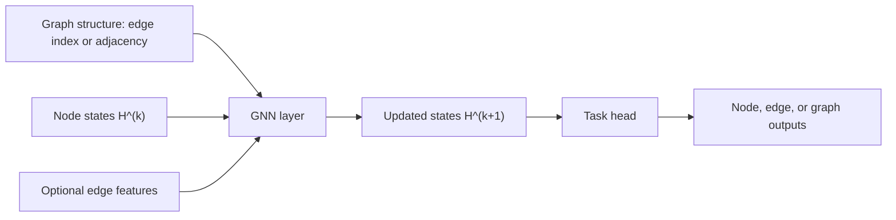
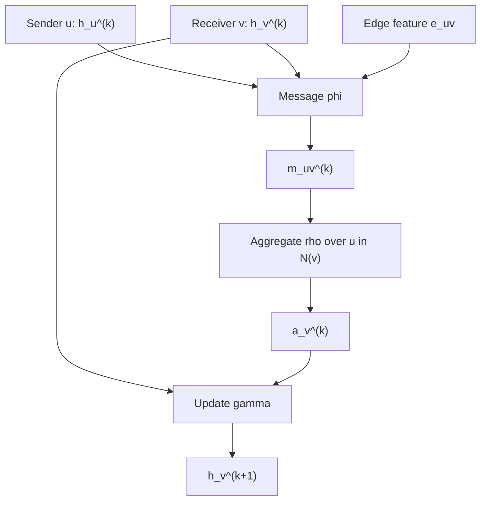
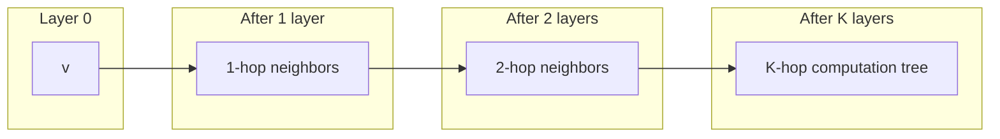

# **General Perspective on Graph Neural Networks**

Graph neural networks are learnable algorithms over relational data. Given a graph, node features, optional edge features, and a task-specific supervision signal, a GNN repeatedly performs local computations along edges so that each node representation becomes a summary of its own attributes and the attributes of nodes reachable through graph structure.

The central abstraction is not "neighbors are always similar." Homophily is useful in citation networks, social friendship graphs, and many recommendation systems, but many important graphs are heterophilous, directed, typed, temporal, or governed by physical constraints. The more robust view is:

$$
\text{a prediction on a graph should be a permutation-consistent function of features and relations.}
$$

This chapter develops GNNs from that perspective: graphs as unordered relational objects, message passing as the main computational primitive, aggregation as a permutation-invariant operation, and layers such as GCN, GraphSAGE, GAT, and MPNN as specific choices inside one common template.

---

## **1. Formal Setup**

Let

$$
G=(V,E)
$$

be a graph with

$$
|V|=n,\qquad |E|=m.
$$

The node feature matrix is

$$
X\in\mathbb{R}^{n\times d_0},
$$

where row $x_v^\top$ stores the features of node $v$. A GNN maintains hidden node representations

$$
H^{(k)}\in\mathbb{R}^{n\times d_k},
$$

with

$$
H^{(0)}=X.
$$

For an unweighted directed graph, define the adjacency matrix

$$
A_{vu}
=
\begin{cases}
1, & (u\rightarrow v)\in E,\\
0, & \text{otherwise}.
\end{cases}
$$

This convention means row $v$ indexes messages received by node $v$. For undirected graphs, each undirected edge is usually represented as two directed edges, so $A=A^\top$.

Optional edge features are denoted

$$
e_{uv}\in\mathbb{R}^{d_e},
$$

and optional graph-level features are denoted

$$
g\in\mathbb{R}^{d_g}.
$$

The incoming neighborhood of node $v$ is

$$
\mathcal{N}(v)=\{u\in V:(u\rightarrow v)\in E\}.
$$

Many layers add self-loops:

$$
\tilde{A}=A+I_n.
$$

The associated degree matrix is

$$
\tilde{D}_{vv}=\sum_{u=1}^{n}\tilde{A}_{vu}.
$$

Self-loops preserve a direct path from $h_v^{(k)}$ to $h_v^{(k+1)}$. Without them, a node with neighbors updates only from neighbor states; an isolated node receives no messages unless the implementation has an explicit residual or self-update term.



---

## **2. What Makes a GNN Different from an MLP**

An MLP applied independently to nodes has the form

$$
z_v=f_\theta(x_v).
$$

It cannot use graph structure except through features already engineered into $x_v$. A GNN instead computes

$$
z_v=f_\theta(x_v,\{x_u:u\in\mathcal{N}(v)\},\{e_{uv}:u\in\mathcal{N}(v)\},G).
$$

The key constraints are:

- **Variable arity:** $|\mathcal{N}(v)|$ changes across nodes.
- **No canonical neighbor order:** $\{u_1,u_2,u_3\}$ and $\{u_3,u_1,u_2\}$ describe the same neighborhood.
- **Shared local rule:** the same parameters should apply at every node and edge.
- **Locality:** after $K$ message-passing layers, $h_v^{(K)}$ depends on at most the $K$-hop computational neighborhood unless global edges, positional encodings, or global attention are added.

The useful mental model is a differentiable distributed algorithm: every node stores a vector state; edges route messages; each round updates node memory.

---

## **3. Permutation Equivariance and Invariance**

Graphs are not arrays with fixed semantic coordinates. If node indices are permuted, the graph is the same object with a different representation.

Let $P\in\{0,1\}^{n\times n}$ be a permutation matrix. Reindexing nodes gives

$$
X'=PX
$$

and

$$
A'=PAP^\top.
$$

A node-level GNN layer $F$ should be permutation equivariant:

$$
F(PAP^\top,PX)=P F(A,X).
$$

For graph-level prediction, a readout $R$ should be permutation invariant:

$$
R(PH)=R(H).
$$

The neighborhood aggregation operator must therefore be a function over multisets rather than ordered sequences:

$$
\rho(\{z_1,\dots,z_r\})=\rho(\{z_{\pi(1)},\dots,z_{\pi(r)}\})
$$

for every permutation $\pi$.

Common choices are:

$$
\rho_{\text{sum}}(\{z_i\}_{i=1}^{r})=\sum_{i=1}^{r}z_i,
$$

$$
\rho_{\text{mean}}(\{z_i\}_{i=1}^{r})=\frac{1}{r}\sum_{i=1}^{r}z_i,
$$

$$
\rho_{\text{max}}(\{z_i\}_{i=1}^{r})_j=\max_{i=1,\dots,r}(z_i)_j.
$$

Attention is also permutation invariant when scores are computed per edge and normalized over the receiver's neighbor set:

$$
\rho_{\text{attn}}(v)
=
\sum_{u\in\mathcal{N}(v)}
\alpha_{vu} z_u,
$$

where

$$
\alpha_{vu}
=
\frac{\exp(s_{vu})}
{\sum_{w\in\mathcal{N}(v)}\exp(s_{vw})}.
$$

The attention weights depend on node and edge content, not on the arbitrary order in which the neighbors are listed.

### **Equivariance Proof for Linear Aggregation**

Consider a simple layer

$$
F(A,X)=\sigma(AXW),
$$

where $W\in\mathbb{R}^{d_{\text{in}}\times d_{\text{out}}}$ and $\sigma$ is applied row-wise. Under a permutation,

$$
F(PAP^\top,PX)
=
\sigma(PAP^\top PXW).
$$

Since $P^\top P=I_n$,

$$
F(PAP^\top,PX)
=
\sigma(PAXW).
$$

Because $P$ only reorders rows and $\sigma$ acts independently on each row,

$$
\sigma(PAXW)=P\sigma(AXW).
$$

Therefore,

$$
F(PAP^\top,PX)=PF(A,X).
$$

This is the basic algebraic reason GNN layers use adjacency-based mixing and shared transformations.

---

## **4. Generic Message Passing**

A broad message-passing layer can be written as

$$
m_{uv}^{(k)}
=
\phi^{(k)}\left(h_u^{(k)},h_v^{(k)},e_{uv}\right),
\qquad u\in\mathcal{N}(v),
$$

$$
a_v^{(k)}
=
\rho^{(k)}
\left(
\left\{
m_{uv}^{(k)}:u\in\mathcal{N}(v)
\right\}
\right),
$$

$$
h_v^{(k+1)}
=
\gamma^{(k)}
\left(
h_v^{(k)},a_v^{(k)}
\right).
$$

Here:

- $\phi^{(k)}$ is the message function, usually an MLP, affine map, attention-weighted projection, or edge-conditioned transform.
- $\rho^{(k)}$ is a permutation-invariant reducer such as sum, mean, max, or softmax-weighted sum.
- $\gamma^{(k)}$ is the update function, often an MLP, GRU, residual block, normalization block, or affine transform plus nonlinearity.



### **Step-by-Step Execution of One Layer**

For a graph stored as an edge list

$$
\texttt{edge\_index}
=
\begin{bmatrix}
\text{src}_1 & \dots & \text{src}_M\\
\text{dst}_1 & \dots & \text{dst}_M
\end{bmatrix},
$$

one message-passing layer executes as follows:

1. **Project node states.** Compute transformed states such as $Z=HW$.
2. **Gather source states.** For each edge $u\rightarrow v$, read $z_u$.
3. **Compute edge messages.** Optionally combine $z_u$, $z_v$, and $e_{uv}$.
4. **Aggregate by destination.** Sum, average, maximize, or attention-weight messages into $a_v$.
5. **Update node states.** Combine $a_v$ with $h_v$ through an affine map, nonlinearity, normalization, residual connection, or recurrent update.
6. **Apply task head.** Node-level heads use $h_v^{(K)}$; edge-level heads use pairs such as $(h_u^{(K)},h_v^{(K)})$; graph-level heads pool over nodes.

The sparse edge-list version avoids materializing an $n\times n$ adjacency matrix. This matters because most real graphs have

$$
m\ll n^2.
$$

---

## **5. Receptive Fields and Layer Stacking**

After one message-passing layer, $h_v^{(1)}$ depends on $h_u^{(0)}$ for $u\in\mathcal{N}(v)$ and usually on $h_v^{(0)}$ through a self-loop or update function.

After two layers, $h_v^{(2)}$ depends on nodes that can send messages to $v$ through paths of length at most two. In general, after $K$ layers,

$$
h_v^{(K)}
\text{ depends on }
\{x_u:\operatorname{dist}(u,v)\le K\}
$$

for an undirected graph with self-loops.



This explains both the strength and weakness of local GNNs:

- Small $K$ captures local relational structure efficiently.
- Large $K$ can cause over-smoothing, over-squashing, high memory use, and noisy long-range mixing.
- For long-range tasks, one often adds positional encodings, virtual nodes, graph rewiring, hierarchical pooling, subgraph methods, or attention-style global communication.

---

## **6. Matrix View of Neighborhood Aggregation**

For a simple sum aggregator without edge features,

$$
A H
$$

has row

$$
(AH)_v=\sum_{u=1}^{n} A_{vu}h_u.
$$

If $A_{vu}=1$ exactly when $u$ sends a message to $v$, then

$$
(AH)_v=\sum_{u\in\mathcal{N}(v)}h_u.
$$

For mean aggregation, define

$$
D_{vv}=\sum_{u=1}^{n}A_{vu}.
$$

Then

$$
D^{-1}AH
$$

has row

$$
(D^{-1}AH)_v
=
\frac{1}{d_v}\sum_{u\in\mathcal{N}(v)}h_u.
$$

For GCN-style symmetric normalization with self-loops,

$$
\hat{A}=\tilde{D}^{-1/2}\tilde{A}\tilde{D}^{-1/2},
$$

and the layer is

$$
H^{(k+1)}
=
\sigma\left(\hat{A}H^{(k)}W^{(k)}\right).
$$

The row-wise expression is

$$
h_v^{(k+1)}
=
\sigma
\left(
\sum_{u\in\tilde{\mathcal{N}}(v)}
\frac{1}{\sqrt{\tilde{d}_v\tilde{d}_u}}
h_u^{(k)}W^{(k)}
\right),
$$

where $\tilde{\mathcal{N}}(v)=\mathcal{N}(v)\cup\{v\}$.

### **Why Symmetric Normalization Appears**

Naive sums scale with node degree:

$$
\left\|\sum_{u\in\mathcal{N}(v)}h_u\right\|
$$

can grow as $d_v$ grows. This makes high-degree nodes numerically and statistically different even when their average neighbor content is similar.

Left normalization,

$$
D^{-1}A,
$$

computes neighbor means and corresponds to a random-walk transition matrix. Symmetric normalization,

$$
D^{-1/2}AD^{-1/2},
$$

balances source and target degrees. A message from a high-degree source is downweighted by $\tilde{d}_u^{-1/2}$, and aggregation into a high-degree receiver is downweighted by $\tilde{d}_v^{-1/2}$.

The GCN layer can be derived as a localized first-order spectral graph convolution. At a high level, spectral filtering starts from the graph Laplacian

$$
L=I_n-D^{-1/2}AD^{-1/2}.
$$

Since $L$ is symmetric positive semidefinite for an undirected graph with nonnegative weights, it has an eigendecomposition

$$
L=U\Lambda U^\top.
$$

A spectral filter $g_\theta$ applied to graph signal $X$ is

$$
g_\theta * X
=
Ug_\theta(\Lambda)U^\top X.
$$

Computing $U$ is expensive and gives filters tied to a fixed graph. Chebyshev polynomial approximations avoid eigendecomposition:

$$
g_\theta(\Lambda)\approx\sum_{r=0}^{R}\theta_r T_r(\tilde{\Lambda}),
$$

where $T_r$ is the Chebyshev polynomial of order $r$. A first-order approximation with parameter tying leads to a layer proportional to

$$
I_n + D^{-1/2}AD^{-1/2}.
$$

The GCN renormalization trick replaces this with

$$
\tilde{D}^{-1/2}\tilde{A}\tilde{D}^{-1/2},
$$

which adds self-loops before normalization and improves numerical behavior when stacking layers.

---

## **7. Canonical Layer Families**

### **GCN**

The GCN layer is

$$
H^{(k+1)}
=
\sigma
\left(
\tilde{D}^{-1/2}\tilde{A}\tilde{D}^{-1/2}
H^{(k)}W^{(k)}
\right).
$$

Its message from $u$ to $v$ is

$$
m_{uv}^{(k)}
=
\frac{1}{\sqrt{\tilde{d}_v\tilde{d}_u}}
h_u^{(k)}W^{(k)}.
$$

It is simple, efficient, and often strong on homophilous graphs, but fixed degree-based weights can be too rigid.

### **GraphSAGE**

A common GraphSAGE mean layer is

$$
a_v^{(k)}
=
\frac{1}{|\mathcal{N}(v)|}
\sum_{u\in\mathcal{N}(v)}h_u^{(k)},
$$

$$
h_v^{(k+1)}
=
\sigma
\left(
W^{(k)}
\left[
h_v^{(k)}\Vert a_v^{(k)}
\right]
\right).
$$

The defining perspective is inductive learning: learn an aggregation function that can generate embeddings for unseen nodes or new graphs, rather than learning a separate embedding vector per training node. In large graphs, GraphSAGE commonly samples a fixed number of neighbors per layer.

### **GAT**

Graph attention networks learn edge-specific weights:

$$
z_v^{(k)}=W^{(k)}h_v^{(k)}.
$$

For edge $u\rightarrow v$,

$$
s_{vu}^{(k)}
=
\operatorname{LeakyReLU}
\left(
a^{(k)\top}
\left[
z_v^{(k)}\Vert z_u^{(k)}
\right]
\right).
$$

Normalize over the receiver's neighborhood:

$$
\alpha_{vu}^{(k)}
=
\frac{
\exp(s_{vu}^{(k)})
}{
\sum_{w\in\mathcal{N}(v)\cup\{v\}}
\exp(s_{vw}^{(k)})
}.
$$

Then

$$
h_v^{(k+1)}
=
\sigma
\left(
\sum_{u\in\mathcal{N}(v)\cup\{v\}}
\alpha_{vu}^{(k)} z_u^{(k)}
\right).
$$

Multi-head attention computes several such aggregations in parallel and concatenates or averages the heads.

### **MPNN**

The message passing neural network framework emphasizes edge-conditioned messages and graph-level readout:

$$
m_v^{(t+1)}
=
\sum_{u\in\mathcal{N}(v)}
M_t(h_v^{(t)},h_u^{(t)},e_{uv}),
$$

$$
h_v^{(t+1)}
=
U_t(h_v^{(t)},m_v^{(t+1)}),
$$

$$
\hat{y}
=
R(\{h_v^{(T)}:v\in V\}).
$$

This is especially natural for molecular graphs, where bond types and geometric features affect messages.

---

## **8. Worked Example: One GCN Layer**

Consider the path graph

$$
1-2-3.
$$

Use one scalar feature per node:

$$
X=
\begin{bmatrix}
1\\
2\\
4
\end{bmatrix}.
$$

The adjacency matrix is

$$
A=
\begin{bmatrix}
0 & 1 & 0\\
1 & 0 & 1\\
0 & 1 & 0
\end{bmatrix}.
$$

Add self-loops:

$$
\tilde{A}
=
A+I_3
=
\begin{bmatrix}
1 & 1 & 0\\
1 & 1 & 1\\
0 & 1 & 1
\end{bmatrix}.
$$

The self-loop degrees are

$$
\tilde{d}_1=2,\qquad \tilde{d}_2=3,\qquad \tilde{d}_3=2.
$$

Thus

$$
\tilde{D}^{-1/2}
=
\operatorname{diag}
\left(
\frac{1}{\sqrt{2}},
\frac{1}{\sqrt{3}},
\frac{1}{\sqrt{2}}
\right).
$$

The normalized adjacency entries are

$$
\hat{A}_{vu}
=
\frac{\tilde{A}_{vu}}{\sqrt{\tilde{d}_v\tilde{d}_u}}.
$$

Therefore,

$$
\hat{A}
=
\begin{bmatrix}
\frac{1}{2} & \frac{1}{\sqrt{6}} & 0\\
\frac{1}{\sqrt{6}} & \frac{1}{3} & \frac{1}{\sqrt{6}}\\
0 & \frac{1}{\sqrt{6}} & \frac{1}{2}
\end{bmatrix}.
$$

Let $W=[2]$ and use identity activation. Then

$$
XW=
\begin{bmatrix}
2\\
4\\
8
\end{bmatrix}.
$$

Compute node 1:

$$
h_1^{(1)}
=
\frac{1}{2}\cdot 2
+
\frac{1}{\sqrt{6}}\cdot 4
=
1+\frac{4}{\sqrt{6}}
\approx
2.633.
$$

Compute node 2:

$$
h_2^{(1)}
=
\frac{1}{\sqrt{6}}\cdot 2
+
\frac{1}{3}\cdot 4
+
\frac{1}{\sqrt{6}}\cdot 8
=
\frac{10}{\sqrt{6}}+\frac{4}{3}
\approx
5.416.
$$

Compute node 3:

$$
h_3^{(1)}
=
\frac{1}{\sqrt{6}}\cdot 4
+
\frac{1}{2}\cdot 8
=
\frac{4}{\sqrt{6}}+4
\approx
5.633.
$$

So

$$
H^{(1)}
\approx
\begin{bmatrix}
2.633\\
5.416\\
5.633
\end{bmatrix}.
$$

The middle node receives from both endpoints. Node 1 and node 3 have the same degree after self-loops, but their outputs differ because their own and neighbor features differ.

---

## **9. Worked Example: Mean Aggregation vs Sum Aggregation**

Suppose node $v$ has neighbors with hidden states

$$
h_1=
\begin{bmatrix}
1\\
0
\end{bmatrix},
\qquad
h_2=
\begin{bmatrix}
0\\
2
\end{bmatrix},
\qquad
h_3=
\begin{bmatrix}
3\\
1
\end{bmatrix}.
$$

Sum aggregation gives

$$
a_v^{\text{sum}}
=
h_1+h_2+h_3
=
\begin{bmatrix}
4\\
3
\end{bmatrix}.
$$

Mean aggregation gives

$$
a_v^{\text{mean}}
=
\frac{1}{3}
\begin{bmatrix}
4\\
3
\end{bmatrix}
=
\begin{bmatrix}
\frac{4}{3}\\
1
\end{bmatrix}.
$$

Sum retains degree information because the magnitude can grow with the number of neighbors. Mean removes first-order degree scaling but may erase useful count information. This is one reason GIN-style sum aggregation is more expressive than mean aggregation for distinguishing some multisets, while mean aggregation can be more numerically stable on graphs with broad degree distributions.

---

## **10. From-Scratch NumPy Implementation**

The following code implements one GCN layer using dense matrices. It is useful for clarity but not for large sparse graphs.

```python
import numpy as np


def gcn_norm_dense(adj: np.ndarray, add_self_loops: bool = True, eps: float = 1e-12) -> np.ndarray:
    """
    Compute A_hat = D_tilde^{-1/2} A_tilde D_tilde^{-1/2}.

    adj: shape (n, n), where adj[v, u] means u sends to v.
    """
    n = adj.shape[0]
    a = adj.astype(np.float64, copy=True)

    if add_self_loops:
        a = a + np.eye(n, dtype=a.dtype)

    deg = a.sum(axis=1)
    deg_inv_sqrt = 1.0 / np.sqrt(np.maximum(deg, eps))

    return deg_inv_sqrt[:, None] * a * deg_inv_sqrt[None, :]


def gcn_layer_dense(x: np.ndarray, adj: np.ndarray, weight: np.ndarray, bias=None, activation=None):
    """
    One dense GCN layer:
        H_next = activation(A_hat X W + b).
    """
    a_hat = gcn_norm_dense(adj)
    out = a_hat @ x @ weight

    if bias is not None:
        out = out + bias

    if activation is not None:
        out = activation(out)

    return out


adj = np.array(
    [
        [0.0, 1.0, 0.0],
        [1.0, 0.0, 1.0],
        [0.0, 1.0, 0.0],
    ]
)
x = np.array([[1.0], [2.0], [4.0]])
w = np.array([[2.0]])

print(gcn_layer_dense(x, adj, w))
```

Expected output:

```text
[[2.63299316]
 [5.41581624]
 [5.63299316]]
```

### **Sparse Edge-Index Implementation**

Large GNN libraries typically store graphs as coordinate lists rather than dense adjacency matrices. The next implementation mirrors how edge-wise message passing works internally.

```python
import numpy as np


def add_self_loops(edge_index: np.ndarray, num_nodes: int) -> np.ndarray:
    loops = np.arange(num_nodes, dtype=edge_index.dtype)
    loop_edges = np.stack([loops, loops], axis=0)
    return np.concatenate([edge_index, loop_edges], axis=1)


def scatter_add(messages: np.ndarray, dst: np.ndarray, num_nodes: int) -> np.ndarray:
    out = np.zeros((num_nodes, messages.shape[1]), dtype=messages.dtype)
    np.add.at(out, dst, messages)
    return out


def gcn_layer_edge_index(x: np.ndarray, edge_index: np.ndarray, weight: np.ndarray, num_nodes: int):
    """
    Sparse GCN layer using edge_index.

    edge_index[0] contains source nodes.
    edge_index[1] contains destination nodes.
    """
    edge_index = add_self_loops(edge_index, num_nodes)
    src, dst = edge_index

    # Degree of each receiver after self-loops.
    deg = np.zeros(num_nodes, dtype=np.float64)
    np.add.at(deg, dst, 1.0)

    norm = 1.0 / np.sqrt(deg[src] * deg[dst])

    z = x @ weight
    messages = norm[:, None] * z[src]

    return scatter_add(messages, dst, num_nodes)


edge_index = np.array(
    [
        [0, 1, 1, 2],  # sources
        [1, 0, 2, 1],  # destinations
    ],
    dtype=np.int64,
)

print(gcn_layer_edge_index(x, edge_index, w, num_nodes=3))
```

The dense implementation computes

$$
\hat{A}XW.
$$

The edge-index implementation computes the same expression by iterating over nonzero entries:

$$
\operatorname{out}_v
=
\sum_{(u\rightarrow v)\in \tilde{E}}
\frac{1}{\sqrt{\tilde{d}_v\tilde{d}_u}}
x_uW.
$$

The sparse form has memory complexity

$$
O(n d + m d)
$$

instead of

$$
O(n^2 + n d).
$$

---

## **11. PyTorch Implementation from Scratch**

This version uses autograd and `index_add_`, which is the core primitive behind many scatter-style aggregations.

```python
import torch
import torch.nn as nn
import torch.nn.functional as F


class GCNLayer(nn.Module):
    def __init__(self, in_channels: int, out_channels: int, bias: bool = True):
        super().__init__()
        self.weight = nn.Parameter(torch.empty(in_channels, out_channels))
        self.bias = nn.Parameter(torch.zeros(out_channels)) if bias else None
        nn.init.xavier_uniform_(self.weight)

    def forward(self, x: torch.Tensor, edge_index: torch.Tensor) -> torch.Tensor:
        """
        x: shape (num_nodes, in_channels)
        edge_index: shape (2, num_edges), source-to-destination convention
        """
        num_nodes = x.size(0)
        device = x.device

        loops = torch.arange(num_nodes, device=device)
        loop_edges = torch.stack([loops, loops], dim=0)
        edge_index = torch.cat([edge_index, loop_edges], dim=1)

        src, dst = edge_index

        deg = torch.zeros(num_nodes, device=device, dtype=x.dtype)
        deg.index_add_(0, dst, torch.ones_like(dst, dtype=x.dtype))

        deg_inv_sqrt = deg.clamp_min(1.0).pow(-0.5)
        norm = deg_inv_sqrt[src] * deg_inv_sqrt[dst]

        z = x @ self.weight
        messages = z[src] * norm.unsqueeze(-1)

        out = torch.zeros(num_nodes, z.size(1), device=device, dtype=z.dtype)
        out.index_add_(0, dst, messages)

        if self.bias is not None:
            out = out + self.bias

        return out


class TwoLayerGCN(nn.Module):
    def __init__(self, in_channels: int, hidden_channels: int, out_channels: int):
        super().__init__()
        self.conv1 = GCNLayer(in_channels, hidden_channels)
        self.conv2 = GCNLayer(hidden_channels, out_channels)

    def forward(self, x: torch.Tensor, edge_index: torch.Tensor) -> torch.Tensor:
        x = F.relu(self.conv1(x, edge_index))
        x = F.dropout(x, p=0.5, training=self.training)
        return self.conv2(x, edge_index)
```

Important internal details:

- `src` gathers transformed source node states, producing one row per edge.
- `index_add_` accumulates edge messages into destination rows.
- Gradients flow through `messages`, `z`, and `weight`; the graph topology itself is treated as fixed discrete indexing.
- Duplicate edges contribute multiple messages unless explicitly coalesced.
- The `clamp_min(1.0)` is safe here because self-loops are added, so every node has degree at least one.

---

## **12. Equivalent PyTorch Geometric Implementation**

PyTorch Geometric exposes the same computation through `GCNConv`.

```python
import torch
import torch.nn.functional as F
from torch_geometric.nn import GCNConv


class PyGGCN(torch.nn.Module):
    def __init__(self, in_channels: int, hidden_channels: int, out_channels: int):
        super().__init__()
        self.conv1 = GCNConv(in_channels, hidden_channels)
        self.conv2 = GCNConv(hidden_channels, out_channels)

    def forward(self, x, edge_index):
        x = F.relu(self.conv1(x, edge_index))
        x = F.dropout(x, p=0.5, training=self.training)
        return self.conv2(x, edge_index)
```

Conceptually, `GCNConv` computes

$$
X'=\hat{D}^{-1/2}\hat{A}\hat{D}^{-1/2}X\Theta,
$$

where

$$
\hat{A}=A+I_n.
$$

Its sparse implementation follows the same pattern:

1. Add self-loops unless disabled.
2. Compute degrees from destination indices.
3. Compute edge normalization coefficients.
4. Apply the learnable linear map.
5. Propagate normalized messages.
6. Add bias if enabled.

PyG's `MessagePassing` abstraction separates `message`, `aggregate`, and `update`. For GCN, the message is essentially

$$
m_{uv}=\operatorname{norm}_{uv}x_u\Theta,
$$

and aggregation is summation by destination node.

---

## **13. Equivalent DGL Implementation**

DGL's `GraphConv` expresses the same GCN-style layer with a graph object.

```python
import torch
import torch.nn as nn
import torch.nn.functional as F
from dgl.nn import GraphConv


class DGLGCN(nn.Module):
    def __init__(self, in_channels: int, hidden_channels: int, out_channels: int):
        super().__init__()
        self.conv1 = GraphConv(in_channels, hidden_channels, norm="both", activation=F.relu)
        self.conv2 = GraphConv(hidden_channels, out_channels, norm="both")

    def forward(self, graph, x):
        x = self.conv1(graph, x)
        x = F.dropout(x, p=0.5, training=self.training)
        return self.conv2(graph, x)
```

With `norm="both"`, DGL applies symmetric normalization analogous to

$$
D^{-1/2}AD^{-1/2}.
$$

Depending on graph construction, self-loops may need to be added explicitly. This is a common source of mismatches between from-scratch code and library results.

---

## **14. Training Objectives**

### **Node Classification**

For node labels $y_v\in\{1,\dots,C\}$ and a labeled subset $\mathcal{V}_{\text{train}}$, a node classifier computes logits

$$
o_v = W_{\text{head}} h_v^{(K)} + b_{\text{head}}.
$$

The semi-supervised cross-entropy loss is

$$
\mathcal{L}
=
-
\sum_{v\in\mathcal{V}_{\text{train}}}
\log
\frac{\exp(o_{v,y_v})}
{\sum_{c=1}^{C}\exp(o_{v,c})}.
$$

The GNN still aggregates through unlabeled nodes if they appear in the graph. This is transductive when the graph at training time includes test nodes but hides their labels.

### **Edge Prediction**

For link prediction, compute a score for a pair:

$$
s_{uv}=f_{\text{edge}}(h_u^{(K)},h_v^{(K)},e_{uv}).
$$

A simple dot-product decoder is

$$
s_{uv}=(h_u^{(K)})^\top h_v^{(K)}.
$$

With positive edges $\mathcal{E}^{+}$ and sampled negative edges $\mathcal{E}^{-}$, a binary loss is

$$
\mathcal{L}
=
-
\sum_{(u,v)\in\mathcal{E}^{+}}
\log\sigma(s_{uv})
-
\sum_{(u,v)\in\mathcal{E}^{-}}
\log(1-\sigma(s_{uv})).
$$

Negative sampling quality strongly affects evaluation because most non-edges in a sparse graph are unobserved rather than confirmed negative.

### **Graph Classification**

For graph-level prediction, first compute node embeddings and then a permutation-invariant readout:

$$
h_G
=
R(\{h_v^{(K)}:v\in V\}).
$$

Examples:

$$
R_{\text{sum}}=\sum_{v\in V}h_v^{(K)},
$$

$$
R_{\text{mean}}=\frac{1}{|V|}\sum_{v\in V}h_v^{(K)},
$$

$$
R_{\text{attn}}=\sum_{v\in V}\beta_v h_v^{(K)}.
$$

The graph head predicts

$$
\hat{y}_G=f_{\text{graph}}(h_G).
$$

---

## **15. Computational Complexity**

Let:

$$
n=|V|,\qquad m=|E|,\qquad d=d_{\text{hidden}}.
$$

For a dense adjacency implementation,

$$
\hat{A}H
$$

costs

$$
O(n^2d)
$$

time and

$$
O(n^2)
$$

memory.

For a sparse edge-index implementation, message aggregation costs

$$
O(md)
$$

time and stores graph structure in

$$
O(m)
$$

memory. The linear projection costs

$$
O(nd_{\text{in}}d_{\text{out}}).
$$

For $K$ full-batch layers, the rough cost is

$$
O\left(
K(md+nd^2)
\right)
$$

when $d_{\text{in}}\approx d_{\text{out}}\approx d$.

For attention, edge scores add

$$
O(md)
$$

and the destination-wise softmax also scales with $m$, but with larger constants and more memory because attention coefficients are stored per edge and per head.

Neighbor sampling changes the effective number of edges. If each layer samples at most $s$ neighbors and the batch has $b$ target nodes, a naive $K$-layer sampled computation may involve up to

$$
O(bs^K)
$$

nodes in the sampled computation tree, though practical samplers deduplicate shared nodes and edges.

---

## **16. Numerical Stability and Implementation Pitfalls**

### **Degree-Zero Nodes**

Without self-loops, a node with no incoming edges has

$$
d_v=0.
$$

Then $D^{-1}$ or $D^{-1/2}$ is undefined. Common fixes:

- Add self-loops.
- Clamp degrees before inversion.
- Use an explicit self-update branch.
- Keep isolated-node outputs as transformed self-features.

### **Softmax Overflow in Attention**

Attention coefficients should be computed with a stable segment softmax:

$$
\alpha_{vu}
=
\frac{\exp(s_{vu}-c_v)}
{\sum_{w\in\mathcal{N}(v)}\exp(s_{vw}-c_v)},
$$

where

$$
c_v=\max_{w\in\mathcal{N}(v)}s_{vw}.
$$

The subtraction leaves the softmax unchanged but prevents large exponentials.

### **Duplicate Edges**

If the edge list contains repeated edges, sum aggregation counts each copy. This may be correct for multigraphs but wrong for simple graphs. Coalesce edges when the intended semantics are simple adjacency.

### **Direction Conventions**

Libraries differ in whether `edge_index[0]` is treated as source and `edge_index[1]` as target, and in how graph objects store in-edges or out-edges. A reversed convention silently changes the model on directed graphs.

### **Self-Loop Mismatches**

A GCN formula usually assumes self-loops. Some libraries add them automatically; some do not; some allow improved self-loop weights. Comparing implementations requires checking this detail.

### **Normalization and Edge Weights**

For weighted graphs, the degree should usually be

$$
d_v=\sum_{u}A_{vu},
$$

not merely the count of neighbors. Negative edge weights can break Laplacian assumptions and make degree-based normalization ill-defined.

### **Over-Smoothing**

Repeated normalized aggregation tends to mix node states. Ignoring nonlinearities and weights, repeated GCN propagation applies

$$
\hat{A}^K X.
$$

For connected non-bipartite graphs, powers of normalized propagation operators tend to suppress high-frequency differences. Node embeddings can become too similar:

$$
h_u^{(K)}\approx h_v^{(K)}
$$

for many pairs $u,v$ as $K$ grows.

Residual connections, normalization, jumping knowledge, decoupled propagation, and shallow architectures mitigate this.

### **Over-Squashing**

The number of nodes in a $K$-hop neighborhood can grow exponentially in $K$, but the information reaching $v$ is compressed into a fixed-width vector $h_v^{(K)}$. Long-range dependencies may be compressed through narrow graph bottlenecks.

### **Train/Test Leakage**

In transductive node classification, message passing may use features and edges of validation or test nodes while training only on training labels. This is standard for benchmarks like citation networks, but it is leakage if the production setting cannot observe those nodes or edges at training time.

### **Mini-Batching Graphs**

For graph classification, batching often constructs a disconnected union of graphs and concatenates node features. The batch vector maps each node to its graph. Pooling must respect that vector:

$$
h_{G_i}
=
\sum_{v:\operatorname{batch}(v)=i}h_v.
$$

Pooling over all nodes without graph indices mixes examples.

---

## **17. Limitations of the Basic Message-Passing View**

### **Expressiveness**

Many standard message-passing GNNs are bounded by the distinguishing power of the 1-dimensional Weisfeiler-Lehman color refinement test. If two nodes or graphs remain indistinguishable under iterative multiset refinement, many MPNNs will also fail to distinguish them unless extra features, positional encodings, subgraph structure, higher-order tensors, or random features are added.

### **Homophily Assumption**

GCN-style smoothing works well when connected nodes tend to share labels or compatible latent states. In heterophilous graphs, neighbors may systematically have different labels. Useful models may need signed messages, relation-specific parameters, ego-neighbor separation, higher-order neighborhoods, or structural features.

### **Dynamic and Temporal Graphs**

A static adjacency matrix cannot represent event time, edge creation order, or causality. Temporal GNNs must prevent messages from future events from influencing past predictions.

### **Scalability**

Full-batch GNN training is often impossible for graphs with millions or billions of edges. Practical systems use neighbor sampling, cluster sampling, layer-wise sampling, graph partitioning, caching, or simplified propagation.

### **Graph Construction Sensitivity**

The graph is often an engineered object. Different edge thresholds, similarity metrics, direction choices, or time windows can change the inductive bias more than the choice between two layer variants.

---

## **18. Connections to Related ML Concepts**

### **CNNs**

A CNN aggregates over a fixed grid neighborhood with shared weights. A GNN aggregates over irregular neighborhoods with shared functions. CNN convolution is ordered and coordinate-aware; GNN aggregation is usually permutation-invariant.

### **Transformers**

Self-attention on a sequence can be viewed as message passing on a complete directed graph with learned content-dependent edge weights. Graph transformers restrict or bias attention using graph structure, shortest-path features, Laplacian encodings, edge types, or relative positional encodings.

### **Kernel Methods and Label Propagation**

GCN propagation resembles learned feature smoothing. Classical label propagation diffuses labels over graph edges; GNNs diffuse hidden representations while learning feature transformations and task heads.

### **Random Walks**

Mean aggregation with $D^{-1}A$ corresponds to one step of random-walk averaging. Stacking layers resembles repeated diffusion, while learnable weights and nonlinearities make the process task-adaptive.

### **Probabilistic Graphical Models**

Message passing terminology echoes belief propagation, but GNN messages are learned vector computations rather than exact probabilistic updates under a specified factorization.

---

## **19. Practical Checklist**

- Define edge direction explicitly: does $u\rightarrow v$ mean $u$ sends to $v$?
- Decide whether self-loops are part of the model.
- Check whether the task is transductive, inductive, temporal, or graph-level.
- Use sparse edge representations for nontrivial graphs.
- Normalize degrees carefully, especially with isolated nodes and weighted edges.
- Verify batching and pooling logic for graph-level tasks.
- Compare baselines: MLP on node features, label propagation, simple graph diffusion, and shallow embeddings.
- Watch validation curves for over-smoothing and neighbor-sampling variance.
- Do not assume homophily; measure it or inspect class transition patterns across edges.

---

## **20. References and Deeper Reading**

- Scarselli et al., "The Graph Neural Network Model", IEEE Transactions on Neural Networks, 2009. https://ieeexplore.ieee.org/document/4700287
- Kipf and Welling, "Semi-Supervised Classification with Graph Convolutional Networks", ICLR 2017. https://arxiv.org/abs/1609.02907
- Gilmer et al., "Neural Message Passing for Quantum Chemistry", ICML 2017. https://proceedings.mlr.press/v70/gilmer17a.html
- Hamilton, Ying, and Leskovec, "Inductive Representation Learning on Large Graphs", NeurIPS 2017. https://arxiv.org/abs/1706.02216
- Velickovic et al., "Graph Attention Networks", ICLR 2018. https://arxiv.org/abs/1710.10903
- Xu et al., "How Powerful are Graph Neural Networks?", ICLR 2019. https://arxiv.org/abs/1810.00826
- Bronstein et al., "Geometric Deep Learning: Grids, Groups, Graphs, Geodesics, and Gauges", 2021. https://arxiv.org/abs/2104.13478
- PyTorch Geometric `GCNConv` documentation. https://pytorch-geometric.readthedocs.io/en/latest/generated/torch_geometric.nn.conv.GCNConv.html
- PyTorch Geometric `MessagePassing` documentation. https://pytorch-geometric.readthedocs.io/en/latest/tutorial/create_gnn.html
- DGL `GraphConv` documentation. https://www.dgl.ai/dgl_docs/generated/dgl.nn.pytorch.conv.GraphConv.html
