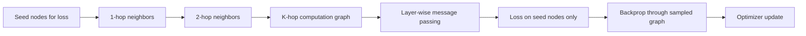
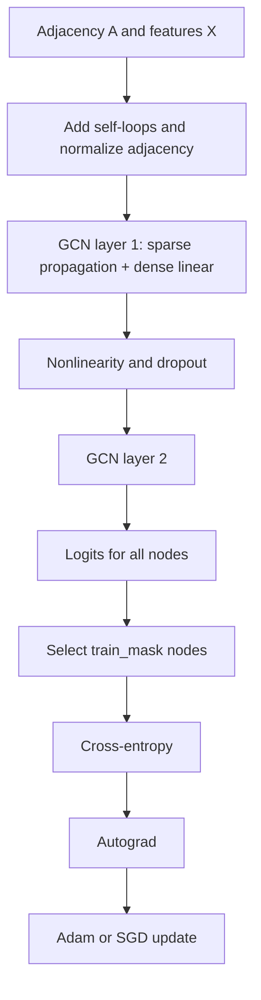
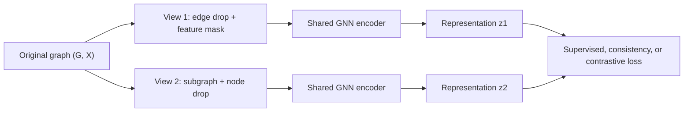
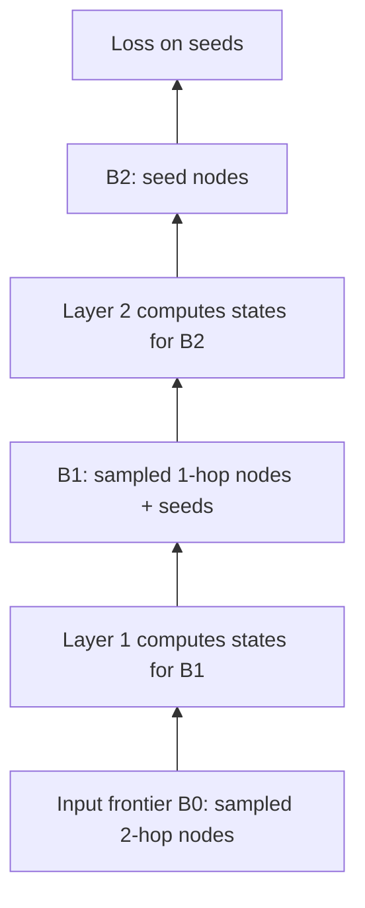

# **GNN Augmentation and Training**

Training a graph neural network is ordinary differentiable programming wrapped around an unusual data dependency: the prediction for one node, edge, or graph may require features from a recursively expanding computation graph. This chapter expands the training pipeline, augmentation operators, neighborhood sampling methods, loss functions, and implementation details that make GNN training work in practice.

We assume a graph

$$
G=(V,E),
$$

with

$$
|V|=n,\qquad |E|=m.
$$

The node feature matrix is

$$
X \in \mathbb{R}^{n \times d_0},
$$

and the hidden representation at layer $k$ is

$$
H^{(k)} \in \mathbb{R}^{n \times d_k},\qquad H^{(0)}=X.
$$

The adjacency matrix is

$$
A \in \mathbb{R}^{n \times n},
$$

where $A_{uv}$ is nonzero when node $u$ sends a message to node $v$. For undirected unweighted graphs, $A$ is symmetric and binary. Many GNN layers add self-loops:

$$
\tilde{A}=A+I_n,
$$

with degree matrix

$$
\tilde{D}_{vv}=\sum_{u=1}^{n}\tilde{A}_{vu}.
$$

The canonical full-batch GCN layer is

$$
H^{(k+1)}
=
\sigma
\left(
\tilde{D}^{-1/2}\tilde{A}\tilde{D}^{-1/2}H^{(k)}W^{(k)}
\right),
$$

where $W^{(k)} \in \mathbb{R}^{d_k \times d_{k+1}}$ is trainable and $\sigma$ is a pointwise nonlinearity.

---

## **1. Why GNN Training Is Different**

In an MLP, each example is usually independent after batching. In a CNN, spatial neighborhoods are fixed-size and regular. In a GNN, a minibatch of target nodes induces a layered dependency graph whose size depends on degrees.

For a $K$-layer message-passing GNN, the representation of target node $v$ can depend on all nodes in its $K$-hop neighborhood:

$$
\mathcal{B}_K(v)
=
\{u \in V : \operatorname{dist}(u,v)\le K\}.
$$

If the average sampled or full degree is $d$, the naive computation graph size for one seed node grows approximately as

$$
1+d+d^2+\cdots+d^K
=
\frac{d^{K+1}-1}{d-1}
=
O(d^K).
$$

This is the neighbor explosion problem. On a graph with high-degree nodes, full neighborhood expansion quickly dominates memory and runtime.



Important consequences:

- Batching is not just stacking examples; it constructs a local graph.
- Data augmentation must preserve task-relevant graph semantics.
- The train, validation, and test split must avoid structural leakage.
- Sampling affects both estimator bias and gradient variance.
- Sparse tensor layout and edge indexing are first-order performance concerns.

---

## **2. Training Objectives by Prediction Level**

### **2.1 Node-Level Prediction**

Let $\mathcal{V}_{\text{train}}\subseteq V$ be labeled training nodes. A GNN encoder computes

$$
Z=f_\theta(G,X)\in \mathbb{R}^{n \times c}.
$$

For multiclass node classification, logits for node $v$ are $z_v\in\mathbb{R}^c$ and

$$
p_\theta(y=j\mid v,G,X)
=
\frac{\exp(z_{vj})}{\sum_{\ell=1}^{c}\exp(z_{v\ell})}.
$$

The supervised loss is

$$
\mathcal{L}_{\text{node}}(\theta)
=
-\frac{1}{|\mathcal{V}_{\text{train}}|}
\sum_{v\in \mathcal{V}_{\text{train}}}
\log p_\theta(y_v\mid v,G,X).
$$

Only training nodes contribute to the loss, but their representations may use features from unlabeled neighbors. This is standard in transductive semi-supervised node classification.

### **2.2 Edge-Level Prediction and Link Prediction**

For an edge candidate $(u,v)$, an encoder gives node embeddings $h_u,h_v$. A decoder scores the pair:

$$
s_\theta(u,v)
=
\operatorname{DEC}_\phi(h_u,h_v,e_{uv}).
$$

Common decoders include dot product,

$$
s_\theta(u,v)=h_u^\top h_v,
$$

bilinear scoring,

$$
s_\theta(u,v)=h_u^\top R h_v,
$$

and an MLP over concatenated features,

$$
s_\theta(u,v)=\operatorname{MLP}_\phi([h_u,h_v,h_u\odot h_v,|h_u-h_v|]).
$$

For binary link prediction with positive edges $\mathcal{E}^{+}$ and sampled negatives $\mathcal{E}^{-}$,

$$
\mathcal{L}_{\text{edge}}(\theta)
=
-\frac{1}{|\mathcal{E}^{+}|+|\mathcal{E}^{-}|}
\left[
\sum_{(u,v)\in\mathcal{E}^{+}}\log \sigma(s_\theta(u,v))
+
\sum_{(u,v)\in\mathcal{E}^{-}}\log \left(1-\sigma(s_\theta(u,v))\right)
\right].
$$

The split must remove validation and test edges from the message-passing graph when evaluating link prediction; otherwise the encoder can directly see the target links.

### **2.3 Graph-Level Prediction**

For a dataset of graphs $\{(G_i,X_i,y_i)\}_{i=1}^{N}$, the encoder computes node states, then a permutation-invariant readout forms a graph embedding:

$$
h_{G_i}
=
\operatorname{READOUT}
\left(
\{h_v^{(K)}:v\in V_i\}
\right).
$$

Common readouts are

$$
h_G=\sum_{v\in V}h_v^{(K)},
\qquad
h_G=\frac{1}{|V|}\sum_{v\in V}h_v^{(K)},
\qquad
h_G=\max_{v\in V}h_v^{(K)}.
$$

Then

$$
\hat{y}_i=g_\phi(h_{G_i}),
$$

and the dataset loss is the usual supervised loss over graphs.

---

## **3. Full-Batch Training Under the Hood**

Full-batch training evaluates message passing on the entire graph before computing the loss. It is common for citation-style transductive benchmarks, but becomes expensive for large graphs.



For a two-layer GCN:

$$
H^{(1)}
=
\operatorname{ReLU}(\hat{A}XW^{(0)}),
$$

$$
Z
=
\hat{A}H^{(1)}W^{(1)},
$$

where

$$
\hat{A}=\tilde{D}^{-1/2}\tilde{A}\tilde{D}^{-1/2}.
$$

The loss for node classification is

$$
\mathcal{L}
=
-\frac{1}{|\mathcal{V}_{\text{train}}|}
\sum_{v\in\mathcal{V}_{\text{train}}}
\log
\frac{\exp(Z_{v,y_v})}{\sum_{j=1}^{c}\exp(Z_{vj})}.
$$

### **Step-by-Step Execution**

1. Convert graph connectivity to a sparse adjacency or edge list.
2. Add self-loops if the layer requires them.
3. Compute degrees and normalization coefficients.
4. Apply sparse propagation $\hat{A}H^{(k)}$.
5. Apply dense trainable projection with $W^{(k)}$.
6. Apply activation, normalization, residual connection, or dropout if configured.
7. Compute logits for all nodes.
8. Select only supervised items through train masks.
9. Compute the loss.
10. Backpropagate through sparse aggregation and dense projections.
11. Update parameters with SGD, Adam, AdamW, or another optimizer.

### **Gradient Structure**

Let

$$
S=\hat{A},
\qquad
Y=SHW.
$$

Suppose the upstream gradient is

$$
G_Y=\frac{\partial \mathcal{L}}{\partial Y}.
$$

Then

$$
\frac{\partial \mathcal{L}}{\partial W}
=
H^\top S^\top G_Y,
$$

and

$$
\frac{\partial \mathcal{L}}{\partial H}
=
S^\top G_Y W^\top.
$$

For undirected normalized GCN, $S=S^\top$, so the backward pass propagates gradients along the same normalized edges. For directed graphs, forward and backward traversal differ unless the implementation symmetrizes the graph.

---

## **4. Deriving GCN Normalization from First Principles**

Start with a simple mean aggregator:

$$
h_v^{(k+1)}
=
\sigma
\left(
W^{(k)}
\frac{1}{|\mathcal{N}(v)\cup\{v\}|}
\sum_{u\in \mathcal{N}(v)\cup\{v\}}
h_u^{(k)}
\right).
$$

In matrix form, with self-loops,

$$
H^{(k+1)}
=
\sigma
\left(
\tilde{D}^{-1}\tilde{A}H^{(k)}W^{(k)}
\right).
$$

This row-normalized operator averages incoming messages. It is intuitive but asymmetric even on undirected graphs, because high-degree and low-degree nodes are scaled differently. The GCN layer instead uses symmetric normalization:

$$
H^{(k+1)}
=
\sigma
\left(
\tilde{D}^{-1/2}\tilde{A}\tilde{D}^{-1/2}H^{(k)}W^{(k)}
\right).
$$

For a single receiving node $v$,

$$
h_v^{(k+1)}
=
\sigma
\left(
\sum_{u\in \mathcal{N}(v)\cup\{v\}}
\frac{1}{\sqrt{\tilde{d}_v\tilde{d}_u}}
h_u^{(k)}W^{(k)}
\right).
$$

Each edge contribution is weighted by both receiver and sender degree. This reduces the dominance of high-degree senders and corresponds to applying a symmetric graph smoothing operator.

The normalization assumes:

- The graph is treated as undirected or has been converted into an appropriate message-flow graph.
- Edge weights are nonnegative if interpreted as affinities.
- Self-loops are included so isolated or low-degree nodes retain their own features.
- Degree zero after self-loop insertion is avoided because $\tilde{d}_v\ge 1$.

---

## **5. Graph Augmentation**

Graph augmentation means sampling a transformed graph view

$$
G' \sim q(\cdot \mid G,X),
$$

and training the model on $G'$ rather than exactly on $G$. For feature augmentation, the transformed input is

$$
X' \sim q_X(\cdot \mid X).
$$

The goal is to encode a prior: predictions should be stable to changes that do not alter the task label. This is subtle. Removing a bond in a molecule, removing a fraud transaction, or masking a rare categorical feature may change the label-relevant evidence. Good augmentation is domain dependent.



### **5.1 Edge Dropping**

Edge dropping samples a binary mask for every edge:

$$
M_{uv}\sim \operatorname{Bernoulli}(1-p_e),
$$

and forms

$$
A'_{uv}=M_{uv}A_{uv}.
$$

For undirected graphs represented by two directed edges $(u,v)$ and $(v,u)$, the same mask should usually be shared across both directions:

$$
M_{uv}=M_{vu}.
$$

Otherwise an originally undirected graph becomes randomly directed.

The expected adjacency is

$$
\mathbb{E}[A']
=(1-p_e)A.
$$

If the layer recomputes normalization from $A'$, the propagation operator is not simply scaled by $(1-p_e)$. The degrees also change:

$$
d'_v=\sum_{u=1}^{n}A'_{vu}.
$$

This makes edge dropping a structural stochastic regularizer rather than ordinary dropout on messages.

### **5.2 Edge Addition and Edge Perturbation**

Edge addition samples non-edges and turns them into edges. Let

$$
\bar{E}=\{(u,v):u\ne v,\ (u,v)\notin E\}.
$$

Sample

$$
B_{uv}\sim \operatorname{Bernoulli}(p_a)
\qquad \text{for } (u,v)\in \bar{E},
$$

and define

$$
A'_{uv}=A_{uv}+(1-A_{uv})B_{uv}.
$$

In practice, uniform edge addition can be harmful on structured graphs because the number of non-edges is $O(n^2)$ and random false edges overwhelm local semantics. Safer variants use:

- similarity-based candidate edges,
- $k$-nearest-neighbor feature graphs,
- diffusion-based edges,
- domain constraints,
- learned edge probabilities.

Edge perturbation combines edge dropping and addition.

### **5.3 Node Dropping**

Node dropping samples a node mask

$$
r_v\sim \operatorname{Bernoulli}(1-p_n),
$$

then keeps

$$
V'=\{v\in V:r_v=1\}.
$$

The induced adjacency is

$$
A' = RAR,
$$

where

$$
R=\operatorname{diag}(r_1,\dots,r_n).
$$

For graph classification, node dropping resembles random cropping on graph structure. For node classification, it must be used carefully: dropping a supervised seed node removes the training example, while dropping neighbors changes the seed's receptive field.

### **5.4 Feature Masking**

Feature masking samples a mask

$$
M \in \{0,1\}^{n\times d_0},
$$

with

$$
M_{ij}\sim \operatorname{Bernoulli}(1-p_f),
$$

and sets

$$
X'=M\odot X.
$$

A feature dropout variant rescales retained entries:

$$
X'=\frac{M\odot X}{1-p_f}.
$$

Then

$$
\mathbb{E}[X']=X.
$$

For categorical one-hot features, arbitrary element-wise masking can create invalid partial categories. Common alternatives mask whole feature fields, replace with a learned mask token, or use missingness indicators.

### **5.5 Subgraph Sampling**

Subgraph augmentation samples

$$
S\subseteq V
$$

and trains on the induced subgraph

$$
G[S]=(S,E_S),
$$

where

$$
E_S=\{(u,v)\in E:u\in S,\ v\in S\}.
$$

Subgraphs can be sampled by random walks, breadth-first expansion, personalized PageRank, cluster partitions, or task-specific neighborhoods. Subgraph sampling is both augmentation and scalability machinery.

### **5.6 Augmentation as Vicinal Risk Minimization**

Standard empirical risk minimization minimizes

$$
\hat{R}(\theta)
=
\frac{1}{N}\sum_{i=1}^{N}
\ell(f_\theta(x_i),y_i).
$$

Augmentation changes the objective to a local distribution around each example:

$$
\hat{R}_{\text{aug}}(\theta)
=
\frac{1}{N}\sum_{i=1}^{N}
\mathbb{E}_{\tilde{x}\sim q(\cdot\mid x_i)}
\left[
\ell(f_\theta(\tilde{x}),y_i)
\right].
$$

For graph inputs,

$$
\tilde{x}=(G',X'),
$$

so

$$
\hat{R}_{\text{aug}}(\theta)
=
\frac{1}{N}\sum_{i=1}^{N}
\mathbb{E}_{(G',X')\sim q(\cdot\mid G_i,X_i)}
\left[
\ell(f_\theta(G',X'),y_i)
\right].
$$

Stochastic training approximates this expectation with one or a few augmented views per step.

### **5.7 Consistency Regularization**

For a supervised example, two augmented views should often produce similar predictions:

$$
G_1',X_1'\sim q(\cdot\mid G,X),
\qquad
G_2',X_2'\sim q(\cdot\mid G,X).
$$

Let

$$
p_1=\operatorname{softmax}(f_\theta(G_1',X_1')),
\qquad
p_2=\operatorname{softmax}(f_\theta(G_2',X_2')).
$$

A symmetric consistency penalty is

$$
\mathcal{L}_{\text{cons}}
=
\frac{1}{2}
\left[
D_{\mathrm{KL}}(p_1\Vert p_2)
+
D_{\mathrm{KL}}(p_2\Vert p_1)
\right],
$$

where

$$
D_{\mathrm{KL}}(p\Vert q)
=
\sum_{j}p_j\log\frac{p_j}{q_j}.
$$

The total objective can be

$$
\mathcal{L}
=
\mathcal{L}_{\text{sup}}
+
\lambda_{\text{cons}}\mathcal{L}_{\text{cons}}.
$$

### **5.8 Contrastive Augmentation**

Graph contrastive learning creates two views of the same graph or node neighborhood and pulls their embeddings together while pushing apart embeddings from different instances.

Let $z_i^{(1)}$ and $z_i^{(2)}$ be normalized embeddings of two augmented views of instance $i$. With cosine similarity

$$
\operatorname{sim}(a,b)=a^\top b
\qquad \text{when } \|a\|_2=\|b\|_2=1,
$$

the NT-Xent loss for one direction is

$$
\mathcal{L}_i
=
-
\log
\frac{
\exp(\operatorname{sim}(z_i^{(1)},z_i^{(2)})/\tau)
}{
\sum_{j=1}^{B}
\exp(\operatorname{sim}(z_i^{(1)},z_j^{(2)})/\tau)
},
$$

where $B$ is batch size and $\tau>0$ is a temperature. Smaller $\tau$ sharpens the softmax and increases emphasis on hard negatives.

---

## **6. Neighborhood Sampling**

Neighborhood sampling approximates full message passing by recursively sampling neighbors for a batch of seed nodes.

Let the seed set at output layer be

$$
B_K.
$$

For layer $k=K-1,K-2,\dots,0$, sample a set of source nodes

$$
B_k
=
B_{k+1}
\cup
\bigcup_{v\in B_{k+1}}
\operatorname{SAMPLE}_{s_k}(\mathcal{N}(v)).
$$

The model computes all hidden states for nodes in $B_k$ needed to produce representations for $B_{k+1}$. After $K$ layers, the loss is evaluated only on the original seeds $B_K$.



### **6.1 Fixed-Size Uniform Sampling**

For each destination node $v$, sample

$$
S_v\subseteq \mathcal{N}(v),
\qquad
|S_v|=\min(s,|\mathcal{N}(v)|).
$$

A GraphSAGE mean layer uses

$$
\hat{m}_v
=
\frac{1}{|S_v|}
\sum_{u\in S_v}h_u^{(k)}.
$$

If $S_v$ is sampled uniformly without replacement and $|\mathcal{N}(v)|=d_v$, then

$$
\mathbb{E}[\hat{m}_v]
=
\frac{1}{d_v}\sum_{u\in\mathcal{N}(v)}h_u^{(k)}.
$$

Thus the sampled mean is an unbiased estimator of the full neighbor mean.

The covariance decreases with sample size. For scalar messages $x_u$, the variance of the without-replacement sample mean is

$$
\operatorname{Var}(\hat{\mu})
=
\frac{1}{s}
\left(1-\frac{s}{d_v}\right)
\frac{1}{d_v-1}
\sum_{u\in\mathcal{N}(v)}(x_u-\mu)^2,
$$

where

$$
\mu=\frac{1}{d_v}\sum_{u\in\mathcal{N}(v)}x_u.
$$

### **6.2 Importance Sampling**

Suppose the full sum aggregator is

$$
m_v=\sum_{u\in\mathcal{N}(v)}a_{vu}h_u.
$$

Sample neighbors $u_i\sim p_v(u)$ independently. An unbiased estimator is

$$
\hat{m}_v
=
\frac{1}{s}
\sum_{i=1}^{s}
\frac{a_{v u_i}h_{u_i}}{p_v(u_i)}.
$$

Indeed,

$$
\mathbb{E}[\hat{m}_v]
=
\frac{1}{s}\sum_{i=1}^{s}
\sum_{u\in\mathcal{N}(v)}
p_v(u)
\frac{a_{vu}h_u}{p_v(u)}
=
\sum_{u\in\mathcal{N}(v)}a_{vu}h_u.
$$

The optimal sampling distribution for scalar terms, ignoring constraints, is proportional to magnitude:

$$
p_v(u)\propto |a_{vu}h_u|.
$$

For vector messages, practical choices use norms, degrees, edge weights, PageRank scores, or learned attention estimates.

### **6.3 Layer-Wise Sampling**

Node-wise sampling samples neighbors independently for each node, so the same source node may appear many times. Layer-wise methods sample a shared set of nodes per layer and connect them to the next layer's frontier.

If layer $k$ uses a sampled node set $S_k$, the propagation approximates

$$
H_{S_{k+1}}^{(k+1)}
\approx
\sigma
\left(
\hat{A}_{S_{k+1},S_k}H_{S_k}^{(k)}W^{(k)}
\right).
$$

FastGCN interprets graph convolution as integral transformation and samples nodes independently per layer. LADIES improves locality by sampling from neighbors of the current upper-layer nodes, reducing irrelevant sampled nodes.

### **6.4 Subgraph Sampling**

Subgraph sampling constructs a minibatch graph $G_b=(V_b,E_b)$, then runs normal message passing inside it:

$$
H_b^{(k+1)}
=
\sigma(\hat{A}_bH_b^{(k)}W^{(k)}).
$$

Examples:

- GraphSAINT samples node-induced, edge-induced, or random-walk subgraphs and uses normalization to reduce sampling bias.
- Cluster-GCN partitions the full graph into clusters and trains on one or a few clusters per batch.
- Random-walk samplers preserve local connectivity better than independent node sampling.

Subgraph sampling is usually more GPU-friendly than deeply nested node-wise sampling because it produces a compact sparse adjacency for standard message passing.

### **6.5 Neighbor Sampling Complexity**

For a $K$-layer model with fanouts

$$
(s_1,s_2,\dots,s_K),
$$

the maximum number of sampled nodes per seed is roughly

$$
1+s_K+s_Ks_{K-1}+\cdots+\prod_{k=1}^{K}s_k.
$$

If every layer has fanout $s$, this is

$$
O(s^K).
$$

This is still exponential in depth, but with a controlled base. For $K=2$ and $s=15$, the worst-case neighborhood per seed is about

$$
1+15+15^2=241
$$

nodes instead of potentially millions.

---

## **7. Worked Example: One GCN Step with Edge Dropping**

Consider an undirected path graph:

$$
1 - 2 - 3.
$$

The adjacency matrix without self-loops is

$$
A=
\begin{bmatrix}
0 & 1 & 0\\
1 & 0 & 1\\
0 & 1 & 0
\end{bmatrix}.
$$

Add self-loops:

$$
\tilde{A}=
\begin{bmatrix}
1 & 1 & 0\\
1 & 1 & 1\\
0 & 1 & 1
\end{bmatrix}.
$$

The degrees are

$$
\tilde{d}_1=2,\qquad \tilde{d}_2=3,\qquad \tilde{d}_3=2.
$$

The normalized adjacency entries are

$$
\hat{A}_{vu}
=
\frac{\tilde{A}_{vu}}{\sqrt{\tilde{d}_v\tilde{d}_u}}.
$$

Therefore

$$
\hat{A}
=
\begin{bmatrix}
\frac{1}{2} & \frac{1}{\sqrt{6}} & 0\\
\frac{1}{\sqrt{6}} & \frac{1}{3} & \frac{1}{\sqrt{6}}\\
0 & \frac{1}{\sqrt{6}} & \frac{1}{2}
\end{bmatrix}.
$$

Let scalar node features be

$$
X=
\begin{bmatrix}
1\\
2\\
4
\end{bmatrix},
$$

and let the one-dimensional weight be

$$
W=[2].
$$

First propagate:

$$
\hat{A}X
=
\begin{bmatrix}
\frac{1}{2}\cdot 1+\frac{1}{\sqrt{6}}\cdot 2\\
\frac{1}{\sqrt{6}}\cdot 1+\frac{1}{3}\cdot 2+\frac{1}{\sqrt{6}}\cdot 4\\
\frac{1}{\sqrt{6}}\cdot 2+\frac{1}{2}\cdot 4
\end{bmatrix}.
$$

Using

$$
\frac{1}{\sqrt{6}}\approx 0.4082,
$$

we get

$$
\hat{A}X
\approx
\begin{bmatrix}
1.3165\\
2.7089\\
2.8165
\end{bmatrix}.
$$

Then apply $W=2$:

$$
\hat{A}XW
\approx
\begin{bmatrix}
2.6330\\
5.4178\\
5.6330
\end{bmatrix}.
$$

Now drop edge $(2,3)$ while keeping self-loops and edge $(1,2)$. The augmented adjacency is

$$
\tilde{A}'=
\begin{bmatrix}
1 & 1 & 0\\
1 & 1 & 0\\
0 & 0 & 1
\end{bmatrix}.
$$

The new degrees are

$$
\tilde{d}'_1=2,\qquad \tilde{d}'_2=2,\qquad \tilde{d}'_3=1.
$$

The normalized adjacency is

$$
\hat{A}'
=
\begin{bmatrix}
\frac{1}{2} & \frac{1}{2} & 0\\
\frac{1}{2} & \frac{1}{2} & 0\\
0 & 0 & 1
\end{bmatrix}.
$$

Then

$$
\hat{A}'X
=
\begin{bmatrix}
1.5\\
1.5\\
4
\end{bmatrix},
$$

and

$$
\hat{A}'XW
=
\begin{bmatrix}
3\\
3\\
8
\end{bmatrix}.
$$

The dropped edge isolates node $3$ from the rest of the graph except for its self-loop. This example shows why structural augmentation is not a small perturbation for low-degree nodes.

---

## **8. Worked Example: Neighbor Sampling Variance**

Node $v$ has five scalar neighbor messages:

$$
\{1,2,4,7,11\}.
$$

The full mean is

$$
\mu=\frac{1+2+4+7+11}{5}=5.
$$

If we sample $s=2$ neighbors uniformly without replacement and observe $\{2,11\}$, the sampled mean is

$$
\hat{\mu}=\frac{2+11}{2}=6.5.
$$

It is noisy but unbiased over repeated samples.

The finite-population variance term is

$$
\sum_{u}(x_u-\mu)^2
=
(1-5)^2+(2-5)^2+(4-5)^2+(7-5)^2+(11-5)^2
=
66.
$$

The sample-mean variance is

$$
\operatorname{Var}(\hat{\mu})
=
\frac{1}{2}
\left(1-\frac{2}{5}\right)
\frac{66}{5-1}
=
4.95.
$$

Thus

$$
\operatorname{Std}(\hat{\mu})\approx 2.2249.
$$

Sampling more neighbors reduces variance, but it increases memory and compute.

---

## **9. Train, Validation, and Test Splits**

### **9.1 Node Classification**

For transductive node classification, all nodes and edges may be visible during message passing, but labels are split:

$$
V=V_{\text{train}}\cup V_{\text{val}}\cup V_{\text{test}}.
$$

The masks are disjoint:

$$
V_{\text{train}}\cap V_{\text{val}}=\emptyset,
\qquad
V_{\text{train}}\cap V_{\text{test}}=\emptyset,
\qquad
V_{\text{val}}\cap V_{\text{test}}=\emptyset.
$$

The model can aggregate features from validation and test nodes, but cannot use their labels. This is appropriate when the graph structure is known at training time.

For inductive node classification, validation and test nodes or graphs are held out structurally. The training graph should not contain test nodes or test edges.

### **9.2 Link Prediction**

A correct split for link prediction is more delicate:

1. Split positive edges into train, validation, and test positives.
2. Remove validation and test positives from the training message-passing graph.
3. Sample negative edges separately for train, validation, and test.
4. Avoid sampling false negatives when the graph is incomplete, if possible.

If validation or test edges remain in the adjacency used by the encoder, the task can become trivial because the target edge directly contributes to the embeddings being scored.

### **9.3 Graph Classification**

Whole graphs are split:

$$
\mathcal{D}
=
\mathcal{D}_{\text{train}}
\cup
\mathcal{D}_{\text{val}}
\cup
\mathcal{D}_{\text{test}}.
$$

If graphs share entities, timestamps, molecules from the same scaffold, or users from the same population, random splitting can overestimate generalization. Use scaffold, temporal, group, or entity-disjoint splits when those match deployment.

---

## **10. Optimization Details**

### **10.1 Cross-Entropy and Stable Softmax**

Given logits $z\in\mathbb{R}^c$, softmax probabilities are

$$
p_j=\frac{\exp(z_j)}{\sum_{\ell=1}^{c}\exp(z_\ell)}.
$$

The stable implementation subtracts the maximum logit:

$$
p_j
=
\frac{\exp(z_j-a)}{\sum_{\ell=1}^{c}\exp(z_\ell-a)},
\qquad
a=\max_{\ell}z_\ell.
$$

This does not change probabilities because the same factor $\exp(-a)$ cancels:

$$
\frac{\exp(z_j-a)}{\sum_{\ell}\exp(z_\ell-a)}
=
\frac{\exp(z_j)\exp(-a)}{\exp(-a)\sum_{\ell}\exp(z_\ell)}
=
\frac{\exp(z_j)}{\sum_{\ell}\exp(z_\ell)}.
$$

The cross-entropy for class $y$ is

$$
\ell(z,y)
=
-\log p_y
=
-z_y+\log\sum_{\ell=1}^{c}\exp(z_\ell).
$$

A stable log-sum-exp computation is

$$
\log\sum_{\ell}\exp(z_\ell)
=
a+\log\sum_{\ell}\exp(z_\ell-a).
$$

### **10.2 Regularization**

Common regularizers:

- Feature dropout: randomly mask hidden features.
- Edge dropout: randomly mask edges or messages.
- Weight decay: penalize large parameters.
- Early stopping: select by validation metric.
- Batch normalization or graph normalization: stabilize hidden scale.
- PairNorm or residual connections: reduce oversmoothing in deep GNNs.
- Label smoothing: reduce overconfident classification.

### **10.3 Oversmoothing and Oversquashing**

Repeated graph propagation tends to smooth node representations:

$$
H^{(K)}
\approx
\hat{A}^{K}XW,
$$

ignoring nonlinearities and layer-specific weights. If $\hat{A}$ has dominant low-frequency eigenvectors, high-frequency differences shrink as $K$ grows. This is oversmoothing.

Oversquashing is different: exponentially many distant signals are compressed into fixed-dimensional node states. Sampling can reduce computation but does not remove the representational bottleneck.

---

## **11. Python Implementation from Scratch**

The implementation below trains a two-layer GCN for node classification using only PyTorch tensor operations. It includes edge dropping, feature masking, stable cross-entropy through PyTorch's built-in loss, and sparse adjacency normalization.

```python
import math
from dataclasses import dataclass

import torch
from torch import nn
import torch.nn.functional as F


@dataclass
class GraphData:
    x: torch.Tensor              # [num_nodes, num_features]
    edge_index: torch.Tensor     # [2, num_edges], directed COO
    y: torch.Tensor              # [num_nodes]
    train_mask: torch.Tensor     # [num_nodes], bool
    val_mask: torch.Tensor       # [num_nodes], bool
    test_mask: torch.Tensor      # [num_nodes], bool


def add_self_loops(edge_index: torch.Tensor, num_nodes: int) -> torch.Tensor:
    """Append one self-loop per node to a COO edge_index."""
    device = edge_index.device
    nodes = torch.arange(num_nodes, device=device)
    self_loops = torch.stack([nodes, nodes], dim=0)
    return torch.cat([edge_index, self_loops], dim=1)


def normalize_gcn_edges(edge_index: torch.Tensor, num_nodes: int):
    """
    Compute symmetric GCN normalization coefficients.

    For each directed edge source -> target, the coefficient is
    1 / sqrt(deg[source] * deg[target]) after self-loop insertion.
    """
    edge_index = add_self_loops(edge_index, num_nodes)
    src, dst = edge_index

    deg = torch.zeros(num_nodes, device=edge_index.device)
    deg.scatter_add_(0, dst, torch.ones_like(dst, dtype=torch.float))

    deg_inv_sqrt = deg.clamp(min=1).pow(-0.5)
    edge_weight = deg_inv_sqrt[src] * deg_inv_sqrt[dst]
    return edge_index, edge_weight


def sparse_message_passing(
    x: torch.Tensor,
    edge_index: torch.Tensor,
    edge_weight: torch.Tensor,
) -> torch.Tensor:
    """
    Compute out[dst] = sum_{src -> dst} edge_weight * x[src].

    This is the COO equivalent of multiplying by a normalized sparse
    adjacency matrix. index_add_ is the core scatter-add primitive.
    """
    src, dst = edge_index
    messages = x[src] * edge_weight.unsqueeze(-1)
    out = torch.zeros_like(x)
    out.index_add_(0, dst, messages)
    return out


class GCNLayer(nn.Module):
    def __init__(self, in_dim: int, out_dim: int):
        super().__init__()
        self.weight = nn.Parameter(torch.empty(in_dim, out_dim))
        self.bias = nn.Parameter(torch.zeros(out_dim))
        nn.init.xavier_uniform_(self.weight)

    def forward(self, x, edge_index, edge_weight):
        propagated = sparse_message_passing(x, edge_index, edge_weight)
        return propagated @ self.weight + self.bias


class TwoLayerGCN(nn.Module):
    def __init__(self, in_dim: int, hidden_dim: int, out_dim: int, dropout: float):
        super().__init__()
        self.conv1 = GCNLayer(in_dim, hidden_dim)
        self.conv2 = GCNLayer(hidden_dim, out_dim)
        self.dropout = dropout

    def forward(self, x, edge_index, edge_weight):
        x = self.conv1(x, edge_index, edge_weight)
        x = F.relu(x)
        x = F.dropout(x, p=self.dropout, training=self.training)
        x = self.conv2(x, edge_index, edge_weight)
        return x


def drop_edges(edge_index: torch.Tensor, drop_prob: float, force_undirected: bool = False):
    """
    Randomly drop edges during training.

    If force_undirected is True, this simple version assumes edge pairs
    are already duplicated and keeps the code compact by not trying to
    synchronize reciprocal masks. Production code should synchronize them.
    """
    if drop_prob <= 0:
        return edge_index
    keep = torch.rand(edge_index.size(1), device=edge_index.device) > drop_prob
    return edge_index[:, keep]


def mask_features(x: torch.Tensor, mask_prob: float):
    """Element-wise feature masking with inverted-dropout scaling."""
    if mask_prob <= 0:
        return x
    keep_prob = 1.0 - mask_prob
    mask = (torch.rand_like(x) < keep_prob).float()
    return x * mask / keep_prob


@torch.no_grad()
def accuracy(logits: torch.Tensor, y: torch.Tensor, mask: torch.Tensor) -> float:
    pred = logits.argmax(dim=-1)
    return (pred[mask] == y[mask]).float().mean().item()


def train_epoch(
    model: nn.Module,
    data: GraphData,
    optimizer: torch.optim.Optimizer,
    edge_drop: float = 0.1,
    feature_mask: float = 0.1,
):
    model.train()
    optimizer.zero_grad()

    edge_index_aug = drop_edges(data.edge_index, edge_drop)
    x_aug = mask_features(data.x, feature_mask)
    edge_index_norm, edge_weight = normalize_gcn_edges(edge_index_aug, data.x.size(0))

    logits = model(x_aug, edge_index_norm, edge_weight)
    loss = F.cross_entropy(logits[data.train_mask], data.y[data.train_mask])
    loss.backward()
    optimizer.step()
    return loss.item()


@torch.no_grad()
def evaluate(model: nn.Module, data: GraphData):
    model.eval()
    edge_index_norm, edge_weight = normalize_gcn_edges(data.edge_index, data.x.size(0))
    logits = model(data.x, edge_index_norm, edge_weight)
    return {
        "train_acc": accuracy(logits, data.y, data.train_mask),
        "val_acc": accuracy(logits, data.y, data.val_mask),
        "test_acc": accuracy(logits, data.y, data.test_mask),
    }
```

### **11.1 What the Scratch Code Is Doing Internally**

The line

```python
messages = x[src] * edge_weight.unsqueeze(-1)
```

materializes one message per edge. If there are $m$ directed edges and hidden dimension $d$, this tensor has shape

$$
m \times d.
$$

The line

```python
out.index_add_(0, dst, messages)
```

performs the scatter-add

$$
\operatorname{out}_v
=
\sum_{(u,v)\in E}
w_{uv}x_u.
$$

This is the same operation implemented by libraries using optimized sparse kernels, segmented reductions, or custom CUDA operators.

The scratch implementation is clear but not optimal:

- It allocates explicit edge messages.
- It recomputes normalization every epoch.
- It does not fuse scatter, linear projection, and activation.
- It does not coalesce duplicate edges.
- It does not synchronize undirected edge-drop masks.

---

## **12. Neighbor Sampling from Scratch**

The following implementation builds a sampled computation graph for a batch of seed nodes. It uses adjacency lists for clarity.

```python
from collections import defaultdict
from typing import Dict, Iterable, List, Sequence, Tuple

import torch


def build_in_neighbors(edge_index: torch.Tensor, num_nodes: int) -> List[List[int]]:
    """Return in-neighbors for message flow src -> dst."""
    src, dst = edge_index.cpu().tolist()
    neighbors = [[] for _ in range(num_nodes)]
    for u, v in zip(src, dst):
        neighbors[v].append(u)
    return neighbors


def sample_neighbors(
    seeds: Sequence[int],
    in_neighbors: List[List[int]],
    fanouts: Sequence[int],
    generator: torch.Generator | None = None,
) -> Tuple[List[torch.Tensor], List[torch.Tensor]]:
    """
    Recursively sample source nodes for each GNN layer.

    Returns:
        blocks: edge_index tensors per layer, ordered input -> output.
        node_layers: node ids per layer, where node_layers[-1] are seeds.
    """
    current = torch.tensor(list(seeds), dtype=torch.long)
    node_layers = [current]
    blocks_reversed = []

    for fanout in reversed(fanouts):
        dst_nodes = node_layers[-1]
        sampled_src = set(dst_nodes.tolist())
        edges = []

        for local_dst, v in enumerate(dst_nodes.tolist()):
            neigh = in_neighbors[v]
            if len(neigh) == 0:
                continue

            if fanout < 0 or fanout >= len(neigh):
                chosen = neigh
            else:
                perm = torch.randperm(len(neigh), generator=generator)[:fanout]
                chosen = [neigh[i] for i in perm.tolist()]

            for u in chosen:
                sampled_src.add(u)
                edges.append((u, v))

        src_nodes = torch.tensor(sorted(sampled_src), dtype=torch.long)
        id_to_local = {nid.item(): i for i, nid in enumerate(src_nodes)}
        dst_to_local = {nid.item(): i for i, nid in enumerate(dst_nodes)}

        local_edges = [
            (id_to_local[u], dst_to_local[v])
            for u, v in edges
            if u in id_to_local and v in dst_to_local
        ]

        if local_edges:
            block_edge_index = torch.tensor(local_edges, dtype=torch.long).t().contiguous()
        else:
            block_edge_index = torch.empty(2, 0, dtype=torch.long)

        blocks_reversed.append(block_edge_index)
        node_layers.append(src_nodes)

    blocks = list(reversed(blocks_reversed))
    node_layers = list(reversed(node_layers))
    return blocks, node_layers
```

For fanouts $[10,5]$ in a two-layer model:

- The second layer samples up to $5$ neighbors per seed.
- The first layer samples up to $10$ neighbors per node needed by the second layer.
- The first layer's input frontier can be much larger than the seed batch.

Production systems represent each layer as a bipartite block from source nodes to destination nodes. This avoids storing irrelevant edges among source nodes that are not needed for that layer.

---

## **13. Library Implementations**

### **13.1 PyTorch Geometric GCN**

```python
import torch
import torch.nn.functional as F
from torch_geometric.nn import GCNConv


class PyGGCN(torch.nn.Module):
    def __init__(self, in_dim, hidden_dim, out_dim, dropout=0.5):
        super().__init__()
        self.conv1 = GCNConv(in_dim, hidden_dim, cached=False, normalize=True)
        self.conv2 = GCNConv(hidden_dim, out_dim, cached=False, normalize=True)
        self.dropout = dropout

    def forward(self, x, edge_index):
        x = self.conv1(x, edge_index)
        x = F.relu(x)
        x = F.dropout(x, p=self.dropout, training=self.training)
        x = self.conv2(x, edge_index)
        return x


def train_pyg_full_batch(model, data, optimizer):
    model.train()
    optimizer.zero_grad()
    logits = model(data.x, data.edge_index)
    loss = F.cross_entropy(logits[data.train_mask], data.y[data.train_mask])
    loss.backward()
    optimizer.step()
    return loss.item()
```

Internally, `GCNConv`:

1. Optionally adds self-loops.
2. Computes degree-based symmetric normalization.
3. Applies a dense linear transformation.
4. Propagates messages with PyG's `MessagePassing` abstraction.
5. Aggregates messages, typically by an optimized scatter operation.

The mathematical operation is

$$
x_i'
=
\Theta^\top
\sum_{j\in\mathcal{N}(i)\cup\{i\}}
\frac{e_{j,i}}{\sqrt{\hat{d}_j\hat{d}_i}}
x_j,
$$

where $e_{j,i}$ is the edge weight, defaulting to $1$ for unweighted graphs.

The `cached=True` option stores the normalized adjacency after the first forward pass. This is appropriate for fixed transductive graphs, but it is wrong when edges change across batches or augmentations.

### **13.2 PyTorch Geometric NeighborLoader**

```python
from torch_geometric.loader import NeighborLoader


loader = NeighborLoader(
    data,
    input_nodes=data.train_mask,
    num_neighbors=[15, 10],
    batch_size=1024,
    shuffle=True,
)


for batch in loader:
    optimizer.zero_grad()
    logits = model(batch.x, batch.edge_index)

    # In PyG sampled batches, the first batch.batch_size nodes are the seeds.
    seed_logits = logits[: batch.batch_size]
    seed_y = batch.y[: batch.batch_size]

    loss = F.cross_entropy(seed_logits, seed_y)
    loss.backward()
    optimizer.step()
```

`NeighborLoader` recursively samples a fixed number of neighbors per hop from seed nodes. With `num_neighbors=[15,10]`, the sampled graph contains up to $15$ first-hop neighbors and up to $10$ second-hop neighbors per first-hop node, subject to degree limits and duplicate merging.

Important implementation detail: sampled nodes are relabeled into a compact local index space. The batch still stores metadata such as the original node ids, commonly in `batch.n_id`.

### **13.3 PyTorch Geometric Link Splitting**

```python
from torch_geometric.transforms import RandomLinkSplit


split = RandomLinkSplit(
    num_val=0.1,
    num_test=0.2,
    is_undirected=True,
    add_negative_train_samples=True,
)

train_data, val_data, test_data = split(data)
```

Internally, a link split transform:

1. Partitions positive edges.
2. Removes validation and test positives from the training graph.
3. Creates labels for positive and sampled negative edges.
4. Preserves undirected consistency when requested.

The critical property is that supervision edges and message-passing edges are not always the same tensor. Link prediction needs both an encoder graph and edge labels to score.

### **13.4 DGL Stochastic Training**

```python
import dgl
import torch
import torch.nn.functional as F


sampler = dgl.dataloading.MultiLayerNeighborSampler([15, 10])
dataloader = dgl.dataloading.DataLoader(
    graph,
    train_nids,
    sampler,
    batch_size=1024,
    shuffle=True,
    drop_last=False,
)


for input_nodes, output_nodes, blocks in dataloader:
    x = graph.ndata["feat"][input_nodes]
    y = graph.ndata["label"][output_nodes]

    logits = model(blocks, x)
    loss = F.cross_entropy(logits, y)

    optimizer.zero_grad()
    loss.backward()
    optimizer.step()
```

DGL represents sampled computation dependencies as blocks. A block is a bipartite graph from source nodes needed as input to destination nodes whose next-layer states are computed. This directly matches the layer-wise dependency structure of message passing.

---

## **14. Mini-Batch Training Algorithms**

### **14.1 GraphSAGE Sampling**

GraphSAGE learns an inductive aggregation function rather than a separate embedding vector for each node. A mean-aggregator layer can be written as

$$
m_v^{(k)}
=
\frac{1}{|S_v|}
\sum_{u\in S_v}h_u^{(k)},
$$

$$
h_v^{(k+1)}
=
\sigma
\left(
W^{(k)}
\left[
h_v^{(k)} \Vert m_v^{(k)}
\right]
\right),
$$

followed by optional normalization:

$$
h_v^{(k+1)}
\leftarrow
\frac{h_v^{(k+1)}}{\|h_v^{(k+1)}\|_2}.
$$

The concatenation keeps the node's own representation separate from its sampled neighborhood summary.

### **14.2 GraphSAINT**

GraphSAINT samples subgraphs rather than independently sampling neighbors at each layer. A sampled subgraph $G_s$ is used for all layers, reducing repeated expansion. Because nodes and edges have unequal sampling probabilities, GraphSAINT uses normalization constants to reduce bias in the minibatch estimator.

The high-level estimator is

$$
\mathcal{L}
=
\sum_{v\in V_{\text{train}}}\ell_v,
$$

approximated by

$$
\hat{\mathcal{L}}
=
\sum_{v\in V_s\cap V_{\text{train}}}
\alpha_v \ell_v,
$$

where $\alpha_v$ corrects for the probability that $v$ appears in sampled subgraphs.

### **14.3 Cluster-GCN**

Cluster-GCN partitions the graph into clusters

$$
V=C_1\cup C_2\cup\cdots\cup C_r,
$$

with dense internal edges and fewer cut edges. A minibatch uses one or more clusters:

$$
V_b=C_{i_1}\cup\cdots\cup C_{i_q}.
$$

Then standard GCN propagation runs on the induced subgraph $G[V_b]$. The method improves locality and memory use, but partition quality matters. If many informative edges cross clusters, small cluster batches lose signal.

---

## **15. Complexity**

Let:

- $n$ be number of nodes.
- $m$ be number of directed edges.
- $d_k$ be hidden dimension at layer $k$.
- $K$ be number of GNN layers.
- $B$ be seed batch size.
- $s_k$ be fanout at layer $k$.

### **15.1 Full-Batch GCN**

For one layer:

Sparse propagation:

$$
O(md_k).
$$

Dense projection:

$$
O(nd_kd_{k+1}).
$$

Activation and dropout:

$$
O(nd_{k+1}).
$$

Memory:

$$
O(m+nd_k+nd_{k+1})
$$

plus optimizer states and autograd activations.

### **15.2 Neighbor-Sampled Training**

The number of sampled nodes per batch is bounded by

$$
N_b
\lesssim
B\left(1+s_K+s_Ks_{K-1}+\cdots+\prod_{k=1}^{K}s_k\right).
$$

The number of sampled edges is roughly

$$
M_b
\lesssim
B\left(s_K+s_Ks_{K-1}+\cdots+\prod_{k=1}^{K}s_k\right).
$$

One minibatch costs approximately

$$
O\left(\sum_{k=0}^{K-1}M_b^{(k)}d_k + N_b^{(k)}d_kd_{k+1}\right).
$$

The advantage is that $N_b$ and $M_b$ are controlled by fanouts rather than total graph size.

### **15.3 Augmentation Overhead**

Feature masking:

$$
O(nd_0)
$$

if applied full-batch, or

$$
O(N_bd_0)
$$

if applied to sampled batches.

Edge dropping:

$$
O(m)
$$

to sample masks full-batch, or

$$
O(M_b)
$$

per sampled batch.

Subgraph sampling depends on the sampler. Random walk sampling of length $L$ from $r$ roots is

$$
O(rL)
$$

before deduplication and induced-edge extraction.

---

## **16. Numerical Stability**

### **16.1 Degree Normalization**

Without self-loops, isolated nodes have

$$
d_v=0,
$$

so $d_v^{-1/2}$ is undefined. Add self-loops or clamp degrees:

$$
d_v \leftarrow \max(d_v,1).
$$

Adding self-loops is usually preferable because the node should at least preserve its own features.

### **16.2 Softmax and Logits**

Use stable cross-entropy functions rather than computing `softmax` followed by `log`. In PyTorch, `F.cross_entropy` combines `log_softmax` and negative log-likelihood.

### **16.3 Mixed Precision**

Sparse reductions can accumulate many messages into high-degree nodes. In mixed precision, accumulation error may be visible for hubs. Common mitigations:

- Keep normalization and reduction in FP32.
- Use gradient scaling.
- Clip gradients for unstable deep models.
- Monitor NaN values after sparse propagation.

### **16.4 Duplicate Edges**

If duplicate edges exist, scatter-add sums them. This may be desired for multigraphs, but accidental duplicates change degrees and message weights. Coalesce edges when the graph is meant to be simple.

---

## **17. Edge Cases and Pitfalls**

### **17.1 Directed Graphs**

A directed edge $(u,v)$ can mean:

- $u$ points to $v$,
- $u$ sends messages to $v$,
- $v$ should aggregate from $u$,
- or the reverse, depending on library convention.

Always verify edge direction conventions. Many frameworks store `edge_index[0]` as source and `edge_index[1]` as destination.

### **17.2 Leakage Through Splits**

Common leakage patterns:

- Using validation or test labels during feature preprocessing.
- Keeping test edges in the encoder graph for link prediction.
- Creating node features from full-graph label statistics.
- Normalizing features using statistics from held-out inductive graphs.
- Sampling negatives differently across train and test.

### **17.3 Cached Normalization with Augmentation**

If the adjacency changes due to edge dropout, neighbor sampling, or dynamic graph updates, cached normalized adjacency is stale. Disable caching in such settings.

### **17.4 Augmentations That Break Labels**

Not every graph transformation is label-preserving. Examples:

- Dropping a chemically essential bond in molecular classification.
- Adding a transaction edge in fraud detection.
- Removing a bridge edge in traffic prediction.
- Masking the only informative feature for rare classes.

Treat graph augmentation as a modeling assumption, not a free regularizer.

### **17.5 High-Degree Hubs**

Hubs can dominate message passing and minibatch construction. Remedies include:

- degree normalization,
- fanout caps,
- importance sampling,
- attention clipping,
- personalized PageRank diffusion,
- hub-specific features,
- or separate treatment of global nodes.

### **17.6 Class Imbalance**

Graph labels are often imbalanced. Use weighted cross-entropy:

$$
\mathcal{L}
=
-\frac{1}{|\mathcal{V}_{\text{train}}|}
\sum_{v\in\mathcal{V}_{\text{train}}}
\alpha_{y_v}\log p_\theta(y_v\mid v),
$$

where $\alpha_c$ is larger for rare classes. Evaluate with macro-F1, AUROC, AUPRC, or task-specific metrics rather than accuracy alone.

---

## **18. Debugging Checklist**

- Verify `edge_index` shape is `[2, num_edges]`.
- Check whether the graph is directed, undirected, or duplicated directed edges.
- Confirm self-loops are added exactly once if required.
- Inspect degree distribution before and after augmentation.
- Ensure train, validation, and test masks are disjoint.
- For link prediction, confirm validation and test positives are absent from the training message-passing graph.
- Run a tiny graph by hand and compare the layer output to expected calculations.
- Overfit a small subset before scaling up.
- Disable augmentation and sampling when debugging model correctness.
- Fix random seeds only for debugging; evaluate final models over multiple seeds.

---

## **19. Connections to Related Concepts**

### **19.1 Dropout**

Feature masking resembles dropout on input or hidden channels. Edge dropping resembles dropout on graph structure or messages. Unlike standard dropout, edge dropping changes normalization and receptive fields.

### **19.2 Data Augmentation in Vision**

Image crops and flips encode invariances. Graph augmentations encode invariances over topology and attributes. The difference is that graph transformations can easily change semantics, especially in scientific and relational domains.

### **19.3 Contrastive Learning**

GraphCL-style objectives use augmentations to define positive pairs. The quality of learned representations depends strongly on whether the two views preserve the same semantic identity while removing nuisance factors.

### **19.4 Stochastic Gradient Estimation**

Neighbor sampling and subgraph sampling are stochastic estimators of full-batch training. Their main tradeoff is bias, variance, and hardware efficiency.

### **19.5 Graph Signal Processing**

GCN normalization acts as graph smoothing. Oversmoothing can be understood spectrally as repeated attenuation of high-frequency graph components.

### **19.6 Scalability Systems**

Large-scale GNN training connects to sparse linear algebra, graph partitioning, negative sampling, distributed training, feature caching, and CPU-GPU pipeline design.

---

## **20. References for Deeper Reading**

- Kipf and Welling, ["Semi-Supervised Classification with Graph Convolutional Networks"](https://arxiv.org/abs/1609.02907), ICLR 2017.
- Hamilton, Ying, and Leskovec, ["Inductive Representation Learning on Large Graphs"](https://arxiv.org/abs/1706.02216), NeurIPS 2017.
- Velickovic et al., ["Graph Attention Networks"](https://arxiv.org/abs/1710.10903), ICLR 2018.
- Xu et al., ["How Powerful are Graph Neural Networks?"](https://arxiv.org/abs/1810.00826), ICLR 2019.
- Zeng et al., ["GraphSAINT: Graph Sampling Based Inductive Learning Method"](https://arxiv.org/abs/1907.04931), ICLR 2020.
- Chiang et al., ["Cluster-GCN: An Efficient Algorithm for Training Deep and Large Graph Convolutional Networks"](https://arxiv.org/abs/1905.07953), KDD 2019.
- You et al., ["Graph Contrastive Learning with Augmentations"](https://arxiv.org/abs/2010.13902), NeurIPS 2020.
- [PyTorch Geometric documentation](https://pytorch-geometric.readthedocs.io/): `GCNConv`, `NeighborLoader`, and dataset splitting transforms.
- [DGL documentation](https://www.dgl.ai/dgl_docs/): stochastic training and neighbor sampling.
