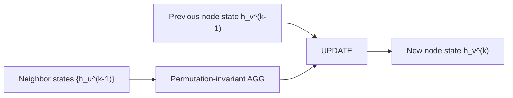
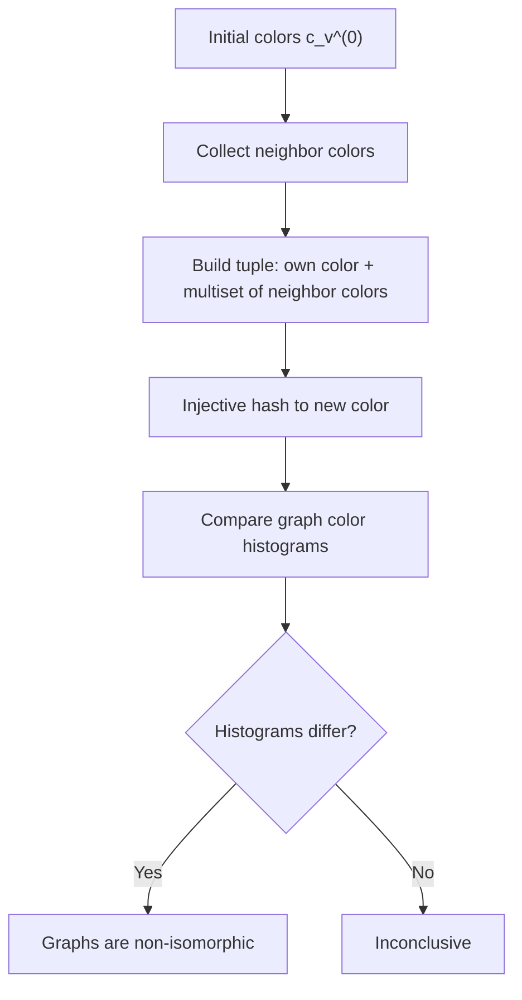
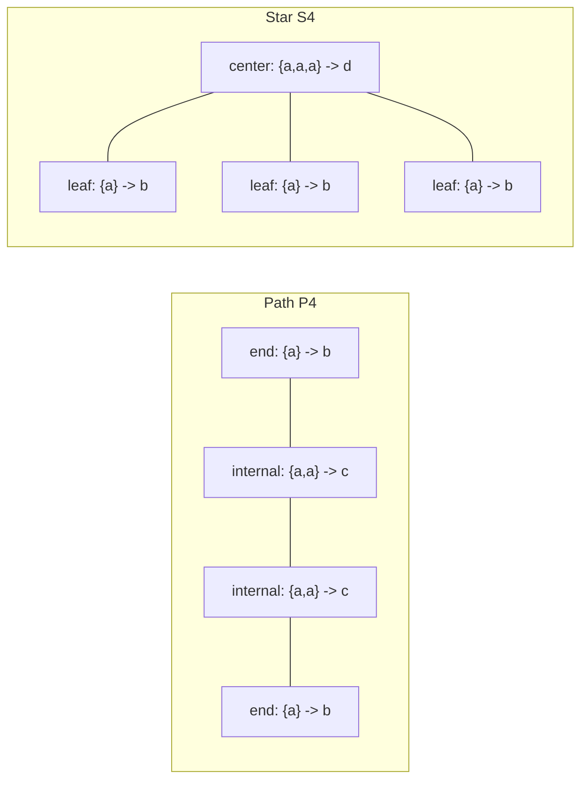
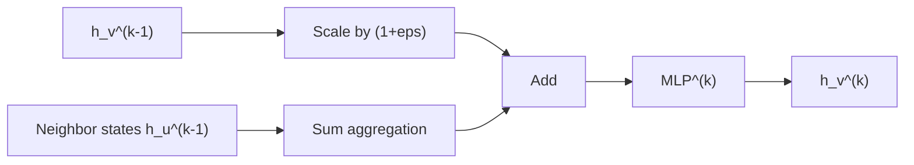

# **Expressiveness of GNNs, Weisfeiler-Lehman, and GIN**

Graph neural network expressiveness is the ability of an architecture to assign different representations to graph structures that should be distinguishable for the task. For message-passing GNNs, the central theoretical reference point is the 1-dimensional Weisfeiler-Lehman test, also called 1-WL or color refinement.

The main results are:

- Standard message-passing GNNs are at most as expressive as 1-WL when they use permutation-invariant neighborhood aggregation over node states.
- Mean and max aggregation are usually weaker than 1-WL because they are not injective over multisets.
- Graph Isomorphism Network (GIN) matches the discriminative power of 1-WL among standard message-passing GNNs under idealized assumptions: injective aggregation, injective update, sufficient feature precision, and adequate optimization.
- GIN does not solve graph isomorphism and does not distinguish graph pairs that 1-WL cannot distinguish.

---

## **1. Problem Setup**

Let

$$
G=(V,E)
$$

be a finite graph with

$$
|V|=n,\qquad |E|=m.
$$

Each node $v\in V$ has an initial feature vector

$$
x_v\in\mathbb{R}^{d_0}.
$$

At GNN layer $k$, the node state is

$$
h_v^{(k)}\in\mathbb{R}^{d_k},
$$

with

$$
h_v^{(0)}=x_v.
$$

A graph-level representation is usually computed by a permutation-invariant readout:

$$
h_G
=
\operatorname{READOUT}
\left(
\left\{h_v^{(K)}:v\in V\right\}
\right).
$$

For graph classification, the model is a function

$$
f_\theta(G,X)=\psi_\theta(h_G).
$$

The important symmetry constraint is graph isomorphism invariance. If $G$ and $G'$ differ only by node labels, then a graph-level model should satisfy

$$
f_\theta(G,X)=f_\theta(G',X').
$$

For node-level prediction, the corresponding property is permutation equivariance:

$$
F_\theta(PAP^\top,PX)=P F_\theta(A,X),
$$

where $P$ is a permutation matrix.

Expressiveness asks a stronger question: among non-isomorphic graphs, which pairs can the model distinguish?

---

## **2. What Expressiveness Means**

There are several related notions.

| Notion | Meaning | Typical object |
|---|---|---|
| Node distinguishability | Whether two nodes receive different embeddings | $h_u^{(K)}\neq h_v^{(K)}$ |
| Graph distinguishability | Whether two graphs receive different graph embeddings | $h_G\neq h_{G'}$ |
| Function approximation | Which invariant/equivariant functions can be represented | $f_\theta$ over graphs |
| Isomorphism power | Which non-isomorphic graph pairs can be separated | comparison to WL |

For this chapter, expressiveness mainly means graph and node distinguishability under message passing.

A GNN can fail to distinguish graphs for two different reasons:

1. The architecture is not theoretically expressive enough.
2. The architecture is theoretically expressive, but finite width, finite precision, regularization, or failed optimization makes the learned function collapse distinctions.

The WL/GIN theory mostly addresses the first reason.

---

## **3. Message Passing as Multiset Computation**

A generic message-passing GNN layer has the form

$$
h_v^{(k)}
=
\operatorname{UPDATE}^{(k)}
\left(
h_v^{(k-1)},
\operatorname{AGG}^{(k)}
\left(
\left\{h_u^{(k-1)}:u\in\mathcal{N}(v)\right\}
\right)
\right).
$$

Here $\mathcal{N}(v)$ is the set of neighbors of $v$. The aggregation input is a multiset, not an ordered list, because the same neighbor representation may appear multiple times and graph neighbor order is arbitrary.



The multiset aspect is crucial. Consider the neighbor multisets

$$
X_1=\{1,1,2\},\qquad X_2=\{1,2,2\}.
$$

They have different multiplicities. A graph algorithm that ignores multiplicity may lose structural information.

An aggregation function $\rho$ over multisets is injective if

$$
\rho(X)=\rho(Y)\implies X=Y.
$$

If $\rho$ is not injective, then two different neighborhoods may produce the same aggregate, after which the update function cannot recover the lost distinction.

---

## **4. Why Mean and Max Lose Information**

Mean aggregation is

$$
\rho_{\operatorname{mean}}(X)
=
\frac{1}{|X|}
\sum_{x\in X}x.
$$

For scalar node states,

$$
\rho_{\operatorname{mean}}(\{2,4\})=3,
$$

and

$$
\rho_{\operatorname{mean}}(\{3,3\})=3.
$$

The two multisets differ, but the aggregate is identical.

Mean also discards cardinality:

$$
\rho_{\operatorname{mean}}(\{1,2\})=1.5,
$$

and

$$
\rho_{\operatorname{mean}}(\{1,1,2,2\})=1.5.
$$

Max aggregation is

$$
\rho_{\operatorname{max}}(X)_j
=
\max_{x\in X}x_j.
$$

For scalar states,

$$
\rho_{\operatorname{max}}(\{1,3\})=3,
$$

and

$$
\rho_{\operatorname{max}}(\{1,1,1,3\})=3.
$$

Max discards nearly all multiplicity information except whether a maximum value exists.

Sum aggregation is

$$
\rho_{\operatorname{sum}}(X)=\sum_{x\in X}x.
$$

Sum is not injective over arbitrary real-valued multisets by itself:

$$
\sum_{x\in\{1,2\}}x=3
$$

and

$$
\sum_{x\in\{3\}}x=3.
$$

The theoretical claim behind GIN is more subtle: for a countable input domain and bounded multiset size, there exists a feature map $f$ such that

$$
X\mapsto \sum_{x\in X} f(x)
$$

is injective over multisets. An MLP can approximate the required transformations on compact domains, so a sum aggregator followed by an MLP can represent an injective multiset function under the assumptions used in the theory.

---

## **5. The 1-WL Color Refinement Test**

The 1-dimensional Weisfeiler-Lehman test iteratively refines node colors using each node's current color and the multiset of its neighbors' colors.

Let

$$
c_v^{(0)}
$$

be the initial color of node $v$. If no labels are available, all nodes usually start with the same color:

$$
c_v^{(0)}=c_0,\qquad \forall v\in V.
$$

At iteration $k$, 1-WL computes a signature

$$
s_v^{(k)}
=
\left(
c_v^{(k-1)},
\operatorname{sort}
\left(
\left\{c_u^{(k-1)}:u\in\mathcal{N}(v)\right\}
\right)
\right).
$$

Then a hashing function maps equal signatures to equal new colors and different signatures to different new colors:

$$
c_v^{(k)}
=
\operatorname{HASH}
\left(
s_v^{(k)}
\right).
$$

The graph-level color histogram after iteration $k$ is

$$
H_G^{(k)}(a)
=
\left|
\left\{v\in V:c_v^{(k)}=a\right\}
\right|.
$$

For two graphs $G$ and $G'$, if for some $k$ their color histograms differ, then 1-WL declares them non-isomorphic:

$$
H_G^{(k)}\neq H_{G'}^{(k)}
\implies
G\not\cong G'.
$$

The converse is false. If the histograms never differ, the graphs may still be non-isomorphic.



### **Step-by-Step Execution**

For each iteration:

1. For every node $v$, read $c_v^{(k-1)}$.
2. Gather the multiset of neighbor colors.
3. Sort or otherwise canonically encode the neighbor multiset.
4. Pair the node's own color with that multiset.
5. Assign a unique integer ID to every distinct signature.
6. Compare the color count histograms across graphs.
7. Stop if histograms differ or if the coloring stabilizes.

The coloring stabilizes when the partition of nodes no longer changes:

$$
c_u^{(k)}=c_v^{(k)}
\iff
c_u^{(k-1)}=c_v^{(k-1)}.
$$

On a graph with $n$ nodes, color refinement stabilizes in at most $n-1$ strict refinements because each strict refinement increases the number of color classes, and there are at most $n$ classes.

---

## **6. Worked 1-WL Example: Path vs Star**

Compare two 4-node graphs:

- $P_4$: a path with edges $(1,2),(2,3),(3,4)$.
- $S_4$: a 3-star with center $1$ and leaves $2,3,4$.

Initial colors:

$$
c_v^{(0)}=a
$$

for every node in both graphs.

### **Iteration 1**

For $P_4$, endpoint nodes have one neighbor of color $a$:

$$
s_{\operatorname{end}}^{(1)}=(a,\{a\}).
$$

Internal nodes have two neighbors of color $a$:

$$
s_{\operatorname{internal}}^{(1)}=(a,\{a,a\}).
$$

So $P_4$ has color histogram

$$
H_{P_4}^{(1)}=\{b:2,c:2\}.
$$

For $S_4$, the center has three neighbors:

$$
s_{\operatorname{center}}^{(1)}=(a,\{a,a,a\}),
$$

and leaves have one neighbor:

$$
s_{\operatorname{leaf}}^{(1)}=(a,\{a\}).
$$

So

$$
H_{S_4}^{(1)}=\{b:3,d:1\}.
$$

Because

$$
H_{P_4}^{(1)}\neq H_{S_4}^{(1)},
$$

1-WL distinguishes the graphs after one iteration.



---

## **7. Message Passing and 1-WL**

The structural similarity between 1-WL and message passing is direct.

1-WL update:

$$
c_v^{(k)}
=
\operatorname{HASH}
\left(
c_v^{(k-1)},
\left\{c_u^{(k-1)}:u\in\mathcal{N}(v)\right\}
\right).
$$

Message-passing update:

$$
h_v^{(k)}
=
\operatorname{UPDATE}^{(k)}
\left(
h_v^{(k-1)},
\operatorname{AGG}^{(k)}
\left(
\left\{h_u^{(k-1)}:u\in\mathcal{N}(v)\right\}
\right)
\right).
$$

The correspondence is:

| 1-WL | Message-passing GNN |
|---|---|
| Discrete color | Continuous embedding |
| Neighbor color multiset | Neighbor embedding multiset |
| Injective hash | Learnable update function |
| Color histogram | Readout over node embeddings |

If a GNN maps two equal 1-WL colors to equal embeddings at every layer, then it cannot distinguish nodes or graphs that 1-WL cannot distinguish. Most standard message-passing GNNs have this limitation because nodes with identical rooted computation trees receive identical aggregated messages.

### **Induction Argument for the 1-WL Upper Bound**

Assume two nodes $u$ and $v$ have the same 1-WL color at layer $k$:

$$
c_u^{(k)}=c_v^{(k)}.
$$

By definition of 1-WL, this means their previous colors and neighbor-color multisets are equal:

$$
c_u^{(k-1)}=c_v^{(k-1)}
$$

and

$$
\left\{c_a^{(k-1)}:a\in\mathcal{N}(u)\right\}
=
\left\{c_b^{(k-1)}:b\in\mathcal{N}(v)\right\}.
$$

If the GNN embeddings are constant on 1-WL color classes at layer $k-1$, then

$$
h_u^{(k-1)}=h_v^{(k-1)}
$$

and the neighbor embedding multisets are also equal:

$$
\left\{h_a^{(k-1)}:a\in\mathcal{N}(u)\right\}
=
\left\{h_b^{(k-1)}:b\in\mathcal{N}(v)\right\}.
$$

Permutation-invariant aggregation gives equal aggregates:

$$
\operatorname{AGG}
\left(
\left\{h_a^{(k-1)}:a\in\mathcal{N}(u)\right\}
\right)
=
\operatorname{AGG}
\left(
\left\{h_b^{(k-1)}:b\in\mathcal{N}(v)\right\}
\right).
$$

The same update function is shared across all nodes, so

$$
h_u^{(k)}=h_v^{(k)}.
$$

Thus message passing cannot split a node pair that 1-WL does not split.

---

## **8. GCN and GraphSAGE Through the Expressiveness Lens**

### **GCN**

A common GCN layer is

$$
H^{(k)}
=
\sigma
\left(
\tilde{D}^{-\frac{1}{2}}
\tilde{A}
\tilde{D}^{-\frac{1}{2}}
H^{(k-1)}W^{(k)}
\right),
$$

where

$$
\tilde{A}=A+I
$$

and

$$
\tilde{D}_{vv}=\sum_{u=1}^{n}\tilde{A}_{vu}.
$$

Node-wise, this is

$$
h_v^{(k)}
=
\sigma
\left(
\sum_{u\in\mathcal{N}(v)\cup\{v\}}
\frac{1}{\sqrt{\tilde{d}_v\tilde{d}_u}}
h_u^{(k-1)}W^{(k)}
\right).
$$

The degree-normalized weighted sum smooths representations. It is useful for optimization and scale control, but it can merge different neighborhoods when normalized sums match.

### **GraphSAGE Mean**

A GraphSAGE mean layer can be written as

$$
h_v^{(k)}
=
\sigma
\left(
W^{(k)}
\left[
h_v^{(k-1)}
\;\Vert\;
\frac{1}{|\mathcal{N}(v)|}
\sum_{u\in\mathcal{N}(v)}
h_u^{(k-1)}
\right]
\right).
$$

The mean aggregator is not injective over multisets, so GraphSAGE-mean is weaker than the strongest possible 1-WL-level message passing.

### **GraphSAGE Max-Pool**

GraphSAGE pooling aggregation often computes

$$
a_v^{(k)}
=
\max_{u\in\mathcal{N}(v)}
\sigma
\left(
W_{\operatorname{pool}}^{(k)}h_u^{(k-1)}+b^{(k)}
\right),
$$

where max is element-wise. It can be expressive in practice, but max still discards multiplicities.

---

## **9. Graph Isomorphism Network**

GIN was designed to match 1-WL as closely as possible using neural message passing.

The GIN node update is

$$
h_v^{(k)}
=
\operatorname{MLP}^{(k)}
\left(
(1+\epsilon^{(k)})h_v^{(k-1)}
+
\sum_{u\in\mathcal{N}(v)}h_u^{(k-1)}
\right).
$$

The graph representation is often a concatenation or sum of readouts from all layers:

$$
h_G
=
\operatorname{CONCAT}
\left(
\operatorname{READOUT}
\left(\left\{h_v^{(0)}:v\in V\right\}\right),
\dots,
\operatorname{READOUT}
\left(\left\{h_v^{(K)}:v\in V\right\}\right)
\right).
$$

The readout is commonly sum pooling:

$$
\operatorname{READOUT}
\left(\left\{h_v^{(k)}:v\in V\right\}\right)
=
\sum_{v\in V}h_v^{(k)}.
$$

### **Why the $(1+\epsilon)$ Term Exists**

The neighbor multiset alone is not enough; 1-WL hashes the pair containing:

1. The node's own previous color.
2. The multiset of neighbor colors.

GIN mirrors this by separately controlling the self-contribution:

$$
(1+\epsilon)h_v^{(k-1)}
+
\sum_{u\in\mathcal{N}(v)}h_u^{(k-1)}.
$$

If $\epsilon=0$, the self node is included with the same weight as one occurrence of its own feature. If $\epsilon$ is learned, the model can tune the relative importance of the self state and the neighbor multiset.

In implementation, $\epsilon$ is usually either:

$$
\epsilon^{(k)}=0
$$

or a trainable scalar initialized at zero.

### **Computational Graph**



---

## **10. First-Principles Derivation of GIN's Injective Form**

The goal is to emulate 1-WL's injective hash:

$$
\left(c_v,\left\{c_u:u\in\mathcal{N}(v)\right\}\right)
\mapsto
c_v'.
$$

For neural embeddings, replace colors by vectors. The update should be injective over pairs

$$
\left(h_v,X_v\right),
$$

where

$$
X_v=\left\{h_u:u\in\mathcal{N}(v)\right\}.
$$

We want a function

$$
\Phi(h_v,X_v)
$$

such that

$$
\Phi(h,X)=\Phi(h',X')
\implies
(h,X)=(h',X').
$$

GIN uses

$$
\Phi(h,X)
=
\operatorname{MLP}
\left(
(1+\epsilon)h+\sum_{x\in X}x
\right).
$$

This is not injective for arbitrary continuous vectors without further assumptions. The theoretical result relies on the fact that at any finite training graph and finite iteration, the set of possible WL colors is countable or finite. For a countable feature domain $\mathcal{X}$ and bounded multiset size, one can construct an encoding

$$
f:\mathcal{X}\to\mathbb{R}^d
$$

such that

$$
X\mapsto \sum_{x\in X}f(x)
$$

is injective.

### **Concrete Scalar Construction for Bounded Multisets**

Suppose possible discrete colors are indexed as

$$
\mathcal{C}=\{1,2,\dots,q\}
$$

and each multiset has size at most $M$. Define

$$
f(i)=N^{-i},
$$

where

$$
N>M.
$$

For a multiset $X$, let $m_i(X)$ be the multiplicity of color $i$. Then

$$
\sum_{x\in X}f(x)
=
\sum_{i=1}^{q}m_i(X)N^{-i}.
$$

Because each digit $m_i(X)$ is in $\{0,\dots,M\}$ and the base satisfies $N>M$, this base-$N$ expansion uniquely determines all multiplicities. Therefore the sum is injective over bounded multisets of colors.

In vector form, an even simpler finite-domain construction uses one-hot encodings:

$$
f(i)=e_i\in\mathbb{R}^{q}.
$$

Then

$$
\sum_{x\in X}f(x)
=
\begin{bmatrix}
m_1(X)\\
\vdots\\
m_q(X)
\end{bmatrix}.
$$

This vector is exactly the count histogram of the multiset.

### **Including the Center Node**

The WL update distinguishes

$$
(c_v,X_v)
$$

from

$$
(c_v',X_v')
$$

whenever either the center color differs or the neighbor multiset differs.

GIN's weighted self term can be injective over this pair if $\epsilon$ is chosen so that the self contribution cannot be confused with an additional neighbor contribution.

For scalar count encodings, suppose a color count vector for neighbors is

$$
m(X)\in\mathbb{N}^{q}.
$$

Let the center color be one-hot:

$$
e_c.
$$

The combined code is

$$
(1+\epsilon)e_c+m(X).
$$

If $\epsilon$ is not an integer that creates collisions with possible count differences, then the fractional or distinct coefficient on the center separates the center identity from neighbor multiplicities. In practice, learned $\epsilon$ is not a formal guarantee, but it gives the model a route to represent this separation.

---

## **11. Worked GIN Calculation**

Consider a node $v$ with scalar hidden state

$$
h_v^{(0)}=2.
$$

Its neighbors have states

$$
\{h_u^{(0)}:u\in\mathcal{N}(v)\}=\{1,3,3\}.
$$

Let

$$
\epsilon=0.1.
$$

The pre-MLP aggregate is

$$
z_v
=(1+\epsilon)h_v^{(0)}
+
\sum_{u\in\mathcal{N}(v)}h_u^{(0)}.
$$

Substitute:

$$
z_v
=1.1\cdot 2+(1+3+3).
$$

So

$$
z_v=2.2+7=9.2.
$$

Suppose the MLP has one hidden layer:

$$
\operatorname{MLP}(z)
=
W_2\operatorname{ReLU}(W_1z+b_1)+b_2.
$$

Let

$$
W_1=
\begin{bmatrix}
0.5\\
-1.0
\end{bmatrix},
\qquad
b_1=
\begin{bmatrix}
0.1\\
10.0
\end{bmatrix},
$$

and

$$
W_2=
\begin{bmatrix}
2.0 & -0.3
\end{bmatrix},
\qquad
b_2=0.5.
$$

The hidden preactivation is

$$
a_1
=
W_1z_v+b_1
=
\begin{bmatrix}
0.5\cdot 9.2+0.1\\
-1.0\cdot 9.2+10.0
\end{bmatrix}
=
\begin{bmatrix}
4.7\\
0.8
\end{bmatrix}.
$$

After ReLU:

$$
r_1=
\begin{bmatrix}
4.7\\
0.8
\end{bmatrix}.
$$

The output is

$$
h_v^{(1)}
=
2.0\cdot 4.7-0.3\cdot 0.8+0.5.
$$

Therefore

$$
h_v^{(1)}=9.4-0.24+0.5=9.66.
$$

The important point is not the numeric value itself, but the order of operations:

1. Preserve the center state with a separate coefficient.
2. Sum neighbor states with multiplicity.
3. Apply a nonlinear function capable of separating aggregate codes.

---

## **12. Example Where Mean Fails but Sum Can Succeed**

Consider two nodes $a$ and $b$ with identical center state

$$
h_a=h_b=0.
$$

Their neighbor multisets are

$$
X_a=\{1,1,3,3\}
$$

and

$$
X_b=\{1,3\}.
$$

Mean aggregation gives

$$
\rho_{\operatorname{mean}}(X_a)
=
\frac{1+1+3+3}{4}=2,
$$

and

$$
\rho_{\operatorname{mean}}(X_b)
=
\frac{1+3}{2}=2.
$$

GraphSAGE-mean receives the same aggregate.

Sum gives

$$
\rho_{\operatorname{sum}}(X_a)=8,
$$

and

$$
\rho_{\operatorname{sum}}(X_b)=4.
$$

So sum preserves the cardinality difference in this case.

This example does not prove sum is always injective for raw scalar features. It illustrates why sum is a better primitive: it can retain multiplicities that mean and max necessarily erase.

---

## **13. Graph-Level Readout and Layer Aggregation**

For graph classification, node embeddings must be pooled into a graph embedding. If the readout is not injective over node multisets, graph-level distinctions can be lost even when node-level message passing is expressive.

Common readouts:

$$
h_G^{\operatorname{sum}}
=
\sum_{v\in V}h_v^{(K)}.
$$

$$
h_G^{\operatorname{mean}}
=
\frac{1}{|V|}
\sum_{v\in V}h_v^{(K)}.
$$

$$
h_G^{\operatorname{max}}_j
=
\max_{v\in V}h_{v,j}^{(K)}.
$$

GIN usually uses sum readout. Many implementations concatenate readouts from every layer:

$$
h_G
=
\big\Vert_{k=0}^{K}
\sum_{v\in V}h_v^{(k)}.
$$

This helps because different layers capture different WL refinement depths. A shallow layer may preserve local labels that a deeper layer smooths or compresses.

---

## **14. Graphs That 1-WL and GIN Cannot Distinguish**

1-WL fails on many regular graph pairs. The simplest intuition is that if every node sees the same color multiset at every iteration, color refinement never breaks symmetry.

### **Cycle Example**

Consider two cycle graphs:

$$
C_6
$$

and

$$
C_8.
$$

If all nodes start with the same color, every node in each graph has degree 2. At every 1-WL iteration, every node sees the same pair of neighbor colors:

$$
(a,\{a,a\})
$$

at iteration 1, and similarly at later iterations.

1-WL assigns one color class to all nodes in each graph. However, graph-level histograms differ because the graph sizes differ:

$$
|V(C_6)|=6,\qquad |V(C_8)|=8.
$$

So sum readout can distinguish these two by size. Mean readout may not.

More difficult failures occur when non-isomorphic graphs have the same number of nodes and the same stable color histograms. For example, many pairs of non-isomorphic regular graphs with the same degree and same number of nodes are indistinguishable by 1-WL when initialized with uniform colors.

### **Strong Limitation**

If two graphs are 1-WL-indistinguishable and use identical initial node features, then a standard GIN cannot distinguish them solely through message passing:

$$
G\equiv_{\operatorname{1-WL}}G'
\implies
h_G^{\operatorname{GIN}}=h_{G'}^{\operatorname{GIN}}
$$

under the idealized deterministic architecture with shared parameters and the same readout class.

This is why going beyond 1-WL requires extra information or different computation:

- positional encodings,
- random features,
- structural identifiers,
- subgraph GNNs,
- higher-order GNNs,
- $k$-WL-inspired architectures,
- graph transformers with expressive positional or structural biases.

---

## **15. Python Implementation: 1-WL From Scratch**

The following implementation compares graphs using color refinement. It is intentionally explicit.

```python
from collections import Counter, defaultdict


def wl_refinement(adj, labels=None, max_iter=None):
    """
    Run 1-WL color refinement on a single graph.

    Parameters
    ----------
    adj:
        Dict[int, list[int]] adjacency list.
    labels:
        Optional dict node -> hashable initial label.
        If None, all nodes start with the same label.
    max_iter:
        Maximum number of WL iterations. Defaults to number of nodes.

    Returns
    -------
    history:
        List[Counter] containing color histograms at each iteration,
        including iteration 0.
    colors:
        Dict[int, int] final node colors.
    """
    nodes = sorted(adj)
    if labels is None:
        colors = {v: 0 for v in nodes}
    else:
        # Canonicalize arbitrary labels to integers.
        label_to_id = {}
        colors = {}
        for v in nodes:
            label = labels[v]
            if label not in label_to_id:
                label_to_id[label] = len(label_to_id)
            colors[v] = label_to_id[label]

    if max_iter is None:
        max_iter = len(nodes)

    history = [Counter(colors.values())]

    for _ in range(max_iter):
        signatures = {}
        for v in nodes:
            neighbor_colors = tuple(sorted(colors[u] for u in adj[v]))
            signatures[v] = (colors[v], neighbor_colors)

        sig_to_id = {}
        new_colors = {}
        for v in nodes:
            sig = signatures[v]
            if sig not in sig_to_id:
                sig_to_id[sig] = len(sig_to_id)
            new_colors[v] = sig_to_id[sig]

        history.append(Counter(new_colors.values()))

        # Stabilization: same partition up to color IDs.
        same_partition = all(
            (colors[u] == colors[v]) == (new_colors[u] == new_colors[v])
            for i, u in enumerate(nodes)
            for v in nodes[i + 1 :]
        )
        colors = new_colors
        if same_partition:
            break

    return history, colors


def wl_distinguishes(adj1, adj2, labels1=None, labels2=None, max_iter=None):
    """
    Return True if 1-WL proves the two graphs non-isomorphic.
    """
    h1, _ = wl_refinement(adj1, labels1, max_iter)
    h2, _ = wl_refinement(adj2, labels2, max_iter)

    steps = max(len(h1), len(h2))
    for t in range(steps):
        hist1 = h1[min(t, len(h1) - 1)]
        hist2 = h2[min(t, len(h2) - 1)]
        if hist1 != hist2:
            return True, t, hist1, hist2
    return False, None, h1[-1], h2[-1]


path4 = {
    0: [1],
    1: [0, 2],
    2: [1, 3],
    3: [2],
}

star4 = {
    0: [1, 2, 3],
    1: [0],
    2: [0],
    3: [0],
}

is_distinguished, step, hist_path, hist_star = wl_distinguishes(path4, star4)
print(is_distinguished, step, hist_path, hist_star)
```

Expected output:

```text
True 1 Counter({0: 2, 1: 2}) Counter({1: 3, 0: 1})
```

The specific integer color IDs are arbitrary. The histogram mismatch is what matters.

### **Implementation Notes**

The `HASH` operation in WL must be canonical across graphs being compared. If graph $G$ maps a signature to color 0 and graph $G'$ independently maps the same signature to color 1, comparing histograms becomes invalid. A robust pairwise implementation should canonicalize signatures jointly at every iteration.

The above function is fine for inspecting one graph's refinement. For graph comparison in production, refine both graphs in one shared loop.

---

## **16. Pairwise 1-WL With Shared Hashing**

```python
from collections import Counter


def wl_compare_shared(adj1, adj2, labels1=None, labels2=None, max_iter=None):
    """
    Pairwise 1-WL comparison with shared signature-to-color mapping.
    Returns True if 1-WL distinguishes the graphs.
    """
    nodes1 = sorted(adj1)
    nodes2 = sorted(adj2)

    if len(nodes1) != len(nodes2):
        return True

    if labels1 is None:
        colors1 = {v: 0 for v in nodes1}
    else:
        colors1 = {v: labels1[v] for v in nodes1}

    if labels2 is None:
        colors2 = {v: 0 for v in nodes2}
    else:
        colors2 = {v: labels2[v] for v in nodes2}

    # Shared canonicalization of initial labels.
    all_labels = sorted(set(colors1.values()) | set(colors2.values()), key=repr)
    label_to_id = {label: i for i, label in enumerate(all_labels)}
    colors1 = {v: label_to_id[colors1[v]] for v in nodes1}
    colors2 = {v: label_to_id[colors2[v]] for v in nodes2}

    if Counter(colors1.values()) != Counter(colors2.values()):
        return True

    if max_iter is None:
        max_iter = len(nodes1)

    for _ in range(max_iter):
        sigs1 = {
            v: (colors1[v], tuple(sorted(colors1[u] for u in adj1[v])))
            for v in nodes1
        }
        sigs2 = {
            v: (colors2[v], tuple(sorted(colors2[u] for u in adj2[v])))
            for v in nodes2
        }

        all_sigs = sorted(set(sigs1.values()) | set(sigs2.values()), key=repr)
        sig_to_id = {sig: i for i, sig in enumerate(all_sigs)}

        new1 = {v: sig_to_id[sigs1[v]] for v in nodes1}
        new2 = {v: sig_to_id[sigs2[v]] for v in nodes2}

        if Counter(new1.values()) != Counter(new2.values()):
            return True

        stable1 = all(
            (colors1[u] == colors1[v]) == (new1[u] == new1[v])
            for i, u in enumerate(nodes1)
            for v in nodes1[i + 1 :]
        )
        stable2 = all(
            (colors2[u] == colors2[v]) == (new2[u] == new2[v])
            for i, u in enumerate(nodes2)
            for v in nodes2[i + 1 :]
        )

        colors1, colors2 = new1, new2
        if stable1 and stable2:
            break

    return False
```

---

## **17. GIN From Scratch in PyTorch**

This implementation uses dense tensors for readability. It is not the most memory-efficient representation for large sparse graphs.

```python
import torch
from torch import nn


class DenseGINLayer(nn.Module):
    """
    Dense adjacency implementation of one GIN layer.

    H_out = MLP((1 + eps) * H + A @ H)

    A should not include self-loops because the self term is handled separately.
    """

    def __init__(self, in_dim, out_dim, hidden_dim=None, train_eps=False, eps=0.0):
        super().__init__()
        hidden_dim = hidden_dim or out_dim
        self.mlp = nn.Sequential(
            nn.Linear(in_dim, hidden_dim),
            nn.BatchNorm1d(hidden_dim),
            nn.ReLU(),
            nn.Linear(hidden_dim, out_dim),
        )

        if train_eps:
            self.eps = nn.Parameter(torch.tensor(float(eps)))
        else:
            self.register_buffer("eps", torch.tensor(float(eps)))

    def forward(self, x, adj):
        """
        Parameters
        ----------
        x:
            Tensor of shape [num_nodes, in_dim].
        adj:
            Dense adjacency matrix of shape [num_nodes, num_nodes].
            adj[v, u] = 1 means u sends a message to v.
        """
        neighbor_sum = adj @ x
        out = (1.0 + self.eps) * x + neighbor_sum
        return self.mlp(out)


class DenseGIN(nn.Module):
    def __init__(self, in_dim, hidden_dim, out_dim, num_layers):
        super().__init__()
        self.layers = nn.ModuleList()
        self.layers.append(DenseGINLayer(in_dim, hidden_dim, train_eps=True))
        for _ in range(num_layers - 1):
            self.layers.append(DenseGINLayer(hidden_dim, hidden_dim, train_eps=True))
        self.classifier = nn.Sequential(
            nn.Linear(hidden_dim * num_layers, hidden_dim),
            nn.ReLU(),
            nn.Linear(hidden_dim, out_dim),
        )

    def forward(self, x, adj, batch=None):
        """
        batch:
            Optional tensor of shape [num_nodes] assigning nodes to graphs.
            If None, all nodes are treated as one graph.
        """
        layer_graph_embeddings = []

        for layer in self.layers:
            x = layer(x, adj)
            if batch is None:
                pooled = x.sum(dim=0, keepdim=True)
            else:
                num_graphs = int(batch.max().item()) + 1
                pooled = x.new_zeros(num_graphs, x.size(-1))
                pooled.index_add_(0, batch, x)
            layer_graph_embeddings.append(pooled)

        graph_emb = torch.cat(layer_graph_embeddings, dim=-1)
        return self.classifier(graph_emb)
```

### **Sparse Edge-Index Implementation**

For realistic graphs, store edges as a tensor:

$$
\texttt{edge\_index}\in\mathbb{N}^{2\times m}.
$$

The first row contains source nodes and the second row contains destination nodes.

```python
import torch
from torch import nn


def scatter_sum(src, index, dim_size):
    """
    Minimal scatter-sum for node aggregation.

    src:
        Tensor [num_edges, feature_dim] containing source messages.
    index:
        Tensor [num_edges] containing destination node IDs.
    dim_size:
        Number of destination nodes.
    """
    out = src.new_zeros(dim_size, src.size(-1))
    out.index_add_(0, index, src)
    return out


class SparseGINLayer(nn.Module):
    def __init__(self, in_dim, out_dim, hidden_dim=None, train_eps=False, eps=0.0):
        super().__init__()
        hidden_dim = hidden_dim or out_dim
        self.mlp = nn.Sequential(
            nn.Linear(in_dim, hidden_dim),
            nn.ReLU(),
            nn.Linear(hidden_dim, out_dim),
        )
        if train_eps:
            self.eps = nn.Parameter(torch.tensor(float(eps)))
        else:
            self.register_buffer("eps", torch.tensor(float(eps)))

    def forward(self, x, edge_index):
        src, dst = edge_index
        messages = x[src]
        neighbor_sum = scatter_sum(messages, dst, dim_size=x.size(0))
        out = (1.0 + self.eps) * x + neighbor_sum
        return self.mlp(out)
```

Internally, this is what graph libraries optimize:

1. Gather source node features along edges.
2. Reduce them by destination node using sum, mean, max, or attention-weighted sum.
3. Combine the aggregate with the destination node's previous state.
4. Apply learnable transformations.

The expensive operation is not the MLP alone; it is often the memory movement during edge-wise gather and scatter.

---

## **18. PyTorch Geometric Implementation**

PyTorch Geometric provides `GINConv`, whose mathematical operator is

$$
x_i'
=
h_\Theta
\left(
(1+\epsilon)x_i
+
\sum_{j\in\mathcal{N}(i)}x_j
\right),
$$

where $h_\Theta$ is the neural network passed as the `nn` argument.

```python
import torch
import torch.nn.functional as F
from torch import nn
from torch_geometric.nn import GINConv, global_add_pool


class PyGGIN(nn.Module):
    def __init__(self, in_channels, hidden_channels, out_channels, num_layers):
        super().__init__()
        self.convs = nn.ModuleList()

        for layer in range(num_layers):
            input_dim = in_channels if layer == 0 else hidden_channels
            mlp = nn.Sequential(
                nn.Linear(input_dim, hidden_channels),
                nn.BatchNorm1d(hidden_channels),
                nn.ReLU(),
                nn.Linear(hidden_channels, hidden_channels),
            )
            self.convs.append(GINConv(mlp, eps=0.0, train_eps=True))

        self.classifier = nn.Sequential(
            nn.Linear(hidden_channels * num_layers, hidden_channels),
            nn.ReLU(),
            nn.Linear(hidden_channels, out_channels),
        )

    def forward(self, x, edge_index, batch):
        pooled_per_layer = []

        for conv in self.convs:
            x = conv(x, edge_index)
            x = F.relu(x)
            pooled_per_layer.append(global_add_pool(x, batch))

        graph_embedding = torch.cat(pooled_per_layer, dim=-1)
        return self.classifier(graph_embedding)
```

### **How `GINConv` Works Internally**

At a high level, `GINConv` is a `MessagePassing` layer:

1. For every edge $j\to i$, the default message is $x_j$.
2. Messages are summed at destination node $i$.
3. The destination feature $x_i$ is added with coefficient $1+\epsilon$.
4. The provided neural network `nn` is applied to the result.

Conceptually:

```python
def gin_conv_forward(x, edge_index, mlp, eps):
    src, dst = edge_index
    out = x.new_zeros(x.shape)
    out.index_add_(0, dst, x[src])
    out = out + (1.0 + eps) * x
    return mlp(out)
```

PyG additionally handles bipartite inputs, sparse tensor backends, device placement, argument plumbing, and optimized propagation.

---

## **19. Edge Features: GINE**

Vanilla GIN ignores edge attributes. For molecular graphs, bond types matter, so a common extension is GINE:

$$
h_v^{(k)}
=
\operatorname{MLP}^{(k)}
\left(
(1+\epsilon)h_v^{(k-1)}
+
\sum_{u\in\mathcal{N}(v)}
\operatorname{ReLU}
\left(
h_u^{(k-1)}+e_{uv}^{(k-1)}
\right)
\right).
$$

If edge features have a different dimension from node features, they are first projected:

$$
\tilde{e}_{uv}=W_e e_{uv}+b_e.
$$

Then

$$
\operatorname{ReLU}
\left(
h_u+\tilde{e}_{uv}
\right)
$$

becomes the edge-conditioned message.

```python
from torch_geometric.nn import GINEConv


edge_mlp = nn.Sequential(
    nn.Linear(hidden_channels, hidden_channels),
    nn.ReLU(),
    nn.Linear(hidden_channels, hidden_channels),
)

conv = GINEConv(
    nn=edge_mlp,
    eps=0.0,
    train_eps=True,
    edge_dim=edge_feature_dim,
)
```

Internally, the layer transforms edge features to node hidden dimension when `edge_dim` is provided, adds them to source node features, applies a nonlinearity, and then sums messages by destination.

---

## **20. Complexity**

Let:

$$
n=|V|,
\qquad
m=|E|,
\qquad
d=d_k,
\qquad
L=\text{number of layers}.
$$

### **1-WL**

Per iteration, collecting and sorting neighbor colors costs

$$
O\left(\sum_{v\in V}d_v\log d_v\right)
$$

if each neighborhood is sorted independently. With integer colors and counting/radix-style canonicalization, practical implementations can approach

$$
O(m)
$$

per iteration.

Space is

$$
O(n+m)
$$

for the graph and current colors.

### **Dense GIN**

Using dense adjacency:

$$
A H
$$

costs

$$
O(n^2d)
$$

per layer and stores

$$
O(n^2)
$$

adjacency entries.

This is inappropriate for large sparse graphs.

### **Sparse GIN**

Using edge lists, message aggregation costs

$$
O(md)
$$

per layer.

An MLP with hidden width $p$ costs roughly

$$
O(npd+npd')
$$

for dimensions $d\to p\to d'$. If $p$ and $d'$ are both $O(d)$, this is

$$
O(nd^2).
$$

Total sparse layer cost:

$$
O(md+nd^2).
$$

Activation memory for backpropagation is roughly

$$
O(Lnd+Lmd_{\operatorname{msg}})
$$

depending on whether messages are materialized.

---

## **21. Numerical Stability and Optimization**

### **Magnitude Growth**

Sum aggregation scales with degree:

$$
\left\|
\sum_{u\in\mathcal{N}(v)}h_u
\right\|
\le
\sum_{u\in\mathcal{N}(v)}\|h_u\|.
$$

High-degree nodes can produce large pre-MLP activations. This is a feature for expressiveness because degree and multiplicity are preserved, but it can harm optimization.

Common mitigations:

- Batch normalization after linear layers.
- Layer normalization for small or variable batches.
- Residual connections.
- Gradient clipping.
- Degree-aware initialization or normalization when exact GIN expressiveness is not required.

### **Floating-Point Collisions**

The WL hash is exact and discrete. Neural embeddings are finite-precision continuous vectors. Even if an injective function exists mathematically, an implementation may collide due to:

- limited hidden dimension,
- float32 precision,
- activation saturation,
- dropout,
- regularization,
- optimizer failure.

The theorem should not be interpreted as saying a trained finite GIN always distinguishes every pair that 1-WL distinguishes.

### **Batch Normalization Caveat**

Batch normalization changes a node's output using statistics from other nodes in the mini-batch:

$$
\operatorname{BN}(z)
=
\gamma
\frac{z-\mu_B}{\sqrt{\sigma_B^2+\delta}}
+\beta.
$$

For graph classification, this is usually acceptable and empirically useful. But for strict theoretical analysis, batch-dependent normalization complicates the clean local message-passing model.

---

## **22. Edge Cases**

### **Isolated Nodes**

If

$$
\mathcal{N}(v)=\varnothing,
$$

then GIN computes

$$
h_v^{(k)}
=
\operatorname{MLP}^{(k)}
\left(
(1+\epsilon)h_v^{(k-1)}
\right).
$$

This still updates isolated nodes from their own features.

### **Self-Loops**

Do not accidentally include self-loops in the adjacency and also use the explicit GIN self term unless that is intended. If self-loops are included in $A$, the update becomes

$$
(1+\epsilon)h_v+\sum_{u\in\mathcal{N}(v)\cup\{v\}}h_u
=
(2+\epsilon)h_v+\sum_{u\in\mathcal{N}(v)}h_u.
$$

That changes the architecture.

### **Directed Graphs**

For directed graphs, define whether messages use incoming neighbors,

$$
\mathcal{N}_{\operatorname{in}}(v)=\{u:(u,v)\in E\},
$$

outgoing neighbors,

$$
\mathcal{N}_{\operatorname{out}}(v)=\{u:(v,u)\in E\},
$$

or both. A direction-aware GIN can use separate aggregators:

$$
h_v^{(k)}
=
\operatorname{MLP}
\left(
(1+\epsilon)h_v^{(k-1)}
+
\sum_{u\in\mathcal{N}_{\operatorname{in}}(v)}W_{\operatorname{in}}h_u^{(k-1)}
+
\sum_{u\in\mathcal{N}_{\operatorname{out}}(v)}W_{\operatorname{out}}h_u^{(k-1)}
\right).
$$

### **Continuous Node Features**

WL theory is cleanest with discrete labels. Real GNNs often use continuous features. If initial features are continuous and unique, even weak GNNs may distinguish many nodes because the input already breaks symmetries.

This does not necessarily mean the architecture understands structure. It may simply memorize or exploit identifiers.

### **Graph Size Leakage**

Sum readout preserves graph size information; mean readout often removes it. Whether this is desirable depends on the task.

For molecular property prediction, size may correlate with properties. For tasks requiring size-invariant comparison, mean or normalized readout may be preferable despite lower expressiveness.

---

## **23. Common Implementation Pitfalls**

1. **Double-counting self-loops.** GIN already has an explicit self term.
2. **Using mean pooling when the task needs cardinality.** Mean readout can collapse graphs with repeated structures.
3. **Assuming trainable $\epsilon$ always helps.** It increases flexibility but can overfit or become numerically unimportant.
4. **Using too shallow a network.** A $K$-layer GNN only sees $K$-hop neighborhoods.
5. **Over-smoothing.** Deep message passing can make node embeddings similar even with expressive aggregation.
6. **Over-squashing.** Long-range information is compressed into fixed-dimensional vectors through narrow graph bottlenecks.
7. **Ignoring edge features.** Vanilla GIN is insufficient when edge types carry essential information.
8. **Incorrect batching.** Graph-level pooling must sum only nodes belonging to the same graph.
9. **Non-shared WL hashing across compared graphs.** This can produce invalid WL comparisons.
10. **Confusing 1-WL matching with graph isomorphism solving.** 1-WL is incomplete.

---

## **24. Limitations of the 1-WL Expressiveness Framework**

The WL framework is powerful but not the whole story.

### **It Measures Structural Distinguishability, Not Generalization**

A more expressive architecture can overfit. Distinguishing more graph structures is useful only if the distinctions align with the target function and data regime.

### **It Is Mostly About Worst-Case Pairs**

Many real graph tasks do not contain adversarial 1-WL-indistinguishable pairs. A less expressive GCN may outperform GIN because of better inductive bias, normalization, or optimization.

### **It Does Not Fully Capture Edge Attributes and Geometry**

Graphs in chemistry, physics, and biology often include:

- bond types,
- distances,
- angles,
- coordinates,
- temporal information,
- typed nodes and edges.

These can change the relevant symmetry group and the proper expressiveness analysis.

### **It Ignores Training Dynamics**

The theorem may say a function exists, but stochastic gradient descent may not find it.

---

## **25. Connections to Related Concepts**

### **Deep Sets**

GIN's sum aggregation is closely related to the Deep Sets representation:

$$
f(X)=\rho\left(\sum_{x\in X}\phi(x)\right),
$$

which characterizes permutation-invariant functions under suitable assumptions.

GIN can be viewed as applying a Deep Sets-style function locally at every node.

### **MPNNs**

Message Passing Neural Networks define a broad family:

$$
m_v^{(k+1)}
=
\sum_{u\in\mathcal{N}(v)}
M_k(h_v^{(k)},h_u^{(k)},e_{uv}),
$$

$$
h_v^{(k+1)}
=
U_k(h_v^{(k)},m_v^{(k+1)}).
$$

GIN is an MPNN with message

$$
M_k(h_v,h_u,e_{uv})=h_u
$$

and update

$$
U_k(h_v,m_v)
=
\operatorname{MLP}^{(k)}((1+\epsilon)h_v+m_v).
$$

### **Higher-Order GNNs and $k$-WL**

Higher-order GNNs lift computation from nodes to tuples of nodes. Instead of updating one node state $h_v$, a $k$-order model updates tuple states:

$$
h_{(v_1,\dots,v_k)}.
$$

This can match or approximate higher-dimensional WL tests, which are more expressive than 1-WL but much more expensive.

The state space size grows as

$$
O(n^k).
$$

This quickly becomes impractical for large graphs.

### **Subgraph GNNs**

Subgraph methods represent each node or graph using extracted subgraphs. These can distinguish structures invisible to 1-WL by exposing local identities, rooted substructures, or counts of motifs.

### **Graph Transformers**

A graph transformer with no structural encodings is often permutation-equivariant but structurally weak. Its expressiveness depends heavily on positional encodings, shortest-path biases, Laplacian eigenvectors, random features, or other structural signals.

### **Spectral Methods**

Spectral encodings from the graph Laplacian can break some 1-WL symmetries, but eigenvectors have sign ambiguity, multiplicity ambiguity, and numerical instability under repeated eigenvalues.

---

## **26. Summary**

The expressiveness of a message-passing GNN is controlled by what information its aggregation and update functions preserve. Since neighborhoods are multisets, injectivity over multisets is the key mathematical property.

1-WL refines node colors by hashing each node's current color together with the multiset of neighbor colors. Standard message-passing GNNs mirror this process with continuous embeddings, so they are upper-bounded by 1-WL. Mean and max aggregation are weaker because they collapse different multisets. GIN uses sum aggregation and an MLP to approximate injective multiset functions, allowing it to match 1-WL under idealized assumptions.

GIN is therefore one of the most expressive standard message-passing architectures, but it does not exceed 1-WL. To distinguish structures beyond 1-WL, one must add stronger structural information or use architectures such as higher-order GNNs, subgraph GNNs, or expressive graph transformers.

---

## **27. References for Deeper Reading**

- Keyulu Xu, Weihua Hu, Jure Leskovec, Stefanie Jegelka. **How Powerful are Graph Neural Networks?** ICLR 2019. https://arxiv.org/abs/1810.00826
- Christopher Morris, Martin Ritzert, Matthias Fey, William L. Hamilton, Jan Eric Lenssen, Gaurav Rattan, Martin Grohe. **Weisfeiler and Leman Go Neural: Higher-order Graph Neural Networks.** AAAI 2019. https://arxiv.org/abs/1810.02244
- Justin Gilmer, Samuel S. Schoenholz, Patrick F. Riley, Oriol Vinyals, George E. Dahl. **Neural Message Passing for Quantum Chemistry.** ICML 2017. https://arxiv.org/abs/1704.01212
- Manzil Zaheer, Satwik Kottur, Siamak Ravanbakhsh, Barnabas Poczos, Ruslan Salakhutdinov, Alexander Smola. **Deep Sets.** NeurIPS 2017. https://arxiv.org/abs/1703.06114
- PyTorch Geometric documentation: **GINConv.** https://pytorch-geometric.readthedocs.io/en/latest/generated/torch_geometric.nn.conv.GINConv.html
- PyTorch Geometric documentation: **GINEConv.** https://pytorch-geometric.readthedocs.io/en/latest/generated/torch_geometric.nn.conv.GINEConv.html
