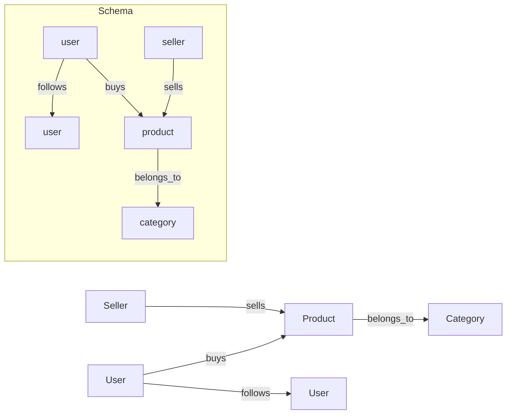
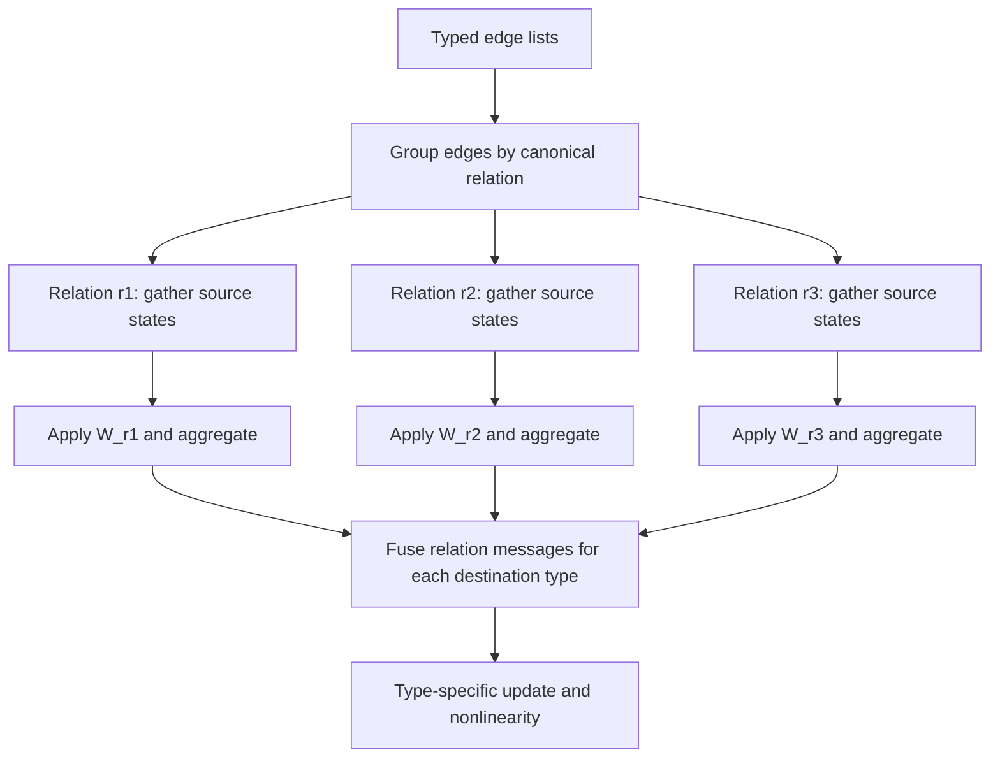
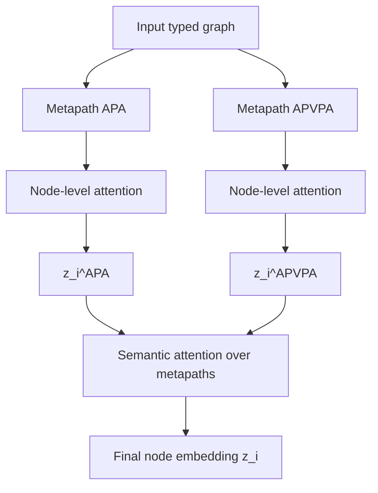
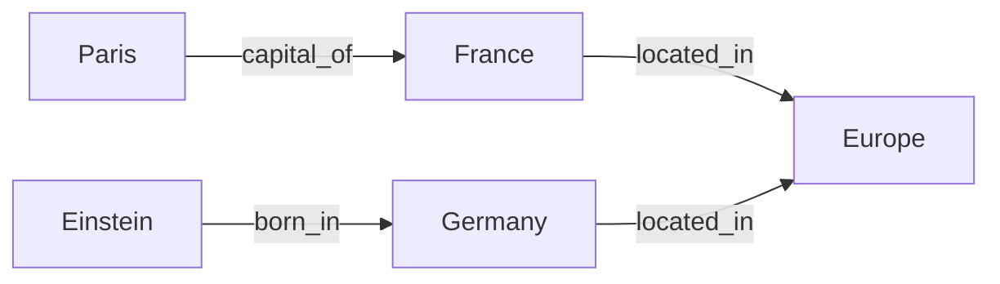
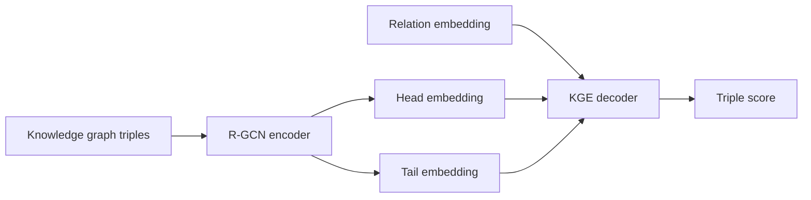

# **Heterogeneous Graphs**

A heterogeneous graph represents multiple kinds of entities and multiple kinds of relations in one graph. The central modeling problem is that the meaning of a neighbor depends on the type of the neighbor and the type of the edge connecting it. A user who follows another user is not the same kind of evidence as a user who buys a product, and a paper citing another paper is not the same operation as an author writing a paper.

This chapter covers heterogeneous graph representation, relational message passing, metapaths, knowledge graphs, knowledge graph embeddings, and practical implementation from scratch and with common graph ML libraries.

---

## **1. Formal Definition**

Let

$$
G = (V, E, \tau, \phi, X, R)
$$

where:

- $V$ is the set of nodes.
- $E \subseteq V \times V$ is the set of directed edges. Undirected edges are usually represented by adding both directions.
- $\tau: V \to \mathcal{A}$ maps each node to a node type in the finite node-type set $\mathcal{A}$.
- $\phi: E \to \mathcal{R}$ maps each edge to a relation type in the finite relation-type set $\mathcal{R}$.
- $X = \{X_a : a \in \mathcal{A}\}$ stores node features by node type.
- $R$ optionally stores edge features or relation metadata.

Many libraries represent a relation by a canonical edge type

$$
r = (a_s, \rho, a_t)
$$

where $a_s$ is the source node type, $\rho$ is the relation name, and $a_t$ is the target node type. For example:

$$
(\text{user}, \text{buys}, \text{product})
$$

This canonical type is stricter than only using the edge label $\rho$, because the same textual relation name can occur between different source and destination types in some schemas.

The relation-specific edge set is

$$
E_r = \{(u,v) \in E : \tau(u)=a_s,\ \phi(u,v)=\rho,\ \tau(v)=a_t\}.
$$

The relation-specific adjacency matrix is

$$
A_r \in \{0,1\}^{|V_{a_s}| \times |V_{a_t}|},
$$

with

$$
(A_r)_{ij}=1
\quad\Longleftrightarrow\quad
(u_i^{(a_s)}, u_j^{(a_t)}) \in E_r.
$$

Depending on convention, message passing into destination nodes uses either $A_r^\top H_{a_s}$ or an edge-index scatter operation over edges $(u,v)$.



The schema, sometimes called the network schema or metagraph, is the graph over types:

$$
S_G = (\mathcal{A}, \mathcal{R}).
$$

It specifies what kinds of typed paths are legal even before observing the instance-level graph.

---

## **2. Homogeneous vs Heterogeneous Graphs**

In a homogeneous graph, all nodes and edges have one shared type. A standard GCN layer can use one adjacency matrix and one shared transformation:

$$
H^{(\ell+1)}
=
\sigma\left(
\tilde{D}^{-1/2}\tilde{A}\tilde{D}^{-1/2}H^{(\ell)}W^{(\ell)}
\right).
$$

This assumes every edge contributes messages of the same semantic kind. If a graph contains:

$$
\text{user} \xrightarrow{\text{buys}} \text{product}
$$

and

$$
\text{user} \xrightarrow{\text{follows}} \text{user},
$$

collapsing both into one adjacency matrix makes both neighbors pass through the same transformation. The model can still use raw node features, but the operator no longer knows whether the message means purchase behavior, social influence, authorship, citation, diagnosis, or treatment.

For heterogeneous graphs, the computational object is not a single adjacency matrix but a family of sparse adjacency matrices:

$$
\{A_r : r \in \mathcal{R}\}.
$$

The natural message-passing layer therefore becomes relation-conditioned.

---

## **3. Under-the-Hood Execution**

For a target node $v$ of type $a_t$, relation-aware message passing usually executes:

1. Identify all incoming canonical relations

$$
\mathcal{R}_{\to a_t}
=
\{r=(a_s,\rho,a_t) : E_r \neq \varnothing\}.
$$

2. For each relation $r$, gather source neighbors:

$$
\mathcal{N}_r(v)
=
\{u \in V_{a_s} : (u,v)\in E_r\}.
$$

3. Transform source features with a relation-specific or type-and-relation-specific function:

$$
m_{u \to v}^{(\ell,r)}
=
f_r^{(\ell)}(h_u^{(\ell)}).
$$

4. Aggregate within the relation:

$$
\bar{m}_{v,r}^{(\ell)}
=
\operatorname{AGG}_r
\left(
\{m_{u \to v}^{(\ell,r)} : u \in \mathcal{N}_r(v)\}
\right).
$$

5. Fuse messages from different relations:

$$
m_v^{(\ell)}
=
\operatorname{FUSE}
\left(
\{\bar{m}_{v,r}^{(\ell)} : r \in \mathcal{R}_{\to \tau(v)}\}
\right).
$$

6. Update the node state:

$$
h_v^{(\ell+1)}
=
\operatorname{UPDATE}_{\tau(v)}
\left(h_v^{(\ell)}, m_v^{(\ell)}\right).
$$



The design choices are:

- Whether transformations depend on source type, relation type, destination type, or all three.
- Whether relation messages are summed, concatenated, attentively fused, or gated.
- Whether neighbor sampling is uniform, type-balanced, degree-aware, temporal, or learned.
- Whether the graph is treated as transductive, inductive over new nodes, or inductive over new node and relation types.

---

## **4. Relational GCN**

Relational GCN, usually abbreviated R-GCN, extends GCN to multi-relational graphs by assigning relation-specific transformations.

For node $i$, the R-GCN update is

$$
h_i^{(\ell+1)}
=
\sigma
\left(
\sum_{r\in\mathcal{R}}
\sum_{j\in\mathcal{N}_i^r}
\frac{1}{c_{i,r}}
W_r^{(\ell)}h_j^{(\ell)}
+
W_0^{(\ell)}h_i^{(\ell)}
\right).
$$

Terms:

- $h_i^{(\ell)} \in \mathbb{R}^{d_\ell}$ is the representation of node $i$ at layer $\ell$.
- $\mathcal{N}_i^r$ is the set of incoming neighbors connected to $i$ by relation $r$.
- $W_r^{(\ell)} \in \mathbb{R}^{d_{\ell+1}\times d_\ell}$ is the relation-specific weight matrix.
- $W_0^{(\ell)}$ is the self-loop transformation.
- $c_{i,r}$ is a normalization constant, often $|\mathcal{N}_i^r|$.
- $\sigma$ is a nonlinearity such as ReLU.

### **4.1 Derivation from Message Passing**

Start with generic message passing:

$$
h_i^{(\ell+1)}
=
\operatorname{UPDATE}
\left(
h_i^{(\ell)},
\operatorname{AGG}
\left(
\{(h_j^{(\ell)}, r_{ji}) : j \in \mathcal{N}(i)\}
\right)
\right).
$$

For a linear relation-conditioned message,

$$
m_{j\to i}^{(\ell)}
=
W_{r_{ji}}^{(\ell)}h_j^{(\ell)}.
$$

Because graph neighbor order is arbitrary, aggregation must be permutation invariant. A normalized sum gives:

$$
m_i^{(\ell)}
=
\sum_{r\in\mathcal{R}}
\sum_{j\in\mathcal{N}_i^r}
\frac{1}{c_{i,r}}
W_r^{(\ell)}h_j^{(\ell)}.
$$

Adding a root or self-loop contribution yields:

$$
z_i^{(\ell+1)}
=
m_i^{(\ell)} + W_0^{(\ell)}h_i^{(\ell)}.
$$

Then:

$$
h_i^{(\ell+1)}
=
\sigma(z_i^{(\ell+1)}).
$$

The normalization $c_{i,r}$ controls scale. Without it, high-degree relations can dominate the representation:

$$
\left\|
\sum_{j\in\mathcal{N}_i^r}W_rh_j
\right\|
\propto |\mathcal{N}_i^r|
$$

under weak independence assumptions on the messages.

### **4.2 Matrix Form**

Let $H^{(\ell)} \in \mathbb{R}^{n\times d_\ell}$ stack all node states. For relation $r$, define $A_r$ with $(A_r)_{ij}=1$ if $j$ sends a message to $i$ under relation $r$. Let $D_r$ be diagonal with

$$
(D_r)_{ii}=c_{i,r}.
$$

Then:

$$
H^{(\ell+1)}
=
\sigma
\left(
\sum_{r\in\mathcal{R}}
D_r^{-1}A_rH^{(\ell)}(W_r^{(\ell)})^\top
+
H^{(\ell)}(W_0^{(\ell)})^\top
\right).
$$

If each node type has a different feature dimensionality, practical systems first project each type into a shared hidden dimension:

$$
\tilde{H}_a^{(0)} = X_aP_a,
$$

where

$$
P_a \in \mathbb{R}^{d_a \times d}.
$$

### **4.3 Parameter Explosion and Basis Decomposition**

Naively, R-GCN uses one matrix per relation:

$$
|\mathcal{R}|d_{\ell+1}d_\ell
$$

parameters per layer. This is expensive when a knowledge graph has hundreds or thousands of relation types.

Basis decomposition constrains each relation matrix to a linear combination of $B$ shared bases:

$$
W_r^{(\ell)}
=
\sum_{b=1}^{B}a_{rb}^{(\ell)}V_b^{(\ell)}.
$$

Here:

- $V_b^{(\ell)} \in \mathbb{R}^{d_{\ell+1}\times d_\ell}$ are basis matrices.
- $a_{rb}^{(\ell)}$ are learned scalar coefficients.

The parameter count becomes:

$$
Bd_{\ell+1}d_\ell + |\mathcal{R}|B.
$$

This is smaller than the naive count when

$$
B(d_{\ell+1}d_\ell + |\mathcal{R}|)
<
|\mathcal{R}|d_{\ell+1}d_\ell.
$$

Block-diagonal decomposition is another regularizer. Each $W_r$ is constrained to block-diagonal structure:

$$
W_r
=
\begin{bmatrix}
Q_{r,1} & 0 & \cdots & 0\\
0 & Q_{r,2} & \cdots & 0\\
\vdots & \vdots & \ddots & \vdots\\
0 & 0 & \cdots & Q_{r,B}
\end{bmatrix}.
$$

This reduces cross-block interactions but improves memory and speed.

### **4.4 Worked R-GCN Example**

Consider three nodes:

- $u_0$: user
- $u_1$: user
- $p_0$: product

Edges into $u_0$:

$$
u_1 \xrightarrow{\text{follows}} u_0,
\qquad
p_0 \xrightarrow{\text{bought_by}} u_0.
$$

Initial states:

$$
h_{u_1}^{(0)}
=
\begin{bmatrix}
1\\
2
\end{bmatrix},
\qquad
h_{p_0}^{(0)}
=
\begin{bmatrix}
3\\
1
\end{bmatrix},
\qquad
h_{u_0}^{(0)}
=
\begin{bmatrix}
0\\
1
\end{bmatrix}.
$$

Weights:

$$
W_{\text{follows}}
=
\begin{bmatrix}
1 & 0\\
0 & 2
\end{bmatrix},
\qquad
W_{\text{bought_by}}
=
\begin{bmatrix}
0 & 1\\
1 & 0
\end{bmatrix},
\qquad
W_0
=
\begin{bmatrix}
1 & 1\\
0 & 1
\end{bmatrix}.
$$

Assume $c_{u_0,r}=1$ for both relations. Then:

$$
W_{\text{follows}}h_{u_1}^{(0)}
=
\begin{bmatrix}
1\\
4
\end{bmatrix}.
$$

$$
W_{\text{bought_by}}h_{p_0}^{(0)}
=
\begin{bmatrix}
1\\
3
\end{bmatrix}.
$$

$$
W_0h_{u_0}^{(0)}
=
\begin{bmatrix}
1\\
1
\end{bmatrix}.
$$

The pre-activation is:

$$
z_{u_0}^{(1)}
=
\begin{bmatrix}
1\\
4
\end{bmatrix}
+
\begin{bmatrix}
1\\
3
\end{bmatrix}
+
\begin{bmatrix}
1\\
1
\end{bmatrix}
=
\begin{bmatrix}
3\\
8
\end{bmatrix}.
$$

With ReLU:

$$
h_{u_0}^{(1)}
=
\begin{bmatrix}
3\\
8
\end{bmatrix}.
$$

The important point is that the same source vector would have produced a different message under a different relation.

---

## **5. Relational GraphSAGE**

GraphSAGE is designed for inductive learning through neighborhood sampling. A relational GraphSAGE variant samples and aggregates separately by relation:

$$
h_i^{(\ell+1)}
=
\sigma
\left(
W_{\tau(i)}^{(\ell)}
\left[
h_i^{(\ell)}
\ \Vert\
\operatorname*{FUSE}_{r\in\mathcal{R}_{\to\tau(i)}}
\operatorname*{AGG}_{j\in S_i^r}
\psi_r^{(\ell)}(h_j^{(\ell)})
\right]
\right).
$$

Here $S_i^r \subseteq \mathcal{N}_i^r$ is a sampled relation-specific neighbor set.

Sampling reduces per-batch cost from all incident edges to:

$$
O\left(
B_0
\sum_{\ell=1}^{L}
B_{\ell-1}
\prod_{k=1}^{\ell}s_k
\right)
$$

nodes in the worst case for fanouts $s_k$, but in practice duplicate sampled nodes are merged.

For heterogeneous graphs, fanout is usually configured per canonical relation:

$$
s_r \in \mathbb{N}.
$$

This matters because relation degrees can be extremely imbalanced. A user may have thousands of viewed products but only a few purchased products. Uniform sampling across all edges can erase the rare but predictive relation.

---

## **6. Relational Graph Attention**

A relational graph attention layer computes attention within each relation or across relation-aware triples.

For edge $(j,i)$ of relation $r$, one common form is:

$$
e_{ij}^{(r)}
=
\operatorname{LeakyReLU}
\left(
a_r^\top
\left[
W_rh_i
\ \Vert\
W_rh_j
\right]
\right).
$$

The attention coefficient is normalized over relation-specific incoming neighbors:

$$
\alpha_{ij}^{(r)}
=
\frac{
\exp(e_{ij}^{(r)})
}{
\sum_{k\in\mathcal{N}_i^r}\exp(e_{ik}^{(r)})
}.
$$

The relation message is:

$$
\bar{m}_{i,r}
=
\sum_{j\in\mathcal{N}_i^r}
\alpha_{ij}^{(r)}W_rh_j.
$$

Then relation messages are fused:

$$
h_i'
=
\sigma
\left(
\sum_{r\in\mathcal{R}_{\to\tau(i)}}\beta_{i,r}\bar{m}_{i,r}
\right).
$$

If $\beta_{i,r}$ is learned, the model can express that, for example, `bought` edges matter more than `viewed` edges for purchase prediction, while `viewed` edges may matter more for retrieval or cold-start ranking.

Numerically, attention should be computed with a stable softmax:

$$
\operatorname{softmax}(e_j)
=
\frac{\exp(e_j - m)}{\sum_k\exp(e_k-m)},
\qquad
m=\max_k e_k.
$$

Without subtracting $m$, large logits can overflow.

---

## **7. Metapaths**

A metapath is a typed path pattern over the schema:

$$
\mathcal{P}
=
a_0 \xrightarrow{r_1} a_1
\xrightarrow{r_2} \cdots
\xrightarrow{r_L} a_L.
$$

Example in an academic graph:

$$
\text{author}
\xrightarrow{\text{writes}}
\text{paper}
\xrightarrow{\text{written_by}}
\text{author}
$$

This author-paper-author metapath connects authors who wrote the same paper.

Another example:

$$
\text{author}
\xrightarrow{\text{writes}}
\text{paper}
\xrightarrow{\text{published_in}}
\text{venue}
\xrightarrow{\text{publishes}^{-1}}
\text{paper}
\xrightarrow{\text{written_by}}
\text{author}.
$$

This connects authors through venues.

### **7.1 Adjacency of a Metapath**

For relation adjacency matrices $A_{r_1},\ldots,A_{r_L}$, the metapath adjacency is the matrix product:

$$
A_{\mathcal{P}}
=
A_{r_1}A_{r_2}\cdots A_{r_L}.
$$

The entry

$$
(A_{\mathcal{P}})_{uv}
$$

counts the number of typed paths from node $u$ to node $v$ matching $\mathcal{P}$.

This follows from the standard matrix multiplication identity:

$$
(AB)_{ij}
=
\sum_k A_{ik}B_{kj},
$$

which sums over all intermediate nodes $k$. Repeated multiplication sums over all valid intermediate typed nodes.

### **7.2 Worked Metapath Example**

Authors:

$$
A_0,A_1
$$

Papers:

$$
P_0,P_1,P_2
$$

Author-paper adjacency:

$$
A_{\text{writes}}
=
\begin{bmatrix}
1 & 1 & 0\\
0 & 1 & 1
\end{bmatrix}.
$$

The reverse relation has adjacency:

$$
A_{\text{written_by}}
=
A_{\text{writes}}^\top
=
\begin{bmatrix}
1 & 0\\
1 & 1\\
0 & 1
\end{bmatrix}.
$$

The author-paper-author metapath adjacency is:

$$
A_{\text{APA}}
=
A_{\text{writes}}A_{\text{written_by}}
=
\begin{bmatrix}
1 & 1 & 0\\
0 & 1 & 1
\end{bmatrix}
\begin{bmatrix}
1 & 0\\
1 & 1\\
0 & 1
\end{bmatrix}
=
\begin{bmatrix}
2 & 1\\
1 & 2
\end{bmatrix}.
$$

Interpretation:

- $(A_{\text{APA}})_{00}=2$: author $A_0$ is connected to themself through two written papers.
- $(A_{\text{APA}})_{01}=1$: authors $A_0$ and $A_1$ share one paper, $P_1$.
- $(A_{\text{APA}})_{11}=2$: author $A_1$ wrote two papers.

Self-counts are often removed or normalized depending on the downstream task.

### **7.3 metapath2vec**

metapath2vec performs random walks constrained by a metapath schema and trains skip-gram embeddings on the resulting typed node sequences.

For a node sequence

$$
v_1,v_2,\ldots,v_T,
$$

the skip-gram objective maximizes:

$$
\sum_{t=1}^{T}
\sum_{-c \leq k \leq c,\ k\neq 0}
\log p(v_{t+k}\mid v_t),
$$

where $c$ is the context window.

With negative sampling, a positive pair $(u,v)$ contributes:

$$
\log\sigma(z_u^\top z_v)
+
\sum_{q=1}^{Q}
\mathbb{E}_{v_q\sim P_n}
\left[
\log\sigma(-z_u^\top z_{v_q})
\right].
$$

For heterogeneous graphs, negative samples may be drawn from the same type as the positive context node. This prevents trivial discrimination based only on node type.

---

## **8. Heterogeneous Graph Attention Network**

Heterogeneous Graph Attention Network, or HAN, combines metapath-specific neighborhood aggregation with semantic-level attention over metapaths.

For a metapath $\mathcal{P}$, first construct or sample the metapath-induced neighbors $\mathcal{N}_i^{\mathcal{P}}$. Node-level attention computes:

$$
e_{ij}^{\mathcal{P}}
=
\operatorname{LeakyReLU}
\left(
a_{\mathcal{P}}^\top
\left[
Wh_i \ \Vert\ Wh_j
\right]
\right),
$$

$$
\alpha_{ij}^{\mathcal{P}}
=
\frac{
\exp(e_{ij}^{\mathcal{P}})
}{
\sum_{k\in\mathcal{N}_i^{\mathcal{P}}}\exp(e_{ik}^{\mathcal{P}})
}.
$$

The metapath-specific embedding is:

$$
z_i^{\mathcal{P}}
=
\sigma
\left(
\sum_{j\in\mathcal{N}_i^{\mathcal{P}}}
\alpha_{ij}^{\mathcal{P}}Wh_j
\right).
$$

Semantic-level attention scores each metapath:

$$
w_{\mathcal{P}}
=
\frac{1}{|V|}
\sum_{i\in V}
q^\top
\tanh
\left(
W_s z_i^{\mathcal{P}} + b_s
\right),
$$

then normalizes:

$$
\beta_{\mathcal{P}}
=
\frac{\exp(w_{\mathcal{P}})}
{\sum_{\mathcal{P}'}\exp(w_{\mathcal{P}'})}.
$$

The final node embedding is:

$$
z_i
=
\sum_{\mathcal{P}}
\beta_{\mathcal{P}}z_i^{\mathcal{P}}.
$$



HAN works well when a small number of meaningful metapaths are known. Its limitation is that metapath selection can be domain-specific, brittle, and expensive when long metapaths create dense induced graphs.

---

## **9. Heterogeneous Graph Transformer**

Heterogeneous Graph Transformer, or HGT, uses type-specific projections and relation-specific attention parameters. For an edge $s \xrightarrow{e} t$, define the meta-relation:

$$
\langle \tau(s), \phi(e), \tau(t) \rangle.
$$

For attention head $h$, HGT computes type-specific key, query, and value projections:

$$
K^h(s)=W_{K,\tau(s)}^hH^{(\ell-1)}[s],
$$

$$
Q^h(t)=W_{Q,\tau(t)}^hH^{(\ell-1)}[t],
$$

$$
V^h(s)=W_{V,\tau(s)}^hH^{(\ell-1)}[s].
$$

Then relation-specific matrices transform keys and values:

$$
\operatorname{ATT}^h(s,e,t)
=
\left(K^h(s)W_{\phi(e)}^{\operatorname{ATT},h}\right)
\cdot Q^h(t)
\cdot
\frac{\mu_{\langle\tau(s),\phi(e),\tau(t)\rangle}}{\sqrt{d_h}}.
$$

The normalized attention is:

$$
\alpha^h(s,e,t)
=
\operatorname{softmax}_{s\in\mathcal{N}(t)}
\left(
\operatorname{ATT}^h(s,e,t)
\right).
$$

The message is:

$$
\operatorname{MSG}^h(s,e,t)
=
V^h(s)W_{\phi(e)}^{\operatorname{MSG},h}.
$$

The destination node aggregates:

$$
\tilde{H}^{(\ell)}[t]
=
\big\Vert_{h=1}^{H}
\sum_{s\in\mathcal{N}(t)}
\alpha^h(s,e,t)
\operatorname{MSG}^h(s,e,t).
$$

HGT is useful when relation semantics are rich and relation importance should depend on node types. Its price is higher implementation complexity and attention memory cost.

---

## **10. Knowledge Graphs**

A knowledge graph is a typed relational graph in which facts are represented as triples:

$$
(h,r,t),
$$

where:

- $h \in \mathcal{E}$ is the head entity.
- $r \in \mathcal{R}$ is the relation.
- $t \in \mathcal{E}$ is the tail entity.

Examples:

$$
(\text{Paris}, \text{capital\_of}, \text{France})
$$

$$
(\text{Einstein}, \text{born\_in}, \text{Germany})
$$

$$
(\text{France}, \text{located\_in}, \text{Europe})
$$

In graph notation, each triple is a directed typed edge:

$$
h \xrightarrow{r} t.
$$



Knowledge graphs are usually incomplete. Knowledge graph completion asks whether an unobserved triple is plausible:

$$
f_\theta(h,r,t) \text{ is high}
\quad\Longrightarrow\quad
(h,r,t) \text{ is likely true}.
$$

This is a ranking problem more than a calibrated binary classification problem. For a query $(h,r,?)$, the model ranks every candidate tail $t'\in\mathcal{E}$.

---

## **11. Knowledge Graph Embeddings**

Knowledge graph embedding models assign vectors to entities and relations:

$$
e_h,e_t \in \mathbb{R}^d,
\qquad
e_r \in \mathbb{R}^d
$$

or sometimes complex-valued embeddings:

$$
e_h,e_t,e_r \in \mathbb{C}^d.
$$

A scoring function maps a triple to a scalar:

$$
s_\theta(h,r,t)\in\mathbb{R}.
$$

Higher scores indicate more plausible triples. Some models use a distance $d_\theta(h,r,t)$ where lower is better; this can be converted to a score by negation.

### **11.1 Training Objective**

Observed triples are positive examples:

$$
\mathcal{T}^+ = \{(h,r,t)\}.
$$

Because most KGs do not enumerate false triples, negative examples are generated by corrupting the head or tail:

$$
(h',r,t),
\qquad
(h,r,t').
$$

The margin ranking loss for a positive triple $x^+$ and negative triple $x^-$ is:

$$
\mathcal{L}
=
\sum_{(x^+,x^-)}
\max
\left(
0,
\gamma + d_\theta(x^+) - d_\theta(x^-)
\right).
$$

Here:

- $\gamma > 0$ is the desired margin.
- $d_\theta(x^+)$ should be small.
- $d_\theta(x^-)$ should be large.

For score-based models where larger is better, binary logistic loss is common:

$$
\mathcal{L}
=
-
\log\sigma(s_\theta(x^+))
-
\sum_{q=1}^{Q}
\log\sigma(-s_\theta(x_q^-)).
$$

The negative sampling distribution strongly affects training. Uniform negative sampling is simple but often creates easy negatives. Self-adversarial negative sampling weights negative triples by the model's current scores, emphasizing harder negatives.

### **11.2 Evaluation**

For link prediction, common metrics are:

$$
\operatorname{MRR}
=
\frac{1}{|\mathcal{Q}|}
\sum_{q\in\mathcal{Q}}
\frac{1}{\operatorname{rank}_q}.
$$

Hits at $K$ is:

$$
\operatorname{Hits@K}
=
\frac{1}{|\mathcal{Q}|}
\sum_{q\in\mathcal{Q}}
\mathbf{1}\{\operatorname{rank}_q \leq K\}.
$$

Filtered evaluation removes other known true triples from the candidate set before computing the rank. This prevents penalizing the model for ranking a different true entity above the held-out target.

---

## **12. TransE**

TransE models a relation as a translation:

$$
e_h + e_r \approx e_t.
$$

Its distance is:

$$
d_\theta(h,r,t)
=
\|e_h + e_r - e_t\|_p,
\qquad
p\in\{1,2\}.
$$

A score can be:

$$
s_\theta(h,r,t)
=
-\|e_h+e_r-e_t\|_p.
$$

### **12.1 First-Principles Derivation**

Suppose a relation $r$ represents a deterministic transformation from head to tail in embedding space:

$$
F_r(e_h) \approx e_t.
$$

The simplest nontrivial transformation that is:

- parameter efficient,
- independent of entity identity,
- compositional under repeated application,
- easy to optimize,

is translation:

$$
F_r(e_h)=e_h+e_r.
$$

For a positive triple, the residual is:

$$
\epsilon_{hrt}=e_h+e_r-e_t.
$$

Maximum likelihood under an isotropic Laplace residual model gives an $\ell_1$ distance objective:

$$
p(t\mid h,r)
\propto
\exp
\left(
-\|e_h+e_r-e_t\|_1
\right).
$$

Under an isotropic Gaussian residual model, the negative log-likelihood is proportional to squared $\ell_2$ distance:

$$
-\log p(t\mid h,r)
=
\frac{1}{2\sigma^2}
\|e_h+e_r-e_t\|_2^2
+ C.
$$

TransE commonly uses $\ell_1$ or $\ell_2$ distance with ranking loss instead of full softmax likelihood because ranking all entities is expensive.

### **12.2 Worked TransE Example**

Let:

$$
e_{\text{Paris}}
=
\begin{bmatrix}
0.2\\
0.7
\end{bmatrix},
\qquad
e_{\text{capital\_of}}
=
\begin{bmatrix}
0.5\\
-0.1
\end{bmatrix},
\qquad
e_{\text{France}}
=
\begin{bmatrix}
0.8\\
0.5
\end{bmatrix}.
$$

Then:

$$
e_h+e_r
=
\begin{bmatrix}
0.2\\
0.7
\end{bmatrix}
+
\begin{bmatrix}
0.5\\
-0.1
\end{bmatrix}
=
\begin{bmatrix}
0.7\\
0.6
\end{bmatrix}.
$$

Residual:

$$
e_h+e_r-e_t
=
\begin{bmatrix}
0.7\\
0.6
\end{bmatrix}
-
\begin{bmatrix}
0.8\\
0.5
\end{bmatrix}
=
\begin{bmatrix}
-0.1\\
0.1
\end{bmatrix}.
$$

$\ell_1$ distance:

$$
\|e_h+e_r-e_t\|_1
=
|-0.1|+|0.1|
=
0.2.
$$

For a corrupted triple with $e_{\text{Germany}}=[-0.4,0.9]^\top$:

$$
e_h+e_r-e_{\text{Germany}}
=
\begin{bmatrix}
0.7\\
0.6
\end{bmatrix}
-
\begin{bmatrix}
-0.4\\
0.9
\end{bmatrix}
=
\begin{bmatrix}
1.1\\
-0.3
\end{bmatrix}.
$$

$$
\|e_h+e_r-e_{\text{Germany}}\|_1
=
1.4.
$$

With margin $\gamma=1$, the ranking loss is:

$$
\max(0, 1 + 0.2 - 1.4)
=
\max(0,-0.2)
=
0.
$$

The positive triple is already separated from this negative triple by the margin.

### **12.3 Limitations of TransE**

TransE struggles with one-to-many, many-to-one, and many-to-many relations.

For a one-to-many relation:

$$
(h,r,t_1), (h,r,t_2), \ldots, (h,r,t_k),
$$

TransE requires:

$$
e_h+e_r \approx e_{t_1},
\quad
e_h+e_r \approx e_{t_2},
\quad
\ldots,
\quad
e_h+e_r \approx e_{t_k}.
$$

Thus:

$$
e_{t_1}\approx e_{t_2}\approx \cdots \approx e_{t_k}.
$$

This collapses distinct tails into nearby embeddings even when they should remain distinguishable.

---

## **13. TransR**

TransR addresses the mismatch between entity space and relation space. Each relation has a projection matrix:

$$
M_r \in \mathbb{R}^{k\times d}.
$$

Entities are projected into relation-specific space:

$$
e_{h,r}=M_re_h,
\qquad
e_{t,r}=M_re_t.
$$

The TransR distance is:

$$
d_\theta(h,r,t)
=
\|M_re_h + e_r - M_re_t\|_p.
$$

Intuition: the aspects of an entity relevant to `born_in` are different from the aspects relevant to `won_award` or `located_in`. Relation-specific projection lets the model ignore irrelevant dimensions.

The parameter cost is high:

$$
|\mathcal{R}|kd
$$

additional projection parameters. For many relations, this is expensive and prone to overfitting.

---

## **14. Bilinear and Complex KGE Models**

Translation models are not the only option. Bilinear models score triples through multiplicative interactions.

### **14.1 DistMult**

DistMult uses:

$$
s(h,r,t)
=
e_h^\top \operatorname{diag}(e_r)e_t.
$$

Equivalently:

$$
s(h,r,t)
=
\sum_{k=1}^{d}e_{h,k}e_{r,k}e_{t,k}.
$$

Because multiplication is commutative in $e_h$ and $e_t$:

$$
s(h,r,t)=s(t,r,h).
$$

Therefore DistMult cannot model antisymmetric relations well, such as `parent_of` or `capital_of`.

### **14.2 ComplEx**

ComplEx uses complex-valued embeddings:

$$
e_h,e_r,e_t \in \mathbb{C}^{d}.
$$

The score is:

$$
s(h,r,t)
=
\operatorname{Re}
\left(
\sum_{k=1}^{d}
e_{h,k}e_{r,k}\overline{e_{t,k}}
\right).
$$

The conjugate on the tail allows asymmetric scores:

$$
s(h,r,t) \neq s(t,r,h)
$$

in general.

### **14.3 RotatE**

RotatE represents relations as rotations in complex space:

$$
e_t \approx e_h \circ e_r,
\qquad
|e_{r,k}|=1.
$$

The distance is:

$$
d(h,r,t)
=
\|e_h \circ e_r - e_t\|.
$$

Since unit complex numbers can be written as:

$$
e^{i\theta}=\cos\theta+i\sin\theta,
$$

each relation rotates each embedding dimension by an angle $\theta_{r,k}$.

RotatE naturally models:

- Symmetry when rotation angle is $0$ or $\pi$.
- Inversion when one relation rotation is the complex conjugate of another.
- Composition when rotations multiply.

---

## **15. R-GCN Encoder with KGE Decoder**

For knowledge graph completion, R-GCN is often used as an encoder and a KGE scoring function as a decoder.

Encoder:

$$
H^{(L)} = \operatorname{RGCN}_\theta(G,X).
$$

Decoder:

$$
s(h,r,t)
=
\operatorname{score}_\psi
\left(
h_h^{(L)}, e_r, h_t^{(L)}
\right).
$$

For DistMult:

$$
s(h,r,t)
=
(h_h^{(L)})^\top \operatorname{diag}(e_r) h_t^{(L)}.
$$



The encoder injects graph context into entity embeddings. The decoder imposes a relation-specific scoring geometry.

---

## **16. Python Implementation from Scratch**

The following code implements a small heterogeneous graph, a relation-aware convolution layer, and a TransE model without relying on graph libraries.

### **16.1 Typed Graph Storage**

```python
from dataclasses import dataclass
from typing import Dict, List, Tuple

import torch
import torch.nn as nn
import torch.nn.functional as F


CanonicalRelation = Tuple[str, str, str]


@dataclass
class HeteroGraph:
    # Node features by node type.
    x_dict: Dict[str, torch.Tensor]

    # Edge indices by canonical relation.
    # Each tensor has shape [2, num_edges], with row 0 = source ids,
    # row 1 = destination ids, using local ids inside each node type.
    edge_index_dict: Dict[CanonicalRelation, torch.Tensor]


def build_toy_graph() -> HeteroGraph:
    x_dict = {
        "user": torch.tensor(
            [[1.0, 0.0], [0.0, 1.0], [1.0, 1.0]]
        ),
        "product": torch.tensor(
            [[2.0, 0.0], [0.0, 2.0]]
        ),
    }

    edge_index_dict = {
        ("user", "follows", "user"): torch.tensor(
            [[0, 1], [1, 2]], dtype=torch.long
        ),
        ("user", "buys", "product"): torch.tensor(
            [[0, 1, 2], [0, 0, 1]], dtype=torch.long
        ),
        ("product", "bought_by", "user"): torch.tensor(
            [[0, 0, 1], [0, 1, 2]], dtype=torch.long
        ),
    }
    return HeteroGraph(x_dict=x_dict, edge_index_dict=edge_index_dict)
```

Important implementation detail: local node ids are separate per node type. `user` id `0` and `product` id `0` are different nodes. Graph libraries hide this by storing one namespace per type.

### **16.2 Relation-Aware Convolution**

```python
class RelationalConv(nn.Module):
    def __init__(
        self,
        metadata: Tuple[List[str], List[CanonicalRelation]],
        in_dims: Dict[str, int],
        hidden_dim: int,
    ) -> None:
        super().__init__()
        node_types, edge_types = metadata
        self.node_types = node_types
        self.edge_types = edge_types
        self.hidden_dim = hidden_dim

        # Type-specific input projections handle different feature dimensions.
        self.input_proj = nn.ModuleDict({
            node_type: nn.Linear(in_dims[node_type], hidden_dim, bias=False)
            for node_type in node_types
        })

        # ModuleDict keys must be strings, so encode canonical relations.
        self.rel_weights = nn.ModuleDict({
            self._rel_key(rel): nn.Linear(hidden_dim, hidden_dim, bias=False)
            for rel in edge_types
        })

        self.self_weights = nn.ModuleDict({
            node_type: nn.Linear(hidden_dim, hidden_dim, bias=True)
            for node_type in node_types
        })

    @staticmethod
    def _rel_key(rel: CanonicalRelation) -> str:
        return "__".join(rel)

    def forward(
        self,
        x_dict: Dict[str, torch.Tensor],
        edge_index_dict: Dict[CanonicalRelation, torch.Tensor],
    ) -> Dict[str, torch.Tensor]:
        h_dict = {
            node_type: self.input_proj[node_type](x)
            for node_type, x in x_dict.items()
        }

        out_dict = {
            node_type: self.self_weights[node_type](h)
            for node_type, h in h_dict.items()
        }

        for rel, edge_index in edge_index_dict.items():
            src_type, _, dst_type = rel
            src, dst = edge_index

            source_states = h_dict[src_type][src]
            messages = self.rel_weights[self._rel_key(rel)](source_states)

            rel_out = torch.zeros_like(out_dict[dst_type])
            rel_deg = torch.zeros(
                out_dict[dst_type].size(0),
                1,
                device=messages.device,
                dtype=messages.dtype,
            )

            ones = torch.ones(
                dst.numel(), 1, device=messages.device, dtype=messages.dtype
            )

            # Sum messages into destination rows. This gather-transform-scatter
            # primitive is the core operation behind many graph libraries.
            rel_out.index_add_(0, dst, messages)
            rel_deg.index_add_(0, dst, ones)

            out_dict[dst_type] = out_dict[dst_type] + rel_out / rel_deg.clamp_min(1.0)

        result = {}
        for node_type, out in out_dict.items():
            result[node_type] = F.relu(out)
        return result


graph = build_toy_graph()
metadata = (
    list(graph.x_dict.keys()),
    list(graph.edge_index_dict.keys()),
)
in_dims = {node_type: x.size(-1) for node_type, x in graph.x_dict.items()}

conv = RelationalConv(metadata, in_dims=in_dims, hidden_dim=4)
out = conv(graph.x_dict, graph.edge_index_dict)
for node_type, h in out.items():
    print(node_type, h.shape)
```

What this layer does internally:

1. Projects each node type into a common hidden dimension.
2. Iterates over canonical relations.
3. Gathers source node states using the source ids.
4. Applies the relation-specific linear transformation.
5. Scatters messages into destination nodes with `index_add_`.
6. Normalizes by destination in-degree.
7. Applies a nonlinearity.

Most production graph libraries implement the same gather-transform-scatter pattern with optimized sparse kernels.

### **16.3 Basis-Decomposed R-GCN Layer**

```python
class BasisRelationalConv(nn.Module):
    def __init__(
        self,
        edge_types: List[CanonicalRelation],
        hidden_dim: int,
        num_bases: int,
    ) -> None:
        super().__init__()
        self.edge_types = edge_types
        self.hidden_dim = hidden_dim
        self.num_bases = num_bases

        self.bases = nn.Parameter(
            torch.empty(num_bases, hidden_dim, hidden_dim)
        )
        self.coefficients = nn.Parameter(
            torch.empty(len(edge_types), num_bases)
        )
        nn.init.xavier_uniform_(self.bases)
        nn.init.xavier_uniform_(self.coefficients)

    def relation_weight(self, rel_index: int) -> torch.Tensor:
        # W_r = sum_b a_{r,b} V_b
        return torch.einsum(
            "b,bio->io",
            self.coefficients[rel_index],
            self.bases,
        )
```

This avoids materializing a fully independent matrix for every relation. In a full implementation, `relation_weight(rel_index)` would be used to transform messages for relation `rel_index`.

### **16.4 TransE from Scratch**

```python
class TransE(nn.Module):
    def __init__(
        self,
        num_entities: int,
        num_relations: int,
        dim: int,
        margin: float = 1.0,
        p_norm: int = 1,
    ) -> None:
        super().__init__()
        self.entity = nn.Embedding(num_entities, dim)
        self.relation = nn.Embedding(num_relations, dim)
        self.margin = margin
        self.p_norm = p_norm

        bound = 6.0 / dim ** 0.5
        nn.init.uniform_(self.entity.weight, -bound, bound)
        nn.init.uniform_(self.relation.weight, -bound, bound)

        # TransE commonly constrains entity embeddings to unit length.
        with torch.no_grad():
            self.entity.weight.copy_(
                F.normalize(self.entity.weight, p=2, dim=-1)
            )

    def distance(self, triples: torch.Tensor) -> torch.Tensor:
        h = self.entity(triples[:, 0])
        r = self.relation(triples[:, 1])
        t = self.entity(triples[:, 2])
        return torch.linalg.vector_norm(h + r - t, ord=self.p_norm, dim=-1)

    def loss(self, positive: torch.Tensor, negative: torch.Tensor) -> torch.Tensor:
        pos_dist = self.distance(positive)
        neg_dist = self.distance(negative)
        return F.relu(self.margin + pos_dist - neg_dist).mean()

    @torch.no_grad()
    def renormalize_entities(self) -> None:
        self.entity.weight.copy_(
            F.normalize(self.entity.weight, p=2, dim=-1)
        )


def corrupt_tail(
    triples: torch.Tensor,
    num_entities: int,
) -> torch.Tensor:
    negative = triples.clone()
    negative[:, 2] = torch.randint(
        low=0,
        high=num_entities,
        size=(triples.size(0),),
        device=triples.device,
    )
    return negative


positive_triples = torch.tensor(
    [
        [0, 0, 1],  # Paris capital_of France
        [1, 1, 2],  # France located_in Europe
        [3, 2, 4],  # Einstein born_in Germany
    ],
    dtype=torch.long,
)

model = TransE(num_entities=5, num_relations=3, dim=16, margin=1.0)
optimizer = torch.optim.Adam(model.parameters(), lr=1e-2)

for step in range(200):
    negative_triples = corrupt_tail(positive_triples, num_entities=5)
    loss = model.loss(positive_triples, negative_triples)

    optimizer.zero_grad()
    loss.backward()
    optimizer.step()
    model.renormalize_entities()

print("final loss:", float(loss))
```

Pitfalls:

- The corrupted triple may accidentally be true. Filtered negative sampling avoids this.
- Small graphs produce many false negatives and unstable rankings.
- Entity renormalization should be done without tracking gradients.
- A full ranking loss over all entities costs $O(|\mathcal{E}|)$ per query; negative sampling reduces this.

---

## **17. Library Implementations**

### **17.1 PyTorch Geometric**

PyTorch Geometric stores heterogeneous graphs in `HeteroData`. Each node type and edge type has its own storage.

```python
import torch
from torch_geometric.data import HeteroData
from torch_geometric.nn import HeteroConv, SAGEConv


data = HeteroData()

data["user"].x = torch.tensor(
    [[1.0, 0.0], [0.0, 1.0], [1.0, 1.0]]
)
data["product"].x = torch.tensor(
    [[2.0, 0.0], [0.0, 2.0]]
)

data["user", "follows", "user"].edge_index = torch.tensor(
    [[0, 1], [1, 2]], dtype=torch.long
)
data["user", "buys", "product"].edge_index = torch.tensor(
    [[0, 1, 2], [0, 0, 1]], dtype=torch.long
)
data["product", "bought_by", "user"].edge_index = torch.tensor(
    [[0, 0, 1], [0, 1, 2]], dtype=torch.long
)


class PyGHeteroSAGE(torch.nn.Module):
    def __init__(self, hidden_dim: int, out_dim: int) -> None:
        super().__init__()
        self.conv1 = HeteroConv(
            {
                ("user", "follows", "user"): SAGEConv((-1, -1), hidden_dim),
                ("user", "buys", "product"): SAGEConv((-1, -1), hidden_dim),
                ("product", "bought_by", "user"): SAGEConv((-1, -1), hidden_dim),
            },
            aggr="sum",
        )
        self.conv2 = HeteroConv(
            {
                ("user", "follows", "user"): SAGEConv((-1, -1), out_dim),
                ("user", "buys", "product"): SAGEConv((-1, -1), out_dim),
                ("product", "bought_by", "user"): SAGEConv((-1, -1), out_dim),
            },
            aggr="sum",
        )

    def forward(self, x_dict, edge_index_dict):
        x_dict = self.conv1(x_dict, edge_index_dict)
        x_dict = {key: x.relu() for key, x in x_dict.items()}
        x_dict = self.conv2(x_dict, edge_index_dict)
        return x_dict


model = PyGHeteroSAGE(hidden_dim=32, out_dim=16)
out = model(data.x_dict, data.edge_index_dict)
```

Internally, `HeteroConv` dispatches each canonical edge type to its own message-passing module. For an edge type `(src, rel, dst)`, the corresponding convolution receives:

$$
X_{\text{src}},\quad X_{\text{dst}},\quad \text{edge\_index}_{(src,rel,dst)}.
$$

It produces destination-node updates for type `dst`. If multiple relations target the same destination node type, `HeteroConv` combines their outputs using `aggr`, commonly `"sum"`, `"mean"`, `"min"`, `"max"`, or concatenation depending on the layer and version.

`SAGEConv((-1, -1), hidden_dim)` uses lazy initialization. The input dimensions are inferred the first time the layer sees source and destination feature matrices.

PyG also supports converting a homogeneous GNN into a heterogeneous one with `to_hetero`. Conceptually, this duplicates message-passing parameters per relation and wraps the relation-wise outputs in a heterogeneous dispatch layer.

### **17.2 DGL**

DGL represents a heterograph with a dictionary from canonical edge type to source and destination index tensors.

```python
import torch
import dgl
import dgl.nn as dglnn


g = dgl.heterograph({
    ("user", "follows", "user"): (
        torch.tensor([0, 1]),
        torch.tensor([1, 2]),
    ),
    ("user", "buys", "product"): (
        torch.tensor([0, 1, 2]),
        torch.tensor([0, 0, 1]),
    ),
    ("product", "bought_by", "user"): (
        torch.tensor([0, 0, 1]),
        torch.tensor([0, 1, 2]),
    ),
})

x_dict = {
    "user": torch.randn(g.num_nodes("user"), 8),
    "product": torch.randn(g.num_nodes("product"), 8),
}

conv = dglnn.HeteroGraphConv(
    {
        "follows": dglnn.SAGEConv(8, 16, "mean"),
        "buys": dglnn.SAGEConv(8, 16, "mean"),
        "bought_by": dglnn.SAGEConv(8, 16, "mean"),
    },
    aggregate="sum",
)

out_dict = conv(g, x_dict)
```

Internally, `HeteroGraphConv` applies a submodule to each relation graph and aggregates outputs by destination type. DGL stores one bipartite graph per relation under the hood. Message functions operate on relation-specific blocks, then destination-type reducers combine results.

One subtle difference from PyG is that DGL relation modules are often keyed by edge-type name. If multiple canonical relations share the same edge-type string, canonical disambiguation is needed.

---

## **18. Complexity**

Let:

- $n_a=|V_a|$ for node type $a$.
- $m_r=|E_r|$ for relation $r$.
- $d$ be hidden dimension.
- $L$ be number of layers.
- $R=|\mathcal{R}|$.

For dense relation matrices in R-GCN, per layer:

$$
T
=
O
\left(
\sum_{r\in\mathcal{R}} m_r d
+
R d^2
\right)
$$

if messages are transformed edge-wise after computing relation weights. With sparse matrix multiplication, the dominant cost is often:

$$
O
\left(
\sum_{r} m_r d
\right)
$$

plus linear transformations. Parameter memory is:

$$
O(Rd^2)
$$

for independent relation matrices and:

$$
O(Bd^2 + RB)
$$

for basis decomposition.

For attention-based heterogeneous GNNs, per-edge attention adds:

$$
O
\left(
\sum_r m_r H d_h
\right)
$$

where $H$ is number of heads and $d_h$ is head dimension. Memory also stores attention logits or coefficients for backpropagation:

$$
O\left(\sum_r m_r H\right).
$$

For KGE models:

- TransE scoring one triple costs $O(d)$.
- DistMult scoring one triple costs $O(d)$.
- ComplEx scoring one triple costs $O(d)$ with a larger constant due to real and imaginary components.
- Full ranking for one query costs $O(|\mathcal{E}|d)$ unless approximate retrieval or sampled evaluation is used.

---

## **19. Numerical Stability and Edge Cases**

### **19.1 Nodes with No Incoming Edges**

If a node has no incoming neighbors for a layer, mean aggregation can divide by zero. Use:

$$
\max(\deg(i),1)
$$

or keep a self-loop/root transformation:

$$
h_i' = W_0h_i.
$$

### **19.2 Relation Imbalance**

High-volume relations can dominate low-volume relations. Remedies:

- Normalize within each relation.
- Use relation attention or learned gates.
- Sample per relation with relation-specific fanouts.
- Reweight losses or messages by relation frequency.

### **19.3 Feature Dimension Mismatch**

Different node types often have different feature spaces. Project each node type to a shared hidden dimension:

$$
\tilde{x}_v = P_{\tau(v)}x_v.
$$

Do not concatenate incompatible raw features into one global matrix unless their semantics are aligned.

### **19.4 Reverse Edges**

A directed edge

$$
u\xrightarrow{r}v
$$

only sends messages from $u$ to $v$ in a directed message-passing layer. Many tasks need reverse edges:

$$
v\xrightarrow{r^{-1}}u.
$$

Reverse relations should usually have separate parameters because the inverse direction has different semantics.

### **19.5 False Negatives in KGE**

Negative sampling can produce triples that are unobserved but true. This biases training. Filter known positives when generating negatives:

$$
(h,r,t')\notin \mathcal{T}_{\text{train}}\cup\mathcal{T}_{\text{valid}}\cup\mathcal{T}_{\text{test}}.
$$

In practice, filtering against all splits is used for evaluation and sometimes for training.

### **19.6 Type Leakage**

In heterogeneous graphs, type alone can be predictive. This may be valid, but it can also create shortcut learning. For example, if all positive tails for a relation have one node type and negatives are sampled from all types, the model can win by detecting type rather than relation semantics. Sample negatives from valid type domains:

$$
t' \sim V_{\operatorname{range}(r)}.
$$

### **19.7 Over-Smoothing and Over-Squashing**

Like homogeneous GNNs, heterogeneous GNNs can over-smooth after many layers:

$$
h_i^{(L)} \approx h_j^{(L)}
$$

for many nodes in the same connected component. Relation-specific weights reduce but do not eliminate this. Over-squashing occurs when exponentially many typed paths are compressed into fixed-dimensional vectors.

---

## **20. Common Implementation Pitfalls**

- Treating canonical edge types as only relation names and accidentally mixing different source or destination types.
- Forgetting reverse edges for tasks that need bidirectional information.
- Applying one shared input projection to node types with unrelated features.
- Using unfiltered negative samples in KGE evaluation.
- Comparing raw ranks instead of filtered ranks.
- Sampling neighbors uniformly across all relations and losing rare high-signal relations.
- Building long metapath adjacency matrices densely; products like $A_{\mathcal{P}}$ can become dense.
- Using attention softmax over all incoming neighbors when the intended normalization is per relation.
- Ignoring temporal leakage in dynamic heterogeneous graphs, such as using future purchases to predict past purchases.
- Assuming transductive entity embeddings generalize to unseen entities. Pure KGE embeddings do not handle unseen entities without side features or an encoder.

---

## **21. Connections to Related Concepts**

### **21.1 Homogeneous GNNs**

GCN, GraphSAGE, and GAT are recovered as special cases when:

$$
|\mathcal{A}|=1,
\qquad
|\mathcal{R}|=1.
$$

R-GCN is the direct multi-relation analogue of GCN. Relational GraphSAGE adds sampling. Relational GAT adds attention.

### **21.2 Tensor Factorization**

A knowledge graph can be viewed as a binary tensor:

$$
\mathcal{X}\in\{0,1\}^{|\mathcal{E}|\times|\mathcal{R}|\times|\mathcal{E}|},
$$

where:

$$
\mathcal{X}_{hrt}=1
\quad\Longleftrightarrow\quad
(h,r,t)\text{ is true}.
$$

KGE models are low-rank factorization models for this tensor. DistMult is especially close to CP decomposition with relation-specific diagonal weights.

### **21.3 Recommender Systems**

User-item graphs are naturally heterogeneous:

$$
\text{user}\xrightarrow{\text{clicks}}\text{item},
\quad
\text{user}\xrightarrow{\text{buys}}\text{item},
\quad
\text{item}\xrightarrow{\text{belongs\_to}}\text{category}.
$$

Typed relations distinguish weak feedback from strong feedback. Negative sampling must account for exposure bias: an unpurchased item is not necessarily disliked.

### **21.4 Program Analysis and Databases**

Heterogeneous graphs resemble relational databases:

- Node types correspond to entity tables.
- Edge types correspond to foreign-key relationships or join tables.
- Metapaths correspond to typed join paths.
- Message passing resembles differentiable aggregation over joins.

This connection is useful when designing schemas and avoiding leakage.

---

## **22. References for Deeper Reading**

- Schlichtkrull et al., "Modeling Relational Data with Graph Convolutional Networks", ESWC 2018.
  https://arxiv.org/abs/1703.06103
- Wang et al., "Heterogeneous Graph Attention Network", WWW 2019.
  https://arxiv.org/abs/1903.07293
- Hu et al., "Heterogeneous Graph Transformer", WWW 2020.
  https://arxiv.org/abs/2003.01332
- Dong et al., "metapath2vec: Scalable Representation Learning for Heterogeneous Networks", KDD 2017.
  https://www.kdd.org/kdd2017/papers/view/metapath2vec-scalable-representation-learning-for-heterogeneous-networks
- Bordes et al., "Translating Embeddings for Modeling Multi-relational Data", NeurIPS 2013.
  https://papers.nips.cc/paper/5071-translating-embeddings-for-modeling-multi-relational-data
- Yang et al., "Embedding Entities and Relations for Learning and Inference in Knowledge Bases", ICLR 2015.
  https://arxiv.org/abs/1412.6575
- Trouillon et al., "Complex Embeddings for Simple Link Prediction", ICML 2016.
  https://proceedings.mlr.press/v48/trouillon16.html
- Sun et al., "RotatE: Knowledge Graph Embedding by Relational Rotation in Complex Space", ICLR 2019.
  https://arxiv.org/abs/1902.10197
- PyTorch Geometric heterogeneous graph documentation.
  https://pytorch-geometric.readthedocs.io/en/latest/notes/heterogeneous.html
- DGL heterogeneous graph documentation.
  https://www.dgl.ai/dgl_docs/guide/graph-heterogeneous.html
- Open Graph Benchmark.
  https://ogb.stanford.edu/
