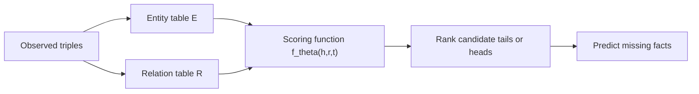
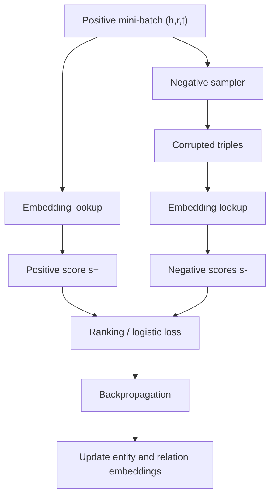
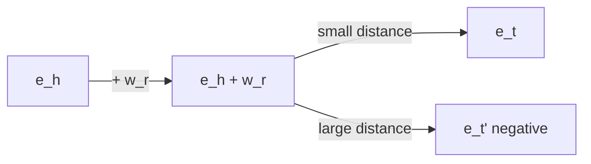

# **Reasoning in Knowledge Graphs Using Embeddings**

Knowledge graph reasoning asks a model to infer plausible facts that are not explicitly stored in a graph. In embedding-based reasoning, entities and relations are mapped to vectors or structured tensors, and the plausibility of a candidate triple is computed by a differentiable scoring function.

A knowledge graph is a set of directed labeled triples:

$$
\mathcal{G}
=
\{(h,r,t): h,t\in\mathcal{E},\ r\in\mathcal{R}\},
$$

where $\mathcal{E}$ is the finite entity set and $\mathcal{R}$ is the finite relation set. A triple such as

$$
(\text{Paris}, \text{CapitalOf}, \text{France})
$$

states that relation $\text{CapitalOf}$ holds from head entity $\text{Paris}$ to tail entity $\text{France}$.

Real knowledge graphs are incomplete under the open-world assumption: absence of a triple usually means "unknown", not "false". Knowledge graph embedding models therefore learn a scoring function

$$
f_\theta:\mathcal{E}\times\mathcal{R}\times\mathcal{E}\to\mathbb{R}
$$

such that true or plausible triples receive higher scores than corrupted or implausible triples.



---

## **1. Reasoning Tasks**

The same scoring function supports several predictive queries.

| Task | Query | Model output |
|---|---:|---|
| Tail prediction | $(h,r,?)$ | Rank all $t\in\mathcal{E}$ |
| Head prediction | $(?,r,t)$ | Rank all $h\in\mathcal{E}$ |
| Relation prediction | $(h,?,t)$ | Rank all $r\in\mathcal{R}$ |
| Triple classification | $(h,r,t)$ | Decide whether triple is plausible |
| Query answering | Composite logical query | Approximate answer set |

For a tail prediction query such as

$$
(\text{France}, \text{LocatedIn}, ?),
$$

the model computes

$$
s_e = f_\theta(\text{France}, \text{LocatedIn}, e)
\qquad \forall e\in\mathcal{E},
$$

then returns the highest-ranked entities. If $\text{Europe}$ receives the largest score, the model predicts

$$
(\text{France}, \text{LocatedIn}, \text{Europe}).
$$

This is not symbolic theorem proving. It is learned approximate reasoning: the model generalizes relational regularities from observed triples into a continuous latent space.

---

## **2. Tensor View of a Knowledge Graph**

A knowledge graph can be represented as a third-order binary tensor:

$$
\mathcal{X}\in\{0,1\}^{|\mathcal{E}|\times|\mathcal{R}|\times|\mathcal{E}|},
$$

with entries

$$
\mathcal{X}_{hrt}
=
\begin{cases}
1, & (h,r,t)\in\mathcal{G},\\
0, & \text{otherwise or unknown.}
\end{cases}
$$

The key statistical difficulty is that most zero entries are unobserved, not verified negatives. A model must learn from positive triples and sampled or constructed negatives.

Embedding models factorize or parameterize this sparse tensor. Each entity has an embedding

$$
e_i\in\mathbb{R}^d
$$

or

$$
e_i\in\mathbb{C}^d,
$$

and each relation has parameters such as a vector, diagonal matrix, full matrix, rotation, neural network, or logical operator.

The model is trained so that

$$
f_\theta(h,r,t)
>
f_\theta(h',r,t')
$$

when $(h,r,t)$ is observed and $(h',r,t')$ is a corrupted candidate.

---

## **3. Under-the-Hood Execution**

For link prediction with a mini-batch of positive triples, a typical KGE training step is:

1. Map symbolic IDs to integer IDs.

$$
\text{Paris}\mapsto 0,\quad
\text{France}\mapsto 1,\quad
\text{Europe}\mapsto 2.
$$

2. Look up embeddings for heads, relations, and tails.

$$
H = E[\text{head\_ids}],\qquad
R = W[\text{relation\_ids}],\qquad
T = E[\text{tail\_ids}].
$$

3. Score positive triples.

$$
s^+_i=f_\theta(h_i,r_i,t_i).
$$

4. Generate negative triples by corrupting the head or tail.

$$
(h,r,t)\to(h',r,t)
\quad \text{or}\quad
(h,r,t)\to(h,r,t').
$$

5. Score negative triples.

$$
s^-_{ij}=f_\theta(\tilde{h}_{ij},r_i,\tilde{t}_{ij}).
$$

6. Compute a ranking, logistic, or cross-entropy loss.

7. Backpropagate through the scoring function into the embedding tables.

8. Optionally normalize or constrain embeddings.

9. Evaluate by ranking all candidate entities for held-out queries.



---

## **4. TransE**

TransE models a relation as a translation in embedding space:

$$
e_h + w_r \approx e_t.
$$

Here:

- $e_h\in\mathbb{R}^d$ is the head embedding.
- $w_r\in\mathbb{R}^d$ is the relation embedding.
- $e_t\in\mathbb{R}^d$ is the tail embedding.
- $d$ is the embedding dimension.

The distance-based energy is

$$
D(h,r,t)
=
\lVert e_h + w_r - e_t\rVert_p,
$$

where $p\in\{1,2\}$ is common. A low distance means high plausibility. If a library expects larger scores to mean better triples, it often uses

$$
f(h,r,t)
=
-D(h,r,t).
$$

### **4.1 Derivation from a Translation Assumption**

Assume that each relation $r$ corresponds to a displacement vector $w_r$. If $(h,r,t)$ is true, the latent representation of $t$ should be reachable from the latent representation of $h$ by adding $w_r$:

$$
e_t = e_h + w_r + \epsilon_{hrt},
$$

where $\epsilon_{hrt}$ is modeling error. If the error is assumed Laplace distributed with independent coordinates,

$$
p(\epsilon_{hrt})
\propto
\exp\left(-\frac{\lVert \epsilon_{hrt}\rVert_1}{b}\right),
$$

then maximum likelihood minimizes an $L_1$ distance. If the error is Gaussian,

$$
p(\epsilon_{hrt})
\propto
\exp\left(-\frac{\lVert \epsilon_{hrt}\rVert_2^2}{2\sigma^2}\right),
$$

then maximum likelihood minimizes a squared $L_2$ distance. TransE usually uses an $L_1$ or $L_2$ norm:

$$
\epsilon_{hrt}=e_h+w_r-e_t.
$$

The score is not a calibrated probability. It is an energy used for ranking.

### **4.2 Margin Ranking Loss**

For each positive triple $(h,r,t)\in\mathcal{G}$, sample a corrupted triple

$$
(h',r,t)
\quad \text{or}\quad
(h,r,t').
$$

Let

$$
D^+ = D(h,r,t),
\qquad
D^- = D(\tilde{h},r,\tilde{t}).
$$

The margin ranking loss is

$$
\mathcal{L}
=
\sum_{(h,r,t)\in\mathcal{B}}
\sum_{(\tilde{h},r,\tilde{t})\in\mathcal{N}(h,r,t)}
\max\left(0,\ \gamma + D^+ - D^-\right),
$$

where:

- $\mathcal{B}$ is a mini-batch of positive triples.
- $\mathcal{N}(h,r,t)$ is the sampled negative set.
- $\gamma>0$ is the required separation margin.

The loss is zero when

$$
D^- \ge D^+ + \gamma.
$$

That is, every negative triple must be at least $\gamma$ farther away than the corresponding positive triple.

### **4.3 Gradients**

For the active hinge case,

$$
\gamma + D^+ - D^- > 0,
$$

the loss contributes

$$
\ell = \gamma + D^+ - D^-.
$$

For $p=2$ with unsquared norm,

$$
D=\lVert x\rVert_2,\qquad x=e_h+w_r-e_t.
$$

The gradient with respect to $x$ is

$$
\frac{\partial D}{\partial x}
=
\frac{x}{\lVert x\rVert_2+\varepsilon},
$$

where $\varepsilon$ is added in implementations to avoid division by zero.

Therefore for a positive triple:

$$
\frac{\partial D^+}{\partial e_h}
=
\frac{x^+}{\lVert x^+\rVert_2+\varepsilon},
\qquad
\frac{\partial D^+}{\partial w_r}
=
\frac{x^+}{\lVert x^+\rVert_2+\varepsilon},
\qquad
\frac{\partial D^+}{\partial e_t}
=
-\frac{x^+}{\lVert x^+\rVert_2+\varepsilon}.
$$

Because the loss contains $+D^+$, gradient descent pulls $e_h+w_r$ toward $e_t$. Because the loss contains $-D^-$, gradient descent pushes corrupted triples apart.

### **4.4 Intuition**

If the model observes

$$
(\text{Paris}, \text{CapitalOf}, \text{France})
$$

and

$$
(\text{Berlin}, \text{CapitalOf}, \text{Germany}),
$$

then it tries to make both differences similar:

$$
e_{\text{France}} - e_{\text{Paris}}
\approx
w_{\text{CapitalOf}},
$$

and

$$
e_{\text{Germany}} - e_{\text{Berlin}}
\approx
w_{\text{CapitalOf}}.
$$

The relation embedding becomes a reusable vector offset.



### **4.5 Worked Example**

Let $d=2$ and

$$
e_{\text{Paris}}=
\begin{bmatrix}
0.20\\
0.70
\end{bmatrix},
\qquad
w_{\text{CapitalOf}}=
\begin{bmatrix}
0.50\\
-0.10
\end{bmatrix},
\qquad
e_{\text{France}}=
\begin{bmatrix}
0.80\\
0.55
\end{bmatrix}.
$$

Then

$$
e_h+w_r
=
\begin{bmatrix}
0.20\\
0.70
\end{bmatrix}
+
\begin{bmatrix}
0.50\\
-0.10
\end{bmatrix}
=
\begin{bmatrix}
0.70\\
0.60
\end{bmatrix}.
$$

The residual is

$$
x^+
=
e_h+w_r-e_t
=
\begin{bmatrix}
0.70\\
0.60
\end{bmatrix}
-
\begin{bmatrix}
0.80\\
0.55
\end{bmatrix}
=
\begin{bmatrix}
-0.10\\
0.05
\end{bmatrix}.
$$

Using $L_2$ distance:

$$
D^+
=
\sqrt{(-0.10)^2+(0.05)^2}
=
\sqrt{0.0125}
\approx
0.1118.
$$

Suppose a corrupted tail is $\text{Europe}$ with

$$
e_{\text{Europe}}=
\begin{bmatrix}
-0.10\\
0.20
\end{bmatrix}.
$$

Then

$$
x^-
=
\begin{bmatrix}
0.70\\
0.60
\end{bmatrix}
-
\begin{bmatrix}
-0.10\\
0.20
\end{bmatrix}
=
\begin{bmatrix}
0.80\\
0.40
\end{bmatrix},
$$

and

$$
D^-
=
\sqrt{0.80^2+0.40^2}
=
\sqrt{0.80}
\approx
0.8944.
$$

With margin $\gamma=1$:

$$
\ell
=
\max(0,\ 1 + 0.1118 - 0.8944)
=
0.2174.
$$

The negative is farther away than the positive, but not by a full margin of $1$, so the model still updates.

---

## **5. Negative Sampling and the Open-World Assumption**

Most KGs provide positive facts, not an exhaustive list of false facts. Training therefore constructs negatives. For a positive triple $(h,r,t)$, the basic corruption distribution is

$$
q(\tilde{h},\tilde{t}\mid h,r,t)
=
\frac{1}{2}q_E(\tilde{h})\mathbf{1}[\tilde{t}=t]
+
\frac{1}{2}q_E(\tilde{t})\mathbf{1}[\tilde{h}=h].
$$

Common choices for $q_E$ include:

- Uniform entity sampling.
- Degree-biased sampling.
- Relation-aware Bernoulli sampling.
- Self-adversarial sampling, where harder negatives receive higher probability.

The main pitfall is false negatives. If $(h,r,\tilde{t})$ is unobserved but actually true, pushing it down damages generalization. Filtered negative sampling removes sampled negatives that are known true in train, validation, or test graphs, but it cannot remove facts missing from the dataset.

---

## **6. Alternative Scoring Functions**

### **6.1 RESCAL**

RESCAL uses a full relation matrix:

$$
f(h,r,t)
=
e_h^\top W_r e_t,
\qquad
W_r\in\mathbb{R}^{d\times d}.
$$

This is expressive because each relation can model pairwise interactions between all embedding dimensions. Its parameter cost is high:

$$
O(|\mathcal{R}|d^2).
$$

### **6.2 DistMult**

DistMult constrains $W_r$ to be diagonal:

$$
W_r=\operatorname{diag}(w_r).
$$

The score becomes

$$
f(h,r,t)
=
e_h^\top \operatorname{diag}(w_r)e_t
=
\sum_{k=1}^{d} e_{h,k}w_{r,k}e_{t,k}.
$$

This is parameter efficient:

$$
O((|\mathcal{E}|+|\mathcal{R}|)d).
$$

However,

$$
f(h,r,t)=f(t,r,h),
$$

because scalar multiplication is commutative. DistMult therefore cannot model antisymmetric relations such as $\text{ParentOf}$ or $\text{CapitalOf}$ by score asymmetry alone.

### **6.3 ComplEx**

ComplEx extends DistMult to complex-valued embeddings:

$$
e_h,w_r,e_t\in\mathbb{C}^d.
$$

The score is

$$
f(h,r,t)
=
\operatorname{Re}
\left(
\sum_{k=1}^{d}
e_{h,k} w_{r,k} \overline{e_{t,k}}
\right),
$$

where $\overline{e_{t,k}}$ is the complex conjugate and $\operatorname{Re}$ takes the real part.

Write

$$
e_h=a+ib,\qquad
w_r=c+id,\qquad
e_t=p+iq.
$$

For one dimension,

$$
(a+ib)(c+id)(p-iq)
=
[(ac-bd)+i(ad+bc)](p-iq).
$$

The real part is

$$
(ac-bd)p + (ad+bc)q.
$$

Because the conjugate changes sign when swapping head and tail, ComplEx can model asymmetric relations. The model remains close to a diagonal bilinear factorization, but the imaginary components introduce direction-sensitive interactions.

### **6.4 RotatE**

RotatE represents entities and relations in complex space and constrains each relation component to lie on the unit circle:

$$
e_h,e_t\in\mathbb{C}^d,
\qquad
w_r\in\mathbb{C}^d,
\qquad
|w_{r,k}|=1.
$$

The relation applies a coordinate-wise rotation:

$$
e_t \approx e_h \circ w_r,
$$

where $\circ$ is elementwise multiplication. The distance is

$$
D(h,r,t)
=
\lVert e_h\circ w_r - e_t\rVert.
$$

Using Euler's formula,

$$
w_{r,k}=e^{i\theta_{r,k}}
=
\cos\theta_{r,k}+i\sin\theta_{r,k}.
$$

Thus each relation rotates each embedding dimension by an angle $\theta_{r,k}$.

RotatE naturally represents several relation patterns:

- Symmetry when $\theta_{r,k}\in\{0,\pi\}$.
- Inversion because inverse relations use conjugate rotations.
- Composition because rotations multiply and angles add.

If

$$
w_{r_3}=w_{r_1}\circ w_{r_2},
$$

then applying $r_1$ followed by $r_2$ corresponds to relation $r_3$:

$$
(e_h\circ w_{r_1})\circ w_{r_2}
=
e_h\circ(w_{r_1}\circ w_{r_2}).
$$

---

## **7. Logical Relation Patterns**

Embedding models are often judged by whether they can represent common relation patterns.

| Pattern | Logical form | Example |
|---|---|---|
| Symmetry | $r(x,y)\Rightarrow r(y,x)$ | sibling of |
| Antisymmetry | $r(x,y)\Rightarrow \neg r(y,x)$ for $x\neq y$ | parent of |
| Inversion | $r_1(x,y)\Leftrightarrow r_2(y,x)$ | born in / birthplace of |
| Composition | $r_1(x,y)\wedge r_2(y,z)\Rightarrow r_3(x,z)$ | capital of + located in |
| Hierarchy | $r_1(x,y)\Rightarrow r_2(x,y)$ | professor at implies works at |

TransE handles simple composition intuitively:

$$
e_y\approx e_x+w_{r_1},
\qquad
e_z\approx e_y+w_{r_2}.
$$

Substitution gives

$$
e_z
\approx
e_x+w_{r_1}+w_{r_2}.
$$

If relation $r_3$ encodes the composed relation, then a natural condition is

$$
w_{r_3}\approx w_{r_1}+w_{r_2}.
$$

However, TransE struggles with one-to-many, many-to-one, and many-to-many relations. If both

$$
(h,r,t_1)
\quad \text{and}\quad
(h,r,t_2)
$$

are true, TransE pushes

$$
e_h+w_r\approx e_{t_1}
\qquad \text{and}\qquad
e_h+w_r\approx e_{t_2},
$$

which implies

$$
e_{t_1}\approx e_{t_2}.
$$

That may be wrong when $t_1$ and $t_2$ are distinct objects.

---

## **8. Evaluation: Raw and Filtered Ranking**

For a test triple $(h,r,t)$, tail prediction ranks $t$ among all candidates:

$$
\operatorname{rank}_t(h,r,t)
=
1+
\sum_{e\in\mathcal{E},\ e\neq t}
\mathbf{1}\left[
f(h,r,e)>f(h,r,t)
\right].
$$

If ties occur, implementations may use optimistic, pessimistic, or average tie handling.

Mean reciprocal rank is

$$
\operatorname{MRR}
=
\frac{1}{N}
\sum_{i=1}^{N}
\frac{1}{\operatorname{rank}_i}.
$$

Hits@$K$ is

$$
\operatorname{Hits@}K
=
\frac{1}{N}
\sum_{i=1}^{N}
\mathbf{1}[\operatorname{rank}_i\le K].
$$

Raw evaluation ranks against all entities. Filtered evaluation removes candidate triples that are known true anywhere in the dataset before computing the rank. For tail prediction, the filtered candidate set is

$$
\mathcal{C}_{\text{filtered}}
=
\{e\in\mathcal{E}:(h,r,e)\notin\mathcal{G}_{\text{all}}\}
\cup
\{t\}.
$$

Filtered evaluation avoids penalizing the model for ranking another correct answer above the test answer.


---

## **9. From-Scratch Python: TransE**

The implementation below is intentionally small. It includes ID mapping, negative sampling, margin loss, and ranking evaluation.

```python
import math
import random
from collections import defaultdict

import torch
from torch import nn
import torch.nn.functional as F


class TransE(nn.Module):
    """Minimal TransE implementation with larger-is-better scores."""

    def __init__(self, num_entities, num_relations, dim=64, p_norm=1):
        super().__init__()
        self.entity = nn.Embedding(num_entities, dim)
        self.relation = nn.Embedding(num_relations, dim)
        self.p_norm = p_norm
        self.reset_parameters()

    def reset_parameters(self):
        bound = 6 / math.sqrt(self.entity.embedding_dim)
        nn.init.uniform_(self.entity.weight, -bound, bound)
        nn.init.uniform_(self.relation.weight, -bound, bound)
        self.normalize_entities()

    @torch.no_grad()
    def normalize_entities(self):
        self.entity.weight.data = F.normalize(self.entity.weight.data, p=2, dim=-1)

    def distance(self, h, r, t):
        h_e = self.entity(h)
        r_e = self.relation(r)
        t_e = self.entity(t)
        return torch.linalg.vector_norm(h_e + r_e - t_e, ord=self.p_norm, dim=-1)

    def score(self, h, r, t):
        # Many libraries use larger scores for better triples.
        return -self.distance(h, r, t)


def build_ids(triples):
    entities = sorted({h for h, _, t in triples} | {t for h, _, t in triples})
    relations = sorted({r for _, r, _ in triples})
    ent2id = {e: i for i, e in enumerate(entities)}
    rel2id = {r: i for i, r in enumerate(relations)}
    encoded = [(ent2id[h], rel2id[r], ent2id[t]) for h, r, t in triples]
    return encoded, ent2id, rel2id


def sample_negatives(batch, num_entities, true_triples=None):
    negatives = []
    true_triples = true_triples or set()
    for h, r, t in batch:
        for _ in range(100):
            if random.random() < 0.5:
                h_neg = random.randrange(num_entities)
                candidate = (h_neg, r, t)
            else:
                t_neg = random.randrange(num_entities)
                candidate = (h, r, t_neg)
            if candidate not in true_triples:
                negatives.append(candidate)
                break
        else:
            negatives.append(candidate)
    return negatives


def train_transe(triples, dim=32, epochs=500, batch_size=4, lr=1e-2, margin=1.0):
    encoded, ent2id, rel2id = build_ids(triples)
    true_set = set(encoded)
    model = TransE(len(ent2id), len(rel2id), dim=dim, p_norm=1)
    optimizer = torch.optim.Adam(model.parameters(), lr=lr)

    for epoch in range(epochs):
        random.shuffle(encoded)
        total_loss = 0.0

        for start in range(0, len(encoded), batch_size):
            batch = encoded[start : start + batch_size]
            neg = sample_negatives(batch, len(ent2id), true_set)

            pos = torch.tensor(batch, dtype=torch.long)
            neg = torch.tensor(neg, dtype=torch.long)

            pos_dist = model.distance(pos[:, 0], pos[:, 1], pos[:, 2])
            neg_dist = model.distance(neg[:, 0], neg[:, 1], neg[:, 2])
            loss = F.relu(margin + pos_dist - neg_dist).mean()

            optimizer.zero_grad()
            loss.backward()
            optimizer.step()
            model.normalize_entities()

            total_loss += float(loss.item()) * len(batch)

        if epoch % 100 == 0:
            print(f"epoch={epoch:03d} loss={total_loss / len(encoded):.4f}")

    return model, ent2id, rel2id, encoded


@torch.no_grad()
def rank_tail(model, h_id, r_id, t_id, all_true_triples=None):
    all_true_triples = all_true_triples or set()
    num_entities = model.entity.num_embeddings

    h = torch.full((num_entities,), h_id, dtype=torch.long)
    r = torch.full((num_entities,), r_id, dtype=torch.long)
    candidates = torch.arange(num_entities, dtype=torch.long)

    scores = model.score(h, r, candidates)

    # Filter known true alternatives but keep the target.
    for e in range(num_entities):
        if e != t_id and (h_id, r_id, e) in all_true_triples:
            scores[e] = -torch.inf

    target_score = scores[t_id]
    rank = int((scores > target_score).sum().item()) + 1
    return rank, scores


if __name__ == "__main__":
    triples = [
        ("Paris", "CapitalOf", "France"),
        ("Berlin", "CapitalOf", "Germany"),
        ("Madrid", "CapitalOf", "Spain"),
        ("France", "LocatedIn", "Europe"),
        ("Germany", "LocatedIn", "Europe"),
        ("Spain", "LocatedIn", "Europe"),
    ]

    model, ent2id, rel2id, encoded = train_transe(triples)
    id2ent = {i: e for e, i in ent2id.items()}

    h = ent2id["France"]
    r = rel2id["LocatedIn"]
    scores = []
    for entity, entity_id in ent2id.items():
        score = model.score(
            torch.tensor([h]),
            torch.tensor([r]),
            torch.tensor([entity_id]),
        ).item()
        scores.append((score, entity))

    for score, entity in sorted(scores, reverse=True):
        print(f"(France, LocatedIn, {entity}) score={score:.4f}")
```

### **9.1 What the Code Does Internally**

`nn.Embedding` is a learnable lookup table. If the entity table is

$$
E\in\mathbb{R}^{|\mathcal{E}|\times d},
$$

then `self.entity(h)` returns rows

$$
E_h.
$$

The vectorized residual is

$$
X = E_H + W_R - E_T,
$$

where $H$, $R$, and $T$ are integer tensors of shape $B$. The call

```python
torch.linalg.vector_norm(X, ord=1, dim=-1)
```

computes one distance per triple. Backpropagation only updates the rows of the embedding tables used in the batch. With sparse optimizers this can be exploited for memory efficiency, though many simple implementations use dense Adam updates.

---

## **10. Library Implementations**

### **10.1 PyKEEN**

PyKEEN provides high-level training and evaluation pipelines. Internally, a model exposes scoring methods such as `score_hrt` for batches of explicit triples and optimized methods for scoring all heads or all tails for a partially specified query.

```python
from pykeen.pipeline import pipeline

result = pipeline(
    dataset="nations",
    model="TransE",
    model_kwargs={
        "embedding_dim": 128,
        "scoring_fct_norm": 1,
    },
    training_kwargs={
        "num_epochs": 100,
        "batch_size": 256,
    },
    optimizer="adam",
    optimizer_kwargs={
        "lr": 1e-3,
    },
    random_seed=42,
)

print(result.metric_results.to_df())
```

Under the hood, PyKEEN constructs mapped triples, initializes representation modules for entities and relations, applies an interaction function such as TransE interaction, trains with a negative sampler and loss, then evaluates with rank-based metrics.

### **10.2 PyTorch Geometric**

PyTorch Geometric includes KGE modules such as `TransE`, `DistMult`, `ComplEx`, and `RotatE`.

```python
import torch
from torch_geometric.nn.kge import TransE

num_entities = 1000
num_relations = 50
model = TransE(
    num_nodes=num_entities,
    num_relations=num_relations,
    hidden_channels=128,
    margin=1.0,
    p_norm=1,
)

head_index = torch.tensor([0, 10, 25])
rel_type = torch.tensor([2, 4, 7])
tail_index = torch.tensor([5, 11, 30])

score = model(head_index, rel_type, tail_index)
loss = model.loss(head_index, rel_type, tail_index)
loss.backward()
```

The PyG implementation follows the same mathematical pattern: entity and relation embeddings are looked up, relation vectors translate heads toward tails, and ranking loss trains positives against sampled negatives. The library wraps the details in a reusable `KGEModel` interface.

### **10.3 DGL-KE**

DGL-KE targets large-scale training and supports common models such as TransE, TransR, RESCAL, DistMult, ComplEx, and RotatE. It is most useful when the bottleneck is not the scoring function but the data pipeline, distributed embedding tables, and high-throughput negative sampling.

---

## **11. Complexity**

Let:

- $n=|\mathcal{E}|$ be the number of entities.
- $m=|\mathcal{R}|$ be the number of relations.
- $d$ be the embedding dimension.
- $B$ be the batch size.
- $K$ be the number of negatives per positive.

### **11.1 Parameter Complexity**

| Model | Entity parameters | Relation parameters | Total order |
|---|---:|---:|---:|
| TransE | $nd$ | $md$ | $O((n+m)d)$ |
| DistMult | $nd$ | $md$ | $O((n+m)d)$ |
| ComplEx | $2nd$ | $2md$ | $O((n+m)d)$ |
| RESCAL | $nd$ | $md^2$ | $O(nd+md^2)$ |
| RotatE | $2nd$ | $md$ or $2md$ depending on parameterization | $O((n+m)d)$ |

### **11.2 Training Time**

For TransE, scoring one triple costs

$$
O(d).
$$

With $K$ negatives per positive, one batch costs

$$
O(B(K+1)d).
$$

Full tail ranking for one query scores every entity:

$$
O(nd).
$$

This is often the evaluation bottleneck. Efficient implementations batch candidate scoring, use matrix operations, or approximate nearest-neighbor retrieval for deployment.

### **11.3 Space**

The dominant storage is the embedding table:

$$
O((n+m)d).
$$

For billion-scale graphs, embeddings cannot always fit on one GPU. Production systems use CPU memory, parameter servers, sharding, quantization, mixed precision, or offline candidate generation.

---

## **12. Numerical Stability and Implementation Pitfalls**

### **12.1 Norm Gradients**

The unsquared $L_2$ norm has derivative

$$
\frac{x}{\lVert x\rVert_2}.
$$

At $x=0$, this is undefined. Libraries avoid instability by adding $\varepsilon$, using subgradients, or using a powered norm:

$$
\lVert x\rVert_2^2,
$$

whose derivative is

$$
2x.
$$

The squared norm is smoother at zero but changes the geometry and margin scale.

### **12.2 Embedding Norm Explosion**

If the model can arbitrarily increase vector norms, it may satisfy ranking constraints by scaling rather than learning meaningful geometry. Common mitigations are:

- Unit-normalizing entity embeddings after each update.
- Adding $L_2$ regularization.
- Constraining relation norms.
- Using bounded parameterizations for rotations.

### **12.3 False Negatives**

An unobserved triple may be true. Uniform corruption can accidentally create such triples. This is especially harmful for one-to-many relations where many valid tails are missing.

### **12.4 Inverse Relation Leakage**

Some benchmark splits contain near-duplicate inverse relations. If the training graph contains

$$
(\text{France}, \text{HasCapital}, \text{Paris}),
$$

and the test graph asks

$$
(\text{Paris}, \text{CapitalOf}, ?),
$$

then the task can become memorization rather than reasoning. Datasets such as FB15k-237 and WN18RR were introduced to reduce this problem relative to earlier FB15k and WN18 splits.

### **12.5 Evaluation Leakage**

Filtered evaluation must filter against all known positives from train, validation, and test. Filtering only the training graph can incorrectly penalize correct alternatives.

### **12.6 Score Direction**

Some models return larger-is-better scores, while distance models naturally produce smaller-is-better energies. Mixing these conventions causes silent metric bugs. For TransE:

$$
f(h,r,t)=-\lVert e_h+w_r-e_t\rVert
$$

is larger-is-better, while

$$
D(h,r,t)=\lVert e_h+w_r-e_t\rVert
$$

is smaller-is-better.

---

## **13. Limitations**

Embedding-based reasoning is powerful but limited.

1. It does not produce guaranteed logical proofs.
2. It is weak under distribution shift when entity semantics change.
3. It struggles with rare entities and rare relations.
4. It often needs many negatives and careful evaluation.
5. It can encode dataset artifacts such as inverse leakage.
6. It has limited inductive ability for unseen entities unless combined with text, attributes, GNN encoders, or entity descriptions.
7. Scores are usually not calibrated probabilities.

For strict logical reasoning, rule-learning systems, differentiable logic, or neuro-symbolic methods may be better. For large-scale retrieval and recommendation, KGE scores are often used as candidate generators or features inside larger ranking systems.

---

## **14. Connections to Related ML Concepts**

### **14.1 Matrix and Tensor Factorization**

DistMult and ComplEx are tensor factorization models. Each relation corresponds to a slice of the adjacency tensor:

$$
X_r\in\{0,1\}^{n\times n}.
$$

DistMult approximates relation slices by

$$
\hat{X}_{r,ht}
=
\sum_{k=1}^{d} e_{h,k}w_{r,k}e_{t,k}.
$$

This is a low-rank factorization shared across relations.

### **14.2 Metric Learning**

TransE learns a metric space where valid relational translations have small distances. The margin ranking loss is analogous to triplet loss:

$$
\max(0,\ \gamma + d(a,p)-d(a,n)).
$$

Here the "anchor" is relation-conditioned:

$$
a=e_h+w_r.
$$

### **14.3 Collaborative Filtering**

A user-item recommender graph can be represented as triples:

$$
(\text{user}, \text{buys}, \text{item}).
$$

KGE then becomes multi-relation recommendation. DistMult resembles matrix factorization when there is one interaction relation.

### **14.4 GNNs and Relational Message Passing**

KGE models usually assign free embeddings to entity IDs. Relational GNNs instead compute entity embeddings from neighborhoods:

$$
h_v^{(\ell+1)}
=
\sigma
\left(
\sum_{r\in\mathcal{R}}
\sum_{u\in\mathcal{N}_r(v)}
\frac{1}{c_{v,r}}W_r^{(\ell)}h_u^{(\ell)}
\right).
$$

KGE is often stronger for transductive link prediction with fixed entities; GNN encoders are useful when node features, text, or inductive generalization matter.

### **14.5 Query Embedding**

For multi-hop logical queries, embeddings can represent sets of possible answers rather than individual entities. A path query such as

$$
(\text{Paris}, \text{CapitalOf}^{-1}/\text{LocatedIn}, ?)
$$

can be approximated by composing relation operators. TransE composes paths by vector addition; RotatE composes by multiplying rotations.

---

## **15. Practical Checklist**

- Use filtered MRR and Hits@$K$ for link prediction.
- Keep train, validation, and test triples separate but filter evaluation against all known positives.
- Check inverse relation leakage before trusting benchmark numbers.
- Use relation-aware negative sampling for one-to-many and many-to-one relations.
- Track score convention carefully: distance or plausibility.
- Normalize or regularize embeddings for translation models.
- Use batched all-entity scoring for evaluation.
- Prefer ComplEx or RotatE when relation asymmetry and inversion matter.
- Prefer GNN or text-conditioned encoders when unseen entities appear at inference time.

---

## **16. References and Deeper Reading**

- Bordes, Usunier, Garcia-Duran, Weston, and Yakhnenko. **Translating Embeddings for Modeling Multi-relational Data.** NeurIPS 2013. https://papers.nips.cc/paper/5071-translating-embeddings-for-modeling-multi-relational-data
- Yang, Yih, He, Gao, and Deng. **Embedding Entities and Relations for Learning and Inference in Knowledge Bases.** ICLR 2015 workshop / arXiv. https://arxiv.org/abs/1412.6575
- Nickel, Tresp, and Kriegel. **A Three-Way Model for Collective Learning on Multi-Relational Data.** ICML 2011. https://icml.cc/2011/papers/438_icmlpaper.pdf
- Trouillon, Welbl, Riedel, Gaussier, and Bouchard. **Complex Embeddings for Simple Link Prediction.** ICML 2016. https://arxiv.org/abs/1606.06357
- Sun, Deng, Nie, and Tang. **RotatE: Knowledge Graph Embedding by Relational Rotation in Complex Space.** ICLR 2019. https://openreview.net/forum?id=HkgEQnRqYQ
- Dettmers, Minervini, Stenetorp, and Riedel. **Convolutional 2D Knowledge Graph Embeddings.** AAAI 2018. https://arxiv.org/abs/1707.01476
- Schlichtkrull et al. **Modeling Relational Data with Graph Convolutional Networks.** ESWC 2018. https://arxiv.org/abs/1703.06103
- PyKEEN documentation. https://pykeen.readthedocs.io/en/stable/
- PyTorch Geometric KGE documentation. https://pytorch-geometric.readthedocs.io/en/latest/modules/nn.html
- DGL-KE documentation. https://dglke.readthedocs.io/en/latest/
