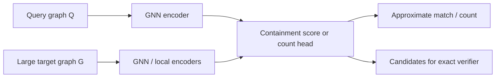
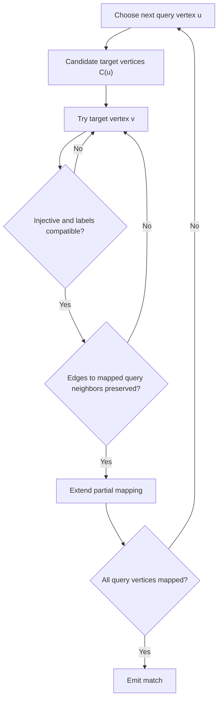
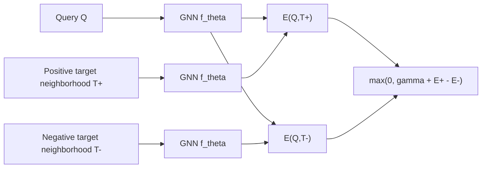
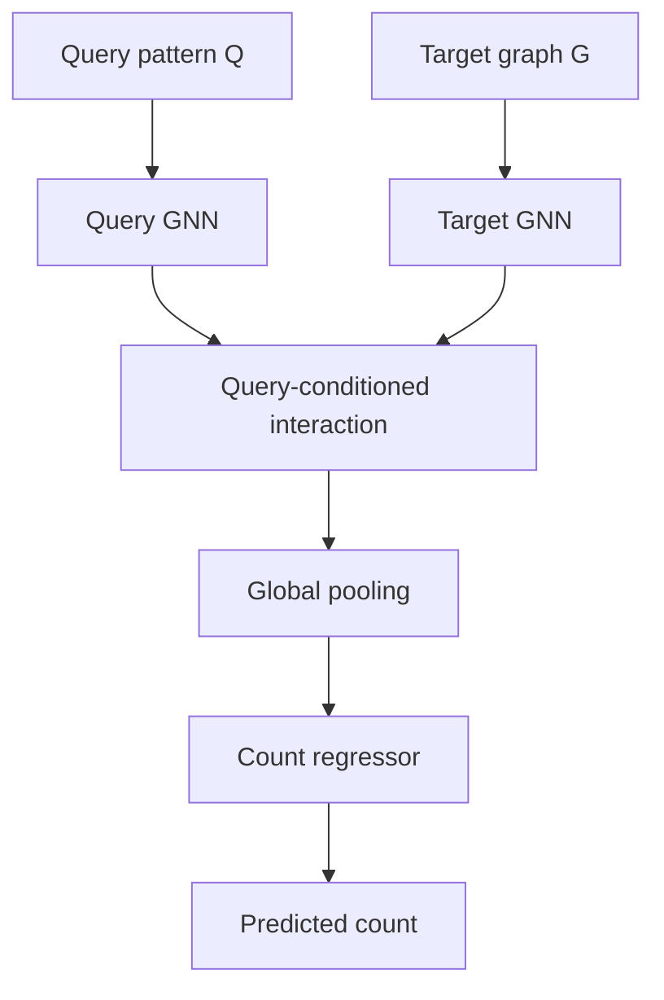
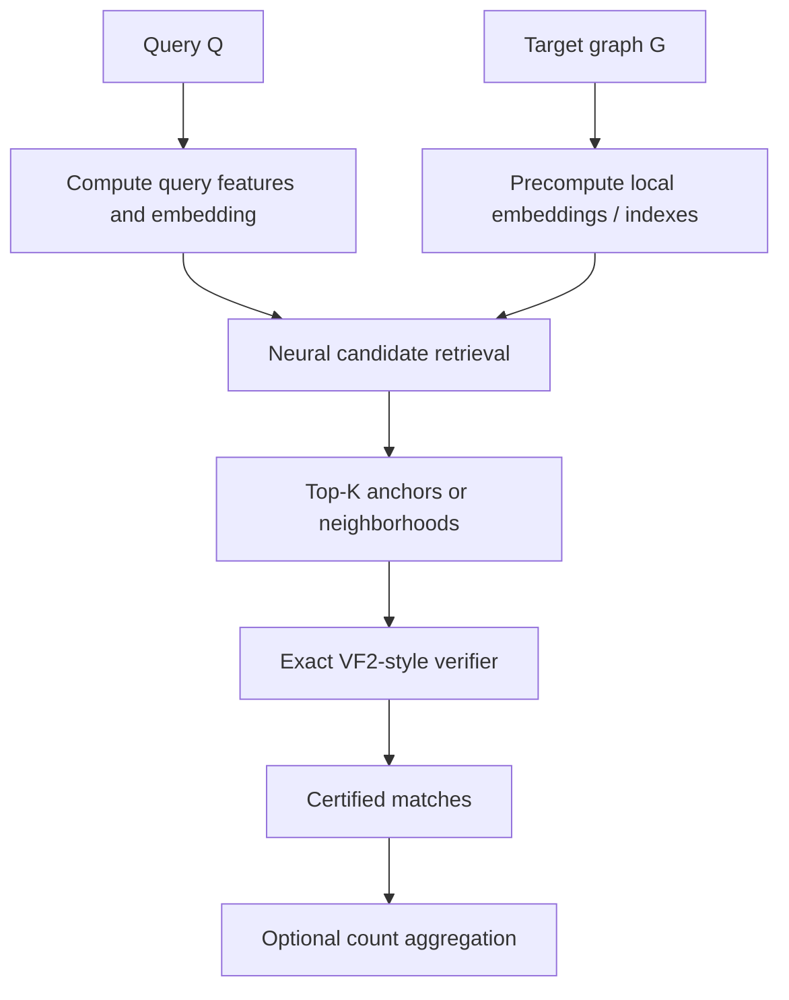

# **Fast Neural Subgraph Matching and Counting**

Subgraph matching asks whether a small query graph occurs inside a larger target graph, and if so, where. Subgraph counting asks how many occurrences there are. These problems sit at the boundary between graph algorithms and graph representation learning: exact algorithms provide guarantees but can be exponential, while neural methods trade exactness for fast candidate generation, learned pruning, or approximate counts.

This chapter focuses on the mechanics behind neural subgraph matching and counting. The important distinction is:

- **Exact subgraph matching** returns only valid matches, usually with backtracking and constraint propagation.
- **Neural subgraph matching** learns embeddings or scores that predict whether a query is contained in a target neighborhood, usually as an approximate retrieval or pruning layer.
- **Neural subgraph counting** predicts the number of embeddings of a query pattern in a target graph, usually by learning query-conditioned graph representations.

Neural methods are most useful when exact search over every candidate is too expensive and the application can tolerate approximation, or when a neural stage is used to produce a small candidate set that an exact verifier checks afterward.



---

## **1. Problem Setup**

Let

$$
Q=(V_Q,E_Q,X_Q)
$$

be a small query graph with $k=|V_Q|$ nodes, and let

$$
G=(V_G,E_G,X_G)
$$

be a target graph with $n=|V_G|$ nodes. Node features are optional; if no features exist, structural features such as degree, labels, or positional encodings are often used.

A graph $Q$ is a **non-induced subgraph** of $G$ if there exists an injective map

$$
\phi:V_Q\to V_G
$$

such that every query edge is preserved:

$$
(u,v)\in E_Q
\implies
(\phi(u),\phi(v))\in E_G.
$$

For **induced subgraph matching**, both edges and non-edges among the mapped query vertices must be preserved:

$$
(u,v)\in E_Q
\iff
(\phi(u),\phi(v))\in E_G,
\qquad u\neq v.
$$

Most graph mining systems distinguish these two cases. Non-induced matching allows extra target edges between matched vertices; induced matching does not.

For labeled graphs with node labels $\ell_V$ and edge labels $\ell_E$, a valid match must additionally satisfy

$$
\ell_V(u)=\ell_V(\phi(u))
$$

and

$$
\ell_E(u,v)=\ell_E(\phi(u),\phi(v)).
$$

Subgraph matching asks for the set

$$
\mathcal{M}(Q,G)
=
\left\{
\phi:V_Q\to V_G:
\phi \text{ is injective and edge-preserving}
\right\}.
$$

Subgraph counting asks for

$$
C(Q,G)=|\mathcal{M}(Q,G)|.
$$

Depending on convention, the count may be divided by the number of automorphisms of $Q$:

$$
C_{\text{unlabeled}}(Q,G)
=
\frac{|\mathcal{M}(Q,G)|}{|\operatorname{Aut}(Q)|}.
$$

This matters. A triangle in an undirected graph has $|\operatorname{Aut}(K_3)|=6$, so counting injective node maps gives six maps per triangle, while counting unlabeled occurrences gives one.

---

## **2. Subgraph Matching as an Optimization Problem**

For simple unweighted graphs, let

$$
A_Q\in\{0,1\}^{k\times k},
\qquad
A_G\in\{0,1\}^{n\times n}
$$

be adjacency matrices. An injective mapping $\phi$ can be represented by an assignment matrix

$$
P\in\{0,1\}^{k\times n},
$$

where

$$
P_{ia}=1
\iff
\phi(i)=a.
$$

Injectivity means each query node maps to exactly one target node and each target node is used at most once:

$$
P\mathbf{1}_n=\mathbf{1}_k,
\qquad
P^\top\mathbf{1}_k\leq \mathbf{1}_n.
$$

The adjacency matrix induced on the mapped target nodes is

$$
P A_G P^\top\in\{0,1\}^{k\times k}.
$$

For non-induced subgraph matching, all query edges must be present:

$$
A_Q \leq P A_G P^\top
$$

elementwise. Thus exact matching can be written as the feasibility problem

$$
\text{find } P
\quad \text{such that}\quad
P\mathbf{1}_n=\mathbf{1}_k,\quad
P^\top\mathbf{1}_k\leq \mathbf{1}_n,\quad
A_Q\leq P A_G P^\top.
$$

For induced matching, the edge constraint becomes

$$
A_Q=P A_G P^\top.
$$

This formulation makes the computational hardness visible: even before checking edge constraints, there are

$$
n(n-1)\cdots(n-k+1)
=
\frac{n!}{(n-k)!}
$$

injective assignments. For $n=10^6$ and $k=5$, the raw number of ordered candidates is approximately

$$
10^6\cdot(10^6-1)\cdot(10^6-2)\cdot(10^6-3)\cdot(10^6-4)
\approx 10^{30}.
$$

Exact algorithms survive by pruning, not by enumerating this space blindly.

---

## **3. Classical Matching Algorithms**

Classical algorithms such as Ullmann, VF2, TurboISO, GraphQL, and related database-style methods follow the same high-level structure:

1. Order the query vertices.
2. Generate candidate target vertices for each query vertex.
3. Extend a partial injective mapping one query vertex at a time.
4. Check local feasibility constraints after every extension.
5. Backtrack when constraints are violated.



For a partial mapping

$$
\phi_t:\{u_1,\dots,u_t\}\to V_G,
$$

adding a pair $(u,v)$ is feasible for non-induced matching if:

1. $v$ has not already been used:

$$
v\notin \operatorname{image}(\phi_t).
$$

2. Labels match:

$$
\ell_V(u)=\ell_V(v).
$$

3. Every already mapped query neighbor has a corresponding target edge:

$$
\forall w\in\{u_1,\dots,u_t\},
\quad
(u,w)\in E_Q
\implies
(v,\phi_t(w))\in E_G.
$$

For induced matching, non-edges must also be checked:

$$
(u,w)\notin E_Q
\implies
(v,\phi_t(w))\notin E_G.
$$

The worst-case time is exponential in $k$, but on many real graphs, degree filters, labels, ordering heuristics, and neighborhood constraints reduce the search dramatically.

---

## **4. Worked Example: Exact Matching**

Consider the query path

$$
Q:\quad 0-1-2
$$

and the target graph

$$
G:\quad A-B-C,\qquad B-D.
$$

The target edges are

$$
E_G=\{(A,B),(B,C),(B,D)\}.
$$

The query has three nodes. Suppose the search order is $1,0,2$, meaning we map the center of the path first.

The degree of query node $1$ is $2$, so it can only map to target nodes with degree at least $2$. In $G$,

$$
\deg(A)=1,\quad \deg(B)=3,\quad \deg(C)=1,\quad \deg(D)=1.
$$

Thus

$$
C(1)=\{B\}.
$$

Set

$$
\phi(1)=B.
$$

Query node $0$ must map to a neighbor of $B$, so

$$
C(0\mid \phi(1)=B)=\{A,C,D\}.
$$

If $\phi(0)=A$, then query node $2$ must map to an unused neighbor of $B$:

$$
C(2\mid \phi(1)=B,\phi(0)=A)=\{C,D\}.
$$

This yields two injective maps:

$$
\phi_1=(0\mapsto A,1\mapsto B,2\mapsto C),
$$

and

$$
\phi_2=(0\mapsto A,1\mapsto B,2\mapsto D).
$$

Repeating for $\phi(0)=C$ and $\phi(0)=D$ gives $6$ injective maps. However, the unlabeled path occurrence count is $3$, corresponding to the three length-2 paths centered at $B$:

$$
A-B-C,\qquad A-B-D,\qquad C-B-D.
$$

The factor of $2$ comes from the automorphism of a 3-node path that swaps its two endpoints.

---

## **5. Neural Subgraph Matching**

The neural approach replaces some part of exact search with learned representations. The most common design is:

1. Decompose the target graph into local neighborhoods or candidate subgraphs.
2. Encode the query and each target neighborhood with a GNN.
3. Score whether the query is contained in the target neighborhood.
4. Return top-ranked candidates, or pass them to an exact verifier.

The central challenge is that subgraph containment is not symmetric. If $Q$ is contained in $G$, then $Q$ is smaller or less constrained than $G$. A plain cosine similarity objective does not naturally encode this partial-order relation.

### **5.1 Order-Embedding View**

NeuroMatch-style models use an embedding space where containment is represented by coordinatewise order. Let

$$
z_Q=f_\theta(Q)\in\mathbb{R}_{\geq 0}^d
$$

and

$$
z_T=f_\theta(T)\in\mathbb{R}_{\geq 0}^d
$$

be embeddings of the query graph and a target neighborhood. A common convention is:

$$
Q\subseteq T
\quad\Longrightarrow\quad
z_Q\preceq z_T,
$$

where

$$
z_Q\preceq z_T
\iff
(z_Q)_j\leq (z_T)_j
\quad \forall j\in\{1,\dots,d\}.
$$

An order-violation energy is

$$
E(Q,T)
=
\left\|
\max(0,z_Q-z_T)
\right\|_2^2.
$$

The max is elementwise. If every coordinate of $z_Q$ is less than or equal to the corresponding coordinate of $z_T$, then

$$
E(Q,T)=0.
$$

If some query coordinate exceeds the target coordinate, the positive excess contributes to the energy.

For a positive pair $(Q,T^+)$ and negative pair $(Q,T^-)$, a margin ranking loss is

$$
\mathcal{L}
=
\max
\left(
0,\,
\gamma+E(Q,T^+)-E(Q,T^-)
\right),
$$

where $\gamma>0$ is a margin. Minimizing this loss pushes positive pairs toward zero order violation and negative pairs above the margin.



### **5.2 Why Coordinatewise Order Makes Sense**

Think of each coordinate as measuring the presence or intensity of a latent structural requirement. If a query has a triangle-like requirement, a target neighborhood that contains that query should have at least as much capacity in the corresponding coordinate. The order embedding turns containment into a geometric dominance test.

This is not a proof of isomorphism. It is a learned relaxation:

- If $E(Q,T)$ is small, the model believes $Q$ may be contained in $T$.
- If $E(Q,T)$ is large, at least one learned structural requirement of $Q$ appears unsupported by $T$.
- A verifier is required if false positives are unacceptable.

### **5.3 Node-Anchored Matching**

For large graphs, scoring the whole target graph against every query is too coarse. A common strategy is node-anchored matching. The query has an anchor node $a_Q$, and the target candidate has an anchor node $a_G$. The task is to predict whether there exists a match

$$
\phi:V_Q\to V_G
$$

such that

$$
\phi(a_Q)=a_G.
$$

The target input is usually a local ego network around $a_G$:

$$
G_r(a_G)
=
G\left[
\{v\in V_G:\operatorname{dist}_G(v,a_G)\leq r\}
\right].
$$

The radius $r$ must be at least the eccentricity of the query anchor:

$$
r\geq \max_{u\in V_Q}\operatorname{dist}_Q(a_Q,u).
$$

The model then scores

$$
s_\theta(Q,a_Q,G_r(a_G),a_G)
=
-E(Q,G_r(a_G)).
$$

Top-scoring anchors become candidate locations.

---

## **6. GNN Encoder Mechanics**

A standard message-passing encoder updates node states as

$$
h_v^{(0)}=x_v,
$$

and

$$
h_v^{(\ell+1)}
=
\sigma
\left(
W_{\text{self}}^{(\ell)}h_v^{(\ell)}
+
W_{\text{nbr}}^{(\ell)}
\operatorname{AGG}
\left(
\{h_u^{(\ell)}:u\in\mathcal{N}(v)\}
\right)
+b^{(\ell)}
\right).
$$

For mean aggregation,

$$
\operatorname{AGG}
\left(
\{h_u^{(\ell)}:u\in\mathcal{N}(v)\}
\right)
=
\frac{1}{|\mathcal{N}(v)|}
\sum_{u\in\mathcal{N}(v)}h_u^{(\ell)}.
$$

For GIN-style sum aggregation,

$$
h_v^{(\ell+1)}
=
\operatorname{MLP}^{(\ell)}
\left(
(1+\epsilon^{(\ell)})h_v^{(\ell)}
+
\sum_{u\in\mathcal{N}(v)}h_u^{(\ell)}
\right).
$$

After $L$ layers, a graph embedding is obtained with a permutation-invariant readout:

$$
z_G
=
\rho
\left(
\{h_v^{(L)}:v\in V\}
\right),
$$

where $\rho$ can be sum, mean, attention pooling, or a combination:

$$
z_G
=
\sum_{v\in V}\alpha_v W_p h_v^{(L)},
$$

with

$$
\alpha_v
=
\frac{\exp(a^\top \tanh(W_a h_v^{(L)}))}
{\sum_{u\in V}\exp(a^\top \tanh(W_a h_u^{(L)}))}.
$$

For order embeddings, the final representation is often constrained to be nonnegative:

$$
z_G=\operatorname{softplus}(r_G)
=
\log(1+\exp(r_G)).
$$

Softplus avoids hard clipping and has stable gradients:

$$
\frac{d}{dx}\operatorname{softplus}(x)
=
\frac{1}{1+\exp(-x)}.
$$

---

## **7. Step-by-Step Neural Matching Execution**

Assume we have a query $Q$, a large graph $G$, and candidate anchors $a_G\in V_G$.

1. **Preprocess the query.**

   Choose an anchor $a_Q$, compute structural features, and determine the required target radius:

$$
r_Q=\max_{u\in V_Q}\operatorname{dist}_Q(a_Q,u).
$$

2. **Generate target neighborhoods.**

   For each candidate anchor $a_G$, extract

$$
T(a_G)=G_{r_Q}(a_G).
$$

3. **Encode query and target neighborhoods.**

$$
z_Q=f_\theta(Q,a_Q),
\qquad
z_{a_G}=f_\theta(T(a_G),a_G).
$$

4. **Compute order violation.**

$$
E(a_G)
=
\left\|
\max(0,z_Q-z_{a_G})
\right\|_2^2.
$$

5. **Rank anchors.**

$$
\operatorname{score}(a_G)=-E(a_G).
$$

6. **Optionally verify.**

   Run exact subgraph matching only inside the top-ranked neighborhoods.

The speed gain comes from replacing a global combinatorial search with many bounded-radius GNN computations plus vector comparisons. The cost is that the neural score may produce false positives or false negatives unless paired with an exact verifier and a no-false-dismissal guarantee.

---

## **8. Worked Example: Order-Violation Score**

Suppose the learned query embedding is

$$
z_Q=
\begin{bmatrix}
1.2\\
0.5\\
2.0
\end{bmatrix},
$$

and two target-neighborhood embeddings are

$$
z_{T_1}=
\begin{bmatrix}
1.5\\
0.7\\
2.2
\end{bmatrix},
\qquad
z_{T_2}=
\begin{bmatrix}
1.1\\
0.9\\
1.4
\end{bmatrix}.
$$

For $T_1$,

$$
z_Q-z_{T_1}
=
\begin{bmatrix}
-0.3\\
-0.2\\
-0.2
\end{bmatrix},
$$

so

$$
\max(0,z_Q-z_{T_1})
=
\begin{bmatrix}
0\\
0\\
0
\end{bmatrix},
$$

and

$$
E(Q,T_1)=0.
$$

For $T_2$,

$$
z_Q-z_{T_2}
=
\begin{bmatrix}
0.1\\
-0.4\\
0.6
\end{bmatrix},
$$

so

$$
\max(0,z_Q-z_{T_2})
=
\begin{bmatrix}
0.1\\
0\\
0.6
\end{bmatrix}.
$$

Thus

$$
E(Q,T_2)
=
0.1^2+0^2+0.6^2
=
0.37.
$$

If lower energy means stronger containment evidence, $T_1$ ranks above $T_2$.

For margin $\gamma=0.5$, the pairwise loss is

$$
\mathcal{L}
=
\max(0,0.5+0-0.37)
=
0.13.
$$

The model has not separated the positive and negative pair by the required margin.

---

## **9. Subgraph Counting**

Counting can refer to several related quantities.

### **9.1 Homomorphism Count**

A graph homomorphism is a map

$$
\psi:V_Q\to V_G
$$

that preserves edges but is not required to be injective:

$$
(u,v)\in E_Q
\implies
(\psi(u),\psi(v))\in E_G.
$$

The homomorphism count is

$$
\operatorname{hom}(Q,G)
=
\sum_{\psi:V_Q\to V_G}
\prod_{(u,v)\in E_Q}A_G[\psi(u),\psi(v)].
$$

Homomorphism counts are easier to express algebraically but can overcount collapsed mappings.

### **9.2 Injective Subgraph Isomorphism Count**

The injective count is

$$
\operatorname{inj}(Q,G)
=
\sum_{\phi:V_Q\hookrightarrow V_G}
\prod_{(u,v)\in E_Q}A_G[\phi(u),\phi(v)],
$$

where $\hookrightarrow$ means injective.

For induced matching, include non-edge constraints:

$$
\operatorname{ind}(Q,G)
=
\sum_{\phi:V_Q\hookrightarrow V_G}
\left[
\prod_{(u,v)\in E_Q}A_G[\phi(u),\phi(v)]
\right]
\left[
\prod_{\substack{u<v\\(u,v)\notin E_Q}}
(1-A_G[\phi(u),\phi(v)])
\right].
$$

The unlabeled induced count is

$$
\operatorname{ind}_{\text{unlabeled}}(Q,G)
=
\frac{\operatorname{ind}(Q,G)}
{|\operatorname{Aut}(Q)|}.
$$

### **9.3 Triangle Count from First Principles**

Let $G$ be an undirected simple graph with adjacency matrix $A$. The number of closed walks of length $3$ is

$$
\operatorname{tr}(A^3).
$$

Why? The $(i,i)$ entry of $A^3$ is

$$
(A^3)_{ii}
=
\sum_{j=1}^n\sum_{k=1}^n A_{ij}A_{jk}A_{ki}.
$$

Each term equals $1$ exactly when

$$
i-j-k-i
$$

is a length-3 closed walk. A triangle with vertices $(a,b,c)$ contributes six such walks:

$$
a\to b\to c\to a,
\quad
a\to c\to b\to a,
$$

and the same two directions starting from $b$ and $c$. Therefore,

$$
\#K_3(G)
=
\frac{\operatorname{tr}(A^3)}{6}.
$$

### **9.4 Worked Triangle Example**

Consider

$$
E_G=\{(0,1),(1,2),(2,0),(2,3)\}.
$$

The adjacency matrix is

$$
A=
\begin{bmatrix}
0&1&1&0\\
1&0&1&0\\
1&1&0&1\\
0&0&1&0
\end{bmatrix}.
$$

Compute

$$
A^2=
\begin{bmatrix}
2&1&1&1\\
1&2&1&1\\
1&1&3&0\\
1&1&0&1
\end{bmatrix}.
$$

Then

$$
A^3=A^2A.
$$

The diagonal entries are

$$
(A^3)_{00}=2,\quad
(A^3)_{11}=2,\quad
(A^3)_{22}=2,\quad
(A^3)_{33}=0.
$$

Thus

$$
\operatorname{tr}(A^3)=6,
$$

and

$$
\#K_3(G)=\frac{6}{6}=1.
$$

---

## **10. Neural Subgraph Counting**

Neural counting models learn a function

$$
f_\theta(Q,G)\approx C(Q,G).
$$

Unlike graph classification, this is a query-conditioned global inference task. The model must reason about how a pattern $Q$ can align with many regions of $G$.

A generic architecture has three components:

1. **Query encoder** for $Q$.
2. **Target encoder** for $G$.
3. **Interaction module** that conditions target messages on the query.



### **10.1 Direct Regression Objective**

Let the training set be

$$
\mathcal{D}
=
\{(Q_i,G_i,c_i)\}_{i=1}^N,
$$

where

$$
c_i=C(Q_i,G_i).
$$

Counts are often heavy-tailed, so the model predicts a transformed target:

$$
y_i=\log(1+c_i).
$$

With prediction

$$
\hat{y}_i=f_\theta(Q_i,G_i),
$$

the mean squared error loss is

$$
\mathcal{L}_{\text{MSE}}
=
\frac{1}{N}
\sum_{i=1}^N
(\hat{y}_i-y_i)^2.
$$

The count estimate is recovered as

$$
\hat{c}_i=\exp(\hat{y}_i)-1.
$$

The log transform reduces the dominance of large-count examples. Without it, examples with large counts can control the gradient:

$$
\frac{\partial}{\partial \hat{c}}
(\hat{c}-c)^2
=
2(\hat{c}-c).
$$

If $c=10^6$, a moderate relative error produces a very large absolute gradient.

### **10.2 Poisson Likelihood**

If the count is modeled as

$$
c_i\sim\operatorname{Poisson}(\lambda_i),
$$

with

$$
\lambda_i=\operatorname{softplus}(g_\theta(Q_i,G_i)),
$$

the negative log-likelihood is

$$
\mathcal{L}_{\text{Poisson}}
=
\frac{1}{N}\sum_{i=1}^N
\left(
\lambda_i-c_i\log\lambda_i+\log(c_i!)
\right).
$$

The last term does not depend on $\theta$, so it is often omitted during optimization:

$$
\tilde{\mathcal{L}}_{\text{Poisson}}
=
\frac{1}{N}\sum_{i=1}^N
\left(
\lambda_i-c_i\log\lambda_i
\right).
$$

Poisson regression assumes

$$
\operatorname{Var}(c_i)=\mathbb{E}[c_i]=\lambda_i,
$$

which is often too restrictive for graph counts. Real subgraph counts are frequently overdispersed because dense graph regions create many correlated occurrences.

### **10.3 Query-Conditioned Message Passing**

A simple query-conditioned target update is

$$
h_v^{(\ell+1)}
=
\sigma
\left(
W_1h_v^{(\ell)}
+
W_2
\sum_{u\in\mathcal{N}(v)}h_u^{(\ell)}
+
W_3 q^{(\ell)}
\right),
$$

where

$$
q^{(\ell)}
=
\operatorname{READOUT}
\left(
\{g_a^{(\ell)}:a\in V_Q\}
\right)
$$

is the current query representation. This broadcasts query information to every target node.

A more expressive interaction uses cross-attention between target nodes and query nodes:

$$
\alpha_{va}
=
\frac{
\exp\left((W_T h_v)^\top(W_Q g_a)/\sqrt{d}\right)
}{
\sum_{b\in V_Q}
\exp\left((W_T h_v)^\top(W_Q g_b)/\sqrt{d}\right)
},
$$

and

$$
r_v
=
\sum_{a\in V_Q}\alpha_{va}W_V g_a.
$$

Then

$$
h_v^{(\ell+1)}
=
\operatorname{MPNN}
\left(
h_v^{(\ell)},\{h_u^{(\ell)}:u\in\mathcal{N}(v)\},r_v
\right).
$$

Intuitively, each target node asks: "Which query roles might I correspond to?" The count head aggregates these local role-compatibility signals into a global count.

### **10.4 Edge-Centric View**

Many motifs are determined by how edges interact. Edge-centric message passing maintains edge states

$$
e_{uv}^{(\ell)}
$$

for $(u,v)\in E_G$. A generic update is

$$
e_{uv}^{(\ell+1)}
=
\sigma
\left(
W_e e_{uv}^{(\ell)}
+
W_s h_u^{(\ell)}
+
W_t h_v^{(\ell)}
+
W_q q
+
\sum_{w\in\mathcal{N}(u)\setminus\{v\}}
W_{\triangleleft} e_{wu}^{(\ell)}
+
\sum_{w\in\mathcal{N}(v)\setminus\{u\}}
W_{\triangleright} e_{vw}^{(\ell)}
\right).
$$

This lets the model reason over adjacent edges, which is useful for paths, cycles, and graphlets. Count-GNN-style models use this idea to improve structure matching between query and target graphs.

---

## **11. Scratch Implementation: Exact Subgraph Matching**

The following implementation is intentionally small. It supports undirected simple graphs, optional node labels, and non-induced matching.

```python
from collections import defaultdict


def build_adj(edges):
    """Build an undirected adjacency dictionary from an edge list."""
    adj = defaultdict(set)
    for u, v in edges:
        adj[u].add(v)
        adj[v].add(u)
    return {u: set(nbrs) for u, nbrs in adj.items()}


def exact_subgraph_matches(query_edges, target_edges, query_labels=None, target_labels=None):
    """
    Enumerate injective non-induced subgraph matches Q -> G.

    Returns:
        A list of dictionaries mapping query nodes to target nodes.
    """
    Q = build_adj(query_edges)
    G = build_adj(target_edges)

    # Include isolated labeled nodes if labels mention them.
    if query_labels:
        for u in query_labels:
            Q.setdefault(u, set())
    if target_labels:
        for v in target_labels:
            G.setdefault(v, set())

    query_labels = query_labels or {}
    target_labels = target_labels or {}

    q_nodes = list(Q)
    g_nodes = list(G)

    # Query ordering: high-degree vertices first tends to prune earlier.
    q_order = sorted(q_nodes, key=lambda u: (-len(Q[u]), str(u)))

    candidates = {}
    for u in q_nodes:
        cand = []
        for v in g_nodes:
            if len(G[v]) < len(Q[u]):
                continue
            if u in query_labels and v in target_labels:
                if query_labels[u] != target_labels[v]:
                    continue
            elif u in query_labels or v in target_labels:
                continue
            cand.append(v)
        candidates[u] = cand

    matches = []
    mapping = {}
    used_targets = set()

    def feasible(u, v):
        if v in used_targets:
            return False

        # Every already mapped query neighbor must map to a target neighbor.
        for u_prev, v_prev in mapping.items():
            if u_prev in Q[u] and v_prev not in G[v]:
                return False
        return True

    def backtrack(depth):
        if depth == len(q_order):
            matches.append(dict(mapping))
            return

        u = q_order[depth]
        for v in candidates[u]:
            if not feasible(u, v):
                continue
            mapping[u] = v
            used_targets.add(v)
            backtrack(depth + 1)
            used_targets.remove(v)
            del mapping[u]

    backtrack(0)
    return matches


query_edges = [(0, 1), (1, 2)]
target_edges = [("A", "B"), ("B", "C"), ("B", "D")]

matches = exact_subgraph_matches(query_edges, target_edges)
print(len(matches))
for m in matches:
    print(m)
```

Expected count:

```text
6
```

This counts injective mappings, so each undirected path occurrence appears twice because the two query endpoints can be swapped.

### **Implementation Notes**

The key pruning step is the feasibility check:

```python
if u_prev in Q[u] and v_prev not in G[v]:
    return False
```

This implements the edge-preservation condition

$$
(u,u_{\text{prev}})\in E_Q
\implies
(v,\phi(u_{\text{prev}}))\in E_G.
$$

The initial degree filter

$$
\deg_G(v)\geq \deg_Q(u)
$$

is necessary for non-induced matching in simple graphs, but not sufficient. A target node can have enough degree but the wrong neighborhood structure.

---

## **12. Scratch Implementation: Triangle Counting**

A direct but efficient undirected triangle counter orients edges by node order and intersects forward neighborhoods.

```python
def count_triangles(edges):
    """Count undirected triangles in a simple graph."""
    adj = build_adj(edges)

    # Forward neighbors avoid counting each triangle more than once.
    forward = {}
    for u in adj:
        forward[u] = {v for v in adj[u] if str(u) < str(v)}

    count = 0
    for u in forward:
        for v in forward[u]:
            count += len(forward[u].intersection(forward.get(v, set())))
    return count


edges = [(0, 1), (1, 2), (2, 0), (2, 3)]
print(count_triangles(edges))  # 1
```

For each ordered wedge

$$
u<v<w,
$$

the algorithm checks whether

$$
(u,v),(u,w),(v,w)\in E.
$$

Each triangle has exactly one increasing ordering, so it is counted once.

---

## **13. Scratch Implementation: Neural Order Embedding Model**

The following PyTorch code implements the core order-embedding score. It uses a simple dense GCN encoder for clarity. Production graph code should use sparse operations or a graph library.

```python
import torch
import torch.nn as nn
import torch.nn.functional as F


def normalize_adjacency(A):
    """
    Symmetric GCN normalization:
        A_hat = D^{-1/2} (A + I) D^{-1/2}
    """
    n = A.shape[0]
    I = torch.eye(n, device=A.device, dtype=A.dtype)
    A_tilde = A + I
    deg = A_tilde.sum(dim=1)
    deg_inv_sqrt = deg.clamp(min=1.0).pow(-0.5)
    return deg_inv_sqrt[:, None] * A_tilde * deg_inv_sqrt[None, :]


class DenseGCNLayer(nn.Module):
    def __init__(self, in_dim, out_dim):
        super().__init__()
        self.linear = nn.Linear(in_dim, out_dim)

    def forward(self, A_norm, X):
        return F.relu(self.linear(A_norm @ X))


class GraphOrderEncoder(nn.Module):
    def __init__(self, in_dim, hidden_dim, out_dim, num_layers=3):
        super().__init__()
        dims = [in_dim] + [hidden_dim] * (num_layers - 1)
        self.layers = nn.ModuleList(
            DenseGCNLayer(dims[i], dims[i + 1]) for i in range(len(dims) - 1)
        )
        self.proj = nn.Linear(hidden_dim, out_dim)

    def forward(self, A, X):
        A_norm = normalize_adjacency(A)
        H = X
        for layer in self.layers:
            H = layer(A_norm, H)

        # Sum pooling preserves size information better than mean pooling.
        pooled = H.sum(dim=0)

        # Nonnegative embedding for coordinatewise order.
        return F.softplus(self.proj(pooled))


def order_energy(z_query, z_target):
    violation = F.relu(z_query - z_target)
    return (violation * violation).sum(dim=-1)


def margin_order_loss(z_q, z_pos, z_neg, margin=1.0):
    e_pos = order_energy(z_q, z_pos)
    e_neg = order_energy(z_q, z_neg)
    return F.relu(margin + e_pos - e_neg).mean()


# Example tensors.
A_q = torch.tensor(
    [[0., 1., 0.],
     [1., 0., 1.],
     [0., 1., 0.]]
)
X_q = torch.ones(3, 4)

A_pos = torch.tensor(
    [[0., 1., 0., 0.],
     [1., 0., 1., 1.],
     [0., 1., 0., 0.],
     [0., 1., 0., 0.]]
)
X_pos = torch.ones(4, 4)

A_neg = torch.tensor(
    [[0., 1., 0.],
     [1., 0., 0.],
     [0., 0., 0.]]
)
X_neg = torch.ones(3, 4)

encoder = GraphOrderEncoder(in_dim=4, hidden_dim=16, out_dim=8)
z_q = encoder(A_q, X_q)
z_pos = encoder(A_pos, X_pos)
z_neg = encoder(A_neg, X_neg)
loss = margin_order_loss(z_q, z_pos, z_neg, margin=0.5)
loss.backward()
```

### **What Backpropagation Does Here**

The order energy is

$$
E(z_q,z_t)
=
\sum_{j=1}^d
\max(0,z_{qj}-z_{tj})^2.
$$

For a coordinate with violation

$$
z_{qj}>z_{tj},
$$

the derivatives are

$$
\frac{\partial E}{\partial z_{qj}}
=
2(z_{qj}-z_{tj}),
$$

and

$$
\frac{\partial E}{\partial z_{tj}}
=
-2(z_{qj}-z_{tj}).
$$

For a coordinate with no violation,

$$
z_{qj}\leq z_{tj},
$$

both derivatives are zero. Thus positive pairs only update coordinates that violate the desired order. Negative pairs update through the margin loss only when they are too close:

$$
\gamma+E^+-E^->0.
$$

---

## **14. Scratch Implementation: Neural Count Regressor**

This example predicts log-counts from query and target graph embeddings. It is deliberately minimal; the important mechanism is the interaction between query and target representations.

```python
class NeuralCountRegressor(nn.Module):
    def __init__(self, in_dim, hidden_dim, emb_dim):
        super().__init__()
        self.query_encoder = GraphOrderEncoder(in_dim, hidden_dim, emb_dim)
        self.target_encoder = GraphOrderEncoder(in_dim, hidden_dim, emb_dim)
        self.head = nn.Sequential(
            nn.Linear(4 * emb_dim, hidden_dim),
            nn.ReLU(),
            nn.Linear(hidden_dim, 1),
        )

    def forward(self, A_q, X_q, A_g, X_g):
        z_q = self.query_encoder(A_q, X_q)
        z_g = self.target_encoder(A_g, X_g)

        features = torch.cat(
            [
                z_q,
                z_g,
                torch.abs(z_q - z_g),
                z_q * z_g,
            ],
            dim=-1,
        )
        log_count = self.head(features).squeeze(-1)
        return log_count


def log_count_loss(pred_log_count, true_count):
    target = torch.log1p(true_count.float())
    return F.mse_loss(pred_log_count, target)


model = NeuralCountRegressor(in_dim=4, hidden_dim=32, emb_dim=16)
true_count = torch.tensor(1.0)
pred_log_count = model(A_q, X_q, A_pos, X_pos)
loss = log_count_loss(pred_log_count, true_count)
loss.backward()
```

This architecture is weaker than query-conditioned message passing because the query and target interact only after separate pooling. It can work for simple distributions but struggles when the same target graph must be evaluated against many structurally diverse queries.

---

## **15. Library Implementations**

### **15.1 NetworkX Exact Matching**

NetworkX provides VF2-style exact graph matching through `GraphMatcher`.

```python
import networkx as nx
from networkx.algorithms import isomorphism as iso


Q = nx.Graph()
Q.add_edges_from([(0, 1), (1, 2)])

G = nx.Graph()
G.add_edges_from([("A", "B"), ("B", "C"), ("B", "D")])

matcher = iso.GraphMatcher(G, Q)

# Each dictionary maps target nodes to query nodes.
matches = list(matcher.subgraph_isomorphisms_iter())
print(len(matches))  # 6
print(matches[:2])
```

Internally, VF2 maintains a partial mapping and frontier sets of nodes adjacent to the mapped region. At each step it checks syntactic feasibility, such as degree and adjacency constraints, and semantic feasibility, such as labels or attributes. This is the same recursive pruning principle as the scratch implementation, but with stronger state management and candidate ordering.

For labeled graphs:

```python
Q.nodes[0]["label"] = "C"
Q.nodes[1]["label"] = "O"
Q.nodes[2]["label"] = "C"

G.nodes["A"]["label"] = "C"
G.nodes["B"]["label"] = "O"
G.nodes["C"]["label"] = "C"
G.nodes["D"]["label"] = "N"

node_match = iso.categorical_node_match("label", None)
matcher = iso.GraphMatcher(G, Q, node_match=node_match)
matches = list(matcher.subgraph_isomorphisms_iter())
```

`categorical_node_match` creates a predicate that checks whether the specified node attribute has equal values in the two graphs.

### **15.2 NetworkX Triangle Counting**

```python
G = nx.Graph()
G.add_edges_from([(0, 1), (1, 2), (2, 0), (2, 3)])

triangles_per_node = nx.triangles(G)
total_triangles = sum(triangles_per_node.values()) // 3

print(triangles_per_node)  # {0: 1, 1: 1, 2: 1, 3: 0}
print(total_triangles)     # 1
```

`nx.triangles` counts triangles incident to each node. Summing over nodes counts each triangle three times, once at each vertex.

### **15.3 PyTorch Geometric Encoder**

PyTorch Geometric implements sparse message passing. A comparable order-embedding encoder can be written as:

```python
import torch
import torch.nn as nn
import torch.nn.functional as F
from torch_geometric.nn import GCNConv, global_add_pool


class PyGOrderEncoder(nn.Module):
    def __init__(self, in_dim, hidden_dim, out_dim):
        super().__init__()
        self.conv1 = GCNConv(in_dim, hidden_dim)
        self.conv2 = GCNConv(hidden_dim, hidden_dim)
        self.proj = nn.Linear(hidden_dim, out_dim)

    def forward(self, x, edge_index, batch):
        h = F.relu(self.conv1(x, edge_index))
        h = F.relu(self.conv2(h, edge_index))
        pooled = global_add_pool(h, batch)
        return F.softplus(self.proj(pooled))
```

`GCNConv` computes the normalized update

$$
H^{(\ell+1)}
=
\sigma
\left(
\hat{D}^{-1/2}\hat{A}\hat{D}^{-1/2}
H^{(\ell)}
W^{(\ell)}
\right),
$$

where

$$
\hat{A}=A+I.
$$

The `edge_index` tensor stores the sparse adjacency as two rows:

$$
\texttt{edge\_index}
\in \mathbb{N}^{2\times 2m}
$$

for an undirected graph represented with both edge directions. `global_add_pool` sums node embeddings per graph according to the `batch` vector, which identifies the graph membership of each node in a mini-batch.

---

## **16. Complexity**

Let $k=|V_Q|$, $n=|V_G|$, $m=|E_G|$, hidden dimension $d$, and GNN depth $L$.

| Method | Time | Space | Notes |
|---|---:|---:|---|
| Naive injective enumeration | $O(n^k k^2)$ | $O(k)$ | Checks every ordered assignment |
| Backtracking/VF2 | Exponential worst case | $O(k+n)$ | Often much faster with pruning |
| Triangle count by adjacency matrix | $O(n^\omega)$ or $O(n^3)$ | $O(n^2)$ | Dense matrix method |
| Triangle count by intersections | $\sum_{(u,v)\in E}\min(d_u,d_v)$ | $O(n+m)$ | Efficient for sparse graphs |
| One full-graph GNN pass | $O(Lmd)$ | $O(nd)$ | Sparse message passing |
| Ego-network neural retrieval | $O(R\cdot Lm_r d)$ | $O(n_rd)$ per batch | $R$ candidates, local edges $m_r$ |
| Dense cross-attention query-target | $O(nkd)$ | $O(nk)$ | Expensive if both graphs are large |

The neural pipeline is not automatically faster. It becomes useful when:

- the query is reused many times and target embeddings can be cached,
- candidate neighborhoods are small,
- approximate retrieval is acceptable,
- or neural scores eliminate most exact-search calls.

---

## **17. Numerical Stability and Training Details**

### **17.1 Nonnegative Embeddings**

Hard clipping

$$
z=\max(0,r)
$$

can create dead coordinates when $r<0$ and the gradient is zero. Softplus is smoother:

$$
z=\log(1+\exp(r)).
$$

For stable implementation, use the framework's built-in `softplus`, which avoids overflow for large positive $r$.

### **17.2 Energy Scale**

The order energy grows with dimension:

$$
E=\sum_{j=1}^d e_j^2.
$$

If $d$ is large, raw energies can become large even when per-coordinate violations are moderate. Common remedies:

- normalize by dimension,

$$
E_{\text{mean}}=\frac{1}{d}\sum_{j=1}^d e_j^2,
$$

- tune the margin $\gamma$,
- regularize embedding norms,
- or use a learned calibration layer.

### **17.3 Negative Sampling**

Random negative pairs are often too easy. If $Q$ is a path and $T^-$ is a disconnected graph, the model learns little. Hard negatives are more useful:

- same number of nodes as positive target neighborhoods,
- similar degree distribution,
- high embedding similarity under a previous model,
- partial structural overlap without actual containment.

The training objective depends strongly on negative quality. Easy negatives produce low training loss but poor retrieval ranking.

### **17.4 Count Targets**

Counts may range from zero to millions. Direct regression on $c$ is usually unstable. Common targets are:

$$
\log(1+c),
$$

relative error losses,

$$
\left(
\frac{\hat{c}-c}{c+\epsilon}
\right)^2,
$$

or count likelihoods such as Poisson and negative binomial. For zero-heavy data, use metrics that separately report zero/nonzero classification and nonzero count error.

---

## **18. Edge Cases**

### **18.1 Empty Query**

If $V_Q=\varnothing$, many conventions define exactly one empty match:

$$
C(Q,G)=1.
$$

Most software APIs do not treat this as a normal query and may reject it.

### **18.2 Query Larger Than Target**

If

$$
|V_Q|>|V_G|,
$$

then injective matching is impossible:

$$
C(Q,G)=0.
$$

Neural models should encode this explicitly or include such examples in training.

### **18.3 Isolated Query Nodes**

Degree-based pruning does not constrain isolated query nodes. If $Q$ has $r$ isolated nodes and the connected part has already used $s$ target nodes, isolated nodes can map to any unused target nodes:

$$
(n-s)(n-s-1)\cdots(n-s-r+1).
$$

This can dominate counts.

### **18.4 Automorphisms**

Symmetric query graphs inflate injective map counts. For a cycle $C_4$,

$$
|\operatorname{Aut}(C_4)|=8.
$$

If a system reports injective maps and another reports unlabeled occurrences, their answers differ by a factor of $8$ for each isolated $C_4$ occurrence.

### **18.5 Multigraphs and Directed Graphs**

For directed graphs, edge preservation is

$$
(u,v)\in E_Q
\implies
(\phi(u),\phi(v))\in E_G,
$$

with direction preserved. For multigraphs, edge multiplicity and edge labels must be handled explicitly. Many simple GNN encoders collapse parallel edges unless edge features or relational message passing are used.

---

## **19. Limitations of Neural Methods**

Neural subgraph models do not generally solve subgraph isomorphism. Important limitations:

1. **No exact guarantee by default.** A low order-violation score is not a certificate of containment.
2. **False negatives are dangerous.** If a neural filter discards a true match before verification, recall is lost.
3. **Distribution shift is severe.** Models trained on synthetic graph patterns may fail on molecular graphs, knowledge graphs, circuits, or social networks.
4. **GNN expressiveness is limited.** Standard message-passing GNNs are bounded by 1-WL-style distinctions and may fail to count certain substructures.
5. **Pooling can erase multiplicity.** Mean pooling often loses count information; sum pooling is usually better for counting but may be scale-sensitive.
6. **Query conditioning matters.** A fixed target embedding cannot support arbitrary query counts unless it preserves enough information about all relevant substructures.
7. **Large counts are hard to calibrate.** A model can rank graphs correctly but still produce poorly calibrated absolute counts.

For high-stakes exact applications, use neural models as candidate generators or learned heuristics, then verify with an exact algorithm.

---

## **20. Common Implementation Pitfalls**

- **Confusing induced and non-induced matching.** Extra target edges invalidate induced matches but not non-induced matches.
- **Confusing injective maps and unlabeled occurrences.** Divide by $|\operatorname{Aut}(Q)|$ only when the counting convention requires it.
- **Using mean pooling for counts.** Mean pooling removes graph-size information, which is often essential for count prediction.
- **Training with easy negatives only.** The model may learn graph size or density shortcuts instead of containment.
- **Ignoring isolated nodes.** Isolated query nodes can multiply counts without changing local edge structure.
- **Leaking labels into synthetic data.** If labels identify nodes too strongly, the model may avoid learning structure.
- **Assuming GNN depth should equal query size.** Too little depth misses structure; too much depth causes oversmoothing and high cost.
- **Not verifying retrieved matches.** Approximate retrieval is not exact matching.
- **Using dense adjacency for large graphs.** Dense $n\times n$ matrices are infeasible for large sparse graphs.

---

## **21. Connections to Related ML Concepts**

### **21.1 GNN Expressiveness**

Subgraph counting exposes limitations of message passing. If a GNN cannot distinguish two graphs that differ in a motif count, then no readout head can recover that count. This connects directly to Weisfeiler-Lehman expressiveness, GIN, higher-order GNNs, and subgraph-enhanced GNNs.

### **21.2 Metric Learning and Retrieval**

Neural subgraph matching is a metric-learning problem with asymmetric similarity. Order embeddings replace symmetric distance with a partial order:

$$
z_Q\preceq z_T.
$$

This is related to entailment embeddings, hypernymy modeling, and learned retrieval with hard negative mining.

### **21.3 Program Relaxation**

Exact matching can be viewed as a discrete constraint satisfaction program. Neural matching relaxes parts of this program into differentiable scoring functions. The learned model approximates feasibility constraints that exact algorithms enforce symbolically.

### **21.4 Motif Features**

Subgraph counts are classical graph features. Graphlet kernels, motif counts, and positional encodings based on cycles or triangles can be seen as handcrafted subgraph-count features. Neural counting models try to learn these features adaptively for a query distribution.

### **21.5 Neural-Guided Search**

A pragmatic hybrid system uses neural predictions to choose:

- candidate node ordering,
- candidate target vertices,
- promising branches in backtracking,
- graph partitions to search,
- or paths/substructures to index.

The exact verifier remains responsible for correctness.

---

## **22. Minimal Hybrid Pipeline**

A robust production-style architecture is:



The neural stage optimizes speed and recall. The exact stage optimizes precision. If recall must be guaranteed, the neural stage must be designed as a no-false-dismissal pruning method or used only for ranking, not filtering.

---

## **23. Further Reading**

- Rex Ying, Zhaoyu Lou, Jiaxuan You, Chengtao Wen, Arquimedes Canedo, and Jure Leskovec, **Neural Subgraph Matching**, arXiv:2007.03092, 2020. https://arxiv.org/abs/2007.03092
- Stanford SNAP project page and code for **NeuroMatch**. https://snap.stanford.edu/subgraph-matching/ and https://github.com/snap-stanford/neural-subgraph-learning-GNN
- Xin Liu et al., **Neural Subgraph Isomorphism Counting**, arXiv:1912.11589, 2019/2020. https://arxiv.org/abs/1912.11589
- Xingtong Yu, Zemin Liu, Yuan Fang, and Xinming Zhang, **Learning to Count Isomorphisms with Graph Neural Networks**, AAAI 2023. https://arxiv.org/abs/2302.03266
- Yutong Ye, Xiang Lian, and Mingsong Chen, **Efficient Exact Subgraph Matching via GNN-based Path Dominance Embedding**, PVLDB 2024. https://arxiv.org/abs/2309.15641
- L. P. Cordella et al., **A (Sub)Graph Isomorphism Algorithm for Matching Large Graphs**, IEEE TPAMI, 2004. VF2 is the common exact-matching baseline implemented in many libraries.
- Key related topics: Weisfeiler-Lehman tests, GIN, higher-order GNNs, graphlet kernels, motif counting, color coding, graph databases, and neural-guided combinatorial search.
