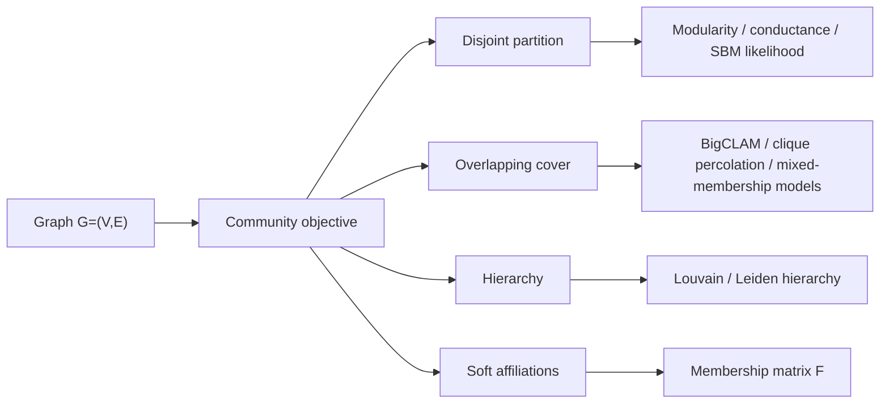
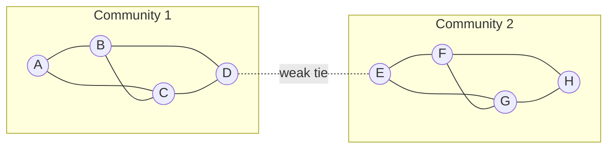
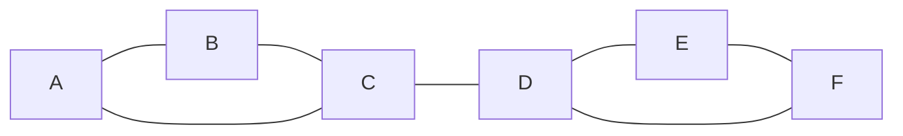
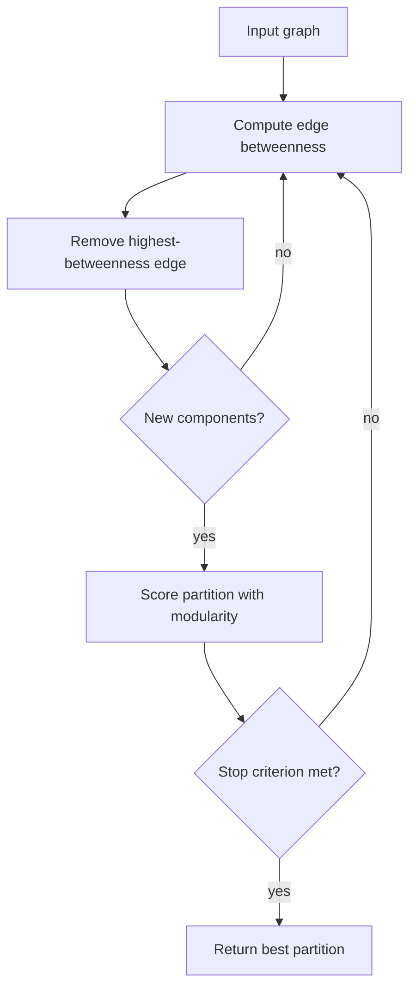
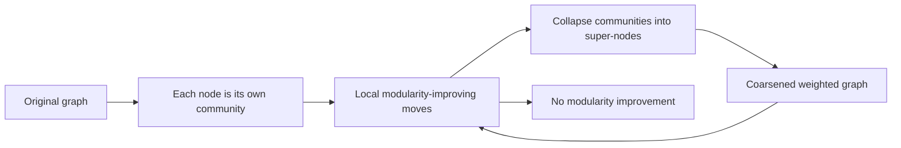
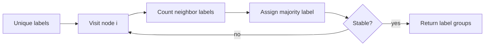

# **Community Detection in Networks**

Community detection asks for a partition or cover of a graph into groups whose internal connectivity is stronger than what would be expected from an appropriate baseline. In graph ML, community structure is both an object of study and a useful inductive bias: it explains homophily, information diffusion, fraud rings, protein modules, recommendation cohorts, and the failure modes of message passing when signals cross sparse bottlenecks.

The phrase "more densely connected internally than externally" is intuitive but incomplete. A technically useful definition must specify:

- the graph type: undirected, directed, weighted, signed, attributed, temporal, bipartite, heterogeneous;
- the output constraint: disjoint partition, overlapping cover, hierarchy, soft memberships;
- the null model: what "more than expected" means;
- the resolution: whether small communities should be preserved or merged;
- the optimization criterion or probabilistic data-generating model.



---

## **1. Formal Problem Setup**

Let

$$
G=(V,E)
$$

be a graph with $n=|V|$ nodes and $m=|E|$ edges. For a weighted graph, edge weights are $w_{ij}\geq 0$ and the weighted adjacency matrix is

$$
A_{ij}=w_{ij}.
$$

For an unweighted graph, $A_{ij}\in\{0,1\}$. Unless stated otherwise, assume an undirected graph with no self-loops:

$$
A=A^\top,
\qquad
A_{ii}=0.
$$

The degree or strength of node $i$ is

$$
k_i=\sum_{j=1}^n A_{ij},
$$

and for an undirected graph,

$$
2m=\sum_{i=1}^n k_i=\sum_{i,j}A_{ij}.
$$

A **hard disjoint community assignment** is a map

$$
c:V\to\{1,\dots,K\},
$$

where $c_i=r$ means node $i$ belongs to community $r$. Equivalently, define a binary assignment matrix

$$
Z\in\{0,1\}^{n\times K},
\qquad
Z_{ir}=\mathbf{1}[c_i=r],
\qquad
\sum_{r=1}^K Z_{ir}=1.
$$

An **overlapping community assignment** relaxes this to multiple memberships:

$$
Z_{ir}\in\{0,1\},
\qquad
\sum_{r=1}^K Z_{ir}\geq 1.
$$

A **soft overlapping assignment** uses nonnegative affiliation strengths:

$$
F\in\mathbb{R}_{\geq 0}^{n\times K},
\qquad
F_{ir}=\text{strength of node }i\text{ in community }r.
$$

The output can therefore be one of:

| Output | Constraint | Example Method |
|---|---:|---|
| Partition | one community per node | Louvain, Leiden, spectral modularity |
| Cover | one or more communities per node | clique percolation, BigCLAM thresholding |
| Soft memberships | continuous strengths | BigCLAM, mixed-membership SBM |
| Hierarchy | nested communities | Louvain levels, hierarchical SBM |

---

## **2. What Makes a Community Good?**

For a subset $S\subseteq V$, define:

$$
\operatorname{vol}(S)=\sum_{i\in S}k_i,
$$

$$
\operatorname{cut}(S,\bar{S})
=
\sum_{i\in S,j\notin S}A_{ij},
$$

and

$$
e(S)
=
\frac{1}{2}\sum_{i\in S,j\in S}A_{ij}.
$$

Here $\operatorname{vol}(S)$ is the total degree incident to nodes in $S$, $\operatorname{cut}(S,\bar{S})$ is the number or weight of edges leaving $S$, and $e(S)$ is the number of internal undirected edges.

A community should have high $e(S)$ and low $\operatorname{cut}(S,\bar{S})$, but optimizing only one of these quantities is degenerate:

- maximizing $e(S)$ favors very large sets;
- minimizing $\operatorname{cut}(S,\bar{S})$ favors isolated singletons or disconnected components;
- maximizing density favors tiny cliques;
- maximizing global modularity can merge small real communities.

Common set quality functions include:

$$
\operatorname{conductance}(S)
=
\frac{\operatorname{cut}(S,\bar{S})}
{\min(\operatorname{vol}(S),\operatorname{vol}(\bar{S}))},
$$

$$
\operatorname{internal\ density}(S)
=
\frac{2e(S)}{|S|(|S|-1)},
$$

and

$$
\operatorname{expansion}(S)
=
\frac{\operatorname{cut}(S,\bar{S})}{|S|}.
$$

Conductance is especially useful for local community detection because it penalizes boundary size relative to volume. Modularity, discussed next, is more common for global partitioning.

---

## **3. Granovetter's Strength of Weak Ties**

Granovetter's weak-ties theory is not a community detection algorithm; it is a structural explanation for why sparse inter-community edges are important. Strong ties usually lie inside densely connected social groups. Weak ties often bridge otherwise separated groups and therefore carry nonredundant information.



In graph terms, weak ties tend to have high bridge value: removing them may sharply increase shortest paths or disconnect modules. This connects weak ties to:

- edge betweenness in Girvan-Newman;
- bridges and articulation structure;
- information diffusion across communities;
- link prediction features such as common neighbors and Adamic-Adar, where inter-community links often have fewer shared neighbors.

For community detection, weak ties are the sparse edges that algorithms should usually cut. For downstream ML, they are often the most informative edges because they connect different latent groups.

---

## **4. Modularity**

Modularity measures whether a proposed partition has more within-community edge weight than expected under a degree-preserving random graph null model.

For an undirected graph, the standard Newman-Girvan modularity is

$$
Q
=
\frac{1}{2m}
\sum_{i=1}^{n}\sum_{j=1}^{n}
\left(
A_{ij}
-
\frac{k_i k_j}{2m}
\right)
\delta(c_i,c_j),
$$

where:

- $A_{ij}$ is observed edge weight;
- $k_i=\sum_j A_{ij}$ is node degree or strength;
- $2m=\sum_i k_i$ is total directed edge mass in the symmetric adjacency representation;
- $\delta(c_i,c_j)=1$ if $i$ and $j$ are assigned to the same community, otherwise $0$;
- $\frac{k_i k_j}{2m}$ is the expected edge weight between $i$ and $j$ under the configuration-model null.

### **4.1 Derivation from the Configuration Model**

The configuration model preserves expected degrees. Imagine node $i$ has $k_i$ half-edges or stubs. There are $2m$ total stubs. The probability that one stub from $i$ connects to node $j$ is approximately

$$
\frac{k_j}{2m}.
$$

Since node $i$ has $k_i$ stubs, the expected number of edges between $i$ and $j$ is

$$
\mathbb{E}[A_{ij}]
\approx
k_i\frac{k_j}{2m}
=
\frac{k_i k_j}{2m}.
$$

Define the modularity matrix

$$
B_{ij}
=
A_{ij}
-
\frac{k_i k_j}{2m}.
$$

Then

$$
Q
=
\frac{1}{2m}
\sum_{i,j}B_{ij}\delta(c_i,c_j).
$$

The term $B_{ij}$ is positive when $i$ and $j$ are more connected than expected by degree alone, and negative when they are less connected than expected. Modularity sums these deviations only for pairs placed in the same community.

### **4.2 Equivalent Community-Level Form**

For a community $r$, let

$$
L_r
=
\frac{1}{2}\sum_{i,j:c_i=c_j=r} A_{ij}
$$

be its number of internal undirected edges, and let

$$
d_r
=
\sum_{i:c_i=r} k_i
$$

be its total degree. Then:

$$
\begin{aligned}
Q
&=
\frac{1}{2m}
\sum_{r=1}^{K}
\sum_{i,j:c_i=c_j=r}
\left(
A_{ij}
-
\frac{k_i k_j}{2m}
\right)\\
&=
\frac{1}{2m}
\sum_{r=1}^{K}
\left(
2L_r
-
\frac{1}{2m}
\sum_{i:c_i=r}\sum_{j:c_j=r}k_i k_j
\right)\\
&=
\sum_{r=1}^{K}
\left(
\frac{L_r}{m}
-
\left(\frac{d_r}{2m}\right)^2
\right).
\end{aligned}
$$

The first term is the observed fraction of edges inside community $r$. The second term is the expected fraction under random stub matching.

### **4.3 Resolution Parameter**

A common generalized modularity is

$$
Q_\gamma
=
\frac{1}{2m}
\sum_{i,j}
\left(
A_{ij}
-
\gamma\frac{k_i k_j}{2m}
\right)
\delta(c_i,c_j).
$$

The parameter $\gamma$ controls community scale:

- $\gamma>1$ favors smaller communities because the null-model penalty is stronger;
- $\gamma<1$ favors larger communities;
- $\gamma=1$ recovers standard modularity.

This parameter is not merely cosmetic. Modularity has a resolution limit: optimizing standard modularity can merge small but well-defined communities in large graphs because the null model is global.

### **4.4 Worked Modularity Example**

Consider two triangles connected by one bridge:



There are $m=7$ edges. Degrees are:

$$
k_A=2,\quad k_B=2,\quad k_C=3,\quad k_D=3,\quad k_E=2,\quad k_F=2.
$$

Partition into two communities:

$$
S_1=\{A,B,C\},
\qquad
S_2=\{D,E,F\}.
$$

For $S_1$:

$$
L_1=3,
\qquad
d_1=2+2+3=7.
$$

For $S_2$:

$$
L_2=3,
\qquad
d_2=3+2+2=7.
$$

Therefore:

$$
\begin{aligned}
Q
&=
\left(
\frac{3}{7}
-
\left(\frac{7}{14}\right)^2
\right)
+
\left(
\frac{3}{7}
-
\left(\frac{7}{14}\right)^2
\right)\\
&=
2\left(
0.428571
-
0.25
\right)\\
&=
0.357142.
\end{aligned}
$$

Now compare with the single-community partition $S=\{A,B,C,D,E,F\}$:

$$
L=7,
\qquad
d=14,
$$

so

$$
Q
=
\frac{7}{7}
-
\left(\frac{14}{14}\right)^2
=0.
$$

The two-community split is better because the bridge edge is weak relative to the internal triangle structure.

### **4.5 Matrix Form for Two-Way Splits**

For a bipartition, encode assignments with

$$
s_i\in\{-1,+1\}.
$$

Then

$$
\delta(c_i,c_j)
=
\frac{1+s_i s_j}{2}.
$$

Since

$$
\sum_{i,j}B_{ij}=0,
$$

we obtain

$$
\begin{aligned}
Q
&=
\frac{1}{2m}
\sum_{i,j}B_{ij}\frac{1+s_i s_j}{2}\\
&=
\frac{1}{4m}
\sum_{i,j}B_{ij}s_i s_j\\
&=
\frac{1}{4m}s^\top B s.
\end{aligned}
$$

This connects modularity maximization to spectral methods: if $s$ were allowed to be continuous with a norm constraint, the best direction would align with the leading eigenvector of $B$. The discrete problem remains NP-hard in general, so practical algorithms use heuristics.

---

## **5. Girvan-Newman Algorithm**

Girvan-Newman is a divisive algorithm: it repeatedly removes edges that act as bridges between communities. The bridge score is usually **edge betweenness centrality**.

For an edge $e$, edge betweenness is

$$
g(e)
=
\sum_{s<t}
\frac{\sigma_{st}(e)}{\sigma_{st}},
$$

where:

- $\sigma_{st}$ is the number of shortest paths between nodes $s$ and $t$;
- $\sigma_{st}(e)$ is the number of those shortest paths that pass through edge $e$.

Edges connecting communities tend to lie on many shortest paths, so they get high betweenness.

### **5.1 Execution**

1. Compute edge betweenness for every edge.
2. Remove the edge with maximum betweenness.
3. Recompute edge betweenness on the modified graph.
4. Repeat until the graph splits into desired components or modularity reaches a maximum.
5. Select the partition with the best validation criterion, often modularity.



### **5.2 Brandes-Style Betweenness Computation**

Naively enumerating all shortest paths is too expensive. The standard implementation uses a dependency accumulation procedure. For each source $s$:

1. Run BFS for unweighted graphs or Dijkstra for weighted positive graphs.
2. Store shortest-path counts $\sigma[v]$ from $s$ to each $v$.
3. Store predecessor lists $P[v]$ on shortest paths.
4. Process nodes in reverse distance order.
5. Accumulate dependency values:

$$
\delta_s(v)
=
\sum_{w:v\in P[w]}
\frac{\sigma_s(v)}{\sigma_s(w)}
\left(1+\delta_s(w)\right).
$$

The contribution to edge $(v,w)$ is

$$
c_s(v,w)
=
\frac{\sigma_s(v)}{\sigma_s(w)}
\left(1+\delta_s(w)\right),
$$

when $v$ is a predecessor of $w$.

For an unweighted graph, one full edge-betweenness computation costs

$$
O(nm).
$$

Girvan-Newman recomputes betweenness after edge removals, so the total cost can be roughly

$$
O(m^2n)
$$

for sparse unweighted graphs. This is why Girvan-Newman is mainly useful for small graphs or educational analysis, not million-edge production graphs.

---

## **6. Louvain Algorithm**

Louvain is a greedy hierarchical modularity maximization algorithm. It is popular because it is simple and fast in practice. It alternates between:

1. local node moves that increase modularity;
2. graph coarsening where each community becomes a super-node.



### **6.1 Community-Level Modularity Gain**

Let node $i$ be moved into community $C$. Define:

$$
k_i=\sum_j A_{ij}
$$

as the degree of node $i$,

$$
k_{i,\text{in}}(C)
=
\sum_{j\in C}A_{ij}
$$

as the weight of edges from $i$ to community $C$, and

$$
\Sigma_{\text{tot}}(C)
=
\sum_{j\in C}k_j
$$

as the total degree of community $C$ before inserting $i$.

The modularity gain for inserting isolated node $i$ into $C$ is, up to constants independent of $C$:

$$
\Delta Q(i\to C)
=
\frac{k_{i,\text{in}}(C)}{m}
-
\frac{k_i\Sigma_{\text{tot}}(C)}{2m^2}.
$$

With resolution parameter $\gamma$:

$$
\Delta Q_\gamma(i\to C)
=
\frac{k_{i,\text{in}}(C)}{m}
-
\gamma\frac{k_i\Sigma_{\text{tot}}(C)}{2m^2}.
$$

Many implementations use algebraically equivalent forms scaled by $2m$ or by constants. The argmax is unchanged if the same positive constant multiplies all candidate gains.

### **6.2 Deriving the Louvain Gain**

Using the community form,

$$
Q
=
\sum_r
\left(
\frac{L_r}{m}
-
\left(\frac{d_r}{2m}\right)^2
\right).
$$

When node $i$ is inserted into community $C$:

$$
L_C' = L_C + k_{i,\text{in}}(C),
$$

because each edge from $i$ to $C$ becomes internal once. Also,

$$
d_C'=d_C+k_i.
$$

Ignoring the singleton community removal term, which is constant when comparing destination communities after $i$ has been removed, the contribution change for $C$ is:

$$
\begin{aligned}
\Delta Q
&=
\left[
\frac{L_C+k_{i,\text{in}}}{m}
-
\left(\frac{d_C+k_i}{2m}\right)^2
\right]
-
\left[
\frac{L_C}{m}
-
\left(\frac{d_C}{2m}\right)^2
-
\left(\frac{k_i}{2m}\right)^2
\right]\\
&=
\frac{k_{i,\text{in}}}{m}
-
\frac{(d_C+k_i)^2-d_C^2-k_i^2}{4m^2}\\
&=
\frac{k_{i,\text{in}}}{m}
-
\frac{2d_Ck_i}{4m^2}\\
&=
\frac{k_{i,\text{in}}}{m}
-
\frac{k_i d_C}{2m^2}.
\end{aligned}
$$

Thus Louvain only needs local quantities: node degree, edge weight from node to each neighboring community, and total degree of each candidate community.

### **6.3 Full Algorithm**

At level $\ell=0$, start from the original graph.

1. Assign each node to its own community.
2. Visit nodes in random or fixed order.
3. For node $i$, temporarily remove it from its current community.
4. Compute $\Delta Q$ for moving $i$ to each community appearing among its neighbors.
5. Move $i$ to the community with the largest positive gain.
6. Repeat passes until no node move improves modularity by more than a threshold.
7. Build a coarsened graph:
   - each detected community becomes one super-node;
   - edges between communities become weighted inter-super-node edges;
   - edges inside a community become self-loop weights.
8. Repeat local moving on the coarsened graph.
9. Stop when coarsening no longer improves modularity.

### **6.4 Worked Louvain Move**

Use the two-triangle graph from Section 4.4. Initially, suppose $C=\{A,B\}$ and we evaluate moving $C$'s neighbor node $C_{\text{node}}$ into it. To avoid symbol conflict, call the node $x$.

Node $x$ has degree:

$$
k_x=3.
$$

Edges from $x$ into community $\{A,B\}$:

$$
k_{x,\text{in}}=A_{xA}+A_{xB}=1+1=2.
$$

The total degree of community $\{A,B\}$ is:

$$
\Sigma_{\text{tot}}=k_A+k_B=2+2=4.
$$

Total edges:

$$
m=7.
$$

The modularity gain is:

$$
\begin{aligned}
\Delta Q
&=
\frac{2}{7}
-
\frac{3\cdot 4}{2\cdot 7^2}\\
&=
0.285714
-
\frac{12}{98}\\
&=
0.285714-0.122449\\
&=
0.163265.
\end{aligned}
$$

This move is beneficial.

Now evaluate moving $x$ into a community containing only bridge neighbor $D$. Here:

$$
k_{x,\text{in}}=1,
\qquad
\Sigma_{\text{tot}}=k_D=3.
$$

Then:

$$
\Delta Q
=
\frac{1}{7}
-
\frac{3\cdot 3}{98}
=
0.142857-0.091837
=
0.051020.
$$

The move into $\{A,B\}$ is better because $x$ has stronger internal support there.

### **6.5 Coarsening Mechanics**

Suppose a partition has communities $\mathcal{C}_1,\dots,\mathcal{C}_K$. The coarsened graph has $K$ nodes. The weight between super-nodes $p$ and $q$ is

$$
A'_{pq}
=
\sum_{i\in\mathcal{C}_p}
\sum_{j\in\mathcal{C}_q}
A_{ij}.
$$

For $p=q$, $A'_{pp}$ is a self-loop representing internal community weight. Self-loops matter because they preserve the modularity contribution of previously discovered internal structure.

### **6.6 Complexity**

One local-moving pass can be close to

$$
O(m)
$$

because each node evaluates only neighboring communities and each edge contributes to such evaluations. The number of passes and hierarchy levels is data-dependent. In practice Louvain is near-linear on many sparse graphs, but it is a heuristic with no guarantee of finding the global modularity optimum.

### **6.7 Limitations**

Louvain has several important failure modes:

- **Resolution limit:** standard modularity can merge small communities.
- **Degeneracy:** many different partitions can have nearly identical modularity.
- **Order dependence:** random node order and tie-breaking affect the result.
- **Disconnected communities:** Louvain can produce communities that are internally disconnected after aggregation.
- **Hard partition assumption:** each node receives one final label.

The Leiden algorithm modifies Louvain with a refinement phase and guarantees communities are well connected under its assumptions. For production-scale modularity-style detection, Leiden is often preferable when available.

---

## **7. Label Propagation**

Label propagation is a near-linear heuristic for detecting communities without explicitly optimizing modularity.

### **7.1 Algorithm**

1. Initialize each node with a unique label:

$$
y_i^{(0)}=i.
$$

2. Iterate over nodes in random order.
3. Replace each node's label with the most frequent label among its neighbors:

$$
y_i^{(t+1)}
=
\arg\max_{\ell}
\sum_{j\in N(i)}
A_{ij}\mathbf{1}[y_j^{(t)}=\ell].
$$

4. Break ties randomly or deterministically.
5. Stop when labels no longer change or after a maximum number of iterations.
6. Communities are connected groups sharing the same label.



### **7.2 Intuition**

Labels spread like local consensus. Dense regions reinforce a shared label because many neighbors vote for the same group. Sparse bridges do not dominate unless the bridge endpoint has enough support from the other side.

### **7.3 Complexity and Pitfalls**

Each iteration costs

$$
O(m)
$$

for sparse adjacency-list graphs. The number of iterations is usually small but not strongly guaranteed in the basic asynchronous version.

Important pitfalls:

- labels can oscillate in synchronous updates;
- random tie-breaking makes results non-deterministic;
- high-degree hubs can absorb large portions of the graph;
- no explicit objective means model selection is less transparent than modularity maximization.

---

## **8. Overlapping Communities and BigCLAM**

Many real nodes belong to multiple groups. A person can belong to family, workplace, school, and sports communities. A protein can participate in multiple biological processes. A paper can sit between research areas.

BigCLAM models this by assigning each node a nonnegative affiliation vector:

$$
F_u\in\mathbb{R}_{\geq 0}^{K}.
$$

The $c$-th coordinate $F_{uc}$ is the strength of node $u$ in community $c$.

### **8.1 Edge Probability Model**

BigCLAM assumes that shared community affiliations independently increase the chance of an edge. Define the affiliation dot product:

$$
s_{uv}=F_u^\top F_v.
$$

The probability that nodes $u$ and $v$ are connected is

$$
P(A_{uv}=1)
=
1-\exp(-F_u^\top F_v).
$$

The probability of no edge is

$$
P(A_{uv}=0)
=
\exp(-F_u^\top F_v).
$$

This form has useful behavior:

- if $F_u^\top F_v=0$, then $P(A_{uv}=1)=0$;
- if nodes share strong affiliations, $F_u^\top F_v$ is large and edge probability approaches $1$;
- multiple shared communities combine additively in log no-edge probability.

### **8.2 Log-Likelihood**

For an undirected graph without self-loops, the likelihood is

$$
\mathcal{L}(F)
=
\prod_{(u,v)\in E}
\left(1-\exp(-F_u^\top F_v)\right)
\prod_{(u,v)\notin E,\,u<v}
\exp(-F_u^\top F_v).
$$

The log-likelihood is

$$
\ell(F)
=
\sum_{(u,v)\in E}
\log\left(1-\exp(-F_u^\top F_v)\right)
-
\sum_{(u,v)\notin E,\,u<v}
F_u^\top F_v.
$$

The non-edge sum is expensive because there are $O(n^2)$ non-edges. BigCLAM uses algebraic simplification and local gradient computation.

Let

$$
S=\sum_{v\in V}F_v.
$$

For a fixed node $u$:

$$
\sum_{v\notin N(u),v\neq u}F_v
=
S-F_u-\sum_{v\in N(u)}F_v.
$$

This lets the non-edge gradient be computed using global and local sums instead of iterating over all non-neighbors.

### **8.3 Gradient for One Node**

The edge term for neighbor $v$ is:

$$
g_{uv}
=
\log\left(1-\exp(-F_u^\top F_v)\right).
$$

Let

$$
x=F_u^\top F_v.
$$

Then

$$
\frac{\partial g_{uv}}{\partial x}
=
\frac{\exp(-x)}{1-\exp(-x)}
=
\frac{1}{\exp(x)-1}.
$$

By the chain rule,

$$
\nabla_{F_u}g_{uv}
=
\frac{F_v}{\exp(F_u^\top F_v)-1}.
$$

The non-edge term for fixed $u$ contributes:

$$
-\sum_{v\notin N(u),v\neq u}F_v.
$$

Therefore:

$$
\nabla_{F_u}\ell
=
\sum_{v\in N(u)}
\frac{F_v}{\exp(F_u^\top F_v)-1}
-
\sum_{v\notin N(u),v\neq u}F_v.
$$

Using the global sum:

$$
\nabla_{F_u}\ell
=
\sum_{v\in N(u)}
\left(
\frac{F_v}{\exp(F_u^\top F_v)-1}
+F_v
\right)
-
S
+F_u.
$$

This costs

$$
O(k\deg(u))
$$

for node $u$ if $K=k$ communities, after maintaining $S$.

### **8.4 Numerical Stability**

The term

$$
\log(1-\exp(-x))
$$

is unstable when $x$ is small. Use a stable implementation:

$$
\log(1-\exp(-x))
=
\log(-\operatorname{expm1}(-x)).
$$

For the gradient denominator:

$$
\exp(x)-1
=
\operatorname{expm1}(x).
$$

Clamp affiliation values to nonnegative numbers after updates, or parameterize

$$
F=\operatorname{softplus}(U)
$$

to enforce nonnegativity smoothly.

### **8.5 From Soft Affiliations to Communities**

After learning $F$, overlapping communities can be produced by thresholding:

$$
\mathcal{C}_c
=
\{u:F_{uc}\geq \tau_c\}.
$$

Thresholds can be:

- global, such as $\tau_c=\tau$;
- percentile-based per community;
- selected using validation labels;
- selected by optimizing a conductance or likelihood criterion.

The choice of threshold changes the resulting cover substantially. BigCLAM learns scores; it does not uniquely determine a binary cover without a post-processing rule.

---

## **9. Spectral View**

Community detection is closely related to graph cuts and spectral clustering. Let

$$
L=D-A
$$

be the unnormalized graph Laplacian and

$$
L_{\text{sym}}
=
I-D^{-1/2}AD^{-1/2}
$$

be the symmetric normalized Laplacian.

For a two-way cut, minimizing normalized cut can be relaxed to an eigenvector problem involving the second-smallest eigenvector of $L_{\text{sym}}$. Modularity maximization has a similar relaxation using the leading eigenvectors of the modularity matrix:

$$
B=A-\frac{kk^\top}{2m}.
$$

Spectral methods are useful when:

- the graph is medium-sized and sparse eigensolvers are available;
- a fixed number of clusters is desired;
- a continuous embedding is useful before clustering;
- one wants a clearer linear algebraic relaxation than greedy local moves.

They are less convenient when the number of communities is unknown, the graph is very large, or overlapping communities are needed.

---

## **10. Python Implementation from Scratch**

The following implementations prioritize clarity over extreme optimization. They use adjacency dictionaries so they work for sparse weighted undirected graphs.

### **10.1 Utilities and Modularity**

```python
from __future__ import annotations

from collections import defaultdict
from dataclasses import dataclass
from math import exp, log
from random import Random
from typing import Dict, Hashable, Iterable, List, Mapping, MutableMapping, Set, Tuple

Node = Hashable
Adj = Dict[Node, Dict[Node, float]]


def build_undirected_adjacency(
    edges: Iterable[Tuple[Node, Node, float]]
) -> Adj:
    """Build a weighted undirected adjacency dictionary."""
    adj: Adj = defaultdict(dict)
    for u, v, w in edges:
        if u == v:
            # Keep self-loops if present; Louvain coarsening may create them.
            adj[u][v] = adj[u].get(v, 0.0) + w
        else:
            adj[u][v] = adj[u].get(v, 0.0) + w
            adj[v][u] = adj[v].get(u, 0.0) + w
    return {u: dict(nbrs) for u, nbrs in adj.items()}


def degrees(adj: Mapping[Node, Mapping[Node, float]]) -> Dict[Node, float]:
    return {u: sum(nbrs.values()) for u, nbrs in adj.items()}


def total_edge_weight(adj: Mapping[Node, Mapping[Node, float]]) -> float:
    # In an undirected adjacency, each non-self-loop appears twice.
    total = 0.0
    for u, nbrs in adj.items():
        for v, w in nbrs.items():
            total += w if u != v else 2.0 * w
    return total / 2.0


def modularity(
    adj: Mapping[Node, Mapping[Node, float]],
    partition: Mapping[Node, int],
    resolution: float = 1.0,
) -> float:
    """Newman-Girvan modularity for a weighted undirected graph."""
    deg = degrees(adj)
    m = total_edge_weight(adj)
    if m == 0.0:
        return 0.0

    internal = defaultdict(float)
    comm_degree = defaultdict(float)

    for u, nbrs in adj.items():
        cu = partition[u]
        comm_degree[cu] += deg[u]
        for v, w in nbrs.items():
            if partition[v] == cu:
                internal[cu] += w

    # internal currently double-counts ordinary undirected internal edges.
    q = 0.0
    for c, d_c in comm_degree.items():
        l_c = internal[c] / 2.0
        q += (l_c / m) - resolution * (d_c / (2.0 * m)) ** 2
    return q
```

Important internal details:

- `total_edge_weight` returns $m$, not $2m$.
- Internal edges are double-counted when scanning adjacency lists, so `l_c = internal[c] / 2`.
- Weighted modularity uses strengths in place of degrees.
- Isolated nodes have degree zero and do not affect modularity.

### **10.2 Louvain Local-Move Phase**

This is a single-level Louvain implementation. Full Louvain adds graph coarsening and repeats.

```python
def louvain_one_level(
    adj: Mapping[Node, Mapping[Node, float]],
    resolution: float = 1.0,
    max_passes: int = 50,
    seed: int = 0,
) -> Dict[Node, int]:
    rng = Random(seed)
    nodes = list(adj)
    deg = degrees(adj)
    m = total_edge_weight(adj)
    if m == 0.0:
        return {u: i for i, u in enumerate(nodes)}

    # Initially every node is its own community.
    comm = {u: i for i, u in enumerate(nodes)}
    comm_tot = {comm[u]: deg[u] for u in nodes}

    def neigh_comm_weights(u: Node) -> Dict[int, float]:
        weights = defaultdict(float)
        for v, w in adj[u].items():
            if v != u:
                weights[comm[v]] += w
        return weights

    for _ in range(max_passes):
        moved = False
        rng.shuffle(nodes)

        for u in nodes:
            old_c = comm[u]
            k_u = deg[u]

            # Remove u from its current community before evaluating insertions.
            comm_tot[old_c] -= k_u

            best_c = old_c
            best_gain = 0.0

            for c, k_u_in in neigh_comm_weights(u).items():
                gain = (k_u_in / m) - resolution * (
                    k_u * comm_tot.get(c, 0.0) / (2.0 * m * m)
                )
                if gain > best_gain:
                    best_gain = gain
                    best_c = c

            comm[u] = best_c
            comm_tot[best_c] = comm_tot.get(best_c, 0.0) + k_u

            if best_c != old_c:
                moved = True

        if not moved:
            break

    # Renumber communities compactly.
    remap = {}
    next_id = 0
    compact = {}
    for u in nodes:
        c = comm[u]
        if c not in remap:
            remap[c] = next_id
            next_id += 1
        compact[u] = remap[c]
    return compact
```

This implementation omits two production details:

- it does not compute the full remove-then-insert modularity delta including the old community term, because the old community contribution is constant across destination comparisons once the node has been removed;
- it does not coarsen the graph, so it may stop earlier than full Louvain.

### **10.3 Graph Coarsening**

```python
def coarsen_graph(
    adj: Mapping[Node, Mapping[Node, float]],
    partition: Mapping[Node, int],
) -> Adj:
    coarse: Dict[int, Dict[int, float]] = defaultdict(lambda: defaultdict(float))

    for u, nbrs in adj.items():
        cu = partition[u]
        for v, w in nbrs.items():
            cv = partition[v]
            coarse[cu][cv] += w

    # Convert double-counted self-loop convention back to edge weights.
    result: Adj = {}
    for cu, nbrs in coarse.items():
        result[cu] = {}
        for cv, w in nbrs.items():
            result[cu][cv] = w / 2.0 if cu == cv else w
    return result
```

Coarsening is easy to get wrong. The adjacency representation double-counts undirected edges, while a self-loop represents internal mass. Libraries differ in self-loop conventions, so test modularity preservation after coarsening before relying on a custom implementation.

### **10.4 Label Propagation**

```python
def label_propagation(
    adj: Mapping[Node, Mapping[Node, float]],
    max_iter: int = 100,
    seed: int = 0,
) -> Dict[Node, int]:
    rng = Random(seed)
    nodes = list(adj)
    labels = {u: i for i, u in enumerate(nodes)}

    for _ in range(max_iter):
        changed = False
        rng.shuffle(nodes)

        for u in nodes:
            scores = defaultdict(float)
            for v, w in adj[u].items():
                if v != u:
                    scores[labels[v]] += w

            if not scores:
                continue

            max_score = max(scores.values())
            candidates = [lab for lab, score in scores.items() if score == max_score]
            new_label = rng.choice(candidates)

            if new_label != labels[u]:
                labels[u] = new_label
                changed = True

        if not changed:
            break

    remap = {}
    out = {}
    next_id = 0
    for u in nodes:
        lab = labels[u]
        if lab not in remap:
            remap[lab] = next_id
            next_id += 1
        out[u] = remap[lab]
    return out
```

### **10.5 BigCLAM-Like Gradient Ascent**

```python
import numpy as np


def log1mexp_neg(x: np.ndarray) -> np.ndarray:
    """Compute log(1 - exp(-x)) for x > 0."""
    return np.log(-np.expm1(-np.maximum(x, 1e-12)))


def bigclam_fit(
    adj: Mapping[int, Mapping[int, float]],
    num_comms: int,
    steps: int = 200,
    lr: float = 0.01,
    seed: int = 0,
) -> np.ndarray:
    """Small BigCLAM-style optimizer for unweighted undirected graphs.

    This is intended for understanding, not for large-scale production use.
    """
    rng = np.random.default_rng(seed)
    nodes = sorted(adj)
    index = {u: i for i, u in enumerate(nodes)}
    n = len(nodes)

    neighbors = [
        np.array([index[v] for v in adj[u] if v != u], dtype=np.int64)
        for u in nodes
    ]

    F = rng.gamma(shape=1.0, scale=0.1, size=(n, num_comms))

    for _ in range(steps):
        total = F.sum(axis=0)

        for u_idx in rng.permutation(n):
            nbr_idx = neighbors[u_idx]
            f_u = F[u_idx]

            if len(nbr_idx) > 0:
                F_nbr = F[nbr_idx]
                dots = F_nbr @ f_u
                edge_grad = (F_nbr / np.expm1(np.maximum(dots, 1e-12))[:, None]).sum(axis=0)
                nbr_sum = F_nbr.sum(axis=0)
            else:
                edge_grad = np.zeros(num_comms)
                nbr_sum = np.zeros(num_comms)

            # Non-edge gradient: -sum_{v not in N(u), v != u} F_v.
            non_edge_grad = -(total - f_u - nbr_sum)
            grad = edge_grad + non_edge_grad

            F[u_idx] = np.maximum(0.0, f_u + lr * grad)

    return F
```

Implementation notes:

- This updates one row at a time and projects to the nonnegative orthant.
- Large learning rates can collapse values to zero or overflow edge gradients.
- Real implementations use line search, parallelism, sparse operations, better initialization, and often regularization.
- The number of communities $K$ must be chosen externally.

### **10.6 Worked Example in Code**

```python
edges = [
    ("A", "B", 1.0),
    ("B", "C", 1.0),
    ("C", "A", 1.0),
    ("C", "D", 1.0),
    ("D", "E", 1.0),
    ("E", "F", 1.0),
    ("F", "D", 1.0),
]

adj = build_undirected_adjacency(edges)

manual_partition = {
    "A": 0,
    "B": 0,
    "C": 0,
    "D": 1,
    "E": 1,
    "F": 1,
}

print(modularity(adj, manual_partition))
# 0.3571428571428571

print(louvain_one_level(adj, seed=7))
# Example output: {'A': 0, 'B': 0, 'C': 0, 'D': 1, 'E': 1, 'F': 1}

print(label_propagation(adj, seed=7))
# Output may vary because tie-breaking is random.
```

---

## **11. Library Implementations**

### **11.1 NetworkX**

```python
import networkx as nx
from networkx.algorithms.community import (
    girvan_newman,
    greedy_modularity_communities,
    label_propagation_communities,
    louvain_communities,
    modularity,
)

G = nx.Graph()
G.add_weighted_edges_from(edges)

communities = louvain_communities(
    G,
    weight="weight",
    resolution=1.0,
    threshold=1e-7,
    seed=0,
)

print(communities)
print(modularity(G, communities, weight="weight", resolution=1.0))
```

Internally, `louvain_communities` performs the two Louvain phases: greedy node moves using modularity gain, then graph aggregation. The `resolution` argument corresponds to $\gamma$ in generalized modularity. The `threshold` argument stops levels whose modularity gain is too small.

Girvan-Newman in NetworkX returns a generator over progressively finer partitions:

```python
comp_gen = girvan_newman(G)
first_split = next(comp_gen)
print(tuple(sorted(c) for c in first_split))
```

NetworkX is excellent for correctness, teaching, and medium graphs. It is not usually the fastest choice for very large community detection because much of it is Python-level graph manipulation.

### **11.2 python-louvain**

```python
import community as community_louvain

partition = community_louvain.best_partition(
    G,
    weight="weight",
    resolution=1.0,
    random_state=0,
)

communities_by_id = defaultdict(set)
for node, cid in partition.items():
    communities_by_id[cid].add(node)

print(dict(communities_by_id))
```

The `best_partition` function computes a Louvain heuristic partition that tries to maximize modularity. It accepts a starting partition, edge weight attribute, resolution parameter, and random state. As with all Louvain implementations, the result is heuristic and can vary with tie-breaking.

### **11.3 igraph and Leiden**

For larger graphs, `igraph` plus `leidenalg` is often more scalable:

```python
import igraph as ig
import leidenalg

ig_graph = ig.Graph.TupleList(
    [(u, v, w) for u, v, w in edges],
    directed=False,
    edge_attrs=["weight"],
)

partition = leidenalg.find_partition(
    ig_graph,
    leidenalg.RBConfigurationVertexPartition,
    weights="weight",
    resolution_parameter=1.0,
    seed=0,
)

print(partition.membership)
```

Leiden follows the broad Louvain idea but adds a refinement phase before aggregation. The practical consequence is that it avoids some badly connected communities that Louvain can produce.

### **11.4 scikit-learn Spectral Clustering**

```python
import numpy as np
from sklearn.cluster import SpectralClustering

A = nx.to_numpy_array(G, weight="weight")

model = SpectralClustering(
    n_clusters=2,
    affinity="precomputed",
    assign_labels="kmeans",
    random_state=0,
)

labels = model.fit_predict(A)
print(labels)
```

With `affinity="precomputed"`, scikit-learn treats the input as a similarity matrix. Internally, spectral clustering builds a graph Laplacian, computes a low-dimensional eigenvector embedding, normalizes it depending on the variant, and runs k-means in that spectral space.

Spectral clustering requires specifying `n_clusters`, which is a major difference from Louvain-style modularity maximization.

---

## **12. Complexity Summary**

| Method | Main Idea | Typical Time | Space | Output |
|---|---|---:|---:|---|
| Girvan-Newman | remove high-betweenness edges | $O(m^2n)$ sparse unweighted worst-style estimate | $O(n+m)$ | hierarchy / partition |
| Label propagation | neighbor-label consensus | $O(Tm)$ | $O(n+m)$ | partition |
| Louvain | greedy modularity + coarsening | near $O(m)$ per pass in practice | $O(n+m)$ | hierarchical partition |
| Leiden | refined Louvain-style optimization | near-linear in practice | $O(n+m)$ | well-connected partition |
| Spectral clustering | Laplacian/modularity eigenspace | eigensolver-dependent; often $O(km)$ iterative | $O(n+m)$ sparse | fixed-$K$ partition |
| BigCLAM | nonnegative affiliation likelihood | roughly $O(Km)$ per full gradient-style pass with optimizations | $O(nK+m)$ | soft overlapping cover |

The exact complexity depends heavily on graph representation, sparsity, weighted/directed support, convergence thresholds, and implementation language.

---

## **13. Numerical Stability and Implementation Pitfalls**

### **13.1 Modularity**

- Use floating-point weights; integer division bugs silently corrupt $Q$.
- Be explicit about whether $m$ is total undirected edge weight or total adjacency mass.
- Handle self-loops consistently, especially after Louvain coarsening.
- Isolated nodes do not affect modularity but still need labels.
- Directed modularity uses separate in/out degrees:

$$
Q_{\text{directed}}
=
\frac{1}{m}
\sum_{i,j}
\left(
A_{ij}
-
\frac{k_i^{\text{out}}k_j^{\text{in}}}{m}
\right)
\delta(c_i,c_j).
$$

### **13.2 Louvain**

- Node ordering changes results.
- Ties should be controlled with a seed for reproducibility.
- Empty communities must be handled after node removals.
- Coarsened self-loops must preserve internal edge mass.
- A higher modularity partition is not always more semantically correct.

### **13.3 Label Propagation**

- Synchronous updates can oscillate.
- Random tie-breaking can produce unstable partitions.
- Hubs can dominate large neighborhoods.
- Results are hard to compare because there is no optimized scalar objective.

### **13.4 BigCLAM**

- `log(1 - exp(-x))` must be computed with `expm1`.
- Gradients can explode when $F_u^\top F_v$ is near zero for observed edges.
- Nonnegativity needs projection or reparameterization.
- Choosing $K$ and thresholds is part of the model, not an afterthought.
- Dense graphs make non-edge modeling less sparse-friendly.

---

## **14. Evaluation**

When ground-truth communities are unavailable, evaluation is usually structural:

$$
Q,\quad
\operatorname{conductance},\quad
\operatorname{coverage},\quad
\operatorname{performance}.
$$

Coverage is:

$$
\operatorname{coverage}
=
\frac{\text{number of intra-community edges}}{m}.
$$

Coverage alone is insufficient because the trivial one-community partition has coverage $1$.

When labels are available, compare detected communities against labels using:

- normalized mutual information;
- adjusted Rand index;
- pairwise precision/recall/F1;
- overlapping NMI or Omega index for covers;
- downstream task performance.

For graph ML systems, the best evaluation is often task-based:

- Does adding community IDs improve node classification?
- Do community-aware negative samples improve link prediction?
- Do detected communities align with fraud investigations?
- Are communities stable across time windows?

---

## **15. Connections to Graph ML**

### **15.1 Homophily and Message Passing**

Communities are a structural source of homophily. In a homophilic graph, neighboring nodes often share labels or features, so message passing smooths representations inside communities. Sparse inter-community edges can cause oversmoothing or label leakage if too many layers are used.

### **15.2 Node Embeddings**

Random-walk embeddings such as DeepWalk and Node2Vec often recover community structure because short random walks stay inside dense regions with high probability. The skip-gram objective makes nodes co-occurring in walk windows geometrically close.

### **15.3 Stochastic Block Models**

The stochastic block model is a probabilistic generative model:

$$
z_i\sim\operatorname{Categorical}(\pi),
$$

$$
A_{ij}\mid z_i,z_j
\sim
\operatorname{Bernoulli}(B_{z_i z_j}).
$$

Assortative SBMs model communities by making diagonal block probabilities larger:

$$
B_{rr}>B_{rs},
\qquad r\neq s.
$$

Modularity can be interpreted as related to likelihood under degree-corrected block-model assumptions, though the exact equivalence depends on the chosen model and constraints.

### **15.4 Graph Pooling and Coarsening**

Louvain-style aggregation resembles graph pooling: groups of nodes become super-nodes, and inter-community edges become weighted edges. This is conceptually related to hierarchical GNN pooling methods, although Louvain is unsupervised and non-differentiable.

### **15.5 Recommendation and Fraud**

Communities can provide:

- candidate generation groups;
- user/item segmentation;
- dense fraud-ring features;
- graph-level summaries for monitoring;
- hard negatives sampled across community boundaries.

In fraud graphs, the most suspicious structures are not always high-modularity communities. Fraud rings may be near-bipartite, temporally bursty, or deliberately low-density to evade detection. Community detection should be combined with temporal, attribute, and transaction features.

---

## **16. Limitations**

Community detection is not a uniquely defined problem. Different algorithms can produce incompatible but defensible answers on the same graph. Major limitations include:

- no universal definition of a community;
- sensitivity to graph construction choices;
- resolution dependence;
- instability under small perturbations;
- difficulty with overlapping, hierarchical, directed, signed, temporal, or heterogeneous communities;
- semantic mismatch between structural clusters and real-world labels;
- scalability bottlenecks for algorithms requiring global recomputation or eigendecomposition.

The practical question is not "Which algorithm finds the true communities?" It is:

> Which community definition is useful for the graph, scale, and downstream decision being made?

---

## **17. Practical Selection Guide**

| Situation | Good First Choice | Why |
|---|---|---|
| Small graph, interpretable hierarchy | Girvan-Newman | edge removals are easy to inspect |
| Large sparse graph, disjoint communities | Leiden or Louvain | scalable modularity-style heuristic |
| Need very fast rough partition | label propagation | near-linear and simple |
| Fixed number of clusters | spectral clustering | explicit $K$ and eigenvector relaxation |
| Overlapping social/biological groups | BigCLAM or mixed-membership model | nodes can have multiple memberships |
| Local community around seed nodes | personalized PageRank / conductance sweep | avoids global partitioning |
| Production graph ML features | compare Louvain/Leiden + task validation | structural quality may not equal task quality |

---

## **18. References for Deeper Reading**

- M. Girvan and M. E. J. Newman, "Community structure in social and biological networks," PNAS, 2002.
- M. E. J. Newman and M. Girvan, "Finding and evaluating community structure in networks," Physical Review E, 2004.
- M. E. J. Newman, "Modularity and community structure in networks," PNAS, 2006.
- V. D. Blondel, J.-L. Guillaume, R. Lambiotte, and E. Lefebvre, "Fast unfolding of communities in large networks," Journal of Statistical Mechanics, 2008.
- U. N. Raghavan, R. Albert, and S. Kumara, "Near linear time algorithm to detect community structures in large-scale networks," Physical Review E, 2007.
- S. Fortunato and M. Barthelemy, "Resolution limit in community detection," PNAS, 2007.
- J. Yang and J. Leskovec, "Overlapping community detection at scale: a nonnegative matrix factorization approach," WSDM, 2013.
- V. A. Traag, L. Waltman, and N. J. van Eck, "From Louvain to Leiden: guaranteeing well-connected communities," Scientific Reports, 2019.
- S. Fortunato, "Community detection in graphs," Physics Reports, 2010.
- NetworkX documentation for `louvain_communities`, `girvan_newman`, `label_propagation_communities`, and `modularity`.
- `python-louvain` documentation for `community.best_partition`.
