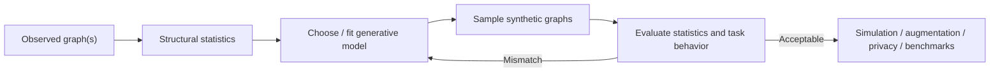
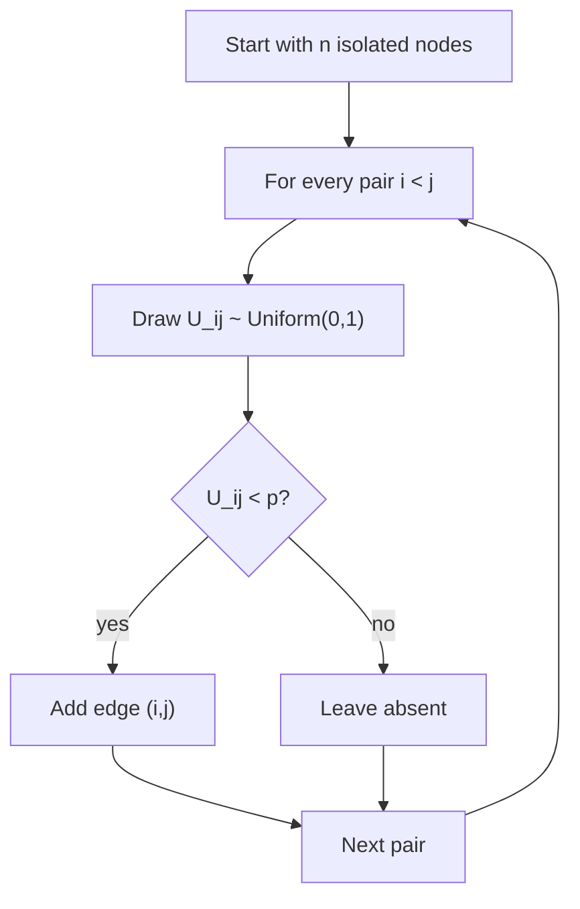
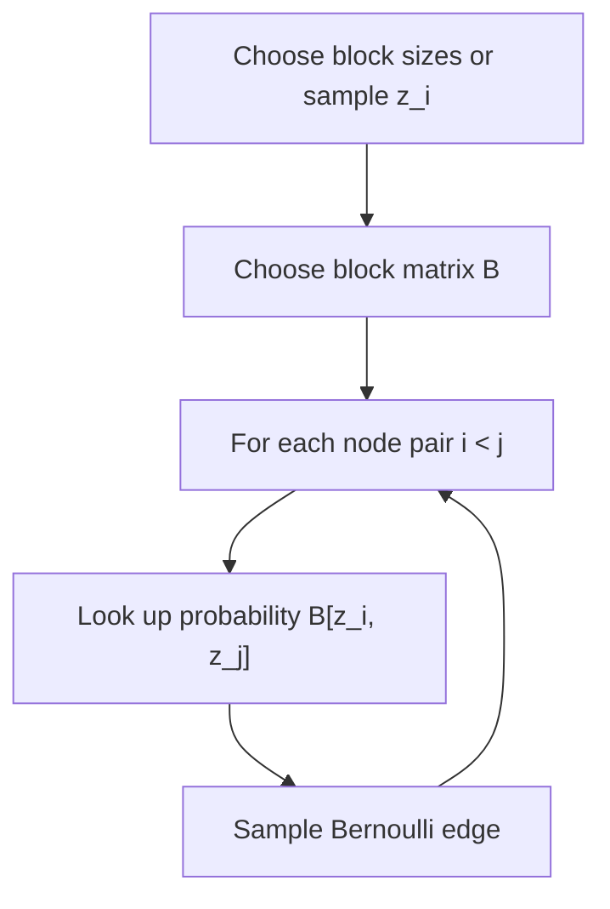
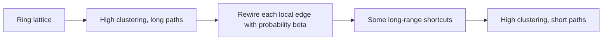
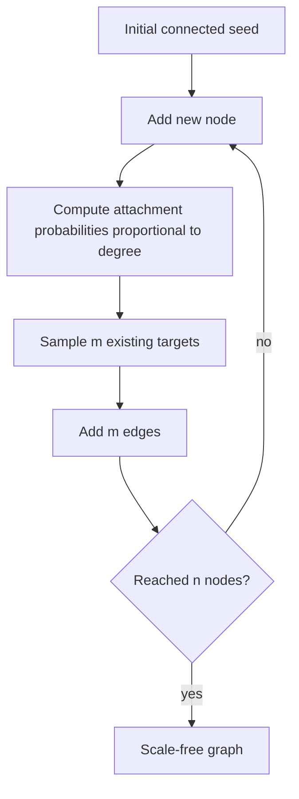
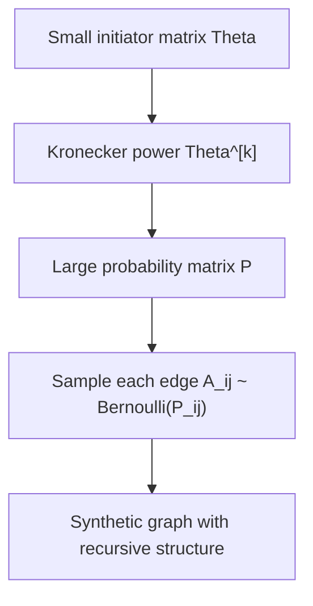
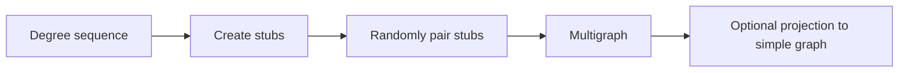

# **Generative Models for Graphs**

A graph generative model specifies or learns a probability distribution over graphs:

$$
P_\theta(G),
\qquad
G=(V,E,X,Y,\ldots),
$$

where $V$ is the node set, $E$ is the edge set, and optional attributes $X,Y,\ldots$ describe node, edge, temporal, or heterogeneous information. The central goal is not merely to draw random edges; it is to produce graphs whose structural statistics resemble a target graph or graph population.

In classical network science, the model is usually explicit: choose a small number of parameters, define a random process, sample a graph, and analyze its expected properties. In deep graph generation, the distribution is learned with neural networks. This chapter focuses on the classical models because they are the mathematical baselines for understanding what deep graph generators must improve.



---

## **1. Problem Setup**

Let an undirected simple graph be represented by an adjacency matrix

$$
A\in\{0,1\}^{n\times n},
\qquad
A=A^\top,
\qquad
A_{ii}=0.
$$

The random graph model defines a probability mass function over all simple graphs on $n$ labeled nodes:

$$
P_\theta(G)
=
P_\theta(A).
$$

There are

$$
N=\binom{n}{2}
=
\frac{n(n-1)}{2}
$$

possible undirected edges. Therefore the sample space contains

$$
2^N
$$

possible simple undirected labeled graphs. A fully general graph distribution would need one probability for each graph, subject to normalization:

$$
\sum_{G}P(G)=1.
$$

This is statistically and computationally infeasible. Practical generative models impose structure. Typical assumptions include:

- **independent edges**, as in Erdos-Renyi and stochastic block models;
- **conditional independence given latent variables**, as in latent-space models and SBMs;
- **growth processes**, as in preferential attachment;
- **local rewiring**, as in Watts-Strogatz small-world graphs;
- **self-similar recursion**, as in Kronecker graphs.

The modeling decision is therefore a bias-variance tradeoff. A simple model is analyzable but misses many empirical patterns. A flexible model fits more statistics but may become hard to estimate, hard to sample, or hard to interpret.

---

## **2. What Should a Graph Generator Preserve?**

For a generated graph $\tilde{G}$ to resemble a real graph $G$, matching edge count alone is almost never enough. Important statistics include:

| Property | Definition | Why It Matters |
|---|---:|---|
| Edge density | $\rho=2m/(n(n-1))$ | Controls sparsity |
| Degree distribution | empirical distribution of $k_i$ | Detects hubs and heavy tails |
| Clustering coefficient | triangle closure around nodes | Measures local transitivity |
| Average path length | mean shortest path over reachable pairs | Measures global navigability |
| Diameter | maximum finite shortest path | Sensitive to long tails and disconnectedness |
| Connected components | component size distribution | Captures fragmentation |
| Community structure | dense within-group, sparse between-group links | Captures mesoscale organization |
| Motif counts | triangles, wedges, feed-forward loops, etc. | Captures local graph patterns |
| Assortativity | correlation of degrees or labels across edges | Captures homophily and mixing |

For an undirected graph, the degree of node $i$ is

$$
k_i=\sum_{j=1}^{n}A_{ij}.
$$

The global edge density is

$$
\rho
=
\frac{m}{\binom{n}{2}}
=
\frac{2m}{n(n-1)}.
$$

The local clustering coefficient of node $i$ is

$$
C_i
=
\frac{\text{number of edges among neighbors of }i}
{\binom{k_i}{2}}
=
\frac{2T_i}{k_i(k_i-1)},
\qquad
k_i\geq 2,
$$

where $T_i$ is the number of triangles incident to node $i$. If $k_i<2$, $C_i$ is usually defined as $0$ or excluded from the average, depending on convention.

The average clustering coefficient is

$$
\bar{C}
=
\frac{1}{n}\sum_{i=1}^{n} C_i.
$$

The average shortest path length over connected pairs is

$$
\ell
=
\frac{1}{|\mathcal{R}|}
\sum_{(i,j)\in\mathcal{R}} d(i,j),
$$

where $d(i,j)$ is the shortest-path distance and

$$
\mathcal{R}
=
\{(i,j):i<j,\ d(i,j)<\infty\}.
$$

For disconnected graphs, averaging only over reachable pairs must be reported explicitly; otherwise path statistics are ambiguous.

---

## **3. Erdos-Renyi Random Graphs**

The Erdos-Renyi family is the canonical independent-edge baseline. There are two closely related versions:

- $G(n,p)$: each possible edge is included independently with probability $p$.
- $G(n,m)$: exactly $m$ edges are chosen uniformly from the $\binom{n}{2}$ possible edges.

The notes use $G(n,p)$, also called the binomial random graph.

### **3.1 Generative Process**

For $G(n,p)$:

1. Fix $n$ nodes.
2. Enumerate all unordered pairs $(i,j)$ with $1\leq i<j\leq n$.
3. For each pair, sample

$$
A_{ij}\sim \operatorname{Bernoulli}(p).
$$

4. Set $A_{ji}=A_{ij}$ and $A_{ii}=0$.



### **3.2 Probability of a Graph**

Let $G$ have $m$ edges. Since all edge indicators are independent Bernoulli random variables,

$$
P(G)
=
\prod_{1\leq i<j\leq n}
p^{A_{ij}}(1-p)^{1-A_{ij}}.
$$

Because exactly $m$ terms have $A_{ij}=1$ and $N-m$ terms have $A_{ij}=0$,

$$
P(G)
=
p^m(1-p)^{N-m},
\qquad
N=\binom{n}{2}.
$$

Every graph with the same number of edges has the same probability. This exchangeability is useful analytically but unrealistic for many networks.

### **3.3 Edge Count**

The number of edges is

$$
M=\sum_{1\leq i<j\leq n}A_{ij}.
$$

Since $M$ is a sum of $N$ independent Bernoulli variables,

$$
M\sim \operatorname{Binomial}(N,p).
$$

Therefore

$$
\mathbb{E}[M]=Np
=
\binom{n}{2}p,
$$

and

$$
\operatorname{Var}(M)=Np(1-p).
$$

### **3.4 Degree Distribution**

For node $i$,

$$
K_i=\sum_{j\neq i}A_{ij}.
$$

There are $n-1$ possible incident edges, each independently present with probability $p$, so

$$
K_i\sim \operatorname{Binomial}(n-1,p).
$$

Thus

$$
\mathbb{E}[K_i]=(n-1)p,
$$

and

$$
\operatorname{Var}(K_i)=(n-1)p(1-p).
$$

In the sparse asymptotic regime

$$
p=\frac{\lambda}{n-1},
$$

the expected degree stays approximately constant:

$$
\mathbb{E}[K_i]=\lambda.
$$

The binomial distribution converges to a Poisson distribution:

$$
\lim_{n\to\infty}
\binom{n-1}{k}
\left(\frac{\lambda}{n-1}\right)^k
\left(1-\frac{\lambda}{n-1}\right)^{n-1-k}
=
e^{-\lambda}\frac{\lambda^k}{k!}.
$$

This explains why $G(n,p)$ does not naturally produce heavy-tailed degree distributions: degrees concentrate around $\lambda$ rather than spanning many orders of magnitude.

### **3.5 Expected Clustering**

Condition on node $i$ having at least two neighbors. For any two neighbors $j$ and $k$, the edge $(j,k)$ exists independently with probability $p$. Therefore

$$
\mathbb{E}[C_i\mid K_i\geq 2]=p.
$$

The global clustering is approximately $p$. In sparse graphs with $p=\lambda/(n-1)$,

$$
\mathbb{E}[C_i]\approx \frac{\lambda}{n},
$$

which vanishes as $n$ grows. Real social graphs often have much higher clustering than this, motivating small-world and triangle-aware models.

### **3.6 Connectivity Threshold**

A key asymptotic result is that the transition to connectedness occurs around

$$
p=\frac{\log n}{n}.
$$

Intuition: isolated nodes are the main obstruction to connectivity. The probability node $i$ is isolated is

$$
P(K_i=0)=(1-p)^{n-1}.
$$

The expected number of isolated nodes is

$$
\mathbb{E}[I]
=
n(1-p)^{n-1}.
$$

Set

$$
p=\frac{\log n + c}{n}.
$$

Using $(1-x)^n\approx e^{-nx}$ for small $x$,

$$
\mathbb{E}[I]
\approx
n\exp(-(\log n+c))
=
e^{-c}.
$$

When $c\to+\infty$, isolated nodes disappear with high probability. When $c\to-\infty$, many isolated nodes remain. The full connectivity theorem is sharper, but this calculation captures the mechanism.

### **3.7 Worked Example**

Let

$$
n=5,
\qquad
p=0.4.
$$

The number of possible edges is

$$
N=\binom{5}{2}=10.
$$

Expected edges:

$$
\mathbb{E}[M]=10\cdot 0.4=4.
$$

Variance:

$$
\operatorname{Var}(M)=10\cdot 0.4\cdot 0.6=2.4.
$$

Expected degree:

$$
\mathbb{E}[K_i]=(5-1)\cdot 0.4=1.6.
$$

Probability of exactly two edges:

$$
P(M=2)
=
\binom{10}{2}(0.4)^2(0.6)^8.
$$

Compute:

$$
\binom{10}{2}=45,
$$

$$
(0.4)^2=0.16,
$$

$$
(0.6)^8=0.01679616.
$$

Therefore

$$
P(M=2)
=
45\cdot 0.16\cdot 0.01679616
=
0.120932352.
$$

### **3.8 Python From Scratch**

```python
import random
from typing import List, Tuple


def erdos_renyi_gnp(n: int, p: float, seed: int | None = None) -> List[Tuple[int, int]]:
    """Sample an undirected simple G(n,p) graph as an edge list."""
    if n < 0:
        raise ValueError("n must be nonnegative")
    if not 0.0 <= p <= 1.0:
        raise ValueError("p must lie in [0, 1]")

    rng = random.Random(seed)
    edges: List[Tuple[int, int]] = []

    for i in range(n):
        for j in range(i + 1, n):
            if rng.random() < p:
                edges.append((i, j))

    return edges


def adjacency_from_edges(n: int, edges: List[Tuple[int, int]]) -> List[List[int]]:
    A = [[0] * n for _ in range(n)]
    for i, j in edges:
        A[i][j] = 1
        A[j][i] = 1
    return A


edges = erdos_renyi_gnp(n=5, p=0.4, seed=7)
print(edges)
print(adjacency_from_edges(5, edges))
```

The scratch algorithm checks every possible edge. Its time complexity is

$$
O(n^2),
$$

and its memory complexity is $O(m)$ for an edge list or $O(n^2)$ for a dense adjacency matrix.

### **3.9 Library Implementation**

```python
import networkx as nx

G = nx.gnp_random_graph(n=5, p=0.4, seed=7)
print(sorted(G.edges()))
```

`networkx.gnp_random_graph(n, p)` implements the same edge-independent $G(n,p)$ model: each possible edge is considered and included with probability $p$. NetworkX also provides `fast_gnp_random_graph`, which uses geometric skipping to jump between present edges. This is especially useful for sparse graphs because it avoids testing all $O(n^2)$ absent edges.

---

## **4. Stochastic Block Models**

The Erdos-Renyi model assumes all node pairs have the same edge probability. A stochastic block model (SBM) relaxes this by assigning nodes to groups and making edge probabilities depend on group pair.

SBMs are both generative models and community-detection models. They are the probabilistic counterpart of the idea that graphs may contain dense communities, bipartite structure, core-periphery structure, or more general mixing patterns.

### **4.1 Generative Process**

Let there be $K$ blocks. Each node $i$ has a block label

$$
z_i\in\{1,\ldots,K\}.
$$

Let

$$
B\in[0,1]^{K\times K}
$$

be the block probability matrix, where $B_{rs}$ is the probability of an edge between a node in block $r$ and a node in block $s$.

For an undirected graph:

$$
B=B^\top.
$$

Edges are sampled as

$$
A_{ij}\mid z_i,z_j,B
\sim
\operatorname{Bernoulli}(B_{z_i z_j}),
\qquad
i<j.
$$



### **4.2 Likelihood**

Conditioned on block assignments $z$ and block probabilities $B$, the likelihood is

$$
P(A\mid z,B)
=
\prod_{1\leq i<j\leq n}
B_{z_i z_j}^{A_{ij}}
(1-B_{z_i z_j})^{1-A_{ij}}.
$$

The log-likelihood is

$$
\log P(A\mid z,B)
=
\sum_{1\leq i<j\leq n}
\left[
A_{ij}\log B_{z_i z_j}
+
(1-A_{ij})\log(1-B_{z_i z_j})
\right].
$$

If $z$ is known, the maximum-likelihood estimate of $B_{rs}$ is the empirical edge density between blocks $r$ and $s$.

For $r\neq s$, define

$$
m_{rs}
=
\sum_{i:z_i=r}\sum_{j:z_j=s} A_{ij},
$$

and

$$
N_{rs}=n_r n_s,
$$

where $n_r$ is the number of nodes in block $r$. Then

$$
\hat{B}_{rs}=\frac{m_{rs}}{N_{rs}}.
$$

For $r=s$,

$$
m_{rr}
=
\sum_{i<j:z_i=z_j=r} A_{ij},
$$

and

$$
N_{rr}=\binom{n_r}{2}.
$$

Thus

$$
\hat{B}_{rr}=\frac{m_{rr}}{N_{rr}}.
$$

### **4.3 Derivation of the MLE**

For one block pair, the relevant log-likelihood has the form

$$
\ell(q)
=
m\log q + (N-m)\log(1-q),
$$

where $q=B_{rs}$, $m$ is the number of observed edges among $N$ possible pairs, and $0<q<1$.

Differentiate:

$$
\frac{d\ell}{dq}
=
\frac{m}{q}
-
\frac{N-m}{1-q}.
$$

Set the derivative to zero:

$$
\frac{m}{q}
=
\frac{N-m}{1-q}.
$$

Cross-multiply:

$$
m(1-q)=q(N-m).
$$

Expand:

$$
m-mq=qN-qm.
$$

Cancel $-mq$ and $-qm$:

$$
m=qN.
$$

Therefore

$$
\hat{q}=\frac{m}{N}.
$$

The second derivative is

$$
\frac{d^2\ell}{dq^2}
=
-\frac{m}{q^2}
-
\frac{N-m}{(1-q)^2}
<0,
$$

so this is a maximum for $0<m<N$.

### **4.4 Worked Example**

Suppose six nodes are split into two blocks:

$$
z=(1,1,1,2,2,2).
$$

Let

$$
B=
\begin{bmatrix}
0.8 & 0.1 \\
0.1 & 0.6
\end{bmatrix}.
$$

Within block 1, there are

$$
\binom{3}{2}=3
$$

possible edges, each with probability $0.8$. Expected within-block-1 edges:

$$
3\cdot 0.8=2.4.
$$

Within block 2:

$$
\binom{3}{2}\cdot 0.6=1.8.
$$

Between blocks:

$$
3\cdot 3=9
$$

possible edges, each with probability $0.1$. Expected between-block edges:

$$
9\cdot 0.1=0.9.
$$

Total expected edges:

$$
2.4+1.8+0.9=5.1.
$$

This graph has community structure because within-block probabilities exceed between-block probability.

### **4.5 Python From Scratch**

```python
import random
from typing import Sequence


def stochastic_block_model_scratch(
    sizes: Sequence[int],
    probs: Sequence[Sequence[float]],
    seed: int | None = None,
) -> list[tuple[int, int]]:
    """Sample an undirected simple stochastic block model graph."""
    if any(size < 0 for size in sizes):
        raise ValueError("block sizes must be nonnegative")

    K = len(sizes)
    if len(probs) != K or any(len(row) != K for row in probs):
        raise ValueError("probs must be a K x K matrix")

    for r in range(K):
        for s in range(K):
            if not 0.0 <= probs[r][s] <= 1.0:
                raise ValueError("all probabilities must lie in [0, 1]")
            if probs[r][s] != probs[s][r]:
                raise ValueError("undirected SBM requires a symmetric probability matrix")

    rng = random.Random(seed)

    labels: list[int] = []
    for r, size in enumerate(sizes):
        labels.extend([r] * size)

    n = len(labels)
    edges: list[tuple[int, int]] = []

    for i in range(n):
        for j in range(i + 1, n):
            p = probs[labels[i]][labels[j]]
            if rng.random() < p:
                edges.append((i, j))

    return edges


edges = stochastic_block_model_scratch(
    sizes=[3, 3],
    probs=[
        [0.8, 0.1],
        [0.1, 0.6],
    ],
    seed=3,
)
print(edges)
```

### **4.6 Library Implementation**

```python
import networkx as nx

G = nx.stochastic_block_model(
    sizes=[3, 3],
    p=[
        [0.8, 0.1],
        [0.1, 0.6],
    ],
    seed=3,
)

print(sorted(G.edges()))
print(G.graph["partition"])
```

`networkx.stochastic_block_model` partitions nodes according to `sizes`, then places edges independently with probabilities from the block matrix `p`. The `sparse=True` option uses faster sparse sampling logic when probabilities are small, avoiding unnecessary work over many absent edges.

### **4.7 Degree-Corrected SBM**

The vanilla SBM often fails on real graphs with broad degree distributions because all nodes in the same block are exchangeable. Degree-corrected SBMs introduce node-specific propensities:

$$
\mathbb{E}[A_{ij}\mid z,\theta,\omega]
=
\theta_i\theta_j\omega_{z_i z_j}.
$$

Here:

- $\theta_i$ controls expected degree of node $i$;
- $\omega_{rs}$ controls interaction strength between blocks $r$ and $s$.

The intuition is that communities and hubs are different phenomena. A model that cannot separate them may confuse high-degree nodes for communities or merge unrelated nodes because they have similar degree.

---

## **5. Watts-Strogatz Small-World Model**

The Watts-Strogatz model was designed to interpolate between a regular lattice and a random graph. It captures two properties that often coexist in real networks:

- high clustering, caused by local neighborhood structure;
- short path lengths, caused by a small number of long-range shortcuts.

### **5.1 Generative Process**

Parameters:

- $n$: number of nodes;
- $k$: even number of nearest neighbors per node in the initial ring lattice;
- $\beta$: rewiring probability.

Algorithm:

1. Put $n$ nodes on a ring.
2. Connect each node to $k/2$ nearest neighbors on each side.
3. For each edge $(i,j)$ in a chosen orientation, rewire one endpoint with probability $\beta$.
4. Avoid self-loops and duplicate edges.



### **5.2 Edge Count**

Each of the $n$ nodes connects to $k$ neighbors in the undirected lattice, but every edge is counted twice. Therefore

$$
m=\frac{nk}{2}.
$$

Rewiring preserves the number of edges. Thus

$$
M=\frac{nk}{2}
$$

deterministically, unlike $G(n,p)$.

### **5.3 Clustering at Zero Rewiring**

At $\beta=0$, the graph is a regular ring lattice. For a node $i$, its $k$ neighbors consist of $k/2$ nodes on the left and $k/2$ nodes on the right.

The maximum possible edges among neighbors is

$$
\binom{k}{2}
=
\frac{k(k-1)}{2}.
$$

In the ring lattice, the number of edges among these neighbors is

$$
\frac{3k(k-2)}{8}.
$$

Therefore the clustering coefficient is

$$
C(0)
=
\frac{\frac{3k(k-2)}{8}}{\frac{k(k-1)}{2}}
=
\frac{3(k-2)}{4(k-1)}.
$$

For example, if $k=4$,

$$
C(0)
=
\frac{3(4-2)}{4(4-1)}
=
\frac{6}{12}
=
0.5.
$$

As $\beta$ increases, many local triangles are broken. A common approximation is

$$
C(\beta)\approx C(0)(1-\beta)^3,
$$

because a triangle survives if its three edges are not rewired. This approximation ignores triangle creation by random rewiring.

### **5.4 Path-Length Intuition**

In a ring lattice, shortest paths scale linearly in $n$:

$$
\ell_{\text{ring}}=O(n/k).
$$

In a random graph with average degree $k$, typical distances scale approximately as

$$
\ell_{\text{random}}=O\left(\frac{\log n}{\log k}\right),
$$

when a giant connected component exists. Watts-Strogatz graphs can obtain random-graph-like path lengths with small $\beta$ while retaining much of the lattice clustering.

### **5.5 Worked Example**

Let

$$
n=10,
\qquad
k=4,
\qquad
\beta=0.2.
$$

Initial edge count:

$$
m=\frac{10\cdot 4}{2}=20.
$$

Expected number of rewired edges:

$$
\mathbb{E}[R]=\beta m=0.2\cdot 20=4.
$$

Initial clustering:

$$
C(0)=\frac{3(4-2)}{4(4-1)}=0.5.
$$

Approximate clustering after rewiring:

$$
C(0.2)
\approx
0.5(1-0.2)^3
=
0.5\cdot 0.512
=
0.256.
$$

The model has the same number of edges as the original ring lattice but much shorter paths because several local edges become shortcuts.

### **5.6 Python From Scratch**

```python
import random


def watts_strogatz_scratch(
    n: int,
    k: int,
    beta: float,
    seed: int | None = None,
) -> set[tuple[int, int]]:
    """Sample an undirected Watts-Strogatz graph."""
    if n <= 0:
        raise ValueError("n must be positive")
    if k <= 0 or k >= n:
        raise ValueError("k must satisfy 0 < k < n")
    if k % 2 != 0:
        raise ValueError("k must be even for this implementation")
    if not 0.0 <= beta <= 1.0:
        raise ValueError("beta must lie in [0, 1]")

    rng = random.Random(seed)
    edges: set[tuple[int, int]] = set()

    def add_edge(u: int, v: int) -> None:
        if u == v:
            return
        a, b = sorted((u, v))
        edges.add((a, b))

    # Initial ring lattice.
    for i in range(n):
        for d in range(1, k // 2 + 1):
            add_edge(i, (i + d) % n)

    # Rewire only the clockwise lattice edges to avoid processing each edge twice.
    for i in range(n):
        for d in range(1, k // 2 + 1):
            j = (i + d) % n
            old = tuple(sorted((i, j)))

            if rng.random() >= beta:
                continue

            edges.remove(old)

            candidates = [
                v
                for v in range(n)
                if v != i and tuple(sorted((i, v))) not in edges
            ]
            if not candidates:
                edges.add(old)
                continue

            new_j = rng.choice(candidates)
            add_edge(i, new_j)

    return edges


G_edges = watts_strogatz_scratch(n=10, k=4, beta=0.2, seed=5)
print(len(G_edges), sorted(G_edges))
```

### **5.7 Library Implementation**

```python
import networkx as nx

G = nx.watts_strogatz_graph(n=10, k=4, p=0.2, seed=5)
print(G.number_of_edges())
print(nx.average_clustering(G))
```

NetworkX uses `p` for the rewiring probability. It starts with a ring lattice and rewires edges while preserving the edge count. The generated graph is not guaranteed to be connected. For connected samples, NetworkX provides `connected_watts_strogatz_graph`, which repeatedly samples until it finds a connected graph or reaches a retry limit.

---

## **6. Barabasi-Albert Preferential Attachment**

The Barabasi-Albert model generates scale-free networks through two mechanisms:

1. **Growth**: nodes arrive over time.
2. **Preferential attachment**: new nodes are more likely to connect to already high-degree nodes.

This creates a rich-get-richer process where hubs emerge endogenously.

### **6.1 Generative Process**

Parameters:

- $n$: final number of nodes;
- $m$: number of edges each new node creates;
- initial connected graph on $m_0\geq m$ nodes.

Algorithm:

1. Start with an initial graph $G_{m_0}$.
2. For each new node $t=m_0,\ldots,n-1$:
   - add node $t$;
   - choose $m$ distinct existing nodes;
   - choose existing node $i$ with probability proportional to its degree:

$$
P(\text{choose }i)
=
\frac{k_i}{\sum_j k_j}.
$$

   - add edges from $t$ to the chosen nodes.



### **6.2 Continuum Derivation of the Power Law**

Let node $i$ arrive at time $t_i$. Let $k_i(t)$ be its expected degree at time $t$. At each time step, one node and $m$ edges are added.

The total degree at time $t$ is approximately

$$
\sum_j k_j(t)\approx 2mt,
$$

because each of the $mt$ edges contributes two degree units.

The expected rate of degree growth for node $i$ is

$$
\frac{dk_i}{dt}
=
m\frac{k_i(t)}{\sum_j k_j(t)}
\approx
m\frac{k_i(t)}{2mt}
=
\frac{k_i(t)}{2t}.
$$

This differential equation separates:

$$
\frac{dk_i}{k_i}
=
\frac{dt}{2t}.
$$

Integrate from arrival time $t_i$ to time $t$:

$$
\int_{m}^{k_i(t)}\frac{dk}{k}
=
\int_{t_i}^{t}\frac{d\tau}{2\tau}.
$$

The initial degree at arrival is $m$, so

$$
\log\frac{k_i(t)}{m}
=
\frac{1}{2}\log\frac{t}{t_i}.
$$

Exponentiate:

$$
k_i(t)
=
m\left(\frac{t}{t_i}\right)^{1/2}.
$$

Solve for $t_i$:

$$
t_i
=
\frac{m^2t}{k_i(t)^2}.
$$

Assume arrival times are approximately uniform over $[1,t]$. Then

$$
P(k_i(t)\geq k)
=
P\left(t_i\leq \frac{m^2t}{k^2}\right)
\approx
\frac{m^2}{k^2}.
$$

This is the complementary cumulative distribution:

$$
P(K\geq k)\propto k^{-2}.
$$

Differentiating the tail gives the degree density

$$
P(K=k)\propto k^{-3}.
$$

Thus the BA model predicts a power-law exponent near $3$ under its idealized assumptions.

### **6.3 Worked Example**

Suppose the current graph has degrees

$$
(k_0,k_1,k_2,k_3)=(3,2,1,2).
$$

The total degree is

$$
\sum_i k_i=3+2+1+2=8.
$$

A new node attaches with $m=2$. The first target probabilities are:

$$
P(0)=\frac{3}{8},
\qquad
P(1)=\frac{2}{8},
\qquad
P(2)=\frac{1}{8},
\qquad
P(3)=\frac{2}{8}.
$$

If node $0$ is chosen first and sampling is without replacement, a simple implementation removes node $0$ from the candidate set. The remaining total degree is

$$
2+1+2=5.
$$

The second target probabilities become

$$
P(1\mid 0\text{ chosen})=\frac{2}{5},
\qquad
P(2\mid 0\text{ chosen})=\frac{1}{5},
\qquad
P(3\mid 0\text{ chosen})=\frac{2}{5}.
$$

Different implementations approximate this sampling step differently. The important invariant is degree-proportional attachment without self-loops or duplicate edges from the new node.

### **6.4 Python From Scratch**

```python
import random
from collections import Counter


def weighted_sample_without_replacement(
    items: list[int],
    weights: list[float],
    k: int,
    rng: random.Random,
) -> list[int]:
    selected: list[int] = []
    pool_items = items[:]
    pool_weights = weights[:]

    for _ in range(k):
        total = sum(pool_weights)
        if total <= 0:
            raise ValueError("all remaining weights are zero")

        threshold = rng.random() * total
        cumulative = 0.0

        for idx, weight in enumerate(pool_weights):
            cumulative += weight
            if cumulative >= threshold:
                selected.append(pool_items.pop(idx))
                pool_weights.pop(idx)
                break

    return selected


def barabasi_albert_scratch(
    n: int,
    m: int,
    seed: int | None = None,
) -> set[tuple[int, int]]:
    """Sample a Barabasi-Albert graph with a complete initial graph on m nodes."""
    if m < 1:
        raise ValueError("m must be positive")
    if n <= m:
        raise ValueError("n must be greater than m")

    rng = random.Random(seed)

    # Complete graph on m nodes as the seed.
    edges: set[tuple[int, int]] = set()
    degree = Counter({i: 0 for i in range(m)})

    for i in range(m):
        for j in range(i + 1, m):
            edges.add((i, j))
            degree[i] += 1
            degree[j] += 1

    # If m=1, the complete graph has one isolated node. Give it weight 1
    # for the first attachment, then ordinary degree counts take over.
    for new_node in range(m, n):
        existing = list(range(new_node))
        weights = [max(degree[i], 1 if new_node == m else 0) for i in existing]

        targets = weighted_sample_without_replacement(existing, weights, m, rng)
        degree[new_node] = 0

        for target in targets:
            u, v = sorted((new_node, target))
            edges.add((u, v))
            degree[new_node] += 1
            degree[target] += 1

    return edges


edges = barabasi_albert_scratch(n=10, m=2, seed=11)
print(sorted(edges))
```

### **6.5 Library Implementation**

```python
import networkx as nx

G = nx.barabasi_albert_graph(n=10, m=2, seed=11)
print(sorted(G.edges()))
print(dict(G.degree()))
```

NetworkX implements preferential attachment by maintaining a list in which each existing node appears with multiplicity proportional to its degree. Sampling uniformly from that repeated list samples nodes approximately proportional to degree. The method is simple and fast, but the repeated-node list uses memory proportional to the number of degree stubs, which is $O(mn)$ for a BA graph with $n$ nodes and $m$ new edges per node.

### **6.6 Limitations**

The BA model captures heavy-tailed degree distributions but misses several real-network properties:

- clustering is often too low unless modified with triadic closure;
- all nodes have the same fitness, so late high-quality nodes cannot easily become hubs;
- the power-law exponent is constrained by the model assumptions;
- community structure is not explicit;
- edges only appear from new nodes to old nodes, so the temporal mechanism may be wrong for networks with edge churn.

---

## **7. Kronecker Graphs**

Kronecker graph models generate large graphs by recursively expanding a small initiator matrix. They are useful because many real networks exhibit self-similar patterns, heavy-tailed degrees, shrinking diameters, and repeated block structure.

### **7.1 Kronecker Product**

For matrices

$$
A\in\mathbb{R}^{a\times b},
\qquad
B\in\mathbb{R}^{c\times d},
$$

the Kronecker product is

$$
A\otimes B
=
\begin{bmatrix}
A_{11}B & A_{12}B & \cdots & A_{1b}B\\
A_{21}B & A_{22}B & \cdots & A_{2b}B\\
\vdots & \vdots & \ddots & \vdots\\
A_{a1}B & A_{a2}B & \cdots & A_{ab}B
\end{bmatrix}.
$$

If the initiator matrix is

$$
\Theta=
\begin{bmatrix}
a & b\\
c & d
\end{bmatrix},
$$

then the $k$-th Kronecker power is

$$
\Theta^{[k]}
=
\underbrace{\Theta\otimes\Theta\otimes\cdots\otimes\Theta}_{k\text{ times}}.
$$

If $\Theta$ is $2\times 2$, then $\Theta^{[k]}$ is

$$
2^k\times 2^k.
$$

### **7.2 Stochastic Kronecker Graph**

In a stochastic Kronecker graph, entries of $\Theta$ lie in $[0,1]$. The Kronecker power defines edge probabilities:

$$
P=\Theta^{[k]},
\qquad
A_{ij}\sim \operatorname{Bernoulli}(P_{ij}).
$$

The probability of an edge is a product of initiator entries determined by the binary representations of $i$ and $j$. This multiplicative structure creates heterogeneous probabilities across node pairs.



### **7.3 Worked Example**

Let

$$
\Theta=
\begin{bmatrix}
0.9 & 0.5\\
0.5 & 0.1
\end{bmatrix}.
$$

For $k=2$,

$$
P=\Theta\otimes\Theta
=
\begin{bmatrix}
0.9\Theta & 0.5\Theta\\
0.5\Theta & 0.1\Theta
\end{bmatrix}.
$$

Compute each block:

$$
0.9\Theta
=
\begin{bmatrix}
0.81 & 0.45\\
0.45 & 0.09
\end{bmatrix},
$$

$$
0.5\Theta
=
\begin{bmatrix}
0.45 & 0.25\\
0.25 & 0.05
\end{bmatrix},
$$

and

$$
0.1\Theta
=
\begin{bmatrix}
0.09 & 0.05\\
0.05 & 0.01
\end{bmatrix}.
$$

Therefore

$$
P=
\begin{bmatrix}
0.81 & 0.45 & 0.45 & 0.25\\
0.45 & 0.09 & 0.25 & 0.05\\
0.45 & 0.25 & 0.09 & 0.05\\
0.25 & 0.05 & 0.05 & 0.01
\end{bmatrix}.
$$

The top-left region is dense, the bottom-right region is sparse, and the pattern recursively repeats at larger $k$.

### **7.4 Python From Scratch**

```python
import random
from typing import Sequence

import numpy as np


def stochastic_kronecker_scratch(
    theta: Sequence[Sequence[float]],
    k: int,
    seed: int | None = None,
    self_loops: bool = False,
) -> np.ndarray:
    """Sample an undirected stochastic Kronecker graph adjacency matrix."""
    if k < 1:
        raise ValueError("k must be positive")

    P = np.array(theta, dtype=float)
    if P.ndim != 2 or P.shape[0] != P.shape[1]:
        raise ValueError("theta must be a square matrix")
    if np.any((P < 0.0) | (P > 1.0)):
        raise ValueError("theta entries must lie in [0, 1]")
    if not np.allclose(P, P.T):
        raise ValueError("this implementation assumes an undirected graph")

    for _ in range(k - 1):
        P = np.kron(P, theta)

    rng = random.Random(seed)
    n = P.shape[0]
    A = np.zeros((n, n), dtype=np.int8)

    for i in range(n):
        start = i if self_loops else i + 1
        for j in range(start, n):
            if rng.random() < P[i, j]:
                A[i, j] = 1
                A[j, i] = 1

    if not self_loops:
        np.fill_diagonal(A, 0)

    return A


A = stochastic_kronecker_scratch(
    theta=[
        [0.9, 0.5],
        [0.5, 0.1],
    ],
    k=2,
    seed=2,
)
print(A)
```

The direct implementation materializes the full $n\times n$ probability matrix. For $n=2^k$, this costs

$$
O(n^2)
$$

memory and time. Production implementations avoid materializing all probabilities when sampling sparse graphs.

### **7.5 Limitations**

Kronecker models are mathematically elegant but delicate:

- likelihood surfaces may have many local optima;
- node ordering matters because the recursive structure is tied to labels;
- direct sampling is expensive for large dense probability matrices;
- sharp recursive patterns can be unrealistic unless noise or permutations are added.

---

## **8. Configuration Model**

The configuration model is a degree-preserving random graph model. It answers:

If we fix the degree sequence, what structure would appear by chance?

This makes it a useful null model for community detection, motif analysis, and significance testing.

### **8.1 Generative Process**

Given a degree sequence

$$
(k_1,\ldots,k_n),
$$

where

$$
\sum_{i=1}^{n}k_i
$$

is even:

1. Create $k_i$ half-edges, or stubs, for node $i$.
2. Randomly pair all stubs.
3. Convert each pair into an edge.

The raw configuration model may generate self-loops and parallel edges. Removing them changes the degree sequence, so one must be clear about which variant is being used.



### **8.2 Expected Edges Between Nodes**

Let

$$
2m=\sum_i k_i.
$$

In the configuration model, node $i$ has $k_i$ stubs. A particular stub from $i$ is paired uniformly among approximately $2m-1$ other stubs. The probability it connects to one of node $j$'s $k_j$ stubs is approximately

$$
\frac{k_j}{2m-1}.
$$

Summing over $k_i$ stubs from node $i$, the expected number of edges between $i$ and $j$ is approximately

$$
\mathbb{E}[A_{ij}]
\approx
\frac{k_i k_j}{2m}.
$$

This term appears as the null model in modularity:

$$
Q
=
\frac{1}{2m}
\sum_{i,j}
\left(
A_{ij}
-
\frac{k_i k_j}{2m}
\right)
\mathbf{1}[c_i=c_j].
$$

### **8.3 Python From Scratch**

```python
import random
from collections import defaultdict


def configuration_model_scratch(
    degrees: list[int],
    seed: int | None = None,
) -> list[tuple[int, int]]:
    """Sample a configuration-model multigraph as an edge list."""
    if any(d < 0 for d in degrees):
        raise ValueError("degrees must be nonnegative")
    if sum(degrees) % 2 != 0:
        raise ValueError("sum of degrees must be even")

    rng = random.Random(seed)
    stubs: list[int] = []

    for node, degree in enumerate(degrees):
        stubs.extend([node] * degree)

    rng.shuffle(stubs)

    edges: list[tuple[int, int]] = []
    for idx in range(0, len(stubs), 2):
        edges.append((stubs[idx], stubs[idx + 1]))

    return edges


edges = configuration_model_scratch([3, 2, 2, 1], seed=1)
print(edges)

# Count loops and parallel edges.
counts = defaultdict(int)
for u, v in edges:
    counts[tuple(sorted((u, v)))] += 1
print(dict(counts))
```

### **8.4 Library Implementation**

```python
import networkx as nx

G_multi = nx.configuration_model([3, 2, 2, 1], seed=1)
print(list(G_multi.edges()))

# Projection to a simple graph changes the degree sequence.
G_simple = nx.Graph(G_multi)
G_simple.remove_edges_from(nx.selfloop_edges(G_simple))
print(dict(G_simple.degree()))
```

The NetworkX function returns a multigraph. If the downstream task requires a simple graph, explicitly convert and remove self-loops, then re-check the degree distribution.

---

## **9. Model Fitting**

Graph generation often starts from a real graph $G_{\text{obs}}$ and estimates parameters. The fitting method depends on the model.

### **9.1 Erdos-Renyi MLE**

For $G(n,p)$, the likelihood is

$$
P(A\mid p)
=
p^m(1-p)^{N-m}.
$$

The log-likelihood is

$$
\ell(p)
=
m\log p+(N-m)\log(1-p).
$$

Differentiate:

$$
\frac{d\ell}{dp}
=
\frac{m}{p}
-
\frac{N-m}{1-p}.
$$

Set to zero:

$$
\hat{p}
=
\frac{m}{N}
=
\frac{2m}{n(n-1)}.
$$

Thus the MLE for $p$ is simply the observed edge density.

### **9.2 SBM With Known Blocks**

If block assignments are known, estimate each block-pair probability by empirical density:

$$
\hat{B}_{rs}
=
\frac{\text{observed edges between blocks }r,s}
{\text{possible edges between blocks }r,s}.
$$

If blocks are unknown, fitting becomes a latent-variable problem. Common methods include:

- expectation-maximization;
- variational inference;
- Markov chain Monte Carlo;
- spectral initialization followed by likelihood refinement;
- minimum description length approaches.

### **9.3 Preferential Attachment Parameter**

The basic BA model has few tunable parameters beyond $m$. Since each new node adds $m$ edges, a rough estimate from an observed graph with $n$ nodes and $m_{\text{obs}}$ edges is

$$
\hat{m}_{\text{BA}}
\approx
\frac{m_{\text{obs}}}{n}.
$$

This is only meaningful if the graph plausibly grew by adding one node at a time with approximately constant outgoing edges. For many real networks, a generalized preferential attachment model with attractiveness, fitness, or nonlinear attachment is more appropriate.

---

## **10. Evaluation Metrics**

A good generator should be evaluated by distributions, not only scalar averages. Given generated graphs

$$
\tilde{G}^{(1)},\ldots,\tilde{G}^{(S)},
$$

compare each statistic of interest to the observed graph.

### **10.1 Degree Distribution Distance**

Let $p_k$ be the empirical degree distribution of the real graph and $\tilde{p}_k$ that of generated graphs. A simple distance is total variation:

$$
d_{\operatorname{TV}}(p,\tilde{p})
=
\frac{1}{2}\sum_k |p_k-\tilde{p}_k|.
$$

For heavy-tailed distributions, comparing complementary cumulative distributions is often more stable:

$$
\bar{F}(k)=P(K\geq k).
$$

### **10.2 Maximum Mean Discrepancy**

For graph-level statistics $s(G)$, maximum mean discrepancy compares distributions in a reproducing-kernel Hilbert space:

$$
\operatorname{MMD}^2(P,Q)
=
\mathbb{E}_{x,x'\sim P}[k(x,x')]
-
2\mathbb{E}_{x\sim P,y\sim Q}[k(x,y)]
+
\mathbb{E}_{y,y'\sim Q}[k(y,y')].
$$

In graph generation papers, $x$ and $y$ are often histograms of degrees, clustering coefficients, or orbit counts. The kernel $k$ may be Gaussian:

$$
k(x,y)
=
\exp\left(-\frac{\lVert x-y\rVert_2^2}{2\sigma^2}\right).
$$

### **10.3 Task-Based Evaluation**

Structural similarity does not guarantee usefulness. If synthetic graphs are used for downstream ML, evaluate:

- performance of algorithms trained on synthetic and tested on real graphs;
- ranking consistency for node importance;
- robustness of community detection;
- privacy leakage or memorization;
- validity constraints, especially for molecules and knowledge graphs.

---

## **11. Numerical Stability and Implementation Pitfalls**

### **11.1 Random Seeds**

Graph generators are stochastic. For reproducibility, pass explicit seeds and record:

- model type;
- parameter values;
- random seed;
- library version;
- graph type assumptions: directed, weighted, self-loops, multigraph.

### **11.2 Dense Versus Sparse Representations**

A dense adjacency matrix costs

$$
O(n^2)
$$

memory. For $n=10^6$, this is impossible for ordinary machines. Sparse graphs should be stored as edge lists, CSR matrices, or library graph objects.

### **11.3 Log-Likelihood Underflow**

Products of many probabilities underflow:

$$
\prod_{i<j}p_{ij}^{A_{ij}}(1-p_{ij})^{1-A_{ij}}
$$

can become numerically zero. Always compute log-likelihoods:

$$
\sum_{i<j}
\left[
A_{ij}\log p_{ij}
+
(1-A_{ij})\log(1-p_{ij})
\right].
$$

Clamp probabilities when needed:

$$
p_{ij}\leftarrow \min(\max(p_{ij},\epsilon),1-\epsilon).
$$

### **11.4 Disconnected Graphs**

Average shortest path and diameter are undefined across disconnected components. Options:

- compute on the largest connected component;
- compute over reachable pairs only;
- report component size distribution separately;
- use harmonic mean distance/global efficiency:

$$
E_{\text{global}}
=
\frac{1}{n(n-1)}
\sum_{i\neq j}
\frac{1}{d(i,j)},
$$

with $1/\infty=0$.

### **11.5 Self-Loops and Parallel Edges**

Some models naturally create multigraphs:

- configuration model;
- preferential attachment variants;
- directed edge sampling schemes.

If a simple graph is required, removing self-loops and merging parallel edges changes the target statistics. This is not a harmless preprocessing step; it changes the distribution.

### **11.6 Node Ordering**

Many graph distributions are invariant under node relabeling, but many implementations are not. Kronecker graphs and autoregressive graph generators are especially sensitive to ordering. Evaluation should either:

- use permutation-invariant statistics;
- average over random node permutations;
- define a canonical ordering only when it is semantically meaningful.

---

## **12. Complexity Summary**

| Model | Main Parameters | Sampling Time | Memory | Captures Well | Misses |
|---|---:|---:|---:|---|---|
| $G(n,p)$ | $n,p$ | $O(n^2)$ naive, faster sparse variants | $O(m)$ edge list | density, simple null behavior | hubs, clustering, communities |
| SBM | block sizes, $B$ | $O(n^2)$ naive, faster sparse variants | $O(m)$ | communities, mixing patterns | degree heterogeneity unless corrected |
| Watts-Strogatz | $n,k,\beta$ | $O(nk)$ | $O(nk)$ | clustering plus short paths | heavy tails, explicit communities |
| Barabasi-Albert | $n,m$ | roughly $O(nm)$ | $O(nm)$ | hubs, heavy-tailed degrees | clustering, communities |
| Kronecker | $\Theta,k$ | $O(n^2)$ naive | $O(n^2)$ naive | recursive/self-similar structure | ordering sensitivity, fitting difficulty |
| Configuration | degree sequence | $O(m)$ | $O(m)$ | fixed degree sequence | simple-graph constraints, clustering |

---

## **13. End-to-End Python: Generate and Compare Models**

```python
from __future__ import annotations

import math
from collections import Counter, deque
from typing import Iterable


Edge = tuple[int, int]


def degrees(n: int, edges: Iterable[Edge]) -> list[int]:
    deg = [0] * n
    for u, v in edges:
        if u == v:
            deg[u] += 2
        else:
            deg[u] += 1
            deg[v] += 1
    return deg


def degree_histogram(deg: list[int]) -> dict[int, float]:
    counts = Counter(deg)
    n = len(deg)
    return {k: v / n for k, v in sorted(counts.items())}


def adjacency_list(n: int, edges: Iterable[Edge]) -> list[set[int]]:
    adj = [set() for _ in range(n)]
    for u, v in edges:
        if u == v:
            continue
        adj[u].add(v)
        adj[v].add(u)
    return adj


def average_clustering(n: int, edges: Iterable[Edge]) -> float:
    adj = adjacency_list(n, edges)
    total = 0.0

    for i in range(n):
        neighbors = list(adj[i])
        k = len(neighbors)
        if k < 2:
            continue

        links = 0
        for a_idx in range(k):
            for b_idx in range(a_idx + 1, k):
                if neighbors[b_idx] in adj[neighbors[a_idx]]:
                    links += 1

        total += 2 * links / (k * (k - 1))

    return total / n


def reachable_average_shortest_path(n: int, edges: Iterable[Edge]) -> float:
    adj = adjacency_list(n, edges)
    total_distance = 0
    reachable_pairs = 0

    for source in range(n):
        dist = [-1] * n
        dist[source] = 0
        q: deque[int] = deque([source])

        while q:
            u = q.popleft()
            for v in adj[u]:
                if dist[v] == -1:
                    dist[v] = dist[u] + 1
                    q.append(v)

        for target in range(source + 1, n):
            if dist[target] >= 0:
                total_distance += dist[target]
                reachable_pairs += 1

    return math.inf if reachable_pairs == 0 else total_distance / reachable_pairs


def summarize_graph(n: int, edges: Iterable[Edge]) -> dict[str, object]:
    edge_list = list(edges)
    deg = degrees(n, edge_list)
    return {
        "n": n,
        "m": len(edge_list),
        "mean_degree": sum(deg) / n,
        "degree_histogram": degree_histogram(deg),
        "average_clustering": average_clustering(n, edge_list),
        "reachable_average_shortest_path": reachable_average_shortest_path(n, edge_list),
    }


if __name__ == "__main__":
    er_edges = erdos_renyi_gnp(n=30, p=0.1, seed=1)
    ws_edges = watts_strogatz_scratch(n=30, k=4, beta=0.1, seed=1)
    ba_edges = barabasi_albert_scratch(n=30, m=2, seed=1)

    for name, edge_list in [
        ("ER", er_edges),
        ("WS", list(ws_edges)),
        ("BA", list(ba_edges)),
    ]:
        print(name, summarize_graph(30, edge_list))
```

The functions above intentionally use plain Python so the mechanics are visible. For large graphs, use NetworkX for convenience and scipy/PyTorch Geometric/DGL sparse structures for scale.

---

## **14. Equivalent NetworkX Workflow**

```python
import networkx as nx


def nx_summary(G: nx.Graph) -> dict[str, object]:
    if G.number_of_nodes() == 0:
        return {}

    degrees = [degree for _, degree in G.degree()]

    if nx.is_connected(G):
        avg_path = nx.average_shortest_path_length(G)
        diameter = nx.diameter(G)
    else:
        largest_cc_nodes = max(nx.connected_components(G), key=len)
        H = G.subgraph(largest_cc_nodes)
        avg_path = nx.average_shortest_path_length(H)
        diameter = nx.diameter(H)

    return {
        "n": G.number_of_nodes(),
        "m": G.number_of_edges(),
        "mean_degree": sum(degrees) / len(degrees),
        "average_clustering": nx.average_clustering(G),
        "transitivity": nx.transitivity(G),
        "assortativity": nx.degree_assortativity_coefficient(G),
        "largest_component_avg_path": avg_path,
        "largest_component_diameter": diameter,
    }


models = {
    "ER": nx.gnp_random_graph(100, 0.05, seed=0),
    "SBM": nx.stochastic_block_model(
        [40, 30, 30],
        [
            [0.12, 0.01, 0.01],
            [0.01, 0.10, 0.02],
            [0.01, 0.02, 0.14],
        ],
        seed=0,
    ),
    "WS": nx.watts_strogatz_graph(100, 6, 0.1, seed=0),
    "BA": nx.barabasi_albert_graph(100, 3, seed=0),
}

for name, graph in models.items():
    print(name, nx_summary(graph))
```

Important internal behavior:

- `gnp_random_graph` samples possible edges independently with probability $p$.
- `fast_gnp_random_graph` skips runs of absent edges and is preferable for sparse $G(n,p)$ graphs.
- `stochastic_block_model` samples independent edges with probabilities indexed by block pair.
- `watts_strogatz_graph` starts from a ring lattice and rewires edges while preserving edge count.
- `barabasi_albert_graph` uses degree-proportional target sampling, implemented efficiently through degree-weighted node multiplicities.
- `configuration_model` returns a multigraph, not a simple graph.

---

## **15. Connections to Related ML Concepts**

### **15.1 Null Models**

Graph generators are often null models. For example:

- $G(n,p)$ asks whether structure exceeds random edge placement.
- The configuration model asks whether structure exceeds what is implied by degrees.
- SBM asks whether block structure explains edges better than homogeneous random wiring.

This connects directly to hypothesis testing, modularity, motif significance, and anomaly detection.

### **15.2 Link Prediction**

Many graph generators define edge probabilities:

$$
P(A_{ij}=1\mid \theta).
$$

This is also the object needed for link prediction. The difference is emphasis:

- link prediction evaluates missing edges in a fixed graph;
- graph generation samples entire graphs from the learned distribution.

### **15.3 Graph Representation Learning**

Latent-space models assume each node has an embedding $z_i$ and

$$
P(A_{ij}=1)
=
\sigma(z_i^\top z_j)
$$

or a distance-based form such as

$$
P(A_{ij}=1)
=
\sigma(\alpha-\lVert z_i-z_j\rVert_2).
$$

This connects graph generation to matrix factorization, node embeddings, graph autoencoders, and probabilistic latent-variable models.

### **15.4 Deep Graph Generators**

Deep graph generative models replace hand-designed mechanisms with learned neural parameterizations:

- GraphVAE uses a variational latent variable model for graphs.
- GraphRNN factorizes graph generation autoregressively.
- GraphGAN uses adversarial training.
- Diffusion models learn denoising transitions over graph structures.

The classical models in this chapter remain important because they define the structural phenomena that deep models are expected to match: sparsity, hubs, clustering, communities, motifs, and path-length behavior.

---

## **16. Limitations of Classical Graph Generators**

Classical generators are interpretable but limited.

The main limitations are:

- **single-mechanism bias**: each model captures one or two phenomena well but misses others;
- **static assumptions**: many real graphs are temporal and nonstationary;
- **attribute ignorance**: node and edge features are often ignored;
- **constraint violations**: molecular valence, typed relations, business rules, and physical constraints are not built in;
- **poor joint matching**: matching degree distribution can break clustering, and matching clustering can break path lengths;
- **estimation difficulty**: flexible models such as SBMs and Kronecker graphs can have hard likelihood landscapes;
- **privacy risk**: synthetic graphs can still leak structural information if the generator memorizes rare patterns.

No generator should be judged by visual similarity alone. Use quantitative structural metrics, downstream task metrics, and domain-specific validity checks.

---

## **17. References and Deeper Reading**

- P. Erdos and A. Renyi, "On Random Graphs I", 1959. [PDF](https://www.renyi.hu/~p_erdos/1959-11.pdf)
- P. Erdos and A. Renyi, "On the Evolution of Random Graphs", 1960. [PDF](https://www.renyi.hu/~p_erdos/1960-10.pdf)
- D. J. Watts and S. H. Strogatz, "Collective dynamics of small-world networks", Nature, 1998. [Nature](https://www.nature.com/articles/30918)
- A.-L. Barabasi and R. Albert, "Emergence of Scaling in Random Networks", Science, 1999. [arXiv](https://arxiv.org/abs/cond-mat/9910332)
- P. W. Holland, K. B. Laskey, and S. Leinhardt, "Stochastic Blockmodels: First Steps", Social Networks, 1983. [ScienceDirect](https://www.sciencedirect.com/science/article/pii/0378873383900217)
- B. Karrer and M. E. J. Newman, "Stochastic blockmodels and community structure in networks", Physical Review E, 2011. [APS](https://link.aps.org/doi/10.1103/PhysRevE.83.016107)
- J. Leskovec, D. Chakrabarti, J. Kleinberg, C. Faloutsos, and Z. Ghahramani, "Kronecker Graphs: An Approach to Modeling Networks", JMLR, 2010. [JMLR](https://jmlr.csail.mit.edu/papers/v11/leskovec10a.html)
- M. E. J. Newman, *Networks*, Oxford University Press.
- A.-L. Barabasi, *Network Science*, Cambridge University Press. [Online book](https://networksciencebook.com/)
- NetworkX graph generators documentation. [NetworkX](https://networkx.org/documentation/stable/reference/generators.html)
