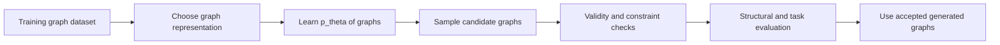
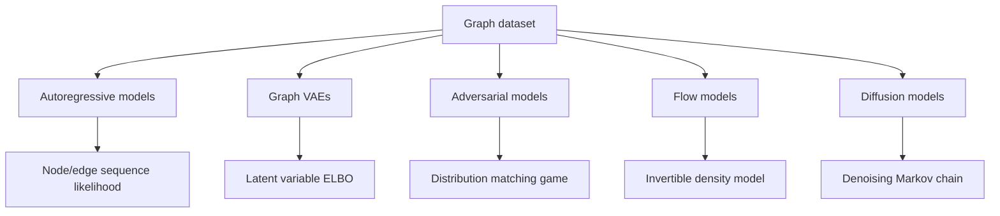
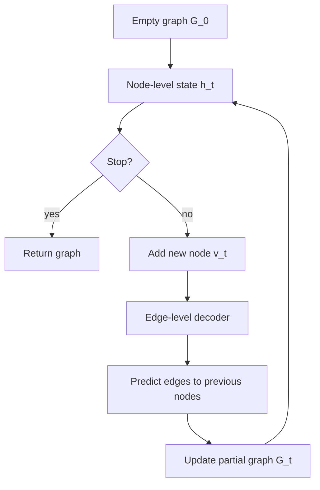
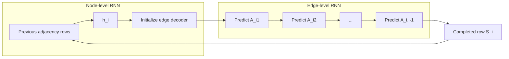
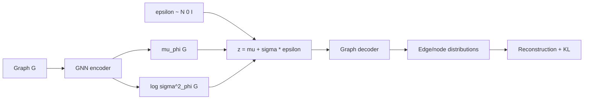
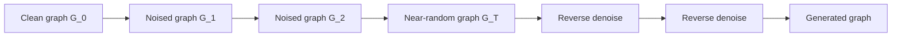

# Deep Generative Models for Graphs

Deep graph generative models learn a probability distribution over graphs and sample new graphs whose structural, attribute, and domain-specific properties resemble the training distribution. A graph sample is not a fixed-length vector: it has a variable number of nodes, a variable number of edges, symmetries under node relabeling, and often discrete node and edge types. These properties make graph generation more delicate than image or sequence generation.

For a dataset of graphs

$$
\mathcal{D} = \{G_i\}_{i=1}^{N},
$$

the goal is to learn a model

$$
p_{\theta}(G)
$$

such that samples

$$
G \sim p_{\theta}(G)
$$

match the real data distribution under graph-level statistics, node and edge attributes, constraints, and downstream utility.

Typical applications include molecule generation, protein and material design, circuit generation, scene graph synthesis, knowledge graph completion, social network simulation, and synthetic data generation for graph ML benchmarks.



## 1. What Makes Graph Generation Hard

Let $G=(V,E,X,A)$ be a graph with $n=|V|$ nodes, adjacency matrix $A \in \{0,1\}^{n \times n}$, and optional node features $X \in \mathbb{R}^{n \times d}$ or categorical node labels $x_v \in \{1,\dots,C\}$. For edge-attributed graphs, each edge can have a type

$$
e_{uv} \in \{0,1,\dots,B\},
$$

where $0$ often represents no edge.

The main complications are:

- **Variable size:** $n$ differs across samples.
- **Discrete structure:** edges and many node labels are categorical.
- **Permutation symmetry:** the same graph has many adjacency matrices.
- **Combinatorial support:** there are $2^{n(n-1)/2}$ undirected untyped graphs on $n$ labeled nodes.
- **Global dependencies:** one edge decision may affect connectivity, cycles, chemical validity, or long-range motifs.
- **Domain constraints:** molecules require valid valence; circuits require typed connectivity; knowledge graphs require relation semantics.

### Permutation Symmetry

For any permutation matrix $P \in \{0,1\}^{n \times n}$, relabeling nodes gives

$$
A' = P A P^\top,
$$

and the unlabeled graph is unchanged. Therefore, for an unlabeled graph distribution, a perfect model should satisfy

$$
p_{\theta}(A) = p_{\theta}(PAP^\top)
$$

or should define probabilities over equivalence classes

$$
[A] = \{PAP^\top : P \in \mathcal{S}_n\}.
$$

Most practical models either impose an ordering, use permutation-equivariant neural networks, or train with approximate graph matching.

## 2. Taxonomy of Deep Graph Generative Models

| Family | Probability view | Sampling style | Strengths | Main limitations |
|---|---:|---|---|---|
| Autoregressive | $p(G)=\prod_t p(a_t \mid a_{<t})$ | Sequential node/edge actions | Explicit likelihood, valid stepwise construction | Slow; ordering-sensitive |
| VAE | $p_{\theta}(G)=\int p_{\theta}(G \mid z)p(z)\,dz$ | Sample latent $z$, decode graph | Continuous latent space, interpolation | Graph matching; blurry independent edge decoders |
| GAN | Minimax distribution matching | Generator vs discriminator | Can optimize implicit distributions | Training instability; no likelihood |
| Normalizing flow | Exact change of variables | Invertible latent-to-graph process | Exact likelihood for transformed variables | Discrete graph handling is hard |
| Diffusion | Reverse learned noising process | Iterative denoising | Strong discrete generation, parallelizable steps | Many sampling steps; expensive training |



## 3. Graph Representation Choices

### Dense Adjacency Tensor

For maximum graph size $n_{\max}$ and $B$ edge classes including "no edge", represent a graph with

$$
E \in \{0,1\}^{n_{\max} \times n_{\max} \times B}.
$$

For each node pair $(u,v)$,

$$
\sum_{b=0}^{B-1} E_{uvb}=1.
$$

This is convenient for graph VAEs and diffusion models on small graphs, but memory is

$$
O(n_{\max}^2B).
$$

### Sparse Edge List

A sparse graph can be represented as

$$
\mathcal{E} = \{(u_k,v_k,r_k)\}_{k=1}^{m},
$$

where $r_k$ is an edge type. This is efficient when $m \ll n^2$, but generation requires deciding which non-edges remain absent.

### Sequential Action Representation

Autoregressive models represent graph generation as actions:

$$
a_t \in \{\text{add-node}, \text{add-edge}, \text{choose-node}, \text{choose-edge-type}, \text{stop}\}.
$$

Then

$$
p_{\theta}(G) = \sum_{a_{1:T} \in \mathcal{A}(G)} \prod_{t=1}^{T} p_{\theta}(a_t \mid a_{<t}),
$$

where $\mathcal{A}(G)$ is the set of valid action sequences that construct $G$. In practice, most models choose one or a small number of canonical orderings and optimize a lower-variance surrogate.

## 4. Autoregressive Graph Generation

### Motivation

Autoregressive models reduce graph generation to a sequence of small conditional decisions. Instead of predicting an entire adjacency matrix at once, they ask: given the partial graph already generated, what node or edge should be added next?

For an ordered representation of a graph,

$$
S(G) = (s_1,s_2,\dots,s_T),
$$

the likelihood factorizes exactly as

$$
p_{\theta}(S(G)) = \prod_{t=1}^{T} p_{\theta}(s_t \mid s_1,\dots,s_{t-1}).
$$

If the sequence representation is deterministic for a chosen node ordering, maximizing graph likelihood becomes sequence maximum likelihood.

### Step-by-Step Execution

Given an empty graph $G_0$:

1. Initialize hidden state $h_0$.
2. Predict whether to add a node or stop.
3. If adding a node $v_t$, append it to the partial graph.
4. Predict edges from $v_t$ to previous nodes.
5. Optionally predict node type and edge types.
6. Update hidden states using the new partial graph.
7. Repeat until stop or maximum size.



### GraphRNN Factorization

GraphRNN represents a graph by ordering nodes and generating rows of the adjacency matrix. For a graph with node order $1,\dots,n$, define

$$
S_i = (A_{i,1}, A_{i,2}, \dots, A_{i,i-1})
$$

as the adjacency decisions from node $i$ to all previous nodes. The graph sequence is

$$
S = (S_1,S_2,\dots,S_n).
$$

Then

$$
p_{\theta}(G)
\approx
p_{\theta}(S)
=
\prod_{i=1}^{n+1} p_{\theta}(S_i \mid S_1,\dots,S_{i-1}),
$$

where $S_{n+1}$ is a stop token.

Each row likelihood can be factorized edge-by-edge:

$$
p_{\theta}(S_i \mid S_{<i})
=
\prod_{j=1}^{i-1}
p_{\theta}(A_{i,j} \mid S_{<i}, A_{i,1},\dots,A_{i,j-1}).
$$

GraphRNN uses two recurrent networks:

- A **graph-level/node-level RNN** updates after each generated row $S_i$.
- An **edge-level RNN** generates the binary entries inside $S_i$.



### Loss Derivation

For binary edges, let the edge decoder output logits

$$
z_{ij} \in \mathbb{R}
$$

and probabilities

$$
\pi_{ij} = \sigma(z_{ij}) = \frac{1}{1+\exp(-z_{ij})}.
$$

Assuming conditionally Bernoulli edge decisions,

$$
p_{\theta}(A_{ij} \mid \mathrm{context})
=
\pi_{ij}^{A_{ij}}(1-\pi_{ij})^{1-A_{ij}}.
$$

The negative log-likelihood for one edge is

$$
\mathcal{L}_{ij}
=
-A_{ij}\log \pi_{ij} -(1-A_{ij})\log(1-\pi_{ij}).
$$

For one graph,

$$
\mathcal{L}(G)
=
\sum_{i=1}^{n}\sum_{j=1}^{i-1}
\left[
-A_{ij}\log \pi_{ij}
-(1-A_{ij})\log(1-\pi_{ij})
\right]
+ \mathcal{L}_{\mathrm{stop}}.
$$

For typed edges with $B$ classes, replace Bernoulli likelihood with categorical likelihood:

$$
p_{\theta}(e_{ij}=b \mid \mathrm{context})
=
\frac{\exp z_{ijb}}{\sum_{c=0}^{B-1}\exp z_{ijc}},
$$

and

$$
\mathcal{L}_{ij}
=
-\log p_{\theta}(e_{ij}=b^\star \mid \mathrm{context}).
$$

### Intuition

The row $S_i$ tells the model how the new node attaches to the existing partial graph. The node-level RNN summarizes the partial graph at a coarse level; the edge-level RNN captures dependencies among edges incident to the new node. For example, if a new node is already connected to one community member, it may become more likely to connect to nearby community members.

### BFS Ordering and Truncation

GraphRNN often uses breadth-first search orderings. In many graphs, a BFS ordering makes most edges local in sequence position. Then instead of generating the full row

$$
(A_{i,1},\dots,A_{i,i-1}),
$$

the model can generate only the most recent $M$ possible previous nodes:

$$
S_i = (A_{i,\max(1,i-M)}, \dots, A_{i,i-1}).
$$

This reduces per-graph sequence length from

$$
O(n^2)
$$

to

$$
O(nM).
$$

The assumption is that long-range edges under the chosen ordering are rare or can be captured with a sufficiently large $M$.

### Worked Example

Consider the undirected path graph

$$
1 - 2 - 3 - 4.
$$

Its lower-triangular adjacency rows are:

$$
S_1 = ()
$$

$$
S_2 = (A_{2,1}) = (1)
$$

$$
S_3 = (A_{3,1},A_{3,2}) = (0,1)
$$

$$
S_4 = (A_{4,1},A_{4,2},A_{4,3}) = (0,0,1)
$$

Suppose the model predicts:

$$
\pi_{2,1}=0.80,
$$

$$
(\pi_{3,1},\pi_{3,2})=(0.25,0.70),
$$

$$
(\pi_{4,1},\pi_{4,2},\pi_{4,3})=(0.10,0.20,0.75).
$$

The edge negative log-likelihood is:

$$
\mathcal{L}
=
-\log(0.80)
-\log(1-0.25)
-\log(0.70)
-\log(1-0.10)
-\log(1-0.20)
-\log(0.75).
$$

Numerically,

$$
\mathcal{L}
\approx
0.2231 + 0.2877 + 0.3567 + 0.1054 + 0.2231 + 0.2877
=
1.4837.
$$

## 5. From-Scratch Autoregressive Implementation

The following implementation is intentionally small. It trains a row-wise GRU decoder on fixed-size undirected graphs represented by lower-triangular adjacency rows. It is not a full GraphRNN reproduction, but it exposes the mechanics: teacher forcing, binary cross-entropy over generated rows, and autoregressive sampling.

```python
from __future__ import annotations

import numpy as np
import torch
from torch import nn
from torch.nn import functional as F


def lower_triangular_sequences(adj_mats: np.ndarray) -> tuple[torch.Tensor, torch.Tensor]:
    """
    Convert dense adjacency matrices of shape (B, n, n) into padded lower-triangular rows.

    Returns:
        x_in:  (B, n, n - 1), previous row input with a zero start row
        y:     (B, n, n - 1), target row bits
    """
    batch, n, _ = adj_mats.shape
    rows = np.zeros((batch, n, n - 1), dtype=np.float32)

    for b in range(batch):
        for i in range(1, n):
            rows[b, i, :i] = adj_mats[b, i, :i]

    x_in = np.zeros_like(rows)
    x_in[:, 1:, :] = rows[:, :-1, :]
    return torch.tensor(x_in), torch.tensor(rows)


class RowAutoregressiveGraphGenerator(nn.Module):
    """
    Row-wise graph generator:
        previous generated row -> GRU -> logits for current lower-triangular row.

    This model makes row entries conditionally independent given the GRU state.
    GraphRNN adds an edge-level RNN to model dependencies inside each row.
    """

    def __init__(self, max_nodes: int, hidden_dim: int = 128):
        super().__init__()
        self.max_nodes = max_nodes
        self.row_dim = max_nodes - 1
        self.input_proj = nn.Linear(self.row_dim, hidden_dim)
        self.gru = nn.GRU(hidden_dim, hidden_dim, batch_first=True)
        self.out = nn.Linear(hidden_dim, self.row_dim)

    def forward(self, x_in: torch.Tensor) -> torch.Tensor:
        h = torch.relu(self.input_proj(x_in))
        h, _ = self.gru(h)
        logits = self.out(h)
        return logits

    @torch.no_grad()
    def sample(self, num_graphs: int, temperature: float = 1.0) -> torch.Tensor:
        device = next(self.parameters()).device
        n = self.max_nodes
        prev_row = torch.zeros(num_graphs, 1, n - 1, device=device)
        hidden = None
        rows = []

        for i in range(n):
            h = torch.relu(self.input_proj(prev_row))
            out, hidden = self.gru(h, hidden)
            logits = self.out(out[:, -1]) / temperature
            probs = torch.sigmoid(logits)

            # Only entries j < i are valid in row i.
            row = torch.zeros(num_graphs, n - 1, device=device)
            if i > 0:
                row[:, :i] = torch.bernoulli(probs[:, :i])
            rows.append(row)
            prev_row = row[:, None, :]

        adj = torch.zeros(num_graphs, n, n, device=device)
        for i, row in enumerate(rows):
            if i > 0:
                adj[:, i, :i] = row[:, :i]
        adj = adj + adj.transpose(1, 2)
        return adj


def masked_bce_loss(logits: torch.Tensor, target: torch.Tensor) -> torch.Tensor:
    """
    BCE over valid lower-triangular entries only.
    """
    _, n, row_dim = target.shape
    mask = torch.zeros_like(target)
    for i in range(1, n):
        mask[:, i, :i] = 1.0

    loss = F.binary_cross_entropy_with_logits(logits, target, reduction="none")
    return (loss * mask).sum() / mask.sum().clamp_min(1.0)


def train_one_epoch(model, optimizer, adj_batch: np.ndarray) -> float:
    model.train()
    x_in, y = lower_triangular_sequences(adj_batch)
    logits = model(x_in)
    loss = masked_bce_loss(logits, y)

    optimizer.zero_grad()
    loss.backward()
    optimizer.step()
    return float(loss.detach())
```

Important implementation details:

- Use `binary_cross_entropy_with_logits` instead of applying `sigmoid` first. It combines sigmoid and BCE using a numerically stable log-sum-exp form.
- Mask invalid padded row entries. Otherwise the model learns artificial zeros from padding.
- Sampling is nondifferentiable because Bernoulli draws are discrete. Maximum-likelihood training uses teacher forcing instead of backpropagating through samples.
- This simplified row decoder assumes conditionally independent edges within a row. A faithful GraphRNN-style decoder adds another RNN over row entries.

## 6. Library Implementation Patterns

There is no single standard `GraphRNN` layer in PyTorch Geometric or NetworkX. In practice, libraries provide the components:

- PyTorch: recurrent modules, BCE/categorical losses, sampling primitives.
- PyTorch Geometric: graph batching, message passing layers, sparse graph containers.
- NetworkX: graph construction and structural metrics.
- RDKit: molecule validity, valence checks, canonical SMILES, chemical properties.

### PyTorch Geometric-Style Decoder Skeleton

The following pattern uses a GNN encoder over the partial graph before making edge decisions. This is closer to DGMG and GRAN-style models than plain row-wise GraphRNN.

```python
import torch
from torch import nn
from torch.nn import functional as F
from torch_geometric.nn import GCNConv, global_mean_pool


class PartialGraphPolicy(nn.Module):
    """
    Given a partial graph, score candidate attachments for a new node.
    """

    def __init__(self, node_dim: int, hidden_dim: int):
        super().__init__()
        self.conv1 = GCNConv(node_dim, hidden_dim)
        self.conv2 = GCNConv(hidden_dim, hidden_dim)
        self.stop_head = nn.Linear(hidden_dim, 1)
        self.edge_head = nn.Sequential(
            nn.Linear(2 * hidden_dim, hidden_dim),
            nn.ReLU(),
            nn.Linear(hidden_dim, 1),
        )

    def forward(self, x, edge_index, batch, candidate_node_emb):
        h = F.relu(self.conv1(x, edge_index))
        h = F.relu(self.conv2(h, edge_index))
        graph_emb = global_mean_pool(h, batch)

        stop_logit = self.stop_head(graph_emb)

        # Candidate score for connecting new node to each existing node.
        repeated_candidate = candidate_node_emb[batch]
        pair_emb = torch.cat([h, repeated_candidate], dim=-1)
        edge_logits = self.edge_head(pair_emb).squeeze(-1)
        return stop_logit, edge_logits
```

Internally, `GCNConv` computes a normalized neighborhood aggregation of the form

$$
H^{(l+1)}
=
\sigma\left(
\hat{D}^{-1/2}\hat{A}\hat{D}^{-1/2}H^{(l)}W^{(l)}
\right),
$$

where

$$
\hat{A} = A + I
$$

adds self-loops, and $\hat{D}$ is the degree matrix of $\hat{A}$. The message-passing operation gives the policy a learned summary of the current partial graph before it decides whether and where to add edges.

## 7. Graph Variational Autoencoders

### Latent Variable Model

A graph VAE introduces a latent vector

$$
z \sim p(z) = \mathcal{N}(0,I)
$$

and a decoder

$$
p_{\theta}(G \mid z).
$$

The marginal likelihood is

$$
p_{\theta}(G) = \int p_{\theta}(G \mid z)p(z)\,dz.
$$

This integral is generally intractable. VAEs introduce an encoder

$$
q_{\phi}(z \mid G)
$$

and maximize the evidence lower bound.

### ELBO Derivation

Start with the log marginal likelihood:

$$
\log p_{\theta}(G)
=
\log \int p_{\theta}(G,z)\,dz.
$$

Insert any density $q_{\phi}(z \mid G)$ whose support covers the posterior:

$$
\log p_{\theta}(G)
=
\log \int q_{\phi}(z \mid G)
\frac{p_{\theta}(G,z)}{q_{\phi}(z \mid G)}
\,dz.
$$

Apply Jensen's inequality:

$$
\log p_{\theta}(G)
\geq
\mathbb{E}_{q_{\phi}(z \mid G)}
\left[
\log \frac{p_{\theta}(G,z)}{q_{\phi}(z \mid G)}
\right].
$$

Using

$$
p_{\theta}(G,z)=p_{\theta}(G \mid z)p(z),
$$

the bound is

$$
\mathcal{L}_{\mathrm{ELBO}}(\theta,\phi;G)
=
\mathbb{E}_{q_{\phi}(z \mid G)}
\left[
\log p_{\theta}(G \mid z)
\right]
-
D_{\mathrm{KL}}\left(q_{\phi}(z \mid G)\,\|\,p(z)\right).
$$

If

$$
q_{\phi}(z \mid G)=\mathcal{N}(\mu_{\phi}(G),\operatorname{diag}(\sigma_{\phi}^2(G))),
$$

then the KL term against $\mathcal{N}(0,I)$ is

$$
D_{\mathrm{KL}}(q_{\phi}\|p)
=
\frac{1}{2}\sum_{k=1}^{d}
\left(
\mu_k^2 + \sigma_k^2 - \log \sigma_k^2 - 1
\right).
$$

Training minimizes the negative ELBO:

$$
\mathcal{J}
=
-\mathbb{E}_{q_{\phi}(z \mid G)}
\left[
\log p_{\theta}(G \mid z)
\right]
+
D_{\mathrm{KL}}\left(q_{\phi}(z \mid G)\,\|\,p(z)\right).
$$

### Reparameterization

Sample

$$
\epsilon \sim \mathcal{N}(0,I)
$$

and set

$$
z = \mu_{\phi}(G) + \sigma_{\phi}(G) \odot \epsilon.
$$

This moves randomness outside the differentiable computation graph and allows gradients to flow through $\mu_{\phi}$ and $\sigma_{\phi}$.



### GraphVAE Decoder

For small graphs with maximum size $n_{\max}$, a dense decoder may output:

$$
\hat{A} \in [0,1]^{n_{\max} \times n_{\max}},
$$

$$
\hat{X} \in [0,1]^{n_{\max} \times C},
$$

and optionally edge labels

$$
\hat{E} \in [0,1]^{n_{\max} \times n_{\max} \times B}.
$$

The reconstruction likelihood might factorize as

$$
p_{\theta}(G \mid z)
=
\prod_{u<v} p_{\theta}(A_{uv} \mid z)
\prod_{u} p_{\theta}(x_u \mid z)
\prod_{u<v:A_{uv}=1} p_{\theta}(e_{uv} \mid z).
$$

This independent-edge assumption is simple but weak: it does not directly enforce connectedness, valence, or global motifs.

### Graph Matching Problem

If the decoder outputs a fixed node order, but the graph is invariant to permutations, reconstruction should compare the target graph to the best matching permutation:

$$
\mathcal{L}_{\mathrm{rec}}(G,\hat{G})
=
\min_{P \in \mathcal{S}_n}
\ell(A, P\hat{A}P^\top).
$$

This exact minimization is combinatorial. Practical approximations include:

- canonical node orderings,
- graph matching heuristics,
- assignment algorithms on node similarities,
- permutation-equivariant decoders,
- set-based losses.

### Minimal Dense Graph VAE

```python
import torch
from torch import nn
from torch.nn import functional as F


class DenseGraphVAE(nn.Module):
    """
    Dense graph VAE for fixed n and binary undirected graphs.
    The decoder predicts lower-triangular edge logits.
    """

    def __init__(self, n_nodes: int, latent_dim: int = 16, hidden_dim: int = 128):
        super().__init__()
        self.n_nodes = n_nodes
        self.num_edges = n_nodes * (n_nodes - 1) // 2

        self.encoder = nn.Sequential(
            nn.Linear(self.num_edges, hidden_dim),
            nn.ReLU(),
            nn.Linear(hidden_dim, hidden_dim),
            nn.ReLU(),
        )
        self.mu = nn.Linear(hidden_dim, latent_dim)
        self.logvar = nn.Linear(hidden_dim, latent_dim)

        self.decoder = nn.Sequential(
            nn.Linear(latent_dim, hidden_dim),
            nn.ReLU(),
            nn.Linear(hidden_dim, self.num_edges),
        )

    def encode_edges(self, adj: torch.Tensor) -> torch.Tensor:
        idx = torch.tril_indices(self.n_nodes, self.n_nodes, offset=-1)
        return adj[:, idx[0], idx[1]]

    def decode_edges(self, edge_logits: torch.Tensor) -> torch.Tensor:
        batch = edge_logits.shape[0]
        adj = edge_logits.new_zeros(batch, self.n_nodes, self.n_nodes)
        idx = torch.tril_indices(self.n_nodes, self.n_nodes, offset=-1)
        adj[:, idx[0], idx[1]] = edge_logits
        adj = adj + adj.transpose(1, 2)
        return adj

    def forward(self, adj: torch.Tensor):
        edge_vec = self.encode_edges(adj)
        h = self.encoder(edge_vec)
        mu = self.mu(h)
        logvar = self.logvar(h)
        std = torch.exp(0.5 * logvar)
        eps = torch.randn_like(std)
        z = mu + std * eps
        edge_logits = self.decoder(z)
        return edge_logits, mu, logvar


def graph_vae_loss(model: DenseGraphVAE, adj: torch.Tensor) -> torch.Tensor:
    target = model.encode_edges(adj)
    logits, mu, logvar = model(adj)

    rec = F.binary_cross_entropy_with_logits(logits, target, reduction="sum")
    kl = -0.5 * torch.sum(1.0 + logvar - mu.pow(2) - logvar.exp())
    return (rec + kl) / adj.shape[0]
```

## 8. Adversarial Graph Generation

GAN-style graph generation learns an implicit sampler

$$
G_{\theta}: z \mapsto \tilde{G}
$$

and a discriminator

$$
D_{\psi}(G) \in (0,1)
$$

that tries to distinguish real graphs from generated graphs.

The original minimax objective is

$$
\min_{\theta}\max_{\psi}
\mathbb{E}_{G \sim p_{\mathrm{data}}}
[\log D_{\psi}(G)]
+
\mathbb{E}_{z \sim p(z)}
[\log(1-D_{\psi}(G_{\theta}(z)))].
$$

For graphs, the difficult part is that $\tilde{G}$ is discrete. If the generator samples edges using Bernoulli or categorical distributions, the discriminator loss is not directly differentiable through the sampled graph. Common workarounds include:

- continuous adjacency relaxations,
- Gumbel-Softmax / Concrete distributions,
- policy-gradient estimators,
- adversarial training in embedding space,
- Wasserstein objectives with gradient penalties.

### Gumbel-Softmax Relaxation

For categorical probabilities $\pi_1,\dots,\pi_K$, sample independent Gumbel noise

$$
g_k = -\log(-\log u_k), \qquad u_k \sim \operatorname{Uniform}(0,1),
$$

and compute

$$
y_k =
\frac{\exp((\log \pi_k + g_k)/\tau)}
{\sum_{c=1}^{K}\exp((\log \pi_c + g_c)/\tau)}.
$$

As $\tau \rightarrow 0$, $y$ becomes close to one-hot. For finite $\tau$, it is differentiable. In graph generation, this can approximate discrete node or edge types during training.

### Pitfalls

- If the discriminator is too strong, generator gradients vanish.
- If the generator uses dense adjacency relaxations, samples may not be valid discrete graphs.
- Graph-level discriminators must be permutation-invariant; otherwise they may learn node ordering artifacts.
- Mode collapse can produce structurally similar graphs with low diversity.

## 9. Normalizing Flows for Graphs

Normalizing flows learn an invertible transformation

$$
x = f_{\theta}(z), \qquad z \sim p_Z(z),
$$

with density

$$
\log p_X(x)
=
\log p_Z(f_{\theta}^{-1}(x))
+
\log \left|
\det \frac{\partial f_{\theta}^{-1}}{\partial x}
\right|.
$$

For molecular graphs, flow-based models often generate nodes and edges autoregressively while using invertible transformations for continuous or dequantized variables. GraphAF combines autoregressive generation with flow likelihoods for molecular graph actions.

### Why Flows Are Hard for Graphs

Graphs are discrete, while standard flows require continuous invertible mappings. Practical models use:

- dequantization of discrete variables,
- autoregressive categorical decisions plus invertible continuous transformations,
- validity-constrained action spaces,
- reinforcement learning fine-tuning for molecular properties.

## 10. Diffusion Models for Graphs

Diffusion models define a forward noising process

$$
q(G_t \mid G_{t-1})
$$

that gradually destroys graph structure, and a learned reverse process

$$
p_{\theta}(G_{t-1} \mid G_t)
$$

that denoises from noise to data.



### Discrete Forward Process

For categorical edge states, let each edge variable be one-hot:

$$
e_{uv}^{(t)} \in \{0,1\}^{B}.
$$

A categorical transition matrix $Q_t \in [0,1]^{B \times B}$ defines

$$
q(e_{uv}^{(t)} \mid e_{uv}^{(t-1)})
=
e_{uv}^{(t-1)} Q_t.
$$

The marginal transition from time $0$ to $t$ is

$$
\bar{Q}_t = Q_1Q_2\cdots Q_t,
$$

so

$$
q(e_{uv}^{(t)} \mid e_{uv}^{(0)})
=
e_{uv}^{(0)}\bar{Q}_t.
$$

For node labels, the same construction applies with a node-label transition matrix.

### Reverse Model

A graph transformer or message-passing network predicts the clean labels or the posterior transition:

$$
p_{\theta}(G_{t-1} \mid G_t)
$$

or

$$
p_{\theta}(G_0 \mid G_t).
$$

For categorical denoising, a common loss is cross-entropy between the true clean category and predicted clean category:

$$
\mathcal{L}_{\mathrm{diff}}
=
\mathbb{E}_{t,G_0,G_t}
\left[
-\sum_{u<v}\log p_{\theta}(e_{uv}^{(0)} \mid G_t,t)
-\sum_{u}\log p_{\theta}(x_u^{(0)} \mid G_t,t)
\right].
$$

### Intuition

Diffusion converts graph generation into repeated correction. Early reverse steps establish coarse structure such as size, density, and connected components. Later reverse steps repair local details such as edge types, atom labels, and motifs. Unlike strictly autoregressive models, many edge and node states can be updated in parallel at each denoising step.

### Minimal Discrete Edge Denoising Step

```python
import torch
from torch import nn
from torch.nn import functional as F


class EdgeDenoiser(nn.Module):
    """
    Toy dense edge denoiser.
    Input: noised edge one-hot tensor (B, n, n, C) and scalar diffusion step t.
    Output: clean edge logits (B, n, n, C).
    """

    def __init__(self, edge_classes: int, hidden_dim: int = 128):
        super().__init__()
        self.edge_classes = edge_classes
        self.time_mlp = nn.Sequential(
            nn.Linear(1, hidden_dim),
            nn.SiLU(),
            nn.Linear(hidden_dim, hidden_dim),
        )
        self.net = nn.Sequential(
            nn.Linear(edge_classes + hidden_dim, hidden_dim),
            nn.SiLU(),
            nn.Linear(hidden_dim, edge_classes),
        )

    def forward(self, edge_onehot: torch.Tensor, t: torch.Tensor) -> torch.Tensor:
        batch, n, _, c = edge_onehot.shape
        time_emb = self.time_mlp(t[:, None].float())
        time_emb = time_emb[:, None, None, :].expand(batch, n, n, -1)
        inp = torch.cat([edge_onehot, time_emb], dim=-1)
        logits = self.net(inp)
        return logits


def categorical_noise(edge_onehot: torch.Tensor, beta: float) -> torch.Tensor:
    """
    With probability beta, replace each category by a uniformly random category.
    """
    batch, n, _, c = edge_onehot.shape
    keep = torch.rand(batch, n, n, 1, device=edge_onehot.device) > beta
    random_idx = torch.randint(c, (batch, n, n), device=edge_onehot.device)
    random_onehot = F.one_hot(random_idx, num_classes=c).float()
    return torch.where(keep, edge_onehot, random_onehot)
```

This is only a local toy denoiser. Practical graph diffusion models use permutation-equivariant architectures, masks for invalid padded nodes, symmetry enforcement for undirected graphs, and carefully designed transition kernels that preserve marginal category distributions.

## 11. Evaluation of Generated Graphs

Graph generation is rarely evaluated by a single metric. A good evaluation suite combines structural statistics, validity constraints, novelty, uniqueness, and downstream utility.

### Structural Statistics

Common statistics include:

$$
\operatorname{degree}(v)=\sum_{u}A_{vu},
$$

clustering coefficient

$$
C_v =
\frac{2T_v}{d_v(d_v-1)}
$$

for $d_v \geq 2$, where $T_v$ is the number of triangles through $v$, shortest path length distributions, connected components, graph diameter, assortativity, community structure, and motif counts.

### Maximum Mean Discrepancy

Given graph statistic vectors from real graphs

$$
\{r_i\}_{i=1}^{m}
$$

and generated graphs

$$
\{g_j\}_{j=1}^{n},
$$

MMD compares the two empirical distributions in a reproducing kernel Hilbert space:

$$
\operatorname{MMD}^2
=
\frac{1}{m^2}\sum_{i=1}^{m}\sum_{i'=1}^{m}k(r_i,r_{i'})
+
\frac{1}{n^2}\sum_{j=1}^{n}\sum_{j'=1}^{n}k(g_j,g_{j'})
-
\frac{2}{mn}\sum_{i=1}^{m}\sum_{j=1}^{n}k(r_i,g_j).
$$

For an RBF kernel,

$$
k(a,b)=\exp\left(-\frac{\|a-b\|_2^2}{2\sigma^2}\right).
$$

If MMD is small, the statistic distributions are close under the chosen kernel. It does not prove the graph distributions are identical; it only tests the chosen summaries and kernel scale.

### Worked MMD Example

Suppose real graphs have average degrees

$$
r = [2,3]
$$

and generated graphs have

$$
g = [2,4].
$$

Use

$$
k(a,b)=\exp\left(-\frac{(a-b)^2}{2}\right).
$$

The real-real term is

$$
\frac{1}{4}
\left[
k(2,2)+k(2,3)+k(3,2)+k(3,3)
\right]
=
\frac{1}{4}
\left[
1+e^{-1/2}+e^{-1/2}+1
\right]
\approx 0.8033.
$$

The generated-generated term is

$$
\frac{1}{4}
\left[
k(2,2)+k(2,4)+k(4,2)+k(4,4)
\right]
=
\frac{1}{4}
\left[
1+e^{-2}+e^{-2}+1
\right]
\approx 0.5677.
$$

The cross term is

$$
\frac{2}{4}
\left[
k(2,2)+k(2,4)+k(3,2)+k(3,4)
\right]
=
\frac{1}{2}
\left[
1+e^{-2}+e^{-1/2}+e^{-1/2}
\right]
\approx 1.1740.
$$

Therefore

$$
\operatorname{MMD}^2
\approx 0.8033 + 0.5677 - 1.1740 = 0.1970.
$$

### Python Evaluation Utilities

```python
import networkx as nx
import numpy as np


def graph_statistics(graphs: list[nx.Graph]) -> np.ndarray:
    rows = []
    for g in graphs:
        degrees = np.array([d for _, d in g.degree()], dtype=float)
        avg_degree = degrees.mean() if len(degrees) else 0.0
        clustering = nx.average_clustering(g) if g.number_of_nodes() else 0.0
        components = nx.number_connected_components(g) if g.number_of_nodes() else 0

        if g.number_of_nodes() > 0 and nx.is_connected(g):
            avg_path = nx.average_shortest_path_length(g)
            diameter = nx.diameter(g)
        else:
            avg_path = np.nan
            diameter = np.nan

        rows.append([avg_degree, clustering, components, avg_path, diameter])
    return np.array(rows, dtype=float)


def rbf_mmd(x: np.ndarray, y: np.ndarray, sigma: float = 1.0) -> float:
    x = np.nan_to_num(x, nan=0.0)
    y = np.nan_to_num(y, nan=0.0)

    def kernel(a, b):
        sqdist = ((a[:, None, :] - b[None, :, :]) ** 2).sum(axis=-1)
        return np.exp(-sqdist / (2.0 * sigma**2))

    return float(kernel(x, x).mean() + kernel(y, y).mean() - 2.0 * kernel(x, y).mean())
```

## 12. Molecule Generation

A molecule is naturally represented as a graph:

- nodes are atoms,
- edges are chemical bonds,
- node labels are atom types and charges,
- edge labels are bond types,
- constraints include valence, aromaticity, ring validity, and synthesizability.

The generation objective often combines distribution learning with property optimization:

$$
\max_{\theta}
\mathbb{E}_{G \sim p_{\theta}}
\left[
R(G)
\right],
$$

where $R(G)$ may include drug-likeness, binding score, synthetic accessibility, or penalized logP. Pure maximum likelihood learns the training molecule distribution; property optimization biases samples toward desired regions.

### Validity, Novelty, and Uniqueness

For generated molecule set $\mathcal{G}$:

$$
\operatorname{validity}
=
\frac{|\{G \in \mathcal{G}: G \text{ is chemically valid}\}|}{|\mathcal{G}|}.
$$

Given a training set $\mathcal{D}$,

$$
\operatorname{novelty}
=
\frac{|\{G \in \mathcal{G}_{\mathrm{valid}}: G \notin \mathcal{D}\}|}{|\mathcal{G}_{\mathrm{valid}}|}.
$$

Using canonical molecule strings, uniqueness is

$$
\operatorname{uniqueness}
=
\frac{|\operatorname{unique}(\mathcal{G}_{\mathrm{valid}})|}{|\mathcal{G}_{\mathrm{valid}}|}.
$$

### Constraint-Aware Decoding

A molecule generator can improve validity by masking invalid actions. If atom $v$ has remaining valence capacity $c_v$, and a candidate bond type $b$ has order $o_b$, then an edge action $(u,v,b)$ is valid only if

$$
o_b \leq c_u
\quad \text{and} \quad
o_b \leq c_v.
$$

During sampling, invalid logits can be set to $-\infty$:

$$
z'_a =
\begin{cases}
z_a, & a \in \mathcal{A}_{\mathrm{valid}}, \\
-\infty, & a \notin \mathcal{A}_{\mathrm{valid}}.
\end{cases}
$$

Then

$$
p(a \mid G_t)
=
\frac{\exp z'_a}{\sum_{a'}\exp z'_{a'}}.
$$

This changes the model distribution, but it prevents many invalid samples.

## 13. Complexity

Let $n$ be nodes, $m$ be edges, $d$ be hidden dimension, $T$ be diffusion steps, and $B$ be edge classes.

| Model family | Typical training cost per graph | Sampling cost | Memory |
|---|---:|---:|---:|
| Dense VAE | $O(n^2d)$ | $O(n^2d)$ | $O(n^2B)$ |
| Row autoregressive | $O(nMd^2)$ with truncation | $O(nMd^2)$ | $O(Md+nM)$ |
| Full edge autoregressive | $O(n^2d^2)$ | $O(n^2d^2)$ | $O(n^2)$ |
| GNN action model | $O(T_{\mathrm{act}}(m d + nd^2))$ | Same order | Sparse graph memory |
| Dense diffusion | $O(T n^2 d)$ | $O(T n^2 d)$ | $O(n^2B)$ |
| Sparse/block generation | Depends on block size and candidate set | Often subquadratic | Sparse/block memory |

Dense models are practical for molecules and small synthetic graphs. Large social or knowledge graphs usually require sparse generation, block generation, hierarchical generation, or generation of subgraphs rather than entire graphs at once.

## 14. Numerical Stability and Implementation Pitfalls

### Likelihood and Losses

- Use logits-based losses: `binary_cross_entropy_with_logits` and `cross_entropy`.
- Clamp probabilities only at metric computation time, not inside the training objective unless necessary.
- Mask padded nodes, padded edges, invalid lower-triangular entries, and absent graph components.
- For undirected graphs, enforce symmetry:

$$
\hat{A} \leftarrow \frac{\hat{A}+\hat{A}^{\top}}{2}
$$

for continuous scores, or sample one triangle and mirror it.

### Ordering Sensitivity

Autoregressive likelihood depends on node order. A model may learn artifacts of BFS order rather than intrinsic structure. Mitigations:

- randomize BFS roots,
- train on multiple orderings,
- use permutation-equivariant graph encoders,
- use block generation,
- evaluate with order-invariant metrics.

### Class Imbalance

Sparse graphs have many more non-edges than edges. A dense BCE objective can be dominated by absent edges. Options:

- negative sampling,
- weighted BCE,
- focal loss,
- candidate edge restriction,
- sparse action spaces.

### Exposure Bias

Teacher forcing trains on real partial graphs, but sampling conditions on the model's own previous decisions. Mistakes can compound. Mitigations include scheduled sampling, reinforcement learning fine-tuning, constraint-aware decoding, and denoising-style objectives.

### Validity Constraints

Generic graph generators may produce invalid molecules, disconnected circuits, impossible knowledge graph triples, or graphs with wrong type signatures. Hard constraints should be integrated into the action space or decoding masks when validity is non-negotiable.

### Evaluation Pitfalls

- Matching degree distribution alone is insufficient.
- MMD depends heavily on chosen statistics and kernel bandwidth.
- Validity can be high for trivial generators that produce small or repetitive graphs.
- Novelty without quality is not useful.
- Random train/test splits may leak scaffolds in molecular generation; scaffold splits are often more realistic.

## 15. Connections to Related ML Concepts

- **Language modeling:** autoregressive graph generation is sequence modeling after choosing a graph serialization.
- **Structured prediction:** generation is a sequence of constrained decisions over nodes, edges, and types.
- **Message passing GNNs:** partial graph encoders provide permutation-equivariant context for action policies.
- **Energy-based modeling:** some graph generators define unnormalized graph scores and sample with MCMC.
- **Set generation:** node generation has exchangeability and permutation issues similar to set prediction.
- **Causal generation:** temporal and process-driven graphs may require causal mechanisms rather than static distribution matching.
- **Combinatorial optimization:** molecule property optimization and circuit generation often combine generative modeling with search or reinforcement learning.

## 16. Practical Model Selection

Use the simplest model that respects the graph domain:

- Small fixed-size graphs: dense VAE or discrete diffusion can be effective.
- Molecules with hard validity constraints: autoregressive or flow-style action models with valence masks are strong baselines.
- Larger sparse graphs: GraphRNN-style truncation, GRAN-style block generation, hierarchical models, or subgraph generation are more scalable.
- Attribute-rich graphs: use typed node and edge distributions; do not collapse all edges into binary adjacency.
- Need exact likelihood: use autoregressive or flow-based models.
- Need high sample quality and parallel updates: use diffusion if sampling cost is acceptable.

## 17. References and Deeper Reading

- You et al., [**GraphRNN: Generating Realistic Graphs with Deep Auto-regressive Models**](https://arxiv.org/abs/1802.08773), ICML 2018.
- Simonovsky and Komodakis, [**GraphVAE: Towards Generation of Small Graphs Using Variational Autoencoders**](https://arxiv.org/abs/1802.03480), ICANN 2018.
- Li et al., [**Learning Deep Generative Models of Graphs**](https://arxiv.org/abs/1803.03324), ICLR 2018.
- Liao et al., [**Efficient Graph Generation with Graph Recurrent Attention Networks**](https://arxiv.org/abs/1910.00760), NeurIPS 2019.
- Shi et al., [**GraphAF: a Flow-based Autoregressive Model for Molecular Graph Generation**](https://arxiv.org/abs/2001.09382), ICLR 2020.
- Vignac et al., [**DiGress: Discrete Denoising Diffusion for Graph Generation**](https://arxiv.org/abs/2209.14734), ICLR 2023.
- Kipf and Welling, [**Variational Graph Auto-Encoders**](https://arxiv.org/abs/1611.07308), NeurIPS Workshop 2016.
- Gilmer et al., [**Neural Message Passing for Quantum Chemistry**](https://arxiv.org/abs/1704.01212), ICML 2017.
