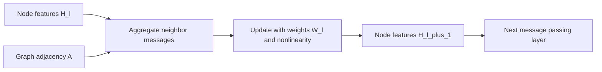
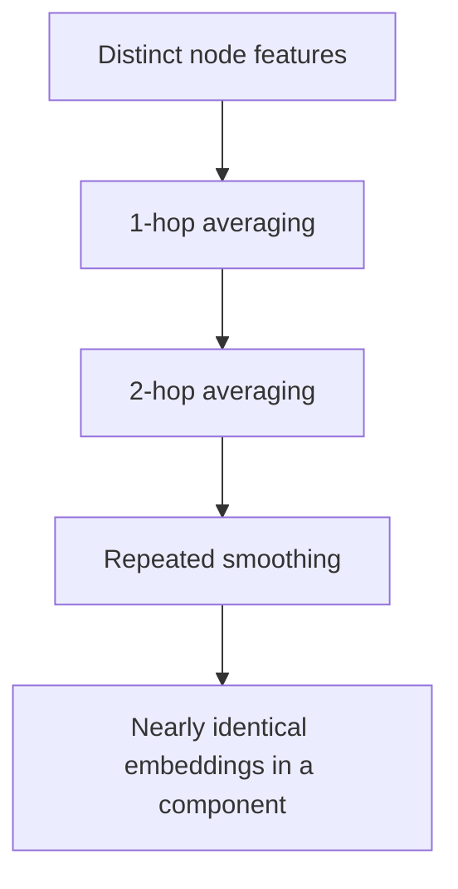
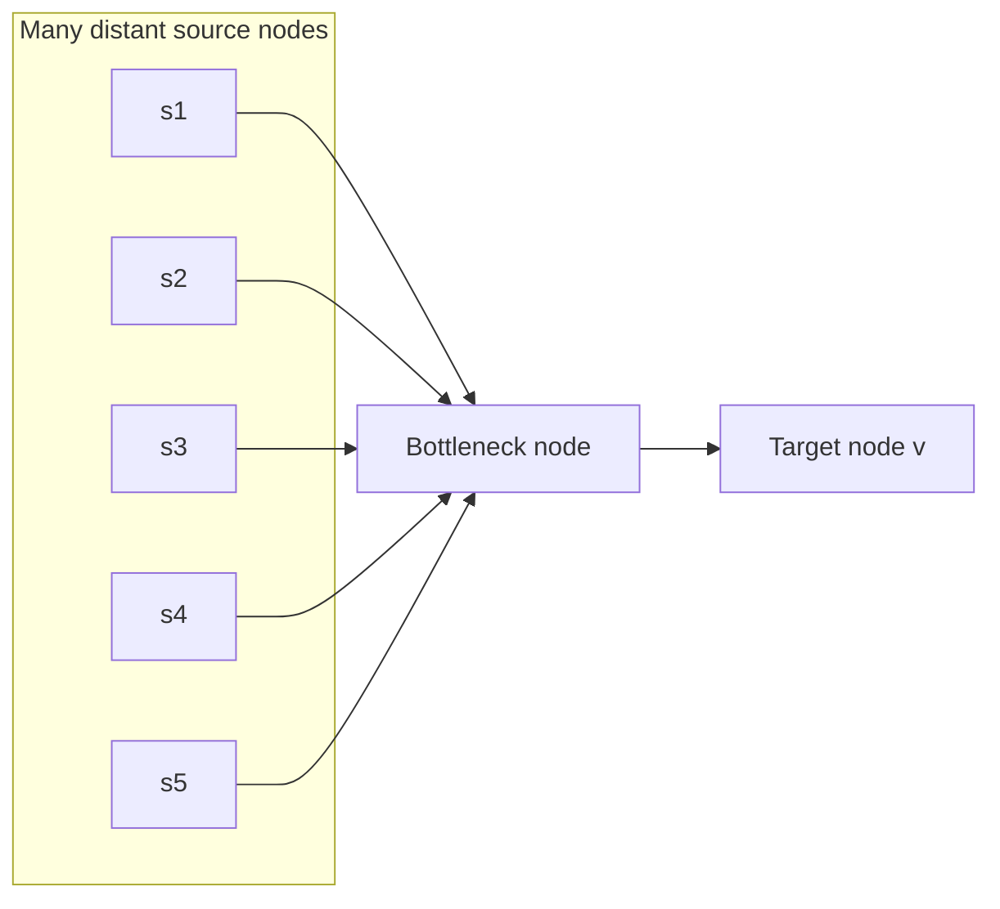
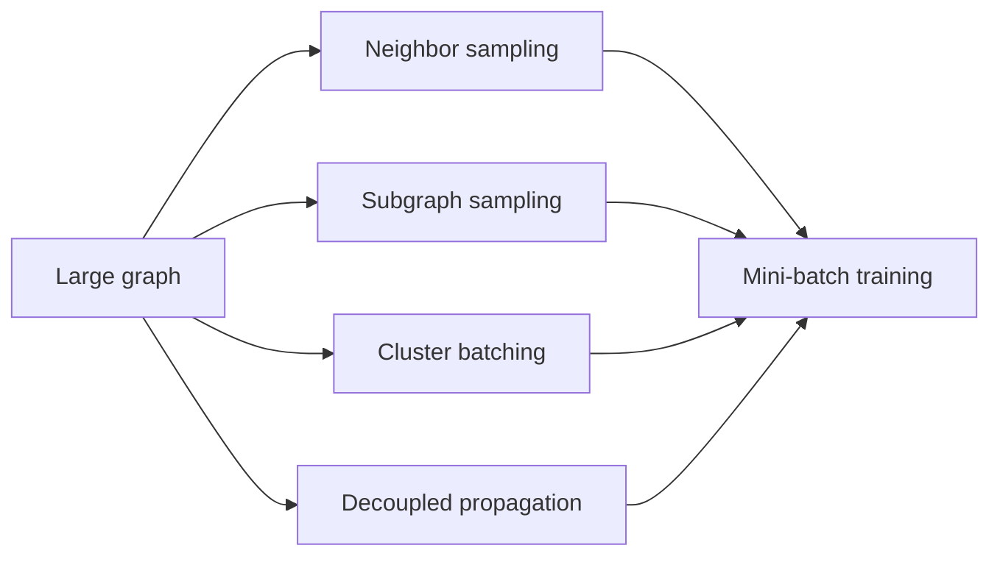
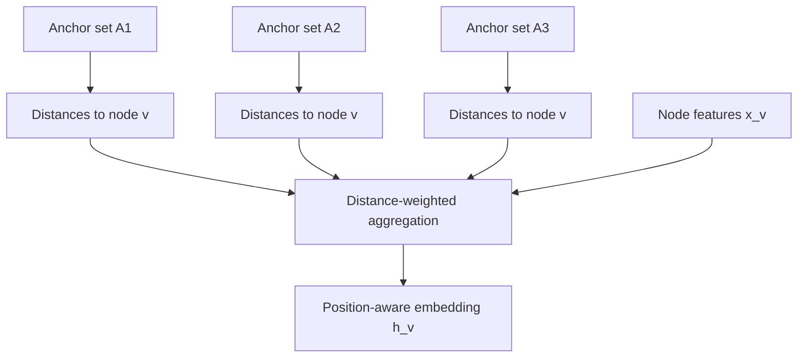
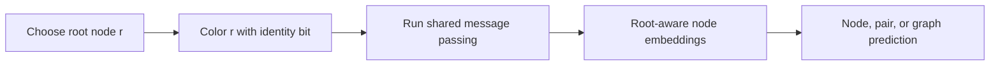
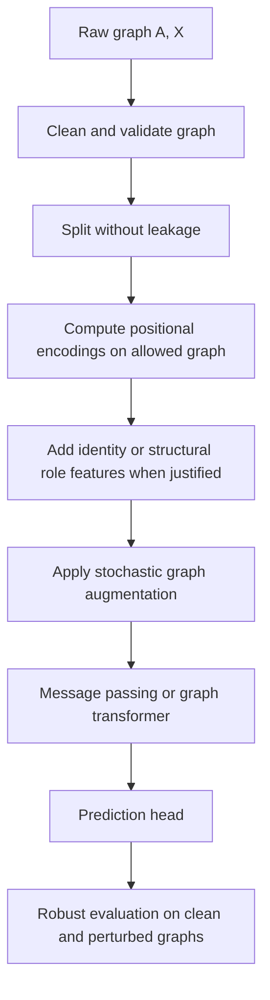

# GNN Limitations, Position-Aware GNNs, Identity-Aware GNNs, and Robust GNNs

Message-passing Graph Neural Networks are powerful because they combine local feature transformation with neighborhood aggregation. The same mechanism creates their main limitations: repeated aggregation smooths node representations, long-range signals are compressed through small graph bottlenecks, permutation-equivariant updates cannot distinguish many symmetric structures, and noisy edges can corrupt predictions through propagation.

This chapter treats the limitations as properties of the message-passing operator, then studies three major responses:

- **Position-aware GNNs:** inject information about where a node sits in the graph.
- **Identity-aware GNNs:** mark or encode node identities to break symmetries that ordinary message passing cannot break.
- **Robust GNNs:** train and design models to tolerate noisy features, missing edges, spurious edges, fake nodes, and adversarial graph perturbations.

## 1. Message Passing as the Starting Point

Let

$$
G=(V,E)
$$

be a graph with $n=|V|$ nodes, adjacency matrix $A \in \{0,1\}^{n \times n}$, node features

$$
X \in \mathbb{R}^{n \times d_0},
$$

and hidden node states

$$
H^{(l)} \in \mathbb{R}^{n \times d_l}.
$$

A generic message-passing layer has the form

$$
m_v^{(l)}
=
\operatorname{AGG}^{(l)}
\left(
\left\{
\phi^{(l)}\left(h_v^{(l)}, h_u^{(l)}, e_{uv}\right)
: u \in \mathcal{N}(v)
\right\}
\right),
$$

$$
h_v^{(l+1)}
=
\psi^{(l)}\left(h_v^{(l)}, m_v^{(l)}\right).
$$

Here:

- $h_v^{(l)}$ is the representation of node $v$ at layer $l$.
- $\mathcal{N}(v)$ is the neighborhood of $v$.
- $\phi^{(l)}$ computes messages from neighbors.
- $\operatorname{AGG}^{(l)}$ is a permutation-invariant aggregation function such as sum, mean, max, or attention-weighted sum.
- $\psi^{(l)}$ updates the node state.

Many common GNNs are special cases. A GCN layer can be written as

$$
H^{(l+1)}
=
\sigma\left(\hat{S}H^{(l)}W^{(l)}\right),
$$

where

$$
\hat{A}=A+I,
$$

$$
\hat{D}_{ii}=\sum_j \hat{A}_{ij},
$$

and

$$
\hat{S}=\hat{D}^{-1/2}\hat{A}\hat{D}^{-1/2}.
$$

The matrix $\hat{S}$ is a normalized graph smoothing operator. Stacking layers repeatedly applies smoothing, local mixing, and nonlinear feature transformation.



## 2. Over-Smoothing

### Motivation

Deep GNNs often perform worse as the number of layers grows. After many message-passing steps, node embeddings within a connected component can become nearly indistinguishable, even when their initial features were different.

This is **over-smoothing**.

### Linearized Derivation

Ignore nonlinearities and trainable matrices for the moment. Consider repeated propagation:

$$
H^{(L)} = \hat{S}^{L}X.
$$

For a connected, non-bipartite undirected graph with self-loops, $\hat{S}$ has eigen-decomposition

$$
\hat{S}=U\Lambda U^\top,
$$

where

$$
\Lambda=\operatorname{diag}(\lambda_1,\dots,\lambda_n),
$$

and eigenvalues satisfy approximately

$$
1=\lambda_1 > |\lambda_2| \geq \cdots \geq |\lambda_n|.
$$

Then

$$
\hat{S}^{L}
=
U\Lambda^{L}U^\top
=
\sum_{k=1}^{n}\lambda_k^{L}u_ku_k^\top.
$$

As $L \rightarrow \infty$,

$$
\lambda_k^L \rightarrow 0
\qquad \text{for } k \geq 2,
$$

so

$$
\hat{S}^{L}X
\rightarrow
u_1u_1^\top X.
$$

For normalized adjacency, $u_1$ is related to the degree profile. Therefore, every node representation in the same connected component converges toward a low-dimensional subspace dominated by the principal eigenvector. Node-specific high-frequency information is removed.

### Dirichlet Energy View

For node embeddings $H \in \mathbb{R}^{n \times d}$, define graph Dirichlet energy

$$
\mathcal{E}(H)
=
\frac{1}{2}\sum_{(u,v)\in E}
\left\|
\frac{h_u}{\sqrt{d_u}}
-
\frac{h_v}{\sqrt{d_v}}
\right\|_2^2.
$$

Low energy means adjacent nodes have similar embeddings. GCN-style propagation decreases high-frequency components, so repeated propagation tends to reduce $\mathcal{E}(H)$.

### Step-by-Step Execution

1. At layer $0$, nodes may have distinguishable features.
2. Layer $1$ averages each node with its immediate neighbors.
3. Layer $2$ mixes information from two-hop neighborhoods.
4. After $L$ layers, each node has mixed information from its $L$-hop receptive field.
5. In a connected graph, large $L$ makes many receptive fields nearly the whole graph.
6. Embeddings collapse toward component-level averages or low-frequency signals.



### Worked Example

Consider a 3-node path with self-loops:

$$
A =
\begin{bmatrix}
0 & 1 & 0 \\
1 & 0 & 1 \\
0 & 1 & 0
\end{bmatrix},
\qquad
\hat{A}=A+I=
\begin{bmatrix}
1 & 1 & 0 \\
1 & 1 & 1 \\
0 & 1 & 1
\end{bmatrix}.
$$

Use a row-normalized propagation matrix for easy arithmetic:

$$
P=\hat{D}^{-1}\hat{A}
=
\begin{bmatrix}
1/2 & 1/2 & 0 \\
1/3 & 1/3 & 1/3 \\
0 & 1/2 & 1/2
\end{bmatrix}.
$$

Let initial scalar features be

$$
x^{(0)}=
\begin{bmatrix}
1 \\
0 \\
-1
\end{bmatrix}.
$$

After one propagation:

$$
x^{(1)}=Px^{(0)}
=
\begin{bmatrix}
1/2 \\
0 \\
-1/2
\end{bmatrix}.
$$

After two propagations:

$$
x^{(2)}=Px^{(1)}
=
\begin{bmatrix}
1/4 \\
0 \\
-1/4
\end{bmatrix}.
$$

After $L$ propagations, the contrast between endpoint nodes decays. The node features are not becoming more expressive; they are becoming smoother.

### Mitigations

Common mitigations include:

- residual or initial residual connections,
- jumping knowledge across layers,
- normalization designed for graph depth,
- decoupling propagation depth from transformation depth,
- graph rewiring,
- limiting unnecessary depth,
- using positional or identity features to preserve distinguishing information.

For example, an initial residual update can be written as

$$
H^{(l+1)}
=
\sigma\left(
\left((1-\alpha)\hat{S}H^{(l)}+\alpha X\right)W^{(l)}
\right),
$$

where $\alpha \in [0,1]$ preserves part of the original feature signal.

## 3. Over-Squashing

### Motivation

Over-smoothing concerns representations becoming too similar. **Over-squashing** is different: information from exponentially many distant nodes must pass through a small number of edges or nodes, so long-range dependencies are compressed into fixed-size vectors.

### Receptive Field Growth vs Bottleneck Capacity

After $L$ message-passing layers, node $v$ can receive information from nodes in

$$
\mathcal{B}_L(v)=\{u \in V : \operatorname{dist}(u,v)\leq L\}.
$$

If the graph has branching factor $b$, then the size of this ball can grow like

$$
|\mathcal{B}_L(v)| = O(b^L).
$$

But every message passed across an edge is usually a vector in

$$
\mathbb{R}^{d}.
$$

When many distant signals must cross a small cut, fixed-dimensional messages become an information bottleneck.

### Sensitivity View

Let $h_v^{(L)}$ be the representation of target node $v$ after $L$ layers. The influence of an input feature $x_u$ on $h_v^{(L)}$ can be measured by the Jacobian norm

$$
\left\|
\frac{\partial h_v^{(L)}}{\partial x_u}
\right\|.
$$

For many message-passing networks, this influence decays rapidly with graph distance and with bottlenecks on paths from $u$ to $v$. If all paths from many source nodes to $v$ pass through a small separator, the separator must compress all relevant information.

### Cut-Based Intuition

Let $S$ be a set of distant nodes whose information is needed at $v$. Suppose all paths from $S$ to $v$ pass through a cut of $c$ edges. Then one message-passing layer can transmit at most $c$ edge messages across that boundary, each of dimension $d$. A rough capacity proxy is

$$
O(cd).
$$

If the task-relevant information in $S$ grows with $|S|$, then $O(cd)$ can be insufficient even when the model has enough layers.



### Worked Example

Consider a binary tree of depth $L$ whose root is the prediction node. The number of leaves is

$$
2^L.
$$

If the root must determine whether at least one leaf has a special feature, then information from all leaves must move upward. At the root's two incident child edges, all leaf information has been compressed into two vectors:

$$
m_{\mathrm{left}}, m_{\mathrm{right}} \in \mathbb{R}^{d}.
$$

No matter how many leaves exist, the final decision receives only

$$
2d
$$

real-valued message coordinates from the two subtrees at the last aggregation step. Increasing $L$ grows the number of possible leaf configurations exponentially, but the final communication channel remains fixed if $d$ is fixed.

### Mitigations

Over-squashing is often mitigated by improving information routes:

- graph rewiring based on curvature, commute time, or learned edges,
- adding virtual nodes or global tokens,
- using graph transformers with global attention,
- hierarchical pooling and coarsening,
- increasing hidden dimension where bottlenecks are unavoidable,
- using positional encodings so distant nodes can be addressed more directly.

## 4. Limited Expressiveness and the 1-WL Barrier

### Motivation

Message-passing GNNs aggregate multisets of neighbor representations. This makes them naturally aligned with the 1-dimensional Weisfeiler-Lehman color refinement test. As a result, many standard GNNs cannot distinguish graphs that 1-WL cannot distinguish.

### 1-WL Color Refinement

The 1-WL algorithm initializes node colors

$$
c_v^{(0)}
$$

from node labels or a constant label. At iteration $l+1$:

$$
c_v^{(l+1)}
=
\operatorname{HASH}
\left(
c_v^{(l)},
\left\{
c_u^{(l)} : u \in \mathcal{N}(v)
\right\}
\right).
$$

Two graphs are distinguished if the multisets of node colors differ at some iteration.

### Message Passing Analogy

A GNN layer has the same abstract structure:

$$
h_v^{(l+1)}
=
\psi^{(l)}
\left(
h_v^{(l)},
\operatorname{AGG}^{(l)}
\left(
\left\{h_u^{(l)} : u \in \mathcal{N}(v)\right\}
\right)
\right).
$$

If the aggregation/update functions are not injective over multisets, the GNN can be strictly weaker than 1-WL. GIN uses a sum aggregator because sum can represent injective multiset functions under appropriate conditions:

$$
h_v^{(l+1)}
=
\operatorname{MLP}^{(l)}
\left(
(1+\epsilon^{(l)})h_v^{(l)}
+
\sum_{u \in \mathcal{N}(v)}h_u^{(l)}
\right).
$$

### Example: Regular Graphs

Suppose all nodes start with the same feature:

$$
h_v^{(0)}=x_0
\qquad \forall v.
$$

In any $d$-regular graph, every node sees exactly $d$ neighbors with identical features. For a mean aggregator:

$$
\operatorname{MEAN}\left(\{x_0,\dots,x_0\}\right)=x_0.
$$

Thus all nodes remain identical after every layer. Two non-isomorphic $d$-regular graphs with the same number of nodes may receive identical graph embeddings under many message-passing architectures.

### Why This Matters

Tasks involving cycles, graph isomorphism, counting substructures, and reasoning over symmetric structures can require information beyond 1-WL. Improvements include:

- higher-order GNNs,
- subgraph GNNs,
- positional encodings,
- identity-aware message passing,
- spectral features,
- random features,
- graph transformers with structural biases.

## 5. Scalability

### Cost of Full-Batch Message Passing

For a sparse graph with $n$ nodes, $m$ edges, input dimension $d_l$, and output dimension $d_{l+1}$, a GCN-like layer costs approximately

$$
O(md_l + nd_ld_{l+1})
$$

depending on whether aggregation is applied before or after linear projection. Memory for activations across $L$ layers is roughly

$$
O\left(Lnd\right)
$$

plus adjacency storage

$$
O(m).
$$

Large graphs with millions or billions of edges cannot always be trained full-batch.

### Neighbor Explosion

If each node samples or uses $s$ neighbors per layer, the computation tree for one target node can contain up to

$$
1+s+s^2+\cdots+s^L
=
\frac{s^{L+1}-1}{s-1}
$$

nodes. Even modest $s$ and $L$ become expensive.

### Common Approaches

- **Neighbor sampling:** sample a bounded number of neighbors per layer.
- **Layer-wise sampling:** sample nodes per layer rather than recursively expanding per target.
- **Subgraph mini-batching:** train on sampled induced subgraphs.
- **Cluster batching:** partition the graph and train on clusters.
- **GraphSAGE-style inductive aggregation:** compute embeddings from sampled neighborhoods.
- **Precomputation/decoupling:** separate propagation from prediction where possible.



## 6. Dynamic and Heterogeneous Graphs

### Dynamic Graphs

Static GNNs assume one fixed graph. Dynamic graphs have time-dependent edges, nodes, or features:

$$
G(t)=(V(t),E(t),X(t)).
$$

For temporal edges

$$
(u,v,t,e_{uv}(t)),
$$

the model must prevent future leakage:

$$
h_v(t)
\text{ may depend only on events with time } \tau \leq t.
$$

Common mechanisms include temporal neighbor sampling, recurrent memory per node, continuous-time point processes, and time encodings.

### Heterogeneous Graphs

Heterogeneous graphs have node types

$$
\tau(v) \in \mathcal{T}_V
$$

and edge relation types

$$
r(u,v) \in \mathcal{T}_E.
$$

A relation-specific message-passing layer can be written as

$$
h_v^{(l+1)}
=
\sigma
\left(
\sum_{r \in \mathcal{R}}
\sum_{u \in \mathcal{N}_r(v)}
\frac{1}{c_{v,r}}
W_r^{(l)}h_u^{(l)}
+
W_0^{(l)}h_v^{(l)}
\right).
$$

This is the core idea behind relational GCN-style models. The challenge is parameter growth:

$$
O(|\mathcal{R}|d_ld_{l+1})
$$

parameters if every relation has a full matrix.

## 7. Position-Aware GNNs

### Motivation

Standard message passing knows local connectivity but not absolute or relative position. Two nodes with identical features and isomorphic rooted neighborhoods receive the same embedding, even if they occupy different global positions.

Position-aware GNNs augment node features or attention biases with information derived from graph geometry:

$$
\tilde{x}_v = [x_v \,\|\, p_v],
$$

where $p_v$ is a positional encoding.

### Types of Position and Structure Encodings

| Encoding | Definition | Captures | Main caveat |
|---|---|---|---|
| Shortest-path distances | $d(v,a)$ to anchors or nodes | Global relative position | Expensive all-pairs distances |
| Laplacian eigenvectors | eigenvectors of graph Laplacian | Smooth global coordinates | Sign and basis ambiguity |
| Random-walk encodings | diagonal or landing probabilities of $P^k$ | Local structural roles | Choice of walk lengths |
| Centrality features | degree, PageRank, closeness | importance/role | Coarse and hand-designed |
| Anchor-set encodings | distance to sampled anchor sets | scalable global position | stochastic approximation |

### Laplacian Positional Encoding

For an undirected graph, define the combinatorial Laplacian

$$
L = D - A,
$$

or the normalized Laplacian

$$
\mathcal{L}=I-D^{-1/2}AD^{-1/2}.
$$

Compute eigenpairs

$$
\mathcal{L}u_k=\lambda_k u_k.
$$

The first eigenvector of the normalized Laplacian is often constant-like and usually not useful as a position coordinate. A $k$-dimensional Laplacian positional encoding uses

$$
p_v =
\left[
u_2(v),u_3(v),\dots,u_{k+1}(v)
\right].
$$

Then the GNN uses

$$
\tilde{x}_v = [x_v \,\|\, p_v].
$$

### Sign Ambiguity

If $u$ is an eigenvector, then $-u$ is also an eigenvector:

$$
\mathcal{L}u=\lambda u
\quad \Rightarrow \quad
\mathcal{L}(-u)=\lambda(-u).
$$

Therefore, models using Laplacian eigenvectors must handle sign ambiguity. Practical approaches include:

- random sign flips during training,
- sign-invariant architectures,
- using pairwise spectral distances,
- canonical sign rules when stable.

If an eigenvalue has multiplicity greater than one, any orthonormal basis of its eigenspace is valid, so the ambiguity becomes a basis rotation.

### Random-Walk Structural Encoding

Let

$$
P=D^{-1}A
$$

be the random-walk transition matrix. The quantity

$$
(P^k)_{vv}
$$

is the probability that a length-$k$ random walk starting at $v$ returns to $v$. A random-walk structural encoding can be

$$
p_v =
\left[
(P^1)_{vv},
(P^2)_{vv},
\dots,
(P^K)_{vv}
\right].
$$

This captures local cycle and neighborhood structure around $v$.

### P-GNN Anchor-Set Idea

Position-aware GNNs can also use distances to anchor sets. Let

$$
\mathcal{A}_1,\dots,\mathcal{A}_M
$$

be sampled anchor sets. For node $v$, define distance to anchor set

$$
d(v,\mathcal{A}_i)=\min_{a \in \mathcal{A}_i} d(v,a).
$$

A distance-weighted message from anchor set $i$ can be represented abstractly as

$$
z_{v,i} =
\operatorname{AGG}_{a \in \mathcal{A}_i}
\left(
\alpha(d(v,a)) \cdot \phi(x_v,x_a)
\right),
$$

where $\alpha(\cdot)$ decreases with distance. The node representation concatenates or aggregates the anchor-set messages:

$$
h_v = \operatorname{COMBINE}(z_{v,1},\dots,z_{v,M}).
$$



### Worked Laplacian Example

For a 3-node path, the combinatorial Laplacian is

$$
L=
\begin{bmatrix}
1 & -1 & 0 \\
-1 & 2 & -1 \\
0 & -1 & 1
\end{bmatrix}.
$$

The eigenvalues are

$$
\lambda_1=0,\qquad \lambda_2=1,\qquad \lambda_3=3.
$$

An eigenvector for $\lambda_2=1$ is

$$
u_2=
\frac{1}{\sqrt{2}}
\begin{bmatrix}
1 \\
0 \\
-1
\end{bmatrix}.
$$

Using one Laplacian coordinate,

$$
p_1=\frac{1}{\sqrt{2}},
\qquad
p_2=0,
\qquad
p_3=-\frac{1}{\sqrt{2}}.
$$

The two endpoints now receive opposite positional coordinates even if their original features are identical. The sign could flip, but relative separation remains.

## 8. Identity-Aware GNNs

### Motivation

Position encodings describe where a node is. Identity-aware methods explicitly mark which node is being reasoned about or distinguish nodes by IDs, structural identifiers, or colored roots. This is especially useful for link prediction, pairwise reasoning, and breaking automorphic symmetries.

### Why Ordinary GNNs Lose Identity

If all node features are identical and two nodes have isomorphic computation trees, standard message passing gives them identical representations. This is a feature of permutation equivariance:

$$
f(PAP^\top, PX)=P f(A,X).
$$

Equivariance is necessary for graph learning, but without additional information it prevents arbitrary node identity distinctions.

### One-Hot IDs

For a fixed transductive graph, one can append one-hot node IDs:

$$
\tilde{X}=[X \,\|\, I_n].
$$

This gives every node a unique identity, but it has major limitations:

- memory cost is $O(n^2)$ for dense one-hot features,
- it does not transfer to unseen nodes,
- it may encourage memorization rather than structural generalization.

### Learnable ID Embeddings

A more compact transductive variant uses an embedding table:

$$
e_v = E[v],
\qquad
E \in \mathbb{R}^{n \times d_{\mathrm{id}}},
$$

and

$$
\tilde{x}_v = [x_v \,\|\, e_v].
$$

This is common in recommendation and knowledge graph settings, but still does not naturally handle unseen node identities.

### ID-GNN Root Coloring

Identity-aware GNNs can be made more structural by marking a root node and running message passing relative to that root. For each root $r$, define identity feature

$$
q_v^{(r)} =
\mathbf{1}[v=r].
$$

Then run a shared GNN on

$$
\tilde{x}_v^{(r)}=[x_v \,\|\, q_v^{(r)}].
$$

The embedding of a target node $v$ can depend on its relationship to the colored root $r$. For link prediction between $(u,v)$, run identity-aware computations rooted at $u$, $v$, or both.



### Expressiveness Intuition

Root coloring breaks symmetries because automorphisms must now preserve the distinguished root. Nodes that were previously indistinguishable may become distinguishable by their distances and structural relationships to the root.

For example, in a cycle graph with identical features, all nodes are symmetric under ordinary message passing. If one node is marked as root, nodes at different distances from the root receive different computation-tree contexts.

### Worked Example: Cycle With Root Coloring

Consider a 4-cycle:

$$
1-2-3-4-1.
$$

All nodes start with scalar feature $1$:

$$
x_v=1.
$$

Ordinary mean aggregation keeps all nodes identical:

$$
h_1^{(l)}=h_2^{(l)}=h_3^{(l)}=h_4^{(l)}
\qquad \forall l.
$$

Now mark node $1$ with identity bit:

$$
\tilde{x}_1=[1,1],
\qquad
\tilde{x}_2=\tilde{x}_3=\tilde{x}_4=[1,0].
$$

After one mean aggregation, nodes $2$ and $4$ each see the root, while node $3$ does not. Thus

$$
h_2^{(1)}=h_4^{(1)} \neq h_3^{(1)}.
$$

The root identity has made the graph representation sensitive to relative position around node $1$.

## 9. Robustness of GNNs

### Threat and Noise Model

Robustness is the ability to preserve useful predictions when the graph is corrupted. Let a clean graph be

$$
G=(A,X)
$$

and a perturbed graph be

$$
\tilde{G}=(\tilde{A},\tilde{X}).
$$

Perturbations can include:

- feature noise,
- missing edges,
- spurious edges,
- fake nodes,
- label noise,
- adversarial changes optimized to fool the model.

For a node classifier $f_\theta$, a robust objective can be written as

$$
\min_{\theta}
\mathbb{E}_{(G,Y)}
\left[
\max_{\Delta \in \mathcal{S}}
\mathcal{L}\left(f_{\theta}(G+\Delta),Y\right)
\right],
$$

where $\mathcal{S}$ is the allowed perturbation set. For graph structure attacks, $\Delta$ may flip a limited number of adjacency entries:

$$
\|\tilde{A}-A\|_0 \leq 2B
$$

for an undirected graph with at most $B$ edge insertions/deletions.

### Why GNNs Are Sensitive

GCN-style propagation directly uses adjacency:

$$
H^{(1)}=\sigma(\hat{S}XW).
$$

If an attacker changes $A$, they change $\hat{S}$ and therefore the mixing weights. A single spurious edge can inject features from a malicious or irrelevant node into the target node's receptive field. With multiple layers, the corrupted signal can propagate farther.

### Types of Attacks

| Attack type | Perturbs | Timing | Example |
|---|---|---|---|
| Evasion | test-time graph/features | after training | add edge near target node |
| Poisoning | training graph/features | before training | inject fake nodes before fitting |
| Targeted | specific node/edge/graph | either | flip one target prediction |
| Untargeted | overall performance | either | degrade global accuracy |
| White-box | model known | either | optimize using gradients/surrogates |
| Black-box | limited access | either | transfer attack from surrogate model |

### Attention as Robust Weighting

Graph Attention Networks compute edge weights:

$$
e_{uv}
=
\operatorname{LeakyReLU}
\left(
a^\top[Wh_u \,\|\, Wh_v]
\right),
$$

$$
\alpha_{uv}
=
\frac{\exp(e_{uv})}
{\sum_{k \in \mathcal{N}(v)}\exp(e_{kv})}.
$$

Then

$$
h_v'
=
\sigma\left(
\sum_{u \in \mathcal{N}(v)}
\alpha_{uv}Wh_u
\right).
$$

In principle, attention can assign low weights to noisy neighbors. In practice, attention is not a complete defense because adversarial neighbors can be optimized to receive high attention.

### Robust Aggregation

Mean aggregation has unbounded sensitivity to outliers. For scalar neighbor messages

$$
\{m_1,\dots,m_k\},
$$

a mean aggregator is

$$
\bar{m}=\frac{1}{k}\sum_{i=1}^{k}m_i.
$$

One extreme message can shift $\bar{m}$ substantially. Robust alternatives include coordinate-wise median,

$$
\operatorname{median}(m_1,\dots,m_k),
$$

trimmed mean, clipped messages,

$$
\tilde{m}_i = m_i \cdot \min\left(1,\frac{c}{\|m_i\|_2}\right),
$$

or learned edge gates:

$$
h_v'
=
\sum_{u \in \mathcal{N}(v)}
g_{uv}\phi(h_u),
\qquad
g_{uv}\in[0,1].
$$

### Consistency Regularization with Graph Augmentation

Let $\mathcal{T}_1$ and $\mathcal{T}_2$ be two stochastic graph augmentations such as edge dropout, feature masking, or subgraph sampling. A consistency objective enforces stable predictions:

$$
\mathcal{L}
=
\mathcal{L}_{\mathrm{sup}}
+
\lambda
\left\|
p_{\theta}(Y \mid \mathcal{T}_1(G))
-
p_{\theta}(Y \mid \mathcal{T}_2(G))
\right\|_2^2.
$$

This trains the model to be invariant to plausible perturbations, not arbitrary attacks.

## 10. Complete Workflow for a Stronger GNN



Important leakage rule: positional encodings, graph statistics, and rewiring should be computed only from graph information available at prediction time. For temporal graphs, computing eigenvectors or centrality on future edges leaks information.

## 11. From-Scratch Python Implementations

### GCN Layer and Over-Smoothing Diagnostic

```python
import numpy as np


def normalize_adjacency_with_self_loops(adj: np.ndarray) -> np.ndarray:
    """Symmetric GCN normalization: S = D^{-1/2} (A + I) D^{-1/2}."""
    n = adj.shape[0]
    a_hat = adj + np.eye(n)
    deg = a_hat.sum(axis=1)
    inv_sqrt = 1.0 / np.sqrt(np.maximum(deg, 1e-12))
    return inv_sqrt[:, None] * a_hat * inv_sqrt[None, :]


def propagate_without_weights(adj: np.ndarray, x: np.ndarray, layers: int) -> list[np.ndarray]:
    """Repeated graph smoothing without trainable weights or nonlinearities."""
    s = normalize_adjacency_with_self_loops(adj)
    states = [x.copy()]
    h = x.copy()
    for _ in range(layers):
        h = s @ h
        states.append(h.copy())
    return states


def pairwise_embedding_variance(h: np.ndarray) -> float:
    """Average squared distance from the mean. Small values indicate collapse."""
    centered = h - h.mean(axis=0, keepdims=True)
    return float((centered**2).sum(axis=1).mean())


adj = np.array(
    [
        [0, 1, 0],
        [1, 0, 1],
        [0, 1, 0],
    ],
    dtype=float,
)
x = np.array([[1.0], [0.0], [-1.0]])

for depth, h in enumerate(propagate_without_weights(adj, x, layers=8)):
    print(depth, h.ravel(), pairwise_embedding_variance(h))
```

### Laplacian Positional Encoding

```python
import numpy as np


def laplacian_positional_encoding(adj: np.ndarray, k: int) -> np.ndarray:
    """
    Compute k Laplacian positional coordinates using the combinatorial Laplacian.
    Skips the first eigenvector, which corresponds to the zero eigenvalue per component.
    """
    deg = np.diag(adj.sum(axis=1))
    lap = deg - adj
    eigvals, eigvecs = np.linalg.eigh(lap)
    order = np.argsort(eigvals)
    eigvecs = eigvecs[:, order]

    # For connected graphs, column 0 is the constant eigenvector.
    pe = eigvecs[:, 1 : k + 1]

    # Deterministic sign convention for display. During ML training,
    # random sign flips are often better regularization.
    for j in range(pe.shape[1]):
        idx = np.argmax(np.abs(pe[:, j]))
        if pe[idx, j] < 0:
            pe[:, j] *= -1
    return pe
```

### Random-Walk Structural Encoding

```python
import numpy as np


def random_walk_structural_encoding(adj: np.ndarray, max_steps: int) -> np.ndarray:
    """
    Return RWSE matrix where column k-1 is diag(P^k).
    P is the row-stochastic random-walk transition matrix.
    """
    deg = adj.sum(axis=1)
    p = adj / np.maximum(deg[:, None], 1.0)
    power = np.eye(adj.shape[0])
    encodings = []
    for _ in range(max_steps):
        power = power @ p
        encodings.append(np.diag(power).copy())
    return np.stack(encodings, axis=1)
```

### Edge Dropout Augmentation

```python
import numpy as np


def dropout_edges_undirected(adj: np.ndarray, drop_prob: float, rng=None) -> np.ndarray:
    """Randomly remove undirected edges while preserving symmetry and zero diagonal."""
    rng = np.random.default_rng(rng)
    n = adj.shape[0]
    upper = np.triu(adj, k=1)
    keep = rng.random((n, n)) > drop_prob
    new_upper = upper * np.triu(keep, k=1)
    return new_upper + new_upper.T
```

### Robust Median Aggregation

```python
import numpy as np


def median_neighbor_aggregate(adj: np.ndarray, h: np.ndarray) -> np.ndarray:
    """
    Coordinate-wise median aggregation.
    If a node has no neighbors, keep its own representation.
    """
    out = np.zeros_like(h)
    for v in range(adj.shape[0]):
        nbrs = np.flatnonzero(adj[v])
        if len(nbrs) == 0:
            out[v] = h[v]
        else:
            out[v] = np.median(h[nbrs], axis=0)
    return out
```

## 12. Library Implementations

### PyTorch Geometric GCN with Positional Encodings

```python
import torch
from torch import nn
from torch.nn import functional as F
from torch_geometric.nn import GCNConv


class GCNWithPositionalEncoding(nn.Module):
    """
    x should already include raw node features concatenated with positional encodings.
    edge_index is PyG's COO representation with shape (2, num_edges).
    """

    def __init__(self, in_dim: int, hidden_dim: int, out_dim: int, dropout: float = 0.5):
        super().__init__()
        self.conv1 = GCNConv(in_dim, hidden_dim)
        self.conv2 = GCNConv(hidden_dim, out_dim)
        self.dropout = dropout

    def forward(self, x, edge_index):
        h = self.conv1(x, edge_index)
        h = F.relu(h)
        h = F.dropout(h, p=self.dropout, training=self.training)
        return self.conv2(h, edge_index)
```

Internally, `GCNConv` adds self-loops by default, computes degree-normalized edge weights, and applies the sparse message-passing equivalent of

$$
H'=\hat{D}^{-1/2}\hat{A}\hat{D}^{-1/2}HW.
$$

### PyTorch Geometric Edge Dropout

```python
import torch
from torch_geometric.utils import dropout_edge


def train_step(model, data, optimizer):
    model.train()
    optimizer.zero_grad()

    edge_index_aug, _ = dropout_edge(
        data.edge_index,
        p=0.2,
        force_undirected=True,
        training=True,
    )

    logits = model(data.x, edge_index_aug)
    loss = torch.nn.functional.cross_entropy(
        logits[data.train_mask],
        data.y[data.train_mask],
    )
    loss.backward()
    optimizer.step()
    return float(loss.detach())
```

`dropout_edge` samples edges to remove from the COO edge list. With `force_undirected=True`, it treats paired directed entries as one undirected edge so the augmented graph remains symmetric.

### DGL-Style Relation-Aware Layer

```python
import torch
from torch import nn


class BasisRelationWeights(nn.Module):
    """
    Parameter-efficient relation matrices:
        W_r = sum_b a_{r,b} V_b
    """

    def __init__(self, num_relations: int, num_bases: int, in_dim: int, out_dim: int):
        super().__init__()
        self.bases = nn.Parameter(torch.randn(num_bases, in_dim, out_dim) * 0.02)
        self.coeff = nn.Parameter(torch.randn(num_relations, num_bases) * 0.02)

    def forward(self):
        return torch.einsum("rb,bio->rio", self.coeff, self.bases)
```

Basis decomposition reduces relation-specific parameter cost from

$$
O(|\mathcal{R}|d_{\mathrm{in}}d_{\mathrm{out}})
$$

to

$$
O(Bd_{\mathrm{in}}d_{\mathrm{out}} + |\mathcal{R}|B),
$$

where $B$ is the number of bases.

## 13. Complexity Summary

| Technique | Time | Space | Notes |
|---|---:|---:|---|
| Full-batch GCN layer | $O(md + nd^2)$ | $O(nd + m)$ | Best for moderate sparse graphs |
| Dense attention over all nodes | $O(n^2d)$ | $O(n^2)$ | Used in graph transformers unless sparse/linearized |
| Laplacian PE by full eigendecomposition | $O(n^3)$ | $O(n^2)$ | Use sparse eigensolvers for large graphs |
| Sparse $k$ eigenvectors | roughly $O(km)$ per iterative phase | $O(k n + m)$ | Depends on eigengap and solver |
| RWSE up to $K$ | $O(Km)$ sparse | $O(Kn + m)$ | Need only diagonal of powers in efficient implementations |
| One-hot IDs | $O(n^2)$ dense | $O(n^2)$ | Not scalable or inductive |
| ID embeddings | $O(n d_{\mathrm{id}})$ lookup table | $O(n d_{\mathrm{id}})$ | Transductive memory |
| Edge dropout | $O(m)$ | $O(m)$ | Cheap stochastic robustness |
| Robust median aggregation | $O(md\log \Delta)$ naive | $O(nd)$ activations | Sorting cost per neighborhood |

## 14. Edge Cases and Pitfalls

### Over-Smoothing Diagnostics

- Do not diagnose over-smoothing only from poor accuracy; optimization failure and overfitting can look similar.
- Track pairwise embedding distances, class separation, Dirichlet energy, and validation accuracy by depth.
- Residual connections can hide collapse in intermediate layers but still produce weak final representations if the readout discards useful early-layer information.

### Positional Encoding Pitfalls

- Laplacian eigenvectors have sign ambiguity.
- Repeated eigenvalues create basis ambiguity.
- Positional encodings computed on a full transductive graph may leak test topology in inductive or temporal settings.
- Centrality features can encode dataset artifacts rather than robust signals.
- Shortest-path distances are unstable under edge noise.

### Identity Pitfalls

- One-hot IDs can cause memorization.
- Learnable node embeddings usually do not transfer to unseen graphs.
- Root-coloring methods can be expensive if repeated for many roots.
- Identity features may break desired invariances if the task should ignore arbitrary IDs.

### Robustness Pitfalls

- Random edge dropout is not a certified adversarial defense.
- Attention weights are not explanations by default and can be manipulated.
- Robust aggregation may discard useful rare signals.
- Adversarial training is expensive because inner maximization over graph structure is combinatorial.
- Defenses should be evaluated against adaptive attacks, not only fixed attacks known during design.

## 15. Connections to Related Concepts

- **Graph signal processing:** over-smoothing is low-pass filtering on graph signals.
- **Spectral graph theory:** Laplacian eigenvectors provide global graph coordinates.
- **Weisfeiler-Lehman theory:** message-passing expressiveness is tied to color refinement.
- **Transformers:** graph transformers need positional or structural encodings because attention alone is permutation equivariant over nodes.
- **Robust statistics:** median, trimmed mean, and clipping inspire robust aggregation.
- **Adversarial ML:** graph attacks are discrete, structured analogues of adversarial examples.
- **Causal ML:** robust graph learning often needs to separate stable causal relations from spurious edges.
- **Recommender systems and knowledge graphs:** identity embeddings are useful but often transductive and prone to memorization.

## 16. References and Deeper Reading

- Li, Han, and Wu, [**Deeper Insights into Graph Convolutional Networks for Semi-Supervised Learning**](https://arxiv.org/abs/1801.07606), AAAI 2018.
- Oono and Suzuki, [**Graph Neural Networks Exponentially Lose Expressive Power for Node Classification**](https://arxiv.org/abs/1905.10947), ICLR 2020.
- Alon and Yahav, [**On the Bottleneck of Graph Neural Networks and its Practical Implications**](https://arxiv.org/abs/2006.05205), ICLR 2021.
- Topping et al., [**Understanding Over-Squashing and Bottlenecks on Graphs via Curvature**](https://arxiv.org/abs/2111.14522), ICLR 2022.
- Xu et al., [**How Powerful are Graph Neural Networks?**](https://arxiv.org/abs/1810.00826), ICLR 2019.
- You, Ying, and Leskovec, [**Position-aware Graph Neural Networks**](https://arxiv.org/abs/1906.04817), ICML 2019.
- Dwivedi and Bresson, [**A Generalization of Transformer Networks to Graphs**](https://arxiv.org/abs/2012.09699), AAAI Workshop 2021.
- Rampasek et al., [**Recipe for a General, Powerful, Scalable Graph Transformer**](https://arxiv.org/abs/2205.12454), NeurIPS 2022.
- You et al., [**Identity-aware Graph Neural Networks**](https://arxiv.org/abs/2101.10320), AAAI 2021.
- Zügner, Akbarnejad, and Günnemann, [**Adversarial Attacks on Neural Networks for Graph Data**](https://arxiv.org/abs/1805.07984), KDD 2018.
- Zhang and Zitnik, [**GNNGuard: Defending Graph Neural Networks against Adversarial Attacks**](https://arxiv.org/abs/2006.08149), NeurIPS 2020.
- Feng et al., [**Graph Random Neural Networks for Semi-Supervised Learning on Graphs**](https://arxiv.org/abs/2005.11079), NeurIPS 2020.

