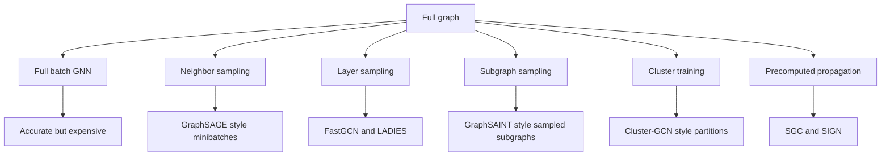
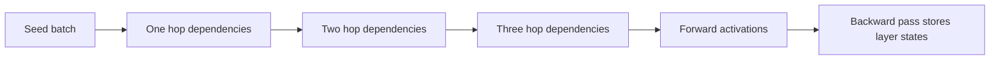
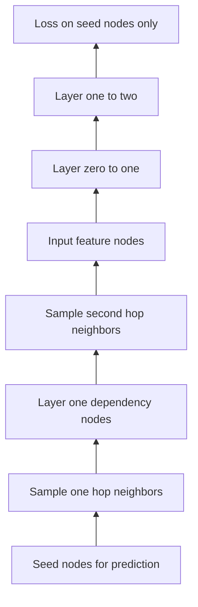
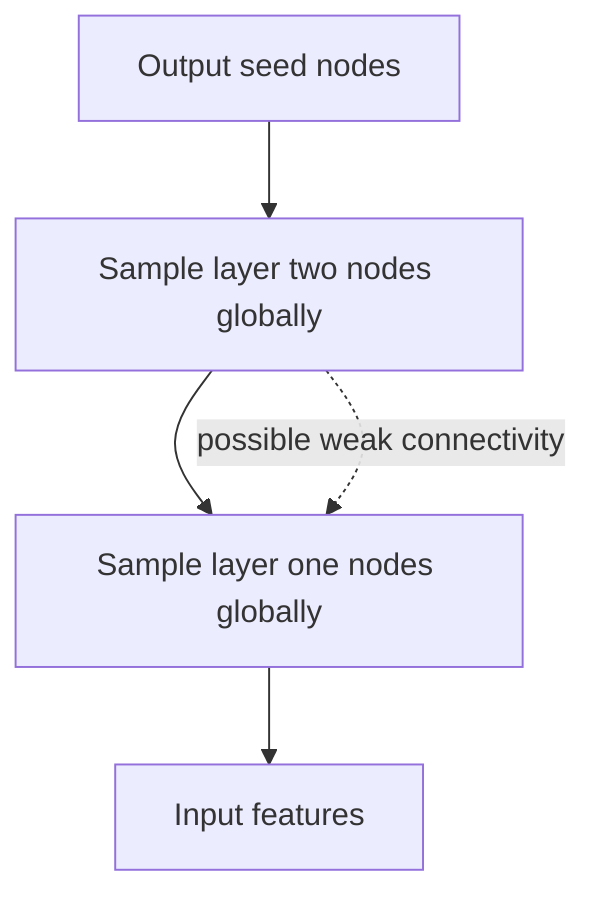
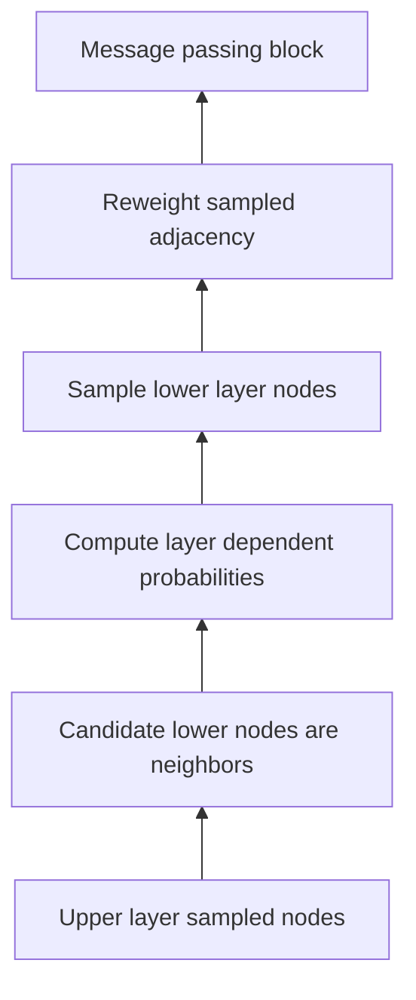
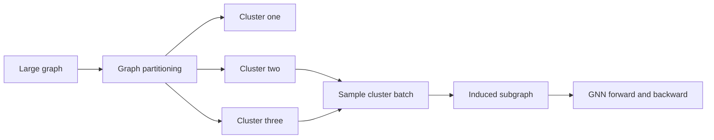
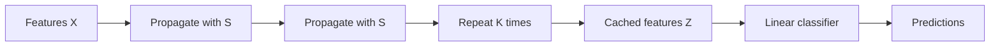

# Scaling Up GNNs to Large Graphs

Large-graph GNN training is difficult because message passing couples the loss of a small set of supervised nodes to a much larger computation graph. In ordinary minibatch SGD for images or text, a batch of examples is almost independent from the rest of the dataset. In graph learning, the prediction for a seed node depends on its neighbors, their neighbors, and so on. A minibatch of seed nodes can therefore require a large fraction of the graph.

This chapter studies the main families of scalable GNN training:

- **Node-wise neighbor sampling:** sample a bounded number of neighbors recursively, as in GraphSAGE.
- **Layer-wise sampling:** sample a set of nodes per layer, as in FastGCN and LADIES.
- **Subgraph sampling:** train on sampled induced subgraphs, as in GraphSAINT.
- **Cluster-based training:** partition the graph and train on one or several clusters, as in Cluster-GCN.
- **Architecture simplification and preprocessing:** move expensive propagation out of the training loop, as in SGC and SIGN.
- **Systems-level minibatching:** use sparse storage, CPU-GPU transfer pipelines, pinned memory, distributed sampling, and feature caching.

The target setting is usually a single large graph

$$
G=(V,E),
$$

with $n=|V|$ nodes, $m=|E|$ edges, feature matrix

$$
X \in \mathbb{R}^{n \times d_0},
$$

labels for a subset of nodes

$$
\mathcal{V}_{\mathrm{train}} \subseteq V,
$$

and a message-passing model that predicts $y_v$ for $v \in \mathcal{V}_{\mathrm{train}}$.



## 1. Why Full-Batch GNNs Do Not Scale

Consider a $K$-layer message-passing GNN:

$$
h_v^{(k+1)}
=
\psi^{(k)}
\left(
h_v^{(k)},
\operatorname{AGG}^{(k)}
\left(
\left\{
\phi^{(k)}(h_v^{(k)},h_u^{(k)},e_{uv})
: u \in \mathcal{N}(v)
\right\}
\right)
\right),
$$

where $h_v^{(0)}=x_v$.

For a seed node $v$, the exact $K$-layer embedding $h_v^{(K)}$ depends on all nodes in its $K$-hop receptive field:

$$
\mathcal{B}_K(v)
=
\{u \in V : \operatorname{dist}(u,v) \le K\}.
$$

If the graph has average branching factor $b$, the worst-case number of required nodes is approximately

$$
1+b+b^2+\cdots+b^K
=
\frac{b^{K+1}-1}{b-1}
=
O(b^K).
$$

This is the **neighborhood explosion problem**.

### Worked Receptive Field Calculation

Suppose a batch contains $B=512$ seed nodes, each layer samples all neighbors, and the effective branching factor is $b=50$. For $K=3$ layers, an upper bound on unique node visits before deduplication is

$$
B(1+b+b^2+b^3)
=
512(1+50+2500+125000)
=
65{,}306{,}112.
$$

Even if many nodes overlap, the raw dependency expansion is too large for a GPU minibatch. Hub nodes make the problem worse: a single seed connected to a million neighbors forces aggregation over a million messages in the first layer.

### Full-Batch GCN Cost

For a GCN with normalized adjacency

$$
\hat{A}=A+I,
$$

$$
\hat{D}_{ii}=\sum_j \hat{A}_{ij},
$$

$$
\hat{S}=\hat{D}^{-1/2}\hat{A}\hat{D}^{-1/2},
$$

a layer is

$$
H^{(k+1)}
=
\sigma\left(\hat{S}H^{(k)}W^{(k)}\right).
$$

Using sparse matrix multiplication, the propagation cost is

$$
O(md_k),
$$

and the dense feature transformation cost is

$$
O(nd_kd_{k+1}).
$$

For $K$ layers, full-batch training stores all intermediate node activations for backpropagation:

$$
O\left(n\sum_{k=1}^{K} d_k\right)
$$

activation memory, plus sparse graph storage. This is acceptable for citation graphs with thousands of nodes but not for graphs with millions or billions of nodes.



## 2. The Minibatch Objective

For node classification, the empirical risk is

$$
\mathcal{L}(\theta)
=
\frac{1}{|\mathcal{V}_{\mathrm{train}}|}
\sum_{v \in \mathcal{V}_{\mathrm{train}}}
\ell(f_{\theta}(v,G,X),y_v).
$$

A minibatch of seed nodes

$$
\mathcal{B} \subset \mathcal{V}_{\mathrm{train}}
$$

gives the ordinary stochastic objective

$$
\hat{\mathcal{L}}_{\mathcal{B}}(\theta)
=
\frac{1}{|\mathcal{B}|}
\sum_{v \in \mathcal{B}}
\ell(f_{\theta}(v,G,X),y_v).
$$

The complication is that evaluating $f_{\theta}(v,G,X)$ exactly may require a large induced computation graph. Scalable GNN methods replace the exact computation by a random approximation:

$$
f_{\theta}(v,G,X)
\approx
\tilde{f}_{\theta}(v,\tilde{G},\tilde{X},\omega),
$$

where $\omega$ is sampler randomness and $\tilde{G}$ is the sampled computation graph.

The ideal estimator has:

- low expected compute;
- low activation memory;
- controlled bias;
- low gradient variance;
- good graph locality;
- high GPU utilization;
- simple inference behavior.

## 3. GraphSAGE and Node-Wise Neighbor Sampling

GraphSAGE learns an inductive aggregation function instead of learning one embedding vector per node. For each target node, it recursively samples a bounded number of neighbors and aggregates their features.

### Layer Update

A common mean-aggregator GraphSAGE layer is

$$
m_v^{(k)}
=
\frac{1}{|\mathcal{S}_k(v)|}
\sum_{u \in \mathcal{S}_k(v)}
h_u^{(k)},
$$

$$
h_v^{(k+1)}
=
\sigma
\left(
W^{(k)}
\left[
h_v^{(k)} \Vert m_v^{(k)}
\right]
+ b^{(k)}
\right),
$$

where:

- $\mathcal{S}_k(v) \subseteq \mathcal{N}(v)$ is a sampled neighbor set for layer $k$;
- $[a \Vert b]$ denotes concatenation;
- $W^{(k)} \in \mathbb{R}^{d_{k+1} \times 2d_k}$;
- $\sigma$ is usually ReLU or another pointwise nonlinearity.

If neighbors are sampled uniformly without replacement and $|\mathcal{S}_k(v)|=s_k$, then

$$
\hat{m}_v^{(k)}
=
\frac{1}{s_k}
\sum_{u \in \mathcal{S}_k(v)}h_u^{(k)}
$$

is an unbiased estimator of the full neighborhood mean

$$
m_v^{(k)}
=
\frac{1}{|\mathcal{N}(v)|}
\sum_{u \in \mathcal{N}(v)}h_u^{(k)}
$$

when $s_k \le |\mathcal{N}(v)|$.

### Deriving the Sampling Variance

Let

$$
z_u=h_u^{(k)} \in \mathbb{R}^{d_k},
$$

and consider one feature dimension. For a node with degree $D=|\mathcal{N}(v)|$, define the population mean

$$
\mu
=
\frac{1}{D}\sum_{u \in \mathcal{N}(v)}z_u
$$

and finite population variance

$$
S^2
=
\frac{1}{D-1}\sum_{u \in \mathcal{N}(v)}(z_u-\mu)^2.
$$

Uniform sampling without replacement with sample size $s$ gives

$$
\mathbb{E}[\hat{\mu}]=\mu,
$$

and

$$
\operatorname{Var}(\hat{\mu})
=
\left(1-\frac{s}{D}\right)\frac{S^2}{s}.
$$

The variance decreases as $s$ grows, and the finite population correction

$$
1-\frac{s}{D}
$$

vanishes when all neighbors are sampled.

For sampling with replacement, the correction term disappears:

$$
\operatorname{Var}(\hat{\mu})
=
\frac{\sigma^2}{s}.
$$

This is why increasing fanout reduces noise but increases computation.

### Step-by-Step Execution

For a $K$-layer GraphSAGE model and a seed batch $\mathcal{B}^{(K)}$:

1. Set the top-level nodes to predict:

$$
\mathcal{B}^{(K)}=\mathcal{B}.
$$

2. For $k=K-1,K-2,\dots,0$, sample neighbors for every node in $\mathcal{B}^{(k+1)}$:

$$
\mathcal{U}^{(k)}
=
\bigcup_{v \in \mathcal{B}^{(k+1)}}\mathcal{S}_k(v).
$$

3. Define the nodes needed at layer $k$:

$$
\mathcal{B}^{(k)}
=
\mathcal{B}^{(k+1)} \cup \mathcal{U}^{(k)}.
$$

4. Load features for $\mathcal{B}^{(0)}$.

5. Run message passing forward from layer $0$ to layer $K-1$ on the sampled bipartite blocks.

6. Compute loss only on the original seed nodes $\mathcal{B}^{(K)}$.

7. Backpropagate through the sampled computation graph.



### Fanout Cost

With seed batch size $B$ and per-layer fanouts

$$
s_1,s_2,\dots,s_K,
$$

the maximum number of sampled source nodes before deduplication is

$$
B\left(1+s_K+s_Ks_{K-1}+\cdots+\prod_{k=1}^{K}s_k\right).
$$

For a two-layer model with $B=1024$, first-hop fanout $s_2=25$, and second-hop fanout $s_1=10$:

$$
1024(1+25+25 \cdot 10)
=
1024 \cdot 276
=
282{,}624.
$$

This is far smaller than full expansion when average degree is hundreds or thousands.

### Worked Numerical Example

Suppose a node $v$ has four neighbors with one-dimensional hidden states

$$
h_1=2,\quad h_2=4,\quad h_3=8,\quad h_4=10.
$$

The exact mean aggregation is

$$
m_v
=
\frac{2+4+8+10}{4}
=
6.
$$

If GraphSAGE samples neighbors $\{1,4\}$, the sampled mean is

$$
\hat{m}_v
=
\frac{2+10}{2}
=
6.
$$

If it samples $\{1,2\}$, then

$$
\hat{m}_v
=
\frac{2+4}{2}
=
3.
$$

The estimator is unbiased over repeated samples, but each minibatch can be noisy. If the self-state is $h_v=5$, and the layer uses

$$
W=
\begin{bmatrix}
0.6 & 0.4
\end{bmatrix},
\quad b=0,
\quad \sigma(t)=\max(t,0),
$$

then using the exact mean gives

$$
h_v'
=
\operatorname{ReLU}(0.6 \cdot 5 + 0.4 \cdot 6)
=
\operatorname{ReLU}(5.4)
=
5.4.
$$

The sample $\{1,2\}$ gives

$$
\hat{h}_v'
=
\operatorname{ReLU}(0.6 \cdot 5 + 0.4 \cdot 3)
=
4.2.
$$

The nonlinearity means the final hidden representation is not generally an unbiased estimator of the exact hidden representation, even when the neighbor mean itself is unbiased.

### From-Scratch PyTorch Implementation

The code below implements a small GraphSAGE-style sampler and layer. It is intentionally minimal: production systems also need deduplication-optimized adjacency formats, multiprocessing samplers, pinned memory, negative sampling for links, feature caching, and distributed graph stores.

```python
from __future__ import annotations

from dataclasses import dataclass
from typing import Dict, Iterable, List, Sequence, Tuple

import torch
import torch.nn as nn
import torch.nn.functional as F


AdjList = Dict[int, List[int]]


@dataclass
class SampledBlock:
    """Bipartite block from source nodes to destination nodes."""

    src_nodes: torch.Tensor
    dst_nodes: torch.Tensor
    edge_index: torch.Tensor  # shape [2, num_edges], local src -> local dst


def sample_neighbors(
    adj: AdjList,
    dst_nodes: Sequence[int],
    fanout: int,
    generator: torch.Generator | None = None,
) -> Tuple[List[int], List[Tuple[int, int]]]:
    """Uniformly sample at most fanout incoming neighbors for each dst node."""
    sampled_edges: List[Tuple[int, int]] = []
    sampled_src = set(dst_nodes)

    for dst in dst_nodes:
        neigh = adj.get(int(dst), [])
        if len(neigh) == 0:
            continue

        if len(neigh) <= fanout:
            chosen = neigh
        else:
            perm = torch.randperm(len(neigh), generator=generator)[:fanout]
            chosen = [neigh[i] for i in perm.tolist()]

        for src in chosen:
            sampled_src.add(int(src))
            sampled_edges.append((int(src), int(dst)))

    return list(sampled_src), sampled_edges


def build_block(
    src_nodes: Sequence[int],
    dst_nodes: Sequence[int],
    edges: Sequence[Tuple[int, int]],
) -> SampledBlock:
    """Map global node ids to local contiguous ids for a sampled block."""
    src_nodes = list(dict.fromkeys(int(v) for v in src_nodes))
    dst_nodes = list(dict.fromkeys(int(v) for v in dst_nodes))
    src_pos = {v: i for i, v in enumerate(src_nodes)}
    dst_pos = {v: i for i, v in enumerate(dst_nodes)}

    local_edges = [
        (src_pos[s], dst_pos[d])
        for s, d in edges
        if s in src_pos and d in dst_pos
    ]

    if local_edges:
        edge_index = torch.tensor(local_edges, dtype=torch.long).t().contiguous()
    else:
        edge_index = torch.empty((2, 0), dtype=torch.long)

    return SampledBlock(
        src_nodes=torch.tensor(src_nodes, dtype=torch.long),
        dst_nodes=torch.tensor(dst_nodes, dtype=torch.long),
        edge_index=edge_index,
    )


def sample_multilayer_blocks(
    adj: AdjList,
    seed_nodes: Sequence[int],
    fanouts: Sequence[int],
    generator: torch.Generator | None = None,
) -> List[SampledBlock]:
    """
    Build blocks from output layer backward to input layer.

    fanouts=[10, 25] means:
    - sample 25 neighbors for the last layer;
    - sample 10 neighbors for the previous layer.
    """
    blocks: List[SampledBlock] = []
    dst_nodes = list(seed_nodes)

    for fanout in reversed(fanouts):
        src_nodes, edges = sample_neighbors(adj, dst_nodes, fanout, generator)
        block = build_block(src_nodes, dst_nodes, edges)
        blocks.insert(0, block)
        dst_nodes = src_nodes

    return blocks


class MeanSAGELayer(nn.Module):
    def __init__(self, in_dim: int, out_dim: int):
        super().__init__()
        self.linear = nn.Linear(2 * in_dim, out_dim)

    def forward(
        self,
        h_src: torch.Tensor,
        h_dst_self: torch.Tensor,
        edge_index: torch.Tensor,
    ) -> torch.Tensor:
        src, dst = edge_index
        num_dst = h_dst_self.size(0)

        agg = h_src.new_zeros((num_dst, h_src.size(1)))
        deg = h_src.new_zeros((num_dst, 1))

        if edge_index.numel() > 0:
            agg.index_add_(0, dst, h_src[src])
            deg.index_add_(0, dst, torch.ones((dst.numel(), 1), device=h_src.device))

        # Isolated nodes receive a zero neighbor message.
        agg = agg / deg.clamp_min(1.0)
        out = self.linear(torch.cat([h_dst_self, agg], dim=-1))
        return F.relu(out)
```

### Important Implementation Details

Neighbor sampling libraries typically do the following internally:

- keep adjacency in compressed sparse row or compressed sparse column format;
- start from seed nodes and sample incoming or outgoing edges depending on message direction;
- relabel global node ids to compact local ids for the minibatch;
- return one bipartite block per GNN layer;
- load only the features needed by the first block;
- compute loss only for the seed nodes, not every sampled context node.

Pitfalls:

- Confusing sampled context nodes with supervised seed nodes.
- Applying labels to all nodes in the sampled subgraph.
- Forgetting that a $K$-layer model needs $K$ sampling fanouts.
- Using too small fanouts for high-variance graphs.
- Sampling without replacement from tiny neighborhoods without handling degree less than fanout.
- Accidentally leaking validation or test labels through custom subgraph construction.

## 4. Layer-Wise Sampling: FastGCN

GraphSAGE samples neighbors separately for every destination node. FastGCN instead interprets graph convolution as an integral transform and samples a fixed number of nodes per layer.

### Full GCN as an Empirical Integral

For one GCN layer,

$$
h_v^{(k+1)}
=
\sigma
\left(
\sum_{u=1}^{n}
\hat{S}_{vu}h_u^{(k)}W^{(k)}
\right).
$$

Let $u$ be drawn uniformly from all nodes. Then

$$
\sum_{u=1}^{n}
\hat{S}_{vu}h_u^{(k)}
=
n \cdot
\mathbb{E}_{u \sim \operatorname{Unif}(V)}
\left[
\hat{S}_{vu}h_u^{(k)}
\right].
$$

With $s$ sampled nodes

$$
\mathcal{S}^{(k)}=\{u_1,\dots,u_s\},
$$

the Monte Carlo estimator is

$$
\widehat{a}_v^{(k)}
=
\frac{n}{s}
\sum_{u \in \mathcal{S}^{(k)}}
\hat{S}_{vu}h_u^{(k)}.
$$

For nonuniform sampling distribution $q(u)$, importance sampling gives

$$
\widehat{a}_v^{(k)}
=
\frac{1}{s}
\sum_{u \in \mathcal{S}^{(k)}}
\frac{\hat{S}_{vu}h_u^{(k)}}{q(u)}.
$$

This is unbiased for the pre-activation aggregation when $q(u)>0$ for every node with $\hat{S}_{vu} \ne 0$.

### Variance-Minimizing Importance Distribution

For a scalar integrand

$$
g_v(u)=\hat{S}_{vu}h_u,
$$

the importance estimator is

$$
\hat{\mu}
=
\frac{1}{s}\sum_{i=1}^{s}\frac{g_v(u_i)}{q(u_i)}.
$$

Its second moment is

$$
\mathbb{E}_{u \sim q}
\left[
\left(\frac{g_v(u)}{q(u)}\right)^2
\right]
=
\sum_{u=1}^{n}\frac{g_v(u)^2}{q(u)}.
$$

Minimizing this under

$$
\sum_{u=1}^{n}q(u)=1
$$

with Lagrange multiplier $\lambda$:

$$
\mathcal{J}(q,\lambda)
=
\sum_{u=1}^{n}\frac{g_v(u)^2}{q(u)}
+ \lambda\left(\sum_{u=1}^{n}q(u)-1\right).
$$

Set derivative to zero:

$$
\frac{\partial \mathcal{J}}{\partial q(u)}
=
-\frac{g_v(u)^2}{q(u)^2}+\lambda
=0.
$$

Thus

$$
q(u)
\propto
|g_v(u)|.
$$

Because $h_u$ changes across layers and training steps, practical FastGCN uses graph-structure proxies, often based on column norms of $\hat{S}$:

$$
q(u)
\propto
\|\hat{S}_{:,u}\|_2^2.
$$

### Main Limitation

Layer-wise sampling can sample nodes that are weakly connected or disconnected from the current seed nodes. This creates sparse sampled adjacency between consecutive sampled layers. The result is wasted computation and high estimator variance.



## 5. LADIES: Layer-Dependent Importance Sampling

LADIES fixes a key problem in FastGCN by making the sampled nodes at layer $k$ depend on the nodes already sampled at layer $k+1$.

### Core Idea

Given upper-layer sampled nodes

$$
\mathcal{S}^{(k+1)},
$$

LADIES restricts candidates for the lower layer to their neighbors:

$$
\mathcal{C}^{(k)}
=
\{u : \exists v \in \mathcal{S}^{(k+1)} \text{ with } \hat{S}_{vu} \ne 0\}.
$$

Then it computes importance probabilities inside this candidate set. A common structural form is

$$
q^{(k)}(u)
=
\frac{
\|\hat{S}_{\mathcal{S}^{(k+1)},u}\|_2^2
}{
\sum_{w \in \mathcal{C}^{(k)}}
\|\hat{S}_{\mathcal{S}^{(k+1)},w}\|_2^2
},
\quad
u \in \mathcal{C}^{(k)}.
$$

The sampled adjacency between layer $k+1$ and $k$ is reweighted by inverse sampling probabilities to reduce bias.

### Step-by-Step Execution

1. Start with output seed nodes:

$$
\mathcal{S}^{(K)}=\mathcal{B}.
$$

2. For $k=K-1,\dots,0$, build candidate source nodes:

$$
\mathcal{C}^{(k)}=\mathcal{N}(\mathcal{S}^{(k+1)}).
$$

3. Compute layer-dependent probabilities $q^{(k)}(u)$.

4. Sample a fixed number of nodes from $\mathcal{C}^{(k)}$.

5. Include the upper-layer nodes themselves when self-loops are needed.

6. Reweight sampled columns of the adjacency by $1/q^{(k)}(u)$ or an equivalent normalization.

7. Run layer-wise propagation on the resulting bipartite matrices.



### Intuition

FastGCN asks: "Which nodes are globally important for this layer?"

LADIES asks: "Which lower-layer nodes are important for the specific upper-layer nodes currently being computed?"

This keeps the sampled bipartite graph connected to the minibatch and reduces wasted samples.

## 6. Subgraph Sampling: GraphSAINT

GraphSAINT samples a subgraph and runs ordinary GNN layers inside that subgraph. The subgraph can be sampled by nodes, edges, random walks, or other topology-aware procedures.

Let

$$
G_s=(V_s,E_s)
$$

be a sampled subgraph. The model computes

$$
H_s^{(k+1)}
=
\sigma(\hat{S}_s H_s^{(k)}W^{(k)}),
$$

where $\hat{S}_s$ is built from the sampled subgraph.

### Bias from Subgraph Sampling

Sampling subgraphs changes both the objective and the aggregation operator. Nodes and edges do not have equal probability of appearing. If node $v$ appears with probability $p_v$, a Horvitz-Thompson style unbiased estimate of a sum over training nodes is

$$
\sum_{v \in \mathcal{V}_{\mathrm{train}}}\ell_v
\approx
\sum_{v \in V_s \cap \mathcal{V}_{\mathrm{train}}}
\frac{\ell_v}{p_v}.
$$

Similarly, edge normalization can use edge sampling probabilities $p_{uv}$ to reduce aggregation bias:

$$
\sum_{(u,v) \in E} a_{uv}h_u
\approx
\sum_{(u,v) \in E_s}
\frac{a_{uv}}{p_{uv}}h_u.
$$

GraphSAINT uses normalization constants estimated from sampler statistics to correct for unequal node and edge sampling frequencies.

### When Subgraph Sampling Works Well

Subgraph sampling is attractive when:

- graph locality matters and sampled subgraphs preserve local structure;
- repeated recursive neighbor expansion is too expensive;
- the same sampled edges can serve all layers;
- random-walk or edge samplers capture high-signal regions better than uniform node sampling.

## 7. Cluster-GCN

Cluster-GCN partitions the graph into many clusters, then trains GNNs on one or several cluster-induced subgraphs at a time.

### Partitioning Objective

Let the node set be partitioned into $c$ disjoint clusters:

$$
V = V_1 \cup V_2 \cup \cdots \cup V_c,
$$

$$
V_i \cap V_j = \varnothing
\quad
\text{for }
i \ne j.
$$

Graph partitioners such as METIS try to minimize the number of cut edges

$$
\operatorname{cut}(V_1,\dots,V_c)
=
\sum_{i \ne j}
|\{(u,v)\in E : u \in V_i, v \in V_j\}|,
$$

while keeping clusters balanced:

$$
|V_i| \approx \frac{n}{c}.
$$

For a batch of cluster ids $\mathcal{C}$, define

$$
V_{\mathcal{C}}=\bigcup_{i \in \mathcal{C}}V_i,
$$

and use the induced subgraph

$$
G_{\mathcal{C}}=G[V_{\mathcal{C}}].
$$

### Step-by-Step Execution

1. Partition the graph offline into $c$ clusters.
2. Shuffle cluster ids at every epoch.
3. Select one or multiple clusters per minibatch.
4. Build the induced subgraph on selected cluster nodes.
5. Run ordinary GCN, GraphSAGE, GAT, or another layer on that subgraph.
6. Compute loss for training nodes inside the selected clusters.
7. Repeat until all clusters have been visited.



### Matrix View

After permuting nodes by cluster, the adjacency matrix often becomes approximately block diagonal:

$$
PAP^\top
\approx
\begin{bmatrix}
A_{11} & A_{12} & \cdots & A_{1c} \\
A_{21} & A_{22} & \cdots & A_{2c} \\
\vdots & \vdots & \ddots & \vdots \\
A_{c1} & A_{c2} & \cdots & A_{cc}
\end{bmatrix},
$$

where diagonal blocks $A_{ii}$ are dense relative to off-diagonal cut blocks $A_{ij}$. A minibatch using cluster $i$ keeps $A_{ii}$ and drops cross-cluster messages for that step. Sampling multiple clusters per batch recovers some cross-cluster edges among the selected clusters.

### Worked Example

Suppose a graph has $n=1{,}000{,}000$ nodes and $m=50{,}000{,}000$ edges. Partition it into $c=1000$ clusters of roughly $1000$ nodes each. If a minibatch uses $r=10$ clusters, it contains about

$$
10 \cdot 1000 = 10{,}000
$$

nodes. If edges are reasonably localized and each cluster has roughly $40{,}000$ internal edges, the batch has about

$$
10 \cdot 40{,}000=400{,}000
$$

internal edges, plus edges between selected clusters. This is large enough for efficient sparse GPU kernels but small enough for minibatch training.

### Advantages and Limitations

Cluster-GCN avoids recursive neighbor expansion because every layer uses the same cluster-induced subgraph. It also has strong memory locality. The main approximation is that messages crossing cluster boundaries are absent unless both endpoint clusters are sampled together.

Important pitfalls:

- Poor partitions can destroy useful message paths.
- Very small clusters may underrepresent long-range context.
- Very large clusters can exceed GPU memory.
- Partitioning can be expensive and must be repeated if the graph changes substantially.
- Training can overfit to partition boundaries unless clusters are shuffled or grouped randomly.

## 8. Simplified Graph Convolution: SGC

SGC removes nonlinearities and intermediate weight matrices from a GCN, then precomputes graph propagation.

### From GCN to SGC

A $K$-layer linearized GCN without nonlinearities is

$$
H^{(1)} = \hat{S}XW^{(0)},
$$

$$
H^{(2)} = \hat{S}H^{(1)}W^{(1)}
=
\hat{S}^2XW^{(0)}W^{(1)}.
$$

By induction,

$$
H^{(K)}
=
\hat{S}^KX
\left(\prod_{k=0}^{K-1}W^{(k)}\right).
$$

Let

$$
W=\prod_{k=0}^{K-1}W^{(k)}.
$$

Then SGC uses

$$
Z=\hat{S}^KX,
$$

$$
\hat{Y}=\operatorname{softmax}(ZW).
$$

Only the final linear classifier is trained.



### Why It Scales

The propagation

$$
Z=\hat{S}^KX
$$

is computed once before training. Training then becomes logistic regression on propagated features. Each epoch costs

$$
O(ndC)
$$

for $C$ classes, independent of $m$, after preprocessing.

### Worked SGC Propagation Example

Consider a three-node path with self-loops:

$$
1 - 2 - 3.
$$

The self-loop adjacency is

$$
\hat{A}
=
\begin{bmatrix}
1 & 1 & 0 \\
1 & 1 & 1 \\
0 & 1 & 1
\end{bmatrix}.
$$

Degrees are

$$
\hat{d}_1=2,\quad \hat{d}_2=3,\quad \hat{d}_3=2.
$$

The normalized adjacency entry between nodes $1$ and $2$ is

$$
\hat{S}_{12}
=
\frac{1}{\sqrt{2}\sqrt{3}}
=
\frac{1}{\sqrt{6}}.
$$

The full normalized matrix is

$$
\hat{S}
=
\begin{bmatrix}
\frac{1}{2} & \frac{1}{\sqrt{6}} & 0 \\
\frac{1}{\sqrt{6}} & \frac{1}{3} & \frac{1}{\sqrt{6}} \\
0 & \frac{1}{\sqrt{6}} & \frac{1}{2}
\end{bmatrix}.
$$

For one-dimensional features

$$
X=
\begin{bmatrix}
1\\
2\\
4
\end{bmatrix},
$$

one propagation gives

$$
Z_1
=
\hat{S}X.
$$

The first node value is

$$
Z_{1}
=
\frac{1}{2}\cdot 1
+\frac{1}{\sqrt{6}}\cdot 2
=
0.5+0.8165
=
1.3165.
$$

The second node value is

$$
Z_{2}
=
\frac{1}{\sqrt{6}}\cdot 1
+\frac{1}{3}\cdot 2
+\frac{1}{\sqrt{6}}\cdot 4
=
0.4082+0.6667+1.6330
=
2.7079.
$$

The third node value is

$$
Z_{3}
=
\frac{1}{\sqrt{6}}\cdot 2
+\frac{1}{2}\cdot 4
=
0.8165+2
=
2.8165.
$$

SGC repeats this propagation $K$ times, then trains a classifier on the resulting features.

### Limitations

SGC is fast because it removes depth-specific nonlinear representation learning. This can hurt when:

- the task requires feature interactions after each propagation step;
- the graph is heterophilous and smoothing mixes incompatible labels;
- edge types or attention are important;
- training needs task-adaptive propagation rather than fixed preprocessing.

## 9. SIGN and Precomputed Multi-Scale Features

SIGN generalizes the SGC idea by precomputing multiple powers or filters of the graph operator and feeding all of them into an MLP.

For propagation operators $S_1,\dots,S_R$, SIGN constructs

$$
Z^{(r)}=S_rX,
$$

then predicts with

$$
\hat{Y}
=
g_{\theta}
\left(
Z^{(0)} \Vert Z^{(1)} \Vert \cdots \Vert Z^{(R)}
\right),
$$

where $Z^{(0)}=X$.

Typical choices include

$$
S_r=\hat{S}^r
$$

or personalized PageRank-like diffusion operators.

SIGN decouples graph propagation from training. It can train extremely quickly because the MLP sees dense tensors rather than repeatedly multiplying sparse adjacency matrices.

## 10. Scratch Implementations

### Sparse GCN Normalization and SGC

```python
import torch
import torch.nn as nn
import torch.nn.functional as F


def gcn_norm(edge_index: torch.Tensor, num_nodes: int) -> torch.Tensor:
    """
    Return edge weights for D^{-1/2} (A + I) D^{-1/2}.

    edge_index has shape [2, num_edges] with source -> destination convention.
    """
    device = edge_index.device
    loop = torch.arange(num_nodes, device=device)
    self_loops = torch.stack([loop, loop], dim=0)
    edge_index = torch.cat([edge_index, self_loops], dim=1)

    src, dst = edge_index
    deg = torch.bincount(dst, minlength=num_nodes).float()
    deg_inv_sqrt = deg.clamp_min(1).pow(-0.5)
    edge_weight = deg_inv_sqrt[src] * deg_inv_sqrt[dst]
    return edge_index, edge_weight


def sparse_propagate(
    x: torch.Tensor,
    edge_index: torch.Tensor,
    edge_weight: torch.Tensor,
    num_nodes: int,
) -> torch.Tensor:
    """Compute out[dst] += edge_weight * x[src]."""
    src, dst = edge_index
    out = x.new_zeros((num_nodes, x.size(1)))
    out.index_add_(0, dst, edge_weight.unsqueeze(-1) * x[src])
    return out


class SGC(nn.Module):
    def __init__(self, in_dim: int, num_classes: int):
        super().__init__()
        self.classifier = nn.Linear(in_dim, num_classes)

    def forward(self, z: torch.Tensor) -> torch.Tensor:
        return self.classifier(z)


@torch.no_grad()
def precompute_sgc_features(
    x: torch.Tensor,
    edge_index: torch.Tensor,
    num_nodes: int,
    k: int,
) -> torch.Tensor:
    norm_edge_index, edge_weight = gcn_norm(edge_index, num_nodes)
    z = x
    for _ in range(k):
        z = sparse_propagate(z, norm_edge_index, edge_weight, num_nodes)
    return z


def train_sgc(
    x: torch.Tensor,
    edge_index: torch.Tensor,
    y: torch.Tensor,
    train_idx: torch.Tensor,
    num_classes: int,
    k: int = 2,
    epochs: int = 200,
) -> SGC:
    z = precompute_sgc_features(x, edge_index, x.size(0), k)
    model = SGC(z.size(1), num_classes)
    opt = torch.optim.Adam(model.parameters(), lr=0.01, weight_decay=5e-4)

    for _ in range(epochs):
        model.train()
        logits = model(z)
        loss = F.cross_entropy(logits[train_idx], y[train_idx])
        opt.zero_grad()
        loss.backward()
        opt.step()

    return model
```

### Minimal Cluster Minibatching

This implementation assumes a precomputed `cluster_id` vector. A real implementation should use a high-quality partitioner and sparse subgraph extraction.

```python
from typing import Iterator


def cluster_batches(
    cluster_id: torch.Tensor,
    clusters_per_batch: int,
    shuffle: bool = True,
) -> Iterator[torch.Tensor]:
    unique_clusters = torch.unique(cluster_id)
    if shuffle:
        unique_clusters = unique_clusters[torch.randperm(unique_clusters.numel())]

    for start in range(0, unique_clusters.numel(), clusters_per_batch):
        chosen = unique_clusters[start : start + clusters_per_batch]
        mask = torch.isin(cluster_id, chosen)
        yield torch.where(mask)[0]


def induced_subgraph(
    node_idx: torch.Tensor,
    edge_index: torch.Tensor,
) -> tuple[torch.Tensor, torch.Tensor]:
    """Return local node ids and local edge_index for the induced subgraph."""
    num_global = int(edge_index.max()) + 1
    global_to_local = torch.full((num_global,), -1, dtype=torch.long)
    global_to_local[node_idx] = torch.arange(node_idx.numel())

    src, dst = edge_index
    keep = (global_to_local[src] >= 0) & (global_to_local[dst] >= 0)
    sub_edges = edge_index[:, keep]
    sub_edges = global_to_local[sub_edges]
    return node_idx, sub_edges
```

## 11. Library Implementations

### PyTorch Geometric: NeighborLoader

```python
import torch
import torch.nn.functional as F
from torch_geometric.datasets import Reddit
from torch_geometric.loader import NeighborLoader
from torch_geometric.nn import SAGEConv


dataset = Reddit(root="data/Reddit")
data = dataset[0]

train_loader = NeighborLoader(
    data,
    input_nodes=data.train_mask,
    num_neighbors=[15, 10],
    batch_size=1024,
    shuffle=True,
    num_workers=4,
    persistent_workers=True,
)


class GraphSAGE(torch.nn.Module):
    def __init__(self, in_channels, hidden_channels, out_channels):
        super().__init__()
        self.convs = torch.nn.ModuleList([
            SAGEConv(in_channels, hidden_channels),
            SAGEConv(hidden_channels, out_channels),
        ])

    def forward(self, x, edge_index):
        x = self.convs[0](x, edge_index).relu()
        x = self.convs[1](x, edge_index)
        return x


model = GraphSAGE(dataset.num_features, 256, dataset.num_classes)
optimizer = torch.optim.Adam(model.parameters(), lr=0.003)

for batch in train_loader:
    optimizer.zero_grad()
    out = model(batch.x, batch.edge_index)

    # The first batch.batch_size nodes are the seed nodes whose labels
    # should be used for the minibatch loss.
    out_seed = out[: batch.batch_size]
    y_seed = batch.y[: batch.batch_size]
    loss = F.cross_entropy(out_seed, y_seed)

    loss.backward()
    optimizer.step()
```

Internally, `NeighborLoader` starts from `input_nodes`, samples a bounded number of neighbors per hop, relabels sampled global node ids into local ids, and returns a `Data` object containing the sampled subgraph. The ordering convention places seed nodes first, so `batch.batch_size` separates supervised seeds from sampled context nodes.

### PyTorch Geometric: Cluster-GCN

```python
import torch
import torch.nn.functional as F
from torch_geometric.loader import ClusterData, ClusterLoader
from torch_geometric.nn import GCNConv


cluster_data = ClusterData(
    data,
    num_parts=1500,
    recursive=False,
    save_dir="data/reddit_cluster_cache",
)

cluster_loader = ClusterLoader(
    cluster_data,
    batch_size=20,
    shuffle=True,
    num_workers=4,
)


class GCN(torch.nn.Module):
    def __init__(self, in_channels, hidden_channels, out_channels):
        super().__init__()
        self.conv1 = GCNConv(in_channels, hidden_channels)
        self.conv2 = GCNConv(hidden_channels, out_channels)

    def forward(self, x, edge_index):
        x = self.conv1(x, edge_index).relu()
        x = F.dropout(x, p=0.5, training=self.training)
        return self.conv2(x, edge_index)


model = GCN(dataset.num_features, 256, dataset.num_classes)
optimizer = torch.optim.Adam(model.parameters(), lr=0.01, weight_decay=5e-4)

for subgraph in cluster_loader:
    optimizer.zero_grad()
    logits = model(subgraph.x, subgraph.edge_index)
    loss = F.cross_entropy(
        logits[subgraph.train_mask],
        subgraph.y[subgraph.train_mask],
    )
    loss.backward()
    optimizer.step()
```

`ClusterData` partitions the graph and caches cluster assignments. `ClusterLoader` selects one or more partitions, merges them, constructs the induced subgraph, and returns it as a minibatch. Unlike neighbor sampling, all layers run on the same sampled subgraph.

### DGL: Neighbor Sampling

```python
import dgl
import torch
import torch.nn as nn
import torch.nn.functional as F
from dgl.dataloading import DataLoader, NeighborSampler
from dgl.nn import SAGEConv


sampler = NeighborSampler([15, 10])

dataloader = DataLoader(
    g,
    train_nids,
    sampler,
    batch_size=1024,
    shuffle=True,
    drop_last=False,
    num_workers=4,
)


class DGLGraphSAGE(nn.Module):
    def __init__(self, in_dim, hidden_dim, out_dim):
        super().__init__()
        self.layers = nn.ModuleList([
            SAGEConv(in_dim, hidden_dim, "mean"),
            SAGEConv(hidden_dim, out_dim, "mean"),
        ])

    def forward(self, blocks, x):
        h = x
        for layer_id, layer in enumerate(self.layers):
            h_dst = h[: blocks[layer_id].num_dst_nodes()]
            h = layer(blocks[layer_id], (h, h_dst))
            if layer_id != len(self.layers) - 1:
                h = F.relu(h)
        return h


model = DGLGraphSAGE(in_dim, 256, num_classes)
optimizer = torch.optim.Adam(model.parameters(), lr=0.003)

for input_nodes, output_nodes, blocks in dataloader:
    x = g.ndata["feat"][input_nodes]
    y = g.ndata["label"][output_nodes]

    logits = model(blocks, x)
    loss = F.cross_entropy(logits, y)

    optimizer.zero_grad()
    loss.backward()
    optimizer.step()
```

DGL returns message-flow graphs, usually called blocks. Each block is a bipartite graph from source nodes needed at the previous layer to destination nodes computed at the next layer.

## 12. Complexity Comparison

Let:

- $n$ be the number of nodes;
- $m$ be the number of edges;
- $K$ be the number of layers;
- $d$ be a representative hidden width;
- $B$ be seed batch size;
- $s_k$ be fanout at layer $k$;
- $s$ be sampled nodes per layer for layer-wise methods;
- $b$ be sampled subgraph or cluster nodes;
- $e_b$ be sampled subgraph or cluster edges.

| Method | Per-minibatch graph work | Activation memory | Main approximation |
|---|---:|---:|---|
| Full-batch GCN | $O(Kmd)$ | $O(Knd)$ | None |
| GraphSAGE sampling | $O\left(dB\sum_{r=1}^{K}\prod_{j=r}^{K}s_j\right)$ | proportional to sampled nodes | sampled neighbor means |
| FastGCN | $O(Ks^2d)$ or sparse sampled equivalent | $O(Ksd)$ | layer-wise Monte Carlo |
| LADIES | depends on sampled bipartite blocks | $O(Ksd)$ | layer-dependent importance sampling |
| GraphSAINT | $O(Ke_bd)$ | $O(Kbd)$ | sampled subgraph and normalization |
| Cluster-GCN | $O(Ke_bd)$ | $O(Kbd)$ | dropped cross-cluster edges |
| SGC | preprocessing $O(Kmd)$, training $O(ndC)$ | $O(nd)$ cached features | removed intermediate nonlinearities |
| SIGN | preprocessing $O(Rmd)$, training dense MLP | stores $R$ feature tensors | fixed precomputed filters |

These are approximate because real cost is dominated by sparse memory access, feature transfer, kernel launch overhead, deduplication, and load imbalance around high-degree nodes.

## 13. Numerical Stability and Systems Issues

### Sparse Normalization

For normalized adjacency, always handle isolated nodes. With self-loops, most nodes have degree at least one:

$$
\hat{d}_v=d_v+1.
$$

Without self-loops, isolated nodes produce

$$
d_v^{-1/2}=\infty.
$$

Use clamping:

$$
d_v^{-1/2}
=
\frac{1}{\sqrt{\max(d_v,\epsilon)}}.
$$

### Sampling Probabilities

Importance sampling requires nonzero probability for every node or edge that can contribute:

$$
q(u)>0
\quad
\text{whenever}
\quad
\hat{S}_{vu} \ne 0.
$$

In practice, add a small floor:

$$
q_{\epsilon}(u)
=
(1-\epsilon)q(u)+\frac{\epsilon}{n}.
$$

This avoids division by zero and reduces extreme weights.

### High-Degree Hubs

Hubs cause:

- high aggregation cost in full-batch training;
- high variance if fanout is too small;
- repeated sampling of the same popular nodes;
- feature cache pressure.

Common mitigations include degree-aware sampling, importance sampling, caching hub features on GPU, and capping fanout.

### Duplicate Nodes

Recursive neighbor sampling often samples the same node multiple times. Good implementations deduplicate nodes at each layer and remap them to local ids. Without deduplication, memory and compute can grow unnecessarily.

### Train, Validation, and Test Leakage

For transductive node classification, validation and test node features and edges are often visible during training, but their labels are not. This is not label leakage if the benchmark defines the task that way. Custom pipelines must be explicit:

- Do not include validation or test labels in the loss.
- Do not tune preprocessing using test labels.
- For inductive evaluation, remove unseen nodes or unseen graphs from the training graph entirely.

### Inference Is Different

Training may use sampling, but inference often needs deterministic full-neighborhood computation. Common inference modes:

- full-batch inference layer by layer on CPU or GPU;
- batched exact inference over all nodes;
- sampled inference for approximate serving;
- cached embeddings for slowly changing graphs.

For a $K$-layer model, exact layer-wise inference computes all nodes at layer $1$, then all nodes at layer $2$, and so on. This avoids recursive expansion per seed.

## 14. Edge Cases and Limitations

### Low-Degree Nodes

If a node has fewer neighbors than fanout, sample all available neighbors. For mean aggregation, do not divide by the requested fanout; divide by the actual sampled count.

### Directed Graphs

Message direction matters. If messages flow from source to destination, node $v$ aggregates from in-neighbors:

$$
\mathcal{N}_{\mathrm{in}}(v)=\{u:(u,v)\in E\}.
$$

For link prediction or recommendation, separate incoming and outgoing adjacency may be needed.

### Heterogeneous Graphs

For relation types $r \in \mathcal{R}$, a relation-aware layer may compute

$$
h_v^{(k+1)}
=
\sigma
\left(
\sum_{r \in \mathcal{R}}
\sum_{u \in \mathcal{N}_r(v)}
\alpha_{r,u,v}h_u^{(k)}W_r^{(k)}
\right).
$$

Sampling must specify fanouts per relation. Rare relations can disappear if sampled uniformly across all edges, so heterogeneous samplers often use per-edge-type fanouts.

### Temporal Graphs

For temporal graphs, a node at time $t$ must not aggregate from future edges:

$$
\mathcal{N}_t(v)
=
\{u : (u,v,\tau)\in E,\ \tau \le t\}.
$$

Sampling must enforce time constraints. Otherwise, temporal leakage can dominate reported performance.

### Deep GNNs

Sampling solves memory expansion but not necessarily optimization pathologies. Deep GNNs can still suffer from over-smoothing, over-squashing, noisy long-range propagation, and vanishing gradients. Methods such as residual connections, normalization, Jumping Knowledge, APPNP, GCNII, and decoupled depth-scope methods address different parts of this problem.

## 15. Choosing a Scaling Method

| Scenario | Good default | Reason |
|---|---|---|
| Inductive node classification with rich features | GraphSAGE neighbor sampling | Bounded fanout and natural inductive behavior |
| Large transductive graph with community structure | Cluster-GCN | Efficient locality-preserving minibatches |
| Need simple and very fast baseline | SGC | Precompute propagation and train linear classifier |
| Need fast dense training with multi-hop features | SIGN | Precompute several graph filters and train an MLP |
| Neighbor sampling has too much expansion | GraphSAINT or Cluster-GCN | One sampled subgraph supports all layers |
| Layer-wise sampling wastes disconnected nodes | LADIES | Sampling depends on upper-layer nodes |
| Dynamic graph with frequent new nodes | GraphSAGE or sampled message passing | Avoids fixed node embeddings |
| Production serving with latency constraints | Cached embeddings or SGC/SIGN-like features | Avoid expensive online neighborhood expansion |

Practical starting points:

- For PyG, start with `NeighborLoader` and `SAGEConv`.
- If fanout expansion is still too expensive, try `ClusterData` and `ClusterLoader`.
- For a strong preprocessing baseline, implement SGC or SIGN.
- For link prediction, combine neighbor sampling with negative sampling.
- For heterogeneous graphs, tune fanout per relation type.

## 16. Connections to Related ML Concepts

### Monte Carlo Estimation

Neighbor sampling and layer-wise sampling are Monte Carlo approximations to sums over neighborhoods or graph-wide integrals. Fanout controls the bias-variance-compute tradeoff.

### Stochastic Optimization

The minibatch gradient has two noise sources:

$$
\nabla_{\theta}\hat{\mathcal{L}}
=
\nabla_{\theta}\mathcal{L}
+ \xi_{\mathrm{batch}}
+ \xi_{\mathrm{sampler}}.
$$

The first term is ordinary minibatch noise from seed selection. The second is graph sampler noise from approximating message passing.

### Dropout and Data Augmentation

Sampling neighbors or subgraphs can act like structural dropout. It may improve generalization, but too aggressive sampling can remove critical evidence.

### Graph Signal Processing

SGC and SIGN treat graph propagation as fixed graph filtering. Powers of $\hat{S}$ apply low-pass smoothing over the graph. This connects scalable GNNs to label propagation, diffusion, personalized PageRank, and spectral filtering.

### Distributed Systems

At industrial scale, the bottleneck is often not floating-point compute but data movement:

- neighbor lookup from CPU memory or remote graph stores;
- feature fetching for sampled nodes;
- CPU sampler throughput;
- GPU underutilization from irregular sparse batches;
- synchronization in distributed training.

Good systems overlap sampling, feature transfer, and GPU computation.

## 17. References and Deeper Reading

- William L. Hamilton, Rex Ying, and Jure Leskovec, [Inductive Representation Learning on Large Graphs](https://arxiv.org/abs/1706.02216), NeurIPS 2017.
- Wei-Lin Chiang, Xuanqing Liu, Si Si, Yang Li, Samy Bengio, and Cho-Jui Hsieh, [Cluster-GCN: An Efficient Algorithm for Training Deep and Large Graph Convolutional Networks](https://arxiv.org/abs/1905.07953), KDD 2019.
- Jie Chen, Tengfei Ma, and Cao Xiao, [FastGCN: Fast Learning with Graph Convolutional Networks via Importance Sampling](https://arxiv.org/abs/1801.10247), ICLR 2018.
- Difan Zou, Ziniu Hu, Yewen Wang, Song Jiang, Yizhou Sun, and Quanquan Gu, [Layer-Dependent Importance Sampling for Training Deep and Large Graph Convolutional Networks](https://arxiv.org/abs/1911.07323), NeurIPS 2019.
- Hanqing Zeng, Hongkuan Zhou, Ajitesh Srivastava, Rajgopal Kannan, and Viktor Prasanna, [GraphSAINT: Graph Sampling Based Inductive Learning Method](https://arxiv.org/abs/1907.04931), ICLR 2020.
- Felix Wu, Amauri Souza, Tianyi Zhang, Christopher Fifty, Tao Yu, and Kilian Weinberger, [Simplifying Graph Convolutional Networks](https://arxiv.org/abs/1902.07153), ICML 2019.
- Emanuele Rossi et al., [SIGN: Scalable Inception Graph Neural Networks](https://arxiv.org/abs/2004.11198), ICML workshop 2020.
- PyTorch Geometric documentation, [Scaling GNNs via Neighbor Sampling](https://pytorch-geometric.readthedocs.io/en/latest/tutorial/neighbor_loader.html).
- PyTorch Geometric documentation, [`ClusterData` and `ClusterLoader`](https://pytorch-geometric.readthedocs.io/en/latest/_modules/torch_geometric/loader/cluster.html).
- DGL documentation, [Training GNN with Neighbor Sampling for Node Classification](https://www.dgl.ai/dgl_docs/en/1.1.x/tutorials/large/L1_large_node_classification.html).
- DGL documentation, [`ClusterGCNSampler`](https://www.dgl.ai/dgl_docs/generated/dgl.dataloading.ClusterGCNSampler.html).
