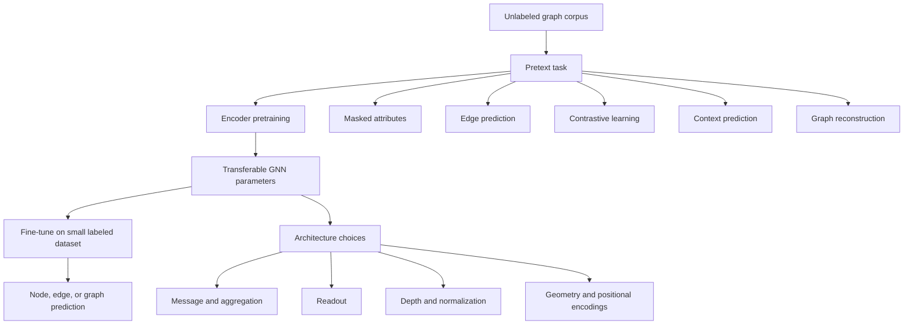
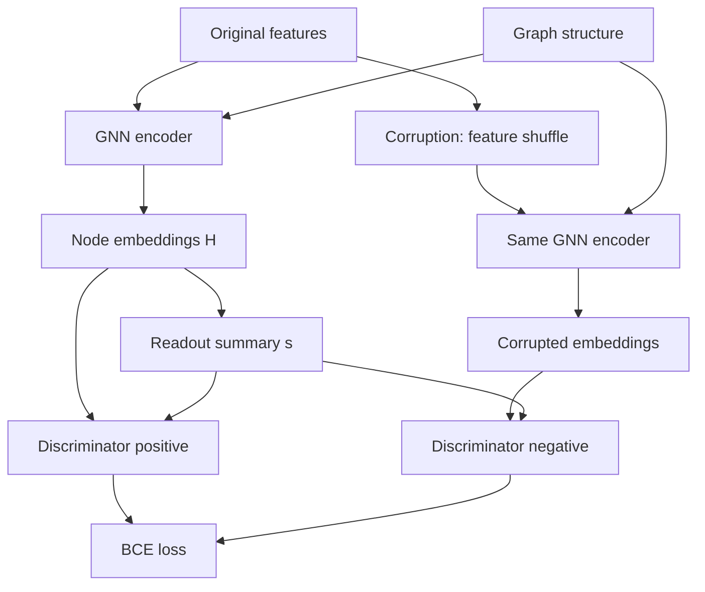
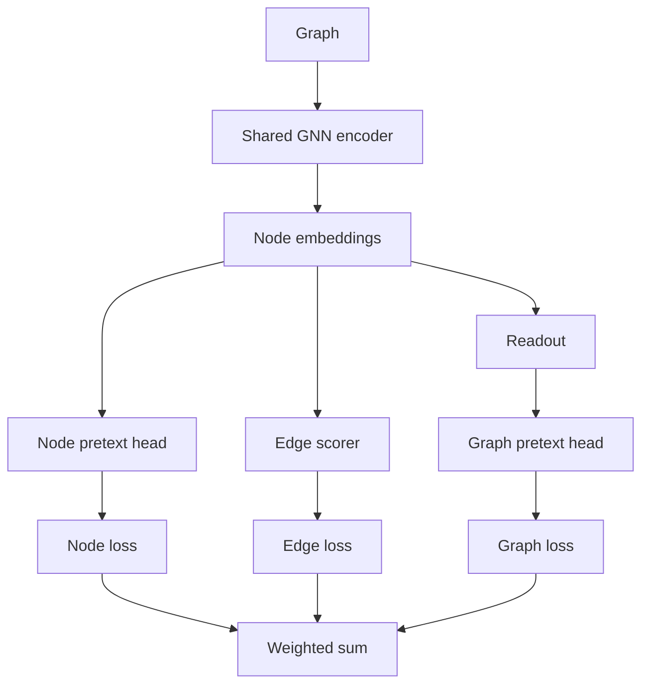
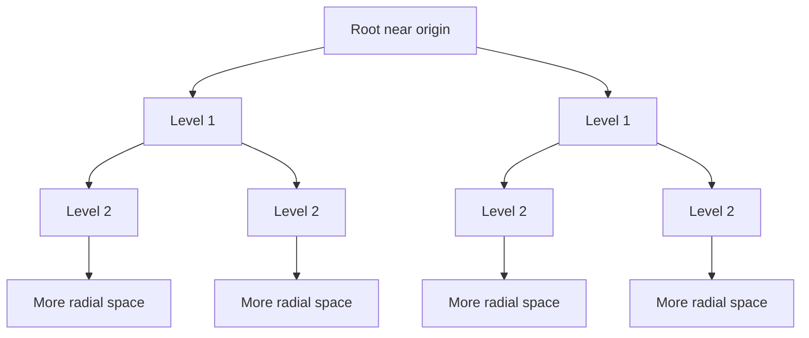
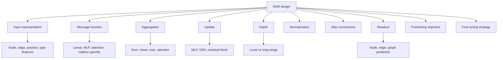

# Pre-Training Graph Neural Networks, Hyperbolic Embeddings, and the GNN Design Space

Graph pretraining tries to learn transferable graph representations before task-specific labels are available. The central difficulty is that graph data is less homogeneous than text or images: graphs differ in scale, feature schema, edge semantics, density, node identity assumptions, and downstream prediction level. A molecule, citation network, recommender graph, and knowledge graph do not share the same input distribution in the way ImageNet images roughly share pixels and local spatial structure.

This chapter studies three connected ideas:

- **Pre-trained GNNs:** learn node, edge, subgraph, or graph representations from unlabeled graph data, then fine-tune on a downstream task.
- **Hyperbolic graph embeddings:** represent hierarchical or tree-like graph structure in negatively curved spaces, where volume grows exponentially with radius.
- **GNN design space:** decompose GNNs into message, aggregation, update, pooling, normalization, depth, positional information, and training strategy choices. Pretraining is useful only when these choices match the transfer problem.

The focus is on mechanics, objectives, derivations, implementation details, and pitfalls.



## 1. Problem Setting

Let a graph be

$$
G=(V,E),
$$

with $n=|V|$ nodes, $m=|E|$ edges, node feature matrix

$$
X \in \mathbb{R}^{n \times d_0},
$$

optional edge features

$$
e_{uv} \in \mathbb{R}^{d_e}
\quad \text{for } (u,v) \in E,
$$

and adjacency matrix

$$
A \in \{0,1\}^{n \times n}.
$$

A $K$-layer GNN encoder maps

$$
f_\theta : (G,X) \mapsto H^{(K)} \in \mathbb{R}^{n \times d_K},
$$

where the row $h_v^{(K)}$ is the final node representation of node $v$.

For graph-level tasks, a readout function gives

$$
z_G
= \operatorname{READOUT}\left(\{h_v^{(K)}:v \in V\}\right)
\in \mathbb{R}^{d_g}.
$$

Pretraining learns parameters $\theta$ from an unlabeled source distribution

$$
G \sim \mathcal{D}_{\mathrm{pre}},
$$

using a self-supervised loss

$$
\mathcal{L}_{\mathrm{pre}}(\theta)
=
\mathbb{E}_{G \sim \mathcal{D}_{\mathrm{pre}}}
\left[
\ell_{\mathrm{pre}}(G;\theta)
\right].
$$

Fine-tuning initializes the downstream model with $\theta$ and optimizes a supervised loss on a target distribution

$$
(G,y) \sim \mathcal{D}_{\mathrm{target}}.
$$

The core transfer assumption is:

$$
\theta_{\mathrm{pre}}
\text{ captures reusable structural, semantic, or geometric invariances for }
\mathcal{D}_{\mathrm{target}}.
$$

This assumption is strong. A pretrained molecular GNN can transfer well across molecular property tasks, but a model pretrained on citation graphs may transfer poorly to recommender graphs unless the pretext task learns generic structural features rather than domain-specific labels.

## 2. Message Passing Backbone

Most pretraining methods use a message-passing encoder. A generic layer is

$$
m_v^{(k)}
=
\operatorname{AGG}^{(k)}
\left(
\left\{
\phi^{(k)}(h_v^{(k)},h_u^{(k)},e_{uv})
: u \in \mathcal{N}(v)
\right\}
\right),
$$

$$
h_v^{(k+1)}
=
\psi^{(k)}(h_v^{(k)},m_v^{(k)}),
$$

with $h_v^{(0)}=x_v$.

The aggregator must be permutation invariant because a graph neighborhood is a set, not a sequence:

$$
\operatorname{AGG}(\{a,b,c\})
=
\operatorname{AGG}(\{c,a,b\}).
$$

Common choices are sum, mean, max, and attention-weighted sum.

### 2.1 GCN Layer

A standard GCN layer adds self-loops and uses symmetric degree normalization:

$$
\tilde{A}=A+I,
$$

$$
\tilde{D}_{ii}=\sum_j \tilde{A}_{ij},
$$

$$
\hat{S}
=
\tilde{D}^{-1/2}\tilde{A}\tilde{D}^{-1/2}.
$$

The layer is

$$
H^{(k+1)}
=
\sigma\left(\hat{S}H^{(k)}W^{(k)}\right).
$$

Elementwise, for node $v$:

$$
h_v^{(k+1)}
=
\sigma
\left(
\sum_{u \in \mathcal{N}(v)\cup \{v\}}
\frac{1}{\sqrt{\tilde{d}_v\tilde{d}_u}}
h_u^{(k)}W^{(k)}
\right).
$$

The normalization term

$$
\frac{1}{\sqrt{\tilde{d}_v\tilde{d}_u}}
$$

prevents high-degree nodes from dominating and keeps the propagation operator better scaled.

```mermaid
flowchart LR
    X[Node features H^k] --> L[Linear transform W^k]
    L --> M[Neighbor messages]
    A[Adjacency with self-loops] --> N[Symmetric normalization]
    N --> M
    M --> S[Sum normalized messages]
    S --> R[Nonlinearity]
    R --> O[H^{k+1}]
```

### 2.2 Pretraining Does Not Require a Special Encoder

The encoder can be GCN, GraphSAGE, GAT, GIN, R-GCN, Graph Transformer, or a domain-specific molecular architecture. What changes is the loss and the data construction.

For example, the same encoder can be trained with:

- a masked node attribute loss,
- an edge existence loss,
- a contrastive InfoNCE loss,
- a global-local mutual information objective,
- a graph-level context prediction loss.

This separation is important:

$$
\text{pretrained GNN}
=
\text{encoder architecture}
+
\text{self-supervised objective}
+
\text{pretraining data distribution}.
$$

## 3. Pretraining Pipeline

The common execution pipeline is:

```mermaid
sequenceDiagram
    participant Data as Unlabeled graphs
    participant Aug as Masking / augmentation / sampling
    participant Enc as GNN encoder
    participant Head as Pretext head
    participant Opt as Optimizer
    participant FT as Fine-tuning head

    Data->>Aug: Construct self-supervised views or targets
    Aug->>Enc: Encode corrupted, masked, or augmented graphs
    Enc->>Head: Produce logits, scores, or projections
    Head->>Opt: Backpropagate pretext loss
    Opt->>Enc: Update encoder parameters
    Enc->>FT: Transfer initialized encoder
    FT->>FT: Train supervised target task
```

Step-by-step:

1. Select a source graph corpus $\mathcal{G}_{\mathrm{pre}}$.
2. Select encoder $f_\theta$ and readout $r_\theta$ if graph-level representations are needed.
3. Generate pretext inputs, for example masked features, sampled positive pairs, corrupted graphs, or augmented graph views.
4. Compute node embeddings $H=f_\theta(G,X)$ and graph embeddings $z_G=r_\theta(H)$.
5. Compute self-supervised loss $\mathcal{L}_{\mathrm{pre}}$.
6. Save $\theta_{\mathrm{pre}}$.
7. Replace the pretext head with a downstream head.
8. Fine-tune all parameters, freeze the encoder, or use discriminative learning rates.

The pretext head is usually discarded after pretraining. It should not be mistaken for the transferable representation itself.

## 4. Node-Level Pretraining

Node-level pretraining learns representations useful for predicting properties of individual nodes.

### 4.1 Masked Node Attribute Prediction

Let $\mathcal{M} \subset V$ be a set of masked nodes. The corrupted input is

$$
\tilde{x}_v =
\begin{cases}
x_{\mathrm{mask}}, & v \in \mathcal{M},\\
x_v, & v \notin \mathcal{M}.
\end{cases}
$$

The encoder computes

$$
\tilde{H}=f_\theta(G,\tilde{X}).
$$

A prediction head $g_\psi$ predicts the masked attribute:

$$
\hat{x}_v = g_\psi(\tilde{h}_v).
$$

For categorical attributes, the loss is cross entropy:

$$
\mathcal{L}_{\mathrm{mask}}
=
-
\sum_{v \in \mathcal{M}}
\log
\frac{
\exp(s_{v,x_v})
}{
\sum_{c=1}^C \exp(s_{v,c})
},
$$

where

$$
s_v=g_\psi(\tilde{h}_v)\in \mathbb{R}^C.
$$

For continuous attributes, a regression loss is common:

$$
\mathcal{L}_{\mathrm{mask}}
=
\sum_{v \in \mathcal{M}}
\left\|
g_\psi(\tilde{h}_v)-x_v
\right\|_2^2.
$$

#### Under-the-hood execution

1. Sample mask indicators

$$
b_v \sim \operatorname{Bernoulli}(p_{\mathrm{mask}}).
$$

2. Replace selected features with a learned mask token, zero vector, noise vector, or type-specific mask.
3. Run message passing on the corrupted graph.
4. Predict only the masked attributes.
5. Backpropagate through all message-passing paths that influenced masked nodes.

The loss should usually be computed only on masked positions. If unmasked positions are included, the model can learn an identity shortcut.

#### Intuition

Masked node prediction asks the GNN to infer missing local semantics from graph context. For molecular graphs, an atom type can often be inferred from valence patterns, bond types, and neighboring atoms. For citation graphs, a paper's topic-like features can be inferred from linked papers.

#### Worked example

Suppose node $v$ has true categorical type $x_v=2$ among $C=3$ classes. The prediction logits are

$$
s_v = [1.2,\; 2.0,\; -0.3].
$$

The softmax probability of the true class is

$$
p(x_v=2 \mid G,\tilde{X})
=
\frac{\exp(2.0)}
{\exp(1.2)+\exp(2.0)+\exp(-0.3)}.
$$

Using

$$
\exp(1.2)\approx 3.320,\quad
\exp(2.0)\approx 7.389,\quad
\exp(-0.3)\approx 0.741,
$$

we get

$$
p(x_v=2 \mid G,\tilde{X})
\approx
\frac{7.389}{3.320+7.389+0.741}
=
0.645.
$$

The cross-entropy contribution is

$$
-\log(0.645)\approx 0.438.
$$

### 4.2 Context Prediction

Context prediction trains a node or subgraph representation to predict surrounding graph context.

Let

$$
S_v
=
\{u:\operatorname{dist}(u,v)\le r_{\mathrm{sub}}\}
$$

be a local subgraph around node $v$, and let

$$
C_v
=
\{u:r_{\mathrm{in}} < \operatorname{dist}(u,v) \le r_{\mathrm{out}}\}
$$

be a larger context ring. Encode the local subgraph and context:

$$
z_{S_v}=f_\theta(G[S_v],X_{S_v}),
$$

$$
z_{C_v}=q_\phi(G[C_v],X_{C_v}).
$$

A binary classifier scores whether a pair belongs together:

$$
s(v,c)=z_{S_v}^{\top}Wz_{C_c}.
$$

With positive pairs $(S_v,C_v)$ and negative contexts $C_{u_1},\ldots,C_{u_K}$, an InfoNCE-style loss is

$$
\mathcal{L}_{\mathrm{context}}(v)
=
-
\log
\frac{
\exp(s(v,v)/\tau)
}{
\exp(s(v,v)/\tau)
+
\sum_{k=1}^K \exp(s(v,u_k)/\tau)
}.
$$

Here $\tau>0$ is a temperature. Smaller $\tau$ makes the softmax sharper and emphasizes hard negatives.

### 4.3 Deep Graph Infomax

Deep Graph Infomax learns node representations by maximizing agreement between local node embeddings and a global graph summary.

Let

$$
H=f_\theta(G,X),
$$

and define a graph summary

$$
s
=
\sigma
\left(
\frac{1}{n}\sum_{v \in V} h_v
\right).
$$

Construct corrupted features $\bar{X}$, often by shuffling node features across nodes, and compute corrupted embeddings

$$
\bar{H}=f_\theta(G,\bar{X}).
$$

A discriminator scores local-global pairs:

$$
D(h_v,s)
=
\sigma(h_v^\top W s).
$$

The binary cross-entropy objective is

$$
\mathcal{L}_{\mathrm{DGI}}
=
-
\sum_{v \in V}
\left[
\log D(h_v,s)
+
\log(1-D(\bar{h}_v,s))
\right].
$$

This is a contrastive objective between real node-summary pairs and corrupted node-summary pairs.



#### Why the corruption matters

If negatives are too easy, the model learns shallow dataset artifacts. If negatives are too hard or false negatives, optimization becomes noisy. Feature shuffling keeps the graph topology fixed but breaks the alignment between structure and attributes.

## 5. Edge-Level Pretraining

Edge-level pretraining is useful when downstream tasks involve link prediction, recommendation, relation prediction, or graph completion.

### 5.1 Link Prediction Objective

Given embeddings $h_u,h_v$, define a link score

$$
s(u,v)=h_u^\top h_v.
$$

The Bernoulli edge likelihood is

$$
p(A_{uv}=1 \mid h_u,h_v)
=
\sigma(s(u,v)).
$$

For positive edges $\mathcal{E}^+$ and sampled negative non-edges $\mathcal{E}^-$, the negative log-likelihood is

$$
\mathcal{L}_{\mathrm{edge}}
=
-
\sum_{(u,v)\in \mathcal{E}^+}
\log \sigma(h_u^\top h_v)
-
\sum_{(u,v)\in \mathcal{E}^-}
\log \sigma(-h_u^\top h_v).
$$

This is equivalent to binary cross entropy with logits, where positive edges have label $1$ and negative edges have label $0$.

### 5.2 Negative Sampling

The full non-edge set has size

$$
O(n^2-m),
$$

so it is usually impossible to enumerate. Instead, sample negatives:

$$
(u,v) \sim q(u,v)
\quad \text{such that } (u,v)\notin E.
$$

The negative sampling distribution $q$ matters. Uniform negative sampling can make the task too easy in sparse graphs, because most random node pairs are obviously unrelated. Degree-aware or type-constrained negative sampling gives harder and more realistic examples.

### 5.3 Derivation from Bernoulli Likelihood

For a candidate pair $(u,v)$, assume

$$
A_{uv} \sim \operatorname{Bernoulli}(p_{uv}),
$$

where

$$
p_{uv}=\sigma(h_u^\top h_v).
$$

The likelihood is

$$
p(A_{uv}\mid h_u,h_v)
=
p_{uv}^{A_{uv}}(1-p_{uv})^{1-A_{uv}}.
$$

The negative log-likelihood is

$$
-\log p(A_{uv}\mid h_u,h_v)
=
-A_{uv}\log p_{uv}
-(1-A_{uv})\log(1-p_{uv}).
$$

Using

$$
1-\sigma(t)=\sigma(-t),
$$

we get the positive and negative terms above.

### 5.4 Worked example

Let

$$
h_u=[1,2],
\quad
h_v=[0.5,1],
\quad
h_w=[2,-1].
$$

For a positive edge $(u,v)$:

$$
h_u^\top h_v = 1\cdot 0.5 + 2\cdot 1=2.5.
$$

The positive loss is

$$
-\log \sigma(2.5)
\approx
-\log(0.924)
=0.079.
$$

For a negative edge $(u,w)$:

$$
h_u^\top h_w=1\cdot 2 + 2\cdot(-1)=0.
$$

The negative loss is

$$
-\log \sigma(-0)
=
-\log(0.5)
=0.693.
$$

The negative pair is not confidently separated, so it contributes more gradient.

## 6. Graph-Level Pretraining

Graph-level pretraining learns embeddings of entire graphs. This is common in molecules, proteins, program graphs, and ego-network classification.

### 6.1 Graph Readout

Given node embeddings $H=\{h_v:v\in V\}$, common readouts are

$$
z_G=\sum_{v\in V}h_v,
$$

$$
z_G=\frac{1}{n}\sum_{v\in V}h_v,
$$

$$
z_G=\max_{v\in V}h_v,
$$

or attention pooling:

$$
\alpha_v
=
\frac{
\exp(a^\top \tanh(Wh_v))
}{
\sum_{u\in V}
\exp(a^\top \tanh(Wh_u))
},
$$

$$
z_G
=
\sum_{v\in V}\alpha_v h_v.
$$

Sum pooling preserves graph size information. Mean pooling normalizes away graph size. Attention pooling learns which nodes are important but can overfit on small datasets.

### 6.2 Graph Contrastive Learning

Graph contrastive learning creates two augmented views of the same graph:

$$
\tilde{G}_i^{(1)} = t_1(G_i),
\quad
\tilde{G}_i^{(2)} = t_2(G_i),
$$

where $t_1,t_2$ are stochastic augmentations such as node dropping, edge perturbation, attribute masking, or subgraph sampling.

Encode and project:

$$
z_i^{(1)} = p_\psi(r(f_\theta(\tilde{G}_i^{(1)}))),
$$

$$
z_i^{(2)} = p_\psi(r(f_\theta(\tilde{G}_i^{(2)}))).
$$

For a batch of $B$ graphs, the InfoNCE loss for graph $i$ is

$$
\mathcal{L}_i
=
-
\log
\frac{
\exp(\operatorname{sim}(z_i^{(1)},z_i^{(2)})/\tau)
}{
\sum_{j=1}^{B}
\mathbb{1}_{j\ne i}
\exp(\operatorname{sim}(z_i^{(1)},z_j^{(2)})/\tau)
+
\exp(\operatorname{sim}(z_i^{(1)},z_i^{(2)})/\tau)
}.
$$

Usually

$$
\operatorname{sim}(a,b)
=
\frac{a^\top b}{\|a\|_2\|b\|_2}.
$$

#### Derivation as multiclass classification

For anchor $z_i^{(1)}$, define the candidate set

$$
\mathcal{C}_i
=
\{z_1^{(2)},\ldots,z_B^{(2)}\}.
$$

The positive candidate is $z_i^{(2)}$. The model assigns probability

$$
p(j \mid i)
=
\frac{
\exp(\operatorname{sim}(z_i^{(1)},z_j^{(2)})/\tau)
}{
\sum_{k=1}^B
\exp(\operatorname{sim}(z_i^{(1)},z_k^{(2)})/\tau)
}.
$$

Cross entropy with target class $i$ gives

$$
\mathcal{L}_i=-\log p(i\mid i).
$$

Thus InfoNCE is ordinary softmax classification where the label says which view came from the same original graph.

### 6.3 Augmentations and Invariance Assumptions

An augmentation defines what information the model should ignore. This is powerful and dangerous.

| Augmentation | Invariance learned | Pitfall |
|---|---|---|
| Node dropping | Robustness to missing nodes | Can destroy labels depending on rare nodes |
| Edge perturbation | Robustness to noisy topology | Bad for tasks where exact bonds/links matter |
| Attribute masking | Contextual feature inference | Can become too easy with redundant features |
| Subgraph sampling | Local-to-global consistency | May lose long-range signal |
| Random walk sampling | Structural context | Biased toward high-degree regions |

For molecules, random edge deletion may create chemically invalid structures. For social graphs, edge perturbation may be a reasonable robustness assumption.

## 7. Combining Node-Level and Graph-Level Pretraining

A key empirical lesson from early pretraining work is that local and global objectives can conflict or complement each other. Node-level pretraining encourages useful local representations, while graph-level pretraining encourages readout-compatible global semantics.

One combined loss is

$$
\mathcal{L}_{\mathrm{pre}}
=
\lambda_{\mathrm{node}}\mathcal{L}_{\mathrm{node}}
+
\lambda_{\mathrm{edge}}\mathcal{L}_{\mathrm{edge}}
+
\lambda_{\mathrm{graph}}\mathcal{L}_{\mathrm{graph}}.
$$

The weights $\lambda$ should be tuned because the losses can have different scales.



## 8. Fine-Tuning Strategies

After pretraining, attach a downstream head. For graph classification:

$$
\hat{y}_G
=
\operatorname{softmax}
\left(
W_{\mathrm{task}}z_G+b_{\mathrm{task}}
\right).
$$

The supervised loss is

$$
\mathcal{L}_{\mathrm{sup}}
=
-
\sum_{(G,y)\in \mathcal{D}_{\mathrm{train}}}
\log \hat{p}(y\mid G).
$$

Three common fine-tuning strategies:

| Strategy | Trainable parameters | Use when |
|---|---:|---|
| Linear probing | only downstream head | evaluate representation quality |
| Frozen encoder with shallow head | head plus maybe normalization | very few labels or high overfitting risk |
| Full fine-tuning | encoder and head | enough labels and target close to source |

Discriminative learning rates are often useful:

$$
\eta_{\mathrm{encoder}} < \eta_{\mathrm{head}}.
$$

This prevents early fine-tuning steps from destroying pretrained representations.

### 8.1 Avoiding Negative Transfer

Negative transfer occurs when pretraining hurts downstream performance. Common causes:

- source and target graphs have incompatible feature semantics,
- pretext task removes information needed by the target task,
- augmentation assumptions are invalid,
- pretraining objective learns shortcuts,
- fine-tuning dataset is too small to adapt a large encoder,
- batch normalization statistics shift between source and target.

Mitigations:

- use domain-matched pretraining data,
- select augmentations from domain invariances,
- use early stopping and smaller encoder learning rate,
- freeze lower layers,
- reinitialize task-specific normalization layers,
- compare against training from scratch.

## 9. Generative Pretraining

Generative graph pretraining models attributes and structure rather than only contrasting views.

### 9.1 Attribute Generation

For masked attributes:

$$
p_\theta(X_\mathcal{M}\mid G,X_{\bar{\mathcal{M}}})
=
\prod_{v\in \mathcal{M}}
p_\theta(x_v\mid G,X_{\bar{\mathcal{M}}}).
$$

The negative log-likelihood is

$$
\mathcal{L}_{\mathrm{attr}}
=
-
\sum_{v\in \mathcal{M}}
\log p_\theta(x_v\mid G,X_{\bar{\mathcal{M}}}).
$$

### 9.2 Structure Generation

For edge generation:

$$
p_\theta(A\mid X)
=
\prod_{u<v}
p_\theta(A_{uv}\mid X),
$$

with

$$
p_\theta(A_{uv}=1\mid X)
=
\sigma(h_u^\top W h_v).
$$

The full likelihood is too expensive for large graphs because it has $O(n^2)$ candidate pairs. Practical implementations use sampled positives and negatives.

### 9.3 Autoregressive Graph Generation

Some methods decompose graph generation into sequential decisions:

$$
p_\theta(G)
=
\prod_{t=1}^{T}
p_\theta(a_t \mid a_{<t}),
$$

where $a_t$ may be a node type, edge endpoint, edge type, or stop token.

Autoregressive graph generation is expressive but sensitive to node ordering. Canonicalization, random order training, or permutation-invariant decoders are needed to avoid learning arbitrary order artifacts.

## 10. Hyperbolic Graph Embeddings

Many graphs have latent hierarchy. A rooted tree with branching factor $b$ has approximately

$$
1+b+b^2+\cdots+b^r
=
\frac{b^{r+1}-1}{b-1}
$$

nodes within depth $r$, which grows exponentially in $r$.

Euclidean $d$-dimensional volume grows polynomially with radius:

$$
V_{\mathbb{R}^d}(r)
\propto r^d.
$$

Hyperbolic $d$-dimensional volume grows exponentially:

$$
V_{\mathbb{H}^d}(r)
\propto \sinh^{d-1}(r)
\approx
\frac{1}{2^{d-1}}\exp((d-1)r)
\quad \text{for large } r.
$$

This exponential expansion makes hyperbolic geometry naturally suited to tree-like or hierarchical graph structure.



### 10.1 Poincare Ball Model

The $d$-dimensional Poincare ball with curvature $-1$ is

$$
\mathbb{B}^d
=
\{x\in \mathbb{R}^d:\|x\|_2<1\}.
$$

The hyperbolic distance between $u,v\in \mathbb{B}^d$ is

$$
d_{\mathbb{B}}(u,v)
=
\operatorname{arcosh}
\left(
1+
2
\frac{\|u-v\|_2^2}
{(1-\|u\|_2^2)(1-\|v\|_2^2)}
\right).
$$

Important terms:

- $\|u-v\|_2^2$ is the Euclidean squared distance in coordinates.
- $1-\|u\|_2^2$ and $1-\|v\|_2^2$ shrink near the boundary.
- As $\|u\|_2\to 1$, distances to many other points become large.
- Points near the origin represent general concepts; points near the boundary represent specific leaves.

For curvature $-c$ with $c>0$, the ball radius is $1/\sqrt{c}$ and the distance becomes

$$
d_c(u,v)
=
\frac{1}{\sqrt{c}}
\operatorname{arcosh}
\left(
1+
2c
\frac{\|u-v\|_2^2}
{(1-c\|u\|_2^2)(1-c\|v\|_2^2)}
\right).
$$

### 10.2 Objective for Hierarchical Embeddings

Given observed related pairs

$$
\mathcal{D}=\{(u,v)\},
$$

where $v$ is a child, neighbor, or associated concept of $u$, define energy

$$
E(u,v)=d_{\mathbb{B}}(z_u,z_v).
$$

A negative-sampling loss is

$$
\mathcal{L}
=
-
\sum_{(u,v)\in \mathcal{D}}
\log
\frac{
\exp(-d_{\mathbb{B}}(z_u,z_v))
}{
\sum_{v'\in \mathcal{N}(u)}
\exp(-d_{\mathbb{B}}(z_u,z_{v'}))
},
$$

where $\mathcal{N}(u)$ contains the true neighbor $v$ and sampled negatives.

This encourages observed pairs to be closer in hyperbolic distance than corrupted pairs.

### 10.3 Riemannian Gradient Step

The Poincare ball is not optimized correctly with ordinary Euclidean gradient descent unless steps are projected and small. The Riemannian gradient rescales the Euclidean gradient.

The Poincare metric tensor is conformal:

$$
g_x
=
\lambda_x^2 I,
$$

where

$$
\lambda_x
=
\frac{2}{1-\|x\|_2^2}.
$$

Given Euclidean gradient

$$
\nabla_E \mathcal{L}(x),
$$

the Riemannian gradient is

$$
\nabla_R \mathcal{L}(x)
=
\frac{1}{\lambda_x^2}
\nabla_E \mathcal{L}(x)
=
\frac{(1-\|x\|_2^2)^2}{4}
\nabla_E \mathcal{L}(x).
$$

A first-order update is

$$
x' = x - \eta \nabla_R \mathcal{L}(x).
$$

Then project back into the ball:

$$
x_{\mathrm{new}}
=
\begin{cases}
x', & \|x'\|_2 < 1-\epsilon,\\
(1-\epsilon)\dfrac{x'}{\|x'\|_2}, & \text{otherwise}.
\end{cases}
$$

This projection avoids invalid points on or outside the boundary.

### 10.4 Worked Hyperbolic Distance Example

Let

$$
u=[0.1,0],
\quad
v=[0.4,0],
$$

in the unit Poincare ball.

Then

$$
\|u-v\|_2^2=(0.3)^2=0.09,
$$

$$
1-\|u\|_2^2=1-0.01=0.99,
$$

$$
1-\|v\|_2^2=1-0.16=0.84.
$$

The argument to $\operatorname{arcosh}$ is

$$
1+2\frac{0.09}{0.99\cdot 0.84}
=
1+
\frac{0.18}{0.8316}
\approx
1.2165.
$$

Since

$$
\operatorname{arcosh}(x)
=
\log(x+\sqrt{x^2-1}),
$$

we get

$$
d_{\mathbb{B}}(u,v)
\approx
\log(1.2165+\sqrt{1.2165^2-1})
\approx
0.649.
$$

Now compare two points near the boundary:

$$
u=[0.8,0],
\quad
v=[0.9,0].
$$

Then

$$
\|u-v\|_2^2=0.01,
$$

$$
(1-\|u\|^2)(1-\|v\|^2)
=(1-0.64)(1-0.81)=0.36\cdot 0.19=0.0684.
$$

The argument is

$$
1+2\frac{0.01}{0.0684}
\approx
1.2924,
$$

so

$$
d_{\mathbb{B}}(u,v)
\approx
0.746.
$$

A smaller Euclidean displacement near the boundary can correspond to a larger hyperbolic distance.

## 11. Hyperbolic GNNs

Hyperbolic embeddings can be combined with GNNs by performing operations in tangent spaces.

At point $x$ on a manifold, the tangent space $T_x\mathcal{M}$ is a Euclidean vector space that locally approximates the manifold. A common strategy:

1. Map hyperbolic embeddings to a tangent space using the logarithmic map.
2. Perform Euclidean aggregation or linear transformation.
3. Map back to the manifold using the exponential map.

At the origin of the Poincare ball, the maps for curvature $-1$ are:

$$
\log_0(x)
=
\frac{2\operatorname{artanh}(\|x\|)}
{\|x\|}
x,
$$

$$
\exp_0(v)
=
\tanh\left(\frac{\|v\|}{2}\right)
\frac{v}{\|v\|}.
$$

The zero-norm cases are handled by limits:

$$
\log_0(0)=0,
\quad
\exp_0(0)=0.
$$

A simplified hyperbolic aggregation layer can be written:

$$
\bar{h}_v^{(k)}
=
\sum_{u\in \mathcal{N}(v)\cup\{v\}}
\alpha_{uv}
\log_0(h_u^{(k)}),
$$

$$
h_v^{(k+1)}
=
\exp_0
\left(
\sigma(W^{(k)}\bar{h}_v^{(k)})
\right).
$$

This is not the only hyperbolic GNN design, but it shows the general pattern: do vector-space algebra in tangent space and keep representations on the manifold.

## 12. GNN Design Space

The design space of GNNs is the Cartesian product of choices in architecture, training, data representation, and task interface.



### 12.1 Message Construction

The message from $u$ to $v$ can use:

$$
m_{u\to v}^{(k)}
=
\phi^{(k)}(h_u^{(k)},h_v^{(k)},e_{uv},p_u,p_v,t_u,t_v),
$$

where:

- $e_{uv}$ is an edge feature or relation type,
- $p_v$ is a positional or structural encoding,
- $t_v$ is a node type.

For homogeneous graphs with no edge features:

$$
m_{u\to v}^{(k)}=W^{(k)}h_u^{(k)}.
$$

For relational graphs:

$$
m_{u\to v}^{(k)}=W_{r(u,v)}^{(k)}h_u^{(k)}.
$$

For attention:

$$
m_{u\to v}^{(k)}=\alpha_{uv}^{(k)}W^{(k)}h_u^{(k)}.
$$

### 12.2 Aggregation Function

Aggregation determines expressiveness and stability.

| Aggregator | Formula | Notes |
|---|---|---|
| Sum | $\sum_{u\in\mathcal{N}(v)}m_{u\to v}$ | preserves multiplicity, expressive |
| Mean | $\frac{1}{|\mathcal{N}(v)|}\sum_u m_{u\to v}$ | degree-normalized, can lose count information |
| Max | $\max_u m_{u\to v}$ | robust to many irrelevant neighbors, discards frequency |
| Attention | $\sum_u \alpha_{uv}m_{u\to v}$ | adaptive weighting, costlier and can overfit |

Mean aggregation can lose multiplicity information. For example:

$$
\operatorname{mean}(\{1,3\})=2,
\quad
\operatorname{mean}(\{2,2\})=2,
$$

but

$$
\operatorname{sum}(\{1,3\})=4,
\quad
\operatorname{sum}(\{2,2\})=4.
$$

This raw sum example still collides. The expressiveness claim is about summing learned element transforms. If

$$
\phi(x)=[x,x^2],
$$

then

$$
\sum_{x\in\{1,3\}}\phi(x)=[4,10],
$$

but

$$
\sum_{x\in\{2,2\}}\phi(x)=[4,8].
$$

With a sufficiently expressive learned transform before summation, sum aggregation can represent injective multiset functions over bounded domains more effectively than mean or max.

### 12.3 Update Function

The update function combines previous state and aggregated message:

$$
h_v^{(k+1)}
=
\psi^{(k)}(h_v^{(k)},m_v^{(k)}).
$$

Examples:

$$
h_v^{(k+1)}
=
\sigma(Wm_v^{(k)}),
$$

$$
h_v^{(k+1)}
=
h_v^{(k)}+\sigma(Wm_v^{(k)}),
$$

$$
h_v^{(k+1)}
=
\operatorname{GRU}(m_v^{(k)},h_v^{(k)}).
$$

Residual updates reduce optimization difficulty and help preserve local information during deeper propagation.

### 12.4 Depth, Over-Smoothing, and Over-Squashing

A $K$-layer message-passing GNN sees at most $K$ hops:

$$
h_v^{(K)}
\text{ depends on }
\{x_u:\operatorname{dist}(u,v)\le K\}.
$$

Increasing $K$ expands the receptive field but causes two problems.

**Over-smoothing:** node embeddings become indistinguishable under repeated averaging. For a linear GCN,

$$
H^{(K)}=\hat{S}^K X W,
$$

and repeated powers of $\hat{S}$ suppress high-frequency graph signals.

**Over-squashing:** exponentially many distant nodes must communicate through fixed-width vectors and graph bottlenecks. Even if optimization succeeds, the representation may not have enough capacity to preserve all relevant long-range information.

Pretraining does not remove these architectural limits. It can only help the encoder learn better use of its available capacity.

### 12.5 Positional and Structural Encodings

Message passing without identifiers is permutation equivariant:

$$
f_\theta(PAP^\top,PX)=Pf_\theta(A,X),
$$

where $P$ is a permutation matrix.

This is a feature, not a bug, but it limits distinguishability. Positional encodings inject graph location or structure:

- Laplacian eigenvectors,
- random walk landing probabilities,
- shortest-path distances to anchors,
- degree encodings,
- centrality measures,
- role identifiers,
- motif counts.

For pretraining, positional encodings can make pretext tasks less ambiguous, but they can also reduce transfer if the source and target graphs have different positional statistics.

## 13. Python Implementation from Scratch

This implementation uses PyTorch tensors and sparse matrix multiplication. It includes:

- GCN normalization,
- a two-layer GCN encoder,
- DGI-style self-supervised pretraining,
- linear probing for node classification.

It avoids PyG/DGL so the mechanics are visible.

```python
from dataclasses import dataclass

import torch
import torch.nn as nn
import torch.nn.functional as F


def normalize_adjacency(edge_index, num_nodes, device=None):
    """Return sparse GCN normalization S = D^{-1/2}(A + I)D^{-1/2}.

    edge_index follows the PyG convention: edge_index[0] is source,
    edge_index[1] is target. The returned sparse matrix has entries
    S[target, source], so torch.sparse.mm(S, X) aggregates source
    node features into target rows.
    """
    if device is None:
        device = edge_index.device

    src, dst = edge_index

    # Add self-loops.
    self_loops = torch.arange(num_nodes, device=device)
    loop_index = torch.stack([self_loops, self_loops], dim=0)
    edge_index = torch.cat([edge_index, loop_index], dim=1)
    src, dst = edge_index

    # For undirected graphs represented by both directions, this is the usual degree.
    # For directed graphs, this uses in-degree normalization.
    deg = torch.zeros(num_nodes, device=device)
    deg.scatter_add_(0, dst, torch.ones_like(dst, dtype=torch.float))

    deg_inv_sqrt = deg.clamp(min=1).pow(-0.5)
    values = deg_inv_sqrt[dst] * deg_inv_sqrt[src]

    adj = torch.sparse_coo_tensor(
        torch.stack([dst, src], dim=0),
        values,
        size=(num_nodes, num_nodes),
        device=device,
    ).coalesce()
    return adj


class GCNLayer(nn.Module):
    def __init__(self, in_dim, out_dim):
        super().__init__()
        self.weight = nn.Parameter(torch.empty(in_dim, out_dim))
        self.bias = nn.Parameter(torch.zeros(out_dim))
        nn.init.xavier_uniform_(self.weight)

    def forward(self, x, norm_adj):
        support = x @ self.weight
        out = torch.sparse.mm(norm_adj, support)
        return out + self.bias


class GCNEncoder(nn.Module):
    def __init__(self, in_dim, hidden_dim, out_dim, dropout=0.2):
        super().__init__()
        self.conv1 = GCNLayer(in_dim, hidden_dim)
        self.conv2 = GCNLayer(hidden_dim, out_dim)
        self.dropout = dropout

    def forward(self, x, norm_adj):
        h = self.conv1(x, norm_adj)
        h = F.relu(h)
        h = F.dropout(h, p=self.dropout, training=self.training)
        h = self.conv2(h, norm_adj)
        return h


class DeepGraphInfomaxScratch(nn.Module):
    def __init__(self, encoder, hidden_dim):
        super().__init__()
        self.encoder = encoder
        self.weight = nn.Parameter(torch.empty(hidden_dim, hidden_dim))
        nn.init.xavier_uniform_(self.weight)

    def summary(self, h):
        return torch.sigmoid(h.mean(dim=0))

    def discriminate(self, h, s):
        # Bilinear score h_v^T W s for every node v.
        return h @ self.weight @ s

    def corrupt(self, x):
        perm = torch.randperm(x.size(0), device=x.device)
        return x[perm]

    def forward(self, x, norm_adj):
        h_pos = self.encoder(x, norm_adj)
        s = self.summary(h_pos)

        x_corrupt = self.corrupt(x)
        h_neg = self.encoder(x_corrupt, norm_adj)

        pos_logits = self.discriminate(h_pos, s)
        neg_logits = self.discriminate(h_neg, s)
        return pos_logits, neg_logits, h_pos

    def loss(self, pos_logits, neg_logits):
        pos_labels = torch.ones_like(pos_logits)
        neg_labels = torch.zeros_like(neg_logits)
        logits = torch.cat([pos_logits, neg_logits], dim=0)
        labels = torch.cat([pos_labels, neg_labels], dim=0)
        return F.binary_cross_entropy_with_logits(logits, labels)


@dataclass
class GraphData:
    x: torch.Tensor
    edge_index: torch.Tensor
    y: torch.Tensor | None = None
    train_mask: torch.Tensor | None = None
    val_mask: torch.Tensor | None = None
    test_mask: torch.Tensor | None = None


def pretrain_dgi(data, hidden_dim=64, epochs=200, lr=1e-3, weight_decay=0.0):
    num_nodes, in_dim = data.x.shape
    norm_adj = normalize_adjacency(data.edge_index, num_nodes, data.x.device)

    encoder = GCNEncoder(in_dim, hidden_dim, hidden_dim)
    model = DeepGraphInfomaxScratch(encoder, hidden_dim)
    optimizer = torch.optim.Adam(model.parameters(), lr=lr, weight_decay=weight_decay)

    for epoch in range(epochs):
        model.train()
        optimizer.zero_grad()
        pos_logits, neg_logits, _ = model(data.x, norm_adj)
        loss = model.loss(pos_logits, neg_logits)
        loss.backward()
        optimizer.step()

    return model.encoder


class LinearProbe(nn.Module):
    def __init__(self, in_dim, num_classes):
        super().__init__()
        self.classifier = nn.Linear(in_dim, num_classes)

    def forward(self, h):
        return self.classifier(h)


def train_linear_probe(encoder, data, num_classes, epochs=200, lr=1e-2):
    num_nodes = data.x.size(0)
    norm_adj = normalize_adjacency(data.edge_index, num_nodes, data.x.device)

    encoder.eval()
    with torch.no_grad():
        h = encoder(data.x, norm_adj)

    probe = LinearProbe(h.size(1), num_classes).to(h.device)
    optimizer = torch.optim.Adam(probe.parameters(), lr=lr)

    for epoch in range(epochs):
        probe.train()
        optimizer.zero_grad()
        logits = probe(h)
        loss = F.cross_entropy(logits[data.train_mask], data.y[data.train_mask])
        loss.backward()
        optimizer.step()

    return probe
```

### 13.1 What the Scratch Code Computes

`normalize_adjacency` computes

$$
\hat{S}=\tilde{D}^{-1/2}\tilde{A}\tilde{D}^{-1/2}.
$$

`GCNLayer.forward` computes

$$
\hat{S}XW+b.
$$

`DeepGraphInfomaxScratch.forward` computes:

1. positive embeddings from the original graph,
2. a global summary vector,
3. negative embeddings from feature-shuffled corruption,
4. bilinear positive and negative logits,
5. binary cross entropy with logits.

Using `binary_cross_entropy_with_logits` is numerically more stable than applying `sigmoid` and then binary cross entropy separately, because it avoids computing $\log(0)$ when logits are large.

## 14. Masked Node Pretraining from Scratch

```python
class MaskedNodePretrainer(nn.Module):
    def __init__(self, encoder, in_dim, hidden_dim, num_feature_classes):
        super().__init__()
        self.encoder = encoder
        self.mask_token = nn.Parameter(torch.zeros(in_dim))
        self.predictor = nn.Sequential(
            nn.Linear(hidden_dim, hidden_dim),
            nn.ReLU(),
            nn.Linear(hidden_dim, num_feature_classes),
        )

    def mask_inputs(self, x, mask_rate):
        n = x.size(0)
        mask = torch.rand(n, device=x.device) < mask_rate
        x_masked = x.clone()
        x_masked[mask] = self.mask_token
        return x_masked, mask

    def forward(self, x, norm_adj, mask_rate=0.15):
        x_masked, mask = self.mask_inputs(x, mask_rate)
        h = self.encoder(x_masked, norm_adj)
        logits = self.predictor(h)
        return logits, mask


def train_masked_node_prediction(data, feature_labels, hidden_dim=64, classes=10):
    norm_adj = normalize_adjacency(data.edge_index, data.x.size(0), data.x.device)
    encoder = GCNEncoder(data.x.size(1), hidden_dim, hidden_dim)
    model = MaskedNodePretrainer(encoder, data.x.size(1), hidden_dim, classes)
    optimizer = torch.optim.Adam(model.parameters(), lr=1e-3)

    for epoch in range(200):
        model.train()
        optimizer.zero_grad()
        logits, mask = model(data.x, norm_adj, mask_rate=0.15)

        if mask.sum() == 0:
            continue

        loss = F.cross_entropy(logits[mask], feature_labels[mask])
        loss.backward()
        optimizer.step()

    return model.encoder
```

Pitfalls:

- If `feature_labels` are derived directly from one-hot `x`, masking must hide the original one-hot vector completely.
- If no nodes are masked in a small graph, skip the batch or force at least one mask.
- Masking all nodes can remove the context needed for reconstruction.
- For heterogeneous node types, use type-specific mask tokens.

## 15. Graph Contrastive Pretraining from Scratch

Below is a compact graph-level contrastive implementation. It assumes a list of small graphs.

```python
def drop_edges(edge_index, drop_prob):
    num_edges = edge_index.size(1)
    keep = torch.rand(num_edges, device=edge_index.device) > drop_prob
    return edge_index[:, keep]


def mask_features(x, mask_prob):
    mask = torch.rand_like(x) < mask_prob
    x_aug = x.clone()
    x_aug[mask] = 0.0
    return x_aug


def mean_readout(h, batch):
    num_graphs = int(batch.max().item()) + 1
    out = torch.zeros(num_graphs, h.size(1), device=h.device)
    count = torch.zeros(num_graphs, 1, device=h.device)
    out.scatter_add_(0, batch[:, None].expand_as(h), h)
    count.scatter_add_(0, batch[:, None], torch.ones(h.size(0), 1, device=h.device))
    return out / count.clamp(min=1)


def info_nce(z1, z2, tau=0.2):
    z1 = F.normalize(z1, dim=-1)
    z2 = F.normalize(z2, dim=-1)
    logits = z1 @ z2.t() / tau
    labels = torch.arange(z1.size(0), device=z1.device)
    return F.cross_entropy(logits, labels)
```

For a real implementation, batching variable-sized graphs by hand is tedious. PyG and DGL provide batch objects that concatenate node features and shift edge indices while preserving graph membership.

## 16. Equivalent Implementation with PyTorch Geometric

PyTorch Geometric implements message passing with `MessagePassing.propagate`. For `GCNConv`, the layer internally:

1. optionally adds self-loops,
2. computes degree normalization,
3. linearly transforms node features,
4. sends normalized source node messages along edges,
5. aggregates messages at target nodes.

Conceptually it computes:

$$
X'=\hat{D}^{-1/2}\hat{A}\hat{D}^{-1/2}X\Theta.
$$

```python
import torch
import torch.nn as nn
import torch.nn.functional as F
from torch_geometric.nn import GCNConv, DeepGraphInfomax


class PyGEncoder(nn.Module):
    def __init__(self, in_channels, hidden_channels):
        super().__init__()
        self.conv1 = GCNConv(in_channels, hidden_channels)
        self.conv2 = GCNConv(hidden_channels, hidden_channels)

    def forward(self, x, edge_index):
        x = self.conv1(x, edge_index)
        x = F.relu(x)
        x = self.conv2(x, edge_index)
        return x


def corruption(x, edge_index):
    perm = torch.randperm(x.size(0), device=x.device)
    return x[perm], edge_index


def summary(z, *args, **kwargs):
    return torch.sigmoid(z.mean(dim=0))


def build_pyg_dgi(in_channels, hidden_channels):
    encoder = PyGEncoder(in_channels, hidden_channels)
    model = DeepGraphInfomax(
        hidden_channels=hidden_channels,
        encoder=encoder,
        summary=summary,
        corruption=corruption,
    )
    return model


def train_pyg_dgi(data, epochs=200):
    model = build_pyg_dgi(data.num_features, 64).to(data.x.device)
    optimizer = torch.optim.Adam(model.parameters(), lr=1e-3)

    for epoch in range(epochs):
        model.train()
        optimizer.zero_grad()
        pos_z, neg_z, summary_vec = model(data.x, data.edge_index)
        loss = model.loss(pos_z, neg_z, summary_vec)
        loss.backward()
        optimizer.step()

    return model
```

PyG's `DeepGraphInfomax` stores a trainable bilinear discriminator parameter. Its `loss` method computes positive and negative log-sigmoid terms with a small numerical stabilizer.

## 17. Equivalent Implementation with DGL

DGL's `GraphConv` implements graph convolution with configurable normalization. With `norm="both"`, messages are scaled in a way equivalent to symmetric normalization.

```python
import dgl
import torch
import torch.nn as nn
import torch.nn.functional as F
from dgl.nn import GraphConv


class DGLGCNEncoder(nn.Module):
    def __init__(self, in_dim, hidden_dim):
        super().__init__()
        self.conv1 = GraphConv(in_dim, hidden_dim, norm="both", activation=F.relu)
        self.conv2 = GraphConv(hidden_dim, hidden_dim, norm="both")

    def forward(self, graph, x):
        h = self.conv1(graph, x)
        h = self.conv2(graph, h)
        return h


class DGLDGI(nn.Module):
    def __init__(self, encoder, hidden_dim):
        super().__init__()
        self.encoder = encoder
        self.weight = nn.Parameter(torch.empty(hidden_dim, hidden_dim))
        nn.init.xavier_uniform_(self.weight)

    def forward(self, graph, x):
        h_pos = self.encoder(graph, x)
        s = torch.sigmoid(h_pos.mean(dim=0))

        perm = torch.randperm(x.size(0), device=x.device)
        h_neg = self.encoder(graph, x[perm])

        pos_logits = h_pos @ self.weight @ s
        neg_logits = h_neg @ self.weight @ s
        return pos_logits, neg_logits

    def loss(self, pos_logits, neg_logits):
        logits = torch.cat([pos_logits, neg_logits])
        labels = torch.cat([
            torch.ones_like(pos_logits),
            torch.zeros_like(neg_logits),
        ])
        return F.binary_cross_entropy_with_logits(logits, labels)
```

In DGL, the graph object stores adjacency and controls message flow. In PyG, `edge_index` is passed directly to each layer. Both libraries eventually perform sparse gather-scatter or sparse matrix operations.

## 18. Complexity

Let:

- $n=|V|$,
- $m=|E|$,
- $d$ be hidden dimension,
- $K$ be number of layers,
- $B$ be number of graphs in a contrastive batch.

For a sparse message-passing layer:

$$
T_{\mathrm{layer}}=O(md+nd^2)
$$

if the linear transform costs $O(nd^2)$ and propagation costs $O(md)$.

Memory for activations is roughly:

$$
O(Knd)
$$

for full-batch training, plus sparse edge storage:

$$
O(m).
$$

Pretraining overhead depends on the objective:

| Objective | Extra time | Extra memory |
|---|---:|---:|
| Masked node prediction | prediction head on masked nodes | mask and logits |
| Edge prediction | sampled edge scoring | positive/negative edge batches |
| DGI | roughly second encoder pass | positive and negative embeddings |
| Graph contrastive | two augmented views | two batches of embeddings |
| Full reconstruction | potentially $O(n^2)$ | dense scores if implemented naively |

Graph contrastive loss with in-batch negatives computes a similarity matrix:

$$
S=Z_1Z_2^\top \in \mathbb{R}^{B\times B},
$$

with cost

$$
O(B^2d)
$$

and memory

$$
O(B^2).
$$

For large $B$, this can dominate the GNN cost.

## 19. Numerical Stability

### 19.1 Logits Instead of Probabilities

Use BCE with logits:

$$
\operatorname{BCEWithLogits}(s,y)
=
-y\log\sigma(s)-(1-y)\log(1-\sigma(s)).
$$

Stable implementations rewrite this to avoid overflow:

$$
\max(s,0)-sy+\log(1+\exp(-|s|)).
$$

### 19.2 Cosine Similarity

When normalizing embeddings:

$$
\hat{z}=\frac{z}{\|z\|_2},
$$

use an epsilon:

$$
\hat{z}=\frac{z}{\max(\|z\|_2,\epsilon)}.
$$

Zero embeddings can appear early in training or after aggressive dropout.

### 19.3 Hyperbolic Distance

For Poincare distance, clamp norms:

$$
\|x\|_2 \le 1-\epsilon.
$$

Also clamp the $\operatorname{arcosh}$ argument:

$$
q \leftarrow \max(q,1+\epsilon),
$$

because floating-point error can produce $q<1$, where $\operatorname{arcosh}(q)$ is undefined in real numbers.

## 20. Edge Cases and Implementation Pitfalls

### 20.1 Graph Data Issues

- Isolated nodes need self-loops or special handling; otherwise they receive no messages.
- Directed graphs require a deliberate choice: use incoming edges, outgoing edges, both, or relation-specific directions.
- Multigraphs can duplicate messages unless edges are coalesced or edge weights are used.
- Heterogeneous graphs require type-specific features or projection layers.
- Missing node features require learned embeddings, structural features, or feature imputation.

### 20.2 Pretraining Issues

- Feature masking can leak labels if labels are encoded in node features.
- Link prediction can leak validation/test edges if edge splits are not constructed before message passing.
- Contrastive learning can suffer from false negatives when two different graphs have the same label or semantics.
- Aggressive graph augmentations can change the label.
- Batch normalization can behave poorly when graph sizes vary widely.
- Fine-tuning all layers with a large learning rate can erase pretrained features.

### 20.3 Evaluation Issues

Always compare against:

$$
\text{same architecture trained from scratch}.
$$

Otherwise gains may come from architecture, compute, hyperparameter tuning, or data leakage rather than pretraining.

Use multiple random seeds. Graph splits can have high variance, especially for small molecular datasets or citation networks.

## 21. Connections to Related ML Concepts

### 21.1 BERT-Style Masked Modeling

Masked node prediction is the graph analogue of masked language modeling. The difference is that graph context is unordered, irregular, and often typed.

### 21.2 SimCLR-Style Contrastive Learning

Graph contrastive learning follows the same principle as image contrastive learning: different views of the same object should be close, views of different objects should be separated. The main difficulty is choosing graph augmentations that preserve task semantics.

### 21.3 Matrix Factorization and Link Prediction

The dot-product edge decoder

$$
\sigma(h_u^\top h_v)
$$

is a neural version of low-rank adjacency factorization. The GNN encoder makes embeddings depend on features and topology rather than learning one free vector per node.

### 21.4 Metric Learning

Hyperbolic embedding losses are metric learning objectives with a non-Euclidean distance. The geometry changes what distances are easy to represent.

### 21.5 Transfer Learning and Domain Adaptation

Graph pretraining is transfer learning. Its success depends on alignment between source pretraining distribution and target task distribution:

$$
\mathcal{D}_{\mathrm{pre}} \approx \mathcal{D}_{\mathrm{target}}
$$

in the invariances that matter, not necessarily in raw graph statistics.

## 22. Summary

Pretraining a GNN means learning an encoder from unlabeled graph structure, attributes, or augmented views before supervised training. The main families are masked prediction, edge reconstruction, contrastive learning, context prediction, and generative modeling. Their effectiveness depends on the match between pretext task, architecture, data domain, and downstream target.

Hyperbolic embeddings are useful when graph structure is hierarchical because hyperbolic volume grows exponentially with radius, matching the growth of trees better than Euclidean geometry. Hyperbolic GNNs usually perform aggregation in tangent spaces and project back to the manifold.

The GNN design space matters because pretraining cannot compensate for a mismatched encoder. Message function, aggregation, update, depth, normalization, readout, positional encodings, and fine-tuning strategy all determine what information is learnable and transferable.

## 23. References for Deeper Reading

- Hu, W., Liu, B., Gomes, J., Zitnik, M., Liang, P., Pande, V., and Leskovec, J. "Strategies for Pre-training Graph Neural Networks." ICLR 2020. https://arxiv.org/abs/1905.12265
- Velickovic, P., Fedus, W., Hamilton, W. L., Lio, P., Bengio, Y., and Hjelm, R. D. "Deep Graph Infomax." ICLR 2019. https://arxiv.org/abs/1809.10341
- You, Y., Chen, T., Sui, Y., Chen, T., Wang, Z., and Shen, Y. "Graph Contrastive Learning with Augmentations." NeurIPS 2020. https://arxiv.org/abs/2010.13902
- Qiu, J., Chen, Q., Dong, Y., Zhang, J., Yang, H., Ding, M., Wang, K., and Tang, J. "GCC: Graph Contrastive Coding for Graph Neural Network Pre-Training." KDD 2020. https://arxiv.org/abs/2006.09963
- Hu, Z., Dong, Y., Wang, K., and Sun, Y. "GPT-GNN: Generative Pre-Training of Graph Neural Networks." KDD 2020. https://arxiv.org/abs/2006.15437
- Rong, Y., Bian, Y., Xu, T., Xie, W., Wei, Y., Huang, W., and Huang, J. "Self-Supervised Graph Transformer on Large-Scale Molecular Data." NeurIPS 2020. https://arxiv.org/abs/2007.02835
- Hou, Z., Liu, X., Cen, Y., Dong, Y., Yang, H., Wang, C., and Tang, J. "GraphMAE: Self-Supervised Masked Graph Autoencoders." KDD 2022. https://arxiv.org/abs/2205.10803
- Nickel, M., and Kiela, D. "Poincare Embeddings for Learning Hierarchical Representations." NeurIPS 2017. https://arxiv.org/abs/1705.08039
- You, J., Ying, R., and Leskovec, J. "Design Space for Graph Neural Networks." NeurIPS 2020. https://arxiv.org/abs/2011.08843
- PyTorch Geometric documentation: `GCNConv` and `DeepGraphInfomax`. https://pytorch-geometric.readthedocs.io/
- DGL documentation: `GraphConv`. https://www.dgl.ai/dgl_docs/
