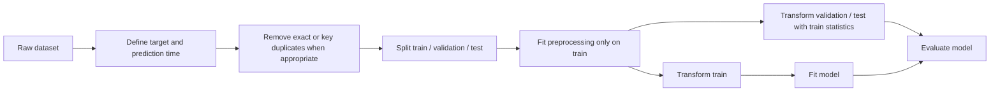
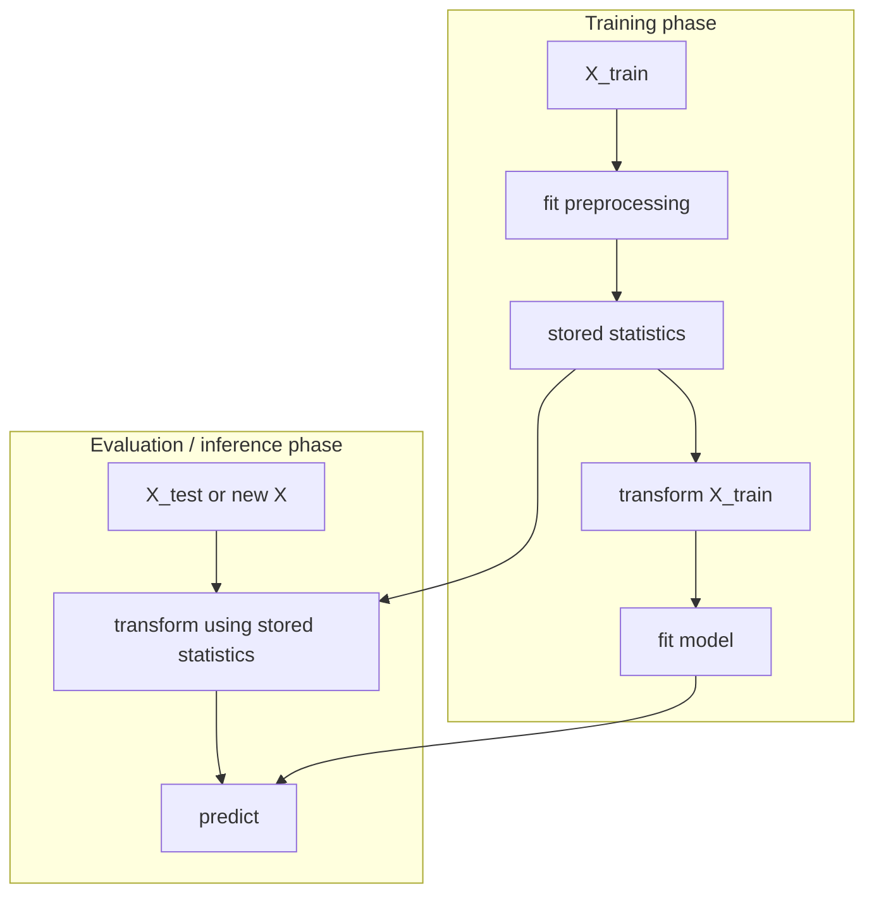
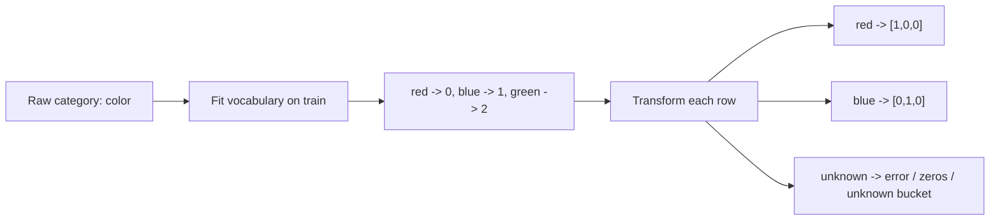
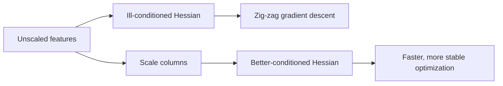
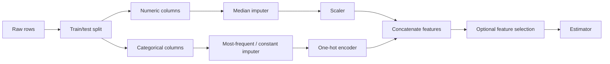

# Data Preprocessing, Dataset Splitting, and Feature Scaling

Raw tabular data rarely matches the mathematical assumptions made by learning algorithms. Preprocessing defines the map from raw records to model-ready tensors:

$$
\mathcal{T}: \mathcal{X}_{\mathrm{raw}} \rightarrow \mathbb{R}^{p'}
$$

where $\mathcal{T}$ may impute missing values, remove invalid duplicates, encode categories, scale numerical variables, transform skewed features, select features, and preserve exactly the same operations for training, validation, test, and production data.

The important engineering rule is simple: any preprocessing operation that learns statistics from data must be fit only on the training split. The learned statistics are then reused on validation, test, and future examples.

$$
\hat{\theta}_{\mathcal{T}} = \operatorname{fit}(X_{\mathrm{train}})
$$

$$
\tilde{X}_{\mathrm{train}} = \mathcal{T}(X_{\mathrm{train}};\hat{\theta}_{\mathcal{T}}), \qquad
\tilde{X}_{\mathrm{test}} = \mathcal{T}(X_{\mathrm{test}};\hat{\theta}_{\mathcal{T}})
$$

Using test-set means, category vocabularies, feature-selection scores, outlier thresholds, or scaling ranges during fitting leaks information from the evaluation set into the model-selection process.



## 1. Notation and Preprocessing as Estimation

Let the supervised dataset be

$$
\mathcal{D} = \{(x_i, y_i)\}_{i=1}^{n}
$$

with $x_i \in \mathcal{X}_{\mathrm{raw}}$ and target $y_i \in \mathcal{Y}$. After preprocessing, the design matrix is

$$
X =
\begin{bmatrix}
x_1^\top \\
x_2^\top \\
\vdots \\
x_n^\top
\end{bmatrix}
\in \mathbb{R}^{n \times p}
$$

For a transformation $\mathcal{T}$, the parameters $\theta_{\mathcal{T}}$ are not model parameters in the predictive model, but they are still estimated from data. Examples:

- Mean imputation learns $\hat{\mu}_j$ for feature $j$.
- Standardization learns $\hat{\mu}_j$ and $\hat{\sigma}_j$.
- Min-max scaling learns $\hat{x}_{j,\min}$ and $\hat{x}_{j,\max}$.
- One-hot encoding learns a category vocabulary $\mathcal{C}_j$.
- Feature selection learns a subset $S \subseteq \{1,\dots,p\}$.

The full learned predictor is therefore

$$
\hat{f}(x) = g_{\hat{w}}(\mathcal{T}(x;\hat{\theta}_{\mathcal{T}}))
$$

where $g_{\hat{w}}$ is the model trained after preprocessing.

### Fit, Transform, and Fit-Transform

Most preprocessing libraries implement the following separation:

```text
fit(X_train):       estimate transformation statistics from X_train
transform(X):       apply stored statistics to any compatible X
fit_transform(X):   fit(X), then transform(X)
```

This separation is not merely API design; it is the mechanism that prevents leakage.



## 2. Training-Test Split and Generalization Estimation

### Motivation

Training loss measures how well a model explains data it has already used. Test loss estimates how well the final training procedure generalizes to unseen samples from the deployment distribution.

### Mathematical Setup

Assume examples are sampled independently from an unknown population distribution $P(X,Y)$:

$$
(X_i,Y_i) \overset{\mathrm{iid}}{\sim} P(X,Y)
$$

For a fixed learned model $\hat{f}$ and loss function $\ell$, the population risk is

$$
R(\hat{f}) = \mathbb{E}_{(X,Y)\sim P}\left[\ell(Y,\hat{f}(X))\right]
$$

The empirical test risk on a test set of size $m$ is

$$
\hat{R}_{\mathrm{test}}(\hat{f}) =
\frac{1}{m}\sum_{i=1}^{m}\ell(y_i^{\mathrm{test}},\hat{f}(x_i^{\mathrm{test}}))
$$

If the test set is independent of training and preprocessing fitting, then conditional on the trained model $\hat{f}$,

$$
\mathbb{E}\left[\hat{R}_{\mathrm{test}}(\hat{f}) \mid \hat{f}\right]
=
R(\hat{f})
$$

This is the first-principles reason a held-out test set is useful: it is an unbiased estimator of the trained model's generalization risk under the same data distribution. Its variance decreases as the test size grows:

$$
\operatorname{Var}\left(\hat{R}_{\mathrm{test}}(\hat{f}) \mid \hat{f}\right)
=
\frac{\operatorname{Var}(\ell(Y,\hat{f}(X)))}{m}
$$

The estimate is unbiased under iid sampling, but it may still be high-variance for small $m$, invalid under distribution shift, and optimistic if preprocessing or model selection used the test set.

### How a Random Split Works

For a dataset of size $n$ and test fraction $\alpha$, a random split usually:

1. Generates a permutation $\pi$ of indices $\{1,\dots,n\}$.
2. Computes $m = \lceil \alpha n \rceil$ or another library-specific rounded size.
3. Assigns the first $m$ shuffled indices to the test set.
4. Assigns the remaining indices to the training set.
5. Applies the same index split to $X$, $y$, and any aligned arrays.

In scikit-learn, `train_test_split` is a convenience wrapper around shuffled splitting utilities. With `stratify=y`, it preserves class proportions approximately in each split.

### Stratified Splitting

For classification with class labels $y \in \{1,\dots,K\}$, stratified splitting applies the split within each class. If class $k$ has $n_k$ samples and test fraction $\alpha$, then the test count is approximately

$$
m_k \approx \alpha n_k
$$

This reduces the chance that minority classes vanish from small test sets.

### Time-Aware Splitting

Random splitting is inappropriate when the prediction problem is temporal and future data must not influence past predictions. For ordered data, use

$$
\{(x_i,y_i): t_i \leq t_0\}
$$

for training and

$$
\{(x_i,y_i): t_i > t_0\}
$$

for validation or testing. Any rolling features must also be computed using only past information.

### Worked Example: Test-Risk Estimate

Suppose a classifier is evaluated on $m=200$ test examples and makes $34$ mistakes under zero-one loss:

$$
\ell(y,\hat{y}) = \mathbf{1}[y \neq \hat{y}]
$$

The test error is

$$
\hat{R}_{\mathrm{test}} = \frac{34}{200} = 0.17
$$

and test accuracy is

$$
1 - \hat{R}_{\mathrm{test}} = 0.83
$$

An approximate standard error for accuracy, treating correctness as Bernoulli with estimated success probability $\hat{p}=0.83$, is

$$
\operatorname{SE}(\hat{p}) =
\sqrt{\frac{\hat{p}(1-\hat{p})}{m}}
=
\sqrt{\frac{0.83 \cdot 0.17}{200}}
\approx 0.0266
$$

So differences of one or two percentage points on this test set may not be practically distinguishable without repeated validation or larger test data.

### From-Scratch Implementation

```python
import numpy as np


def train_test_split_scratch(X, y, test_size=0.2, random_state=None, stratify=None):
    """Minimal train/test split with optional stratification.

    This implementation assumes X and y are indexable NumPy arrays.
    """
    X = np.asarray(X)
    y = np.asarray(y)
    n = len(y)
    rng = np.random.default_rng(random_state)

    if not 0 < test_size < 1:
        raise ValueError("test_size must be a fraction in (0, 1).")

    if stratify is None:
        indices = rng.permutation(n)
        n_test = int(np.ceil(test_size * n))
        test_idx = indices[:n_test]
        train_idx = indices[n_test:]
    else:
        stratify = np.asarray(stratify)
        train_parts = []
        test_parts = []

        for cls in np.unique(stratify):
            cls_idx = np.flatnonzero(stratify == cls)
            cls_idx = rng.permutation(cls_idx)
            n_test_cls = int(np.ceil(test_size * len(cls_idx)))
            test_parts.append(cls_idx[:n_test_cls])
            train_parts.append(cls_idx[n_test_cls:])

        test_idx = rng.permutation(np.concatenate(test_parts))
        train_idx = rng.permutation(np.concatenate(train_parts))

    return X[train_idx], X[test_idx], y[train_idx], y[test_idx]
```

### Library Implementation

```python
from sklearn.model_selection import train_test_split

X_train, X_test, y_train, y_test = train_test_split(
    X,
    y,
    test_size=0.2,
    random_state=42,
    stratify=y,  # classification only; use None for regression
)
```

Internally, `train_test_split` validates aligned inputs, creates shuffled train/test indices using splitting classes such as `ShuffleSplit` or `StratifiedShuffleSplit`, and indexes every provided array consistently.

## 3. Missing Values

### Missingness Notation

Let $X \in \mathbb{R}^{n \times p}$ be the complete but partially unobserved data matrix. Define a missingness mask

$$
M_{ij} =
\begin{cases}
1, & \text{if } X_{ij} \text{ is observed} \\
0, & \text{if } X_{ij} \text{ is missing}
\end{cases}
$$

The observed dataset is $(M, X_{\mathrm{obs}})$, not $X$ itself.

Missingness assumptions matter because they determine whether simple imputation is statistically defensible:

- Missing completely at random:

$$
P(M \mid X_{\mathrm{obs}}, X_{\mathrm{mis}}, Y) = P(M)
$$

- Missing at random:

$$
P(M \mid X_{\mathrm{obs}}, X_{\mathrm{mis}}, Y) = P(M \mid X_{\mathrm{obs}}, Y)
$$

- Missing not at random:

$$
P(M \mid X_{\mathrm{obs}}, X_{\mathrm{mis}}, Y)
$$

depends on the unobserved values $X_{\mathrm{mis}}$ themselves.

Simple mean, median, or mode imputation is often useful engineering, but it is not neutral. It changes marginal distributions, reduces sample variance, and can attenuate correlations.

### Mean Imputation from First Principles

For a numeric feature $x_1,\dots,x_r$ observed in the training set, mean imputation chooses a constant $c$ to minimize squared reconstruction error:

$$
J(c) = \sum_{i=1}^{r}(x_i - c)^2
$$

Differentiate:

$$
\frac{dJ}{dc}
=
\sum_{i=1}^{r}2(c-x_i)
=
2rc - 2\sum_{i=1}^{r}x_i
$$

Set the derivative to zero:

$$
2rc - 2\sum_{i=1}^{r}x_i = 0
$$

$$
c = \frac{1}{r}\sum_{i=1}^{r}x_i = \bar{x}
$$

Thus the mean is the optimal constant imputer under squared error. The assumption is not that the mean is the "true" missing value; the assumption is that replacing missing values by the conditional or unconditional expectation is an acceptable approximation for the downstream estimator.

### Median Imputation from First Principles

Median imputation solves

$$
\min_c \sum_{i=1}^{r}|x_i-c|
$$

For sorted values $x_{(1)} \leq \dots \leq x_{(r)}$, the subgradient is

$$
\partial J(c) =
\#\{i: c > x_i\} - \#\{i: c < x_i\}
$$

Any $c$ for which the number of observations on each side is balanced is a minimizer. That is exactly the median. This is why the median is more robust than the mean under heavy-tailed contamination.

### Mode Imputation as Maximum Likelihood

For a categorical feature with categories $c_1,\dots,c_K$ and counts $n_1,\dots,n_K$, a constant category $c$ that maximizes the empirical likelihood under zero-one reconstruction accuracy is the mode:

$$
\hat{c} = \arg\max_{c_k} n_k
$$

### Missing Indicators

If missingness is informative, replace a feature $x_j$ with both an imputed value and an indicator:

$$
z_{ij} = \mathbf{1}[x_{ij} \text{ is missing}]
$$

The model can then learn a separate effect for the missingness pattern.

### Step-by-Step Execution

1. Split data into training and test sets.
2. For each numeric column, compute training-only statistics such as mean or median over observed values.
3. For each categorical column, compute training-only mode or assign a reserved missing token.
4. Store these statistics.
5. Replace missing values in training data.
6. Replace missing values in validation, test, and production data using the stored training statistics.
7. Optionally append missingness indicators learned during training.

### Worked Example

Training ages:

$$
[21, 22, \mathrm{missing}, 24]
$$

Observed values are $21$, $22$, and $24$:

$$
\hat{\mu} = \frac{21+22+24}{3} = \frac{67}{3} \approx 22.3333
$$

Mean-imputed values:

$$
[21, 22, 22.3333, 24]
$$

If using a missingness indicator:

$$
\text{age\_missing} = [0,0,1,0]
$$

### From-Scratch Implementation

```python
import numpy as np


class SimpleImputerScratch:
    """Column-wise mean, median, most-frequent, or constant imputation."""

    def __init__(self, strategy="mean", fill_value=None):
        self.strategy = strategy
        self.fill_value = fill_value
        self.statistics_ = None

    def fit(self, X):
        X = np.asarray(X, dtype=object)
        stats = []

        for j in range(X.shape[1]):
            col = X[:, j]
            observed = np.array([v for v in col if not self._is_missing(v)], dtype=object)

            if len(observed) == 0:
                if self.strategy == "constant":
                    stats.append(self.fill_value)
                else:
                    raise ValueError(f"Column {j} has no observed values.")
            elif self.strategy == "mean":
                stats.append(float(np.mean(observed.astype(float))))
            elif self.strategy == "median":
                stats.append(float(np.median(observed.astype(float))))
            elif self.strategy == "most_frequent":
                values, counts = np.unique(observed, return_counts=True)
                stats.append(values[np.argmax(counts)])
            elif self.strategy == "constant":
                stats.append(self.fill_value)
            else:
                raise ValueError(f"Unknown strategy: {self.strategy}")

        self.statistics_ = np.array(stats, dtype=object)
        return self

    def transform(self, X):
        if self.statistics_ is None:
            raise RuntimeError("Call fit before transform.")

        X = np.asarray(X, dtype=object).copy()
        for j, stat in enumerate(self.statistics_):
            for i in range(X.shape[0]):
                if self._is_missing(X[i, j]):
                    X[i, j] = stat
        return X

    def fit_transform(self, X):
        return self.fit(X).transform(X)

    @staticmethod
    def _is_missing(value):
        return value is None or (isinstance(value, float) and np.isnan(value))
```

### Library Implementation

```python
from sklearn.impute import SimpleImputer

numeric_imputer = SimpleImputer(strategy="median", add_indicator=True)
X_num_train_imp = numeric_imputer.fit_transform(X_num_train)
X_num_test_imp = numeric_imputer.transform(X_num_test)
```

`SimpleImputer` computes one statistic per feature during `fit`. During `transform`, it replaces entries equal to `missing_values` with the stored statistic. With `add_indicator=True`, it appends binary columns identifying features that had missing values at fit time.

### Edge Cases and Pitfalls

- Do not compute imputation values before train/test split.
- A column that is entirely missing in training cannot support mean or median imputation without an explicit fallback.
- Mean imputation is sensitive to outliers.
- Median imputation may be better for skewed variables but can still distort relationships.
- Missingness itself may encode signal; consider missing indicators.
- Imputing categorical missing values with the mode can hide a meaningful "unknown" state.

## 4. Duplicate Records

### What Counts as a Duplicate?

Duplicate removal is not always a purely syntactic operation. There are at least three cases:

1. Exact row duplicates: every column has the same value.
2. Key duplicates: a primary identifier, such as `customer_id`, appears more than once.
3. Semantic duplicates: records refer to the same entity but differ due to formatting, spelling, or time.

Exact duplicates can overweight repeated observations. Key duplicates can indicate multiple events per entity and may be valid. The right action depends on the prediction unit.

### Why Duplicates Can Corrupt Evaluation

If the same row appears in both train and test, a high-capacity model can memorize it. Suppose row $x_a$ appears once in train and once in test with the same label. A nearest-neighbor classifier may predict it perfectly because the distance is zero:

$$
d(x_a^{\mathrm{test}}, x_a^{\mathrm{train}}) = 0
$$

The resulting test score is optimistic because the test example is not genuinely unseen.

### Hash-Based Duplicate Detection

For exact duplicate removal, a typical implementation:

1. Serializes or hashes the selected columns of each row.
2. Maintains a set of previously observed row keys.
3. Keeps or drops each row according to the chosen policy.

Time complexity is expected $O(n p)$ for $n$ rows and $p$ compared columns, assuming constant-time hash-table operations. Space complexity is $O(n)$ for the set of seen keys.

### From-Scratch Implementation

```python
def drop_duplicates_scratch(rows, subset=None, keep="first"):
    """Drop duplicate rows from a list of dictionaries.

    keep="first" keeps the first occurrence.
    keep="last" keeps the last occurrence.
    keep=False drops all duplicated keys.
    """
    if keep not in {"first", "last", False}:
        raise ValueError("keep must be 'first', 'last', or False.")

    if not rows:
        return []

    columns = subset if subset is not None else list(rows[0].keys())

    def key(row):
        return tuple(row[col] for col in columns)

    if keep == "first":
        seen = set()
        output = []
        for row in rows:
            k = key(row)
            if k not in seen:
                seen.add(k)
                output.append(row)
        return output

    if keep == "last":
        seen = set()
        output_reversed = []
        for row in reversed(rows):
            k = key(row)
            if k not in seen:
                seen.add(k)
                output_reversed.append(row)
        return list(reversed(output_reversed))

    # keep=False: drop every key that occurs more than once.
    counts = {}
    for row in rows:
        counts[key(row)] = counts.get(key(row), 0) + 1
    return [row for row in rows if counts[key(row)] == 1]
```

### Library Implementation

```python
import pandas as pd

df_unique = df.drop_duplicates(
    subset=["student_id"],  # None means use all columns
    keep="first",           # "last" or False are also available
    ignore_index=True,
)
```

`pandas.DataFrame.drop_duplicates` compares all columns by default or a specified `subset`, ignores the index when determining duplicates, and keeps the first matching row unless configured otherwise.

## 5. Categorical Encoding

Most estimators consume numerical arrays, but categorical features live in finite sets:

$$
x_j \in \mathcal{C}_j = \{c_1,c_2,\dots,c_K\}
$$

Encoding defines a map

$$
\phi_j: \mathcal{C}_j \rightarrow \mathbb{R}^{q_j}
$$

### Ordinal Encoding

Ordinal encoding maps categories to integers:

$$
\phi(c_k) = k
$$

This is appropriate only when the category has a meaningful order, such as

$$
\text{low} < \text{medium} < \text{high}
$$

For nominal categories such as city or gender, ordinal codes inject artificial geometry. A linear model seeing `city = 3` and `city = 4` treats them as adjacent, and a distance-based method treats category gaps as numeric distances.

### One-Hot Encoding

For $K$ categories, one-hot encoding maps category $c_k$ to the $k$-th standard basis vector:

$$
\phi(c_k) = e_k \in \{0,1\}^{K}
$$

Each encoded component is

$$
z_{ik} = \mathbf{1}[x_i = c_k]
$$

For example, if

$$
\mathcal{C} = \{\mathrm{Female}, \mathrm{Male}, \mathrm{Other}\}
$$

then

$$
\mathrm{Male} \mapsto [0,1,0]
$$

### Dummy Variable Trap

With an intercept term and all $K$ one-hot columns, the encoded columns are linearly dependent:

$$
\sum_{k=1}^{K} z_{ik} = 1
$$

for every row $i$. Therefore the intercept column is exactly the sum of the one-hot columns:

$$
\mathbf{1} = Z\mathbf{1}_K
$$

In unregularized linear or logistic regression, this makes the design matrix rank-deficient. Common fixes:

- Drop one category with `drop="first"` or `drop="if_binary"`.
- Keep all categories and use regularization, accepting non-unique but prediction-equivalent coefficient parameterizations.

### High Cardinality and Unknown Categories

If a feature has $K$ categories, one-hot encoding adds $K$ columns. For high-cardinality variables, this can dominate memory and overfit rare categories. Options include:

- Group rare categories into an "infrequent" bucket.
- Use hashing encoders.
- Use target encoding inside cross-validation only.
- Learn embeddings for neural models.

At inference, a category unseen during training has no learned column. A safe one-hot implementation either errors, maps it to all zeros, or maps it to an explicit unknown bucket.

### Step-by-Step Execution

1. Fit on training categories only.
2. Sort or preserve categories according to deterministic rules.
3. Assign each known category an output column index.
4. During transform, emit a sparse or dense indicator matrix.
5. Handle unseen categories according to policy.



### Worked Example

Training column:

$$
[\mathrm{Male}, \mathrm{Female}, \mathrm{Male}, \mathrm{Other}]
$$

Vocabulary in sorted order:

$$
[\mathrm{Female}, \mathrm{Male}, \mathrm{Other}]
$$

Encoded matrix:

$$
\begin{bmatrix}
0 & 1 & 0 \\
1 & 0 & 0 \\
0 & 1 & 0 \\
0 & 0 & 1
\end{bmatrix}
$$

### From-Scratch Implementation

```python
import numpy as np


class OneHotEncoderScratch:
    """Simple one-hot encoder for 2D categorical arrays."""

    def __init__(self, handle_unknown="error"):
        if handle_unknown not in {"error", "ignore"}:
            raise ValueError("handle_unknown must be 'error' or 'ignore'.")
        self.handle_unknown = handle_unknown
        self.categories_ = None
        self.offsets_ = None

    def fit(self, X):
        X = np.asarray(X, dtype=object)
        self.categories_ = [np.array(sorted(set(X[:, j])), dtype=object) for j in range(X.shape[1])]
        sizes = [len(cats) for cats in self.categories_]
        self.offsets_ = np.cumsum([0] + sizes[:-1])
        return self

    def transform(self, X):
        if self.categories_ is None:
            raise RuntimeError("Call fit before transform.")

        X = np.asarray(X, dtype=object)
        n = X.shape[0]
        total_width = sum(len(cats) for cats in self.categories_)
        Z = np.zeros((n, total_width), dtype=float)

        for j, cats in enumerate(self.categories_):
            lookup = {cat: idx for idx, cat in enumerate(cats)}
            offset = self.offsets_[j]
            for i, value in enumerate(X[:, j]):
                if value in lookup:
                    Z[i, offset + lookup[value]] = 1.0
                elif self.handle_unknown == "error":
                    raise ValueError(f"Unknown category {value!r} in column {j}.")
                # handle_unknown="ignore" leaves the block all zeros.

        return Z

    def fit_transform(self, X):
        return self.fit(X).transform(X)
```

### Library Implementation

```python
from sklearn.preprocessing import OneHotEncoder

encoder = OneHotEncoder(
    handle_unknown="ignore",
    sparse_output=True,
    min_frequency=5,
)

X_cat_train_enc = encoder.fit_transform(X_cat_train)
X_cat_test_enc = encoder.transform(X_cat_test)
```

`OneHotEncoder` learns `categories_` during `fit`. During `transform`, it maps category values to column positions and emits a dense or sparse matrix. Sparse output is usually preferred when the encoded matrix is mostly zeros.

## 6. Feature Scaling

Feature scaling applies column-wise transformations so that numerical variables have comparable units or numerically favorable ranges.

Scaling is essential for:

- Gradient-based optimization.
- Distance-based methods such as KNN, K-means, RBF SVMs, and kernel methods.
- Regularized models when penalties should treat coefficients comparably.
- PCA and other variance-based methods.
- Neural networks, where activation saturation and optimizer step sizes are sensitive to feature magnitude.

Tree-based models are mostly invariant to monotone feature scaling because splits depend on feature order, not Euclidean geometry.

### Why Scaling Changes Optimization

For linear regression with squared loss,

$$
L(w) = \frac{1}{2n}\|Xw-y\|_2^2
$$

the gradient is

$$
\nabla L(w) = \frac{1}{n}X^\top(Xw-y)
$$

and the Hessian is

$$
H = \nabla^2 L(w) = \frac{1}{n}X^\top X
$$

Gradient descent convergence depends on the condition number

$$
\kappa(H) = \frac{\lambda_{\max}(H)}{\lambda_{\min}(H)}
$$

When one feature has values around $10^6$ and another around $10^1$, the columns of $X$ have very different norms, often making $\kappa(H)$ large. Scaling reduces anisotropy, making the loss contours more spherical and allowing larger stable learning rates.



### Min-Max Normalization

For a feature $x_j$, training minimum $a_j$, training maximum $b_j$, and target range $[\ell,u]$, min-max scaling is

$$
x'_{ij}
=
\ell +
\frac{x_{ij}-a_j}{b_j-a_j}(u-\ell)
$$

For the common range $[0,1]$:

$$
x'_{ij} =
\frac{x_{ij}-a_j}{b_j-a_j}
$$

This is an affine transformation. It preserves ordering, but its scale is determined by the most extreme training values, so it is sensitive to outliers.

#### Worked Example

Values:

$$
[10,20,30,40,50]
$$

Minimum and maximum:

$$
a = 10, \qquad b = 50
$$

For $x=30$:

$$
x' = \frac{30-10}{50-10} = \frac{20}{40} = 0.5
$$

### Standardization

Standardization maps each feature to zero mean and unit variance:

$$
z_{ij} = \frac{x_{ij} - \hat{\mu}_j}{\hat{\sigma}_j}
$$

where scikit-learn-style population estimates are

$$
\hat{\mu}_j = \frac{1}{n}\sum_{i=1}^{n}x_{ij}
$$

$$
\hat{\sigma}_j =
\sqrt{\frac{1}{n}\sum_{i=1}^{n}(x_{ij}-\hat{\mu}_j)^2}
$$

The transformed feature has empirical mean zero:

$$
\frac{1}{n}\sum_{i=1}^{n}z_{ij}
=
\frac{1}{n}\sum_{i=1}^{n}\frac{x_{ij}-\hat{\mu}_j}{\hat{\sigma}_j}
=
\frac{1}{\hat{\sigma}_j}
\left(
\frac{1}{n}\sum_{i=1}^{n}x_{ij}-\hat{\mu}_j
\right)
=0
$$

and empirical variance one:

$$
\frac{1}{n}\sum_{i=1}^{n}z_{ij}^2
=
\frac{1}{n}\sum_{i=1}^{n}
\frac{(x_{ij}-\hat{\mu}_j)^2}{\hat{\sigma}_j^2}
=
\frac{\hat{\sigma}_j^2}{\hat{\sigma}_j^2}
=1
$$

#### Worked Example

Values:

$$
[10,20,30,40,50]
$$

Mean:

$$
\hat{\mu} = \frac{10+20+30+40+50}{5} = 30
$$

Population variance:

$$
\hat{\sigma}^2 =
\frac{(10-30)^2+(20-30)^2+(30-30)^2+(40-30)^2+(50-30)^2}{5}
$$

$$
\hat{\sigma}^2 =
\frac{400+100+0+100+400}{5}=200
$$

Standard deviation:

$$
\hat{\sigma}=\sqrt{200}\approx 14.1421
$$

For $x=50$:

$$
z = \frac{50-30}{14.1421}\approx 1.4142
$$

### Robust Scaling

Robust scaling uses median and interquartile range:

$$
z_{ij} =
\frac{x_{ij} - \operatorname{median}(x_j)}
{Q_{0.75}(x_j)-Q_{0.25}(x_j)}
$$

The denominator is the interquartile range:

$$
\operatorname{IQR}(x_j)=Q_{0.75}(x_j)-Q_{0.25}(x_j)
$$

Because quantiles depend on ranks rather than magnitudes, robust scaling is less affected by extreme values than min-max scaling or standardization.

### Normalization vs Standardization

| Property | Min-max normalization | Standardization | Robust scaling |
| --- | --- | --- | --- |
| Formula | Uses min and max | Uses mean and standard deviation | Uses median and IQR |
| Typical range | Fixed, often $[0,1]$ | Unbounded | Unbounded |
| Outlier sensitivity | High | Medium to high | Lower |
| Preserves sparsity | Yes if no centering is needed | Not if centered | Not if centered |
| Good for | bounded inputs, images, neural nets | optimization, PCA, linear models, SVMs | skewed or heavy-tailed data |

### Distance-Domination Example

Two student records:

$$
x_1 = [22, 50000], \qquad x_2 = [23, 52000]
$$

Raw Euclidean distance:

$$
\|x_1-x_2\|_2 =
\sqrt{(22-23)^2 + (50000-52000)^2}
$$

$$
=
\sqrt{1 + 4,000,000}
\approx 2000.00025
$$

The salary feature dominates the age difference. If age and salary are standardized using training statistics, each coordinate contributes in standard-deviation units rather than raw units.

### From-Scratch Scaling Implementations

```python
import numpy as np


class StandardScalerScratch:
    """Standardize columns using training-set mean and population std."""

    def __init__(self, eps=1e-12):
        self.eps = eps
        self.mean_ = None
        self.scale_ = None

    def fit(self, X):
        X = np.asarray(X, dtype=float)
        self.mean_ = X.mean(axis=0)
        var = ((X - self.mean_) ** 2).mean(axis=0)
        self.scale_ = np.sqrt(var)
        self.scale_ = np.where(self.scale_ < self.eps, 1.0, self.scale_)
        return self

    def transform(self, X):
        if self.mean_ is None:
            raise RuntimeError("Call fit before transform.")
        X = np.asarray(X, dtype=float)
        return (X - self.mean_) / self.scale_

    def fit_transform(self, X):
        return self.fit(X).transform(X)


class MinMaxScalerScratch:
    """Scale columns into a fixed feature range."""

    def __init__(self, feature_range=(0.0, 1.0), eps=1e-12):
        self.feature_range = feature_range
        self.eps = eps
        self.data_min_ = None
        self.data_max_ = None
        self.scale_ = None

    def fit(self, X):
        X = np.asarray(X, dtype=float)
        lo, hi = self.feature_range
        if hi <= lo:
            raise ValueError("feature_range must satisfy high > low.")

        self.data_min_ = X.min(axis=0)
        self.data_max_ = X.max(axis=0)
        data_range = self.data_max_ - self.data_min_
        safe_range = np.where(data_range < self.eps, 1.0, data_range)
        self.scale_ = (hi - lo) / safe_range
        return self

    def transform(self, X):
        if self.data_min_ is None:
            raise RuntimeError("Call fit before transform.")
        lo, _ = self.feature_range
        X = np.asarray(X, dtype=float)
        return (X - self.data_min_) * self.scale_ + lo

    def fit_transform(self, X):
        return self.fit(X).transform(X)
```

### Library Implementation

```python
from sklearn.preprocessing import MinMaxScaler, RobustScaler, StandardScaler

standard = StandardScaler()
X_train_std = standard.fit_transform(X_train_num)
X_test_std = standard.transform(X_test_num)

minmax = MinMaxScaler(feature_range=(0, 1))
X_train_mm = minmax.fit_transform(X_train_num)
X_test_mm = minmax.transform(X_test_num)

robust = RobustScaler(quantile_range=(25.0, 75.0))
X_train_robust = robust.fit_transform(X_train_num)
X_test_robust = robust.transform(X_test_num)
```

`StandardScaler` stores `mean_`, `var_`, and `scale_`. `MinMaxScaler` stores `data_min_`, `data_max_`, `data_range_`, `scale_`, and `min_`. `RobustScaler` stores the median-like center and quantile-based scale. All three estimate column-wise statistics during `fit` and reuse them during `transform`.

### Numerical Stability

Variance computed by

$$
\frac{1}{n}\sum_i x_i^2 - \left(\frac{1}{n}\sum_i x_i\right)^2
$$

can suffer catastrophic cancellation when $x_i$ are large and variance is small. A stable online alternative is Welford's algorithm:

```python
def mean_variance_welford(values):
    n = 0
    mean = 0.0
    m2 = 0.0

    for x in values:
        n += 1
        delta = x - mean
        mean += delta / n
        delta2 = x - mean
        m2 += delta * delta2

    variance = m2 / n
    return mean, variance
```

For sparse matrices, mean centering destroys sparsity because implicit zeros become nonzero after subtracting the mean. In scikit-learn, use `StandardScaler(with_mean=False)` for sparse inputs.

## 7. Outlier Handling

Outliers are observations that are unusual relative to a reference distribution. They may be:

- Measurement errors.
- Valid rare events.
- Distribution-shift examples.
- Points from a mixture component not well described by global statistics.

Removing outliers blindly can erase the exact cases the model must learn.

### Z-Score Rule

For standardized value

$$
z_i = \frac{x_i-\hat{\mu}}{\hat{\sigma}}
$$

a common rule flags

$$
|z_i| > \tau
$$

with $\tau=3$ under a rough Gaussian heuristic.

This rule is itself non-robust because $\hat{\mu}$ and $\hat{\sigma}$ are affected by outliers.

### IQR Rule

Let

$$
Q_1 = Q_{0.25}(x), \qquad Q_3 = Q_{0.75}(x)
$$

and

$$
\operatorname{IQR} = Q_3 - Q_1
$$

The Tukey fences flag points outside

$$
[Q_1 - 1.5\operatorname{IQR}, \ Q_3 + 1.5\operatorname{IQR}]
$$

### Median Absolute Deviation

The median absolute deviation is

$$
\operatorname{MAD} = \operatorname{median}_i(|x_i - \operatorname{median}(x)|)
$$

For approximately normal data, a robust z-like score is

$$
z_i^{\mathrm{MAD}} =
\frac{0.6745(x_i-\operatorname{median}(x))}
{\operatorname{MAD}}
$$

The constant $0.6745$ calibrates the score to the normal distribution.

### Winsorization and Capping

Capping replaces extreme values by quantile thresholds:

$$
x_i' =
\min(\max(x_i, q_{\alpha}), q_{1-\alpha})
$$

This preserves sample size and limits leverage, but it changes the distribution and should be fit on training quantiles only.

### Worked Example

Salaries:

$$
[30000, 35000, 40000, 1000000]
$$

Mean:

$$
\hat{\mu} = \frac{30000+35000+40000+1000000}{4}=276250
$$

The mean is pulled toward $1000000$. Median:

$$
\operatorname{median} = \frac{35000+40000}{2}=37500
$$

The median better represents the central salary for these values. This motivates median imputation, robust scaling, or capping for heavy-tailed features.

### From-Scratch IQR Capping

```python
import numpy as np


class IQRCapperScratch:
    """Fit Tukey IQR caps on training data and apply them later."""

    def __init__(self, factor=1.5):
        self.factor = factor
        self.lower_ = None
        self.upper_ = None

    def fit(self, X):
        X = np.asarray(X, dtype=float)
        q1 = np.quantile(X, 0.25, axis=0)
        q3 = np.quantile(X, 0.75, axis=0)
        iqr = q3 - q1
        self.lower_ = q1 - self.factor * iqr
        self.upper_ = q3 + self.factor * iqr
        return self

    def transform(self, X):
        if self.lower_ is None:
            raise RuntimeError("Call fit before transform.")
        X = np.asarray(X, dtype=float)
        return np.clip(X, self.lower_, self.upper_)

    def fit_transform(self, X):
        return self.fit(X).transform(X)
```

## 8. Data Transformation and Feature Construction

Transformations change feature geometry or expose useful structure.

### Log Transform

For positive skewed variables, use

$$
x' = \log(x)
$$

or, when zeros are possible,

$$
x' = \log(1+x)
$$

Log transformation compresses multiplicative differences:

$$
\log(ab) = \log a + \log b
$$

This often turns multiplicative effects into additive ones, which helps linear models.

### Box-Cox and Yeo-Johnson

The Box-Cox transform for $x>0$ is

$$
T_{\lambda}(x) =
\begin{cases}
\frac{x^\lambda - 1}{\lambda}, & \lambda \neq 0 \\
\log x, & \lambda = 0
\end{cases}
$$

The parameter $\lambda$ is typically fit by maximizing Gaussian likelihood after transformation. Yeo-Johnson extends a similar idea to variables that may be zero or negative.

### Date and Time Features

A raw date string such as `"2026-05-17"` is rarely useful as a scalar. Possible transformations include:

- Year, month, day, day of week.
- Cyclical encodings for periodic components.
- Time since an event.
- Rolling statistics computed using only past data.

For a cyclical variable such as month $m \in \{1,\dots,12\}$:

$$
u = \sin\left(\frac{2\pi m}{12}\right)
$$

$$
v = \cos\left(\frac{2\pi m}{12}\right)
$$

This makes December and January close in feature space.

### Polynomial and Interaction Features

For two variables $x_1,x_2$, degree-2 polynomial expansion includes

$$
[1, x_1, x_2, x_1^2, x_1x_2, x_2^2]
$$

The interaction term $x_1x_2$ lets a linear model represent effects whose slope in $x_1$ depends on $x_2$:

$$
\hat{y} = w_0 + w_1x_1 + w_2x_2 + w_3x_1x_2
$$

Then

$$
\frac{\partial \hat{y}}{\partial x_1} = w_1 + w_3x_2
$$

### From-Scratch Cyclical Encoding

```python
import numpy as np


def encode_cyclical(values, period):
    values = np.asarray(values, dtype=float)
    angle = 2.0 * np.pi * values / period
    return np.column_stack([np.sin(angle), np.cos(angle)])


months = np.array([1, 6, 12])
month_features = encode_cyclical(months, period=12)
```

### Library Implementation

```python
from sklearn.preprocessing import FunctionTransformer, PolynomialFeatures, PowerTransformer

log1p_transformer = FunctionTransformer(np.log1p, feature_names_out="one-to-one")

poly = PolynomialFeatures(degree=2, include_bias=False)
X_poly_train = poly.fit_transform(X_train_num)

power = PowerTransformer(method="yeo-johnson", standardize=True)
X_power_train = power.fit_transform(X_train_num)
X_power_test = power.transform(X_test_num)
```

`FunctionTransformer` wraps a user-supplied function in the estimator API. `PolynomialFeatures` enumerates monomials up to a degree and multiplies columns accordingly. `PowerTransformer` fits transformation parameters feature-wise and can standardize the transformed output.

## 9. Feature Selection

Feature selection reduces dimensionality by selecting a subset of original features:

$$
S \subseteq \{1,\dots,p\}
$$

and replacing $X$ by $X_S$.

Reasons to select features:

- Reduce variance and overfitting.
- Reduce training and inference cost.
- Improve interpretability.
- Remove leakage features or invalid post-outcome variables.
- Mitigate high-dimensional sparse encodings.

### Filter Methods

Filter methods score each feature independently of the final estimator.

#### ANOVA F-Score for Classification

For feature $j$ and $K$ classes, let $\bar{x}_{kj}$ be the mean of feature $j$ in class $k$, $\bar{x}_{\cdot j}$ the global mean, $n_k$ the class size, and $x_{ikj}$ the $i$-th observation in class $k$.

Between-class sum of squares:

$$
\operatorname{SSB}_j =
\sum_{k=1}^{K} n_k(\bar{x}_{kj}-\bar{x}_{\cdot j})^2
$$

Within-class sum of squares:

$$
\operatorname{SSW}_j =
\sum_{k=1}^{K}\sum_{i=1}^{n_k}(x_{ikj}-\bar{x}_{kj})^2
$$

The F-statistic is

$$
F_j =
\frac{\operatorname{SSB}_j/(K-1)}
{\operatorname{SSW}_j/(n-K)}
$$

Large $F_j$ indicates that class means differ relative to within-class variation.

#### Mutual Information

Mutual information measures dependence:

$$
I(X_j;Y) =
\int \int p(x_j,y)
\log\left(
\frac{p(x_j,y)}{p(x_j)p(y)}
\right)
\,dx_j\,dy
$$

It is zero if and only if $X_j$ and $Y$ are independent, assuming exact distributions. Estimation from finite samples is harder than computing correlations or F-statistics.

### Wrapper Methods

Wrapper methods evaluate subsets by training models. Recursive feature elimination repeatedly:

1. Fits an estimator.
2. Ranks features using coefficients or feature importances.
3. Removes the weakest features.
4. Repeats until the desired number remains.

Wrappers can capture interactions but are more expensive.

### Embedded Methods

Embedded methods perform selection as part of model fitting. Lasso uses an $\ell_1$ penalty:

$$
\hat{w}
=
\arg\min_w
\left[
\frac{1}{2n}\|Xw-y\|_2^2 + \lambda \|w\|_1
\right]
$$

where

$$
\|w\|_1 = \sum_{j=1}^{p}|w_j|
$$

The $\ell_1$ penalty has corners at zero. Geometrically, this makes sparse optima common; algorithmically, coordinate updates often soft-threshold coefficients to exactly zero.

### Feature Selection Leakage

Feature selection is one of the easiest places to leak target information. If you select the top $k$ features using all labels before splitting, the test labels influenced the feature set. Selection must happen inside the training fold or pipeline.

### Library Implementation

```python
from sklearn.feature_selection import SelectKBest, f_classif, mutual_info_classif

selector = SelectKBest(score_func=f_classif, k=20)
X_train_sel = selector.fit_transform(X_train, y_train)
X_test_sel = selector.transform(X_test)

mi_selector = SelectKBest(score_func=mutual_info_classif, k=20)
```

`SelectKBest` calls `score_func(X, y)` during `fit`, stores per-feature scores, chooses the top $k$, and applies a boolean column mask during `transform`.

## 10. End-to-End Preprocessing Pipeline

The main engineering goal is to make preprocessing reproducible and impossible to accidentally refit on test data.

### Pipeline Architecture



### scikit-learn Implementation

```python
import numpy as np
import pandas as pd
from sklearn.compose import ColumnTransformer
from sklearn.feature_selection import SelectKBest, f_classif
from sklearn.impute import SimpleImputer
from sklearn.linear_model import LogisticRegression
from sklearn.metrics import accuracy_score
from sklearn.model_selection import train_test_split
from sklearn.pipeline import Pipeline
from sklearn.preprocessing import OneHotEncoder, StandardScaler


numeric_features = ["age", "study_hours"]
categorical_features = ["gender"]

X = df[numeric_features + categorical_features]
y = df["passed"]

X_train, X_test, y_train, y_test = train_test_split(
    X,
    y,
    test_size=0.2,
    random_state=42,
    stratify=y,
)

numeric_pipeline = Pipeline(
    steps=[
        ("imputer", SimpleImputer(strategy="median", add_indicator=True)),
        ("scaler", StandardScaler()),
    ]
)

categorical_pipeline = Pipeline(
    steps=[
        ("imputer", SimpleImputer(strategy="most_frequent")),
        ("onehot", OneHotEncoder(handle_unknown="ignore", sparse_output=True)),
    ]
)

preprocess = ColumnTransformer(
    transformers=[
        ("num", numeric_pipeline, numeric_features),
        ("cat", categorical_pipeline, categorical_features),
    ],
    remainder="drop",
)

clf = Pipeline(
    steps=[
        ("preprocess", preprocess),
        ("select", SelectKBest(score_func=f_classif, k="all")),
        ("model", LogisticRegression(max_iter=1000)),
    ]
)

clf.fit(X_train, y_train)
y_pred = clf.predict(X_test)
print(accuracy_score(y_test, y_pred))
```

### What the Library Does Internally

`Pipeline.fit` executes steps sequentially:

1. For each transformer except the final estimator, call `fit_transform`.
2. Pass the transformed matrix to the next step.
3. Call `fit` on the final estimator.
4. Store every fitted object.

`Pipeline.predict` executes:

1. Call `transform` on each fitted transformer.
2. Pass the final transformed matrix to the fitted estimator's `predict`.

`ColumnTransformer.fit_transform` executes selected transformations on column subsets:

1. Extract numeric columns and send them to the numeric pipeline.
2. Extract categorical columns and send them to the categorical pipeline.
3. Fit each sub-pipeline on its own columns.
4. Horizontally concatenate outputs.
5. Return a dense or sparse matrix depending on transformer outputs and sparsity.

This architecture makes the learned preprocessing statistics part of the model artifact.

### From-Scratch Mini Pipeline

```python
class PipelineScratch:
    """Minimal sequential pipeline for transformers plus final estimator."""

    def __init__(self, steps):
        self.steps = steps

    def fit(self, X, y=None):
        Xt = X
        for name, step in self.steps[:-1]:
            Xt = step.fit_transform(Xt)

        final_name, final_estimator = self.steps[-1]
        if y is None:
            final_estimator.fit(Xt)
        else:
            final_estimator.fit(Xt, y)
        return self

    def predict(self, X):
        Xt = X
        for name, step in self.steps[:-1]:
            Xt = step.transform(Xt)
        return self.steps[-1][1].predict(Xt)
```

## 11. Worked Example: Student Performance Data

Raw data:

| Name | Age | Gender | Study Hours | Marks |
| --- | ---: | --- | ---: | ---: |
| A | 20 | Male | 5 | 80 |
| B | missing | Female | 3 | 65 |
| C | 21 | Male | 50 | 90 |

Assume `Marks` is the target and the feature matrix is `Age`, `Gender`, and `Study Hours`.

### Step 1: Impute Age

Observed ages:

$$
[20,21]
$$

Mean age:

$$
\hat{\mu}_{\mathrm{age}} = \frac{20+21}{2}=20.5
$$

Imputed ages:

$$
[20,20.5,21]
$$

### Step 2: Encode Gender

Vocabulary:

$$
[\mathrm{Female}, \mathrm{Male}]
$$

One-hot encoding:

$$
\mathrm{Male} \mapsto [0,1]
$$

$$
\mathrm{Female} \mapsto [1,0]
$$

Encoded gender matrix:

$$
\begin{bmatrix}
0 & 1 \\
1 & 0 \\
0 & 1
\end{bmatrix}
$$

### Step 3: Scale Study Hours

Study hours:

$$
[5,3,50]
$$

Min-max scaling with min $3$ and max $50$:

$$
x' = \frac{x-3}{50-3}
$$

For each row:

$$
5 \mapsto \frac{5-3}{47} \approx 0.0426
$$

$$
3 \mapsto \frac{3-3}{47} = 0
$$

$$
50 \mapsto \frac{50-3}{47} = 1
$$

The original note used approximate values like $0.5$, $0.3$, and $1.0$ only illustratively. The actual min-max values for this dataset are the values above.

### Step 4: Outlier Awareness

The value $50$ may be an outlier if study hours are weekly. But if it represents exam-month preparation, it may be valid. A preprocessing pipeline should not remove it without domain justification.

Using the median and MAD:

$$
\operatorname{median}([3,5,50])=5
$$

Absolute deviations:

$$
[|3-5|, |5-5|, |50-5|] = [2,0,45]
$$

$$
\operatorname{MAD}=2
$$

Robust score for $50$:

$$
z_{\mathrm{MAD}} =
\frac{0.6745(50-5)}{2}
\approx 15.1763
$$

This is extreme relative to the other two observations, though with only three rows any outlier rule is statistically fragile.

### Final Design Matrix

Using age, two one-hot gender columns, and min-max study hours:

$$
\tilde{X} =
\begin{bmatrix}
20 & 0 & 1 & 0.0426 \\
20.5 & 1 & 0 & 0 \\
21 & 0 & 1 & 1
\end{bmatrix}
$$

In a real workflow, these transformations would be fit on the training split only.

## 12. Complexity

Let $n$ be rows, $p$ numeric columns, $c$ categorical columns, $K=\sum_{j=1}^{c}K_j$ total one-hot categories, and $\operatorname{nnz}$ nonzero entries in a sparse matrix.

| Operation | Fit time | Transform time | Extra space | Notes |
| --- | ---: | ---: | ---: | --- |
| Train/test split | $O(n)$ | not applicable | $O(n)$ | Stores shuffled indices |
| Mean imputation | $O(np)$ | $O(np)$ | $O(p)$ | One statistic per feature |
| Median imputation | $O(np \log n)$ typical | $O(np)$ | $O(p)$ | Selection algorithms can improve median computation |
| Duplicate removal | $O(np)$ expected | not applicable | $O(n)$ | Hash-based exact duplicates |
| One-hot encoding | $O(nc)$ | $O(nc)$ plus output | $O(K)$ | Output can be $O(nK)$ dense or $O(nc)$ sparse |
| Standard scaling | $O(np)$ | $O(np)$ | $O(p)$ | Use stable variance algorithms |
| Min-max scaling | $O(np)$ | $O(np)$ | $O(p)$ | Sensitive to extremes |
| IQR capping | $O(np \log n)$ typical | $O(np)$ | $O(p)$ | Quantile implementation dependent |
| SelectKBest | score dependent | $O(nk)$ output | $O(p)$ | Must be fit inside train folds |

## 13. Numerical Stability, Edge Cases, and Pitfalls

### Leakage

- Scaling before splitting leaks test-set distribution.
- Imputing before splitting leaks test-set statistics.
- One-hot fitting before splitting leaks category existence.
- Feature selection before splitting leaks target information.
- Duplicate examples across train and test inflate evaluation.
- Target encoding without cross-fitting leaks labels.

### Sparse Data

One-hot output is sparse. Centering sparse matrices turns implicit zeros into nonzeros. Prefer:

```python
StandardScaler(with_mean=False)
```

or use models that handle sparse inputs directly.

### Constant Columns

If $b_j-a_j=0$ in min-max scaling or $\hat{\sigma}_j=0$ in standardization, division by zero occurs. Implementations must either drop the column or use a safe scale such as $1$. A constant feature has no predictive information by itself unless its missingness or availability changes across datasets.

### Category Drift

Production data can contain unseen categories. Decide policy explicitly:

- Error fast for data-contract violations.
- Ignore unknown categories with all-zero one-hot blocks.
- Use an unknown bucket.
- Retrain the encoder when category distributions drift.

### Temporal Leakage

For time-dependent prediction, features must be available at prediction time. A feature like "final grade" cannot be used to predict "passed course" before the course ends. Rolling aggregates must use windows ending before the prediction timestamp.

### Outlier Policy

Outlier removal can bias the model if rare but valid cases matter. Prefer to tag, cap, robust-scale, or model heavy tails unless the point is clearly erroneous.

### Target and Feature Separation

Never scale, impute, or encode the target using feature preprocessing objects. Regression targets may need a separate target transformer, fit only on training targets.

### Reproducibility

Set random seeds for stochastic splits and stochastic estimators, but do not confuse reproducibility with validity. A single split can still be high-variance.

## 14. Connections to Related ML Concepts

- Cross-validation generalizes train/test splitting by averaging performance over multiple held-out folds.
- Pipelines are estimators over estimators: they make data transformations part of the learned model.
- Regularization interacts with scaling because penalties are coefficient-scale dependent.
- PCA requires centering and is sensitive to feature scale.
- KNN, K-means, and kernel methods depend directly on distances, so scaling defines the geometry.
- Tree ensembles are less sensitive to monotone scaling but can still benefit from missing-value handling and categorical treatment.
- Representation learning can replace manual feature construction with learned embeddings, but the train-only fitting rule remains.
- Causal ML requires extra caution: preprocessing can accidentally condition on post-treatment variables or colliders.

## 15. References and Deeper Reading

- scikit-learn documentation, "Preprocessing data": https://scikit-learn.org/stable/modules/preprocessing.html
- scikit-learn documentation, `train_test_split`: https://scikit-learn.org/stable/modules/generated/sklearn.model_selection.train_test_split.html
- scikit-learn documentation, `SimpleImputer`: https://scikit-learn.org/stable/modules/generated/sklearn.impute.SimpleImputer.html
- scikit-learn documentation, `OneHotEncoder`: https://scikit-learn.org/stable/modules/generated/sklearn.preprocessing.OneHotEncoder.html
- scikit-learn documentation, `RobustScaler`: https://scikit-learn.org/stable/modules/generated/sklearn.preprocessing.RobustScaler.html
- scikit-learn documentation, `SelectKBest`: https://scikit-learn.org/stable/modules/generated/sklearn.feature_selection.SelectKBest.html
- scikit-learn documentation, "Common pitfalls and recommended practices": https://scikit-learn.org/stable/common_pitfalls.html
- pandas documentation, `DataFrame.drop_duplicates`: https://pandas.pydata.org/pandas-docs/stable/reference/api/pandas.DataFrame.drop_duplicates.html
- Hastie, Tibshirani, and Friedman, The Elements of Statistical Learning.
- Bishop, Pattern Recognition and Machine Learning.
- Murphy, Probabilistic Machine Learning: An Introduction.
- Little and Rubin, Statistical Analysis with Missing Data.
- Kuhn and Johnson, Feature Engineering and Selection.
