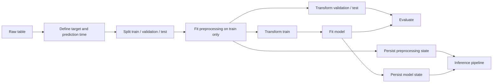
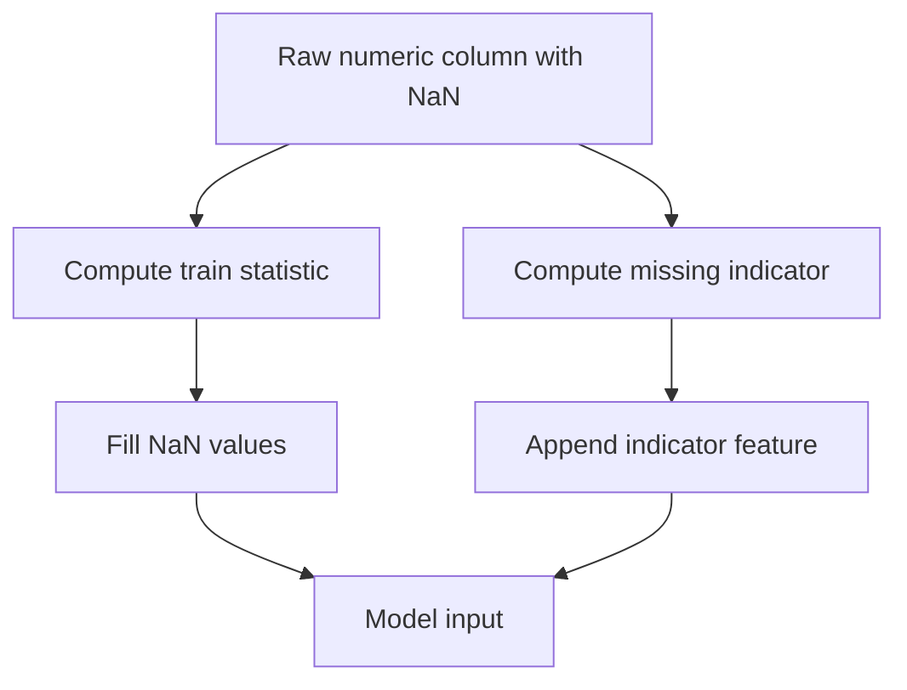
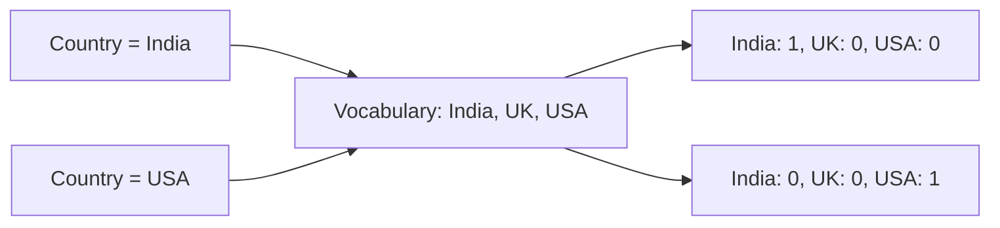
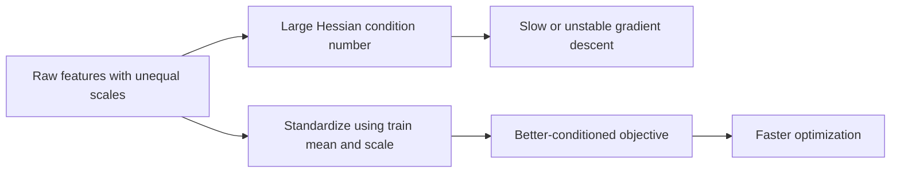
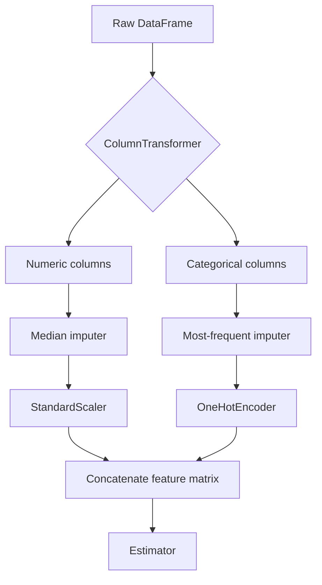

# Data Preprocessing Tools in Machine Learning

Data preprocessing is the learned or deterministic transformation that maps raw records into model-ready numerical arrays. In a production-quality ML system, preprocessing is not a loose collection of helper functions; it is part of the model.

Let the raw feature space be $\mathcal{X}_{\mathrm{raw}}$ and the model's numerical input space be $\mathbb{R}^{p'}$. A preprocessing pipeline is a map

$$
\mathcal{T}: \mathcal{X}_{\mathrm{raw}} \rightarrow \mathbb{R}^{p'}
$$

and a trained predictor is

$$
\hat{f}(x) = g_{\hat{w}}(\mathcal{T}(x; \hat{\theta}_{\mathcal{T}}))
$$

where $g_{\hat{w}}$ is the fitted model and $\hat{\theta}_{\mathcal{T}}$ are preprocessing parameters estimated from data: imputation statistics, category vocabularies, means, variances, quantiles, feature order, and sometimes learned projections.

The central rule:

$$
\hat{\theta}_{\mathcal{T}} = \operatorname{fit}(X_{\mathrm{train}})
$$

$$
\tilde{X}_{\mathrm{train}} = \mathcal{T}(X_{\mathrm{train}}; \hat{\theta}_{\mathcal{T}}),
\qquad
\tilde{X}_{\mathrm{test}} = \mathcal{T}(X_{\mathrm{test}}; \hat{\theta}_{\mathcal{T}})
$$

Any statistic that will not be available at prediction time must not be estimated from validation or test data. This is not merely an evaluation convention; it changes the stochastic dependence between training and evaluation.



## 1. Importing Libraries

The original notes list NumPy, pandas, Matplotlib, and scikit-learn. For serious preprocessing work, their roles are distinct:

- NumPy owns dense numerical arrays, broadcasting, vectorized algebra, and low-level missing-value behavior for floating arrays.
- pandas owns labeled tabular data, CSV/Parquet I/O, heterogeneous dtypes, nullable columns, and index alignment.
- scikit-learn owns estimator-style transformers with a consistent `fit`, `transform`, and `fit_transform` contract.
- Matplotlib or similar libraries are useful for diagnosing distributions, missingness, leakage, outliers, and class imbalance.

```python
import numpy as np
import pandas as pd
import matplotlib.pyplot as plt

from sklearn.compose import ColumnTransformer
from sklearn.impute import SimpleImputer
from sklearn.model_selection import train_test_split
from sklearn.pipeline import Pipeline
from sklearn.preprocessing import OneHotEncoder, StandardScaler, MinMaxScaler, LabelEncoder
```

### Under the Hood

The most important implementation detail is representation:

$$
X_{\mathrm{pandas}} \xrightarrow{\text{column selection and dtype conversion}} X_{\mathrm{numpy/scipy}} \xrightarrow{\text{estimator}} \hat{y}
$$

Many scikit-learn transformers internally validate the input, infer feature count, convert compatible pandas columns to NumPy or SciPy arrays, store fitted attributes ending with an underscore, and return a transformed array.

Common learned attributes include:

| Transformer      |                         Learned attributes | Meaning                                     |
| ---------------- | -----------------------------------------: | ------------------------------------------- |
| `SimpleImputer`  |                              `statistics_` | Per-column fill values                      |
| `OneHotEncoder`  |                              `categories_` | Per-column category vocabulary              |
| `StandardScaler` |                  `mean_`, `var_`, `scale_` | Per-column centering and scaling statistics |
| `MinMaxScaler`   | `data_min_`, `data_max_`, `scale_`, `min_` | Per-column affine scaling parameters        |
| `LabelEncoder`   |                                 `classes_` | Target-label vocabulary                     |

The underscore convention matters: `mean` is a hyperparameter or user argument; `mean_` is learned state.

## 2. Importing the Dataset

For tabular supervised learning, the dataset is usually a matrix-like object plus a target:

$$
\mathcal{D} = \{(x_i, y_i)\}_{i=1}^{n}
$$

where $x_i$ is the raw feature record and $y_i$ is the target.

```python
dataset = pd.read_csv("data.csv")

X = dataset.drop(columns=["Purchased"])
y = dataset["Purchased"]
```

### Under the Hood of `read_csv`

At a high level, `pd.read_csv` performs:

1. Opens a local path, URL, or file-like object.
2. Tokenizes rows according to the delimiter, quote character, escape rules, and line terminator.
3. Infers or applies column names.
4. Infers dtypes unless explicitly provided.
5. Recognizes configured missing-value tokens.
6. Materializes a `DataFrame` with column-oriented arrays and an index.

The dtype inference step is convenient but dangerous. A column containing mostly numbers plus one malformed string may become an object/string column, changing the behavior of downstream transformers.

### Practical Loading Pattern

```python
dtype_spec = {
    "Country": "category",
    "Age": "float64",
    "Salary": "float64",
    "Purchased": "string",
}

dataset = pd.read_csv(
    "data.csv",
    dtype=dtype_spec,
    na_values=["", "NA", "N/A", "null", "None", "?"],
    keep_default_na=True,
)

assert dataset.columns.is_unique
assert not dataset.empty
```

### Edge Cases and Pitfalls

- Silent dtype drift: training data has `Age` as numeric, future data has `Age` as string.
- Hidden missing tokens: `"?"`, `"unknown"`, `"-"`, `" "` may not be interpreted as missing unless configured.
- Index leakage: an index, ID, timestamp, or row order may encode target information.
- Duplicate rows: duplicates may be legitimate repeated observations or leakage from data collection.
- Unit inconsistency: salary in rupees and dollars in the same column is a semantic error, not a scaling problem.

## 3. Missing Data

Missing values are not just absent numbers. The missingness mechanism determines whether simple imputation is statistically defensible.

Let $X_j$ be a feature and $R_j$ be its observation indicator:

$$
R_j =
\begin{cases}
1, & X_j \text{ is observed} \\
0, & X_j \text{ is missing}
\end{cases}
$$

Three standard missingness assumptions are:

| Mechanism | Conditional assumption                                       | Consequence                                            |
| --------- | ------------------------------------------------------------ | ------------------------------------------------------ |
| MCAR      | $P(R_j = 1 \mid X, Y) = P(R_j = 1)$                          | Complete-case analysis can be unbiased but inefficient |
| MAR       | $P(R_j = 1 \mid X, Y) = P(R_j = 1 \mid X_{\mathrm{obs}}, Y)$ | Imputation using observed variables can be reasonable  |
| MNAR      | Missingness depends on unobserved values                     | Simple imputation can be biased                        |

### Mean Imputation from First Principles

For a numerical feature $X_j$ with observed index set

$$
\Omega_j = \{i : x_{ij} \text{ is observed}\}
$$

mean imputation estimates

$$
\hat{\mu}_j = \frac{1}{|\Omega_j|} \sum_{i \in \Omega_j} x_{ij}
$$

and transforms each entry as

$$
\tilde{x}_{ij} =
\begin{cases}
x_{ij}, & i \in \Omega_j \\
\hat{\mu}_j, & i \notin \Omega_j
\end{cases}
$$

Why the mean? If the replacement value $c$ is chosen to minimize squared reconstruction error over observed values,

$$
J(c) = \sum_{i \in \Omega_j} (x_{ij} - c)^2
$$

then

$$
\frac{dJ}{dc}
= -2 \sum_{i \in \Omega_j}(x_{ij} - c)
$$

Setting the derivative to zero gives

$$
\sum_{i \in \Omega_j} x_{ij} - |\Omega_j|c = 0
$$

therefore

$$
c = \frac{1}{|\Omega_j|} \sum_{i \in \Omega_j} x_{ij} = \hat{\mu}_j
$$

So mean imputation is the constant imputation rule minimizing observed squared error. Median imputation similarly minimizes absolute error:

$$
\hat{m}_j \in \arg\min_c \sum_{i \in \Omega_j} |x_{ij} - c|
$$

### Intuition

Mean imputation fills missing values with the center of mass of the observed feature. This keeps the feature mean unchanged on the training data if the same rows are considered, but it shrinks variance because imputed values have zero deviation from the mean.

For a feature with $n$ total rows, $m$ missing rows, and observed variance

$$
\hat{\sigma}_{\mathrm{obs}}^2 = \frac{1}{n-m}\sum_{i \in \Omega_j}(x_{ij} - \hat{\mu}_j)^2
$$

the variance after mean imputation under denominator $n$ becomes

$$
\hat{\sigma}_{\mathrm{imputed}}^2
= \frac{1}{n}\sum_{i=1}^{n}(\tilde{x}_{ij} - \hat{\mu}_j)^2
= \frac{n-m}{n}\hat{\sigma}_{\mathrm{obs}}^2
$$

Thus mean imputation reduces variance by the observed fraction.

### Worked Example

Training feature:

$$
X_{\mathrm{Age}} = [22, \mathrm{NaN}, 25, 29]^\top
$$

Observed set:

$$
\Omega = \{1,3,4\}
$$

Mean:

$$
\hat{\mu}
= \frac{22 + 25 + 29}{3}
= \frac{76}{3}
= 25.3333
$$

Transformed feature:

$$
\tilde{X}_{\mathrm{Age}} =
[22, 25.3333, 25, 29]^\top
$$

If a test row has missing age, it is also filled with $25.3333$, not with the test-set mean.

### Missingness Indicators

Sometimes the fact that a value is missing is predictive. Add an indicator:

$$
z_{ij} = \mathbf{1}[x_{ij} \text{ is missing}]
$$

The transformed feature can be

$$
\phi(x_{ij}) = [\tilde{x}_{ij}, z_{ij}]
$$

This lets a linear model learn a separate offset for missing rows.



### From-Scratch Implementation

```python
import numpy as np
import pandas as pd


class MeanMedianModeImputer:
    """Small educational imputer supporting numeric mean/median and categorical mode."""

    def __init__(self, strategy="mean", add_indicator=False):
        if strategy not in {"mean", "median", "most_frequent"}:
            raise ValueError("strategy must be 'mean', 'median', or 'most_frequent'")
        self.strategy = strategy
        self.add_indicator = add_indicator

    def fit(self, X):
        X = np.asarray(X, dtype=object)
        self.n_features_in_ = X.shape[1]
        self.statistics_ = []

        for j in range(self.n_features_in_):
            col = X[:, j]
            mask = ~pd.isna(col)
            observed = col[mask]
            if observed.size == 0:
                raise ValueError(f"column {j} has no observed values")

            if self.strategy == "mean":
                value = observed.astype(float).mean()
            elif self.strategy == "median":
                value = np.median(observed.astype(float))
            else:
                values, counts = np.unique(observed, return_counts=True)
                value = values[np.argmax(counts)]

            self.statistics_.append(value)

        self.statistics_ = np.asarray(self.statistics_, dtype=object)
        return self

    def transform(self, X):
        X = np.asarray(X, dtype=object)
        if X.shape[1] != self.n_features_in_:
            raise ValueError("number of features changed between fit and transform")

        missing = pd.isna(X)
        X_out = X.copy()

        for j, value in enumerate(self.statistics_):
            X_out[missing[:, j], j] = value

        if self.add_indicator:
            return np.hstack([X_out, missing.astype(float)])
        return X_out

    def fit_transform(self, X):
        return self.fit(X).transform(X)
```

### scikit-learn Implementation

```python
numeric_imputer = SimpleImputer(strategy="mean", add_indicator=True)

X_train_num = numeric_imputer.fit_transform(X_train[["Age", "Salary"]])
X_test_num = numeric_imputer.transform(X_test[["Age", "Salary"]])
```

Internally, `SimpleImputer` estimates one statistic per feature during `fit`, stores it in `statistics_`, and replaces missing entries during `transform`. With `add_indicator=True`, it appends binary missingness indicators for features that had missing values during `fit`.

### Complexity

For $X \in \mathbb{R}^{n \times p}$:

- Fit time: $O(np)$ for mean/mode; median often $O(np \log n)$ if implemented by sorting each column, though selection algorithms can do expected $O(np)$.
- Transform time: $O(np)$.
- Space: $O(p)$ for statistics plus output storage.

### Numerical Stability and Pitfalls

- Use median instead of mean for heavy-tailed features or extreme outliers.
- Do not impute before the train/test split if the statistic uses all rows.
- A column with all missing values has no empirical mean or median.
- For sparse matrices, replacing missing zeros is conceptually different from imputing explicit `NaN`.
- Mean imputation biases covariance structure and can understate uncertainty.

## 4. Encoding Categorical Data

Most ML estimators consume numerical arrays. A categorical feature $C$ taking values in a finite set

$$
\mathcal{C} = \{c_1, c_2, \dots, c_K\}
$$

must be represented numerically.

### Ordinal Encoding vs One-Hot Encoding

Mapping categories to integers,

$$
\operatorname{code}(c_k) = k
$$

creates an artificial order and distance:

$$
\operatorname{code}(\text{USA}) - \operatorname{code}(\text{India}) = 2
$$

This distance has no semantic meaning for nominal categories. One-hot encoding maps each category to a basis vector:

$$
\phi(c_k) = e_k \in \mathbb{R}^{K}
$$

where

$$
(e_k)_r =
\begin{cases}
1, & r = k \\
0, & r \neq k
\end{cases}
$$

### One-Hot Encoding Under the Hood

During `fit`, the encoder computes a sorted or observed category vocabulary per categorical column:

$$
\hat{\mathcal{C}}_j = \{c : c \text{ appears in feature } j \text{ during training}\}
$$

During `transform`, each value is mapped to the corresponding indicator position.

For two categorical columns,

$$
C_1 \in \{a,b\},
\qquad
C_2 \in \{x,y,z\}
$$

the encoded feature dimension is

$$
K_1 + K_2 = 2 + 3 = 5
$$

The output is usually sparse because each row has exactly one active entry per categorical feature.



### Linear Models and the Dummy Variable Trap

For a categorical variable with $K$ categories, one-hot features satisfy

$$
\sum_{k=1}^{K} z_k = 1
$$

If a linear regression model includes an intercept and all $K$ dummy variables,

$$
\hat{y}
= \beta_0 + \sum_{k=1}^{K}\beta_k z_k
$$

then the columns are linearly dependent because the intercept column equals the sum of the dummy columns:

$$
\mathbf{1} = Z\mathbf{1}_K
$$

This makes $X^\top X$ singular for ordinary least squares. Common fixes:

- Drop one category with `drop="first"`.
- Keep all categories and remove the intercept.
- Use regularized models, where non-identifiability may be less destructive but coefficients remain harder to interpret.

For prediction, keeping all one-hot columns is often fine for tree models and regularized linear models. For coefficient interpretation, a reference category is usually preferable.

### Worked Example

Training countries:

$$
[\text{India}, \text{USA}, \text{UK}, \text{India}]
$$

Vocabulary:

$$
\hat{\mathcal{C}} = [\text{India}, \text{UK}, \text{USA}]
$$

The one-hot matrix is

$$
Z =
\begin{bmatrix}
1 & 0 & 0 \\
0 & 0 & 1 \\
0 & 1 & 0 \\
1 & 0 & 0
\end{bmatrix}
$$

If a new value is `"Canada"` and unknown categories are ignored, the encoded row becomes

$$
[0, 0, 0]
$$

This all-zero row means "not any category seen during training." It is not the same as a learned Canada category.

### From-Scratch One-Hot Encoder

```python
import numpy as np
import pandas as pd


class OneHotEncoderScratch:
    def __init__(self, handle_unknown="error", drop_first=False):
        if handle_unknown not in {"error", "ignore"}:
            raise ValueError("handle_unknown must be 'error' or 'ignore'")
        self.handle_unknown = handle_unknown
        self.drop_first = drop_first

    def fit(self, X):
        X = pd.DataFrame(X)
        self.feature_names_in_ = list(X.columns)
        self.categories_ = []

        for col in X.columns:
            cats = pd.Series(X[col].dropna().unique()).sort_values().to_list()
            if self.drop_first:
                cats = cats[1:]
            self.categories_.append(cats)

        return self

    def transform(self, X):
        X = pd.DataFrame(X, columns=self.feature_names_in_)
        blocks = []

        for j, col in enumerate(X.columns):
            cats = self.categories_[j]
            cat_to_idx = {cat: idx for idx, cat in enumerate(cats)}
            Z = np.zeros((len(X), len(cats)), dtype=float)

            for i, value in enumerate(X[col]):
                if value in cat_to_idx:
                    Z[i, cat_to_idx[value]] = 1.0
                elif self.handle_unknown == "error":
                    raise ValueError(f"unknown category {value!r} in column {col!r}")

            blocks.append(Z)

        return np.hstack(blocks) if blocks else np.empty((len(X), 0))

    def fit_transform(self, X):
        return self.fit(X).transform(X)
```

### scikit-learn Implementation

```python
categorical_encoder = OneHotEncoder(
    handle_unknown="ignore",
    sparse_output=True,
    drop=None,
)

X_train_cat = categorical_encoder.fit_transform(X_train[["Country"]])
X_test_cat = categorical_encoder.transform(X_test[["Country"]])
```

`OneHotEncoder` learns `categories_` during `fit`. During `transform`, it produces a dense or sparse indicator matrix. `handle_unknown="ignore"` prevents inference-time failures by encoding unseen categories as all zeros for that feature block.

### Encoding the Dependent Variable

For classification targets, labels may be strings:

$$
y_i \in \{\text{No}, \text{Yes}\}
$$

`LabelEncoder` maps them to integer class indices:

$$
\text{No} \mapsto 0,
\qquad
\text{Yes} \mapsto 1
$$

```python
label_encoder = LabelEncoder()
y_train_encoded = label_encoder.fit_transform(y_train)
y_test_encoded = label_encoder.transform(y_test)
```

Do not use `LabelEncoder` for nominal input features when the downstream model treats integers as ordered numbers. It is appropriate for target labels because class indices are used as identifiers by classifiers, not as continuous magnitudes.

### Complexity

Let there be $q$ categorical columns and $K = \sum_{j=1}^{q} K_j$ total learned categories.

- Fit time: $O(nq \log n)$ or near $O(nq)$ depending on uniqueness/sorting.
- Transform time: $O(nq)$ to assign active positions, plus output construction.
- Dense output space: $O(nK)$.
- Sparse output space: $O(nq + K)$ nonzero/index storage.

### Pitfalls

- High cardinality can create huge matrices and weak rare-category estimates.
- Unknown categories at inference must be planned for.
- `pd.get_dummies` is convenient but can produce mismatched train/test columns unless columns are explicitly aligned.
- One-hot encoding before splitting can leak rare categories from test into the training feature schema.
- Dropping one category changes coefficient interpretation and can interact with regularization.

## 5. Splitting the Dataset into Training and Test Sets

The goal of a test set is to estimate population risk for a trained procedure.

Assume examples are iid:

$$
(X_i, Y_i) \overset{\mathrm{iid}}{\sim} P(X,Y)
$$

For a loss $\ell$, the population risk of a fitted model $\hat{f}$ is

$$
R(\hat{f}) =
\mathbb{E}_{(X,Y)\sim P}\left[\ell(Y, \hat{f}(X))\right]
$$

The empirical test risk over $m$ independent test examples is

$$
\hat{R}_{\mathrm{test}}(\hat{f})
= \frac{1}{m}\sum_{i=1}^{m}\ell(y_i^{\mathrm{test}}, \hat{f}(x_i^{\mathrm{test}}))
$$

Conditional on the trained model and assuming no leakage:

$$
\mathbb{E}\left[\hat{R}_{\mathrm{test}}(\hat{f}) \mid \hat{f}\right]
= R(\hat{f})
$$

This is the mathematical reason test sets are useful. They are not magic; they are unbiased only under the sampling assumptions and only if they were not used to fit preprocessing, tune hyperparameters, or select models.

### How a Random Split Works

For $n$ rows and test fraction $\alpha$:

1. Build index array $I = [0,1,\dots,n-1]$.
2. Shuffle $I$ with a pseudorandom generator.
3. Set $m \approx \alpha n$.
4. Use the first $m$ shuffled indices for test and the rest for train.
5. Apply the same indices to $X$, $y$, sample weights, groups, and metadata.

```python
def train_test_split_scratch(X, y, test_size=0.2, random_state=None, shuffle=True):
    X = np.asarray(X)
    y = np.asarray(y)
    n = len(X)
    if len(y) != n:
        raise ValueError("X and y must have the same number of rows")

    n_test = int(np.ceil(test_size * n)) if isinstance(test_size, float) else int(test_size)
    if not 0 < n_test < n:
        raise ValueError("test_size must leave at least one train and one test sample")

    indices = np.arange(n)
    if shuffle:
        rng = np.random.default_rng(random_state)
        rng.shuffle(indices)

    test_idx = indices[:n_test]
    train_idx = indices[n_test:]

    return X[train_idx], X[test_idx], y[train_idx], y[test_idx]
```

### Stratified Splitting

For classification with class labels $y \in \{1,\dots,K\}$, stratified splitting tries to preserve class frequencies:

$$
\hat{p}_k = \frac{n_k}{n}
$$

where $n_k$ is the count of class $k$. The test count for class $k$ is approximately

$$
m_k \approx \alpha n_k
$$

This reduces sampling variance in class proportions, especially for imbalanced datasets.

### Group and Time Splits

Random iid splitting is wrong when observations are correlated by entity or time. If one user appears in both train and test, the model may memorize user-level signals. If future rows influence preprocessing for past predictions, evaluation is optimistic.

Use grouped splitting when rows share entities:

$$
\operatorname{group}(x_i) = \operatorname{group}(x_j)
\implies
i,j \text{ must be in the same split}
$$

Use temporal splitting when deployment predicts the future:

$$
\mathcal{D}_{\mathrm{train}} = \{(x_i,y_i): t_i \leq t_0\}
$$

$$
\mathcal{D}_{\mathrm{test}} = \{(x_i,y_i): t_i > t_0\}
$$

### Worked Example: Accuracy Uncertainty

Suppose a classifier makes $34$ errors on $200$ test samples under zero-one loss:

$$
\hat{R}_{\mathrm{test}} = \frac{34}{200} = 0.17
$$

Accuracy:

$$
\hat{p} = 1 - 0.17 = 0.83
$$

Approximate standard error:

$$
\operatorname{SE}(\hat{p})
= \sqrt{\frac{\hat{p}(1-\hat{p})}{m}}
= \sqrt{\frac{0.83 \cdot 0.17}{200}}
= 0.0266
$$

A one-percentage-point difference on this test set is not very meaningful without more data, repeated validation, or statistical comparison.

### scikit-learn Implementation

```python
X_train, X_test, y_train, y_test = train_test_split(
    X,
    y,
    test_size=0.2,
    random_state=42,
    stratify=y,
)
```

`train_test_split` is a convenience wrapper around randomized splitting utilities. The `random_state` controls reproducibility; `stratify=y` approximately preserves target class proportions.

## 6. Feature Scaling

Feature scaling changes the geometry of the optimization problem. It is essential for distance-based models, kernel methods, gradient-based optimization, PCA, neural networks, and regularized linear models.

Scaling is less important for decision trees and tree ensembles because axis-aligned threshold splits are invariant under monotone transformations of individual features.

### Standardization

For feature $j$, standardization estimates training mean and variance:

$$
\hat{\mu}_j = \frac{1}{n}\sum_{i=1}^{n} x_{ij}
$$

$$
\hat{\sigma}_j^2 = \frac{1}{n}\sum_{i=1}^{n}(x_{ij} - \hat{\mu}_j)^2
$$

and transforms:

$$
z_{ij} = \frac{x_{ij} - \hat{\mu}_j}{\hat{\sigma}_j}
$$

Assuming $\hat{\sigma}_j > 0$, the transformed training column has mean zero:

$$
\frac{1}{n}\sum_{i=1}^{n}z_{ij}
= \frac{1}{n}\sum_{i=1}^{n}\frac{x_{ij} - \hat{\mu}_j}{\hat{\sigma}_j}
= \frac{1}{\hat{\sigma}_j}
\left(
\frac{1}{n}\sum_{i=1}^{n}x_{ij} - \hat{\mu}_j
\right)
= 0
$$

and variance one:

$$
\frac{1}{n}\sum_{i=1}^{n}z_{ij}^2
= \frac{1}{n}\sum_{i=1}^{n}\frac{(x_{ij}-\hat{\mu}_j)^2}{\hat{\sigma}_j^2}
= 1
$$

### Min-Max Normalization

Min-max scaling estimates:

$$
a_j = \min_i x_{ij},
\qquad
b_j = \max_i x_{ij}
$$

and transforms to $[0,1]$:

$$
u_{ij} = \frac{x_{ij} - a_j}{b_j - a_j}
$$

For an arbitrary feature range $[r_{\min}, r_{\max}]$:

$$
u_{ij}
= r_{\min}
+ \frac{x_{ij} - a_j}{b_j - a_j}(r_{\max} - r_{\min})
$$

Min-max scaling preserves relative spacing but is very sensitive to outliers.

### Why Scaling Improves Optimization

Consider linear regression with squared loss:

$$
J(w) = \frac{1}{2n}\lVert Xw - y\rVert_2^2
$$

Gradient:

$$
\nabla J(w) = \frac{1}{n}X^\top(Xw-y)
$$

Hessian:

$$
H = \nabla^2 J(w) = \frac{1}{n}X^\top X
$$

Gradient descent convergence depends on the condition number:

$$
\kappa(H) = \frac{\lambda_{\max}(H)}{\lambda_{\min}(H)}
$$

If one feature has a much larger scale, $X^\top X$ can become ill-conditioned. Level sets become elongated, gradients oscillate, and a single global learning rate becomes inefficient.

Standardization approximately equalizes diagonal entries of the Hessian:

$$
H_{jj} = \frac{1}{n}\sum_{i=1}^{n}x_{ij}^2
$$

After standardization, if the feature has mean zero and variance one:

$$
H_{jj} \approx 1
$$

This does not remove correlation between features, but it improves the scale of the coordinate system.



### Worked Example

Training feature matrix:

$$
X =
\begin{bmatrix}
22 & 30000 \\
25 & 50000 \\
29 & 70000
\end{bmatrix}
$$

For `Age`:

$$
\hat{\mu}_{\mathrm{Age}} = \frac{22 + 25 + 29}{3} = 25.3333
$$

$$
\hat{\sigma}_{\mathrm{Age}}
= \sqrt{\frac{(22-25.3333)^2 + (25-25.3333)^2 + (29-25.3333)^2}{3}}
= 2.8674
$$

The standardized age values are:

$$
z_{\mathrm{Age}}
= \left[
\frac{22-25.3333}{2.8674},
\frac{25-25.3333}{2.8674},
\frac{29-25.3333}{2.8674}
\right]
$$

$$
z_{\mathrm{Age}} = [-1.1625, -0.1162, 1.2787]
$$

For `Salary`:

$$
\hat{\mu}_{\mathrm{Salary}} = 50000
$$

$$
\hat{\sigma}_{\mathrm{Salary}}
= \sqrt{\frac{(-20000)^2 + 0^2 + 20000^2}{3}}
= 16329.93
$$

$$
z_{\mathrm{Salary}} = [-1.2247, 0, 1.2247]
$$

After standardization, both columns have comparable magnitudes.

### From-Scratch Standard Scaler

```python
import numpy as np


class StandardScalerScratch:
    def __init__(self, with_mean=True, with_std=True, eps=0.0):
        self.with_mean = with_mean
        self.with_std = with_std
        self.eps = eps

    def fit(self, X):
        X = np.asarray(X, dtype=float)
        self.n_features_in_ = X.shape[1]

        self.mean_ = X.mean(axis=0) if self.with_mean else np.zeros(X.shape[1])
        self.var_ = ((X - self.mean_) ** 2).mean(axis=0)

        if self.with_std:
            self.scale_ = np.sqrt(self.var_)
            self.scale_ = np.where(self.scale_ <= self.eps, 1.0, self.scale_)
        else:
            self.scale_ = np.ones(X.shape[1])

        return self

    def transform(self, X):
        X = np.asarray(X, dtype=float)
        if X.shape[1] != self.n_features_in_:
            raise ValueError("number of features changed between fit and transform")
        return (X - self.mean_) / self.scale_

    def inverse_transform(self, Z):
        Z = np.asarray(Z, dtype=float)
        return Z * self.scale_ + self.mean_

    def fit_transform(self, X):
        return self.fit(X).transform(X)
```

### Numerically Stable Online Mean and Variance

The naive variance formula

$$
\frac{1}{n}\sum_i x_i^2 - \left(\frac{1}{n}\sum_i x_i\right)^2
$$

can suffer catastrophic cancellation when values are large and variance is small. Welford's algorithm updates mean and sum of squared deviations online:

```python
def mean_var_welford(x):
    n = 0
    mean = 0.0
    m2 = 0.0

    for value in x:
        n += 1
        delta = value - mean
        mean += delta / n
        delta2 = value - mean
        m2 += delta * delta2

    if n == 0:
        raise ValueError("empty input")

    variance = m2 / n
    return mean, variance
```

### scikit-learn Implementation

```python
scaler = StandardScaler()

X_train_scaled = scaler.fit_transform(X_train[["Age", "Salary"]])
X_test_scaled = scaler.transform(X_test[["Age", "Salary"]])
```

`StandardScaler` learns per-feature means and variances on the training data. During transform it subtracts `mean_` and divides by `scale_`. For zero-variance columns, the scale is set so the feature is left unchanged rather than divided by zero.

### Complexity

For $X \in \mathbb{R}^{n \times p}$:

- Fit time: $O(np)$.
- Transform time: $O(np)$.
- Space: $O(p)$ for learned statistics, plus output.

### Pitfalls

- Scaling before splitting leaks test statistics.
- Centering sparse matrices densifies them; use `with_mean=False` for sparse inputs.
- Outliers distort both mean and standard deviation.
- Scaling the target $y$ is a different operation and must be inverted for interpretation.
- Binary one-hot features usually do not need standardization for tree models, but may be scaled in some linear models depending on regularization goals.

## 7. Combining Preprocessing with `ColumnTransformer` and `Pipeline`

Real datasets contain mixed column types. The robust pattern is to route columns by type and fit all preprocessing inside a single estimator object.



### Full scikit-learn Workflow

```python
from sklearn.compose import ColumnTransformer
from sklearn.impute import SimpleImputer
from sklearn.linear_model import LogisticRegression
from sklearn.model_selection import train_test_split
from sklearn.pipeline import Pipeline
from sklearn.preprocessing import OneHotEncoder, StandardScaler


numeric_features = ["Age", "Salary"]
categorical_features = ["Country"]

numeric_pipeline = Pipeline(
    steps=[
        ("imputer", SimpleImputer(strategy="median")),
        ("scaler", StandardScaler()),
    ]
)

categorical_pipeline = Pipeline(
    steps=[
        ("imputer", SimpleImputer(strategy="most_frequent")),
        ("onehot", OneHotEncoder(handle_unknown="ignore", sparse_output=True)),
    ]
)

preprocess = ColumnTransformer(
    transformers=[
        ("num", numeric_pipeline, numeric_features),
        ("cat", categorical_pipeline, categorical_features),
    ],
    remainder="drop",
)

model = Pipeline(
    steps=[
        ("preprocess", preprocess),
        ("classifier", LogisticRegression(max_iter=1000)),
    ]
)

X = dataset[["Country", "Age", "Salary"]]
y = dataset["Purchased"]

X_train, X_test, y_train, y_test = train_test_split(
    X,
    y,
    test_size=0.2,
    random_state=42,
    stratify=y,
)

model.fit(X_train, y_train)
test_accuracy = model.score(X_test, y_test)
```

### What Happens Internally

During `model.fit(X_train, y_train)`:

1. `Pipeline` calls `fit_transform` on the `preprocess` step.
2. `ColumnTransformer` slices the raw `DataFrame` into numeric and categorical subsets.
3. The numeric pipeline fits `SimpleImputer`, transforms numeric missing values, fits `StandardScaler`, and scales numeric features.
4. The categorical pipeline fits `SimpleImputer`, transforms categorical missing values, fits `OneHotEncoder`, and encodes categories.
5. `ColumnTransformer` horizontally concatenates the transformed blocks.
6. The final estimator fits on the transformed matrix.

During `model.predict(X_test)`:

1. The same fitted preprocessing objects transform `X_test`.
2. No preprocessing statistics are refit.
3. The fitted final estimator predicts on the transformed matrix.

This is the cleanest way to prevent inconsistent preprocessing and data leakage.

### Getting Feature Names

```python
feature_names = model.named_steps["preprocess"].get_feature_names_out()
print(feature_names)
```

For model inspection, coefficients and feature importances are meaningful only if aligned with the transformed feature names.

## 8. End-to-End Worked Example

Raw training data:

| Country | Age | Salary | Purchased |
| ------- | --: | -----: | --------- |
| India   |  22 |  30000 | No        |
| USA     | NaN |  40000 | Yes       |
| UK      |  25 |  50000 | No        |
| India   |  29 |  70000 | Yes       |

Let all four rows be the training set for demonstration.

### Step 1: Impute Age

Observed ages:

$$
22,\ 25,\ 29
$$

Mean:

$$
\hat{\mu}_{\mathrm{Age}} = \frac{22 + 25 + 29}{3} = 25.3333
$$

Imputed age:

$$
[22,\ 25.3333,\ 25,\ 29]
$$

### Step 2: Standardize Numeric Features

Age mean after imputation:

$$
\mu_{\mathrm{Age}} = 25.3333
$$

Age standard deviation:

$$
\sigma_{\mathrm{Age}}
= \sqrt{\frac{(22-25.3333)^2 + 0^2 + (25-25.3333)^2 + (29-25.3333)^2}{4}}
= 2.4944
$$

Standardized age:

$$
[-1.3363,\ 0,\ -0.1336,\ 1.4699]
$$

Salary mean:

$$
\mu_{\mathrm{Salary}} = \frac{30000 + 40000 + 50000 + 70000}{4} = 47500
$$

Salary standard deviation:

$$
\sigma_{\mathrm{Salary}}
= \sqrt{\frac{(-17500)^2 + (-7500)^2 + 2500^2 + 22500^2}{4}}
= 14790.20
$$

Standardized salary:

$$
[-1.1832,\ -0.5071,\ 0.1690,\ 1.5213]
$$

### Step 3: One-Hot Encode Country

Vocabulary:

$$
[\text{India}, \text{UK}, \text{USA}]
$$

Encoded countries:

$$
\begin{bmatrix}
1 & 0 & 0 \\
0 & 0 & 1 \\
0 & 1 & 0 \\
1 & 0 & 0
\end{bmatrix}
$$

### Step 4: Encode Target

Target mapping:

$$
\text{No} \mapsto 0,
\qquad
\text{Yes} \mapsto 1
$$

Encoded target:

$$
y = [0,1,0,1]^\top
$$

### Final Design Matrix

Using column order `[Age_scaled, Salary_scaled, Country_India, Country_UK, Country_USA]`:

$$
\tilde{X} =
\begin{bmatrix}
-1.3363 & -1.1832 & 1 & 0 & 0 \\
0       & -0.5071 & 0 & 0 & 1 \\
-0.1336 & 0.1690 & 0 & 1 & 0 \\
1.4699  & 1.5213 & 1 & 0 & 0
\end{bmatrix}
$$

This is the matrix actually seen by most ML estimators.

## 9. From-Scratch Mini Pipeline

The following implementation is intentionally small, but it captures the core scikit-learn idea: learned preprocessing state must be stored and reused.

```python
import numpy as np
import pandas as pd


class TabularPreprocessorScratch:
    def __init__(self, numeric_cols, categorical_cols):
        self.numeric_cols = list(numeric_cols)
        self.categorical_cols = list(categorical_cols)

    def fit(self, X):
        X = pd.DataFrame(X)

        num = X[self.numeric_cols].astype(float)
        self.num_median_ = num.median(axis=0)

        num_filled = num.fillna(self.num_median_)
        self.num_mean_ = num_filled.mean(axis=0)
        self.num_std_ = num_filled.std(axis=0, ddof=0).replace(0.0, 1.0)

        self.cat_modes_ = {}
        self.cat_categories_ = {}

        for col in self.categorical_cols:
            mode = X[col].mode(dropna=True)
            fill_value = mode.iloc[0] if not mode.empty else "__MISSING__"
            self.cat_modes_[col] = fill_value

            filled = X[col].fillna(fill_value)
            self.cat_categories_[col] = sorted(filled.unique().tolist())

        return self

    def transform(self, X):
        X = pd.DataFrame(X)

        num = X[self.numeric_cols].astype(float)
        num = num.fillna(self.num_median_)
        num_scaled = (num - self.num_mean_) / self.num_std_

        cat_blocks = []
        for col in self.categorical_cols:
            filled = X[col].fillna(self.cat_modes_[col])
            categories = self.cat_categories_[col]
            block = np.zeros((len(X), len(categories)), dtype=float)
            index = {cat: j for j, cat in enumerate(categories)}

            for i, value in enumerate(filled):
                if value in index:
                    block[i, index[value]] = 1.0

            cat_blocks.append(block)

        arrays = [num_scaled.to_numpy(dtype=float)]
        arrays.extend(cat_blocks)
        return np.hstack(arrays)

    def fit_transform(self, X):
        return self.fit(X).transform(X)
```

Usage:

```python
preprocessor = TabularPreprocessorScratch(
    numeric_cols=["Age", "Salary"],
    categorical_cols=["Country"],
)

X_train_ready = preprocessor.fit_transform(X_train)
X_test_ready = preprocessor.transform(X_test)
```

The scratch implementation lacks sparse output, metadata routing, validation depth, feature names, inverse transforms, and estimator compatibility, but the algorithmic state is the same.

## 10. Complexity Summary

Assume:

- $n$ rows.
- $p_{\mathrm{num}}$ numeric features.
- $p_{\mathrm{cat}}$ categorical features.
- $K = \sum_j K_j$ total one-hot categories.
- $\operatorname{nnz}$ nonzero entries in the sparse encoded matrix.

| Operation         |                                               Fit time |         Transform time |          Fitted state |                               Output storage |
| ----------------- | -----------------------------------------------------: | ---------------------: | --------------------: | -------------------------------------------: |
| Mean imputation   |                                 $O(np_{\mathrm{num}})$ | $O(np_{\mathrm{num}})$ | $O(p_{\mathrm{num}})$ |                       $O(np_{\mathrm{num}})$ |
| Median imputation |                   $O(np_{\mathrm{num}}\log n)$ typical | $O(np_{\mathrm{num}})$ | $O(p_{\mathrm{num}})$ |                       $O(np_{\mathrm{num}})$ |
| Standardization   |                                 $O(np_{\mathrm{num}})$ | $O(np_{\mathrm{num}})$ | $O(p_{\mathrm{num}})$ |                       $O(np_{\mathrm{num}})$ |
| Min-max scaling   |                                 $O(np_{\mathrm{num}})$ | $O(np_{\mathrm{num}})$ | $O(p_{\mathrm{num}})$ |                       $O(np_{\mathrm{num}})$ |
| One-hot encoding  | $O(np_{\mathrm{cat}})$ to $O(np_{\mathrm{cat}}\log n)$ | $O(np_{\mathrm{cat}})$ |                $O(K)$ | dense$O(nK)$, sparse $O(\operatorname{nnz})$ |
| Random split      |                                                 $O(n)$ |                    N/A |    random seed/config |                     copied or indexed arrays |

## 11. Numerical Stability, Edge Cases, and Limitations

### Numerical Stability

- Prefer stable variance algorithms for large values with small variance.
- Use `float64` for preprocessing statistics unless memory constraints demand otherwise.
- Avoid subtracting large nearly equal numbers in variance calculations.
- Preserve sparse matrices when one-hot encoding high-cardinality columns.

### Edge Cases

- All values missing in a column.
- Constant feature with zero variance.
- Category seen during inference but not training.
- Category seen in validation/test but not training.
- Empty train or test split after filtering.
- Target has a class present only in test after random splitting.
- Column order changes between training and inference.
- Mixed dtypes in a nominal column, such as `1` and `"1"`.

### Limitations of Simple Preprocessing

Simple preprocessing does not solve:

- MNAR missingness.
- Severe distribution shift.
- Leakage caused by incorrect target definition.
- Broken units or invalid domain semantics.
- High-cardinality categoricals requiring smoothing, hashing, target encoding, embeddings, or hierarchical modeling.
- Outlier contamination when mean and variance are poor summaries.

## 12. Common Implementation Pitfalls

### Pitfall 1: Fitting Transformers on the Whole Dataset

Wrong:

```python
X_scaled = StandardScaler().fit_transform(X)
X_train, X_test, y_train, y_test = train_test_split(X_scaled, y)
```

Correct:

```python
X_train, X_test, y_train, y_test = train_test_split(X, y, random_state=42)

scaler = StandardScaler()
X_train_scaled = scaler.fit_transform(X_train)
X_test_scaled = scaler.transform(X_test)
```

Best:

```python
model = Pipeline(
    steps=[
        ("preprocess", preprocess),
        ("classifier", LogisticRegression(max_iter=1000)),
    ]
)

model.fit(X_train, y_train)
```

### Pitfall 2: Inconsistent Train/Test Encoding

Wrong:

```python
X_train_encoded = pd.get_dummies(X_train)
X_test_encoded = pd.get_dummies(X_test)
```

The two matrices may have different columns. A model trained with `[Country_India, Country_USA]` cannot safely consume `[Country_UK, Country_USA]`.

Safer if using pandas:

```python
X_train_encoded = pd.get_dummies(X_train)
X_test_encoded = pd.get_dummies(X_test)
X_test_encoded = X_test_encoded.reindex(columns=X_train_encoded.columns, fill_value=0)
```

Preferred:

```python
encoder = OneHotEncoder(handle_unknown="ignore")
X_train_encoded = encoder.fit_transform(X_train[cat_cols])
X_test_encoded = encoder.transform(X_test[cat_cols])
```

### Pitfall 3: Using `LabelEncoder` on Nominal Features

Wrong for nominal input:

```python
X["Country_code"] = LabelEncoder().fit_transform(X["Country"])
```

A linear model may infer that `"USA"` is numerically greater than `"India"`. Use one-hot, hashing, target encoding with proper cross-fitting, or learned embeddings depending on the model and data.

### Pitfall 4: Ignoring Prediction-Time Availability

If a feature is computed using data that appears after the prediction timestamp, it leaks future information even if the train/test split is chronological.

For example, predicting loan default at application time cannot use "number of missed payments in the next 90 days" as an input feature.

## 13. Connections to Related ML Concepts

- Feature scaling is a preconditioning operation for optimization.
- Imputation can be viewed as estimating latent missing values under assumptions about the data-generating process.
- One-hot encoding is a finite basis expansion for categorical variables.
- Regularization strength depends on feature scale; scaling changes the effective penalty geometry.
- Pipelines are computational graphs with learned state.
- Cross-validation must include preprocessing inside each fold.
- Target encoding requires cross-fitting to avoid leakage.
- Embeddings generalize one-hot vectors by learning dense category representations.
- PCA and whitening are linear transformations that extend scaling by decorrelating features.

## 14. References for Deeper Reading

- [scikit-learn User Guide: Preprocessing data](https://scikit-learn.org/stable/modules/preprocessing.html).
- [scikit-learn API: `SimpleImputer`](https://scikit-learn.org/stable/modules/generated/sklearn.impute.SimpleImputer.html).
- [scikit-learn API: `OneHotEncoder`](https://scikit-learn.org/stable/modules/generated/sklearn.preprocessing.OneHotEncoder.html).
- [scikit-learn API: `ColumnTransformer`](https://scikit-learn.org/stable/modules/generated/sklearn.compose.ColumnTransformer.html).
- [scikit-learn API: `Pipeline`](https://scikit-learn.org/stable/modules/generated/sklearn.pipeline.Pipeline.html).
- [scikit-learn API: `train_test_split`](https://scikit-learn.org/stable/modules/generated/sklearn.model_selection.train_test_split.html).
- [scikit-learn User Guide: Common pitfalls and recommended practices](https://scikit-learn.org/stable/common_pitfalls.html).
- [pandas API: `read_csv`](https://pandas.pydata.org/pandas-docs/stable/reference/api/pandas.read_csv.html).
- [pandas API: `get_dummies`](https://pandas.pydata.org/pandas-docs/stable/reference/api/pandas.get_dummies.html).
- Hastie, Tibshirani, and Friedman, _The Elements of Statistical Learning_.
- Murphy, _Probabilistic Machine Learning: An Introduction_.
- Bishop, _Pattern Recognition and Machine Learning_.
