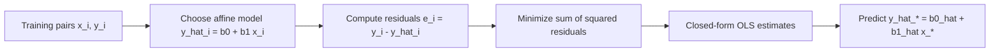
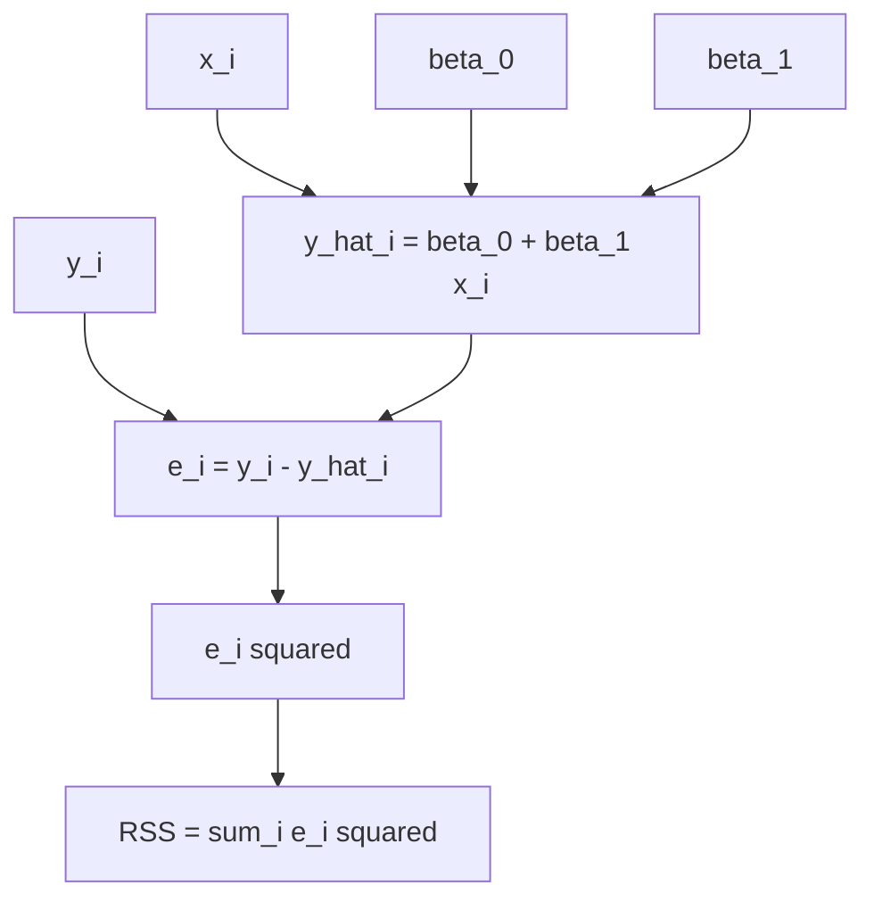
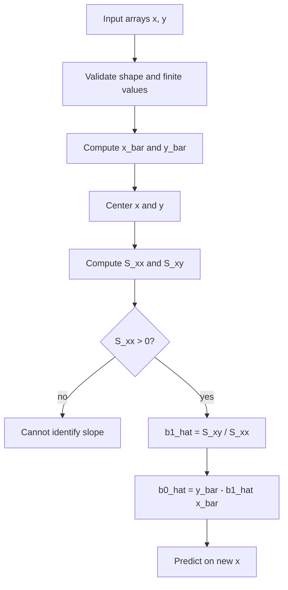

# Simple Linear Regression

Simple linear regression models the conditional mean of a scalar response $Y$ as an affine function of one scalar predictor $X$:

$$
\mathbb{E}[Y \mid X=x] = \beta_0 + \beta_1 x
$$

Given observations

$$
\mathcal{D} = \{(x_i, y_i)\}_{i=1}^{n},
$$

ordinary least squares estimates the intercept $\beta_0$ and slope $\beta_1$ by minimizing the squared residual error:

$$
(\hat{\beta}_0,\hat{\beta}_1)
=
\arg\min_{\beta_0,\beta_1}
\sum_{i=1}^{n}
\left(y_i - \beta_0 - \beta_1 x_i\right)^2.
$$

The model is simple, but it is also the cleanest entry point into many ideas used throughout machine learning: empirical risk minimization, convex optimization, projection geometry, bias-variance tradeoffs, likelihood estimation, numerical linear algebra, feature centering, regularization, diagnostics, and model misspecification.



## 1. Statistical Model and Assumptions

The deterministic prediction rule is

$$
\hat{y}(x) = \hat{\beta}_0 + \hat{\beta}_1 x.
$$

The common statistical data-generating model is

$$
Y_i = \beta_0 + \beta_1 x_i + \varepsilon_i,
\qquad i=1,\dots,n,
$$

where:

- $x_i$ is treated as fixed or conditioned upon.
- $\beta_0$ is the population intercept.
- $\beta_1$ is the population slope.
- $\varepsilon_i$ is the unobserved error term.

For unbiasedness of OLS, the key exogeneity assumption is

$$
\mathbb{E}[\varepsilon_i \mid x_i] = 0.
$$

For the classical finite-sample inference formulas, stronger assumptions are often added:

$$
\operatorname{Var}(\varepsilon_i \mid x_i) = \sigma^2,
$$

$$
\operatorname{Cov}(\varepsilon_i,\varepsilon_j \mid X) = 0
\quad \text{for } i \neq j,
$$

and sometimes

$$
\varepsilon_i \mid X \sim \mathcal{N}(0,\sigma^2).
$$

Normality is not required to compute the OLS line. It is mainly used for exact finite-sample confidence intervals and hypothesis tests. Large-sample inference can often use asymptotic approximations, and heteroscedasticity-consistent standard errors can relax constant-variance assumptions.

## 2. Least Squares Objective

For each training point, define the prediction and residual:

$$
\hat{y}_i = \beta_0 + \beta_1 x_i,
$$

$$
e_i = y_i - \hat{y}_i = y_i - \beta_0 - \beta_1 x_i.
$$

The residual sum of squares is

$$
\operatorname{RSS}(\beta_0,\beta_1)
=
\sum_{i=1}^{n} e_i^2
=
\sum_{i=1}^{n}
\left(y_i - \beta_0 - \beta_1 x_i\right)^2.
$$

The mean squared error objective differs only by the constant factor $1/n$:

$$
\operatorname{MSE}(\beta_0,\beta_1)
=
\frac{1}{n}\operatorname{RSS}(\beta_0,\beta_1).
$$

Both objectives have exactly the same minimizer. Squaring gives a smooth convex objective, penalizes large residuals heavily, and produces a closed-form solution through linear algebra.



## 3. Deriving the OLS Estimates from First Principles

Start with

$$
S(\beta_0,\beta_1)
=
\sum_{i=1}^{n}
\left(y_i - \beta_0 - \beta_1 x_i\right)^2.
$$

Differentiate with respect to $\beta_0$:

$$
\frac{\partial S}{\partial \beta_0}
=
-2\sum_{i=1}^{n}
\left(y_i - \beta_0 - \beta_1 x_i\right).
$$

Set the derivative to zero:

$$
\sum_{i=1}^{n}
\left(y_i - \hat{\beta}_0 - \hat{\beta}_1 x_i\right)
= 0.
$$

Therefore,

$$
\sum_{i=1}^{n} y_i
- n\hat{\beta}_0
- \hat{\beta}_1 \sum_{i=1}^{n}x_i
= 0.
$$

Divide by $n$:

$$
\bar{y} - \hat{\beta}_0 - \hat{\beta}_1 \bar{x} = 0.
$$

So the fitted line passes through the sample centroid:

$$
\hat{\beta}_0 = \bar{y} - \hat{\beta}_1\bar{x}.
$$

Differentiate with respect to $\beta_1$:

$$
\frac{\partial S}{\partial \beta_1}
=
-2\sum_{i=1}^{n}
x_i\left(y_i - \beta_0 - \beta_1x_i\right).
$$

Set the derivative to zero:

$$
\sum_{i=1}^{n}
x_i\left(y_i - \hat{\beta}_0 - \hat{\beta}_1x_i\right)
= 0.
$$

Substitute $\hat{\beta}_0 = \bar{y} - \hat{\beta}_1\bar{x}$:

$$
\sum_{i=1}^{n}
x_i
\left(
y_i - \bar{y}
+ \hat{\beta}_1\bar{x}
- \hat{\beta}_1x_i
\right)
= 0.
$$

Rearrange:

$$
\sum_{i=1}^{n}x_i(y_i-\bar{y})
-
\hat{\beta}_1
\sum_{i=1}^{n}x_i(x_i-\bar{x})
= 0.
$$

Because

$$
\sum_{i=1}^{n}x_i(y_i-\bar{y})
=
\sum_{i=1}^{n}(x_i-\bar{x})(y_i-\bar{y}),
$$

and

$$
\sum_{i=1}^{n}x_i(x_i-\bar{x})
=
\sum_{i=1}^{n}(x_i-\bar{x})^2,
$$

the slope estimate is

$$
\hat{\beta}_1
=
\frac{
\sum_{i=1}^{n}(x_i-\bar{x})(y_i-\bar{y})
}{
\sum_{i=1}^{n}(x_i-\bar{x})^2
}.
$$

The intercept estimate is then

$$
\hat{\beta}_0
=
\bar{y}
-
\hat{\beta}_1\bar{x}.
$$

### Interpretation of the Formula

The numerator

$$
S_{xy} =
\sum_{i=1}^{n}(x_i-\bar{x})(y_i-\bar{y})
$$

is the unnormalized sample covariance between $x$ and $y$. The denominator

$$
S_{xx} =
\sum_{i=1}^{n}(x_i-\bar{x})^2
$$

is the unnormalized variance of $x$. Therefore,

$$
\hat{\beta}_1 = \frac{S_{xy}}{S_{xx}}.
$$

Intuitively, the slope is "how much $y$ co-varies with $x$" divided by "how much $x$ varies at all." If $x$ barely changes, the slope is weakly identified and numerically unstable.

## 4. Matrix Form and Projection Geometry

Define the design matrix with an intercept column:

$$
X =
\begin{bmatrix}
1 & x_1 \\
1 & x_2 \\
\vdots & \vdots \\
1 & x_n
\end{bmatrix}
\in \mathbb{R}^{n \times 2},
\qquad
\beta =
\begin{bmatrix}
\beta_0 \\
\beta_1
\end{bmatrix},
\qquad
y =
\begin{bmatrix}
y_1 \\
y_2 \\
\vdots \\
y_n
\end{bmatrix}.
$$

The fitted values are

$$
\hat{y} = X\hat{\beta},
$$

and the objective is

$$
S(\beta) = \|y-X\beta\|_2^2.
$$

Expanding:

$$
S(\beta)
=
(y-X\beta)^\top(y-X\beta)
=
y^\top y - 2\beta^\top X^\top y + \beta^\top X^\top X\beta.
$$

Taking the gradient:

$$
\nabla_{\beta} S(\beta)
=
-2X^\top y + 2X^\top X\beta.
$$

Set the gradient to zero:

$$
X^\top X\hat{\beta} = X^\top y.
$$

These are the normal equations. If $X^\top X$ is invertible,

$$
\hat{\beta}
=
(X^\top X)^{-1}X^\top y.
$$

Geometrically, $\hat{y}=X\hat{\beta}$ is the orthogonal projection of $y$ onto the two-dimensional column space of $X$. The residual vector

$$
\hat{e} = y - X\hat{\beta}
$$

is orthogonal to every column of $X$:

$$
X^\top \hat{e} = 0.
$$

For simple regression with an intercept, this gives two useful identities:

$$
\sum_{i=1}^{n}\hat{e}_i = 0,
$$

$$
\sum_{i=1}^{n}x_i\hat{e}_i = 0.
$$

```mermaid
flowchart LR
    Y[Observed vector y in R^n] --> Proj[Orthogonal projection onto Col(X)]
    Xmat[Columns: 1 and x] --> Proj
    Proj --> Yhat[Fitted vector y_hat = X beta_hat]
    Y --> Resid[Residual e_hat = y - y_hat]
    Yhat --> Resid
    Resid --> Orth[e_hat orthogonal to Col(X)]
```

## 5. Maximum Likelihood View

Assume Gaussian noise:

$$
Y_i \mid x_i
\sim
\mathcal{N}(\beta_0+\beta_1x_i,\sigma^2),
$$

with conditionally independent observations. The likelihood is

$$
L(\beta_0,\beta_1,\sigma^2)
=
\prod_{i=1}^{n}
\frac{1}{\sqrt{2\pi\sigma^2}}
\exp\left(
-
\frac{
\left(y_i-\beta_0-\beta_1x_i\right)^2
}{
2\sigma^2
}
\right).
$$

The log-likelihood is

$$
\ell(\beta_0,\beta_1,\sigma^2)
=
-
\frac{n}{2}\log(2\pi)
-
\frac{n}{2}\log(\sigma^2)
-
\frac{1}{2\sigma^2}
\sum_{i=1}^{n}
\left(y_i-\beta_0-\beta_1x_i\right)^2.
$$

For fixed $\sigma^2$, maximizing $\ell$ over $\beta_0,\beta_1$ is equivalent to minimizing RSS. Thus, under independent Gaussian errors, OLS and maximum likelihood produce the same coefficient estimates.

The maximum likelihood estimator of $\sigma^2$ is

$$
\hat{\sigma}_{\mathrm{MLE}}^2
=
\frac{1}{n}\sum_{i=1}^{n}\hat{e}_i^2.
$$

The usual unbiased estimator used in classical regression inference divides by $n-2$ because two coefficients were estimated:

$$
s^2
=
\frac{1}{n-2}\sum_{i=1}^{n}\hat{e}_i^2.
$$

## 6. Step-by-Step Execution Algorithm

For one predictor, an efficient implementation does not need to explicitly build the design matrix.

1. Validate that $x$ and $y$ are one-dimensional arrays of equal length.
2. Reject or handle missing and non-finite values.
3. Compute sample means:

$$
\bar{x} = \frac{1}{n}\sum_{i=1}^{n}x_i,
\qquad
\bar{y} = \frac{1}{n}\sum_{i=1}^{n}y_i.
$$

4. Center both arrays:

$$
\tilde{x}_i = x_i - \bar{x},
\qquad
\tilde{y}_i = y_i - \bar{y}.
$$

5. Compute

$$
S_{xx} = \sum_{i=1}^{n}\tilde{x}_i^2,
\qquad
S_{xy} = \sum_{i=1}^{n}\tilde{x}_i\tilde{y}_i.
$$

6. If $S_{xx}=0$, the slope is unidentified because all $x_i$ are equal.
7. Compute

$$
\hat{\beta}_1 = \frac{S_{xy}}{S_{xx}},
\qquad
\hat{\beta}_0 = \bar{y} - \hat{\beta}_1\bar{x}.
$$

8. Predict with

$$
\hat{y}_* = \hat{\beta}_0 + \hat{\beta}_1x_*.
$$



## 7. Worked Example with Intermediate Calculations

Use the note's example:

| Study hours $x$ | Marks $y$ |
|---:|---:|
| 1 | 20 |
| 2 | 40 |
| 3 | 50 |
| 4 | 70 |
| 5 | 90 |

Compute the means:

$$
\bar{x}
=
\frac{1+2+3+4+5}{5}
= 3.
$$

$$
\bar{y}
=
\frac{20+40+50+70+90}{5}
=
\frac{270}{5}
= 54.
$$

Now center the data:

| $x_i$ | $y_i$ | $x_i-\bar{x}$ | $y_i-\bar{y}$ | $(x_i-\bar{x})(y_i-\bar{y})$ | $(x_i-\bar{x})^2$ |
|---:|---:|---:|---:|---:|---:|
| 1 | 20 | -2 | -34 | 68 | 4 |
| 2 | 40 | -1 | -14 | 14 | 1 |
| 3 | 50 | 0 | -4 | 0 | 0 |
| 4 | 70 | 1 | 16 | 16 | 1 |
| 5 | 90 | 2 | 36 | 72 | 4 |

Thus,

$$
S_{xy} = 68+14+0+16+72 = 170,
$$

$$
S_{xx} = 4+1+0+1+4 = 10.
$$

The slope is

$$
\hat{\beta}_1 = \frac{170}{10} = 17.
$$

The intercept is

$$
\hat{\beta}_0 = 54 - 17 \cdot 3 = 3.
$$

So the fitted model is

$$
\hat{y} = 3 + 17x.
$$

Predictions and residuals:

| $x_i$ | $y_i$ | $\hat{y}_i=3+17x_i$ | $\hat{e}_i=y_i-\hat{y}_i$ | $\hat{e}_i^2$ |
|---:|---:|---:|---:|---:|
| 1 | 20 | 20 | 0 | 0 |
| 2 | 40 | 37 | 3 | 9 |
| 3 | 50 | 54 | -4 | 16 |
| 4 | 70 | 71 | -1 | 1 |
| 5 | 90 | 88 | 2 | 4 |

The residual sum of squares is

$$
\operatorname{RSS} = 0+9+16+1+4 = 30.
$$

The mean squared error is

$$
\operatorname{MSE} = \frac{30}{5} = 6.
$$

The unbiased residual variance estimate is

$$
s^2 = \frac{30}{5-2} = 10.
$$

Prediction for $x_*=6$ study hours:

$$
\hat{y}_* = 3 + 17 \cdot 6 = 105.
$$

This is an extrapolation beyond the observed range $[1,5]$, so its reliability depends strongly on whether the linear pattern remains valid past the training data.

## 8. Goodness of Fit and Diagnostics

### Total, Explained, and Residual Variation

With an intercept, decompose total variation around the sample mean:

$$
\operatorname{TSS}
=
\sum_{i=1}^{n}(y_i-\bar{y})^2.
$$

Residual variation:

$$
\operatorname{RSS}
=
\sum_{i=1}^{n}(y_i-\hat{y}_i)^2.
$$

Explained variation:

$$
\operatorname{ESS}
=
\sum_{i=1}^{n}(\hat{y}_i-\bar{y})^2.
$$

For OLS with an intercept:

$$
\operatorname{TSS} = \operatorname{ESS} + \operatorname{RSS}.
$$

The coefficient of determination is

$$
R^2
=
1-\frac{\operatorname{RSS}}{\operatorname{TSS}}.
$$

For the worked example:

$$
\operatorname{TSS}
=
(-34)^2+(-14)^2+(-4)^2+16^2+36^2
=
2920.
$$

Thus,

$$
R^2 = 1 - \frac{30}{2920} \approx 0.9897.
$$

For simple regression with an intercept,

$$
R^2 = r_{xy}^2,
$$

where $r_{xy}$ is the Pearson correlation between $x$ and $y$.

### Leverage

The hat matrix is

$$
H = X(X^\top X)^{-1}X^\top,
$$

so

$$
\hat{y} = Hy.
$$

The leverage of point $i$ is the diagonal entry $h_{ii}$:

$$
h_{ii}
=
\frac{1}{n}
+
\frac{(x_i-\bar{x})^2}{S_{xx}}.
$$

Large leverage means the point has an unusual predictor value. A high-leverage point can strongly affect the slope even if its residual is not large.

### Standard Errors

Under the classical homoscedastic model,

$$
\operatorname{Var}(\hat{\beta} \mid X)
=
\sigma^2(X^\top X)^{-1}.
$$

For simple regression:

$$
\operatorname{Var}(\hat{\beta}_1 \mid X)
=
\frac{\sigma^2}{S_{xx}},
$$

$$
\operatorname{Var}(\hat{\beta}_0 \mid X)
=
\sigma^2
\left(
\frac{1}{n}
+
\frac{\bar{x}^2}{S_{xx}}
\right).
$$

Replacing $\sigma^2$ by $s^2$ gives estimated standard errors:

$$
\operatorname{SE}(\hat{\beta}_1)
=
\sqrt{\frac{s^2}{S_{xx}}},
$$

$$
\operatorname{SE}(\hat{\beta}_0)
=
\sqrt{
s^2
\left(
\frac{1}{n}
+
\frac{\bar{x}^2}{S_{xx}}
\right)
}.
$$

For the example, $s^2=10$ and $S_{xx}=10$, so

$$
\operatorname{SE}(\hat{\beta}_1)
=
\sqrt{\frac{10}{10}}
= 1.
$$

The slope $t$ statistic for testing $H_0:\beta_1=0$ is

$$
t =
\frac{\hat{\beta}_1 - 0}{\operatorname{SE}(\hat{\beta}_1)}
=
\frac{17}{1}
= 17,
$$

with $n-2=3$ degrees of freedom under the Gaussian classical model.

## 9. Prediction Intervals

For a new predictor value $x_*$, the estimated mean response is

$$
\hat{\mu}_*
=
\hat{\beta}_0+\hat{\beta}_1x_*.
$$

The standard error for the estimated conditional mean is

$$
\operatorname{SE}_{\mathrm{mean}}(x_*)
=
s
\sqrt{
\frac{1}{n}
+
\frac{(x_*-\bar{x})^2}{S_{xx}}
}.
$$

A confidence interval for the mean response is

$$
\hat{\mu}_*
\pm
t_{1-\alpha/2,n-2}
\operatorname{SE}_{\mathrm{mean}}(x_*).
$$

A prediction interval for a new observation includes irreducible noise:

$$
\operatorname{SE}_{\mathrm{pred}}(x_*)
=
s
\sqrt{
1
+
\frac{1}{n}
+
\frac{(x_*-\bar{x})^2}{S_{xx}}
}.
$$

The corresponding prediction interval is

$$
\hat{y}_*
\pm
t_{1-\alpha/2,n-2}
\operatorname{SE}_{\mathrm{pred}}(x_*).
$$

Prediction intervals are wider than confidence intervals for the conditional mean because they account for the noise in an individual future response.

## 10. From-Scratch Python Implementation

### Closed-Form Simple Linear Regression

```python
from __future__ import annotations

import numpy as np


class SimpleLinearRegression:
    """Ordinary least squares for one scalar predictor and one scalar target."""

    def __init__(self) -> None:
        self.intercept_: float | None = None
        self.coef_: float | None = None
        self.x_mean_: float | None = None
        self.y_mean_: float | None = None
        self.sxx_: float | None = None
        self.rss_: float | None = None

    def fit(self, x, y) -> "SimpleLinearRegression":
        x_arr = np.asarray(x, dtype=np.float64)
        y_arr = np.asarray(y, dtype=np.float64)

        if x_arr.ndim != 1 or y_arr.ndim != 1:
            raise ValueError("x and y must be one-dimensional arrays.")
        if x_arr.shape[0] != y_arr.shape[0]:
            raise ValueError("x and y must have the same length.")
        if x_arr.shape[0] < 2:
            raise ValueError("At least two observations are required.")
        if not np.isfinite(x_arr).all() or not np.isfinite(y_arr).all():
            raise ValueError("x and y must contain only finite values.")

        x_mean = float(np.mean(x_arr))
        y_mean = float(np.mean(y_arr))

        x_centered = x_arr - x_mean
        y_centered = y_arr - y_mean

        sxx = float(np.dot(x_centered, x_centered))
        if sxx <= 0.0:
            raise ValueError("Cannot fit a slope when all x values are identical.")

        sxy = float(np.dot(x_centered, y_centered))
        coef = sxy / sxx
        intercept = y_mean - coef * x_mean

        y_hat = intercept + coef * x_arr
        residuals = y_arr - y_hat

        self.intercept_ = float(intercept)
        self.coef_ = float(coef)
        self.x_mean_ = x_mean
        self.y_mean_ = y_mean
        self.sxx_ = sxx
        self.rss_ = float(np.dot(residuals, residuals))
        return self

    def predict(self, x):
        if self.intercept_ is None or self.coef_ is None:
            raise RuntimeError("The model must be fit before prediction.")
        x_arr = np.asarray(x, dtype=np.float64)
        return self.intercept_ + self.coef_ * x_arr

    def score_r2(self, x, y) -> float:
        y_arr = np.asarray(y, dtype=np.float64)
        y_hat = self.predict(x)
        rss = float(np.sum((y_arr - y_hat) ** 2))
        tss = float(np.sum((y_arr - np.mean(y_arr)) ** 2))
        if tss == 0.0:
            return float("nan")
        return 1.0 - rss / tss


x = np.array([1, 2, 3, 4, 5], dtype=np.float64)
y = np.array([20, 40, 50, 70, 90], dtype=np.float64)

model = SimpleLinearRegression().fit(x, y)
print(model.intercept_)      # 3.0
print(model.coef_)           # 17.0
print(model.predict([6]))    # [105.]
print(model.score_r2(x, y))  # 0.9897260273972602
```

### Matrix OLS with a Pseudoinverse

The same model can be fit through the general OLS matrix formula. Instead of explicitly computing $(X^\top X)^{-1}$, use a least-squares solver or pseudoinverse. This is usually more stable.

```python
import numpy as np


def fit_ols_lstsq(x, y):
    x = np.asarray(x, dtype=np.float64)
    y = np.asarray(y, dtype=np.float64)

    X = np.column_stack([np.ones_like(x), x])

    # Solves min_beta ||X beta - y||_2.
    # NumPy returns the least-squares solution, residuals, numerical rank,
    # and singular values of X.
    beta, residuals, rank, singular_values = np.linalg.lstsq(X, y, rcond=None)

    return {
        "intercept": beta[0],
        "slope": beta[1],
        "residuals": residuals,
        "rank": rank,
        "singular_values": singular_values,
    }


result = fit_ols_lstsq([1, 2, 3, 4, 5], [20, 40, 50, 70, 90])
print(result)
```

`np.linalg.lstsq` solves the linear least-squares problem directly. Conceptually, it computes the coefficient vector that minimizes $\|X\beta-y\|_2$. Numerically, least-squares routines typically avoid forming the inverse of $X^\top X$ directly, because the condition number of $X^\top X$ is the square of the condition number of $X$:

$$
\kappa(X^\top X) = \kappa(X)^2.
$$

Squaring the condition number can severely amplify floating-point error.

### Gradient Descent Implementation

Closed form is preferred for this small convex problem, but gradient descent connects linear regression to neural network training.

Use the MSE objective:

$$
J(\beta_0,\beta_1)
=
\frac{1}{n}
\sum_{i=1}^{n}
\left(\hat{y}_i-y_i\right)^2.
$$

The gradients are

$$
\frac{\partial J}{\partial \beta_0}
=
\frac{2}{n}
\sum_{i=1}^{n}
\left(\hat{y}_i-y_i\right),
$$

$$
\frac{\partial J}{\partial \beta_1}
=
\frac{2}{n}
\sum_{i=1}^{n}
x_i\left(\hat{y}_i-y_i\right).
$$

The update is

$$
\beta_j^{(t+1)}
=
\beta_j^{(t)}
-
\eta
\frac{\partial J}{\partial \beta_j},
$$

where $\eta$ is the learning rate.

```python
import numpy as np


def fit_simple_lr_gradient_descent(x, y, lr=0.01, epochs=20_000):
    x = np.asarray(x, dtype=np.float64)
    y = np.asarray(y, dtype=np.float64)
    n = x.shape[0]

    b0 = 0.0
    b1 = 0.0

    for _ in range(epochs):
        y_hat = b0 + b1 * x
        error = y_hat - y

        grad_b0 = (2.0 / n) * np.sum(error)
        grad_b1 = (2.0 / n) * np.sum(error * x)

        b0 -= lr * grad_b0
        b1 -= lr * grad_b1

    return b0, b1


b0, b1 = fit_simple_lr_gradient_descent(
    [1, 2, 3, 4, 5],
    [20, 40, 50, 70, 90],
    lr=0.01,
    epochs=20_000,
)

print(b0, b1)  # approximately 3.0, 17.0
```

Gradient descent is sensitive to feature scale. If $x$ is large, the curvature of the loss in the $\beta_1$ direction becomes large, forcing a smaller stable learning rate.

## 11. Equivalent Library Implementations

### scikit-learn

```python
import numpy as np
from sklearn.linear_model import LinearRegression

x = np.array([1, 2, 3, 4, 5], dtype=np.float64).reshape(-1, 1)
y = np.array([20, 40, 50, 70, 90], dtype=np.float64)

reg = LinearRegression(fit_intercept=True)
reg.fit(x, y)

print(reg.intercept_)        # 3.0
print(reg.coef_)             # [17.]
print(reg.predict([[6.0]]))  # [105.]
print(reg.score(x, y))       # R^2
```

Important internal mechanics:

- `LinearRegression` fits ordinary least squares by minimizing residual sum of squares.
- Dense inputs are solved through numerical least-squares linear algebra, not by manually looping over samples.
- If `fit_intercept=True`, the implementation effectively accounts for centering so the intercept is handled correctly.
- For sparse inputs, scikit-learn uses an iterative least-squares solver path.
- `positive=True` constrains coefficients to be non-negative and uses a non-negative least-squares style solver. This is not the same optimization problem as unconstrained OLS.
- `coef_` stores slopes; `intercept_` stores the intercept; `rank_` and `singular_` are available for dense inputs and help diagnose rank deficiency.

For one feature, scikit-learn returns the same line as the closed-form formulas above, up to floating-point precision.

### NumPy

```python
import numpy as np

x = np.array([1, 2, 3, 4, 5], dtype=np.float64)
y = np.array([20, 40, 50, 70, 90], dtype=np.float64)

X = np.c_[np.ones(x.shape[0]), x]
beta, residuals, rank, s = np.linalg.lstsq(X, y, rcond=None)

print(beta)       # [ 3. 17.]
print(residuals)  # [30.] for full-rank overdetermined systems
print(rank)       # 2
print(s)          # singular values of X
```

`np.linalg.lstsq` returns:

- `beta`: least-squares coefficients.
- `residuals`: squared residual sum if the system is overdetermined and full-rank.
- `rank`: numerical rank of the matrix.
- `s`: singular values.

The rank and singular values are important because a tiny singular value indicates near-collinearity or poor scaling.

### statsmodels

```python
import numpy as np
import statsmodels.api as sm

x = np.array([1, 2, 3, 4, 5], dtype=np.float64)
y = np.array([20, 40, 50, 70, 90], dtype=np.float64)

X = sm.add_constant(x)  # adds intercept column
ols = sm.OLS(y, X)
results = ols.fit()

print(results.params)    # [ 3. 17.]
print(results.rsquared)
print(results.bse)       # standard errors
print(results.summary())
```

`statsmodels.OLS` expects the design matrix to already contain a constant if an intercept is desired. This differs from scikit-learn, where `fit_intercept=True` is the default. statsmodels emphasizes statistical inference: standard errors, confidence intervals, hypothesis tests, influence diagnostics, and model summaries.

## 12. Numerical Stability

### Centering

The formula

$$
\hat{\beta}_0 = \bar{y} - \hat{\beta}_1\bar{x}
$$

can suffer cancellation when $\bar{x}$ is huge and the fitted values depend on small differences around $\bar{x}$. Centering $x$ before fitting improves numerical behavior.

Define

$$
z_i = x_i - \bar{x}.
$$

Fit

$$
y_i = \alpha_0 + \alpha_1 z_i + \varepsilon_i.
$$

Then

$$
\hat{\alpha}_1 = \hat{\beta}_1,
$$

and

$$
\hat{\alpha}_0 = \bar{y}.
$$

To convert back:

$$
\hat{\beta}_0 = \hat{\alpha}_0 - \hat{\alpha}_1\bar{x}.
$$

### Avoid Explicit Matrix Inversion

Do not implement production OLS as:

```python
beta = np.linalg.inv(X.T @ X) @ X.T @ y
```

Prefer:

```python
beta = np.linalg.lstsq(X, y, rcond=None)[0]
```

or:

```python
beta = np.linalg.pinv(X) @ y
```

Explicit inversion is slower, less stable, and fails more abruptly under rank deficiency.

### Rank Deficiency

Simple regression with an intercept is rank deficient if all $x_i$ values are identical. Then $S_{xx}=0$, and infinitely many pairs $(\beta_0,\beta_1)$ can produce the same constant prediction on the observed data.

The design matrix

$$
X =
\begin{bmatrix}
1 & c \\
1 & c \\
\vdots & \vdots \\
1 & c
\end{bmatrix}
$$

has rank $1$, not $2$. The slope is not identifiable from the data.

## 13. Complexity

For $n$ observations and one predictor:

| Operation | Time | Space |
|---|---:|---:|
| Closed-form scalar formula | $O(n)$ | $O(1)$ extra if streaming, $O(n)$ if arrays are stored |
| Prediction on $m$ points | $O(m)$ | $O(m)$ for returned predictions |
| Building dense design matrix | $O(n)$ | $O(n)$ |
| General least squares with $p=2$ | $O(n)$ | $O(n)$ |

For multiple linear regression with $p$ features:

| Solver strategy | Typical time | Notes |
|---|---:|---|
| Normal equations | $O(np^2+p^3)$ | Can be unstable because it forms $X^\top X$ |
| QR decomposition | $O(np^2)$ for $n \geq p$ | More stable than normal equations |
| SVD / pseudoinverse | $O(np^2+p^3)$ | Most diagnostic and robust for rank deficiency |
| Iterative sparse solvers | problem-dependent | Useful when $X$ is large and sparse |

## 14. Edge Cases and Implementation Pitfalls

- Constant predictor: $S_{xx}=0$, so the slope is undefined.
- Too few samples: standard errors require $n>2$ for simple regression with intercept.
- Missing values: scikit-learn `LinearRegression` does not natively fit with `NaN`; impute or filter before fitting.
- Outliers: squared loss gives high influence to large residuals.
- High-leverage points: extreme $x$ values can dominate the fitted slope.
- Extrapolation: predictions outside the observed $x$ range may be unreliable.
- Nonlinearity: a high $R^2$ over a narrow range does not prove the true relationship is globally linear.
- Heteroscedasticity: coefficient estimates can remain unbiased under exogeneity, but classical standard errors become wrong.
- Autocorrelation: time-series residual dependence invalidates standard OLS inference.
- Target leakage: using a feature that encodes future or target-derived information can make the regression look excellent but fail in production.
- Unit mismatch: changing units changes coefficient scale; for example, hours versus minutes changes the slope by a factor of $60$.
- Intercept handling mismatch: scikit-learn adds an intercept by default; statsmodels requires adding a constant column manually.
- Shape mismatch: scikit-learn expects a 2D feature matrix, so one predictor must be shaped as `(n_samples, 1)`.

## 15. Limitations

Simple linear regression is appropriate when an affine conditional mean is a reasonable approximation. It is limited when:

- The effect is nonlinear.
- Important predictors are omitted.
- Noise variance changes substantially with $x$.
- Observations are dependent.
- Measurement error in $x$ is large.
- The target distribution has heavy tails and squared loss is too sensitive.
- Causal interpretation is desired but the data are observational and confounded.

Omitted variable bias is especially important. Suppose the true model is

$$
Y = \beta_0 + \beta_1X + \gamma Z + \varepsilon,
$$

but we fit

$$
Y = \alpha_0 + \alpha_1X + u.
$$

When $X$ and $Z$ are correlated, the fitted slope absorbs part of the effect of $Z$:

$$
\mathbb{E}[\hat{\alpha}_1 \mid X,Z]
\approx
\beta_1
+
\gamma
\frac{\operatorname{Cov}(X,Z)}{\operatorname{Var}(X)}.
$$

This is why a regression coefficient should not be interpreted causally without a defensible identification strategy.

## 16. Robust and Regularized Variants

### Ridge Regression

Ridge regression adds an $L_2$ penalty:

$$
\hat{\beta}_{\mathrm{ridge}}
=
\arg\min_{\beta}
\|y-X\beta\|_2^2
+
\lambda\|\beta\|_2^2.
$$

For multiple regression, ridge reduces variance and stabilizes estimates under collinearity. The closed-form solution is

$$
\hat{\beta}_{\mathrm{ridge}}
=
(X^\top X+\lambda I)^{-1}X^\top y.
$$

Usually the intercept is not penalized.

### Lasso

Lasso adds an $L_1$ penalty:

$$
\hat{\beta}_{\mathrm{lasso}}
=
\arg\min_{\beta}
\|y-X\beta\|_2^2
+
\lambda\|\beta\|_1.
$$

It can set coefficients exactly to zero, making it useful for feature selection in higher-dimensional settings.

### Robust Regression

If outliers are a serious issue, alternatives include:

- Least absolute deviations:

$$
\min_{\beta_0,\beta_1}
\sum_{i=1}^{n}
\left|y_i-\beta_0-\beta_1x_i\right|.
$$

- Huber regression, which behaves quadratically near zero residuals and linearly for large residuals.
- RANSAC, which tries to fit using subsets and ignore outliers.

These methods trade the algebraic convenience of OLS for robustness.

## 17. Connections to Related ML Concepts

- Empirical risk minimization: OLS minimizes empirical squared loss.
- Linear models: simple regression is the $p=1$ case of multiple linear regression.
- Gaussian maximum likelihood: OLS coefficients match MLE coefficients under independent Gaussian errors.
- Projection theory: fitted values are orthogonal projections onto the feature column space.
- Gradient-based learning: the OLS loss is a convex quadratic, a useful baseline for understanding neural network optimization.
- Feature engineering: polynomial regression is linear regression on transformed features such as $x,x^2,x^3$.
- Regularization: ridge and lasso modify the least-squares objective to control variance and complexity.
- Bias-variance tradeoff: simple linear regression has low variance but can have high bias under nonlinear relationships.
- Causal inference: regression adjustment is not automatically causal; exogeneity and identification assumptions are central.

## 18. Practical Checklist

Before trusting a simple linear regression:

1. Plot $y$ versus $x$ and inspect whether a line is plausible.
2. Check for missing values, unit inconsistencies, duplicate leakage, and impossible values.
3. Fit the model with an intercept unless there is a strong domain reason to force the line through zero.
4. Inspect residuals versus fitted values.
5. Inspect residuals versus $x$.
6. Check high-leverage and high-residual points.
7. Compare train and test error.
8. Avoid causal language unless the data collection and assumptions justify it.
9. Be cautious with extrapolation beyond the observed $x$ range.
10. Prefer stable solvers such as least-squares routines over explicit matrix inversion.

## 19. Complete Reproducible Example

```python
import numpy as np
from sklearn.linear_model import LinearRegression


def summarize_simple_regression(x, y):
    x = np.asarray(x, dtype=np.float64)
    y = np.asarray(y, dtype=np.float64)

    x_bar = np.mean(x)
    y_bar = np.mean(y)
    x_c = x - x_bar
    y_c = y - y_bar

    sxx = np.dot(x_c, x_c)
    sxy = np.dot(x_c, y_c)

    b1 = sxy / sxx
    b0 = y_bar - b1 * x_bar

    y_hat = b0 + b1 * x
    residuals = y - y_hat
    rss = np.dot(residuals, residuals)
    tss = np.dot(y - y_bar, y - y_bar)
    r2 = 1.0 - rss / tss

    dof = x.shape[0] - 2
    s2 = rss / dof
    se_b1 = np.sqrt(s2 / sxx)
    se_b0 = np.sqrt(s2 * (1.0 / x.shape[0] + x_bar**2 / sxx))

    return {
        "intercept": b0,
        "slope": b1,
        "rss": rss,
        "r2": r2,
        "residual_variance_unbiased": s2,
        "se_intercept": se_b0,
        "se_slope": se_b1,
        "residuals": residuals,
        "fitted": y_hat,
    }


x = np.array([1, 2, 3, 4, 5], dtype=np.float64)
y = np.array([20, 40, 50, 70, 90], dtype=np.float64)

summary = summarize_simple_regression(x, y)
for key, value in summary.items():
    print(f"{key}: {value}")

# Equivalent scikit-learn fit.
sk_model = LinearRegression()
sk_model.fit(x.reshape(-1, 1), y)

print("sklearn intercept:", sk_model.intercept_)
print("sklearn slope:", sk_model.coef_[0])
print("sklearn R^2:", sk_model.score(x.reshape(-1, 1), y))
```

## 20. References for Deeper Reading

- scikit-learn documentation, `sklearn.linear_model.LinearRegression`: https://scikit-learn.org/stable/modules/generated/sklearn.linear_model.LinearRegression.html
- scikit-learn user guide, ordinary least squares: https://scikit-learn.org/stable/modules/linear_model.html#ordinary-least-squares
- NumPy documentation, `numpy.linalg.lstsq`: https://numpy.org/doc/stable/reference/generated/numpy.linalg.lstsq.html
- statsmodels documentation, `statsmodels.regression.linear_model.OLS`: https://www.statsmodels.org/stable/generated/statsmodels.regression.linear_model.OLS.html
- The Book of Statistical Proofs, ordinary least squares for simple linear regression: https://statproofbook.github.io/P/slr-ols.html
- Hastie, Tibshirani, and Friedman, *The Elements of Statistical Learning*, Chapter 3.
- James, Witten, Hastie, Tibshirani, and Taylor, *An Introduction to Statistical Learning*, linear regression chapters.
