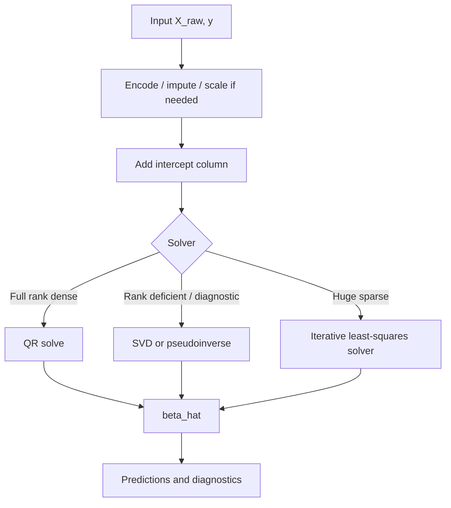
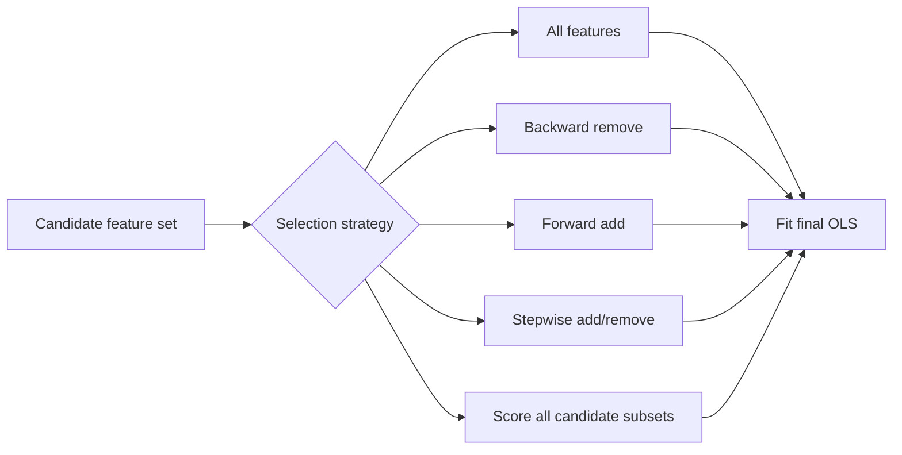
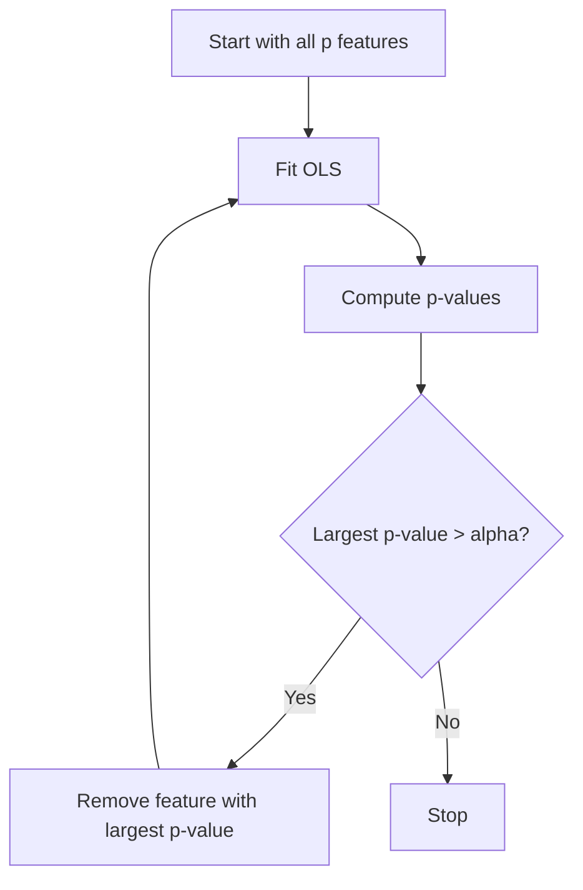
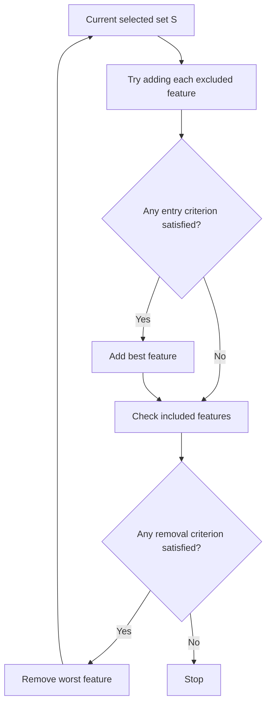

# Multiple Linear Regression and Model Building

Multiple linear regression models a scalar response as an affine function of multiple predictors:

$$
\mathbb{E}[Y \mid X=x] = \beta_0 + \beta_1 x_1 + \beta_2 x_2 + \cdots + \beta_p x_p.
$$

The model is linear in the parameters, not necessarily in the raw variables. Polynomial terms, interactions, splines, logarithms, and one-hot encoded categories are all valid inputs as long as the final predictor is a linear combination of engineered features.

In matrix form, for $n$ observations and $p$ non-intercept features:

$$
y = X\beta + \varepsilon,
$$

where

$$
X =
\begin{bmatrix}
1 & x_{11} & x_{12} & \cdots & x_{1p} \\
1 & x_{21} & x_{22} & \cdots & x_{2p} \\
\vdots & \vdots & \vdots & \ddots & \vdots \\
1 & x_{n1} & x_{n2} & \cdots & x_{np}
\end{bmatrix}
\in \mathbb{R}^{n \times (p+1)},
\qquad
\beta =
\begin{bmatrix}
\beta_0 \\
\beta_1 \\
\vdots \\
\beta_p
\end{bmatrix},
\qquad
y =
\begin{bmatrix}
y_1 \\
y_2 \\
\vdots \\
y_n
\end{bmatrix}.
$$

The leading column of ones encodes the intercept. If the design matrix already contains a constant column, adding another one makes $X^\top X$ singular.

```mermaid
flowchart LR
    A[Raw records] --> B[Feature matrix X with intercept]
    B --> C[y_hat = X beta]
    C --> D[Residuals e = y - y_hat]
    D --> E[Minimize RSS = ||y - X beta||_2^2]
    E --> F[Estimated coefficients beta_hat]
    F --> G[Prediction y_hat_* = x_*^T beta_hat]
```

## 1. Statistical Model

The classical multiple regression data-generating model is

$$
Y_i = x_i^\top \beta + \varepsilon_i,
\qquad i=1,\dots,n,
$$

where $x_i^\top$ is row $i$ of $X$, including the intercept entry if one is used.

The central exogeneity assumption is

$$
\mathbb{E}[\varepsilon_i \mid X] = 0.
$$

Equivalently,

$$
\mathbb{E}[\varepsilon \mid X] = 0.
$$

This says that, after conditioning on the included predictors, the unobserved error has zero mean. OLS can still be computed when this fails, but the coefficients no longer estimate the intended conditional mean effects.

For the usual finite-sample standard errors and hypothesis tests, the stronger homoscedastic independent-error assumptions are often added:

$$
\operatorname{Var}(\varepsilon \mid X) = \sigma^2 I_n.
$$

If exact small-sample $t$ and $F$ tests are desired, a normal-error assumption is commonly used:

$$
\varepsilon \mid X \sim \mathcal{N}(0, \sigma^2 I_n).
$$

Normality is not required for the least-squares coefficient estimate itself. It is an inference assumption. In large samples, asymptotic inference can often replace exact normal-theory inference, and robust covariance estimators can relax the constant-variance assumption.

## 2. Objective Function

For candidate parameter vector $\beta$, the fitted values are

$$
\hat{y} = X\beta,
$$

and the residual vector is

$$
e = y - \hat{y} = y - X\beta.
$$

Ordinary least squares solves

$$
\hat{\beta}
=
\arg\min_{\beta \in \mathbb{R}^{p+1}}
\operatorname{RSS}(\beta),
$$

where

$$
\operatorname{RSS}(\beta)
=
\sum_{i=1}^{n}(y_i - x_i^\top \beta)^2
=
\lVert y - X\beta \rVert_2^2.
$$

The mean squared error objective

$$
\operatorname{MSE}(\beta)
=
\frac{1}{n}\lVert y - X\beta \rVert_2^2
$$

has the same minimizer because $1/n$ is positive and independent of $\beta$.

### Convexity

Expanding the residual sum of squares:

$$
\begin{aligned}
\operatorname{RSS}(\beta)
&= (y - X\beta)^\top (y - X\beta) \\
&= y^\top y - 2\beta^\top X^\top y + \beta^\top X^\top X\beta.
\end{aligned}
$$

The gradient is

$$
\nabla_\beta \operatorname{RSS}(\beta)
=
-2X^\top y + 2X^\top X\beta.
$$

The Hessian is

$$
\nabla_\beta^2 \operatorname{RSS}(\beta)
=
2X^\top X.
$$

For any vector $z$,

$$
z^\top X^\top X z
=
(Xz)^\top (Xz)
=
\lVert Xz \rVert_2^2
\ge 0.
$$

Therefore $X^\top X$ is positive semidefinite and the objective is convex. If the columns of $X$ are linearly independent, then $X^\top X$ is positive definite and the minimizer is unique.

## 3. Normal Equations from First Principles

At a minimizer, the gradient vanishes:

$$
-2X^\top y + 2X^\top X\hat{\beta} = 0.
$$

Dividing by $2$ gives the normal equations:

$$
X^\top X\hat{\beta} = X^\top y.
$$

If $X$ has full column rank,

$$
\hat{\beta}
=
(X^\top X)^{-1}X^\top y.
$$

If $X$ is rank deficient, there are either infinitely many least-squares minimizers or non-identifiable coefficients. The minimum Euclidean norm solution is given by the Moore-Penrose pseudoinverse:

$$
\hat{\beta}
=
X^+y.
$$

### Geometric Interpretation

The fitted vector $\hat{y}$ lies in the column space of $X$:

$$
\hat{y} \in \mathcal{C}(X).
$$

The residual vector at the optimum is orthogonal to every column of $X$:

$$
X^\top (y - X\hat{\beta}) = 0.
$$

Thus OLS projects $y$ onto the subspace spanned by the columns of $X$.

The projection matrix, also called the hat matrix, is

$$
H = X(X^\top X)^{-1}X^\top,
$$

so

$$
\hat{y} = Hy,
\qquad
e = (I_n - H)y.
$$

When $X$ has full column rank and contains an intercept:

$$
H^\top = H,
\qquad
H^2 = H,
\qquad
\operatorname{rank}(H) = p+1,
\qquad
\operatorname{trace}(H) = p+1.
$$

The diagonal entries $h_{ii}$ are leverage scores. Large $h_{ii}$ means observation $i$ has an unusual feature vector relative to the rest of the design.

```mermaid
flowchart TB
    Y[y in R^n] --> P[Orthogonal projection onto C(X)]
    P --> YH[y_hat = Hy]
    Y --> R[e = y - y_hat]
    YH --- O[Residual orthogonal to every column of X]
    R --- O
```

## 4. Interpretation of Coefficients

For model

$$
\hat{y} = \hat{\beta}_0 + \sum_{j=1}^{p}\hat{\beta}_j x_j,
$$

the coefficient $\hat{\beta}_j$ is the estimated change in the conditional mean prediction for a one-unit increase in $x_j$, holding all other included features fixed:

$$
\frac{\partial \hat{y}}{\partial x_j} = \hat{\beta}_j.
$$

The phrase "holding other variables fixed" is model-internal. If two variables are strongly correlated in the data, the coefficient may be statistically unstable even though its algebraic interpretation is clear.

Feature scaling changes coefficient magnitudes. If

$$
z_j = \frac{x_j - \mu_j}{s_j},
$$

then a coefficient on $z_j$ measures the effect of a one-standard-deviation increase in $x_j$, not a one-unit increase in the original feature.

For interaction terms such as

$$
\hat{y} = \beta_0 + \beta_1 x_1 + \beta_2 x_2 + \beta_3 x_1x_2,
$$

the marginal effect of $x_1$ is no longer constant:

$$
\frac{\partial \hat{y}}{\partial x_1}
=
\beta_1 + \beta_3 x_2.
$$

## 5. Worked Example: House Price Model

Suppose prices are measured in lakhs and we use three predictors:

| Area | Bedrooms | Age | Price |
|---:|---:|---:|---:|
| 1200 | 2 | 5 | 50 |
| 1500 | 3 | 3 | 65 |
| 1800 | 4 | 2 | 80 |
| 2400 | 4 | 1 | 110 |
| 3000 | 5 | 4 | 130 |

This dataset has $n=5$ and $p=3$, so with an intercept $X$ has $4$ columns:

$$
X =
\begin{bmatrix}
1 & 1200 & 2 & 5 \\
1 & 1500 & 3 & 3 \\
1 & 1800 & 4 & 2 \\
1 & 2400 & 4 & 1 \\
1 & 3000 & 5 & 4
\end{bmatrix},
\qquad
y =
\begin{bmatrix}
50 \\
65 \\
80 \\
110 \\
130
\end{bmatrix}.
$$

The normal equations require

$$
X^\top X =
\begin{bmatrix}
5 & 9900 & 18 & 15 \\
9900 & 21690000 & 38700 & 28500 \\
18 & 38700 & 70 & 51 \\
15 & 28500 & 51 & 55
\end{bmatrix},
$$

and

$$
X^\top y =
\begin{bmatrix}
435 \\
955500 \\
1705 \\
1235
\end{bmatrix}.
$$

Solving

$$
X^\top X\hat{\beta}=X^\top y
$$

gives approximately

$$
\hat{\beta}
=
\begin{bmatrix}
7.3737 \\
0.0471 \\
-2.1212 \\
-1.9865
\end{bmatrix}.
$$

Thus

$$
\widehat{\operatorname{Price}}
=
7.3737
+ 0.0471 \cdot \operatorname{Area}
- 2.1212 \cdot \operatorname{Bedrooms}
- 1.9865 \cdot \operatorname{Age}.
$$

For a house with area $2000$, bedrooms $3$, and age $4$:

$$
\begin{aligned}
\hat{y}
&=
7.3737
+ 0.0471(2000)
- 2.1212(3)
- 1.9865(4) \\
&=
7.3737
+ 94.1639
- 6.3636
- 7.9461 \\
&\approx 87.2278.
\end{aligned}
$$

The predicted price is approximately $87.23$ lakhs.

This tiny example is useful algebraically, but the coefficient on age is not credible as a causal statement. Area, bedrooms, locality, construction quality, and age are confounded, and the sample is far too small for reliable inference.

## 6. Estimation, Prediction, and Inference

### Residual Variance

If $X$ has $k=p+1$ columns including the intercept, the unbiased estimator of the error variance under the classical assumptions is

$$
\hat{\sigma}^2
=
\frac{\operatorname{RSS}}{n-k}
=
\frac{\sum_{i=1}^{n} e_i^2}{n-p-1}.
$$

The denominator $n-k$ is the residual degrees of freedom. It appears because fitting $k$ parameters consumes $k$ dimensions.

### Coefficient Covariance

Under

$$
\operatorname{Var}(\varepsilon \mid X)=\sigma^2 I_n,
$$

the covariance of $\hat{\beta}$ conditional on $X$ is

$$
\operatorname{Var}(\hat{\beta} \mid X)
=
\sigma^2 (X^\top X)^{-1}.
$$

Replacing $\sigma^2$ with $\hat{\sigma}^2$ gives the estimated covariance:

$$
\widehat{\operatorname{Var}}(\hat{\beta} \mid X)
=
\hat{\sigma}^2 (X^\top X)^{-1}.
$$

The standard error of coefficient $j$ is

$$
\operatorname{SE}(\hat{\beta}_j)
=
\sqrt{
\hat{\sigma}^2
\left[(X^\top X)^{-1}\right]_{jj}
}.
$$

### t-Test for a Single Coefficient

To test

$$
H_0: \beta_j = c,
$$

use

$$
t_j =
\frac{\hat{\beta}_j - c}{\operatorname{SE}(\hat{\beta}_j)}.
$$

Under the classical normal model,

$$
t_j \sim t_{n-k}
\qquad \text{under } H_0.
$$

For the common test $c=0$, a small p-value means the observed coefficient would be unlikely under a model where that coefficient is zero, conditional on the other predictors and assumptions.

P-values do not measure predictive usefulness, effect size, causality, or probability that the null hypothesis is true.

### Confidence Interval

A two-sided $(1-\alpha)$ confidence interval for $\beta_j$ is

$$
\hat{\beta}_j
\pm
t_{1-\alpha/2,\,n-k}
\operatorname{SE}(\hat{\beta}_j),
$$

where $t_{1-\alpha/2,\,n-k}$ is the corresponding quantile of the Student-$t$ distribution.

### Prediction for a New Point

For a new row vector $x_*^\top$, including the intercept entry:

$$
\hat{y}_* = x_*^\top \hat{\beta}.
$$

The standard error for the estimated conditional mean is

$$
\operatorname{SE}_{\mathrm{mean}}(x_*)
=
\sqrt{
\hat{\sigma}^2 x_*^\top (X^\top X)^{-1}x_*
}.
$$

The standard error for a new noisy observation includes irreducible noise:

$$
\operatorname{SE}_{\mathrm{pred}}(x_*)
=
\sqrt{
\hat{\sigma}^2
\left(1 + x_*^\top (X^\top X)^{-1}x_*\right)
}.
$$

Prediction intervals are wider than confidence intervals for the mean because they account for both parameter uncertainty and future observation noise.

## 7. Metrics

### Mean Squared Error

$$
\operatorname{MSE}
=
\frac{1}{n}\sum_{i=1}^{n}(y_i-\hat{y}_i)^2.
$$

### Root Mean Squared Error

$$
\operatorname{RMSE}
=
\sqrt{\operatorname{MSE}}.
$$

RMSE has the same units as the target.

### Mean Absolute Error

$$
\operatorname{MAE}
=
\frac{1}{n}\sum_{i=1}^{n}|y_i-\hat{y}_i|.
$$

MAE is less sensitive to extreme residuals than MSE, but it is not the objective optimized by OLS.

### Coefficient of Determination

With an intercept, define

$$
\operatorname{TSS}
=
\sum_{i=1}^{n}(y_i-\bar{y})^2,
$$

$$
\operatorname{RSS}
=
\sum_{i=1}^{n}(y_i-\hat{y}_i)^2.
$$

Then

$$
R^2
=
1 - \frac{\operatorname{RSS}}{\operatorname{TSS}}.
$$

For an intercept model fitted and evaluated on the same data,

$$
0 \le R^2 \le 1.
$$

On test data, or in no-intercept models, $R^2$ can be negative.

### Adjusted R-Squared

Adding features cannot increase training RSS, so ordinary training $R^2$ is optimistic for feature selection. Adjusted $R^2$ penalizes the number of parameters:

$$
\bar{R}^2
=
1 -
\frac{\operatorname{RSS}/(n-k)}
{\operatorname{TSS}/(n-1)}.
$$

Here $k=p+1$ includes the intercept. Adjusted $R^2$ increases only if the new feature improves fit enough to compensate for the lost degree of freedom.

### AIC and BIC

Under Gaussian errors, the maximized log-likelihood can be written in terms of RSS. Up to constants independent of the model,

$$
\operatorname{AIC}
=
n\log\left(\frac{\operatorname{RSS}}{n}\right) + 2k,
$$

$$
\operatorname{BIC}
=
n\log\left(\frac{\operatorname{RSS}}{n}\right) + k\log n.
$$

Lower values are preferred. BIC penalizes model size more strongly than AIC when $n > e^2$.

## 8. Assumptions, Diagnostics, and Failure Modes

The original notes list linearity, no multicollinearity, homoscedasticity, normal residuals, and independence. A more precise view is:

| Assumption | Needed for | Main symptom if violated |
|---|---|---|
| Linearity in parameters | OLS target model | Structured residuals, biased predictions |
| Exogeneity, $\mathbb{E}[\varepsilon \mid X]=0$ | Unbiased coefficient estimates | Omitted-variable bias, simultaneity bias |
| Full column rank | Unique coefficients | Singular matrix, unstable estimates |
| Homoscedasticity | Classical standard errors | Misleading p-values and intervals |
| Independent errors | Classical standard errors | Underestimated uncertainty in time/clustered data |
| Normal errors | Exact small-sample tests | Non-exact p-values in small samples |

### Multicollinearity

Multicollinearity means columns of $X$ are nearly linearly dependent. If one predictor can be approximated by other predictors, then $X^\top X$ is ill-conditioned.

For coefficient $\hat{\beta}_j$, the variance inflation factor is

$$
\operatorname{VIF}_j
=
\frac{1}{1 - R_j^2},
$$

where $R_j^2$ is obtained by regressing feature $x_j$ on all other features. As $R_j^2 \to 1$, $\operatorname{VIF}_j \to \infty$.

High multicollinearity does not necessarily harm predictions inside the training distribution, but it makes individual coefficients hard to interpret.

### Outliers and Influence

OLS squares residuals, so large residuals dominate the loss. A point is especially influential when it has both high leverage and a large residual.

Cook's distance is a common influence diagnostic:

$$
D_i
=
\frac{e_i^2}{k\hat{\sigma}^2}
\cdot
\frac{h_{ii}}{(1-h_{ii})^2}.
$$

Large $D_i$ suggests that removing observation $i$ would substantially change the fitted model.

### Residual Plots

Useful checks:

- Plot residuals versus fitted values to detect nonlinearity or heteroscedasticity.
- Plot residuals versus each important feature to detect missing transformations.
- Use Q-Q plots to assess tail behavior when inference matters.
- Plot leverage versus standardized residuals to find influential observations.

## 9. Under-the-Hood Execution

Training an OLS model with multiple features proceeds as follows:

1. Build the design matrix $X$ with numeric features and an intercept column if desired.
2. Validate dimensions: $X \in \mathbb{R}^{n \times k}$ and $y \in \mathbb{R}^{n}$.
3. Solve the least-squares problem

$$
\min_\beta \lVert y - X\beta \rVert_2^2.
$$

4. Store $\hat{\beta}$ and possibly rank, singular values, residuals, and fitted statistics.
5. For prediction, compute

$$
\hat{y}_{\mathrm{new}} = X_{\mathrm{new}}\hat{\beta}.
$$

Numerically stable implementations usually do not explicitly form

$$
(X^\top X)^{-1}.
$$

Forming $X^\top X$ squares the condition number:

$$
\kappa(X^\top X) = \kappa(X)^2.
$$

QR or SVD-based solvers are preferred.



## 10. Python Implementation from Scratch

### OLS with SVD

The SVD is robust for rank-deficient or nearly rank-deficient matrices. If

$$
X = U\Sigma V^\top,
$$

then

$$
X^+ = V\Sigma^+U^\top,
$$

where $\Sigma^+$ reciprocates nonzero singular values and leaves near-zero singular values at zero.

```python
import numpy as np


class OLSRegressor:
    """Ordinary least squares using an SVD-based pseudoinverse."""

    def __init__(self, fit_intercept=True, rcond=None):
        self.fit_intercept = fit_intercept
        self.rcond = rcond

    def _add_intercept(self, X):
        X = np.asarray(X, dtype=float)
        if X.ndim != 2:
            raise ValueError("X must be a 2D array")
        if not self.fit_intercept:
            return X
        ones = np.ones((X.shape[0], 1), dtype=X.dtype)
        return np.hstack([ones, X])

    def fit(self, X, y):
        X_design = self._add_intercept(X)
        y = np.asarray(y, dtype=float)

        if y.ndim != 1:
            raise ValueError("y must be a 1D array")
        if X_design.shape[0] != y.shape[0]:
            raise ValueError("X and y have incompatible row counts")

        U, s, Vt = np.linalg.svd(X_design, full_matrices=False)

        if self.rcond is None:
            cutoff = np.finfo(float).eps * max(X_design.shape) * s[0]
        else:
            cutoff = self.rcond * s[0]

        s_inv = np.where(s > cutoff, 1.0 / s, 0.0)
        beta = Vt.T @ (s_inv * (U.T @ y))

        self.beta_ = beta
        self.rank_ = int(np.sum(s > cutoff))
        self.singular_values_ = s
        self.n_features_in_ = X.shape[1]

        y_hat = X_design @ beta
        residuals = y - y_hat
        self.residuals_ = residuals
        self.rss_ = float(residuals @ residuals)
        self.df_resid_ = X_design.shape[0] - self.rank_

        if self.fit_intercept:
            self.intercept_ = float(beta[0])
            self.coef_ = beta[1:]
        else:
            self.intercept_ = 0.0
            self.coef_ = beta

        return self

    def predict(self, X):
        if not hasattr(self, "beta_"):
            raise RuntimeError("Model must be fitted before prediction")
        X_design = self._add_intercept(X)
        return X_design @ self.beta_

    def score_r2(self, X, y):
        y = np.asarray(y, dtype=float)
        y_hat = self.predict(X)
        rss = np.sum((y - y_hat) ** 2)
        tss = np.sum((y - np.mean(y)) ** 2)
        return 1.0 - rss / tss
```

### Example

```python
X = np.array(
    [
        [1200, 2, 5],
        [1500, 3, 3],
        [1800, 4, 2],
        [2400, 4, 1],
        [3000, 5, 4],
    ],
    dtype=float,
)
y = np.array([50, 65, 80, 110, 130], dtype=float)

model = OLSRegressor().fit(X, y)

print(model.intercept_)
print(model.coef_)
print(model.predict([[2000, 3, 4]]))
```

### Inference from Scratch

```python
import numpy as np
from scipy import stats


def ols_summary_arrays(X, y, fit_intercept=True):
    X = np.asarray(X, dtype=float)
    y = np.asarray(y, dtype=float)

    if fit_intercept:
        X_design = np.column_stack([np.ones(X.shape[0]), X])
    else:
        X_design = X

    beta, residuals_from_lstsq, rank, singular_values = np.linalg.lstsq(
        X_design,
        y,
        rcond=None,
    )

    y_hat = X_design @ beta
    resid = y - y_hat
    n, k = X_design.shape
    df_resid = n - rank

    rss = float(resid @ resid)
    sigma2_hat = rss / df_resid

    xtx_inv = np.linalg.pinv(X_design.T @ X_design)
    cov_beta = sigma2_hat * xtx_inv
    se_beta = np.sqrt(np.diag(cov_beta))

    t_stats = beta / se_beta
    p_values = 2.0 * stats.t.sf(np.abs(t_stats), df=df_resid)

    tss = float(np.sum((y - y.mean()) ** 2))
    r2 = 1.0 - rss / tss
    adj_r2 = 1.0 - (rss / df_resid) / (tss / (n - 1))

    return {
        "beta": beta,
        "standard_errors": se_beta,
        "t_stats": t_stats,
        "p_values": p_values,
        "rss": rss,
        "r2": r2,
        "adjusted_r2": adj_r2,
        "rank": rank,
        "singular_values": singular_values,
        "df_resid": df_resid,
    }
```

This example uses `np.linalg.lstsq` for the coefficient solve and uses a pseudoinverse for the covariance calculation. In production inference code, use a statistics library that carefully handles rank, covariance options, missing data, and diagnostic reporting.

## 11. Library Implementations

### scikit-learn

```python
from sklearn.linear_model import LinearRegression
from sklearn.metrics import mean_absolute_error, mean_squared_error, r2_score
from sklearn.model_selection import train_test_split

X_train, X_test, y_train, y_test = train_test_split(
    X,
    y,
    test_size=0.2,
    random_state=0,
)

reg = LinearRegression(fit_intercept=True)
reg.fit(X_train, y_train)

y_pred = reg.predict(X_test)

print(reg.intercept_)
print(reg.coef_)
print(mean_squared_error(y_test, y_pred))
print(mean_absolute_error(y_test, y_pred))
print(r2_score(y_test, y_pred))
```

`LinearRegression` implements ordinary least squares. For dense unconstrained inputs, it delegates to numerical least-squares routines rather than explicitly inverting $X^\top X$. It stores the learned slope vector in `coef_` and the intercept in `intercept_`. When `fit_intercept=True`, centering logic is handled internally so the user does not need to manually add a column of ones.

Important practical details:

- `fit_intercept=False` means the model is forced through the origin unless the user manually supplies a constant feature.
- `positive=True` constrains coefficients to be non-negative and changes the optimization problem.
- `rank_` and `singular_` are available for dense inputs and help diagnose rank deficiency.
- `LinearRegression` is predictive-model oriented; it does not provide p-values or classical regression tables.

### statsmodels

```python
import statsmodels.api as sm

X_with_const = sm.add_constant(X)
ols = sm.OLS(y, X_with_const)
results = ols.fit()

print(results.params)
print(results.bse)
print(results.tvalues)
print(results.pvalues)
print(results.rsquared)
print(results.rsquared_adj)
print(results.summary())
```

`statsmodels.OLS` is inference-oriented. The user must explicitly add the intercept column, commonly with `sm.add_constant`. The fitted results object computes coefficient estimates, standard errors, $t$ statistics, p-values, confidence intervals, information criteria, residual diagnostics, and summary tables.

Use scikit-learn when the regression is part of an ML pipeline with preprocessing, cross-validation, and deployment. Use statsmodels when the main task is statistical inference, coefficient tables, diagnostic reports, and hypothesis tests.

## 12. Feature Selection and Model Building

The notes list five model-building methods:

1. All-in
2. Backward elimination
3. Forward selection
4. Bidirectional elimination
5. Score comparison

These methods differ in how they choose a subset $S \subseteq \{1,\dots,p\}$ of features.

For a selected subset $S$, the model is

$$
\hat{y}^{(S)} = X_S \hat{\beta}^{(S)}.
$$

The combinatorial best-subset problem is

$$
S^*
=
\arg\min_{S \subseteq \{1,\dots,p\}}
\mathcal{C}(S),
$$

where $\mathcal{C}$ may be validation MSE, AIC, BIC, adjusted $R^2$, or another criterion. Exhaustive search costs $2^p$ model fits, so greedy procedures are often used.



### 12.1 All-in Method

The all-in method includes every available feature:

$$
S = \{1,2,\dots,p\}.
$$

Use it when:

- all variables are required by domain knowledge;
- the model is a baseline;
- the cost of an omitted confounder is worse than the cost of extra variance;
- regularization or cross-validation will control complexity downstream.

The main risk is variance and interpretability. Irrelevant predictors do not bias OLS under exogeneity, but they increase estimator variance and may degrade test performance.

```python
from sklearn.linear_model import LinearRegression

all_in_model = LinearRegression()
all_in_model.fit(X_train, y_train)
```

### 12.2 Backward Elimination

Backward elimination starts from all features and repeatedly removes the least useful feature.

With p-value elimination:

1. Fit the full model.
2. Compute p-values for all non-intercept coefficients.
3. Find the feature with the largest p-value.
4. If that p-value exceeds the significance level $\alpha$, remove the feature.
5. Refit and repeat until all remaining p-values are at most $\alpha$.

Decision rule:

$$
\max_{j \in S} p_j > \alpha
\quad \Longrightarrow \quad
\text{remove } \arg\max_{j \in S} p_j.
$$



#### From-Scratch Backward Elimination with statsmodels

```python
import numpy as np
import statsmodels.api as sm


def backward_elimination_pvalues(X, y, feature_names, alpha=0.05):
    selected = list(range(X.shape[1]))
    history = []

    while True:
        X_selected = sm.add_constant(X[:, selected], has_constant="add")
        results = sm.OLS(y, X_selected).fit()

        # pvalues[0] belongs to the intercept, so ignore it.
        pvalues = results.pvalues[1:]
        worst_local_idx = int(np.argmax(pvalues))
        worst_pvalue = float(pvalues[worst_local_idx])
        worst_feature_idx = selected[worst_local_idx]

        history.append(
            {
                "selected": [feature_names[i] for i in selected],
                "worst_feature": feature_names[worst_feature_idx],
                "worst_pvalue": worst_pvalue,
                "aic": float(results.aic),
                "bic": float(results.bic),
            }
        )

        if worst_pvalue <= alpha:
            break

        selected.pop(worst_local_idx)

        if not selected:
            break

    return [feature_names[i] for i in selected], history
```

P-value elimination is inference-driven, not prediction-optimal. It is sensitive to multicollinearity and repeated testing. A feature can have a large p-value because it is useless, because its effect is redundant with another feature, or because the sample is too small.

### 12.3 Forward Selection

Forward selection starts with no features and adds one feature at a time.

With validation score:

1. Start with $S=\varnothing$.
2. For every candidate feature $j \notin S$, fit a model using $S \cup \{j\}$.
3. Evaluate each candidate model using a criterion such as cross-validated MSE.
4. Add the feature that gives the best improvement.
5. Stop when no candidate improves the criterion enough.

Decision rule for minimizing validation loss:

$$
j^*
=
\arg\min_{j \notin S}
\operatorname{CVLoss}(S \cup \{j\}).
$$

Then add $j^*$ if

$$
\operatorname{CVLoss}(S) - \operatorname{CVLoss}(S \cup \{j^*\}) > \tau,
$$

where $\tau$ is a minimum improvement threshold.

```python
from sklearn.base import clone
from sklearn.model_selection import cross_val_score
from sklearn.linear_model import LinearRegression
import numpy as np


def forward_selection_cv(X, y, feature_names, cv=5, min_improvement=0.0):
    remaining = set(range(X.shape[1]))
    selected = []
    best_score = -np.inf
    estimator = LinearRegression()
    history = []

    while remaining:
        candidates = []

        for j in sorted(remaining):
            cols = selected + [j]
            scores = cross_val_score(
                clone(estimator),
                X[:, cols],
                y,
                cv=cv,
                scoring="neg_mean_squared_error",
            )
            score = float(np.mean(scores))
            candidates.append((score, j))

        candidate_score, candidate_j = max(candidates)
        improvement = candidate_score - best_score

        if selected and improvement <= min_improvement:
            break

        selected.append(candidate_j)
        remaining.remove(candidate_j)
        best_score = candidate_score

        history.append(
            {
                "added": feature_names[candidate_j],
                "selected": [feature_names[i] for i in selected],
                "cv_neg_mse": best_score,
            }
        )

    return [feature_names[i] for i in selected], history
```

Forward selection is cheaper than exhaustive search but can miss feature combinations that are weak individually and strong jointly.

### 12.4 Bidirectional Elimination

Bidirectional elimination, often called stepwise selection, alternates between adding and removing features.

One common variant:

1. Start with an empty set or a domain-chosen set.
2. Add the best excluded feature if its entry p-value is below $\alpha_{\mathrm{in}}$.
3. Refit the model.
4. Remove any included feature whose p-value exceeds $\alpha_{\mathrm{out}}$.
5. Repeat until no add or remove operation is triggered.

Usually

$$
\alpha_{\mathrm{in}} < \alpha_{\mathrm{out}}
$$

to reduce oscillation.



Stepwise procedures are convenient but unstable. Small data perturbations can change the selected set, and the final p-values do not account for the adaptive selection path.

### 12.5 Score Comparison

Score comparison fits multiple candidate models and selects the one with the best metric.

For predictive modeling, the score should be estimated out of sample:

$$
S^*
=
\arg\min_S
\frac{1}{K}
\sum_{k=1}^{K}
\operatorname{MSE}_{k}(S).
$$

For statistical model comparison under Gaussian likelihood, AIC and BIC are common:

$$
S^*_{\mathrm{AIC}}
=
\arg\min_S \operatorname{AIC}(S),
\qquad
S^*_{\mathrm{BIC}}
=
\arg\min_S \operatorname{BIC}(S).
$$

#### Exhaustive Search for Small p

```python
from itertools import combinations
from sklearn.linear_model import LinearRegression
from sklearn.model_selection import cross_val_score
import numpy as np


def exhaustive_subset_selection(X, y, feature_names, max_features=None, cv=5):
    p = X.shape[1]
    if max_features is None:
        max_features = p

    results = []

    for size in range(1, max_features + 1):
        for subset in combinations(range(p), size):
            scores = cross_val_score(
                LinearRegression(),
                X[:, subset],
                y,
                cv=cv,
                scoring="neg_mean_squared_error",
            )
            results.append(
                {
                    "features": tuple(feature_names[j] for j in subset),
                    "cv_mse": -float(np.mean(scores)),
                    "cv_mse_std": float(np.std(-scores)),
                }
            )

    return sorted(results, key=lambda row: row["cv_mse"])
```

This is only feasible for small $p$ because the number of nonempty subsets is

$$
2^p - 1.
$$

### 12.6 scikit-learn SequentialFeatureSelector

```python
from sklearn.feature_selection import SequentialFeatureSelector
from sklearn.linear_model import LinearRegression
from sklearn.pipeline import Pipeline
from sklearn.preprocessing import StandardScaler

pipe = Pipeline(
    [
        ("scale", StandardScaler()),
        ("select", SequentialFeatureSelector(
            LinearRegression(),
            n_features_to_select="auto",
            direction="forward",
            scoring="neg_mean_squared_error",
            cv=5,
        )),
        ("regress", LinearRegression()),
    ]
)

pipe.fit(X_train, y_train)
```

`SequentialFeatureSelector` greedily adds or removes features based on cross-validated estimator score. Internally, each step clones the estimator, evaluates candidate subsets using cross-validation, selects the candidate with the best score, and repeats until the requested number of features or stopping rule is reached.

Feature selection must be inside the cross-validation or pipeline when estimating generalization performance. Selecting features once on the full dataset before cross-validation leaks validation information into the model.

## 13. Numerical Stability

### Avoid Explicit Matrix Inversion

This is mathematically correct:

```python
beta = np.linalg.inv(X.T @ X) @ X.T @ y
```

but numerically poor. Prefer:

```python
beta, *_ = np.linalg.lstsq(X, y, rcond=None)
```

or use QR/SVD directly.

### Centering and Scaling

Large differences in feature scale can produce ill-conditioned design matrices. Scaling does not change the representational capacity of an intercept model, but it improves numerical conditioning and makes regularization penalties more meaningful.

For centered columns, the intercept becomes

$$
\hat{\beta}_0 = \bar{y}
$$

when all non-intercept features have zero mean. More generally,

$$
\hat{\beta}_0
=
\bar{y} - \sum_{j=1}^{p}\hat{\beta}_j \bar{x}_j.
$$

### Rank Deficiency

Rank deficiency occurs when

$$
\operatorname{rank}(X) < k.
$$

Common causes:

- duplicate columns;
- one-hot encoding all categories plus an intercept;
- $p \ge n$ with dependent columns;
- polynomial or interaction terms that are deterministic combinations of others;
- constant columns after filtering.

In one-hot encoding with an intercept, use $m-1$ dummy columns for a categorical variable with $m$ levels, or remove the intercept.

## 14. Complexity

Let $X \in \mathbb{R}^{n \times k}$, where $k=p+1$ includes the intercept.

| Operation | Time | Space | Notes |
|---|---:|---:|---|
| Form $X^\top X$ | $O(nk^2)$ | $O(k^2)$ | Can be unstable if followed by inverse |
| Solve normal equations | $O(k^3)$ | $O(k^2)$ | Assumes well-conditioned full rank |
| QR least squares | $O(nk^2)$ | $O(nk)$ | Stable for dense $n \ge k$ |
| SVD least squares | $O(nk^2 + k^3)$ | $O(nk)$ | Most robust, more expensive |
| Prediction | $O(mk)$ | $O(m)$ | For $m$ new rows |
| Exhaustive subset search | $O(2^p)$ fits | varies | Infeasible for large $p$ |
| Forward selection | $O(p^2)$ fits | varies | Greedy |
| Backward elimination | $O(p)$ fits | varies | Each fit may be expensive |

For large sparse designs, iterative solvers such as LSQR can avoid materializing dense factorizations.

## 15. Edge Cases and Pitfalls

- **Data leakage**: Fit preprocessing, feature selection, and scaling only on training folds.
- **Target leakage**: Exclude features that encode future information or post-outcome events.
- **Dummy-variable trap**: Do not include all category dummies with an intercept.
- **Near-perfect collinearity**: Coefficients may explode while predictions appear reasonable.
- **High-dimensional data**: When $p \ge n$, unregularized OLS can interpolate training data and generalize poorly.
- **Outliers**: Squared loss gives extreme residuals high influence.
- **Heteroscedasticity**: Coefficients may remain unbiased under exogeneity, but classical standard errors are wrong.
- **Autocorrelation**: Time-series residual dependence invalidates independent-error standard errors.
- **Categorical extrapolation**: New unseen categories require explicit preprocessing behavior.
- **Extrapolation**: Linear models can produce unreasonable predictions far outside the training feature distribution.
- **Interpreting p-values after selection**: Standard p-values assume the model was fixed before seeing the data.
- **Metric mismatch**: OLS optimizes squared error, not MAE, quantile loss, rank correlation, or business utility.

## 16. Connections to Related ML Concepts

### Ridge Regression

Ridge regression adds an $\ell_2$ penalty:

$$
\hat{\beta}_{\mathrm{ridge}}
=
\arg\min_\beta
\lVert y - X\beta \rVert_2^2
+ \lambda \lVert \beta \rVert_2^2.
$$

For non-intercept coefficients, the closed form is

$$
\hat{\beta}_{\mathrm{ridge}}
=
(X^\top X + \lambda I)^{-1}X^\top y.
$$

Ridge reduces variance and handles multicollinearity by shrinking coefficients.

### Lasso

Lasso adds an $\ell_1$ penalty:

$$
\hat{\beta}_{\mathrm{lasso}}
=
\arg\min_\beta
\frac{1}{2n}\lVert y - X\beta \rVert_2^2
+ \lambda \lVert \beta \rVert_1.
$$

The $\ell_1$ penalty can set coefficients exactly to zero, so lasso performs embedded feature selection.

### Generalized Linear Models

Linear regression models a continuous response with Gaussian-style squared loss. Logistic regression, Poisson regression, and other generalized linear models use a linear predictor

$$
\eta = X\beta
$$

but connect it to the response distribution through a link function.

### Bias-Variance Tradeoff

Adding features usually decreases training bias but increases estimator variance. Feature selection, ridge, lasso, and cross-validation are different mechanisms for managing this tradeoff.

### Projection View and Neural Networks

OLS is a single linear layer trained with squared error where the global optimum can be solved directly. Neural networks replace the linear feature map with learned nonlinear representations and usually require iterative nonconvex optimization.

## 17. References for Deeper Reading

- Hastie, Tibshirani, and Friedman, *The Elements of Statistical Learning*, Chapters 3 and 7.
- James, Witten, Hastie, Tibshirani, and Taylor, *An Introduction to Statistical Learning*, Linear Regression and Model Selection chapters.
- Greene, *Econometric Analysis*, chapters on least squares and inference.
- Golub and Van Loan, *Matrix Computations*, least-squares and numerical linear algebra chapters.
- NumPy documentation: `numpy.linalg.lstsq`.
- scikit-learn documentation: `sklearn.linear_model.LinearRegression` and `sklearn.feature_selection.SequentialFeatureSelector`.
- statsmodels documentation: `statsmodels.regression.linear_model.OLS`.
