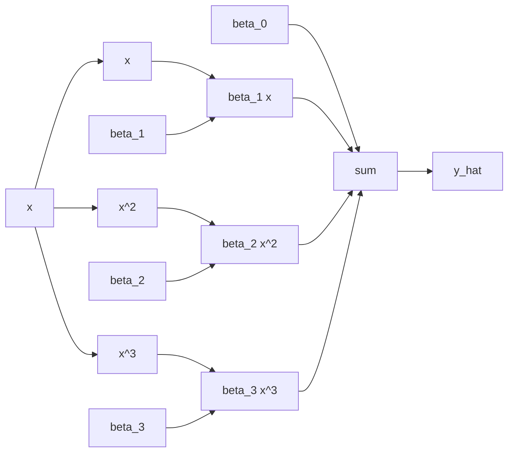
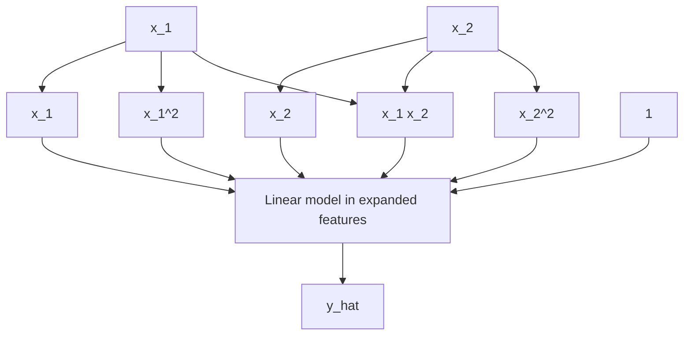

# Polynomial Regression

Polynomial regression models nonlinear dependence by applying a nonlinear feature map to the inputs and then fitting an ordinary linear model in the transformed feature space. For one scalar feature $x$, a degree-$d$ polynomial regression model is

$$
\hat{y}
=
\beta_0 + \beta_1 x + \beta_2 x^2 + \cdots + \beta_d x^d.
$$

The predictor is nonlinear as a function of $x$, but it is linear in the parameters $\beta_0,\dots,\beta_d$. This distinction is the reason polynomial regression can be fit with the same least-squares machinery used for linear regression.

For $p$ raw features, polynomial regression usually means fitting a linear model on all monomials up to a chosen total degree. For example, with $x=(x_1,x_2)$ and degree $2$:

$$
\phi(x)
=
\begin{bmatrix}
1 & x_1 & x_2 & x_1^2 & x_1x_2 & x_2^2
\end{bmatrix}^\top.
$$

The fitted function is

$$
\hat{y}
=
\theta^\top \phi(x)
=
\theta_0
+ \theta_1 x_1
+ \theta_2 x_2
+ \theta_3 x_1^2
+ \theta_4 x_1x_2
+ \theta_5 x_2^2.
$$

## 1. Motivation

Ordinary linear regression imposes an affine conditional mean:

$$
\mathbb{E}[Y \mid X=x] \approx \beta_0 + \beta^\top x.
$$

This is too restrictive when the conditional mean has curvature but the dataset is not large enough, not clean enough, or not domain-suited for a highly flexible nonparametric model. Polynomial regression is a controlled middle ground:

- It keeps the convex least-squares objective.
- It can represent curvature, turning points, and interactions.
- It remains interpretable at low degrees.
- It connects directly to linear models, basis expansions, kernels, splines, and regularization.

The main danger is that high-degree monomial bases can be numerically unstable and statistically high variance.

## 2. Model Formulation

### 2.1 Univariate Polynomial Model

Given observations

$$
\mathcal{D}
=
\{(x_i,y_i)\}_{i=1}^n,
\qquad
x_i \in \mathbb{R},
\quad
y_i \in \mathbb{R},
$$

a degree-$d$ polynomial regression model assumes

$$
y_i
=
f(x_i) + \varepsilon_i,
\qquad
f(x_i)
=
\sum_{j=0}^{d}\beta_j x_i^j.
$$

The noise term $\varepsilon_i$ captures irreducible noise, measurement error, omitted variables, and model mismatch. The standard OLS assumptions used for unbiasedness and classical inference are:

$$
\mathbb{E}[\varepsilon \mid X] = 0,
$$

and, for homoscedastic independent errors,

$$
\operatorname{Var}(\varepsilon \mid X) = \sigma^2 I_n.
$$

Normality,

$$
\varepsilon \mid X \sim \mathcal{N}(0,\sigma^2 I_n),
$$

is not needed to compute the least-squares estimate. It is mainly used for exact finite-sample inference.

### 2.2 Vandermonde Design Matrix

Define the polynomial feature matrix

$$
\Phi
=
\begin{bmatrix}
1 & x_1 & x_1^2 & \cdots & x_1^d \\
1 & x_2 & x_2^2 & \cdots & x_2^d \\
\vdots & \vdots & \vdots & \ddots & \vdots \\
1 & x_n & x_n^2 & \cdots & x_n^d
\end{bmatrix}
\in \mathbb{R}^{n \times (d+1)}.
$$

This is a Vandermonde matrix. Let

$$
\beta
=
\begin{bmatrix}
\beta_0 & \beta_1 & \cdots & \beta_d
\end{bmatrix}^\top,
\qquad
y
=
\begin{bmatrix}
y_1 & y_2 & \cdots & y_n
\end{bmatrix}^\top.
$$

Then the model is exactly linear regression in the transformed design:

$$
y = \Phi \beta + \varepsilon.
$$

### 2.3 Multivariate Polynomial Feature Map

For $x \in \mathbb{R}^p$, a monomial is indexed by a multi-index

$$
\alpha
=
(\alpha_1,\dots,\alpha_p)
\in
\mathbb{N}_0^p.
$$

The corresponding monomial is

$$
x^\alpha
=
\prod_{k=1}^{p} x_k^{\alpha_k},
$$

with total degree

$$
|\alpha|
=
\sum_{k=1}^{p}\alpha_k.
$$

The full polynomial feature map up to degree $d$ is

$$
\phi_d(x)
=
\left[
x^\alpha
\right]_{|\alpha|\le d}.
$$

The model is

$$
\hat{y}
=
\sum_{|\alpha|\le d}\theta_\alpha x^\alpha.
$$

The number of monomials of total degree at most $d$ in $p$ variables is

$$
m
=
\binom{p+d}{d}.
$$

If the bias term is excluded, the number is

$$
m_{\text{no-bias}}
=
\binom{p+d}{d} - 1.
$$

This combinatorial growth is one of the main practical limitations of polynomial regression.

## 3. Under-the-Hood Execution

Polynomial regression is not a separate optimizer. It is a preprocessing step followed by a linear regression solver.

```mermaid
flowchart LR
    A[Raw data X, y] --> B[Choose degree d]
    B --> C[Build polynomial feature map phi_d]
    C --> D[Construct design matrix Phi]
    D --> E[Optionally scale/center columns]
    E --> F[Solve least squares or regularized least squares]
    F --> G[Store coefficients and feature powers]
    G --> H[Transform new input x_* with same powers]
    H --> I[Predict y_hat_* = theta^T phi_d(x_*)]
```

Step-by-step for training:

1. Start with raw data $X \in \mathbb{R}^{n \times p}$ and targets $y \in \mathbb{R}^n$.
2. Select degree $d$ using validation error, cross-validation, an information criterion, or domain constraints.
3. Enumerate all exponent vectors $\alpha$ such that $|\alpha| \le d$.
4. For each sample $x_i$, compute all monomials $x_i^\alpha$.
5. Stack them into $\Phi \in \mathbb{R}^{n \times m}$.
6. Fit a linear model:

$$
\hat{\theta}
=
\arg\min_{\theta \in \mathbb{R}^m}
\lVert y - \Phi\theta \rVert_2^2.
$$

7. At prediction time, apply exactly the same feature expansion to new inputs and compute $\hat{y}_*=\phi_d(x_*)^\top\hat{\theta}$.

The feature expansion must be fitted only on the training split. In scikit-learn this is normally handled with a `Pipeline` so that cross-validation does not leak preprocessing choices.

## 4. Least-Squares Derivation from First Principles

### 4.1 Objective

The residual for sample $i$ is

$$
r_i(\theta)
=
y_i - \phi_d(x_i)^\top\theta.
$$

The residual vector is

$$
r(\theta)
=
y - \Phi\theta.
$$

Ordinary least squares minimizes the residual sum of squares:

$$
J(\theta)
=
\sum_{i=1}^{n}
\left(
y_i - \phi_d(x_i)^\top\theta
\right)^2
=
\lVert y-\Phi\theta\rVert_2^2.
$$

Expanding,

$$
\begin{aligned}
J(\theta)
&=
(y-\Phi\theta)^\top(y-\Phi\theta) \\
&=
y^\top y
-2\theta^\top\Phi^\top y
+\theta^\top\Phi^\top\Phi\theta.
\end{aligned}
$$

### 4.2 Gradient and Normal Equations

Using standard matrix calculus,

$$
\nabla_\theta J(\theta)
=
-2\Phi^\top y
+2\Phi^\top\Phi\theta.
$$

At an optimum,

$$
\nabla_\theta J(\hat{\theta}) = 0.
$$

Therefore,

$$
\Phi^\top\Phi\hat{\theta}
=
\Phi^\top y.
$$

These are the normal equations. If $\Phi$ has full column rank,

$$
\hat{\theta}
=
(\Phi^\top\Phi)^{-1}\Phi^\top y.
$$

If $\Phi$ is rank deficient, the least-squares fitted values can still be well-defined, but the coefficient vector may not be unique. The minimum-norm least-squares solution is

$$
\hat{\theta}
=
\Phi^+ y,
$$

where $\Phi^+$ is the Moore-Penrose pseudoinverse.

### 4.3 Convexity

The Hessian is

$$
\nabla_\theta^2 J(\theta)
=
2\Phi^\top\Phi.
$$

For any $z \in \mathbb{R}^m$,

$$
z^\top\Phi^\top\Phi z
=
(\Phi z)^\top(\Phi z)
=
\lVert\Phi z\rVert_2^2
\ge 0.
$$

Thus $J(\theta)$ is convex. If the columns of $\Phi$ are linearly independent, $\Phi^\top\Phi$ is positive definite and the minimizer is unique.

### 4.4 Orthogonal Projection View

The fitted vector is

$$
\hat{y}
=
\Phi\hat{\theta}.
$$

At the optimum, the normal equations imply

$$
\Phi^\top(y-\Phi\hat{\theta}) = 0.
$$

So the residual vector is orthogonal to every column of $\Phi$:

$$
\Phi^\top\hat{r}=0.
$$

Geometrically, $\hat{y}$ is the orthogonal projection of $y$ onto the column space of $\Phi$.

```mermaid
flowchart TB
    Y[y in R^n] --> P[Projection onto column space C(Phi)]
    P --> YH[y_hat = Phi theta_hat]
    Y --> R[Residual r = y - y_hat]
    YH -. orthogonal .- R
    C[Columns: 1, x, x^2, ..., x^d] --> P
```

The polynomial curve in input space corresponds to a linear projection in feature space.

## 5. Intuition

Polynomial regression creates a richer coordinate system before fitting a linear model. A straight hyperplane in the expanded feature space can correspond to a curved function in the original input space.

For degree $2$ in one variable:

$$
\hat{y}=\beta_0+\beta_1x+\beta_2x^2.
$$

The slope is

$$
\frac{d\hat{y}}{dx}
=
\beta_1 + 2\beta_2x.
$$

The slope changes with $x$, so the model can bend. The second derivative is

$$
\frac{d^2\hat{y}}{dx^2}
=
2\beta_2.
$$

Thus $\beta_2$ controls constant curvature. For a cubic,

$$
\hat{y}
=
\beta_0+\beta_1x+\beta_2x^2+\beta_3x^3,
$$

the second derivative is

$$
\frac{d^2\hat{y}}{dx^2}
=
2\beta_2 + 6\beta_3x,
$$

so curvature itself changes with $x$.

The statistical tradeoff is bias versus variance:

- Low degree: smoother, higher bias, lower variance.
- High degree: more flexible, lower training error, higher variance.
- High degree without regularization: often poor extrapolation and numerical instability.

## 6. Worked Example: Quadratic Fit by Hand

Consider three data points:

$$
(x_1,y_1)=(1,3),
\qquad
(x_2,y_2)=(2,5),
\qquad
(x_3,y_3)=(3,10).
$$

Fit the degree-$2$ polynomial

$$
\hat{y}
=
\beta_0+\beta_1x+\beta_2x^2.
$$

The design matrix is

$$
\Phi
=
\begin{bmatrix}
1 & 1 & 1 \\
1 & 2 & 4 \\
1 & 3 & 9
\end{bmatrix},
\qquad
y
=
\begin{bmatrix}
3 \\ 5 \\ 10
\end{bmatrix}.
$$

With exactly three distinct $x$ values and a quadratic, interpolation is possible. Solve

$$
\Phi\beta=y.
$$

The equations are

$$
\begin{aligned}
\beta_0+\beta_1+\beta_2 &= 3, \\
\beta_0+2\beta_1+4\beta_2 &= 5, \\
\beta_0+3\beta_1+9\beta_2 &= 10.
\end{aligned}
$$

Subtract the first equation from the second:

$$
\beta_1+3\beta_2=2.
$$

Subtract the second equation from the third:

$$
\beta_1+5\beta_2=5.
$$

Subtract these two equations:

$$
2\beta_2=3,
\qquad
\beta_2=1.5.
$$

Then

$$
\beta_1+3(1.5)=2
\quad\Rightarrow\quad
\beta_1=-2.5.
$$

Finally,

$$
\beta_0-2.5+1.5=3
\quad\Rightarrow\quad
\beta_0=4.
$$

So

$$
\hat{y}
=
4 - 2.5x + 1.5x^2.
$$

Check at $x=2$:

$$
\hat{y}
=
4 - 2.5(2) + 1.5(2^2)
=
4 - 5 + 6
=
5.
$$

Check at $x=3$:

$$
\hat{y}
=
4 - 2.5(3) + 1.5(3^2)
=
4 - 7.5 + 13.5
=
10.
$$

### Least-Squares Version with More Points

Now add a fourth point:

$$
(x_4,y_4)=(4,12).
$$

The same quadratic generally cannot interpolate all four points exactly. Now

$$
\Phi
=
\begin{bmatrix}
1 & 1 & 1 \\
1 & 2 & 4 \\
1 & 3 & 9 \\
1 & 4 & 16
\end{bmatrix},
\qquad
y
=
\begin{bmatrix}
3 \\ 5 \\ 10 \\ 12
\end{bmatrix}.
$$

Compute

$$
\Phi^\top\Phi
=
\begin{bmatrix}
4 & 10 & 30 \\
10 & 30 & 100 \\
30 & 100 & 354
\end{bmatrix},
$$

because

$$
\sum_i 1 = 4,
\quad
\sum_i x_i = 10,
\quad
\sum_i x_i^2 = 30,
\quad
\sum_i x_i^3 = 100,
\quad
\sum_i x_i^4 = 354.
$$

Also,

$$
\Phi^\top y
=
\begin{bmatrix}
\sum_i y_i \\
\sum_i x_i y_i \\
\sum_i x_i^2 y_i
\end{bmatrix}
=
\begin{bmatrix}
30 \\ 88 \\ 300
\end{bmatrix}.
$$

The normal equations are

$$
\begin{bmatrix}
4 & 10 & 30 \\
10 & 30 & 100 \\
30 & 100 & 354
\end{bmatrix}
\begin{bmatrix}
\beta_0 \\ \beta_1 \\ \beta_2
\end{bmatrix}
=
\begin{bmatrix}
30 \\ 88 \\ 300
\end{bmatrix}.
$$

Solving gives

$$
\hat{\beta}
=
\begin{bmatrix}
1.75 \\
1.65 \\
0.25
\end{bmatrix}.
$$

Therefore,

$$
\hat{y}
=
1.75 + 1.65x + 0.25x^2.
$$

Predictions:

$$
\begin{aligned}
\hat{y}_1 &= 1.75 + 1.65(1) + 0.25(1)^2 = 3.65, \\
\hat{y}_2 &= 1.75 + 1.65(2) + 0.25(2)^2 = 6.05, \\
\hat{y}_3 &= 1.75 + 1.65(3) + 0.25(3)^2 = 8.95, \\
\hat{y}_4 &= 1.75 + 1.65(4) + 0.25(4)^2 = 12.35.
\end{aligned}
$$

Residuals:

$$
r
=
y-\hat{y}
=
\begin{bmatrix}
-0.65 \\ -1.05 \\ 1.05 \\ -0.35
\end{bmatrix}.
$$

The residual sum of squares is

$$
\operatorname{RSS}
=
(-0.65)^2 + (-1.05)^2 + (1.05)^2 + (-0.35)^2
=
2.75.
$$

## 7. Feature Enumeration in Multiple Dimensions

For two variables $x_1,x_2$ and degree $3$, the monomials are:

$$
\begin{aligned}
\phi_3(x)
=
[
&1,
x_1,
x_2,
x_1^2,
x_1x_2,
x_2^2, \\
&x_1^3,
x_1^2x_2,
x_1x_2^2,
x_2^3
]^\top.
\end{aligned}
$$

The exponents are:

| Feature | Multi-index $\alpha$ | Total degree $|\alpha|$ |
|---|---:|---:|
| $1$ | $(0,0)$ | $0$ |
| $x_1$ | $(1,0)$ | $1$ |
| $x_2$ | $(0,1)$ | $1$ |
| $x_1^2$ | $(2,0)$ | $2$ |
| $x_1x_2$ | $(1,1)$ | $2$ |
| $x_2^2$ | $(0,2)$ | $2$ |
| $x_1^3$ | $(3,0)$ | $3$ |
| $x_1^2x_2$ | $(2,1)$ | $3$ |
| $x_1x_2^2$ | $(1,2)$ | $3$ |
| $x_2^3$ | $(0,3)$ | $3$ |

The interaction $x_1x_2$ is important: it allows the marginal effect of $x_1$ to depend on $x_2$.

For

$$
\hat{y}
=
\theta_0
+\theta_1x_1
+\theta_2x_2
+\theta_3x_1^2
+\theta_4x_1x_2
+\theta_5x_2^2,
$$

the partial derivative with respect to $x_1$ is

$$
\frac{\partial \hat{y}}{\partial x_1}
=
\theta_1 + 2\theta_3x_1 + \theta_4x_2.
$$

The term $\theta_4x_2$ means the slope along $x_1$ changes depending on $x_2$.

## 8. Computational Graph

For a univariate cubic model:



For a multivariate quadratic:



## 9. Python Implementation from Scratch

### 9.1 Univariate Feature Expansion

```python
import numpy as np


def polynomial_features_1d(x, degree, include_bias=True):
    """
    Build a univariate Vandermonde-like design matrix.

    Parameters
    ----------
    x : array-like of shape (n_samples,)
        Input scalar feature.
    degree : int
        Maximum polynomial degree.
    include_bias : bool
        If True, include the x^0 = 1 column.

    Returns
    -------
    Phi : ndarray of shape (n_samples, degree + 1) if include_bias else (n_samples, degree)
    """
    x = np.asarray(x, dtype=float).reshape(-1)
    start = 0 if include_bias else 1
    powers = np.arange(start, degree + 1)
    return x[:, None] ** powers[None, :]
```

### 9.2 Ordinary Least Squares Solver

Avoid explicitly computing $(\Phi^\top\Phi)^{-1}$ in production code. Solving least squares with QR or SVD is more stable.

```python
def fit_polynomial_ols_1d(x, y, degree):
    """
    Fit y ~= beta_0 + beta_1 x + ... + beta_d x^d using least squares.
    """
    Phi = polynomial_features_1d(x, degree, include_bias=True)
    y = np.asarray(y, dtype=float).reshape(-1)

    # np.linalg.lstsq uses a numerically robust least-squares routine.
    coef, residuals, rank, singular_values = np.linalg.lstsq(Phi, y, rcond=None)

    return {
        "coef": coef,
        "rank": rank,
        "singular_values": singular_values,
        "residuals": residuals,
    }


def predict_polynomial_1d(x, coef):
    degree = len(coef) - 1
    Phi = polynomial_features_1d(x, degree, include_bias=True)
    return Phi @ coef
```

### 9.3 Example

```python
x = np.array([1, 2, 3, 4], dtype=float)
y = np.array([3, 5, 10, 12], dtype=float)

fit = fit_polynomial_ols_1d(x, y, degree=2)
coef = fit["coef"]
y_hat = predict_polynomial_1d(x, coef)
residuals = y - y_hat
rss = residuals @ residuals

print(coef)
print(y_hat)
print(residuals)
print(rss)
```

Expected coefficients:

$$
\hat{\beta}
\approx
\begin{bmatrix}
1.75 & 1.65 & 0.25
\end{bmatrix}^\top.
$$

### 9.4 Multivariate Polynomial Features from Scratch

The main task is generating all exponent tuples $\alpha$ with total degree at most $d$.

```python
from itertools import combinations_with_replacement
from collections import Counter


def generate_powers(n_features, degree, include_bias=True):
    """
    Generate exponent vectors for all monomials with total degree <= degree.

    The ordering matches the common convention:
    degree 0 terms first, then degree 1, ..., degree d.
    """
    powers = []

    if include_bias:
        powers.append(tuple([0] * n_features))

    for total_degree in range(1, degree + 1):
        for comb in combinations_with_replacement(range(n_features), total_degree):
            counts = Counter(comb)
            powers.append(tuple(counts.get(j, 0) for j in range(n_features)))

    return np.array(powers, dtype=int)


def polynomial_features(X, degree, include_bias=True):
    """
    Expand X into polynomial features up to the given total degree.

    Parameters
    ----------
    X : ndarray of shape (n_samples, n_features)
    degree : int
    include_bias : bool

    Returns
    -------
    Phi : ndarray of shape (n_samples, n_output_features)
    powers : ndarray of shape (n_output_features, n_features)
    """
    X = np.asarray(X, dtype=float)
    if X.ndim == 1:
        X = X.reshape(-1, 1)

    n_samples, n_features = X.shape
    powers = generate_powers(n_features, degree, include_bias=include_bias)

    Phi = np.empty((n_samples, len(powers)), dtype=float)
    for j, alpha in enumerate(powers):
        Phi[:, j] = np.prod(X ** alpha[None, :], axis=1)

    return Phi, powers
```

Example:

```python
X = np.array([
    [1.0, 2.0],
    [3.0, 4.0],
])

Phi, powers = polynomial_features(X, degree=2, include_bias=True)

print(powers)
print(Phi)
```

The powers should correspond to:

$$
1,\quad x_1,\quad x_2,\quad x_1^2,\quad x_1x_2,\quad x_2^2.
$$

### 9.5 Ridge-Regularized Polynomial Regression

Ridge regression is often a better default than unregularized OLS for high-degree polynomial features.

The ridge objective is

$$
J_{\lambda}(\theta)
=
\lVert y-\Phi\theta\rVert_2^2
+\lambda\lVert\theta_{-0}\rVert_2^2,
$$

where $\theta_{-0}$ excludes the intercept. Penalizing the intercept is usually undesirable because it makes the estimate depend on arbitrary target centering.

Let

$$
\Gamma
=
\operatorname{diag}(0,1,1,\dots,1).
$$

Then

$$
J_{\lambda}(\theta)
=
\lVert y-\Phi\theta\rVert_2^2
+\lambda\theta^\top\Gamma\theta.
$$

Taking the gradient:

$$
\nabla_\theta J_{\lambda}(\theta)
=
-2\Phi^\top y
+2\Phi^\top\Phi\theta
+2\lambda\Gamma\theta.
$$

Set it equal to zero:

$$
(\Phi^\top\Phi+\lambda\Gamma)\hat{\theta}
=
\Phi^\top y.
$$

Thus

$$
\hat{\theta}_{\lambda}
=
(\Phi^\top\Phi+\lambda\Gamma)^{-1}\Phi^\top y.
$$

Implementation:

```python
def fit_polynomial_ridge_1d(x, y, degree, alpha=1.0, penalize_intercept=False):
    Phi = polynomial_features_1d(x, degree, include_bias=True)
    y = np.asarray(y, dtype=float).reshape(-1)

    n_features = Phi.shape[1]
    penalty = np.eye(n_features)
    if not penalize_intercept:
        penalty[0, 0] = 0.0

    lhs = Phi.T @ Phi + alpha * penalty
    rhs = Phi.T @ y

    # solve(A, b) is preferable to inv(A) @ b.
    coef = np.linalg.solve(lhs, rhs)
    return coef
```

## 10. Equivalent Library Implementations

### 10.1 scikit-learn: PolynomialFeatures + LinearRegression

```python
import numpy as np
from sklearn.linear_model import LinearRegression
from sklearn.pipeline import Pipeline
from sklearn.preprocessing import PolynomialFeatures


X = np.array([[1], [2], [3], [4]], dtype=float)
y = np.array([3, 5, 10, 12], dtype=float)

model = Pipeline([
    ("poly", PolynomialFeatures(degree=2, include_bias=False)),
    ("ols", LinearRegression()),
])

model.fit(X, y)
y_hat = model.predict(X)

print(model.named_steps["ols"].intercept_)
print(model.named_steps["ols"].coef_)
print(y_hat)
```

Important detail: `PolynomialFeatures(include_bias=True)` adds a column of ones. `LinearRegression(fit_intercept=True)` also fits an intercept internally. Using both is redundant and can create collinearity. Common choices are:

- `PolynomialFeatures(include_bias=False)` with `LinearRegression(fit_intercept=True)`.
- `PolynomialFeatures(include_bias=True)` with `LinearRegression(fit_intercept=False)`.

Internally, `PolynomialFeatures` stores exponent patterns in its `powers_` attribute. Each output column is computed as a product of input columns raised to those powers. For degree $2$ and input $[a,b]$, the generated features are

$$
[1,\ a,\ b,\ a^2,\ ab,\ b^2]
$$

when the bias column is included.

`LinearRegression` solves the ordinary least-squares problem:

$$
\min_w \lVert Xw-y\rVert_2^2.
$$

For dense arrays, scikit-learn delegates the core least-squares solve to numerical linear algebra routines rather than explicitly inverting $X^\top X$.

### 10.2 scikit-learn: PolynomialFeatures + Ridge

```python
from sklearn.linear_model import Ridge
from sklearn.pipeline import Pipeline
from sklearn.preprocessing import PolynomialFeatures, StandardScaler


ridge_poly = Pipeline([
    ("poly", PolynomialFeatures(degree=8, include_bias=False)),
    ("scale", StandardScaler()),
    ("ridge", Ridge(alpha=1.0)),
])

ridge_poly.fit(X, y)
y_hat = ridge_poly.predict(X)
```

Scaling after polynomial expansion is usually important for regularized models. Without scaling, columns like $x$, $x^2$, and $x^8$ can have radically different magnitudes, so the same coefficient penalty has unequal practical effects across degrees.

### 10.3 NumPy polyfit

```python
coef_descending = np.polyfit(x, y, deg=2)
print(coef_descending)

p = np.poly1d(coef_descending)
print(p(x))
```

`np.polyfit` returns coefficients in descending degree order:

$$
[c_d,\ c_{d-1},\dots,c_0].
$$

That differs from the scratch implementation above, which uses ascending order:

$$
[\beta_0,\ \beta_1,\dots,\beta_d].
$$

NumPy's documentation notes that polynomial fitting can be badly conditioned when the degree is large or the sample interval is poorly centered. This is a property of monomial Vandermonde systems, not a NumPy-specific weakness.

### 10.4 NumPy Polynomial.fit

```python
from numpy.polynomial import Polynomial


p_fit = Polynomial.fit(x, y, deg=2)
print(p_fit(x))

# Convert back to the ordinary power basis on the original x-domain.
p_power_basis = p_fit.convert()
print(p_power_basis.coef)
```

`Polynomial.fit` uses a scaled domain/window representation, which often improves numerical conditioning compared with directly fitting high powers on the original coordinate scale.

## 11. Numerical Stability

### 11.1 Why Monomial Bases Become Ill-Conditioned

In the univariate case, the design matrix is

$$
\Phi_{ij}=x_i^j.
$$

If $|x_i|$ is large and $j$ is large, powers explode:

$$
100^{10}=10^{20}.
$$

If $|x_i|<1$, high powers may collapse toward zero:

$$
0.1^{10}=10^{-10}.
$$

Both cases produce columns with very different scales, which can make $\Phi^\top\Phi$ ill-conditioned. Worse, forming $\Phi^\top\Phi$ squares the condition number:

$$
\kappa_2(\Phi^\top\Phi)
=
\kappa_2(\Phi)^2
$$

when $\Phi$ has full column rank. This is why solving normal equations explicitly is often less stable than QR or SVD.

### 11.2 Practical Stabilization

Common techniques:

- Center $x$ before creating powers:

$$
\tilde{x}
=
x-\bar{x}.
$$

- Scale $x$ into a compact interval such as $[-1,1]$:

$$
\tilde{x}
=
2\frac{x-x_{\min}}{x_{\max}-x_{\min}} - 1.
$$

- Use QR/SVD-based least squares instead of explicit matrix inversion.
- Prefer orthogonal polynomial bases such as Chebyshev or Legendre polynomials when high degrees are necessary.
- Use ridge regularization to reduce coefficient variance.
- Select degree with validation or cross-validation, not training error.

### 11.3 Horner's Method for Prediction

Evaluating

$$
p(x)=\beta_0+\beta_1x+\cdots+\beta_dx^d
$$

by explicitly computing all powers is acceptable for moderate degree, but Horner's method is usually more efficient and stable:

$$
p(x)
=
\beta_0
+x\left(
\beta_1
+x\left(
\beta_2
+\cdots
+x\beta_d
\right)
\right).
$$

Implementation for ascending coefficients:

```python
def horner_predict_ascending(x, coef):
    """
    Evaluate beta_0 + beta_1 x + ... + beta_d x^d.
    """
    x = np.asarray(x, dtype=float)
    result = np.zeros_like(x, dtype=float) + coef[-1]
    for c in coef[-2::-1]:
        result = result * x + c
    return result
```

## 12. Complexity

Let:

- $n$ be the number of samples.
- $p$ be the number of raw features.
- $d$ be the polynomial degree.
- $m=\binom{p+d}{d}$ be the number of polynomial features including bias.

### 12.1 Feature Expansion

Computing all monomial features costs approximately

$$
O(nmp)
$$

with a direct implementation. With optimized reuse of powers, the constant can be reduced, but the combinatorial growth of $m$ remains.

Memory usage for the expanded design matrix is

$$
O(nm).
$$

This can dominate the cost when $p$ or $d$ is large.

### 12.2 Least-Squares Solve

For dense least squares with $n \ge m$:

- Normal equations: $O(nm^2 + m^3)$ time, $O(m^2)$ memory, but weaker numerical stability.
- QR decomposition: $O(nm^2)$ time, better stability.
- SVD: $O(nm^2 + m^3)$ time, best rank-deficiency diagnostics, usually more expensive.

Prediction costs

$$
O(m)
$$

per sample after expansion.

## 13. Edge Cases and Pitfalls

### 13.1 Degree Too High for Sample Size

If

$$
m > n,
$$

the problem is underdetermined. There are more coefficients than observations, so OLS can interpolate training data in many ways. Regularization is usually necessary.

### 13.2 Duplicate or Nearly Duplicate Inputs

For interpolation-style fitting, duplicate $x$ values with different $y$ values make exact interpolation impossible. Nearly duplicate inputs can make columns close to linearly dependent.

### 13.3 Extrapolation

Polynomial regression can behave extremely poorly outside the training range. A model with low validation error on

$$
x \in [a,b]
$$

may explode for

$$
x \notin [a,b].
$$

This is especially severe for high-degree monomials.

### 13.4 Outliers

Squared loss gives large residuals disproportionate influence:

$$
r_i^2
$$

grows quadratically with $|r_i|$. Polynomial models can bend sharply to accommodate outliers. Robust regression, outlier diagnostics, or loss functions such as Huber loss may be preferable.

### 13.5 Intercept Duplication

Do not accidentally include two intercepts:

```python
PolynomialFeatures(include_bias=True)
LinearRegression(fit_intercept=True)
```

This creates duplicate constant columns. The predictions may still be fine because numerical solvers can handle rank deficiency, but coefficients become less identifiable.

### 13.6 Train-Test Leakage

Preprocessing must be learned only from the training split. This matters especially for scaling:

```python
from sklearn.pipeline import Pipeline

model = Pipeline([
    ("poly", PolynomialFeatures(degree=4, include_bias=False)),
    ("scale", StandardScaler()),
    ("ridge", Ridge(alpha=1.0)),
])
```

The pipeline ensures each cross-validation fold fits preprocessing only on the fold's training data.

### 13.7 Feature Explosion

The number of features grows as

$$
\binom{p+d}{d}.
$$

Examples:

| Raw features $p$ | Degree $d$ | Features including bias $\binom{p+d}{d}$ |
|---:|---:|---:|
| 5 | 2 | 21 |
| 10 | 3 | 286 |
| 20 | 4 | 10,626 |
| 100 | 3 | 176,851 |

Polynomial expansion is therefore practical mainly for small $p$, low $d$, sparse interaction assumptions, or regularized models.

## 14. Degree Selection and Generalization

Training error is monotone non-increasing with polynomial degree because higher-degree models contain lower-degree models as special cases. If $\mathcal{F}_d$ is the set of degree-$d$ polynomials, then

$$
\mathcal{F}_1
\subseteq
\mathcal{F}_2
\subseteq
\cdots
\subseteq
\mathcal{F}_d.
$$

Therefore,

$$
\min_{f\in\mathcal{F}_{d+1}}
\sum_i(y_i-f(x_i))^2
\le
\min_{f\in\mathcal{F}_{d}}
\sum_i(y_i-f(x_i))^2.
$$

This does not imply better test error.

Typical degree-selection workflow:

1. Define candidate degrees, for example $d\in\{1,2,3,4,5,8,10\}$.
2. Use a pipeline containing polynomial expansion, scaling, and the linear estimator.
3. Evaluate validation or cross-validation error.
4. Prefer the simplest degree whose validation performance is statistically competitive.
5. Use regularization for high-degree candidates.

Example:

```python
from sklearn.model_selection import GridSearchCV, KFold
from sklearn.pipeline import Pipeline
from sklearn.preprocessing import PolynomialFeatures, StandardScaler
from sklearn.linear_model import Ridge


pipe = Pipeline([
    ("poly", PolynomialFeatures(include_bias=False)),
    ("scale", StandardScaler()),
    ("ridge", Ridge()),
])

param_grid = {
    "poly__degree": [1, 2, 3, 4, 5, 8],
    "ridge__alpha": [1e-4, 1e-3, 1e-2, 1e-1, 1.0, 10.0],
}

cv = KFold(n_splits=5, shuffle=True, random_state=0)

search = GridSearchCV(
    pipe,
    param_grid=param_grid,
    scoring="neg_mean_squared_error",
    cv=cv,
)

search.fit(X, y)
print(search.best_params_)
print(-search.best_score_)
```

## 15. Bias-Variance and Regularization

For a fixed input $x$, the expected squared prediction error decomposes as

$$
\mathbb{E}_{\mathcal{D},\varepsilon}
\left[
(Y-\hat{f}_{\mathcal{D}}(x))^2
\right]
=
\operatorname{Bias}[\hat{f}(x)]^2
+\operatorname{Var}[\hat{f}(x)]
+\sigma^2.
$$

The terms are:

$$
\operatorname{Bias}[\hat{f}(x)]
=
\mathbb{E}_{\mathcal{D}}[\hat{f}_{\mathcal{D}}(x)] - f^\star(x),
$$

$$
\operatorname{Var}[\hat{f}(x)]
=
\mathbb{E}_{\mathcal{D}}
\left[
\left(
\hat{f}_{\mathcal{D}}(x)
-\mathbb{E}_{\mathcal{D}}[\hat{f}_{\mathcal{D}}(x)]
\right)^2
\right].
$$

Increasing degree often reduces bias but increases variance. Ridge regression reduces variance by shrinking coefficients:

$$
\hat{\theta}_{\lambda}
=
\arg\min_\theta
\left[
\lVert y-\Phi\theta\rVert_2^2
+\lambda\lVert\theta\rVert_2^2
\right].
$$

Lasso can perform feature selection among polynomial terms:

$$
\hat{\theta}_{\lambda}
=
\arg\min_\theta
\left[
\frac{1}{2n}\lVert y-\Phi\theta\rVert_2^2
+\lambda\lVert\theta\rVert_1
\right].
$$

Elastic Net combines both:

$$
\hat{\theta}
=
\arg\min_\theta
\left[
\frac{1}{2n}\lVert y-\Phi\theta\rVert_2^2
+\lambda
\left(
\rho\lVert\theta\rVert_1
+\frac{1-\rho}{2}\lVert\theta\rVert_2^2
\right)
\right].
$$

## 16. Relationship to Kernel Methods

Polynomial regression explicitly constructs polynomial features. A polynomial kernel computes inner products in a polynomial feature space without explicitly constructing all features.

The degree-$d$ polynomial kernel is commonly written as

$$
K(x,z)
=
(\gamma x^\top z + c)^d.
$$

For $d=2$, $p=2$, $\gamma=1$, and $c=1$:

$$
K(x,z)
=
(1+x^\top z)^2.
$$

Expanding,

$$
\begin{aligned}
K(x,z)
&=
\left(
1+x_1z_1+x_2z_2
\right)^2 \\
&=
1
+2x_1z_1
+2x_2z_2
+x_1^2z_1^2
+2x_1x_2z_1z_2
+x_2^2z_2^2.
\end{aligned}
$$

This equals an inner product between scaled polynomial feature maps:

$$
K(x,z)
=
\phi(x)^\top\phi(z).
$$

Kernel ridge regression and support vector regression can therefore represent polynomial decision functions without materializing $\Phi$ explicitly.

## 17. Relationship to Splines

Polynomial regression uses one global polynomial over the full input domain. Splines use piecewise polynomials joined at knots. This often improves local control.

Global polynomial:

$$
f(x)
=
\sum_{j=0}^{d}\beta_jx^j.
$$

Spline:

$$
f(x)
=
\sum_{j}\theta_j B_j(x),
$$

where $B_j(x)$ are local basis functions.

High-degree global polynomials can oscillate strongly. Splines often achieve better bias-variance behavior by using low-degree local polynomials with continuity constraints.

## 18. Relationship to Taylor Approximation

A smooth function $f$ near a point $a$ has the Taylor approximation

$$
f(x)
\approx
\sum_{j=0}^{d}
\frac{f^{(j)}(a)}{j!}
(x-a)^j.
$$

Polynomial regression is not the same as Taylor approximation:

- Taylor coefficients are determined by derivatives at a point.
- Regression coefficients are determined by minimizing empirical loss over data.
- Taylor approximation is local.
- Polynomial regression can fit over a full observed interval.

However, both use polynomial bases to approximate smooth functions.

## 19. Practical Checklist

Use polynomial regression when:

- The number of raw features is small.
- Low-degree interactions are scientifically or operationally meaningful.
- You need a transparent model with controlled nonlinearity.
- You can validate degree and regularization carefully.

Prefer another model when:

- There are many raw features and no strong sparsity assumption.
- The function has local discontinuities or sharp regime changes.
- Extrapolation outside the training domain is central.
- The required degree is high.

Implementation checklist:

- Split train/validation/test before fitting preprocessing.
- Use `Pipeline`.
- Use `include_bias=False` when the downstream estimator fits an intercept.
- Center/scale features before or after expansion depending on estimator and interpretation needs.
- Use ridge or lasso for high-degree models.
- Inspect residuals.
- Check condition numbers or singular values for instability.
- Do not judge degree by training error.
- Avoid extrapolating far beyond observed input support.

## 20. Complete Reproducible Example

```python
import numpy as np
import matplotlib.pyplot as plt
from sklearn.linear_model import LinearRegression, Ridge
from sklearn.metrics import mean_squared_error
from sklearn.model_selection import train_test_split
from sklearn.pipeline import Pipeline
from sklearn.preprocessing import PolynomialFeatures, StandardScaler


rng = np.random.default_rng(0)

n = 80
X = np.linspace(-3, 3, n).reshape(-1, 1)
y_true = 1.0 + 0.8 * X[:, 0] - 0.4 * X[:, 0] ** 2 + 0.15 * X[:, 0] ** 3
y = y_true + rng.normal(0.0, 1.0, size=n)

X_train, X_test, y_train, y_test = train_test_split(
    X, y, test_size=0.25, random_state=0
)

models = {
    "degree_1_ols": Pipeline([
        ("poly", PolynomialFeatures(degree=1, include_bias=False)),
        ("ols", LinearRegression()),
    ]),
    "degree_3_ols": Pipeline([
        ("poly", PolynomialFeatures(degree=3, include_bias=False)),
        ("ols", LinearRegression()),
    ]),
    "degree_12_ridge": Pipeline([
        ("poly", PolynomialFeatures(degree=12, include_bias=False)),
        ("scale", StandardScaler()),
        ("ridge", Ridge(alpha=1.0)),
    ]),
}

for name, model in models.items():
    model.fit(X_train, y_train)
    train_mse = mean_squared_error(y_train, model.predict(X_train))
    test_mse = mean_squared_error(y_test, model.predict(X_test))
    print(f"{name:>16} train_mse={train_mse:.3f} test_mse={test_mse:.3f}")

grid = np.linspace(-3.5, 3.5, 400).reshape(-1, 1)

plt.figure(figsize=(9, 5))
plt.scatter(X_train[:, 0], y_train, label="train", alpha=0.7)
plt.scatter(X_test[:, 0], y_test, label="test", alpha=0.7)

for name, model in models.items():
    plt.plot(grid[:, 0], model.predict(grid), label=name)

plt.legend()
plt.xlabel("x")
plt.ylabel("y")
plt.title("Polynomial regression: degree and regularization")
plt.tight_layout()
plt.show()
```

## 21. Summary

Polynomial regression is linear regression after a deterministic basis expansion. The important design matrix is not the raw $X$, but the polynomial feature matrix $\Phi$. Least squares solves

$$
\hat{\theta}
=
\arg\min_\theta
\lVert y-\Phi\theta\rVert_2^2.
$$

The method is powerful because it preserves convex optimization while modeling nonlinear functions. Its weaknesses are equally direct: polynomial feature counts grow combinatorially, monomial Vandermonde matrices can be ill-conditioned, high-degree fits have high variance, and extrapolation can be unreliable.

The practical version is usually:

$$
\text{polynomial features}
\rightarrow
\text{scaling}
\rightarrow
\text{ridge/lasso/elastic net}
\rightarrow
\text{cross-validation}.
$$

## 22. References and Deeper Reading

- scikit-learn documentation: `PolynomialFeatures`, feature generation, bias columns, and polynomial combinations: https://scikit-learn.org/stable/modules/generated/sklearn.preprocessing.PolynomialFeatures.html
- scikit-learn documentation: `LinearRegression` and ordinary least squares objective: https://scikit-learn.org/stable/modules/generated/sklearn.linear_model.LinearRegression.html
- scikit-learn user guide: linear models and ordinary least squares: https://scikit-learn.org/stable/modules/linear_model.html
- NumPy documentation: `numpy.polyfit`, Vandermonde polynomial fitting, rank warnings, and conditioning notes: https://numpy.org/doc/stable/reference/generated/numpy.polyfit.html
- NumPy documentation: `numpy.polynomial.Polynomial.fit`, scaled-domain polynomial fitting: https://numpy.org/doc/stable/reference/generated/numpy.polynomial.polynomial.Polynomial.fit.html
- NumPy documentation: `numpy.linalg.lstsq`, least-squares solutions for underdetermined, well-determined, and overdetermined systems: https://numpy.org/doc/stable/reference/generated/numpy.linalg.lstsq.html
- Wolfram MathWorld: least-squares polynomial fitting and Vandermonde structure: https://mathworld.wolfram.com/LeastSquaresFittingPolynomial.html
- Hastie, Tibshirani, and Friedman, *The Elements of Statistical Learning*, sections on linear methods, basis expansions, regularization, and splines.
- Bishop, *Pattern Recognition and Machine Learning*, sections on linear basis-function models and regularized least squares.
- Trefethen and Bau, *Numerical Linear Algebra*, chapters on least squares, QR factorization, SVD, and conditioning.
