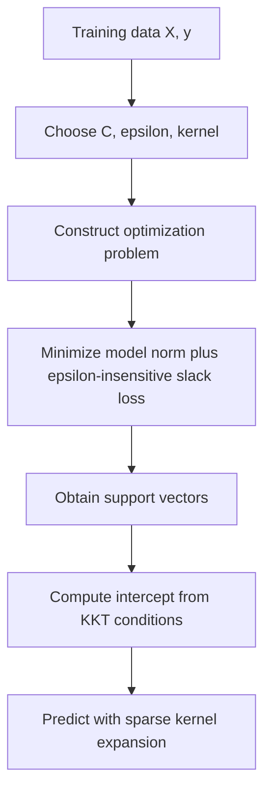
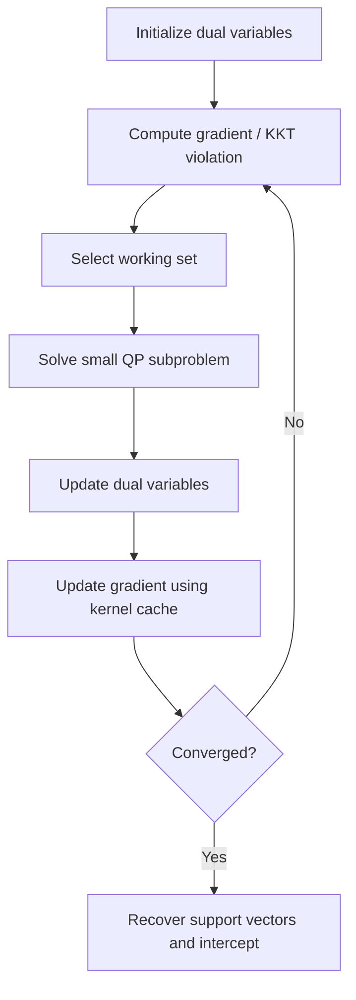

# Support Vector Regression

Support Vector Regression, usually abbreviated **SVR**, is the regression analogue of the support vector machine. It estimates a function that is as flat as possible while allowing prediction errors inside an $\epsilon$-wide tube to be ignored. Errors outside the tube are penalized linearly through slack variables.

For input-output pairs

$$
\mathcal{D}
=
\{(x_i,y_i)\}_{i=1}^{n},
\qquad
x_i \in \mathbb{R}^{p},
\quad
y_i \in \mathbb{R},
$$

the linear SVR predictor is

$$
f(x) = w^\top x + b,
$$

where $w \in \mathbb{R}^{p}$ controls the slope and $b \in \mathbb{R}$ is the intercept. Kernel SVR replaces the raw dot product $x_i^\top x_j$ with a positive semidefinite kernel $K(x_i,x_j)$, which corresponds to a dot product in an implicit feature space.

SVR is useful when the target has moderate noise, the desired estimator should be sparse in training examples, and one wants a nonparametric kernel method with explicit control over tolerance and smoothness.

## 1. Core Idea

Ordinary least squares penalizes every residual quadratically:

$$
L_{\text{sq}}(y,f(x)) = (y - f(x))^2.
$$

SVR instead uses the **$\epsilon$-insensitive loss**:

$$
L_\epsilon(y,f(x))
=
\max \left(0,\ |y - f(x)| - \epsilon \right).
$$

This loss is exactly zero when the absolute residual is at most $\epsilon$. The model does not try to correct small deviations inside the tube.



The geometric picture is:

- The center of the tube is $f(x)$.
- The upper boundary is $f(x) + \epsilon$.
- The lower boundary is $f(x) - \epsilon$.
- Points inside the tube have zero training loss.
- Points on or outside the tube can become support vectors.
- The regularization term makes the fitted function flat in the chosen feature space.

## 2. Linear SVR Primal Problem

For linear SVR, we want a function

$$
f(x)=w^\top x+b
$$

that is flat. In Euclidean feature space, flatness is encoded by a small $\ell_2$ norm:

$$
\lVert w \rVert_2^2.
$$

The factor $1/2$ is conventionally used because it simplifies derivatives:

$$
\frac{\partial}{\partial w}
\left(
\frac{1}{2}\lVert w \rVert_2^2
\right)
=
w.
$$

If every point can fit inside the tube, the hard-margin regression constraints are

$$
y_i - (w^\top x_i+b) \le \epsilon,
\qquad
(w^\top x_i+b) - y_i \le \epsilon,
\qquad
i=1,\dots,n.
$$

Equivalently,

$$
|y_i - f(x_i)| \le \epsilon.
$$

Real data rarely satisfies this exactly, so SVR introduces nonnegative slack variables $\xi_i$ and $\xi_i^\ast$:

$$
\xi_i \ge 0,
\qquad
\xi_i^\ast \ge 0.
$$

The soft-margin primal optimization problem is

$$
\begin{aligned}
\min_{w,b,\xi,\xi^\ast}
\quad
&
\frac{1}{2}\lVert w\rVert_2^2
+
C\sum_{i=1}^{n}(\xi_i+\xi_i^\ast)
\\
\text{subject to}
\quad
&
y_i - w^\top x_i - b
\le
\epsilon + \xi_i,
\\
&
w^\top x_i + b - y_i
\le
\epsilon + \xi_i^\ast,
\\
&
\xi_i \ge 0,
\qquad
\xi_i^\ast \ge 0,
\qquad
i=1,\dots,n.
\end{aligned}
$$

The parameter $C>0$ controls the regularization-loss tradeoff:

- Large $C$: violations outside the tube are expensive, so the model fits training data more tightly.
- Small $C$: violations are cheaper, so the model accepts more training error for a flatter function.

The parameter $\epsilon \ge 0$ controls tube width:

- Large $\epsilon$: more points have zero loss, often fewer support vectors, smoother but potentially biased estimates.
- Small $\epsilon$: more points affect the model, often lower training error but less sparsity.

## 3. $\epsilon$-Insensitive Loss From the Slack Formulation

Fix $w$ and $b$. Define the residual

$$
r_i = y_i - f(x_i).
$$

The first constraint is violated only when the prediction is too low:

$$
y_i - f(x_i) > \epsilon.
$$

The smallest feasible $\xi_i$ is therefore

$$
\xi_i
=
\max(0,\ r_i-\epsilon).
$$

The second constraint is violated only when the prediction is too high:

$$
f(x_i)-y_i > \epsilon.
$$

The smallest feasible $\xi_i^\ast$ is

$$
\xi_i^\ast
=
\max(0,\ -r_i-\epsilon).
$$

At most one of $\xi_i$ and $\xi_i^\ast$ is positive unless $\epsilon < 0$, which is not allowed. Thus

$$
\xi_i+\xi_i^\ast
=
\max(0,\ |r_i|-\epsilon).
$$

Substituting the optimal slacks into the primal gives the unconstrained regularized empirical risk form:

$$
\min_{w,b}
\quad
\frac{1}{2}\lVert w\rVert_2^2
+
C\sum_{i=1}^{n}
\max(0,\ |y_i-w^\top x_i-b|-\epsilon).
$$

This is convex but nonsmooth because of the absolute value and hinge at the tube boundary.

## 4. Geometry and Intuition

The SVR objective combines two forces:

$$
\text{flatness}
\quad
\frac{1}{2}\lVert w\rVert_2^2
\qquad
\text{and}
\qquad
\text{tube violations}
\quad
C\sum_i(\xi_i+\xi_i^\ast).
$$

The model does not maximize a margin in exactly the same sense as hard-margin classification SVM. Instead, it minimizes function complexity while tolerating an $\epsilon$ error tube. In a feature space $\mathcal{H}$, small $\lVert w\rVert_{\mathcal{H}}$ means the fitted function changes smoothly with respect to the geometry induced by the kernel.

```mermaid
flowchart LR
    A[Small ||w||] --> B[Flat / smooth function]
    C[Large epsilon] --> D[Wide zero-loss tube]
    E[Large C] --> F[Strong penalty for outside-tube errors]
    B --> G[Generalization bias]
    D --> G
    F --> H[Lower training error]
```

The support vectors are the points whose dual coefficients are nonzero. They are the only training points used at prediction time. Points strictly inside the tube usually have zero coefficients and disappear from the predictor.

## 5. Dual Derivation From First Principles

The dual formulation is important because it depends on training examples only through inner products. This is what enables kernels.

### 5.1 Lagrangian

Use Lagrange multipliers

$$
\alpha_i \ge 0,
\qquad
\alpha_i^\ast \ge 0,
$$

for the two tube constraints, and

$$
\eta_i \ge 0,
\qquad
\eta_i^\ast \ge 0,
$$

for the nonnegativity constraints on slacks.

Write the constraints in the form $g(z)\le 0$:

$$
y_i-w^\top x_i-b-\epsilon-\xi_i \le 0,
$$

$$
w^\top x_i+b-y_i-\epsilon-\xi_i^\ast \le 0,
$$

$$
-\xi_i \le 0,
\qquad
-\xi_i^\ast \le 0.
$$

The Lagrangian is

$$
\begin{aligned}
\mathcal{L}
=
&
\frac{1}{2}\lVert w\rVert_2^2
+
C\sum_{i=1}^{n}(\xi_i+\xi_i^\ast)
\\
&
+
\sum_{i=1}^{n}\alpha_i
\left(
y_i-w^\top x_i-b-\epsilon-\xi_i
\right)
\\
&
+
\sum_{i=1}^{n}\alpha_i^\ast
\left(
w^\top x_i+b-y_i-\epsilon-\xi_i^\ast
\right)
\\
&
-
\sum_{i=1}^{n}\eta_i\xi_i
-
\sum_{i=1}^{n}\eta_i^\ast\xi_i^\ast.
\end{aligned}
$$

### 5.2 Stationarity Conditions

Differentiate with respect to $w$:

$$
\frac{\partial \mathcal{L}}{\partial w}
=
w
-
\sum_{i=1}^{n}\alpha_i x_i
+
\sum_{i=1}^{n}\alpha_i^\ast x_i
=
0.
$$

Therefore

$$
w
=
\sum_{i=1}^{n}(\alpha_i-\alpha_i^\ast)x_i.
$$

Differentiate with respect to $b$:

$$
\frac{\partial \mathcal{L}}{\partial b}
=
-
\sum_{i=1}^{n}\alpha_i
+
\sum_{i=1}^{n}\alpha_i^\ast
=
0.
$$

Therefore

$$
\sum_{i=1}^{n}(\alpha_i-\alpha_i^\ast)=0.
$$

Differentiate with respect to $\xi_i$:

$$
\frac{\partial \mathcal{L}}{\partial \xi_i}
=
C-\alpha_i-\eta_i
=
0.
$$

Since $\eta_i\ge 0$,

$$
0 \le \alpha_i \le C.
$$

Similarly,

$$
0 \le \alpha_i^\ast \le C.
$$

### 5.3 Dual Objective

Substitute the stationarity conditions into the Lagrangian. Let

$$
\beta_i = \alpha_i-\alpha_i^\ast.
$$

The primal weight vector is

$$
w = \sum_{i=1}^{n}\beta_i x_i.
$$

The squared norm becomes

$$
\lVert w\rVert_2^2
=
\left(
\sum_{i=1}^{n}\beta_i x_i
\right)^\top
\left(
\sum_{j=1}^{n}\beta_j x_j
\right)
=
\sum_{i=1}^{n}\sum_{j=1}^{n}
\beta_i\beta_j x_i^\top x_j.
$$

After cancellation, the dual is

$$
\begin{aligned}
\max_{\alpha,\alpha^\ast}
\quad
&
-
\frac{1}{2}
\sum_{i=1}^{n}\sum_{j=1}^{n}
(\alpha_i-\alpha_i^\ast)(\alpha_j-\alpha_j^\ast)
x_i^\top x_j
\\
&
-
\epsilon
\sum_{i=1}^{n}(\alpha_i+\alpha_i^\ast)
+
\sum_{i=1}^{n}y_i(\alpha_i-\alpha_i^\ast)
\\
\text{subject to}
\quad
&
\sum_{i=1}^{n}(\alpha_i-\alpha_i^\ast)=0,
\\
&
0 \le \alpha_i \le C,
\qquad
0 \le \alpha_i^\ast \le C.
\end{aligned}
$$

Equivalently, as a minimization:

$$
\begin{aligned}
\min_{\alpha,\alpha^\ast}
\quad
&
\frac{1}{2}
\sum_{i=1}^{n}\sum_{j=1}^{n}
(\alpha_i-\alpha_i^\ast)(\alpha_j-\alpha_j^\ast)
x_i^\top x_j
\\
&
+
\epsilon
\sum_{i=1}^{n}(\alpha_i+\alpha_i^\ast)
-
\sum_{i=1}^{n}y_i(\alpha_i-\alpha_i^\ast)
\\
\text{subject to}
\quad
&
\sum_{i=1}^{n}(\alpha_i-\alpha_i^\ast)=0,
\\
&
0 \le \alpha_i \le C,
\qquad
0 \le \alpha_i^\ast \le C.
\end{aligned}
$$

The prediction function is

$$
f(x)
=
\sum_{i=1}^{n}(\alpha_i-\alpha_i^\ast)x_i^\top x + b.
$$

Only examples with $\alpha_i-\alpha_i^\ast \ne 0$ contribute.

## 6. KKT Conditions and Support Vector Types

The Karush-Kuhn-Tucker conditions characterize optimality because the primal is convex and satisfies standard constraint qualifications.

The complementary slackness conditions are

$$
\alpha_i
\left(
y_i-f(x_i)-\epsilon-\xi_i
\right)
=
0,
$$

$$
\alpha_i^\ast
\left(
f(x_i)-y_i-\epsilon-\xi_i^\ast
\right)
=
0,
$$

$$
(C-\alpha_i)\xi_i=0,
\qquad
(C-\alpha_i^\ast)\xi_i^\ast=0.
$$

These imply the following operational interpretation:

| Case | Residual behavior | Dual behavior | Meaning |
|---|---:|---:|---|
| Strictly inside tube | $|y_i-f(x_i)| < \epsilon$ | $\alpha_i=\alpha_i^\ast=0$ | Not a support vector |
| On upper tube boundary | $y_i-f(x_i)=\epsilon$ | $0<\alpha_i<C$ often possible | Support vector |
| On lower tube boundary | $f(x_i)-y_i=\epsilon$ | $0<\alpha_i^\ast<C$ often possible | Support vector |
| Above tube with slack | $y_i-f(x_i)>\epsilon$ | $\alpha_i=C$ | Error support vector |
| Below tube with slack | $f(x_i)-y_i>\epsilon$ | $\alpha_i^\ast=C$ | Error support vector |

For a non-bound support vector with $0<\alpha_i<C$,

$$
b = y_i - w^\top x_i - \epsilon.
$$

For a non-bound support vector with $0<\alpha_i^\ast<C$,

$$
b = y_i - w^\top x_i + \epsilon.
$$

In practice, implementations average valid intercept estimates across eligible support vectors for numerical stability.

## 7. Kernel SVR

The linear predictor can be lifted to a feature space:

$$
f(x)=w^\top \phi(x)+b,
$$

where

$$
\phi:\mathbb{R}^{p}\to \mathcal{H}.
$$

The dual depends on data only through

$$
\phi(x_i)^\top \phi(x_j).
$$

A kernel function is

$$
K(x_i,x_j)=\phi(x_i)^\top \phi(x_j).
$$

Replacing every dot product in the dual with $K(x_i,x_j)$ gives the kernelized dual:

$$
\begin{aligned}
\max_{\alpha,\alpha^\ast}
\quad
&
-
\frac{1}{2}
\sum_{i=1}^{n}\sum_{j=1}^{n}
(\alpha_i-\alpha_i^\ast)(\alpha_j-\alpha_j^\ast)
K(x_i,x_j)
\\
&
-
\epsilon
\sum_{i=1}^{n}(\alpha_i+\alpha_i^\ast)
+
\sum_{i=1}^{n}y_i(\alpha_i-\alpha_i^\ast)
\\
\text{subject to}
\quad
&
\sum_{i=1}^{n}(\alpha_i-\alpha_i^\ast)=0,
\\
&
0 \le \alpha_i \le C,
\qquad
0 \le \alpha_i^\ast \le C.
\end{aligned}
$$

The prediction function becomes

$$
f(x)
=
\sum_{i=1}^{n}
(\alpha_i-\alpha_i^\ast)K(x_i,x)+b.
$$

```mermaid
flowchart LR
    A[x_i in input space] --> B[Implicit feature map phi]
    C[x_j in input space] --> B
    B --> D[Compute phi(x_i)^T phi(x_j)]
    A --> E[Kernel K(x_i,x_j)]
    C --> E
    E --> F[Same value without explicit phi]
```

The feature map may be high-dimensional or infinite-dimensional. The kernel trick avoids materializing $\phi(x)$ and solves the optimization entirely through the Gram matrix

$$
K_{ij}=K(x_i,x_j).
$$

## 8. Common Kernels

### 8.1 Linear Kernel

$$
K(x,z)=x^\top z.
$$

This recovers linear SVR. It is often the right baseline for high-dimensional sparse data.

### 8.2 Polynomial Kernel

$$
K(x,z)
=
(\gamma x^\top z + r)^d,
$$

where $d$ is the degree, $\gamma>0$ is a scale parameter, and $r$ is often called `coef0` in libraries.

The polynomial kernel implicitly contains monomial interactions up to degree $d$ when $r\ne 0$, and homogeneous degree-$d$ interactions when $r=0$.

### 8.3 Radial Basis Function Kernel

$$
K(x,z)
=
\exp\left(-\gamma \lVert x-z\rVert_2^2\right),
\qquad
\gamma>0.
$$

The RBF kernel is local: points far apart have exponentially small similarity. Its effective length scale is

$$
\ell
=
\frac{1}{\sqrt{2\gamma}},
$$

because the Gaussian process convention often writes

$$
\exp\left(
-\frac{\lVert x-z\rVert_2^2}{2\ell^2}
\right).
$$

Large $\gamma$ gives narrow local influence and can overfit. Small $\gamma$ gives broad influence and can underfit.

### 8.4 Sigmoid Kernel

$$
K(x,z)
=
\tanh(\gamma x^\top z + r).
$$

This resembles the activation form used in older neural networks, but it is not positive semidefinite for all choices of $\gamma$ and $r$. It should be treated as a specialized kernel rather than a default.

## 9. Linear vs Nonlinear SVR

| Aspect | Linear SVR | Kernel / Nonlinear SVR |
|---|---|---|
| Predictor | $w^\top x+b$ | $\sum_i \beta_i K(x_i,x)+b$ |
| Learned object | Explicit weight vector | Sparse dual coefficients |
| Expressiveness | Linear in raw features | Nonlinear in raw features |
| Scaling | Can scale well with specialized solvers | Usually limited by kernel matrix and QP cost |
| Best use | Many features, sparse text, linear signal | Smooth nonlinear functions, moderate $n$ |
| Main risk | Underfitting nonlinear structure | Slow training, kernel hyperparameter sensitivity |

## 10. Step-by-Step Execution

For kernel SVR, the computational path is:

1. Scale features and often scale the target.
2. Select $C$, $\epsilon$, and kernel hyperparameters.
3. Compute the Gram matrix $K \in \mathbb{R}^{n\times n}$, where $K_{ij}=K(x_i,x_j)$.
4. Solve the convex quadratic program for $\alpha,\alpha^\ast$.
5. Form $\beta_i=\alpha_i-\alpha_i^\ast$.
6. Identify support vectors where $|\beta_i|$ is above a numerical tolerance.
7. Estimate $b$ from KKT boundary conditions.
8. Predict new points by evaluating kernels only against support vectors:

$$
\hat{y}
=
\sum_{i\in \mathcal{S}}\beta_i K(x_i,x)+b.
$$

```mermaid
flowchart TD
    A[Scaled X and y] --> B[Kernel matrix K]
    B --> C[Quadratic program]
    C --> D[Dual variables alpha and alpha_star]
    D --> E[beta = alpha - alpha_star]
    E --> F[Support vectors where beta != 0]
    F --> G[Intercept b from KKT]
    G --> H[Prediction: sum beta_i K(x_i, x) + b]
```

## 11. Worked Example: Two-Point Linear SVR

Consider two training points:

$$
(x_1,y_1)=(0,0),
\qquad
(x_2,y_2)=(1,1),
$$

with

$$
C=10,
\qquad
\epsilon=0.1.
$$

Use the linear kernel:

$$
K(x_i,x_j)=x_ix_j.
$$

The Gram matrix is

$$
K
=
\begin{bmatrix}
0\cdot 0 & 0\cdot 1 \\
1\cdot 0 & 1\cdot 1
\end{bmatrix}
=
\begin{bmatrix}
0 & 0 \\
0 & 1
\end{bmatrix}.
$$

Let

$$
\beta_i = \alpha_i-\alpha_i^\ast.
$$

The equality constraint is

$$
\beta_1+\beta_2=0.
$$

Set

$$
\beta_1=-t,
\qquad
\beta_2=t.
$$

Because $y=[0,1]^\top$, the dual objective as a function of $t\ge 0$ is

$$
\begin{aligned}
W(t)
&=
-
\frac{1}{2}\beta^\top K\beta
-
\epsilon\sum_i(\alpha_i+\alpha_i^\ast)
+
y^\top \beta.
\end{aligned}
$$

For the minimal representation of $\beta$, use

$$
\alpha_1^\ast=t,
\qquad
\alpha_2=t,
\qquad
\alpha_1=\alpha_2^\ast=0.
$$

Then

$$
\sum_i(\alpha_i+\alpha_i^\ast)=2t,
$$

and

$$
\beta^\top K\beta
=
\begin{bmatrix}
-t & t
\end{bmatrix}
\begin{bmatrix}
0 & 0 \\
0 & 1
\end{bmatrix}
\begin{bmatrix}
-t \\
t
\end{bmatrix}
=
t^2.
$$

Also,

$$
y^\top\beta
=
0(-t)+1(t)
=
t.
$$

Thus

$$
W(t)
=
-
\frac{1}{2}t^2
-
0.1(2t)
+
t
=
-
\frac{1}{2}t^2
+
0.8t.
$$

Differentiate:

$$
\frac{dW}{dt}
=
-t+0.8.
$$

The optimum is

$$
t^\star=0.8.
$$

This is feasible because $0.8<C=10$. Therefore

$$
\beta_1=-0.8,
\qquad
\beta_2=0.8.
$$

For the linear kernel,

$$
w=\sum_i\beta_i x_i
=
-0.8(0)+0.8(1)
=
0.8.
$$

To compute $b$, use the KKT boundary condition. Since $\alpha_2=0.8$ is non-bound,

$$
y_2-f(x_2)=\epsilon.
$$

So

$$
1-(0.8+b)=0.1,
$$

which gives

$$
b=0.1.
$$

The fitted function is

$$
f(x)=0.8x+0.1.
$$

Predictions at the training points are

$$
f(0)=0.1,
\qquad
f(1)=0.9.
$$

Both residuals have magnitude exactly $\epsilon$:

$$
|0-0.1|=0.1,
\qquad
|1-0.9|=0.1.
$$

The primal objective is

$$
\frac{1}{2}w^2
=
\frac{1}{2}(0.8)^2
=
0.32,
$$

with zero slack. The dual objective at $t=0.8$ is

$$
W(0.8)
=
-
\frac{1}{2}(0.8)^2
+
0.8(0.8)
=
-0.32+0.64
=
0.32.
$$

Primal and dual objectives match, as expected from strong duality.

## 12. Worked Example: One-Dimensional RBF Prediction

Suppose a trained RBF SVR has two support vectors:

$$
x_1=0,
\qquad
x_2=2,
$$

with coefficients

$$
\beta_1=0.7,
\qquad
\beta_2=-0.4,
\qquad
b=0.2,
$$

and

$$
\gamma=0.5.
$$

Predict at

$$
x=1.
$$

The kernel values are

$$
K(0,1)
=
\exp(-0.5(0-1)^2)
=
\exp(-0.5)
\approx
0.60653,
$$

and

$$
K(2,1)
=
\exp(-0.5(2-1)^2)
=
\exp(-0.5)
\approx
0.60653.
$$

The prediction is

$$
\begin{aligned}
f(1)
&=
0.7(0.60653)
-
0.4(0.60653)
+
0.2
\\
&=
0.3(0.60653)+0.2
\\
&=
0.18196+0.2
\\
&=
0.38196.
\end{aligned}
$$

The prediction is a weighted sum of similarity to support vectors plus the intercept.

## 13. Python Implementation From Scratch

The following implementation solves the kernel SVR dual with `scipy.optimize.minimize`. It is intended for clarity, not large-scale production use.

```python
import numpy as np
from scipy.optimize import minimize


def linear_kernel(X, Z):
    """Compute K_ij = X_i^T Z_j."""
    return X @ Z.T


def rbf_kernel(X, Z, gamma):
    """Compute K_ij = exp(-gamma ||X_i - Z_j||^2)."""
    X_norm = np.sum(X * X, axis=1)[:, None]
    Z_norm = np.sum(Z * Z, axis=1)[None, :]
    sq_dist = X_norm + Z_norm - 2.0 * (X @ Z.T)
    sq_dist = np.maximum(sq_dist, 0.0)  # remove tiny negative roundoff
    return np.exp(-gamma * sq_dist)


class KernelSVRFromScratch:
    def __init__(self, C=1.0, epsilon=0.1, kernel="rbf", gamma=1.0, tol=1e-7):
        self.C = float(C)
        self.epsilon = float(epsilon)
        self.kernel = kernel
        self.gamma = float(gamma)
        self.tol = float(tol)

    def _kernel(self, X, Z):
        if self.kernel == "linear":
            return linear_kernel(X, Z)
        if self.kernel == "rbf":
            return rbf_kernel(X, Z, self.gamma)
        raise ValueError(f"Unknown kernel: {self.kernel}")

    def fit(self, X, y):
        X = np.asarray(X, dtype=float)
        y = np.asarray(y, dtype=float).ravel()
        n = X.shape[0]

        K = self._kernel(X, X)

        # Variables are stacked as z = [alpha, alpha_star].
        # beta = alpha - alpha_star.
        def unpack(z):
            alpha = z[:n]
            alpha_star = z[n:]
            beta = alpha - alpha_star
            return alpha, alpha_star, beta

        def objective(z):
            alpha, alpha_star, beta = unpack(z)
            quad = 0.5 * beta @ K @ beta
            eps_term = self.epsilon * np.sum(alpha + alpha_star)
            y_term = y @ beta
            return quad + eps_term - y_term

        def gradient(z):
            alpha, alpha_star, beta = unpack(z)
            common = K @ beta
            grad_alpha = common + self.epsilon - y
            grad_alpha_star = -common + self.epsilon + y
            return np.concatenate([grad_alpha, grad_alpha_star])

        constraints = [
            {
                "type": "eq",
                "fun": lambda z: np.sum(z[:n] - z[n:]),
                "jac": lambda z: np.concatenate([np.ones(n), -np.ones(n)]),
            }
        ]
        bounds = [(0.0, self.C)] * (2 * n)
        z0 = np.zeros(2 * n)

        result = minimize(
            objective,
            z0,
            jac=gradient,
            bounds=bounds,
            constraints=constraints,
            method="SLSQP",
            options={"ftol": 1e-10, "maxiter": 1000},
        )

        if not result.success:
            raise RuntimeError(result.message)

        alpha, alpha_star, beta = unpack(result.x)
        support_mask = np.abs(beta) > self.tol

        self.X_train_ = X
        self.y_train_ = y
        self.alpha_ = alpha
        self.alpha_star_ = alpha_star
        self.dual_coef_ = beta
        self.support_mask_ = support_mask
        self.support_ = np.flatnonzero(support_mask)
        self.support_vectors_ = X[support_mask]
        self.support_dual_coef_ = beta[support_mask]

        # Estimate intercept from non-bound support vectors when possible.
        f_without_b = K @ beta
        candidates = []
        for i in range(n):
            if self.tol < alpha[i] < self.C - self.tol:
                candidates.append(y[i] - f_without_b[i] - self.epsilon)
            if self.tol < alpha_star[i] < self.C - self.tol:
                candidates.append(y[i] - f_without_b[i] + self.epsilon)

        if candidates:
            self.intercept_ = float(np.mean(candidates))
        else:
            # Fallback: choose intercept minimizing median absolute tube violation.
            # This is less principled than KKT averaging but useful in degenerate cases.
            residual_centers = y - f_without_b
            self.intercept_ = float(np.median(residual_centers))

        return self

    def predict(self, X):
        X = np.asarray(X, dtype=float)
        K = self._kernel(X, self.support_vectors_)
        return K @ self.support_dual_coef_ + self.intercept_
```

Example usage:

```python
import numpy as np
from sklearn.preprocessing import StandardScaler


rng = np.random.default_rng(7)
X = np.linspace(-3, 3, 80)[:, None]
y = np.sin(X[:, 0]) + 0.15 * rng.normal(size=X.shape[0])

x_scaler = StandardScaler()
y_scaler = StandardScaler()

X_scaled = x_scaler.fit_transform(X)
y_scaled = y_scaler.fit_transform(y[:, None]).ravel()

model = KernelSVRFromScratch(C=10.0, epsilon=0.05, kernel="rbf", gamma=0.7)
model.fit(X_scaled, y_scaled)

X_test = np.array([[-2.0], [0.0], [2.0]])
pred_scaled = model.predict(x_scaler.transform(X_test))
pred = y_scaler.inverse_transform(pred_scaled[:, None]).ravel()

print(pred)
print(model.support_)
```

### How the Scratch Implementation Maps to the Math

The code minimizes

$$
\frac{1}{2}\beta^\top K\beta
+
\epsilon\mathbf{1}^\top(\alpha+\alpha^\ast)
-
y^\top\beta,
$$

where

$$
\beta=\alpha-\alpha^\ast.
$$

The equality constraint

$$
\sum_i\beta_i=0
$$

is enforced by the SLSQP equality constraint. The box constraints

$$
0\le \alpha_i,\alpha_i^\ast\le C
$$

are enforced through `bounds`.

The implementation computes RBF distances using the identity

$$
\lVert x-z\rVert_2^2
=
\lVert x\rVert_2^2+\lVert z\rVert_2^2-2x^\top z,
$$

which vectorizes pairwise distance computation without explicit Python loops.

## 14. Linear SVR With Subgradient Descent

For large linear problems, directly optimizing the primal can be cheaper than forming an $n\times n$ kernel matrix. The primal objective is

$$
J(w,b)
=
\frac{1}{2}\lVert w\rVert_2^2
+
C\sum_{i=1}^{n}
\max(0,\ |r_i|-\epsilon),
$$

where

$$
r_i=y_i-w^\top x_i-b.
$$

A subgradient contribution for point $i$ is:

$$
\frac{\partial}{\partial w}
\max(0,\ |r_i|-\epsilon)
=
\begin{cases}
-x_i, & r_i>\epsilon, \\
x_i, & r_i<-\epsilon, \\
0, & |r_i|<\epsilon.
\end{cases}
$$

For the intercept:

$$
\frac{\partial}{\partial b}
\max(0,\ |r_i|-\epsilon)
=
\begin{cases}
-1, & r_i>\epsilon, \\
1, & r_i<-\epsilon, \\
0, & |r_i|<\epsilon.
\end{cases}
$$

At $|r_i|=\epsilon$, any value in the subdifferential is valid.

```python
import numpy as np


class LinearSVRSubgradient:
    def __init__(self, C=1.0, epsilon=0.1, lr=0.01, epochs=2000):
        self.C = float(C)
        self.epsilon = float(epsilon)
        self.lr = float(lr)
        self.epochs = int(epochs)

    def fit(self, X, y):
        X = np.asarray(X, dtype=float)
        y = np.asarray(y, dtype=float).ravel()
        n, p = X.shape

        w = np.zeros(p)
        b = 0.0

        for epoch in range(self.epochs):
            residual = y - (X @ w + b)

            above = residual > self.epsilon
            below = residual < -self.epsilon

            grad_w = w.copy()
            grad_b = 0.0

            if np.any(above):
                grad_w += self.C * np.sum(-X[above], axis=0)
                grad_b += self.C * np.sum(-np.ones(np.sum(above)))

            if np.any(below):
                grad_w += self.C * np.sum(X[below], axis=0)
                grad_b += self.C * np.sum(np.ones(np.sum(below)))

            # Average the empirical-loss gradient for a learning rate less tied to n.
            grad_w = w + (grad_w - w) / n
            grad_b = grad_b / n

            step = self.lr / np.sqrt(epoch + 1.0)
            w -= step * grad_w
            b -= step * grad_b

        self.coef_ = w
        self.intercept_ = b
        return self

    def predict(self, X):
        X = np.asarray(X, dtype=float)
        return X @ self.coef_ + self.intercept_
```

This primal subgradient version is useful pedagogically, but it is not a replacement for mature solvers. It converges slowly near nonsmooth optima and needs careful learning-rate tuning.

## 15. scikit-learn Implementations

### 15.1 Kernel SVR

```python
import numpy as np
from sklearn.pipeline import make_pipeline
from sklearn.preprocessing import StandardScaler
from sklearn.svm import SVR


rng = np.random.default_rng(7)
X = np.linspace(-3, 3, 120)[:, None]
y = np.sin(X[:, 0]) + 0.15 * rng.normal(size=X.shape[0])

model = make_pipeline(
    StandardScaler(),
    SVR(kernel="rbf", C=10.0, epsilon=0.05, gamma="scale"),
)

model.fit(X, y)
pred = model.predict(np.array([[-2.0], [0.0], [2.0]]))
print(pred)
```

`sklearn.svm.SVR` is an $\epsilon$-SVR implementation based on LIBSVM. It solves a dual quadratic optimization problem using decomposition methods rather than forming a generic dense QP for a black-box solver.

Important parameters:

- `C`: penalty for outside-tube deviations.
- `epsilon`: tube radius in target units.
- `kernel`: `linear`, `poly`, `rbf`, `sigmoid`, `precomputed`, or callable.
- `gamma`: scale parameter for `rbf`, `poly`, and `sigmoid`.
- `degree`: degree for the polynomial kernel.
- `coef0`: additive constant for polynomial and sigmoid kernels.
- `cache_size`: memory used for kernel cache.
- `tol`: stopping tolerance.
- `shrinking`: whether to use the shrinking heuristic.

For `gamma="scale"`, scikit-learn uses

$$
\gamma
=
\frac{1}{p \operatorname{Var}(X)},
$$

where $p$ is the number of features and $\operatorname{Var}(X)$ is computed over the supplied training data. For `gamma="auto"`,

$$
\gamma
=
\frac{1}{p}.
$$

### 15.2 LinearSVR

```python
from sklearn.pipeline import make_pipeline
from sklearn.preprocessing import StandardScaler
from sklearn.svm import LinearSVR


linear_model = make_pipeline(
    StandardScaler(),
    LinearSVR(C=1.0, epsilon=0.1, loss="epsilon_insensitive", max_iter=10000),
)

linear_model.fit(X, y)
pred = linear_model.predict(np.array([[-2.0], [0.0], [2.0]]))
print(pred)
```

`LinearSVR` is optimized for linear models and uses LIBLINEAR-style optimization rather than LIBSVM's kernel machinery. It is usually preferable to `SVR(kernel="linear")` when $n$ is large and a linear predictor is sufficient.

### 15.3 Target Scaling

Feature scaling is almost always necessary for RBF and polynomial kernels because distances and dot products are scale-sensitive. Target scaling is also often useful because $\epsilon$ is measured in the units of $y$.

```python
from sklearn.compose import TransformedTargetRegressor
from sklearn.pipeline import make_pipeline
from sklearn.preprocessing import StandardScaler
from sklearn.svm import SVR


svr = make_pipeline(
    StandardScaler(),
    SVR(kernel="rbf", C=10.0, epsilon=0.1, gamma="scale"),
)

model = TransformedTargetRegressor(
    regressor=svr,
    transformer=StandardScaler(),
)

model.fit(X, y)
pred = model.predict(X)
```

Internally, `TransformedTargetRegressor` fits the target transformer on $y$, trains the regressor on transformed targets, and inverse-transforms predictions back to the original target scale.

## 16. How LIBSVM-Style Solvers Work Internally

Generic QP solvers are too expensive for typical SVM problems. LIBSVM uses a decomposition strategy: optimize a small working set of variables while holding the others fixed, then iterate.

At a high level:

1. Maintain dual variables satisfying box constraints and the equality constraint.
2. Select a small working set of variables that most violates optimality conditions.
3. Solve the restricted quadratic subproblem analytically or cheaply.
4. Update gradients and optimality violation measures.
5. Use a kernel cache to avoid recomputing expensive kernel values.
6. Use shrinking heuristics to temporarily remove variables that are unlikely to move.
7. Reconstruct gradients and check full optimality near convergence.



The kernel cache matters because a full Gram matrix costs

$$
O(n^2)
$$

memory. Caching only active rows can reduce memory pressure, although worst-case training can still be expensive.

## 17. Hyperparameter Effects

### 17.1 $C$

The parameter $C$ controls the cost of outside-tube residuals:

$$
J(w,b)
=
\frac{1}{2}\lVert w\rVert_2^2
+
C\sum_i L_\epsilon(y_i,f(x_i)).
$$

Large $C$ reduces tolerance for large residuals. Small $C$ increases regularization.

### 17.2 $\epsilon$

The parameter $\epsilon$ sets the no-penalty radius:

$$
L_\epsilon(y,f(x))
=
0
\quad
\text{when}
\quad
|y-f(x)|\le \epsilon.
$$

Increasing $\epsilon$ can reduce the number of support vectors and produce a smoother estimator. If $\epsilon$ is too large, the model can ignore meaningful signal.

### 17.3 $\gamma$ for RBF

For RBF SVR,

$$
K(x,z)=\exp(-\gamma\lVert x-z\rVert_2^2).
$$

If $\gamma$ is too large, each support vector has very local influence and the function can become wiggly. If $\gamma$ is too small, most points look similar and the model behaves closer to a low-complexity global smoother.

### 17.4 Practical Search Space

A common search strategy is logarithmic:

$$
C \in \{2^{-5},2^{-3},\dots,2^{15}\},
$$

$$
\gamma \in \{2^{-15},2^{-13},\dots,2^{3}\},
$$

with $\epsilon$ chosen relative to the target scale. After a coarse search, refine around the best region.

```python
from sklearn.model_selection import GridSearchCV, KFold
from sklearn.pipeline import make_pipeline
from sklearn.preprocessing import StandardScaler
from sklearn.svm import SVR


pipe = make_pipeline(StandardScaler(), SVR(kernel="rbf"))

param_grid = {
    "svr__C": [0.1, 1.0, 10.0, 100.0],
    "svr__epsilon": [0.01, 0.05, 0.1, 0.2],
    "svr__gamma": ["scale", 0.01, 0.1, 1.0],
}

cv = KFold(n_splits=5, shuffle=True, random_state=0)
search = GridSearchCV(
    pipe,
    param_grid=param_grid,
    scoring="neg_mean_absolute_error",
    cv=cv,
    n_jobs=-1,
)

search.fit(X, y)
print(search.best_params_)
print(-search.best_score_)
```

## 18. Complexity

Let $n$ be the number of samples, $p$ the number of features, and $s$ the number of support vectors.

| Operation | Linear primal solver | Kernel SVR |
|---|---:|---:|
| Store training data | $O(np)$ | $O(np)$ |
| Store full Gram matrix | Not needed | $O(n^2)$ |
| One full kernel matrix computation | Not needed | $O(n^2p)$ for common kernels |
| Training | Solver-dependent, often near-linear for specialized linear solvers | More than quadratic in $n$ in common LIBSVM-style use; can approach cubic in difficult cases |
| Prediction per point | $O(p)$ | $O(sp)$ for RBF/linear kernel evaluation against support vectors |

For kernel SVR, prediction cost depends on the number of support vectors:

$$
f(x)=\sum_{i\in\mathcal{S}}\beta_iK(x_i,x)+b.
$$

If nearly every training point is a support vector, prediction can be slow.

## 19. Numerical Stability

### 19.1 Feature Scaling

RBF kernels depend on squared distances:

$$
\lVert x-z\rVert_2^2.
$$

If one feature has a much larger scale than others, it dominates the distance. Polynomial kernels have a similar issue because large dot products are raised to powers.

### 19.2 Target Scaling

The tube width $\epsilon$ is in the same units as $y$. If $y$ is measured in thousands, $\epsilon=0.1$ is nearly zero. If $y$ is standardized, $\epsilon=0.1$ means one tenth of a target standard deviation.

### 19.3 Kernel Matrix Conditioning

For very small $\gamma$, the RBF kernel matrix can approach an all-ones matrix:

$$
K_{ij}\approx 1.
$$

This makes many examples nearly indistinguishable. For very large $\gamma$, the kernel matrix can approach the identity:

$$
K_{ij}\approx
\begin{cases}
1, & i=j,\\
0, & i\ne j.
\end{cases}
$$

This can produce overly local fits.

### 19.4 Floating-Point Tolerances

Dual coefficients rarely become exactly zero in floating-point arithmetic. Use a tolerance such as

$$
|\beta_i| > 10^{-7}
$$

to identify support vectors in educational implementations.

## 20. Edge Cases and Pitfalls

### 20.1 Forgetting to Scale Features

Unscaled features are the most common reason RBF SVR behaves poorly. Always scale inside a cross-validation pipeline to avoid data leakage.

### 20.2 Choosing $\epsilon$ Without Considering Target Units

The same $\epsilon$ means different things for different target scales. Standardize $y$ or choose $\epsilon$ from domain noise levels.

### 20.3 Treating Support Vectors as Outliers

Support vectors are not necessarily outliers. They are points that define the tube, including boundary points with no slack.

### 20.4 Too Large $C$

Very large $C$ can force the model to explain noise, increasing the number of support vectors and worsening generalization.

### 20.5 Too Small $\epsilon$

When $\epsilon$ is near zero, many points fall outside or on the tube, reducing sparsity. The model can behave more like regularized absolute-error regression in feature space.

### 20.6 Extrapolation

RBF SVR extrapolates poorly far from training data. If $x$ is far from every support vector, then

$$
K(x_i,x)\approx 0
$$

for all support vectors, so

$$
f(x)\approx b.
$$

### 20.7 Large Datasets

Kernel SVR is usually unsuitable for very large $n$ unless approximate kernels, subsampling, or specialized scalable methods are used.

## 21. Limitations

SVR has strong theoretical and practical appeal, but the standard kernel version has limitations:

- Training cost grows poorly with the number of samples.
- Hyperparameters interact strongly.
- Model interpretation is harder than explicit linear models.
- Probability intervals are not directly produced.
- RBF kernels are weak extrapolators.
- Performance is sensitive to preprocessing.
- The $\epsilon$-insensitive loss may introduce bias when $\epsilon$ is too large relative to the true noise scale.

## 22. Connections to Related ML Concepts

### 22.1 Ridge Regression

Ridge regression solves

$$
\min_w
\quad
\frac{1}{2}\lVert w\rVert_2^2
+
\lambda\sum_i(y_i-w^\top x_i-b)^2.
$$

SVR replaces squared loss with $\epsilon$-insensitive absolute loss. Ridge usually uses all points in the solution; SVR can be sparse in examples.

### 22.2 Lasso and Sparsity

Lasso is sparse in features because it uses an $\ell_1$ penalty on weights:

$$
\lambda\lVert w\rVert_1.
$$

SVR is sparse in training examples because many dual coefficients are zero.

### 22.3 Huber Regression

Huber loss is quadratic near zero and linear in the tails. SVR loss is flat near zero and linear outside the $\epsilon$ tube:

$$
L_\epsilon(r)=\max(0,|r|-\epsilon).
$$

Huber regression still cares about small residuals. SVR explicitly ignores them.

### 22.4 Gaussian Processes

RBF SVR and Gaussian process regression can use the same RBF kernel, but their interpretations differ. SVR solves a margin-based regularized optimization problem. Gaussian process regression defines a probabilistic prior over functions and returns predictive uncertainty under the model assumptions.

### 22.5 Kernel Ridge Regression

Kernel ridge regression predicts with

$$
f(x)=\sum_i \alpha_iK(x_i,x),
$$

but the coefficients usually involve all training points:

$$
\alpha=(K+\lambda I)^{-1}y.
$$

SVR instead solves a constrained QP and often yields sparse coefficients.

## 23. Summary

SVR fits a regression function by combining a flatness penalty with an $\epsilon$-insensitive loss. The primal formulation explains the tube and slack variables; the dual formulation explains support vectors and kernels. Kernel SVR can model nonlinear functions by replacing dot products with kernels, but this flexibility comes with computational cost and sensitivity to scaling and hyperparameters.

The essential predictor is

$$
f(x)
=
\sum_{i\in\mathcal{S}}
(\alpha_i-\alpha_i^\ast)K(x_i,x)+b.
$$

The essential loss is

$$
L_\epsilon(y,f(x))
=
\max(0,\ |y-f(x)|-\epsilon).
$$

The essential implementation advice is: scale features, tune $C$, $\epsilon$, and kernel parameters by cross-validation, prefer `LinearSVR` for large linear problems, and avoid kernel SVR when $n$ is too large for quadratic-or-worse training.

## 24. References and Further Reading

- Alex J. Smola and Bernhard Schoelkopf, "A Tutorial on Support Vector Regression", *Statistics and Computing*, 2004.
- Chih-Chung Chang and Chih-Jen Lin, "LIBSVM: A Library for Support Vector Machines", *ACM Transactions on Intelligent Systems and Technology*, 2011.
- scikit-learn documentation, `sklearn.svm.SVR`.
- scikit-learn user guide, "Support Vector Machines".
- Bernhard Schoelkopf and Alex J. Smola, *Learning with Kernels*, MIT Press, 2002.
- Vladimir Vapnik, *The Nature of Statistical Learning Theory*, Springer, 1995.
