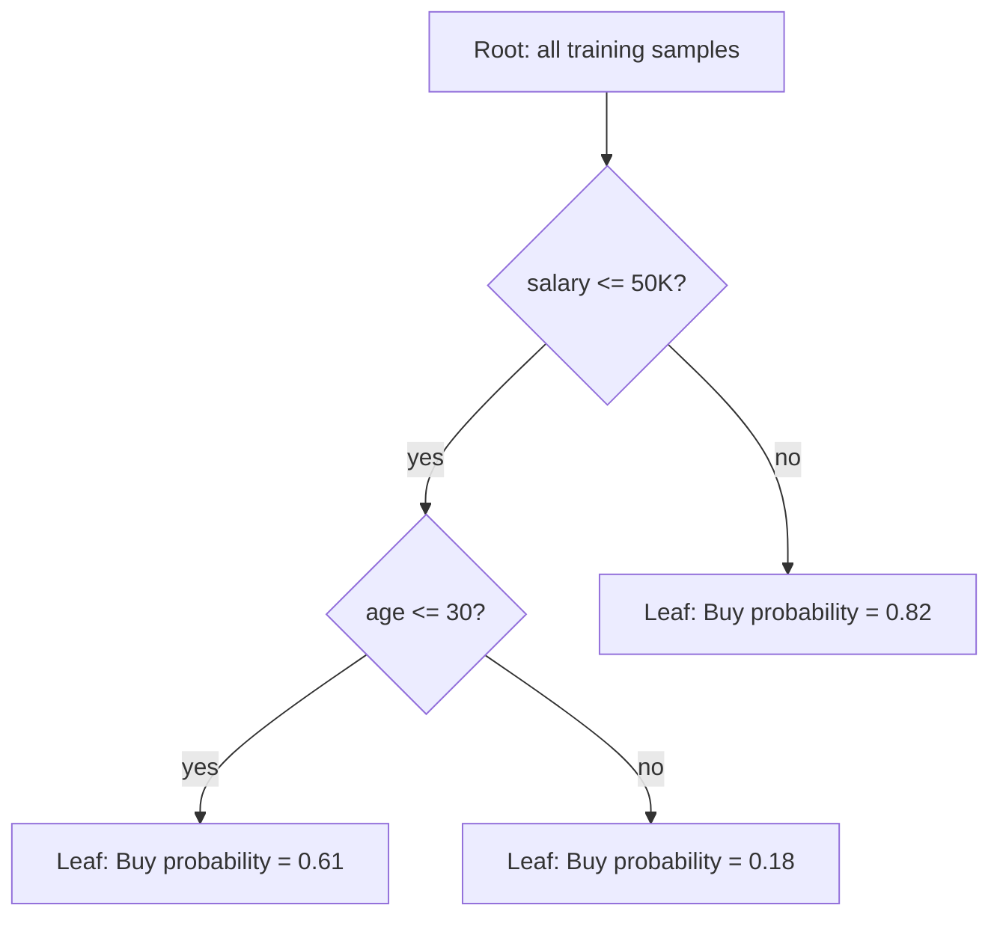
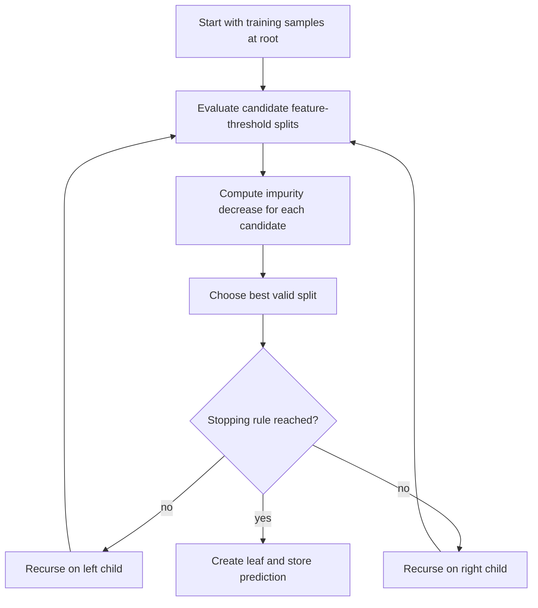
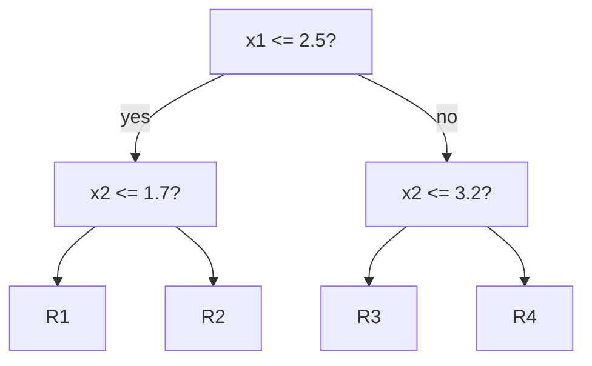

# Decision Trees for Classification and Regression

A **decision tree** is a nonparametric supervised learning model that partitions the input space into axis-aligned regions and fits a simple prediction rule inside each region. For classification, the leaf prediction is usually a class distribution or majority class. For regression, it is usually the mean response in the leaf.

Given training data

$$
\mathcal{D}
=
\{(x_i,y_i)\}_{i=1}^{n},
\qquad
x_i \in \mathbb{R}^{p},
$$

a decision tree recursively constructs a partition

$$
\mathcal{X}
=
\bigcup_{m=1}^{M} R_m,
\qquad
R_j \cap R_k = \varnothing
\text{ for } j \neq k,
$$

and predicts with a piecewise-constant function

$$
\hat{f}(x)
=
\sum_{m=1}^{M} c_m \mathbf{1}\{x \in R_m\}.
$$

The regions $R_m$ are produced by if-else tests such as $x_j \le t$. This makes a tree interpretable, but also statistically unstable: small training-data perturbations can change early splits and therefore many downstream leaves.



## 1. Tree Structure and Prediction Semantics

A tree has three kinds of nodes:

- **Root node:** contains the full training set before any split.
- **Internal decision node:** applies a condition, usually $x_j \le t$ for continuous features.
- **Leaf node:** stores the fitted local prediction.

For a node $m$, define the index set of samples reaching it:

$$
I_m
=
\{i : x_i \in R_m\},
\qquad
N_m = |I_m|.
$$

For classification with $K$ classes, the empirical class probability at node $m$ is

$$
\hat{p}_{mk}
=
\frac{1}{N_m}
\sum_{i \in I_m}
\mathbf{1}\{y_i = k\},
\qquad
k=1,\dots,K.
$$

The class prediction is

$$
\hat{y}(x)
=
\arg\max_{k}
\hat{p}_{mk},
\qquad
x \in R_m.
$$

For regression, the leaf prediction minimizing squared error inside node $m$ is

$$
\hat{c}_m
=
\frac{1}{N_m}
\sum_{i \in I_m} y_i.
$$

This follows from differentiating the within-node squared loss:

$$
\frac{\partial}{\partial c}
\sum_{i \in I_m}(y_i-c)^2
=
-2\sum_{i \in I_m}(y_i-c)
=
0,
$$

so

$$
c
=
\frac{1}{N_m}
\sum_{i \in I_m}y_i.
$$

For absolute-error regression, the optimal leaf value is any median of the responses in the node:

$$
\hat{c}_m
\in
\arg\min_c
\sum_{i \in I_m}|y_i-c|.
$$

## 2. Under-the-Hood Training Procedure

Most practical trees are trained by **greedy recursive partitioning**. The globally optimal tree of a fixed size is combinatorial and generally infeasible to search exactly, so CART-style algorithms choose the locally best split at each node.



At a node with sample set $I$, a binary split is defined by feature $j$ and threshold $t$:

$$
I_L(j,t)
=
\{i \in I : x_{ij} \le t\},
\qquad
I_R(j,t)
=
\{i \in I : x_{ij} > t\}.
$$

Let $H(I)$ denote node impurity. The weighted impurity after the split is

$$
H_{\text{split}}(I,j,t)
=
\frac{|I_L|}{|I|}H(I_L)
+
\frac{|I_R|}{|I|}H(I_R).
$$

The impurity decrease is

$$
\Delta H(I,j,t)
=
H(I)
-
H_{\text{split}}(I,j,t).
$$

The greedy split is

$$
(j^\star,t^\star)
=
\arg\max_{j,t}
\Delta H(I,j,t).
$$

Equivalently, since $H(I)$ is fixed for the current node, the chosen split minimizes weighted child impurity:

$$
(j^\star,t^\star)
=
\arg\min_{j,t}
\left[
\frac{|I_L|}{|I|}H(I_L)
+
\frac{|I_R|}{|I|}H(I_R)
\right].
$$

Stopping rules typically include:

- all samples in the node have the same target;
- `max_depth` is reached;
- the node has fewer than `min_samples_split` samples;
- a child would violate `min_samples_leaf`;
- impurity decrease is below `min_impurity_decrease`;
- no valid split exists because all candidate feature values are identical.

## 3. Classification Trees

Classification trees need an impurity function that is low when a node is class-pure and high when classes are mixed.

### 3.1 Entropy

For class probabilities $p_1,\dots,p_K$, Shannon entropy is

$$
H_{\text{entropy}}(p)
=
-
\sum_{k=1}^{K}
p_k \log_2 p_k.
$$

The convention is

$$
0 \log 0 = 0,
$$

because

$$
\lim_{p \to 0^+} p\log p = 0.
$$

Entropy is maximized by the uniform distribution $p_k=1/K$ and minimized by a degenerate distribution with one class probability equal to $1$.

For a node $I$,

$$
H_{\text{entropy}}(I)
=
-
\sum_{k=1}^{K}
\hat{p}_{k}(I)\log_2 \hat{p}_{k}(I),
$$

where

$$
\hat{p}_{k}(I)
=
\frac{1}{|I|}
\sum_{i \in I}\mathbf{1}\{y_i=k\}.
$$

### 3.2 Information Gain

Information gain is the entropy reduction caused by a split:

$$
\operatorname{IG}(I,j,t)
=
H_{\text{entropy}}(I)
-
\frac{|I_L|}{|I|}H_{\text{entropy}}(I_L)
-
\frac{|I_R|}{|I|}H_{\text{entropy}}(I_R).
$$

This is the empirical mutual information between the class label and the branch assignment induced by the split. Intuitively, a split is useful if knowing whether a sample went left or right reduces uncertainty about its label.

### 3.3 Gini Impurity

Gini impurity is

$$
H_{\text{gini}}(p)
=
1-\sum_{k=1}^{K}p_k^2.
$$

It has a useful probabilistic interpretation. If one label is drawn from the node distribution and another label is independently predicted using the same distribution, the probability of mismatch is

$$
\Pr(Y \neq \tilde{Y})
=
1-\Pr(Y=\tilde{Y})
=
1-\sum_{k=1}^{K}p_k^2.
$$

Thus Gini impurity measures the expected classification error of random labeling according to the node proportions. It is cheaper to compute than entropy because it avoids logarithms.

For binary classification with $p=\Pr(Y=1)$,

$$
H_{\text{gini}}(p)
=
1-p^2-(1-p)^2
=
2p(1-p),
$$

and

$$
H_{\text{entropy}}(p)
=
-p\log_2p-(1-p)\log_2(1-p).
$$

Both are zero at $p \in \{0,1\}$ and maximal at $p=1/2$, but entropy penalizes near-pure uncertainty slightly more strongly.

### 3.4 Misclassification Impurity

The node misclassification rate is

$$
H_{\text{miss}}(p)
=
1-\max_k p_k.
$$

This directly measures training error if the node became a leaf. It is less sensitive than entropy or Gini to changes in the class distribution, so it is usually inferior for greedy split search. It is more common in pruning analysis than in growing the tree.

## 4. Regression Trees

For regression with squared-error loss, impurity at node $I$ is the within-node mean squared deviation:

$$
H_{\text{sse}}(I)
=
\frac{1}{|I|}
\sum_{i \in I}
(y_i-\bar{y}_I)^2,
$$

where

$$
\bar{y}_I
=
\frac{1}{|I|}
\sum_{i \in I} y_i.
$$

The total within-node sum of squared errors is

$$
\operatorname{SSE}(I)
=
\sum_{i \in I}(y_i-\bar{y}_I)^2.
$$

Because split comparison weights child impurity by child size, minimizing weighted child variance is equivalent to minimizing child SSE:

$$
\frac{|I_L|}{|I|}H_{\text{sse}}(I_L)
+
\frac{|I_R|}{|I|}H_{\text{sse}}(I_R)
=
\frac{\operatorname{SSE}(I_L)+\operatorname{SSE}(I_R)}{|I|}.
$$

So the best regression split is

$$
(j^\star,t^\star)
=
\arg\min_{j,t}
\left[
\operatorname{SSE}(I_L(j,t))
+
\operatorname{SSE}(I_R(j,t))
\right].
$$

An algebraically stable form is

$$
\operatorname{SSE}(I)
=
\sum_{i \in I}y_i^2
-
\frac{\left(\sum_{i \in I}y_i\right)^2}{|I|}.
$$

This allows $O(1)$ split-score updates while scanning sorted thresholds if cumulative sums of $y_i$ and $y_i^2$ are maintained.

## 5. Worked Classification Example

Suppose a node contains 10 samples for a binary target:

$$
\text{Buy}=6,
\qquad
\text{Not Buy}=4.
$$

The parent entropy is

$$
H_{\text{parent}}
=
-
\frac{6}{10}\log_2\frac{6}{10}
-
\frac{4}{10}\log_2\frac{4}{10}
=
0.97095.
$$

Consider a candidate split:

$$
I_L:
\text{Buy}=4,\ \text{Not Buy}=1,
\qquad
I_R:
\text{Buy}=2,\ \text{Not Buy}=3.
$$

Left entropy:

$$
H_L
=
-
\frac{4}{5}\log_2\frac{4}{5}
-
\frac{1}{5}\log_2\frac{1}{5}
=
0.72193.
$$

Right entropy:

$$
H_R
=
-
\frac{2}{5}\log_2\frac{2}{5}
-
\frac{3}{5}\log_2\frac{3}{5}
=
0.97095.
$$

Weighted child entropy:

$$
H_{\text{split}}
=
\frac{5}{10}(0.72193)
+
\frac{5}{10}(0.97095)
=
0.84644.
$$

Information gain:

$$
\operatorname{IG}
=
0.97095-0.84644
=
0.12451.
$$

For the same split, parent Gini is

$$
G_{\text{parent}}
=
1-\left(\frac{6}{10}\right)^2-\left(\frac{4}{10}\right)^2
=
0.48.
$$

Child Gini values are

$$
G_L
=
1-\left(\frac{4}{5}\right)^2-\left(\frac{1}{5}\right)^2
=
0.32,
$$

and

$$
G_R
=
1-\left(\frac{2}{5}\right)^2-\left(\frac{3}{5}\right)^2
=
0.48.
$$

The Gini decrease is

$$
\Delta G
=
0.48
-
\left[
\frac{5}{10}(0.32)+\frac{5}{10}(0.48)
\right]
=
0.08.
$$

## 6. Worked Regression Example

Use the salary example:

| Experience | Salary |
|---:|---:|
| 1 | 30 |
| 2 | 35 |
| 3 | 50 |
| 4 | 80 |

Let salaries be in thousands. Consider the split $x < 2.5$:

$$
I_L = \{30,35\},
\qquad
I_R = \{50,80\}.
$$

The left prediction is

$$
\bar{y}_L
=
\frac{30+35}{2}
=
32.5.
$$

The right prediction is

$$
\bar{y}_R
=
\frac{50+80}{2}
=
65.
$$

The left SSE is

$$
(30-32.5)^2+(35-32.5)^2
=
6.25+6.25
=
12.5.
$$

The right SSE is

$$
(50-65)^2+(80-65)^2
=
225+225
=
450.
$$

Total child SSE:

$$
\operatorname{SSE}_{\text{children}}
=
12.5+450
=
462.5.
$$

Now compare split $x < 3.5$:

$$
I_L=\{30,35,50\},
\qquad
I_R=\{80\}.
$$

Left mean:

$$
\bar{y}_L
=
\frac{30+35+50}{3}
=
38.3333.
$$

Left SSE:

$$
(30-38.3333)^2
+
(35-38.3333)^2
+
(50-38.3333)^2
=
216.6667.
$$

Right SSE is zero because the right child has one sample. Therefore

$$
\operatorname{SSE}_{\text{children}}
=
216.6667.
$$

So $x < 3.5$ is better than $x < 2.5$ under squared-error impurity, although the one-sample leaf is likely high variance unless constrained by `min_samples_leaf`.

## 7. Efficient Split Search

For continuous features, useful thresholds only occur between adjacent sorted unique feature values. If feature $j$ has sorted values

$$
x_{(1)j} \le x_{(2)j} \le \cdots \le x_{(N)j},
$$

then candidate thresholds are midpoints where adjacent values differ:

$$
t_r
=
\frac{x_{(r)j}+x_{(r+1)j}}{2},
\qquad
x_{(r)j} < x_{(r+1)j}.
$$

During a sorted scan:

1. Start with all samples on the right.
2. Move samples one sorted position at a time from right to left.
3. Update class counts or regression sums incrementally.
4. Score the threshold only when the next feature value differs.
5. Reject thresholds that violate minimum leaf-size constraints.

For classification, class-count updates make Gini and entropy evaluation cheap:

$$
n_{Lk}
\leftarrow
n_{Lk}+1,
\qquad
n_{Rk}
\leftarrow
n_{Rk}-1.
$$

For regression, update

$$
S_L=\sum_{i \in I_L}y_i,
\quad
Q_L=\sum_{i \in I_L}y_i^2,
\quad
S_R=\sum_{i \in I_R}y_i,
\quad
Q_R=\sum_{i \in I_R}y_i^2.
$$

Then

$$
\operatorname{SSE}_L
=
Q_L-\frac{S_L^2}{N_L},
\qquad
\operatorname{SSE}_R
=
Q_R-\frac{S_R^2}{N_R}.
$$

## 8. Categorical Features

Categorical handling depends on the implementation.

For an unordered categorical feature with $q$ categories, a binary split may choose a subset $A$:

$$
x_j \in A
\quad
\text{versus}
\quad
x_j \notin A.
$$

There are

$$
2^{q-1}-1
$$

nontrivial binary partitions, which is expensive for large $q$. Common approximations include:

- one-hot encoding, then binary splits on individual category indicators;
- ordering categories by target statistic and scanning ordered splits;
- using native categorical split algorithms in libraries such as CatBoost, LightGBM, or modern histogram-based boosting implementations.

High-cardinality categorical variables can cause severe overfitting because they create many possible partitions. Target encoding must be cross-fitted or regularized to avoid leakage.

## 9. Cost-Complexity Pruning

Fully grown trees often fit noise. CART uses **minimal cost-complexity pruning** to trade empirical fit against tree size.

Let $T$ be a subtree and let $|T|$ be the number of terminal leaves. For regression, define empirical risk

$$
R(T)
=
\sum_{m \in \text{leaves}(T)}
\sum_{i \in I_m}
(y_i-\bar{y}_m)^2.
$$

For classification, $R(T)$ can be node misclassification error or another leaf loss. Cost-complexity pruning minimizes

$$
R_\alpha(T)
=
R(T)+\alpha |T|,
\qquad
\alpha \ge 0.
$$

The parameter $\alpha$ penalizes each additional leaf. When $\alpha=0$, the unpruned tree is preferred. As $\alpha$ increases, smaller subtrees become optimal.

For an internal node $t$, let $T_t$ be the subtree rooted at $t$. Collapsing $T_t$ into a single leaf changes the objective. The effective complexity parameter at which pruning becomes worthwhile is

$$
g(t)
=
\frac{R(t)-R(T_t)}
{|T_t|-1},
$$

where $R(t)$ is the risk if node $t$ is replaced by one leaf. The weakest-link pruning algorithm repeatedly removes the subtree with smallest $g(t)$, producing a nested sequence of candidate subtrees. Cross-validation can then select $\alpha$.

```mermaid
flowchart LR
    A[Grow large tree T0] --> B[Compute weakest link g(t)]
    B --> C[Prune subtree with smallest g(t)]
    C --> D[Record alpha and subtree]
    D --> E{Tree is root only?}
    E -- no --> B
    E -- yes --> F[Choose subtree by validation/CV]
```

## 10. Bias, Variance, and Geometry

Decision trees make very few distributional assumptions:

- no linearity assumption;
- no feature scaling requirement;
- no Gaussian noise requirement;
- no monotonicity requirement unless explicitly constrained.

The price is high variance. A deep tree can create small leaves, and small leaves produce noisy estimates:

$$
\operatorname{Var}(\bar{Y}_m)
=
\frac{\sigma^2}{N_m}
$$

under independent homoscedastic noise inside a leaf. Increasing `min_samples_leaf`, limiting `max_depth`, or pruning increases bias but reduces variance.

Geometrically, standard CART trees form axis-aligned rectangular partitions:



This is powerful for interactions. A split on $x_1$ followed by a split on $x_2$ represents a feature interaction without explicitly constructing $x_1x_2$. But oblique boundaries such as $w^\top x \le b$ may require many axis-aligned splits.

## 11. Python Implementation From Scratch

The implementation below is intentionally small and explicit. It supports numerical features, binary classification, multiclass classification, and squared-error regression. It uses greedy binary CART splits and recursive tree growth.

```python
from __future__ import annotations

from dataclasses import dataclass
from typing import Optional

import numpy as np


@dataclass
class Node:
    prediction: object
    feature: Optional[int] = None
    threshold: Optional[float] = None
    left: Optional["Node"] = None
    right: Optional["Node"] = None
    impurity: float = 0.0
    n_samples: int = 0

    @property
    def is_leaf(self) -> bool:
        return self.feature is None


class CARTTree:
    def __init__(
        self,
        task: str = "classification",
        criterion: str = "gini",
        max_depth: Optional[int] = None,
        min_samples_split: int = 2,
        min_samples_leaf: int = 1,
        min_impurity_decrease: float = 0.0,
    ):
        if task not in {"classification", "regression"}:
            raise ValueError("task must be 'classification' or 'regression'")
        if criterion not in {"gini", "entropy", "squared_error"}:
            raise ValueError("unsupported criterion")

        self.task = task
        self.criterion = criterion
        self.max_depth = max_depth
        self.min_samples_split = min_samples_split
        self.min_samples_leaf = min_samples_leaf
        self.min_impurity_decrease = min_impurity_decrease
        self.root_: Optional[Node] = None
        self.classes_: Optional[np.ndarray] = None

    def fit(self, X: np.ndarray, y: np.ndarray) -> "CARTTree":
        X = np.asarray(X, dtype=float)
        y = np.asarray(y)
        if X.ndim != 2:
            raise ValueError("X must be a 2D array")
        if len(X) != len(y):
            raise ValueError("X and y must have the same number of rows")

        if self.task == "classification":
            self.classes_, y_encoded = np.unique(y, return_inverse=True)
            y_train = y_encoded
        else:
            y_train = y.astype(float)

        self.root_ = self._grow(X, y_train, depth=0)
        return self

    def predict(self, X: np.ndarray) -> np.ndarray:
        if self.root_ is None:
            raise RuntimeError("fit must be called before predict")

        X = np.asarray(X, dtype=float)
        raw = np.array([self._predict_one(row, self.root_) for row in X])
        if self.task == "classification":
            return self.classes_[raw.astype(int)]
        return raw

    def _predict_one(self, x: np.ndarray, node: Node):
        while not node.is_leaf:
            if x[node.feature] <= node.threshold:
                node = node.left
            else:
                node = node.right
        return node.prediction

    def _grow(self, X: np.ndarray, y: np.ndarray, depth: int) -> Node:
        n_samples = len(y)
        impurity = self._impurity(y)
        prediction = self._leaf_prediction(y)

        node = Node(prediction=prediction, impurity=impurity, n_samples=n_samples)

        if self._should_stop(y, depth):
            return node

        split = self._best_split(X, y, impurity)
        if split is None:
            return node

        feature, threshold, gain = split
        if gain < self.min_impurity_decrease:
            return node

        left_mask = X[:, feature] <= threshold
        right_mask = ~left_mask

        node.feature = feature
        node.threshold = threshold
        node.left = self._grow(X[left_mask], y[left_mask], depth + 1)
        node.right = self._grow(X[right_mask], y[right_mask], depth + 1)
        return node

    def _should_stop(self, y: np.ndarray, depth: int) -> bool:
        if self.max_depth is not None and depth >= self.max_depth:
            return True
        if len(y) < self.min_samples_split:
            return True
        if self.task == "classification" and np.unique(y).size == 1:
            return True
        if self.task == "regression" and np.allclose(y, y[0]):
            return True
        return False

    def _leaf_prediction(self, y: np.ndarray):
        if self.task == "classification":
            counts = np.bincount(y.astype(int), minlength=len(self.classes_))
            return int(np.argmax(counts))
        return float(np.mean(y))

    def _impurity(self, y: np.ndarray) -> float:
        if len(y) == 0:
            return 0.0

        if self.task == "regression":
            mean = np.mean(y)
            return float(np.mean((y - mean) ** 2))

        counts = np.bincount(y.astype(int), minlength=len(self.classes_))
        p = counts[counts > 0] / len(y)

        if self.criterion == "gini":
            return float(1.0 - np.sum(p ** 2))

        # Entropy: skip zero probabilities to avoid log(0).
        return float(-np.sum(p * np.log2(p)))

    def _best_split(self, X: np.ndarray, y: np.ndarray, parent_impurity: float):
        n_samples, n_features = X.shape
        best_gain = -np.inf
        best_feature = None
        best_threshold = None

        for feature in range(n_features):
            order = np.argsort(X[:, feature], kind="mergesort")
            x_sorted = X[order, feature]
            y_sorted = y[order]

            for pos in range(self.min_samples_leaf, n_samples - self.min_samples_leaf + 1):
                if x_sorted[pos - 1] == x_sorted[pos]:
                    continue

                y_left = y_sorted[:pos]
                y_right = y_sorted[pos:]

                left_impurity = self._impurity(y_left)
                right_impurity = self._impurity(y_right)
                weighted_child_impurity = (
                    len(y_left) / n_samples * left_impurity
                    + len(y_right) / n_samples * right_impurity
                )
                gain = parent_impurity - weighted_child_impurity

                if gain > best_gain:
                    best_gain = gain
                    best_feature = feature
                    best_threshold = (x_sorted[pos - 1] + x_sorted[pos]) / 2.0

        if best_feature is None:
            return None
        return best_feature, float(best_threshold), float(best_gain)
```

Example usage:

```python
X = np.array(
    [
        [25, 40],
        [28, 55],
        [35, 70],
        [45, 30],
        [52, 80],
        [23, 35],
    ]
)
y = np.array(["no", "yes", "yes", "no", "yes", "no"])

clf = CARTTree(task="classification", criterion="gini", max_depth=2)
clf.fit(X, y)
print(clf.predict(np.array([[30, 60], [48, 25]])))

X_reg = np.array([[1.0], [2.0], [3.0], [4.0]])
y_reg = np.array([30.0, 35.0, 50.0, 80.0])

reg = CARTTree(task="regression", criterion="squared_error", max_depth=1)
reg.fit(X_reg, y_reg)
print(reg.predict(np.array([[1.5], [3.8]])))
```

### Implementation Notes

The scratch implementation recomputes impurity from slices for clarity. A production implementation avoids repeated slicing and recomputation by maintaining cumulative class counts or cumulative regression sums during sorted scans.

Important internal details:

- `np.argsort` sorts samples by one feature so thresholds can be scanned in order.
- Candidate thresholds are skipped when adjacent feature values are equal.
- `min_samples_leaf` is enforced by restricting the scan positions.
- Entropy ignores zero-count classes to avoid evaluating $\log 0$.
- The recursive build stores only the chosen feature, threshold, children, and leaf prediction.

## 12. Library Implementations

### 12.1 scikit-learn Classification

```python
from sklearn.model_selection import train_test_split
from sklearn.tree import DecisionTreeClassifier, plot_tree
from sklearn.metrics import accuracy_score, log_loss

X_train, X_test, y_train, y_test = train_test_split(
    X, y, test_size=0.25, random_state=42, stratify=y
)

clf = DecisionTreeClassifier(
    criterion="gini",
    max_depth=4,
    min_samples_leaf=5,
    ccp_alpha=0.0,
    random_state=42,
)
clf.fit(X_train, y_train)

y_pred = clf.predict(X_test)
y_proba = clf.predict_proba(X_test)

print("accuracy:", accuracy_score(y_test, y_pred))
print("log loss:", log_loss(y_test, y_proba))
```

`DecisionTreeClassifier` grows a binary tree using a split criterion such as Gini, entropy, or log loss. Conceptually, for every node it searches candidate feature-threshold splits, computes weighted child impurity, and chooses the best valid split. The fitted object stores arrays for children, features, thresholds, impurities, sample counts, and leaf values.

```python
tree = clf.tree_

print(tree.children_left)      # left child index, or -1 for leaf
print(tree.children_right)     # right child index, or -1 for leaf
print(tree.feature)            # split feature index, or -2 for leaf
print(tree.threshold)          # split threshold
print(tree.value)              # class counts/proportions at nodes
```

### 12.2 scikit-learn Regression

```python
from sklearn.tree import DecisionTreeRegressor
from sklearn.metrics import mean_absolute_error, root_mean_squared_error

reg = DecisionTreeRegressor(
    criterion="squared_error",
    max_depth=5,
    min_samples_leaf=10,
    random_state=42,
)
reg.fit(X_train, y_train)

y_pred = reg.predict(X_test)

print("RMSE:", root_mean_squared_error(y_test, y_pred))
print("MAE:", mean_absolute_error(y_test, y_pred))
```

For `criterion="squared_error"`, each candidate split is scored by variance reduction. For `criterion="absolute_error"`, leaves predict medians and split evaluation is more expensive because medians are harder to update incrementally than means. For `criterion="poisson"`, the criterion is based on Poisson deviance and assumes nonnegative targets.

### 12.3 Exporting Rules

```python
from sklearn.tree import export_text

print(export_text(clf, feature_names=["age", "salary"]))
```

The exported text corresponds to the traversal logic:

```python
def predict_one(x):
    if x[feature_0] <= threshold_0:
        if x[feature_1] <= threshold_1:
            return leaf_a
        return leaf_b
    return leaf_c
```

## 13. Complexity

Let $n$ be the number of samples, $p$ the number of features, and $d$ the depth.

| Operation | Typical complexity | Notes |
|---|---:|---|
| Naive split search at one node | $O(pn^2)$ | Recompute impurities from scratch for each threshold |
| Sorted split scan at one node | $O(pn\log n)$ or $O(pn)$ after sorting | Sorting dominates unless sorted orders are reused |
| Balanced tree training | $O(pn\log^2 n)$ or near $O(pn\log n)$ | Depends on implementation details |
| Worst-case deep tree training | $O(pn^2\log n)$ or worse | Degenerate one-sample splits |
| Prediction per sample | $O(d)$ | One comparison per level |
| Tree storage | $O(M)$ | $M$ nodes, usually $M \le 2n-1$ for nonempty leaves |

The exact complexity depends heavily on sorting strategy, sparse/dense data representation, handling of missing values, and whether feature subsampling is used.

## 14. Numerical Stability and Edge Cases

### 14.1 Entropy

Entropy must not compute $\log(0)$. Use either masking

$$
\{p_k : p_k > 0\}
$$

or add a tiny $\epsilon$ only when appropriate. Masking is cleaner because it preserves the exact mathematical convention $0\log 0=0$.

### 14.2 Regression SSE

The identity

$$
\operatorname{SSE}
=
\sum_i y_i^2
-
\frac{(\sum_i y_i)^2}{n}
$$

can suffer cancellation when targets are large and variance is tiny. For extreme numeric ranges, use float64, center targets, or compute variance with a stable online algorithm.

### 14.3 Equal Feature Values

Splitting between identical feature values is meaningless because no threshold can separate them. Candidate thresholds should only be evaluated when

$$
x_{(r)j} < x_{(r+1)j}.
$$

### 14.4 Missing Values

Classic CART implementations use surrogate splits or route missing values by learned rules. Many simple implementations require imputation before fitting. Poor imputation can create artificial split signals.

### 14.5 Class Imbalance

With imbalanced labels, a tree can achieve low impurity by favoring the majority class. Use class weights, resampling, calibrated thresholds, or metrics aligned with the task.

### 14.6 Extrapolation

Regression trees do not extrapolate beyond leaf averages. If all training targets in a region are between 30 and 80, the prediction from a standard regression tree leaf is also a local average in that range. This is a major limitation for trend extrapolation.

## 15. Common Pitfalls

- Growing an unconstrained tree and reporting only training accuracy.
- Using one-hot encoded high-cardinality features without regularization.
- Forgetting that feature importance based on impurity decrease is biased toward variables with many possible split points.
- Treating decision-tree probability estimates as calibrated probabilities; leaf frequencies can be poorly calibrated, especially in small leaves.
- Applying target encoding before train-test splitting or cross-validation.
- Ignoring instability: different bootstrap samples can produce different top-level splits.
- Using deep trees for smooth regression functions where splines, kernels, Gaussian processes, or boosted trees may be better.

## 16. Relationship to Other ML Concepts

Decision trees are a foundation for many stronger models:

- **Random forests:** average many decorrelated high-variance trees to reduce variance.
- **ExtraTrees:** randomize thresholds and/or features more aggressively than random forests.
- **Gradient boosting:** fits trees sequentially to negative gradients or residuals, reducing bias.
- **XGBoost, LightGBM, CatBoost:** optimized gradient-boosted tree systems with regularization, histogram split search, missing-value handling, and categorical-feature strategies.
- **Model trees:** fit linear or other parametric models in leaves rather than constants.
- **Rule lists and rule sets:** convert paths into human-readable if-then rules.
- **Hierarchical mixture-of-experts:** replaces hard splits with soft gating functions.

The key conceptual link is recursive partitioning: complex conditional structure is represented by dividing the feature space into simpler local regions.

## 17. References for Deeper Reading

- Leo Breiman, Jerome Friedman, Richard Olshen, and Charles Stone, *Classification and Regression Trees*, 1984.
- J. R. Quinlan, "Induction of Decision Trees", *Machine Learning*, 1986.
- J. R. Quinlan, *C4.5: Programs for Machine Learning*, 1993.
- Trevor Hastie, Robert Tibshirani, and Jerome Friedman, *The Elements of Statistical Learning*, 2nd edition, Chapters 9, 10, and 15.
- scikit-learn User Guide, "Decision Trees": https://scikit-learn.org/stable/modules/tree.html
- scikit-learn API reference, `DecisionTreeClassifier`: https://scikit-learn.org/stable/modules/generated/sklearn.tree.DecisionTreeClassifier.html
- scikit-learn API reference, `DecisionTreeRegressor`: https://scikit-learn.org/stable/modules/generated/sklearn.tree.DecisionTreeRegressor.html
- scikit-learn example, "Post pruning decision trees with cost complexity pruning": https://scikit-learn.org/stable/auto_examples/tree/plot_cost_complexity_pruning.html
