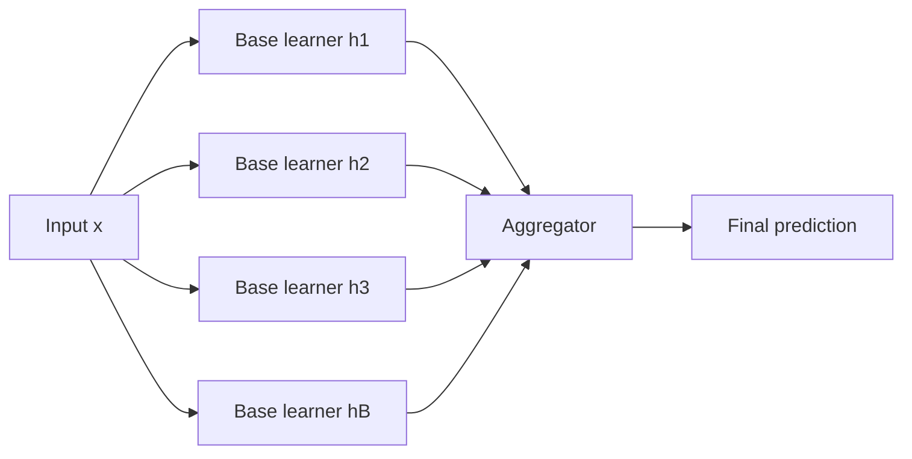
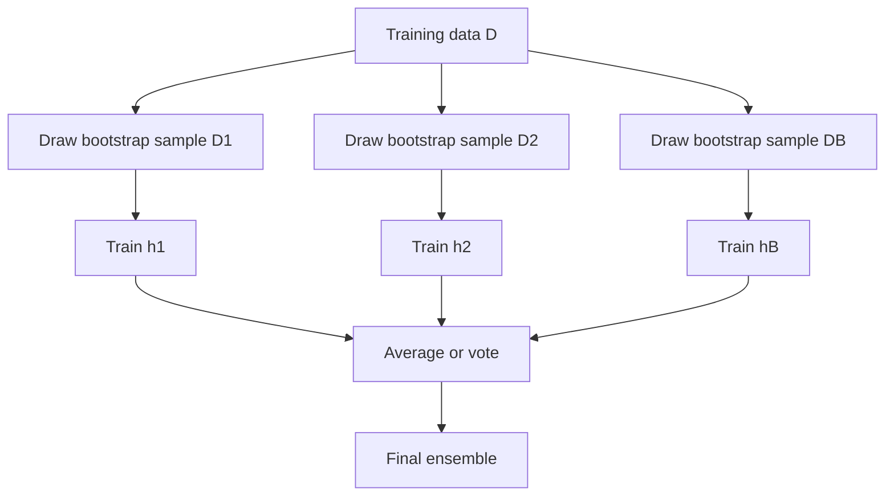
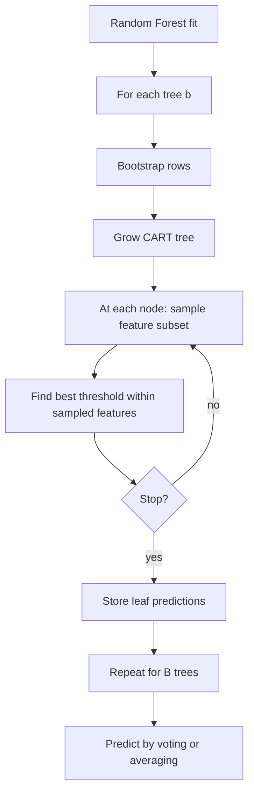
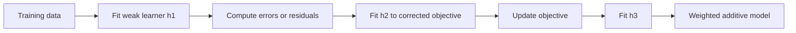
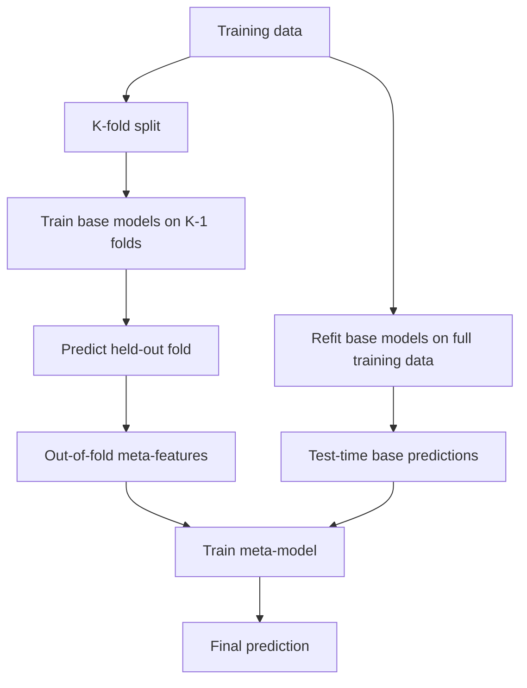

# Ensemble Learning and Random Forests

Ensemble learning combines multiple predictors into a single predictor. The core statistical reason it works is not that "many models are always better than one"; it works when the base learners make sufficiently different errors and the aggregation rule exploits this diversity.

Given training data

$$
\mathcal{D}
=
\{(x_i,y_i)\}_{i=1}^{n},
\qquad
x_i \in \mathbb{R}^{p},
$$

an ensemble constructs $B$ base predictors

$$
h_1,\dots,h_B
$$

and combines them through an aggregation function $A$:

$$
\hat{f}(x)
=
A\left(h_1(x),\dots,h_B(x)\right).
$$

For regression, $A$ is often an arithmetic mean. For classification, it is often a majority vote or an average of class probability vectors.



Ensembles are most useful when a single model is unstable, biased, or too sensitive to noise. Decision trees are a canonical example: deep trees have low bias but high variance, and small perturbations in training data can change early splits. Bagging and Random Forests reduce this variance by averaging many decorrelated trees.

## 1. Error Reduction by Averaging

Consider regression with squared error. Suppose each base learner predicts

$$
h_b(x)
=
f^\star(x) + \varepsilon_b(x),
$$

where $f^\star(x)$ is the target regression function and $\varepsilon_b(x)$ is the prediction error of learner $b$ at $x$. Assume, at this fixed $x$,

$$
\mathbb{E}[\varepsilon_b] = 0,
\qquad
\operatorname{Var}(\varepsilon_b)=\sigma^2,
\qquad
\operatorname{Corr}(\varepsilon_b,\varepsilon_{b'})=\rho
\quad
\text{for } b \neq b'.
$$

The averaged ensemble is

$$
\bar{h}(x)
=
\frac{1}{B}\sum_{b=1}^{B}h_b(x)
=
f^\star(x)
+
\frac{1}{B}\sum_{b=1}^{B}\varepsilon_b(x).
$$

Its variance is

$$
\begin{aligned}
\operatorname{Var}(\bar{h}(x))
&=
\operatorname{Var}
\left(
\frac{1}{B}\sum_{b=1}^{B}\varepsilon_b
\right) \\
&=
\frac{1}{B^2}
\left[
\sum_{b=1}^{B}\operatorname{Var}(\varepsilon_b)
+
\sum_{b \neq b'}\operatorname{Cov}(\varepsilon_b,\varepsilon_{b'})
\right] \\
&=
\frac{1}{B^2}
\left[
B\sigma^2
+
B(B-1)\rho\sigma^2
\right] \\
&=
\rho\sigma^2
+
\frac{1-\rho}{B}\sigma^2.
\end{aligned}
$$

This expression explains most ensemble design choices:

- Increasing $B$ reduces only the second term.
- If errors are independent, $\rho=0$, variance decays as $\sigma^2/B$.
- If errors are perfectly correlated, $\rho=1$, averaging gives no variance reduction.
- Random Forests improve on plain bagging by reducing $\rho$ through feature subsampling.

The same idea applies less directly to classification: voting improves accuracy when base classifiers are better than random and their errors are not too correlated.

## 2. Ensemble Taxonomy

| Method | Training dependency | Primary goal | Typical aggregation | Canonical examples |
| --- | --- | --- | --- | --- |
| Bagging | Parallel, independent learners | Reduce variance | Average or vote | Bagged trees, Random Forest |
| Boosting | Sequential learners | Reduce bias and variance via residual/error correction | Weighted sum | AdaBoost, Gradient Boosting, XGBoost |
| Stacking | Base learners plus meta-learner | Learn how to combine heterogeneous models | Learned combiner | Stacked generalization |

The boundaries are conceptual rather than absolute. For example, gradient-boosted trees are ensembles of trees, but the trees are not independent; each tree is fit to the current model's errors or pseudo-residuals.

## 3. Bagging: Bootstrap Aggregating

Bagging trains base learners on bootstrap samples and averages their predictions. It is particularly effective for high-variance estimators such as deep decision trees.

### 3.1 Bootstrap Sampling

A bootstrap sample is formed by sampling $n$ training indices independently with replacement from $\{1,\dots,n\}$. For tree $b$:

$$
I_b
=
\{i_{b1},\dots,i_{bn}\},
\qquad
i_{bt} \sim \operatorname{Uniform}\{1,\dots,n\}.
$$

The learner $h_b$ is trained on

$$
\mathcal{D}_b
=
\{(x_i,y_i): i \in I_b\}.
$$

Because sampling is with replacement, some examples occur multiple times and some are absent. The probability that a fixed training example is absent from one bootstrap sample is

$$
\left(1-\frac{1}{n}\right)^n.
$$

Taking the limit,

$$
\lim_{n\to\infty}
\left(1-\frac{1}{n}\right)^n
=
e^{-1}
\approx
0.368.
$$

Thus each bootstrap sample leaves out about $36.8\%$ of examples. These omitted examples are called out-of-bag examples for that tree.

### 3.2 Bagging Algorithm



For regression:

$$
\hat{f}_{\text{bag}}(x)
=
\frac{1}{B}
\sum_{b=1}^{B}h_b(x).
$$

For classification with class labels $\{1,\dots,K\}$, hard voting predicts

$$
\hat{y}_{\text{bag}}(x)
=
\arg\max_{k}
\sum_{b=1}^{B}
\mathbf{1}\{h_b(x)=k\}.
$$

If base learners output calibrated or at least meaningful probability estimates $\hat{p}_b(y=k\mid x)$, soft voting predicts

$$
\hat{y}_{\text{bag}}(x)
=
\arg\max_k
\frac{1}{B}
\sum_{b=1}^{B}
\hat{p}_b(y=k\mid x).
$$

### 3.3 Out-of-Bag Estimation

For training example $i$, define the set of trees for which $i$ was not sampled:

$$
\mathcal{B}_{\text{oob}}(i)
=
\{b : i \notin I_b\}.
$$

The out-of-bag prediction is

$$
\hat{f}_{\text{oob}}(x_i)
=
\frac{1}{|\mathcal{B}_{\text{oob}}(i)|}
\sum_{b \in \mathcal{B}_{\text{oob}}(i)}
h_b(x_i)
$$

for regression, with majority or probability voting for classification. The OOB score is an internal validation estimate obtained without a separate validation split. It is not magic: it is still an estimate from the training distribution and can be optimistic under leakage, dependence, temporal ordering, or repeated measurements.

### 3.4 Worked Bootstrap Example

Suppose $n=5$ with indices

$$
\{1,2,3,4,5\}.
$$

One bootstrap draw of size $5$ might be

$$
I_1 = [2,5,2,1,4].
$$

Then:

$$
\mathcal{D}_1
=
\{2,5,2,1,4\},
\qquad
\text{OOB examples}
=
\{3\}.
$$

Another draw might be

$$
I_2 = [3,3,5,1,5],
\qquad
\text{OOB examples}
=
\{2,4\}.
$$

If three regression trees produce predictions at a test point $x$:

$$
h_1(x)=50,
\qquad
h_2(x)=55,
\qquad
h_3(x)=60,
$$

the bagged prediction is

$$
\hat{f}_{\text{bag}}(x)
=
\frac{50+55+60}{3}
=
55.
$$

## 4. Random Forests

A Random Forest is a bagged ensemble of decision trees with additional randomization at split time. Each tree is trained on a bootstrap sample, and each split considers only a random subset of features. This feature subsampling reduces correlation between trees, which is crucial because bagging gives limited benefit when base learners make highly correlated errors.

For tree $b$, node $m$, and $p$ total features, Random Forest samples a subset

$$
S_{bm}
\subseteq
\{1,\dots,p\},
\qquad
|S_{bm}|=m_{\text{try}},
$$

then searches for the best split only among features in $S_{bm}$.

Common defaults are:

$$
m_{\text{try}} = \sqrt{p}
\quad
\text{for classification},
\qquad
m_{\text{try}} = p
\quad
\text{or a fraction of } p
\quad
\text{for regression depending on implementation}.
$$

In current scikit-learn, `RandomForestClassifier` defaults to `max_features="sqrt"`, while `RandomForestRegressor` defaults to `max_features=1.0`, meaning all features are considered at each split unless changed.

### 4.1 Step-by-Step Training

For $b=1,\dots,B$:

1. Draw a bootstrap sample $\mathcal{D}_b$ of size $n$ from $\mathcal{D}$.
2. Grow a decision tree, usually deep and unpruned.
3. At each internal node:
   - sample $m_{\text{try}}$ candidate features without replacement;
   - enumerate valid thresholds for those features;
   - compute impurity decrease for each candidate split;
   - choose the best split among the sampled features;
   - recurse until a stopping rule is reached.
4. Store the fitted tree.

At prediction time:

- classification: aggregate class votes or average class probabilities;
- regression: average numeric predictions.



### 4.2 Split Objective Inside Each Tree

At a node with sample index set $I$, a candidate split $(j,t)$ creates

$$
I_L(j,t)
=
\{i \in I : x_{ij} \le t\},
\qquad
I_R(j,t)
=
\{i \in I : x_{ij} > t\}.
$$

Let $H(I)$ be a node impurity. The weighted child impurity is

$$
H_{\text{split}}(I,j,t)
=
\frac{|I_L|}{|I|}H(I_L)
+
\frac{|I_R|}{|I|}H(I_R).
$$

The impurity decrease is

$$
\Delta H(I,j,t)
=
H(I)-H_{\text{split}}(I,j,t).
$$

Random Forest chooses

$$
(j^\star,t^\star)
=
\arg\max_{j \in S_{bm},\,t}
\Delta H(I,j,t).
$$

For classification with Gini impurity,

$$
H_{\text{Gini}}(I)
=
1-\sum_{k=1}^{K}\hat{p}_{k}^{2},
\qquad
\hat{p}_{k}
=
\frac{1}{|I|}
\sum_{i\in I}
\mathbf{1}\{y_i=k\}.
$$

For regression with squared-error splits,

$$
H_{\text{MSE}}(I)
=
\frac{1}{|I|}
\sum_{i\in I}
\left(y_i-\bar{y}_{I}\right)^2,
\qquad
\bar{y}_{I}
=
\frac{1}{|I|}
\sum_{i\in I}y_i.
$$

The regression leaf prediction is the mean because it minimizes squared error:

$$
\frac{\partial}{\partial c}
\sum_{i\in I}(y_i-c)^2
=
-2\sum_{i\in I}(y_i-c)
=
0
\quad
\Longrightarrow
\quad
c
=
\frac{1}{|I|}
\sum_{i\in I}y_i.
$$

### 4.3 Classification Prediction

For hard-voting Random Forest classification:

$$
\hat{y}(x)
=
\arg\max_{k}
\sum_{b=1}^{B}
\mathbf{1}\{h_b(x)=k\}.
$$

For probability aggregation, each tree returns a leaf-level empirical class distribution:

$$
\hat{p}_{bk}(x)
=
\frac{1}{N_{b\ell(x)}}
\sum_{i \in I_{b\ell(x)}}
\mathbf{1}\{y_i=k\},
$$

where $\ell(x)$ is the leaf reached by $x$ in tree $b$. The forest probability estimate is

$$
\hat{p}_{k}(x)
=
\frac{1}{B}
\sum_{b=1}^{B}
\hat{p}_{bk}(x),
$$

and the predicted class is

$$
\hat{y}(x)
=
\arg\max_k \hat{p}_k(x).
$$

### 4.4 Regression Prediction

For regression:

$$
\hat{f}_{\text{RF}}(x)
=
\frac{1}{B}
\sum_{b=1}^{B}
T_b(x),
$$

where $T_b(x)$ is the leaf mean predicted by tree $b$.

The mean is optimal for squared loss. If a different aggregation loss is desired, one can use a median or quantile aggregation, but standard Random Forest regression uses the arithmetic mean.

### 4.5 Bias-Variance-Correlation View

Random Forests usually grow deep trees, so individual trees have low bias and high variance. Bagging primarily reduces variance:

$$
\operatorname{Var}(\hat{f}_{\text{RF}})
\approx
\rho\sigma^2
+
\frac{1-\rho}{B}\sigma^2.
$$

The number of trees $B$ controls Monte Carlo averaging error. The feature-subset size $m_{\text{try}}$ controls the strength-correlation tradeoff:

- smaller $m_{\text{try}}$: lower tree correlation, but weaker individual splits;
- larger $m_{\text{try}}$: stronger individual trees, but higher correlation;
- best setting depends on data dimensionality, signal sparsity, and feature redundancy.

### 4.6 Worked Random Forest Split Example

Consider a binary classification node with six samples:

| sample | feature $x$ | class |
| --- | ---: | --- |
| 1 | 1.0 | 0 |
| 2 | 2.0 | 0 |
| 3 | 3.0 | 1 |
| 4 | 4.0 | 1 |
| 5 | 5.0 | 1 |
| 6 | 6.0 | 0 |

At the parent node:

$$
\hat{p}_0=\frac{3}{6},
\qquad
\hat{p}_1=\frac{3}{6}.
$$

The parent Gini impurity is

$$
H_{\text{parent}}
=
1-\left(\frac{3}{6}\right)^2-\left(\frac{3}{6}\right)^2
=
1-\frac{1}{4}-\frac{1}{4}
=
0.5.
$$

Try threshold $t=2.5$:

$$
I_L=\{1,2\},
\qquad
I_R=\{3,4,5,6\}.
$$

Left child has classes $(0,0)$:

$$
H_L
=
1-1^2-0^2
=
0.
$$

Right child has classes $(1,1,1,0)$:

$$
H_R
=
1-\left(\frac{1}{4}\right)^2-\left(\frac{3}{4}\right)^2
=
1-\frac{1}{16}-\frac{9}{16}
=
\frac{6}{16}
=
0.375.
$$

Weighted split impurity:

$$
H_{\text{split}}
=
\frac{2}{6}(0)
+
\frac{4}{6}(0.375)
=
0.25.
$$

Impurity decrease:

$$
\Delta H
=
0.5-0.25
=
0.25.
$$

In a Random Forest, this threshold would be compared only against thresholds of features sampled for the current node, not necessarily all features.

### 4.7 Feature Importance

Random Forests commonly expose impurity-based feature importance. For feature $j$, sum the weighted impurity decreases over all splits using $j$:

$$
I_j
=
\sum_{b=1}^{B}
\sum_{m \in \mathcal{M}_{bj}}
\frac{N_{bm}}{N_b}
\Delta H_{bm},
$$

where $\mathcal{M}_{bj}$ is the set of nodes in tree $b$ that split on feature $j$, $N_{bm}$ is the number of samples reaching node $m$, and $N_b$ is the bootstrap sample size. The values are usually normalized so that

$$
\sum_{j=1}^{p} I_j = 1.
$$

Important caveats:

- impurity importance is biased toward high-cardinality continuous features;
- correlated features split importance across substitutes;
- importance is not causal importance;
- permutation importance is often more reliable for model reliance but is more expensive and can be misleading under correlated features.

## 5. Random Forest Implementation from Scratch

The implementation below is intentionally compact but complete enough to show the mechanics: bootstrap sampling, feature subsampling at each split, Gini impurity, recursive tree growth, and probability averaging.

```python
from __future__ import annotations

from dataclasses import dataclass
from typing import Optional

import numpy as np


@dataclass
class Node:
    """A binary decision tree node."""
    feature: Optional[int] = None
    threshold: Optional[float] = None
    left: Optional["Node"] = None
    right: Optional["Node"] = None
    proba: Optional[np.ndarray] = None

    @property
    def is_leaf(self) -> bool:
        return self.proba is not None


class RandomSubspaceDecisionTreeClassifier:
    def __init__(
        self,
        max_depth: Optional[int] = None,
        min_samples_split: int = 2,
        min_samples_leaf: int = 1,
        max_features: str | int | float = "sqrt",
        random_state: Optional[int] = None,
    ):
        self.max_depth = max_depth
        self.min_samples_split = min_samples_split
        self.min_samples_leaf = min_samples_leaf
        self.max_features = max_features
        self.rng = np.random.default_rng(random_state)

    def fit(self, X: np.ndarray, y: np.ndarray, n_classes: int) -> "RandomSubspaceDecisionTreeClassifier":
        self.n_classes_ = n_classes
        self.n_features_in_ = X.shape[1]
        self.root_ = self._grow(X, y, depth=0)
        return self

    def _n_candidate_features(self) -> int:
        p = self.n_features_in_
        if self.max_features == "sqrt":
            return max(1, int(np.sqrt(p)))
        if self.max_features == "log2":
            return max(1, int(np.log2(p)))
        if isinstance(self.max_features, float):
            return max(1, int(self.max_features * p))
        if isinstance(self.max_features, int):
            return max(1, min(self.max_features, p))
        raise ValueError(f"Unsupported max_features={self.max_features!r}")

    def _class_proba(self, y: np.ndarray) -> np.ndarray:
        counts = np.bincount(y, minlength=self.n_classes_)
        return counts / counts.sum()

    def _gini(self, y: np.ndarray) -> float:
        p = self._class_proba(y)
        return 1.0 - np.sum(p * p)

    def _best_split(self, X: np.ndarray, y: np.ndarray):
        n, p = X.shape
        if n < self.min_samples_split:
            return None

        parent_impurity = self._gini(y)
        best_gain = 0.0
        best_feature = None
        best_threshold = None

        m_try = self._n_candidate_features()
        features = self.rng.choice(p, size=m_try, replace=False)

        for feature in features:
            values = np.unique(X[:, feature])
            if values.size <= 1:
                continue

            # Candidate thresholds between consecutive sorted unique values.
            thresholds = (values[:-1] + values[1:]) / 2.0

            for threshold in thresholds:
                left_mask = X[:, feature] <= threshold
                n_left = int(left_mask.sum())
                n_right = n - n_left

                if n_left < self.min_samples_leaf or n_right < self.min_samples_leaf:
                    continue

                y_left = y[left_mask]
                y_right = y[~left_mask]
                child_impurity = (
                    (n_left / n) * self._gini(y_left)
                    + (n_right / n) * self._gini(y_right)
                )
                gain = parent_impurity - child_impurity

                if gain > best_gain:
                    best_gain = gain
                    best_feature = feature
                    best_threshold = float(threshold)

        if best_feature is None:
            return None
        return best_feature, best_threshold

    def _grow(self, X: np.ndarray, y: np.ndarray, depth: int) -> Node:
        pure = np.unique(y).size == 1
        depth_limit_reached = self.max_depth is not None and depth >= self.max_depth

        if pure or depth_limit_reached or X.shape[0] < self.min_samples_split:
            return Node(proba=self._class_proba(y))

        split = self._best_split(X, y)
        if split is None:
            return Node(proba=self._class_proba(y))

        feature, threshold = split
        left_mask = X[:, feature] <= threshold

        left = self._grow(X[left_mask], y[left_mask], depth + 1)
        right = self._grow(X[~left_mask], y[~left_mask], depth + 1)
        return Node(feature=feature, threshold=threshold, left=left, right=right)

    def _predict_one_proba(self, x: np.ndarray, node: Node) -> np.ndarray:
        while not node.is_leaf:
            if x[node.feature] <= node.threshold:
                node = node.left
            else:
                node = node.right
        return node.proba

    def predict_proba(self, X: np.ndarray) -> np.ndarray:
        return np.vstack([self._predict_one_proba(x, self.root_) for x in X])

    def predict(self, X: np.ndarray) -> np.ndarray:
        return np.argmax(self.predict_proba(X), axis=1)


class RandomForestClassifierScratch:
    def __init__(
        self,
        n_estimators: int = 100,
        max_depth: Optional[int] = None,
        min_samples_split: int = 2,
        min_samples_leaf: int = 1,
        max_features: str | int | float = "sqrt",
        bootstrap: bool = True,
        random_state: Optional[int] = None,
    ):
        self.n_estimators = n_estimators
        self.max_depth = max_depth
        self.min_samples_split = min_samples_split
        self.min_samples_leaf = min_samples_leaf
        self.max_features = max_features
        self.bootstrap = bootstrap
        self.rng = np.random.default_rng(random_state)

    def fit(self, X: np.ndarray, y: np.ndarray) -> "RandomForestClassifierScratch":
        X = np.asarray(X, dtype=float)
        y = np.asarray(y, dtype=int)

        self.classes_ = np.unique(y)
        if not np.array_equal(self.classes_, np.arange(self.classes_.size)):
            raise ValueError("This minimal implementation expects labels 0, 1, ..., K-1.")

        n = X.shape[0]
        self.trees_ = []
        self.bootstrap_indices_ = []

        for _ in range(self.n_estimators):
            if self.bootstrap:
                indices = self.rng.integers(0, n, size=n)
            else:
                indices = np.arange(n)

            tree_seed = int(self.rng.integers(0, np.iinfo(np.int32).max))
            tree = RandomSubspaceDecisionTreeClassifier(
                max_depth=self.max_depth,
                min_samples_split=self.min_samples_split,
                min_samples_leaf=self.min_samples_leaf,
                max_features=self.max_features,
                random_state=tree_seed,
            )
            tree.fit(X[indices], y[indices], n_classes=self.classes_.size)
            self.trees_.append(tree)
            self.bootstrap_indices_.append(indices)

        return self

    def predict_proba(self, X: np.ndarray) -> np.ndarray:
        X = np.asarray(X, dtype=float)
        all_proba = np.stack([tree.predict_proba(X) for tree in self.trees_], axis=0)
        return all_proba.mean(axis=0)

    def predict(self, X: np.ndarray) -> np.ndarray:
        return self.classes_[np.argmax(self.predict_proba(X), axis=1)]
```

Example usage:

```python
import numpy as np

X = np.array([
    [1.0, 1.0],
    [1.5, 1.2],
    [2.0, 1.8],
    [5.0, 5.0],
    [5.5, 5.2],
    [6.0, 5.8],
])
y = np.array([0, 0, 0, 1, 1, 1])

rf = RandomForestClassifierScratch(
    n_estimators=25,
    max_depth=3,
    max_features="sqrt",
    random_state=0,
)
rf.fit(X, y)

print(rf.predict([[1.4, 1.1], [5.7, 5.4]]))
print(rf.predict_proba([[1.4, 1.1], [5.7, 5.4]]))
```

### 5.1 Scratch Implementation Notes

This code is deliberately simpler than production implementations:

- It recomputes Gini impurity from scratch for every candidate threshold, which is easy to read but inefficient.
- It supports numeric features only.
- It stores recursive Python objects, which is slower than compact array-based tree storage.
- It does not implement sample weights, missing-value routing, cost-complexity pruning, monotonic constraints, parallelism, or sparse matrices.
- It assumes class labels are contiguous integers.

Production libraries sort feature values once per node or use histogram approximations to reduce split-search cost.

## 6. Random Forest with scikit-learn

```python
from sklearn.ensemble import RandomForestClassifier, RandomForestRegressor
from sklearn.metrics import accuracy_score, root_mean_squared_error
from sklearn.model_selection import train_test_split


X_train, X_test, y_train, y_test = train_test_split(
    X,
    y,
    test_size=0.2,
    random_state=0,
    stratify=y,
)

clf = RandomForestClassifier(
    n_estimators=500,
    criterion="gini",
    max_depth=None,
    min_samples_leaf=1,
    max_features="sqrt",
    bootstrap=True,
    oob_score=True,
    n_jobs=-1,
    random_state=0,
)
clf.fit(X_train, y_train)

test_pred = clf.predict(X_test)
print("test accuracy:", accuracy_score(y_test, test_pred))
print("oob score:", clf.oob_score_)
```

For regression:

```python
reg = RandomForestRegressor(
    n_estimators=500,
    criterion="squared_error",
    max_features=1.0,
    bootstrap=True,
    oob_score=True,
    n_jobs=-1,
    random_state=0,
)
reg.fit(X_train, y_train)

pred = reg.predict(X_test)
rmse = root_mean_squared_error(y_test, pred)
print("RMSE:", rmse)
print("OOB R^2:", reg.oob_score_)
```

Internally, scikit-learn's Random Forest is a meta-estimator around optimized CART decision trees:

- `n_estimators` controls how many trees are fit.
- `bootstrap=True` draws row samples with replacement for each tree.
- `max_samples` can make each bootstrap sample smaller than $n$.
- `max_features` controls feature subsampling at each split.
- `criterion` selects the node impurity or loss used by the underlying trees.
- `n_jobs` parallelizes tree construction and prediction across CPU cores.
- `random_state` controls bootstrap draws and feature-subset randomness.
- `oob_score=True` computes out-of-bag validation predictions when bootstrap sampling is enabled.

The fitted forest stores individual trees in `estimators_`. Each tree is itself a fitted `DecisionTreeClassifier` or `DecisionTreeRegressor`.

```python
first_tree = clf.estimators_[0]
print(first_tree.tree_.node_count)
print(first_tree.tree_.feature[:10])
print(first_tree.tree_.threshold[:10])
```

The low-level `tree_` object stores arrays for child pointers, split features, thresholds, impurities, sample counts, and leaf values. Prediction traverses these arrays rather than Python `Node` objects.

## 7. Boosting

Boosting constructs an additive model sequentially:

$$
F_M(x)
=
\sum_{m=1}^{M}
\nu \alpha_m h_m(x),
$$

where $h_m$ is the $m$-th weak learner, $\alpha_m$ is its weight, and $\nu \in (0,1]$ is a learning rate or shrinkage parameter.

The key difference from bagging is dependency: learner $m$ is trained using information from the previous ensemble $F_{m-1}$. Boosting is often more accurate than Random Forests on tabular supervised-learning tasks, but it is more sensitive to hyperparameters, noise, and leakage.



### 7.1 AdaBoost from Exponential Loss

For binary labels

$$
y_i \in \{-1,+1\},
$$

AdaBoost builds

$$
F_M(x)
=
\sum_{m=1}^{M}\alpha_m h_m(x),
\qquad
h_m(x)\in\{-1,+1\}.
$$

It can be derived as forward stagewise minimization of exponential loss:

$$
L(F)
=
\sum_{i=1}^{n}
\exp\left(-y_i F(x_i)\right).
$$

At stage $m$, set

$$
F_m(x)
=
F_{m-1}(x)+\alpha h(x).
$$

The objective for the new learner is

$$
\begin{aligned}
L_m(\alpha,h)
&=
\sum_{i=1}^{n}
\exp\left(-y_i(F_{m-1}(x_i)+\alpha h(x_i))\right) \\
&=
\sum_{i=1}^{n}
w_i^{(m)}
\exp\left(-\alpha y_i h(x_i)\right),
\end{aligned}
$$

where

$$
w_i^{(m)}
=
\exp\left(-y_iF_{m-1}(x_i)\right).
$$

If $h(x_i)=y_i$, then $y_i h(x_i)=1$ and the contribution is $w_i^{(m)}e^{-\alpha}$. If $h(x_i)\neq y_i$, then $y_i h(x_i)=-1$ and the contribution is $w_i^{(m)}e^{\alpha}$.

Define the weighted error

$$
\epsilon_m
=
\frac{
\sum_{i=1}^{n}w_i^{(m)}\mathbf{1}\{h_m(x_i)\neq y_i\}
}{
\sum_{i=1}^{n}w_i^{(m)}
}.
$$

The stage objective is proportional to

$$
(1-\epsilon_m)e^{-\alpha}
+
\epsilon_m e^{\alpha}.
$$

Differentiate with respect to $\alpha$:

$$
\frac{\partial}{\partial \alpha}
\left[
(1-\epsilon_m)e^{-\alpha}
+
\epsilon_m e^{\alpha}
\right]
=
-(1-\epsilon_m)e^{-\alpha}
+
\epsilon_m e^{\alpha}.
$$

Set the derivative to zero:

$$
\epsilon_m e^{\alpha}
=
(1-\epsilon_m)e^{-\alpha}.
$$

Therefore

$$
e^{2\alpha}
=
\frac{1-\epsilon_m}{\epsilon_m},
\qquad
\alpha_m
=
\frac{1}{2}
\log
\frac{1-\epsilon_m}{\epsilon_m}.
$$

After adding learner $m$, the sample weights update as

$$
w_i^{(m+1)}
=
w_i^{(m)}
\exp
\left(
-\alpha_m y_i h_m(x_i)
\right).
$$

Correctly classified examples are multiplied by $e^{-\alpha_m}$; incorrectly classified examples are multiplied by $e^{\alpha_m}$.

### 7.2 AdaBoost Worked Example

Suppose $n=5$ and the first weak learner misclassifies one example. Initial weights are

$$
w_i^{(1)}=\frac{1}{5}.
$$

The weighted error is

$$
\epsilon_1
=
\frac{1}{5}
=
0.2.
$$

The learner weight is

$$
\alpha_1
=
\frac{1}{2}
\log
\frac{1-0.2}{0.2}
=
\frac{1}{2}\log 4
\approx
0.6931.
$$

The multiplier for correct examples is

$$
e^{-\alpha_1}
\approx
0.5,
$$

and for the incorrect example:

$$
e^{\alpha_1}
\approx
2.0.
$$

Before normalization:

$$
w_{\text{correct}}'
=
0.2 \cdot 0.5
=
0.1,
\qquad
w_{\text{incorrect}}'
=
0.2 \cdot 2.0
=
0.4.
$$

The total unnormalized mass is

$$
4(0.1)+0.4=0.8.
$$

After normalization, each correct example has weight

$$
\frac{0.1}{0.8}
=
0.125,
$$

and the incorrect example has weight

$$
\frac{0.4}{0.8}
=
0.5.
$$

The next weak learner is forced to pay more attention to the previously misclassified point.

### 7.3 AdaBoost from Scratch

```python
import numpy as np


class DecisionStump:
    """One-level decision tree for binary labels {-1, +1}."""

    def fit(self, X: np.ndarray, y: np.ndarray, sample_weight: np.ndarray):
        n, p = X.shape
        best_error = np.inf

        for feature in range(p):
            values = np.unique(X[:, feature])
            thresholds = (values[:-1] + values[1:]) / 2.0
            if thresholds.size == 0:
                thresholds = values

            for threshold in thresholds:
                for polarity in (-1, 1):
                    pred = np.ones(n)
                    pred[polarity * X[:, feature] < polarity * threshold] = -1
                    error = np.sum(sample_weight[pred != y])

                    if error < best_error:
                        best_error = error
                        self.feature_ = feature
                        self.threshold_ = float(threshold)
                        self.polarity_ = polarity

        return self

    def predict(self, X: np.ndarray) -> np.ndarray:
        pred = np.ones(X.shape[0])
        pred[self.polarity_ * X[:, self.feature_] < self.polarity_ * self.threshold_] = -1
        return pred


class AdaBoostBinaryScratch:
    def __init__(self, n_estimators: int = 50, learning_rate: float = 1.0):
        self.n_estimators = n_estimators
        self.learning_rate = learning_rate

    def fit(self, X: np.ndarray, y: np.ndarray):
        X = np.asarray(X, dtype=float)
        y = np.asarray(y, dtype=float)
        if set(np.unique(y)) != {-1.0, 1.0}:
            raise ValueError("Labels must be encoded as -1 and +1.")

        n = X.shape[0]
        w = np.full(n, 1.0 / n)
        self.estimators_ = []
        self.estimator_weights_ = []

        for _ in range(self.n_estimators):
            stump = DecisionStump().fit(X, y, w)
            pred = stump.predict(X)
            error = np.sum(w[pred != y])
            error = np.clip(error, 1e-12, 1.0 - 1e-12)

            alpha = 0.5 * np.log((1.0 - error) / error)
            alpha *= self.learning_rate

            w *= np.exp(-alpha * y * pred)
            w /= w.sum()

            self.estimators_.append(stump)
            self.estimator_weights_.append(alpha)

        return self

    def decision_function(self, X: np.ndarray) -> np.ndarray:
        scores = np.zeros(X.shape[0])
        for alpha, estimator in zip(self.estimator_weights_, self.estimators_):
            scores += alpha * estimator.predict(X)
        return scores

    def predict(self, X: np.ndarray) -> np.ndarray:
        return np.where(self.decision_function(X) >= 0.0, 1.0, -1.0)
```

### 7.4 AdaBoost with scikit-learn

```python
from sklearn.ensemble import AdaBoostClassifier
from sklearn.tree import DecisionTreeClassifier


ada = AdaBoostClassifier(
    estimator=DecisionTreeClassifier(max_depth=1),
    n_estimators=200,
    learning_rate=0.05,
    random_state=0,
)
ada.fit(X_train, y_train)
```

scikit-learn's `AdaBoostClassifier` is a meta-estimator. It repeatedly fits copies of the base estimator on the same dataset while changing sample weights so that incorrectly classified samples receive higher weight. For multiclass classification, modern scikit-learn uses the discrete SAMME algorithm.

## 8. Gradient Boosting

Gradient boosting generalizes boosting by treating supervised learning as numerical optimization in function space. Let the model be an additive expansion:

$$
F_M(x)
=
\sum_{m=0}^{M}
\nu h_m(x).
$$

Given differentiable loss $\ell(y,F(x))$, the empirical risk is

$$
\mathcal{L}(F)
=
\sum_{i=1}^{n}
\ell(y_i,F(x_i)).
$$

At iteration $m$, gradient boosting computes pseudo-residuals:

$$
r_{im}
=
-
\left[
\frac{\partial \ell(y_i,F(x_i))}
{\partial F(x_i)}
\right]_{F=F_{m-1}}.
$$

Then it fits a weak learner $h_m$ to the training set

$$
\{(x_i,r_{im})\}_{i=1}^{n}.
$$

The model updates as

$$
F_m(x)
=
F_{m-1}(x)+\nu \gamma_m h_m(x),
$$

where $\gamma_m$ may be found by line search:

$$
\gamma_m
=
\arg\min_{\gamma}
\sum_{i=1}^{n}
\ell
\left(
y_i,
F_{m-1}(x_i)+\gamma h_m(x_i)
\right).
$$

For squared loss,

$$
\ell(y,F)=\frac{1}{2}(y-F)^2.
$$

The derivative is

$$
\frac{\partial \ell}{\partial F}
=
F-y,
$$

so the pseudo-residual is

$$
r_i
=
y_i-F_{m-1}(x_i).
$$

Thus squared-error gradient boosting fits each new tree to the current residuals.

### 8.1 Gradient Boosting Regression from Scratch

```python
import numpy as np
from sklearn.tree import DecisionTreeRegressor


class GradientBoostingRegressorScratch:
    def __init__(
        self,
        n_estimators: int = 100,
        learning_rate: float = 0.1,
        max_depth: int = 3,
        random_state: int = 0,
    ):
        self.n_estimators = n_estimators
        self.learning_rate = learning_rate
        self.max_depth = max_depth
        self.random_state = random_state

    def fit(self, X: np.ndarray, y: np.ndarray):
        X = np.asarray(X, dtype=float)
        y = np.asarray(y, dtype=float)

        self.init_ = float(np.mean(y))
        current_pred = np.full_like(y, self.init_, dtype=float)
        self.estimators_ = []

        for m in range(self.n_estimators):
            residual = y - current_pred
            tree = DecisionTreeRegressor(
                max_depth=self.max_depth,
                random_state=self.random_state + m,
            )
            tree.fit(X, residual)
            update = tree.predict(X)
            current_pred += self.learning_rate * update
            self.estimators_.append(tree)

        return self

    def predict(self, X: np.ndarray) -> np.ndarray:
        pred = np.full(X.shape[0], self.init_, dtype=float)
        for tree in self.estimators_:
            pred += self.learning_rate * tree.predict(X)
        return pred
```

This uses scikit-learn trees for the weak learner to keep the focus on boosting mechanics. A fully from-scratch version would reuse a regression-tree implementation and change only the target at each iteration.

### 8.2 Gradient Boosting with Libraries

```python
from sklearn.ensemble import GradientBoostingRegressor, HistGradientBoostingRegressor


gbr = GradientBoostingRegressor(
    n_estimators=300,
    learning_rate=0.05,
    max_depth=3,
    subsample=0.8,
    random_state=0,
)
gbr.fit(X_train, y_train)

hgb = HistGradientBoostingRegressor(
    max_iter=300,
    learning_rate=0.05,
    max_leaf_nodes=31,
    l2_regularization=0.0,
    early_stopping=True,
    random_state=0,
)
hgb.fit(X_train, y_train)
```

`GradientBoostingRegressor` grows exact CART-style trees stage by stage. `HistGradientBoostingRegressor` first bins continuous features into histograms, then searches split points over bins instead of all raw thresholds. This reduces split-search cost and improves cache behavior, especially for larger datasets.

XGBoost, LightGBM, and CatBoost are specialized gradient-boosted tree systems. XGBoost adds regularized objectives, second-order Taylor approximations, sparsity-aware split finding, approximate quantile-based split search, parallelism, and engineering optimizations for large tabular data.

## 9. Stacking

Stacking learns a meta-model that combines predictions from multiple base models. Unlike bagging, the base models are often heterogeneous. Unlike simple voting, the combiner is trained.

Let $h_1,\dots,h_B$ be base models. Define the meta-feature vector

$$
z_i
=
\left[
h_1(x_i),
\dots,
h_B(x_i)
\right].
$$

The meta-model $g$ predicts

$$
\hat{y}
=
g(z).
$$

The critical implementation detail is that $z_i$ used to train $g$ should be out-of-sample with respect to $x_i$. Otherwise, the meta-model learns from overfit base predictions and can severely overestimate performance.



### 9.1 Stacking with scikit-learn

```python
from sklearn.ensemble import RandomForestClassifier, StackingClassifier
from sklearn.linear_model import LogisticRegression
from sklearn.svm import SVC
from sklearn.pipeline import make_pipeline
from sklearn.preprocessing import StandardScaler


estimators = [
    ("rf", RandomForestClassifier(n_estimators=300, random_state=0, n_jobs=-1)),
    ("svm", make_pipeline(StandardScaler(), SVC(probability=True, random_state=0))),
]

stack = StackingClassifier(
    estimators=estimators,
    final_estimator=LogisticRegression(max_iter=1000),
    stack_method="predict_proba",
    cv=5,
    n_jobs=-1,
)
stack.fit(X_train, y_train)
```

scikit-learn's `StackingClassifier` uses cross-validated predictions to train the final estimator. After producing out-of-fold meta-features for the final estimator, it refits the base estimators on the full training set for use at prediction time.

## 10. Complexity

Let:

$$
n = \text{number of samples},
\qquad
p = \text{number of features},
\qquad
B = \text{number of trees},
\qquad
m = m_{\text{try}}.
$$

For a balanced binary tree, depth is $O(\log n)$; for an unrestricted pathological tree, depth can be $O(n)$.

### 10.1 Random Forest Training Complexity

At one node, exact split search over $m$ selected features requires sorting or scanning candidate thresholds. If features are sorted per node, a rough cost is

$$
O(mN\log N)
$$

for $N$ samples at that node. Optimized implementations reduce repeated sorting by presorting or using histogram-like strategies, but exact CART split search remains expensive.

A useful high-level estimate for one balanced tree with $m$ candidate features at each node is

$$
O(m n \log n)
$$

per tree for split scanning after accounting over tree levels, plus overhead for sorting or maintaining ordered feature values.

For $B$ trees:

$$
O(B m n \log n)
$$

is a useful high-level estimate for balanced trees.

Prediction cost is

$$
O(B d)
$$

per example, where $d$ is average tree depth.

Space complexity is roughly

$$
O(BL)
$$

where $L$ is the number of nodes per tree. Fully grown binary trees can have $O(n)$ leaves and $O(n)$ nodes per tree, so forest storage can be $O(Bn)$.

### 10.2 Boosting Complexity

Gradient boosting with $M$ trees has training cost similar to fitting $M$ shallow trees:

$$
O(M m n \log n)
$$

for exact split search, with smaller constants when trees are shallow. Histogram gradient boosting often reduces dependence on raw threshold count by binning features:

$$
O(M p n)
+
O(M p q)
$$

where $q$ is the number of bins, ignoring implementation-specific optimizations.

Boosted trees are usually shallower than Random Forest trees, but they cannot be trained independently across boosting iterations.

## 11. Numerical Stability and Edge Cases

### 11.1 Random Forests

Important edge cases:

- A candidate split can create an empty child; it must be rejected.
- Features can be constant inside a node; no valid threshold exists for that feature.
- Very small leaves produce high-variance class probabilities.
- Class probabilities from tree leaves are often poorly calibrated.
- Highly imbalanced classes can make majority-vote accuracy misleading.
- If $B$ is too small, predictions have noticeable Monte Carlo noise.
- If all features are strongly correlated, feature subsampling may not decorrelate trees much.
- Extrapolation is weak in regression: predictions are averages of observed training targets in leaves, so Random Forests generally do not extrapolate linearly beyond the training target range.

Numerical issues are usually mild compared with linear algebra methods, but implementation details still matter:

- impurity computations should avoid division by zero for empty nodes;
- probability estimates should be computed from integer counts and normalized carefully;
- random seeds should be controlled for reproducibility;
- floating-point threshold comparisons near equality can affect deterministic routing;
- large forests can consume significant memory due to node arrays.

### 11.2 AdaBoost

AdaBoost has sharper numerical concerns:

- If $\epsilon_m=0$, then $\alpha_m=\infty$ unless clipped.
- If $\epsilon_m \geq 0.5$ in binary AdaBoost, the weak learner is no better than random under the current weights.
- The weight update can overflow for large $\alpha_m$.
- Label encoding must match the derivation; binary AdaBoost expects $y\in\{-1,+1\}$.
- Outliers and mislabeled examples can receive increasing weights, causing overfitting.

Using log-weights can improve stability:

$$
\log w_i^{(m+1)}
=
\log w_i^{(m)}
-
\alpha_m y_i h_m(x_i)
-
\log Z_m,
$$

where $Z_m$ is the normalization constant.

### 11.3 Gradient Boosting

Common pitfalls:

- Too large a learning rate can overfit or diverge.
- Too many trees with insufficient regularization can memorize noise.
- Deep trees in boosting can create high-order interactions but also high variance.
- Early stopping requires a validation split that respects the data-generating process.
- For temporal data, random cross-validation can leak future information.
- For classification, raw boosted scores are logits or margins, not probabilities until passed through the appropriate link function.

## 12. Practical Model Selection

Random Forest is often a strong baseline when:

- the data is tabular;
- nonlinear interactions matter;
- preprocessing time should be low;
- robustness is more important than maximum leaderboard performance;
- interpretability through feature importance, partial dependence, or tree inspection is sufficient.

Gradient boosting is often preferable when:

- maximum predictive performance on tabular data is needed;
- careful validation and tuning are possible;
- missing values, categorical variables, monotonic constraints, or custom losses matter and the chosen library supports them well.

Stacking is useful when:

- different model families capture complementary structure;
- there is enough data to estimate meta-features without severe overfitting;
- the validation protocol is carefully controlled.

### 12.1 Hyperparameter Effects

| Hyperparameter | Method | Effect |
| --- | --- | --- |
| `n_estimators` | Random Forest, boosting | More averaging or more stages; RF usually plateaus, boosting can overfit |
| `max_depth` | Tree ensembles | Controls interaction order and individual tree complexity |
| `max_features` | Random Forest | Controls tree correlation versus split strength |
| `min_samples_leaf` | Tree ensembles | Smooths leaves and reduces variance |
| `learning_rate` | Boosting | Shrinks each update; lower values need more trees |
| `subsample` | Boosting | Adds stochasticity and regularization |
| `class_weight` / sample weights | Classification | Changes effective loss under imbalance or unequal costs |

## 13. Connections to Related Concepts

### 13.1 Bias-Variance Decomposition

Bagging and Random Forests mainly target variance reduction. Boosting can reduce bias by building an increasingly expressive additive model, but it also controls variance through shrinkage, tree depth, subsampling, and regularization.

### 13.2 Kernel and Nearest-Neighbor Views

Random Forest regression can be interpreted as an adaptive local averaging method. For a tree $b$, define

$$
\mathbf{1}_b(x_i,x)
=
\mathbf{1}\{x_i \text{ and } x \text{ fall in the same leaf of tree } b\}.
$$

The forest prediction can be written as

$$
\hat{f}(x)
=
\sum_{i=1}^{n}
W_i(x)y_i,
$$

where

$$
W_i(x)
=
\frac{1}{B}
\sum_{b=1}^{B}
\frac{
\mathbf{1}_b(x_i,x)
}{
\sum_{j=1}^{n}\mathbf{1}_b(x_j,x)
}.
$$

Thus Random Forests behave like data-adaptive nearest-neighbor smoothers whose neighborhoods are induced by tree partitions.

### 13.3 Margins

For classification, the ensemble margin measures confidence in the correct class relative to alternatives. For a Random Forest, if $Y$ is the true class and $P_k(x)$ is the fraction of votes for class $k$, the margin is

$$
\operatorname{margin}(x,Y)
=
P_Y(x)
-
\max_{k\neq Y}P_k(x).
$$

Large positive margins correspond to confident correct predictions; negative margins correspond to errors. Breiman's Random Forest analysis connects generalization to tree strength and inter-tree correlation through margins.

### 13.4 Calibration

Random Forest probability estimates are averages of leaf frequencies. They are often better than a single tree's probabilities but can still be miscalibrated. Calibration methods include:

- Platt scaling via logistic calibration;
- isotonic regression;
- cross-validated calibration wrappers such as `CalibratedClassifierCV`.

Calibration must be fit on held-out or cross-validated predictions, not on the same predictions used to train the model.

## 14. Common Implementation Pitfalls

- Evaluating stacking with in-sample meta-features.
- Using OOB scores after preprocessing that leaked full-dataset statistics.
- Treating impurity-based feature importance as causal explanation.
- Forgetting that Random Forest regression does not extrapolate well.
- Tuning on the test set through repeated experimentation.
- Using random splits for grouped, temporal, patient-level, user-level, or session-level data.
- Ignoring class imbalance and reporting only accuracy.
- Setting `n_estimators` too low and mistaking Monte Carlo variation for model behavior.
- Comparing Random Forest and boosting without equal validation protocols.

## 15. References and Deeper Reading

- Leo Breiman, "Random Forests", *Machine Learning*, 2001. https://link.springer.com/article/10.1023/A:1010933404324
- Leo Breiman, "Bagging Predictors", *Machine Learning*, 1996. https://link.springer.com/article/10.1007/BF00058655
- Yoav Freund and Robert E. Schapire, "A Decision-Theoretic Generalization of On-Line Learning and an Application to Boosting", 1997. https://www.sciencedirect.com/science/article/pii/S002200009791504X
- Jerome H. Friedman, "Greedy Function Approximation: A Gradient Boosting Machine", *Annals of Statistics*, 2001. https://projecteuclid.org/journals/annals-of-statistics/volume-29/issue-5/Greedy-function-approximation-A-gradient-boosting-machine/10.1214/aos/1013203451.full
- Tianqi Chen and Carlos Guestrin, "XGBoost: A Scalable Tree Boosting System", 2016. https://arxiv.org/abs/1603.02754
- scikit-learn documentation: `RandomForestClassifier`, `RandomForestRegressor`, `AdaBoostClassifier`, `GradientBoostingRegressor`, `HistGradientBoostingRegressor`, and `StackingClassifier`. https://scikit-learn.org/stable/modules/ensemble.html
- Trevor Hastie, Robert Tibshirani, and Jerome Friedman, *The Elements of Statistical Learning*, Chapters 8, 10, and 15. https://hastie.su.domains/ElemStatLearn/
