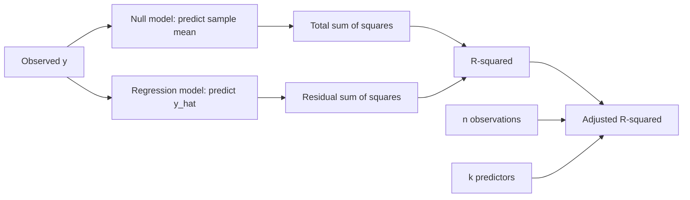
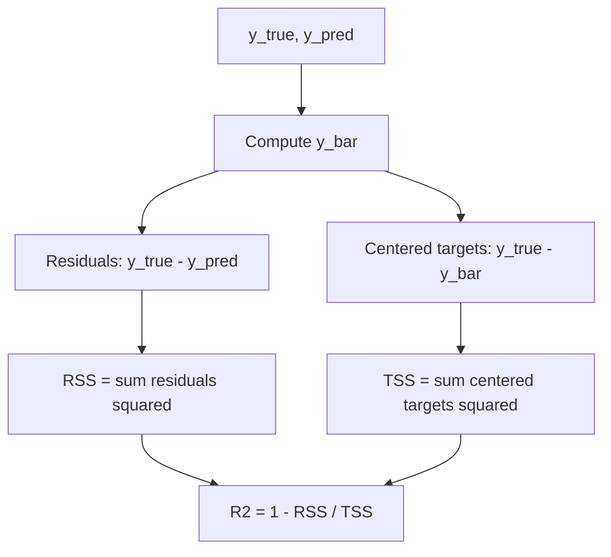
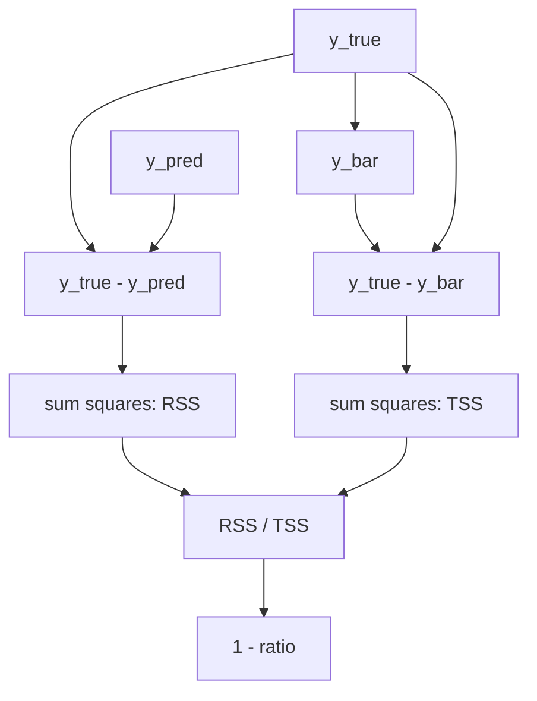

# R-Squared and Adjusted R-Squared

R-squared and adjusted R-squared are goodness-of-fit statistics for regression. They summarize how much squared-error improvement a model achieves relative to a baseline predictor, usually the intercept-only model that always predicts the sample mean.

Given observed responses

$$
y_1,\dots,y_n
$$

and predictions

$$
\hat{y}_1,\dots,\hat{y}_n,
$$

the residuals are

$$
e_i = y_i - \hat{y}_i.
$$

R-squared compares the squared residual error of the fitted model against the squared error of a null model:

$$
R^2
=
1
-
\frac{\operatorname{SS}_{\operatorname{res}}}{\operatorname{SS}_{\operatorname{tot}}}.
$$

Adjusted R-squared modifies this ratio by replacing raw sums of squares with degrees-of-freedom-adjusted variance estimates. Its purpose is not to make the model fit better; it is to make in-sample comparisons across linear models with different numbers of predictors less biased toward larger models.



## 1. Sum-of-Squares Decomposition

Assume a regression dataset

$$
\mathcal{D}
=
\{(x_i,y_i)\}_{i=1}^{n},
\qquad
x_i \in \mathbb{R}^{k}.
$$

Let the sample mean of the response be

$$
\bar{y}
=
\frac{1}{n}
\sum_{i=1}^{n} y_i.
$$

Three sums of squares are central:

$$
\operatorname{SS}_{\operatorname{tot}}
=
\sum_{i=1}^{n}(y_i-\bar{y})^2,
$$

$$
\operatorname{SS}_{\operatorname{res}}
=
\sum_{i=1}^{n}(y_i-\hat{y}_i)^2
=
\sum_{i=1}^{n}e_i^2,
$$

$$
\operatorname{SS}_{\operatorname{reg}}
=
\sum_{i=1}^{n}(\hat{y}_i-\bar{y})^2.
$$

The total sum of squares measures variation around the mean. The residual sum of squares measures unexplained squared variation after fitting the model. The regression sum of squares measures variation in fitted values around the mean.

For ordinary least squares with an intercept, fitted values are orthogonal projections of $y$ onto the column space of the design matrix. This gives the exact decomposition

$$
\operatorname{SS}_{\operatorname{tot}}
=
\operatorname{SS}_{\operatorname{reg}}
+
\operatorname{SS}_{\operatorname{res}}.
$$

This decomposition is not guaranteed for arbitrary predictors, nonlinear models, out-of-sample predictions, or OLS models fitted without an intercept.

### 1.1 Projection Derivation for OLS

Let

$$
X \in \mathbb{R}^{n \times p}
$$

be the design matrix including an intercept column, so $p=k+1$ when there are $k$ non-intercept predictors. The OLS estimate solves

$$
\hat{\beta}
=
\arg\min_{\beta \in \mathbb{R}^{p}}
\|y-X\beta\|_2^2.
$$

Differentiate the objective:

$$
\begin{aligned}
L(\beta)
&=
(y-X\beta)^\top (y-X\beta) \\
&=
y^\top y
-
2\beta^\top X^\top y
+
\beta^\top X^\top X\beta.
\end{aligned}
$$

The gradient is

$$
\nabla_{\beta}L(\beta)
=
-2X^\top y
+
2X^\top X\beta.
$$

Setting it to zero gives the normal equations:

$$
X^\top X\hat{\beta}
=
X^\top y.
$$

If $X^\top X$ is invertible,

$$
\hat{\beta}
=
(X^\top X)^{-1}X^\top y.
$$

The fitted vector is

$$
\hat{y}
=
X\hat{\beta}
=
X(X^\top X)^{-1}X^\top y
=
Hy,
$$

where

$$
H
=
X(X^\top X)^{-1}X^\top
$$

is the hat matrix. It is symmetric and idempotent:

$$
H^\top = H,
\qquad
H^2 = H.
$$

The residual vector is

$$
e
=
y-\hat{y}
=
(I-H)y.
$$

The normal equations imply

$$
X^\top e = 0.
$$

Since $\hat{y}=X\hat{\beta}$ lies in the column space of $X$, the residual vector is orthogonal to the fitted vector:

$$
\hat{y}^\top e = 0.
$$

Because the model contains an intercept, the centered fitted vector $\hat{y}-\bar{y}\mathbf{1}$ also lies in the column space of $X$, and

$$
(\hat{y}-\bar{y}\mathbf{1})^\top e = 0.
$$

Now decompose:

$$
y-\bar{y}\mathbf{1}
=
(\hat{y}-\bar{y}\mathbf{1}) + e.
$$

Taking squared norms,

$$
\begin{aligned}
\|y-\bar{y}\mathbf{1}\|_2^2
&=
\|(\hat{y}-\bar{y}\mathbf{1})+e\|_2^2 \\
&=
\|\hat{y}-\bar{y}\mathbf{1}\|_2^2
+
\|e\|_2^2
+
2(\hat{y}-\bar{y}\mathbf{1})^\top e \\
&=
\|\hat{y}-\bar{y}\mathbf{1}\|_2^2
+
\|e\|_2^2.
\end{aligned}
$$

Thus

$$
\operatorname{SS}_{\operatorname{tot}}
=
\operatorname{SS}_{\operatorname{reg}}
+
\operatorname{SS}_{\operatorname{res}}.
$$

The identity explains why in-sample OLS with an intercept satisfies

$$
0 \le R^2 \le 1.
$$

Outside this setting, $R^2$ can be negative.

## 2. R-Squared

R-squared is

$$
R^2
=
1
-
\frac{
\sum_{i=1}^{n}(y_i-\hat{y}_i)^2
}{
\sum_{i=1}^{n}(y_i-\bar{y})^2
}.
$$

Equivalently, when the OLS intercept decomposition holds,

$$
R^2
=
\frac{\operatorname{SS}_{\operatorname{reg}}}{\operatorname{SS}_{\operatorname{tot}}}.
$$

The first form is more general because it only requires predictions. The second form depends on the OLS geometry.

### 2.1 Interpretation

R-squared is a relative squared-error improvement:

$$
R^2
=
1
-
\frac{\text{model squared error}}{\text{mean-baseline squared error}}.
$$

If $R^2=0.80$, the model's residual sum of squares is $20\%$ of the mean baseline's residual sum of squares:

$$
\frac{\operatorname{SS}_{\operatorname{res}}}{\operatorname{SS}_{\operatorname{tot}}}
=
0.20.
$$

This means the model reduced in-sample squared error by $80\%$ relative to predicting $\bar{y}$. It does not mean that every individual prediction is $80\%$ accurate, nor does it imply causality.

### 2.2 Step-by-Step Execution

Given arrays `y_true` and `y_pred`:

1. Compute the mean of the observed targets.
2. Compute residuals $e_i=y_i-\hat{y}_i$.
3. Square and sum residuals to obtain $\operatorname{SS}_{\operatorname{res}}$.
4. Center the targets around $\bar{y}$.
5. Square and sum centered targets to obtain $\operatorname{SS}_{\operatorname{tot}}$.
6. Return $1-\operatorname{SS}_{\operatorname{res}}/\operatorname{SS}_{\operatorname{tot}}$.



### 2.3 Worked Example

Let

$$
y = [3,\,-0.5,\,2,\,7],
\qquad
\hat{y} = [2.5,\,0,\,2,\,8].
$$

The mean response is

$$
\bar{y}
=
\frac{3-0.5+2+7}{4}
=
2.875.
$$

Residuals:

$$
e
=
[0.5,\,-0.5,\,0,\,-1].
$$

Residual sum of squares:

$$
\operatorname{SS}_{\operatorname{res}}
=
0.5^2+(-0.5)^2+0^2+(-1)^2
=
1.5.
$$

Centered target deviations:

$$
y-\bar{y}
=
[0.125,\,-3.375,\,-0.875,\,4.125].
$$

Total sum of squares:

$$
\begin{aligned}
\operatorname{SS}_{\operatorname{tot}}
&=
0.125^2+(-3.375)^2+(-0.875)^2+4.125^2 \\
&=
0.015625+11.390625+0.765625+17.015625 \\
&=
29.1875.
\end{aligned}
$$

Therefore

$$
R^2
=
1-\frac{1.5}{29.1875}
=
0.948608137.
$$

The model reduces squared error by about $94.86\%$ relative to predicting the sample mean.

### 2.4 Negative R-Squared

R-squared can be negative when

$$
\operatorname{SS}_{\operatorname{res}}
>
\operatorname{SS}_{\operatorname{tot}}.
$$

For example, with

$$
y=[1,2,3],
\qquad
\hat{y}=[10,10,10],
$$

the mean is

$$
\bar{y}=2,
$$

so

$$
\operatorname{SS}_{\operatorname{tot}}
=
(1-2)^2+(2-2)^2+(3-2)^2
=
2.
$$

The residual sum of squares is

$$
\operatorname{SS}_{\operatorname{res}}
=
(1-10)^2+(2-10)^2+(3-10)^2
=
81+64+49
=
194.
$$

Thus

$$
R^2
=
1-\frac{194}{2}
=
-96.
$$

Negative values are common on test data when a model generalizes worse than the mean predictor computed on the evaluation targets.

## 3. Why R-Squared Increases When Predictors Are Added

For nested OLS models fitted on the same data with an intercept, adding predictors cannot increase the training residual sum of squares.

Let $\mathcal{S}_0$ be the column space of the smaller model and $\mathcal{S}_1$ the column space after adding predictors. Then

$$
\mathcal{S}_0 \subseteq \mathcal{S}_1.
$$

OLS chooses the closest point to $y$ in the model's column space:

$$
\hat{y}_{\mathcal{S}}
=
\arg\min_{z \in \mathcal{S}}\|y-z\|_2^2.
$$

Because $\mathcal{S}_0$ is contained in $\mathcal{S}_1$,

$$
\min_{z \in \mathcal{S}_1}\|y-z\|_2^2
\le
\min_{z \in \mathcal{S}_0}\|y-z\|_2^2.
$$

Therefore

$$
\operatorname{SS}_{\operatorname{res},1}
\le
\operatorname{SS}_{\operatorname{res},0}.
$$

Since $\operatorname{SS}_{\operatorname{tot}}$ is unchanged, $R^2$ cannot decrease:

$$
R_1^2
=
1-\frac{\operatorname{SS}_{\operatorname{res},1}}{\operatorname{SS}_{\operatorname{tot}}}
\ge
1-\frac{\operatorname{SS}_{\operatorname{res},0}}{\operatorname{SS}_{\operatorname{tot}}}
=
R_0^2.
$$

This is the core limitation: in-sample $R^2$ rewards extra flexibility even when the new features encode noise.

## 4. Adjusted R-Squared

Adjusted R-squared is

$$
\bar{R}^2
=
1
-
\frac{
\operatorname{SS}_{\operatorname{res}}/(n-k-1)
}{
\operatorname{SS}_{\operatorname{tot}}/(n-1)
},
$$

where:

- $n$ is the number of observations.
- $k$ is the number of non-intercept predictors.
- $n-k-1$ is the residual degrees of freedom for an OLS model with an intercept.
- $n-1$ is the total degrees of freedom after estimating the mean.

Using

$$
R^2
=
1-\frac{\operatorname{SS}_{\operatorname{res}}}{\operatorname{SS}_{\operatorname{tot}}},
$$

we obtain the common formula:

$$
\bar{R}^2
=
1
-
(1-R^2)
\frac{n-1}{n-k-1}.
$$

### 4.1 Degrees-of-Freedom Derivation

Assume the classical linear model:

$$
y
=
X\beta + \varepsilon,
\qquad
\mathbb{E}[\varepsilon \mid X]=0,
\qquad
\operatorname{Var}(\varepsilon \mid X)=\sigma^2 I.
$$

For an intercept model with $p=k+1$ parameters, the residual vector is

$$
e
=
(I-H)y
=
(I-H)\varepsilon,
$$

because $(I-H)X\beta=0$. The residual sum of squares is

$$
\operatorname{SS}_{\operatorname{res}}
=
e^\top e
=
\varepsilon^\top (I-H)\varepsilon.
$$

The matrix $I-H$ is symmetric and idempotent. Its rank is

$$
\operatorname{rank}(I-H)
=
n-\operatorname{rank}(H)
=
n-p
=
n-k-1.
$$

For homoskedastic errors,

$$
\mathbb{E}[\operatorname{SS}_{\operatorname{res}}\mid X]
=
\sigma^2\operatorname{tr}(I-H)
=
\sigma^2(n-k-1).
$$

Thus

$$
\frac{\operatorname{SS}_{\operatorname{res}}}{n-k-1}
$$

is an unbiased estimator of the noise variance $\sigma^2$ under the linear model assumptions.

The denominator

$$
\frac{\operatorname{SS}_{\operatorname{tot}}}{n-1}
$$

is the sample variance of $y$ multiplied by the usual degrees-of-freedom correction:

$$
s_y^2
=
\frac{1}{n-1}
\sum_{i=1}^{n}(y_i-\bar{y})^2.
$$

Adjusted R-squared is therefore

$$
\bar{R}^2
=
1
-
\frac{\text{unexplained variance estimate}}{\text{total response variance estimate}}.
$$

The penalty appears because estimating each additional coefficient consumes one residual degree of freedom.

### 4.2 When Adjusted R-Squared Increases

Suppose a smaller OLS model has residual sum of squares $\operatorname{RSS}_0$ and $k$ predictors. Add one predictor, producing residual sum of squares $\operatorname{RSS}_1$ and $k+1$ predictors.

Adjusted R-squared increases when

$$
1
-
\frac{\operatorname{RSS}_1/(n-k-2)}{\operatorname{TSS}/(n-1)}
>
1
-
\frac{\operatorname{RSS}_0/(n-k-1)}{\operatorname{TSS}/(n-1)}.
$$

Cancel the shared positive denominator:

$$
\frac{\operatorname{RSS}_1}{n-k-2}
<
\frac{\operatorname{RSS}_0}{n-k-1}.
$$

Rearrange:

$$
\operatorname{RSS}_1(n-k-1)
<
\operatorname{RSS}_0(n-k-2).
$$

Equivalently,

$$
\operatorname{RSS}_0-\operatorname{RSS}_1
>
\frac{\operatorname{RSS}_1}{n-k-2}.
$$

The left side is the reduction in residual sum of squares from the new predictor. The right side is the new model's residual mean square. Therefore, a single added predictor must reduce RSS by more than one residual variance unit.

This is equivalent to requiring the partial $F$ statistic for the added predictor to exceed $1$:

$$
F
=
\frac{(\operatorname{RSS}_0-\operatorname{RSS}_1)/1}
{\operatorname{RSS}_1/(n-k-2)}
>
1.
$$

For a single coefficient, this is also equivalent to

$$
t^2 > 1,
$$

where $t$ is the usual OLS $t$ statistic for the added coefficient in the larger model. This threshold is much weaker than a conventional significance test at $5\%$; adjusted R-squared is a descriptive model-selection heuristic, not a hypothesis-testing procedure.

### 4.3 Worked Adjusted R-Squared Example

Suppose a regression model is evaluated in sample with

$$
n=20,
\qquad
k=3,
\qquad
R^2=0.82.
$$

Then

$$
\bar{R}^2
=
1
-
(1-0.82)\frac{20-1}{20-3-1}.
$$

Compute:

$$
1-R^2
=
0.18,
$$

$$
\frac{n-1}{n-k-1}
=
\frac{19}{16}
=
1.1875.
$$

Therefore

$$
\bar{R}^2
=
1
-
0.18 \cdot 1.1875
=
1
-
0.21375
=
0.78625.
$$

Now compare two nested models on the same data:

| Model | Predictors $k$ | RSS | TSS | $R^2$ | Adjusted $R^2$ |
| --- | ---: | ---: | ---: | ---: | ---: |
| Small | 2 | 120 | 500 | $1-120/500=0.7600$ | $1-(120/17)/(500/19)=0.7318$ |
| Large | 6 | 105 | 500 | $1-105/500=0.7900$ | $1-(105/13)/(500/19)=0.6931$ |

The larger model has higher $R^2$ because RSS decreased from $120$ to $105$. But adjusted $R^2$ decreased because the RSS reduction was too small relative to the four additional degrees of freedom consumed.

## 5. Intercept, Centering, and No-Intercept Models

The most common formula

$$
R^2
=
1-\frac{\operatorname{RSS}}{\operatorname{TSS}}
$$

uses the centered total sum of squares

$$
\operatorname{TSS}
=
\sum_{i=1}^{n}(y_i-\bar{y})^2.
$$

This is appropriate when the baseline is the intercept-only model.

If a linear regression is fit without an intercept, some statistical packages report an uncentered R-squared:

$$
R_{\operatorname{uncentered}}^2
=
1
-
\frac{\sum_{i=1}^{n}(y_i-\hat{y}_i)^2}
{\sum_{i=1}^{n}y_i^2}.
$$

The baseline is now prediction zero, not prediction $\bar{y}$. This changes the interpretation and can make no-intercept $R^2$ incomparable with intercept-model $R^2$.

For no-intercept OLS, the adjusted formula often uses residual degrees of freedom $n-k$ and total degrees of freedom $n$:

$$
\bar{R}_{\operatorname{uncentered}}^2
=
1
-
\frac{\operatorname{RSS}/(n-k)}{\sum_{i=1}^{n}y_i^2/n}.
$$

This distinction matters in libraries. `statsmodels` defines adjusted R-squared as

$$
1
-
\frac{n_{\operatorname{obs}}-1}{\operatorname{df}_{\operatorname{resid}}}
(1-R^2)
$$

when a constant is included, and uses

$$
1
-
\frac{n_{\operatorname{obs}}}{\operatorname{df}_{\operatorname{resid}}}
(1-R^2)
$$

when no constant is included. The second formula corresponds to the uncentered total sum of squares convention.

## 6. Weighted and Multi-Output R-Squared

### 6.1 Weighted R-Squared

With nonnegative sample weights $w_i$, the weighted mean is

$$
\bar{y}_w
=
\frac{\sum_{i=1}^{n}w_i y_i}{\sum_{i=1}^{n}w_i}.
$$

The weighted residual and total sums of squares are

$$
\operatorname{SS}_{\operatorname{res},w}
=
\sum_{i=1}^{n}w_i(y_i-\hat{y}_i)^2,
$$

$$
\operatorname{SS}_{\operatorname{tot},w}
=
\sum_{i=1}^{n}w_i(y_i-\bar{y}_w)^2.
$$

The weighted R-squared is

$$
R_w^2
=
1
-
\frac{\operatorname{SS}_{\operatorname{res},w}}
{\operatorname{SS}_{\operatorname{tot},w}}.
$$

Weights change both the baseline mean and the contribution of each residual. This is appropriate when observations have different reliability, sampling probability, or business importance.

### 6.2 Multi-Output R-Squared

For $m$ target dimensions, compute one R-squared value per output:

$$
R_j^2
=
1
-
\frac{\sum_{i=1}^{n}(y_{ij}-\hat{y}_{ij})^2}
{\sum_{i=1}^{n}(y_{ij}-\bar{y}_j)^2},
\qquad
j=1,\dots,m.
$$

Common aggregation rules:

| Aggregation | Formula | Meaning |
| --- | --- | --- |
| Raw values | $[R_1^2,\dots,R_m^2]$ | Preserve per-target scores |
| Uniform average | $\frac{1}{m}\sum_{j=1}^{m}R_j^2$ | Treat all targets equally |
| Variance-weighted | $\frac{\sum_j \operatorname{TSS}_j R_j^2}{\sum_j \operatorname{TSS}_j}$ | Give more weight to high-variance targets |

Variance-weighted aggregation is equivalent to computing a global ratio across all outputs:

$$
R_{\operatorname{vw}}^2
=
1
-
\frac{\sum_{j=1}^{m}\operatorname{RSS}_j}
{\sum_{j=1}^{m}\operatorname{TSS}_j}.
$$

## 7. Python Implementation From Scratch

### 7.1 R-Squared

```python
import numpy as np


def r2_score_from_scratch(y_true, y_pred, sample_weight=None, force_finite=True):
    """
    Compute R-squared for one-dimensional regression targets.

    Parameters
    ----------
    y_true : array-like of shape (n_samples,)
        Observed targets.
    y_pred : array-like of shape (n_samples,)
        Predicted targets.
    sample_weight : array-like of shape (n_samples,), optional
        Nonnegative sample weights.
    force_finite : bool
        If True, replace constant-target NaN/-inf cases with finite values.
    """
    y_true = np.asarray(y_true, dtype=float)
    y_pred = np.asarray(y_pred, dtype=float)

    if y_true.shape != y_pred.shape:
        raise ValueError("y_true and y_pred must have the same shape.")
    if y_true.ndim != 1:
        raise ValueError("This implementation expects one-dimensional targets.")
    if y_true.size < 2:
        raise ValueError("R-squared is not well-defined with fewer than two samples.")

    if sample_weight is None:
        numerator = np.sum((y_true - y_pred) ** 2)
        y_mean = np.mean(y_true)
        denominator = np.sum((y_true - y_mean) ** 2)
    else:
        sample_weight = np.asarray(sample_weight, dtype=float)
        if sample_weight.shape != y_true.shape:
            raise ValueError("sample_weight must have the same shape as y_true.")
        if np.any(sample_weight < 0):
            raise ValueError("sample_weight must be nonnegative.")
        weight_sum = np.sum(sample_weight)
        if weight_sum <= 0:
            raise ValueError("At least one sample must have positive weight.")

        y_mean = np.sum(sample_weight * y_true) / weight_sum
        numerator = np.sum(sample_weight * (y_true - y_pred) ** 2)
        denominator = np.sum(sample_weight * (y_true - y_mean) ** 2)

    if denominator == 0.0:
        if numerator == 0.0:
            return 1.0 if force_finite else np.nan
        return 0.0 if force_finite else -np.inf

    return 1.0 - numerator / denominator
```

Important implementation details:

- Use floating-point arrays; integer arrays can overflow when squared.
- Validate equal shapes before arithmetic.
- The constant-target case has $\operatorname{SS}_{\operatorname{tot}}=0$, so the usual ratio is undefined.
- `force_finite=True` mirrors scikit-learn's default behavior: perfect predictions for constant targets become `1.0`, imperfect predictions become `0.0`.

### 7.2 Adjusted R-Squared

```python
def adjusted_r2_score(r2, n_samples, n_predictors):
    """
    Adjust R-squared for an intercept OLS model with k non-intercept predictors.
    """
    n = int(n_samples)
    k = int(n_predictors)

    if n <= k + 1:
        raise ValueError("Adjusted R-squared requires n_samples > n_predictors + 1.")

    return 1.0 - (1.0 - r2) * (n - 1) / (n - k - 1)
```

The function takes $k$ as the number of non-intercept predictors. If the design matrix already includes an explicit column of ones, do not count that column in $k$ for this intercept formula.

### 7.3 OLS From Scratch and R-Squared

```python
import numpy as np


def fit_ols_qr(X, y, fit_intercept=True):
    """
    Fit OLS using QR decomposition instead of explicitly inverting X.T @ X.
    """
    X = np.asarray(X, dtype=float)
    y = np.asarray(y, dtype=float)

    if X.ndim != 2:
        raise ValueError("X must be a 2D array.")
    if y.ndim != 1:
        raise ValueError("y must be a 1D array.")
    if X.shape[0] != y.shape[0]:
        raise ValueError("X and y must have the same number of rows.")

    if fit_intercept:
        X_design = np.column_stack([np.ones(X.shape[0]), X])
    else:
        X_design = X

    # Reduced QR factorization: X_design = Q R.
    # Solving R beta = Q.T y avoids forming X.T @ X, which squares condition numbers.
    Q, R = np.linalg.qr(X_design, mode="reduced")
    beta = np.linalg.solve(R, Q.T @ y)
    y_hat = X_design @ beta

    return beta, y_hat


X = np.array(
    [
        [1.0, 0.0],
        [2.0, 1.0],
        [3.0, 0.0],
        [4.0, 1.0],
        [5.0, 0.0],
        [6.0, 1.0],
    ]
)
y = np.array([2.0, 3.1, 4.0, 4.9, 6.2, 6.8])

beta, y_hat = fit_ols_qr(X, y, fit_intercept=True)
r2 = r2_score_from_scratch(y, y_hat)
adj_r2 = adjusted_r2_score(r2, n_samples=X.shape[0], n_predictors=X.shape[1])

print(beta)
print(r2, adj_r2)
```

Why QR is preferable to the normal-equation inverse:

$$
\kappa(X^\top X)
=
\kappa(X)^2,
$$

where $\kappa(\cdot)$ is the condition number. Explicitly forming $X^\top X$ can magnify numerical errors when features are collinear or poorly scaled. QR and SVD-based least squares are usually more stable.

## 8. Library Implementations

### 8.1 scikit-learn

```python
import numpy as np
from sklearn.metrics import r2_score
from sklearn.linear_model import LinearRegression


X = np.array(
    [
        [1.0, 0.0],
        [2.0, 1.0],
        [3.0, 0.0],
        [4.0, 1.0],
        [5.0, 0.0],
        [6.0, 1.0],
    ]
)
y = np.array([2.0, 3.1, 4.0, 4.9, 6.2, 6.8])

model = LinearRegression(fit_intercept=True)
model.fit(X, y)
y_pred = model.predict(X)

r2 = r2_score(y, y_pred)
adj_r2 = 1.0 - (1.0 - r2) * (len(y) - 1) / (len(y) - X.shape[1] - 1)

print(model.intercept_, model.coef_)
print(r2, adj_r2)
```

Internally, `sklearn.metrics.r2_score` computes a numerator corresponding to residual sum of squares and a denominator corresponding to total sum of squares around the target mean. With `sample_weight`, it uses a weighted mean and weighted sums of squares. With multi-output targets, it computes one score per output and then aggregates according to `multioutput`.

The important API choices are:

| Argument | Effect |
| --- | --- |
| `sample_weight` | Weights residual and total sums of squares |
| `multioutput="raw_values"` | Returns one $R^2$ value per target |
| `multioutput="uniform_average"` | Averages target scores equally |
| `multioutput="variance_weighted"` | Weights target scores by target variance |
| `force_finite=True` | Replaces constant-target `NaN` or `-Inf` with finite scores |

`LinearRegression.score(X, y)` calls R-squared for regression estimators. It is therefore an evaluation metric, not the optimization objective used during fitting. `LinearRegression.fit` solves a least-squares problem; R-squared is computed afterward from the predictions.

### 8.2 statsmodels

```python
import numpy as np
import statsmodels.api as sm


X = np.array(
    [
        [1.0, 0.0],
        [2.0, 1.0],
        [3.0, 0.0],
        [4.0, 1.0],
        [5.0, 0.0],
        [6.0, 1.0],
    ]
)
y = np.array([2.0, 3.1, 4.0, 4.9, 6.2, 6.8])

X_with_const = sm.add_constant(X)
results = sm.OLS(y, X_with_const).fit()

print(results.rsquared)
print(results.rsquared_adj)
print(results.summary())
```

`statsmodels` is designed for statistical modeling and inference. It exposes:

- `ssr`: residual sum of squares.
- `centered_tss`: $\sum_i(y_i-\bar{y})^2$ when a constant is included.
- `uncentered_tss`: $\sum_i y_i^2$ for no-constant conventions.
- `df_resid`: residual degrees of freedom.
- `rsquared`: coefficient of determination.
- `rsquared_adj`: degrees-of-freedom-adjusted coefficient of determination.

The adjusted formula depends on whether the model includes a constant. This is why `sm.add_constant(X)` is not just a cosmetic preprocessing step; it changes the baseline and degrees-of-freedom semantics.

## 9. Computational Graphs

R-squared is differentiable with respect to predictions when $\operatorname{SS}_{\operatorname{tot}}>0$:

$$
R^2(\hat{y})
=
1
-
\frac{\sum_i(y_i-\hat{y}_i)^2}{C},
\qquad
C
=
\sum_i(y_i-\bar{y})^2.
$$

The gradient with respect to a prediction $\hat{y}_j$ is

$$
\frac{\partial R^2}{\partial \hat{y}_j}
=
\frac{2(y_j-\hat{y}_j)}{C}.
$$

This looks similar to the negative gradient of mean squared error, scaled by the fixed target variance. However, R-squared is usually not used as a training loss because:

- It is undefined for constant targets unless special-cased.
- It couples all examples in a batch through the batch target mean and total sum of squares.
- Mini-batch estimates can be noisy and inconsistent with full-dataset R-squared.
- Optimizing MSE is equivalent to maximizing R-squared when the evaluation dataset is fixed and $\operatorname{SS}_{\operatorname{tot}}$ is constant.



## 10. Complexity

For one target and $n$ samples:

| Operation | Time | Space |
| --- | ---: | ---: |
| R-squared from predictions | $O(n)$ | $O(1)$ extra if streaming, $O(n)$ with vectorized temporary arrays |
| Weighted R-squared | $O(n)$ | $O(1)$ extra if streaming |
| Multi-output R-squared with $m$ outputs | $O(nm)$ | $O(m)$ extra if accumulated by output |
| Adjusted R-squared from $R^2$ | $O(1)$ | $O(1)$ |
| OLS fit by QR for $X \in \mathbb{R}^{n \times p}$ | $O(np^2)$ for $n \ge p$ | $O(np)$ |
| OLS fit by SVD | $O(np^2+p^3)$ for $n \ge p$ | $O(np)$ |

Computing the metric is cheap. Fitting the regression model is usually the expensive part.

## 11. Numerical Stability

### 11.1 Cancellation in Total Sum of Squares

Avoid computing TSS as

$$
\sum_i y_i^2 - n\bar{y}^2
$$

when $y_i$ values are large and variance is small. This one-pass expression can suffer catastrophic cancellation.

Prefer a two-pass computation:

$$
\bar{y}
=
\frac{1}{n}\sum_i y_i,
\qquad
\operatorname{TSS}
=
\sum_i(y_i-\bar{y})^2.
$$

For streaming data, use a stable online variance algorithm such as Welford's algorithm.

```python
def streaming_tss(values):
    """Compute sum of squared deviations using Welford's algorithm."""
    n = 0
    mean = 0.0
    m2 = 0.0

    for value in values:
        n += 1
        delta = value - mean
        mean += delta / n
        delta2 = value - mean
        m2 += delta * delta2

    return m2
```

### 11.2 Constant Targets

If all targets are identical,

$$
\operatorname{SS}_{\operatorname{tot}}=0.
$$

Then the standard formula has division by zero:

- Perfect predictions imply residual sum of squares $0$, giving an undefined $0/0$ expression.
- Imperfect predictions imply positive residual sum of squares divided by zero, which corresponds to $-\infty$ before finite-value correction.

Libraries may special-case this. When comparing results across tools, check the constant-target convention.

### 11.3 Ill-Conditioned Least Squares

The metric can be numerically stable while the fitted model is not. If $X$ has nearly collinear columns, small perturbations in $y$ can cause large coefficient changes. R-squared may remain high because predictions are stable within the training column space, while coefficients become uninterpretable.

Use:

- feature scaling for poorly scaled predictors,
- QR or SVD solvers,
- ridge regression when multicollinearity is problematic,
- cross-validation to assess generalization.

## 12. Edge Cases and Pitfalls

### 12.1 Comparing Models on Different Datasets

R-squared values are only directly comparable when computed on the same target values, because the denominator

$$
\operatorname{SS}_{\operatorname{tot}}
$$

depends on the evaluation dataset. A model can have a higher R-squared on an easier, lower-noise dataset and still be worse in absolute prediction error.

### 12.2 In-Sample vs Out-of-Sample Adjusted R-Squared

Adjusted R-squared is derived from in-sample OLS degrees of freedom. It is most defensible when comparing nested or related linear models fitted on the same dataset.

For test-set predictions from arbitrary ML models, the formula

$$
1-(1-R^2)\frac{n-1}{n-k-1}
$$

can still be computed if one chooses a value of $k$, but the degrees-of-freedom derivation no longer strictly applies. For random forests, boosted trees, neural networks, kernel methods, and regularized models, the effective degrees of freedom is not simply the number of input columns.

Use cross-validated error, test R-squared, information criteria, or task-specific metrics for model selection in those settings.

### 12.3 High R-Squared Does Not Imply Good Calibration or Low Bias Everywhere

R-squared is an aggregate squared-error statistic. A model can have high R-squared while:

- systematically underpredicting one subgroup,
- failing in the tails,
- having heteroskedastic residuals,
- extrapolating poorly,
- violating causal interpretation assumptions.

Residual plots, calibration diagnostics, subgroup errors, and domain-specific loss functions remain necessary.

### 12.4 Low R-Squared Can Be Acceptable

In noisy domains, even strong models can have low R-squared if irreducible noise dominates. A low R-squared does not necessarily mean the model is useless; it means squared-error improvement over the mean baseline is limited on that evaluation distribution.

### 12.5 Spurious Improvement from Leakage

R-squared is sensitive to data leakage. A leaked target-derived feature can produce near-perfect in-sample or validation R-squared while failing in deployment. Always verify feature provenance and split timing.

### 12.6 Shape and Broadcasting Bugs

In NumPy, subtracting arrays with shapes `(n,)` and `(n, 1)` broadcasts to `(n, n)`, silently producing a wrong RSS.

```python
import numpy as np

y_true = np.array([1.0, 2.0, 3.0])      # shape (3,)
y_pred = np.array([[1.0], [2.0], [3.0]])  # shape (3, 1)

wrong = (y_true - y_pred) ** 2
print(wrong.shape)  # (3, 3), not (3,)
```

Always validate shapes explicitly.

## 13. Connections to Related Concepts

### 13.1 Mean Squared Error

For a fixed evaluation set,

$$
\operatorname{MSE}
=
\frac{1}{n}\operatorname{RSS}.
$$

Since $\operatorname{TSS}$ is fixed with respect to predictions, maximizing R-squared is equivalent to minimizing MSE on that same evaluation set.

### 13.2 Correlation in Simple Linear Regression

In simple linear regression with an intercept, R-squared equals the squared Pearson correlation between $x$ and $y$:

$$
R^2
=
r_{xy}^2.
$$

This equality does not generally hold for multiple regression as a pairwise feature-target correlation. In multiple regression, R-squared is the squared correlation between observed and fitted responses:

$$
R^2
=
\operatorname{corr}(y,\hat{y})^2
$$

for in-sample OLS with an intercept.

### 13.3 ANOVA and the F-Test

For an OLS model with $k$ predictors and an intercept, the global $F$ statistic testing all slopes equal to zero is

$$
F
=
\frac{\operatorname{SSR}/k}
{\operatorname{SSE}/(n-k-1)}
=
\frac{(R^2/k)}
{(1-R^2)/(n-k-1)}.
$$

Here $\operatorname{SSR}$ is regression sum of squares and $\operatorname{SSE}$ is residual sum of squares. This connects R-squared to classical linear-model inference.

### 13.4 AIC, BIC, and Cross-Validation

Adjusted R-squared penalizes predictors through degrees of freedom. AIC and BIC penalize model likelihood by parameter count:

$$
\operatorname{AIC}
=
2p - 2\log \hat{L},
$$

$$
\operatorname{BIC}
=
p\log n - 2\log \hat{L}.
$$

For Gaussian linear regression, these criteria are closely related to residual sum of squares but use different penalties. BIC usually penalizes model size more strongly than AIC for large $n$.

Cross-validation estimates out-of-sample predictive performance directly and is usually preferable for modern ML model selection.

### 13.5 Pseudo-R-Squared

For logistic regression and other generalized linear models, the squared-error decomposition behind OLS R-squared does not apply. Pseudo-R-squared measures, such as McFadden's pseudo-R-squared, compare log-likelihoods instead:

$$
R_{\operatorname{McFadden}}^2
=
1
-
\frac{\log L_{\operatorname{model}}}
{\log L_{\operatorname{null}}}.
$$

This quantity should not be interpreted on the same numerical scale as OLS R-squared.

## 14. Practical Guidance

Use R-squared when:

- evaluating regression predictions against a mean baseline,
- communicating relative squared-error reduction,
- comparing models on the same evaluation data,
- using test or cross-validation splits to assess generalization.

Use adjusted R-squared when:

- comparing OLS models with different numbers of predictors,
- the models are fitted on the same dataset,
- the intercept convention is clear,
- the comparison is primarily explanatory rather than predictive.

Avoid relying on either metric alone when:

- costs are asymmetric,
- tail errors matter,
- target variance differs across evaluation sets,
- the model is nonlinear or heavily regularized,
- the deployment distribution differs from the validation distribution.

## 15. Minimal Test Suite

```python
import numpy as np
from sklearn.metrics import r2_score as sklearn_r2_score


def test_matches_sklearn_basic():
    y = np.array([3.0, -0.5, 2.0, 7.0])
    y_hat = np.array([2.5, 0.0, 2.0, 8.0])

    ours = r2_score_from_scratch(y, y_hat)
    expected = sklearn_r2_score(y, y_hat)

    assert np.allclose(ours, expected)


def test_negative_r2():
    y = np.array([1.0, 2.0, 3.0])
    y_hat = np.array([10.0, 10.0, 10.0])

    assert r2_score_from_scratch(y, y_hat) < 0.0


def test_constant_target_force_finite():
    y = np.array([2.0, 2.0, 2.0])

    assert r2_score_from_scratch(y, y, force_finite=True) == 1.0
    assert r2_score_from_scratch(y, y + 1.0, force_finite=True) == 0.0


def test_adjusted_requires_enough_degrees_of_freedom():
    try:
        adjusted_r2_score(0.9, n_samples=3, n_predictors=2)
    except ValueError:
        pass
    else:
        raise AssertionError("Expected ValueError")
```

## 16. References for Deeper Reading

- scikit-learn API documentation: [`sklearn.metrics.r2_score`](https://scikit-learn.org/stable/modules/generated/sklearn.metrics.r2_score.html).
- statsmodels API documentation: [`OLSResults.rsquared_adj`](https://www.statsmodels.org/stable/generated/statsmodels.regression.linear_model.OLSResults.rsquared_adj.html).
- Hastie, Tibshirani, and Friedman, *The Elements of Statistical Learning*, sections on linear methods and model assessment.
- James, Witten, Hastie, Tibshirani, and Taylor, *An Introduction to Statistical Learning*, chapters on linear regression and resampling.
- Weisberg, *Applied Linear Regression*, for projection geometry, diagnostics, and sums-of-squares decompositions.
- The Book of Statistical Proofs, [`R^2` and adjusted `R^2` derivation](https://statproofbook.github.io/P/rsq-der.html).
