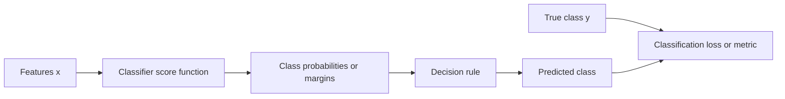
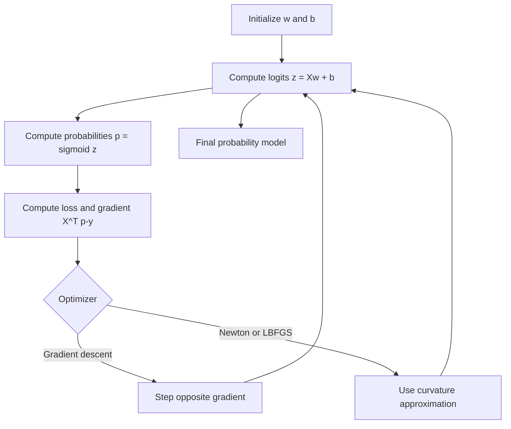
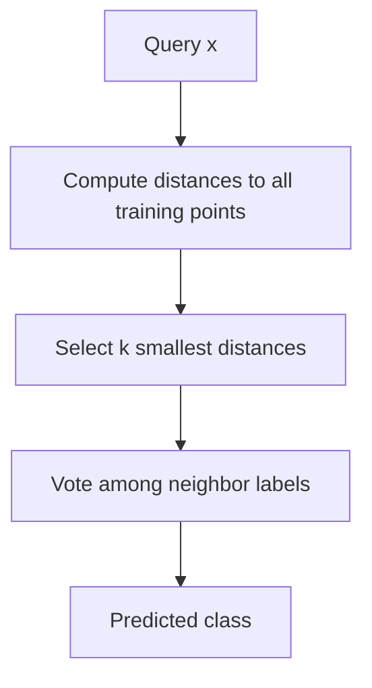
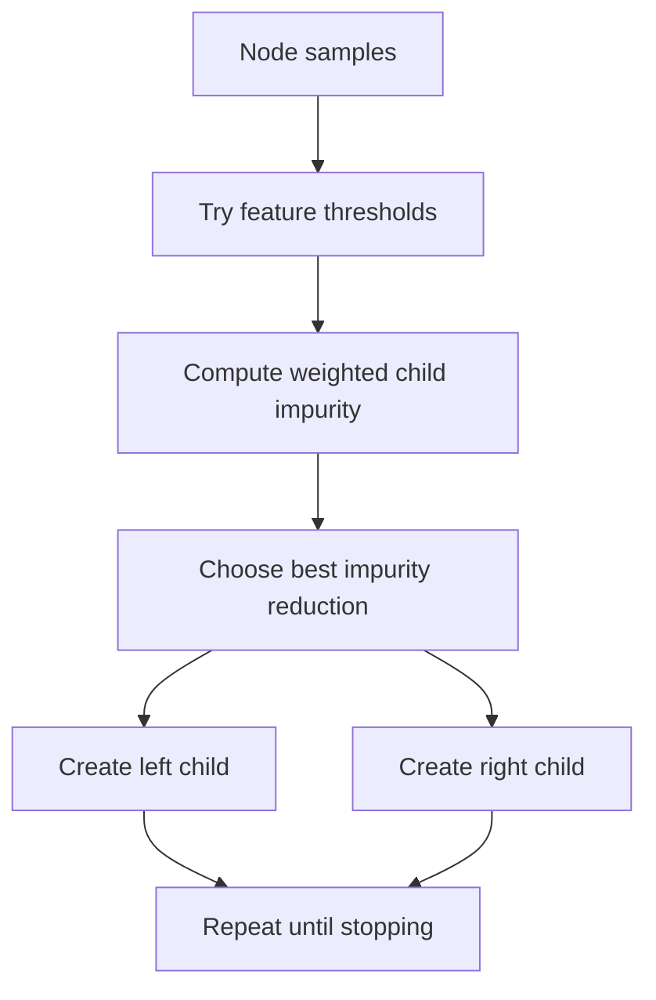
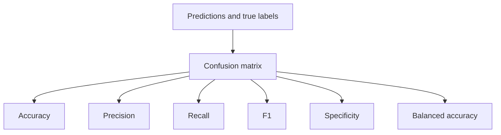
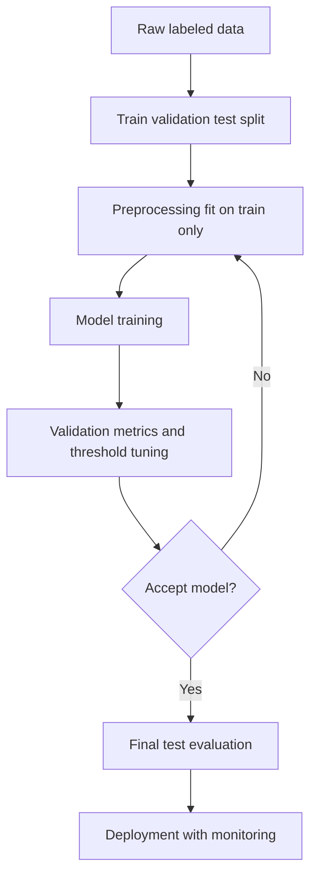

# Classification in Machine Learning

Classification is supervised learning with a discrete target. Given labeled examples

$$
\mathcal{D}
=
\{(x_i,y_i)\}_{i=1}^{n},
\qquad
x_i \in \mathbb{R}^{d},
\qquad
y_i \in \mathcal{Y},
$$

the goal is to learn a predictor

$$
h:\mathcal{X}\rightarrow\mathcal{Y}
$$

or, more often, a scoring/probability model

$$
f:\mathcal{X}\rightarrow\mathbb{R}^{K}
$$

whose output is converted into a class label. For a $K$-class problem,

$$
\mathcal{Y}
=
\{1,\dots,K\}.
$$

The central difference from regression is not merely that outputs are "categories"; it is that the loss, uncertainty model, decision rule, and evaluation metrics are different. Classification usually estimates class posteriors, margins, likelihood ratios, or decision regions rather than conditional means.



## 1. Problem Formulations

### 1.1 Binary Classification

Binary classification has two classes:

$$
\mathcal{Y}
=
\{0,1\}
$$

or, for margin-based methods,

$$
\mathcal{Y}
=
\{-1,+1\}.
$$

A probabilistic classifier estimates

$$
\eta(x)
=
P(Y=1\mid X=x),
$$

then predicts class $1$ if

$$
\eta(x) \geq \tau,
$$

where $\tau$ is the decision threshold. The default $\tau=0.5$ is optimal only under equal misclassification costs and calibrated probabilities.

### 1.2 Multiclass Classification

Multiclass classification assigns exactly one label from $K>2$ mutually exclusive classes:

$$
y_i \in \{1,\dots,K\}.
$$

A probabilistic model estimates

$$
p_k(x)
=
P(Y=k\mid X=x),
\qquad
k=1,\dots,K,
$$

with

$$
\sum_{k=1}^{K}p_k(x)=1.
$$

The standard decision rule is

$$
\hat{y}
=
\arg\max_{k}p_k(x).
$$

### 1.3 Multilabel Classification

Multilabel classification allows more than one label to be true at once. The target is a binary vector

$$
y_i
=
(y_{i1},\dots,y_{iK}) \in \{0,1\}^{K}.
$$

The usual independent-label baseline estimates

$$
P(Y_k=1\mid X=x)
$$

for each label $k$, then thresholds each probability separately:

$$
\hat{y}_k
=
\mathbf{1}
\left[
P(Y_k=1\mid X=x)\geq \tau_k
\right].
$$

This baseline ignores label dependence. That is often acceptable for a first model, but it fails when labels are strongly structured, such as "cardiology" implying "medicine" or "action" frequently co-occurring with "adventure".

## 2. Decision-Theoretic Foundation

Classification is most cleanly derived by minimizing expected loss.

Let the action space be the set of predicted labels:

$$
\mathcal{A}
=
\mathcal{Y}.
$$

Let

$$
L(a,y)
$$

be the cost of predicting $a$ when the true label is $y$. At a fixed input $x$, the conditional risk of action $a$ is

$$
R(a\mid x)
=
\mathbb{E}[L(a,Y)\mid X=x]
=
\sum_{k=1}^{K}L(a,k)P(Y=k\mid X=x).
$$

The Bayes classifier chooses the action with minimum conditional risk:

$$
h^\star(x)
=
\arg\min_{a\in\mathcal{Y}}R(a\mid x).
$$

### 2.1 Zero-One Loss

For ordinary classification accuracy, the loss is

$$
L(a,y)
=
\mathbf{1}[a\neq y].
$$

Then

$$
\begin{aligned}
R(a\mid x)
&=
\sum_{k=1}^{K}\mathbf{1}[a\neq k]P(Y=k\mid X=x) \\
&=
\sum_{k\neq a}P(Y=k\mid X=x) \\
&=
1-P(Y=a\mid X=x).
\end{aligned}
$$

Minimizing this risk is equivalent to maximizing the posterior probability:

$$
h^\star(x)
=
\arg\max_{a}P(Y=a\mid X=x).
$$

This is the mathematical reason classifiers often produce probabilities first and labels second.

### 2.2 Cost-Sensitive Binary Classification

Suppose $Y\in\{0,1\}$ and the costs are

$$
L(1,0)=C_{\operatorname{FP}},
\qquad
L(0,1)=C_{\operatorname{FN}},
\qquad
L(0,0)=L(1,1)=0.
$$

At a fixed $x$, predicting $1$ has risk

$$
R(1\mid x)
=
C_{\operatorname{FP}}P(Y=0\mid X=x)
=
C_{\operatorname{FP}}(1-\eta(x)).
$$

Predicting $0$ has risk

$$
R(0\mid x)
=
C_{\operatorname{FN}}P(Y=1\mid X=x)
=
C_{\operatorname{FN}}\eta(x).
$$

Predict class $1$ when

$$
C_{\operatorname{FP}}(1-\eta(x))
\leq
C_{\operatorname{FN}}\eta(x).
$$

Solving,

$$
\eta(x)
\geq
\frac{C_{\operatorname{FP}}}{C_{\operatorname{FP}}+C_{\operatorname{FN}}}.
$$

If false negatives are more expensive than false positives, $C_{\operatorname{FN}}>C_{\operatorname{FP}}$, the threshold decreases. This is why medical screening systems often use thresholds below $0.5$.

## 3. Scores, Margins, Logits, and Probabilities

Most classifiers do not directly output labels. They output scores.

For binary linear classification, a score is often

$$
z
=
w^\top x+b.
$$

The label rule might be

$$
\hat{y}
=
\mathbf{1}[z\geq 0].
$$

For $y\in\{-1,+1\}$, the signed margin is

$$
m
=
y(w^\top x+b).
$$

Correct classification means

$$
m>0.
$$

A larger positive margin means the example is farther from the decision boundary, assuming $w$ is normalized.

For probabilistic binary classification, the score is converted into a probability through the sigmoid:

$$
\sigma(z)
=
\frac{1}{1+\exp(-z)}.
$$

The inverse transformation is the logit:

$$
\operatorname{logit}(p)
=
\log\frac{p}{1-p}.
$$

Thus logistic regression assumes the log-odds are linear:

$$
\log\frac{P(Y=1\mid x)}{P(Y=0\mid x)}
=
w^\top x+b.
$$

For multiclass classification, scores

$$
z_k
=
w_k^\top x+b_k
$$

are converted into probabilities by softmax:

$$
p_k
=
\frac{\exp(z_k)}{\sum_{j=1}^{K}\exp(z_j)}.
$$

Softmax is invariant to adding the same constant to all logits:

$$
\operatorname{softmax}(z)
=
\operatorname{softmax}(z+c\mathbf{1}).
$$

This invariance is exploited for numerical stability by subtracting $\max_j z_j$ before exponentiation.

## 4. Logistic Regression from First Principles

Despite the name, logistic regression is a classifier. It is a discriminative probabilistic model for

$$
P(Y\mid X).
$$

### 4.1 Binary Likelihood

Assume labels

$$
y_i\in\{0,1\}.
$$

The model is

$$
p_i
=
P(Y_i=1\mid x_i)
=
\sigma(w^\top x_i+b).
$$

Equivalently,

$$
P(Y_i=y_i\mid x_i)
=
p_i^{y_i}(1-p_i)^{1-y_i}.
$$

Assuming conditional independence of examples given the parameters, the likelihood is

$$
\mathcal{L}(w,b)
=
\prod_{i=1}^{n}p_i^{y_i}(1-p_i)^{1-y_i}.
$$

The log-likelihood is

$$
\ell(w,b)
=
\sum_{i=1}^{n}
\left[
y_i\log p_i
+
(1-y_i)\log(1-p_i)
\right].
$$

Maximum likelihood is equivalent to minimizing the negative log-likelihood:

$$
J(w,b)
=
-
\ell(w,b)
=
\sum_{i=1}^{n}
\left[
-y_i\log p_i
-
(1-y_i)\log(1-p_i)
\right].
$$

This is binary cross-entropy.

### 4.2 Gradient Derivation

Let

$$
z_i
=
w^\top x_i+b,
\qquad
p_i
=
\sigma(z_i).
$$

The derivative of the sigmoid is

$$
\frac{d\sigma(z)}{dz}
=
\sigma(z)(1-\sigma(z)).
$$

For one example, the loss is

$$
J_i
=
-y_i\log p_i-(1-y_i)\log(1-p_i).
$$

Differentiate with respect to $z_i$:

$$
\begin{aligned}
\frac{\partial J_i}{\partial z_i}
&=
\frac{\partial J_i}{\partial p_i}
\frac{\partial p_i}{\partial z_i} \\
&=
\left(
-\frac{y_i}{p_i}
+
\frac{1-y_i}{1-p_i}
\right)
p_i(1-p_i) \\
&=
-y_i(1-p_i)+(1-y_i)p_i \\
&=
p_i-y_i.
\end{aligned}
$$

Since

$$
\frac{\partial z_i}{\partial w}=x_i,
\qquad
\frac{\partial z_i}{\partial b}=1,
$$

the gradients are

$$
\nabla_w J
=
\sum_{i=1}^{n}(p_i-y_i)x_i,
$$

$$
\frac{\partial J}{\partial b}
=
\sum_{i=1}^{n}(p_i-y_i).
$$

With average loss and $L_2$ regularization,

$$
J_\lambda(w,b)
=
\frac{1}{n}\sum_{i=1}^{n}J_i
+
\frac{\lambda}{2}\|w\|_2^2,
$$

the gradient becomes

$$
\nabla_w J_\lambda
=
\frac{1}{n}X^\top(p-y)+\lambda w.
$$

The intercept is usually not regularized.

### 4.3 Newton and IRLS View

Logistic regression has no closed-form maximum likelihood solution. Newton's method updates

$$
\theta_{t+1}
=
\theta_t-H^{-1}\nabla J(\theta_t),
$$

where

$$
\theta
=
\begin{bmatrix}
b \\
w
\end{bmatrix}.
$$

Let $\tilde{X}$ be the design matrix with an intercept column. The Hessian of the unregularized negative log-likelihood is

$$
H
=
\tilde{X}^\top R\tilde{X},
$$

where

$$
R
=
\operatorname{diag}(p_i(1-p_i)).
$$

This yields iteratively reweighted least squares. At each step, logistic regression solves a weighted least-squares problem with weights $p_i(1-p_i)$. Examples near probability $0.5$ get high curvature; saturated examples with probability near $0$ or $1$ get small curvature.



### 4.4 Worked Binary Example

Consider one feature, with

$$
w=0.8,
\qquad
b=-1.0,
\qquad
x=2.0,
\qquad
y=1.
$$

The logit is

$$
z
=
0.8\cdot 2.0-1.0
=
0.6.
$$

The probability is

$$
p
=
\frac{1}{1+\exp(-0.6)}
\approx
0.6457.
$$

The loss is

$$
J
=
-\log(0.6457)
\approx
0.4375.
$$

The derivative with respect to the logit is

$$
\frac{\partial J}{\partial z}
=
p-y
=
-0.3543.
$$

The parameter gradients are

$$
\frac{\partial J}{\partial w}
=
(p-y)x
=
-0.7086,
$$

$$
\frac{\partial J}{\partial b}
=
p-y
=
-0.3543.
$$

Gradient descent with learning rate $\alpha=0.1$ gives

$$
w_{\operatorname{new}}
=
0.8-0.1(-0.7086)
=
0.8709,
$$

$$
b_{\operatorname{new}}
=
-1.0-0.1(-0.3543)
=
-0.9646.
$$

Because the true label is $1$ and the predicted probability is too low, the update increases the logit.

### 4.5 From-Scratch Binary Logistic Regression

```python
import numpy as np


class BinaryLogisticRegression:
    """Binary logistic regression trained by batch gradient descent."""

    def __init__(self, lr=0.1, n_iter=2000, l2=0.0, tol=1e-9):
        self.lr = lr
        self.n_iter = n_iter
        self.l2 = l2
        self.tol = tol
        self.w = None
        self.b = 0.0
        self.loss_history = []

    @staticmethod
    def _sigmoid(z):
        # Stable sigmoid: avoids overflow for large negative z.
        out = np.empty_like(z, dtype=float)
        pos = z >= 0
        out[pos] = 1.0 / (1.0 + np.exp(-z[pos]))
        exp_z = np.exp(z[~pos])
        out[~pos] = exp_z / (1.0 + exp_z)
        return out

    def fit(self, X, y):
        X = np.asarray(X, dtype=float)
        y = np.asarray(y, dtype=float)
        n, d = X.shape
        self.w = np.zeros(d)
        self.b = 0.0

        prev_loss = np.inf
        eps = 1e-15

        for _ in range(self.n_iter):
            z = X @ self.w + self.b
            p = self._sigmoid(z)

            data_loss = -np.mean(
                y * np.log(p + eps) + (1.0 - y) * np.log(1.0 - p + eps)
            )
            reg_loss = 0.5 * self.l2 * np.dot(self.w, self.w)
            loss = data_loss + reg_loss
            self.loss_history.append(loss)

            if abs(prev_loss - loss) < self.tol:
                break
            prev_loss = loss

            error = p - y
            grad_w = (X.T @ error) / n + self.l2 * self.w
            grad_b = np.mean(error)

            self.w -= self.lr * grad_w
            self.b -= self.lr * grad_b

        return self

    def predict_proba(self, X):
        X = np.asarray(X, dtype=float)
        p1 = self._sigmoid(X @ self.w + self.b)
        return np.column_stack([1.0 - p1, p1])

    def predict(self, X, threshold=0.5):
        return (self.predict_proba(X)[:, 1] >= threshold).astype(int)
```

Important implementation details:

- Use a stable sigmoid; naive `1 / (1 + exp(-z))` overflows when $z$ is a large negative number.
- Add a small $\epsilon$ inside logarithms or compute the loss with a fused library routine.
- Standardize features before fitting; otherwise one feature can dominate gradient magnitudes.
- Regularize weights but usually not the intercept.
- Complete separation can drive the unregularized maximum likelihood estimate toward infinite weights.

### 4.6 Library Equivalent

```python
from sklearn.linear_model import LogisticRegression
from sklearn.pipeline import make_pipeline
from sklearn.preprocessing import StandardScaler


clf = make_pipeline(
    StandardScaler(),
    LogisticRegression(
        penalty="l2",
        C=1.0,
        solver="lbfgs",
        max_iter=1000,
    ),
)

clf.fit(X_train, y_train)
y_pred = clf.predict(X_test)
y_prob = clf.predict_proba(X_test)
```

Internally, `LogisticRegression` minimizes a regularized negative log-likelihood. The parameter `C` is the inverse regularization strength, so smaller `C` means stronger regularization. For dense medium-sized problems, `lbfgs` uses a limited-memory quasi-Newton approximation to curvature rather than plain gradient descent. For very large datasets, stochastic solvers such as `sag` or `saga` can be more appropriate.

## 5. Multiclass Softmax Regression

Softmax regression generalizes logistic regression to $K$ mutually exclusive classes.

Let

$$
W\in\mathbb{R}^{d\times K},
\qquad
b\in\mathbb{R}^{K}.
$$

For an input $x_i$,

$$
z_i
=
W^\top x_i+b
\in\mathbb{R}^{K}.
$$

The class probabilities are

$$
p_{ik}
=
\frac{\exp(z_{ik})}{\sum_{j=1}^{K}\exp(z_{ij})}.
$$

If labels are one-hot encoded as

$$
y_{ik}
=
\mathbf{1}[y_i=k],
$$

the negative log-likelihood is

$$
J(W,b)
=
-
\sum_{i=1}^{n}\sum_{k=1}^{K}
y_{ik}\log p_{ik}.
$$

For one example, the gradient with respect to the logit $z_k$ is

$$
\frac{\partial J_i}{\partial z_k}
=
p_k-y_k.
$$

Therefore,

$$
\nabla_W J
=
X^\top(P-Y),
$$

$$
\nabla_b J
=
\sum_{i=1}^{n}(p_i-y_i).
$$

This is the same error form as binary logistic regression, but now $p_i-y_i$ is a vector over classes.

### 5.1 Stable Softmax and Cross-Entropy

Directly computing $\exp(z_k)$ can overflow. Use

$$
m
=
\max_k z_k
$$

and compute

$$
p_k
=
\frac{\exp(z_k-m)}{\sum_j \exp(z_j-m)}.
$$

For cross-entropy, avoid separately computing probabilities when possible. The per-example loss for true class $y$ is

$$
J_i
=
-z_y+\log\sum_{j=1}^{K}\exp(z_j).
$$

The stable version is

$$
J_i
=
-(z_y-m)
+
\log\sum_{j=1}^{K}\exp(z_j-m).
$$

### 5.2 From-Scratch Softmax Regression

```python
import numpy as np


class SoftmaxRegression:
    """Multiclass linear classifier trained with full-batch gradient descent."""

    def __init__(self, lr=0.1, n_iter=2000, l2=0.0, tol=1e-9):
        self.lr = lr
        self.n_iter = n_iter
        self.l2 = l2
        self.tol = tol
        self.W = None
        self.b = None
        self.classes_ = None

    @staticmethod
    def _softmax(logits):
        shifted = logits - logits.max(axis=1, keepdims=True)
        exp_logits = np.exp(shifted)
        return exp_logits / exp_logits.sum(axis=1, keepdims=True)

    def fit(self, X, y):
        X = np.asarray(X, dtype=float)
        y = np.asarray(y)
        n, d = X.shape

        self.classes_, y_idx = np.unique(y, return_inverse=True)
        K = len(self.classes_)
        Y = np.eye(K)[y_idx]

        self.W = np.zeros((d, K))
        self.b = np.zeros(K)

        prev_loss = np.inf

        for _ in range(self.n_iter):
            logits = X @ self.W + self.b
            P = self._softmax(logits)

            shifted = logits - logits.max(axis=1, keepdims=True)
            log_sum_exp = np.log(np.exp(shifted).sum(axis=1))
            true_logits = shifted[np.arange(n), y_idx]
            data_loss = np.mean(-true_logits + log_sum_exp)
            reg_loss = 0.5 * self.l2 * np.sum(self.W * self.W)
            loss = data_loss + reg_loss

            if abs(prev_loss - loss) < self.tol:
                break
            prev_loss = loss

            error = P - Y
            grad_W = (X.T @ error) / n + self.l2 * self.W
            grad_b = error.mean(axis=0)

            self.W -= self.lr * grad_W
            self.b -= self.lr * grad_b

        return self

    def predict_proba(self, X):
        X = np.asarray(X, dtype=float)
        return self._softmax(X @ self.W + self.b)

    def predict(self, X):
        idx = np.argmax(self.predict_proba(X), axis=1)
        return self.classes_[idx]
```

## 6. Naive Bayes

Naive Bayes is a generative classifier. It models

$$
P(X\mid Y)
$$

and

$$
P(Y),
$$

then applies Bayes' theorem:

$$
P(Y=k\mid X=x)
=
\frac{P(X=x\mid Y=k)P(Y=k)}{P(X=x)}.
$$

For classification, the denominator is constant across classes, so

$$
\hat{y}
=
\arg\max_k P(Y=k)P(X=x\mid Y=k).
$$

The naive assumption is conditional independence of features given the class:

$$
P(X=x\mid Y=k)
=
\prod_{j=1}^{d}P(X_j=x_j\mid Y=k).
$$

Thus

$$
\hat{y}
=
\arg\max_k
P(Y=k)
\prod_{j=1}^{d}P(X_j=x_j\mid Y=k).
$$

In implementation, use logs:

$$
\hat{y}
=
\arg\max_k
\left[
\log P(Y=k)
+
\sum_{j=1}^{d}\log P(X_j=x_j\mid Y=k)
\right].
$$

This prevents underflow when multiplying many small probabilities.

### 6.1 Multinomial Naive Bayes

For text classification with count vectors

$$
x=(x_1,\dots,x_d),
$$

where $x_j$ counts token $j$, the multinomial event model estimates

$$
\theta_{kj}
=
P(\text{token }j\mid Y=k).
$$

With Laplace or additive smoothing $\alpha>0$,

$$
\hat{\theta}_{kj}
=
\frac{N_{kj}+\alpha}{N_k+\alpha d},
$$

where $N_{kj}$ is the total count of token $j$ among training documents in class $k$, and

$$
N_k
=
\sum_{j=1}^{d}N_{kj}.
$$

The class prior is

$$
\hat{\pi}_k
=
\frac{n_k}{n}.
$$

The log score is

$$
s_k(x)
=
\log\hat{\pi}_k
+
\sum_{j=1}^{d}x_j\log\hat{\theta}_{kj}.
$$

### 6.2 Worked Naive Bayes Example

Vocabulary:

$$
\{\text{cheap}, \text{loan}, \text{meeting}\}.
$$

Suppose the class token counts are:

| Class | cheap | loan | meeting | Total |
| --- | ---: | ---: | ---: | ---: |
| Spam | 3 | 2 | 0 | 5 |
| Ham | 0 | 1 | 4 | 5 |

With $\alpha=1$ and $d=3$:

$$
\theta_{\operatorname{spam},\operatorname{cheap}}
=
\frac{3+1}{5+3}
=
0.5,
$$

$$
\theta_{\operatorname{spam},\operatorname{loan}}
=
\frac{2+1}{8}
=
0.375,
$$

$$
\theta_{\operatorname{spam},\operatorname{meeting}}
=
\frac{0+1}{8}
=
0.125.
$$

For ham:

$$
\theta_{\operatorname{ham},\operatorname{cheap}}
=
\frac{1}{8}
=
0.125,
$$

$$
\theta_{\operatorname{ham},\operatorname{loan}}
=
\frac{2}{8}
=
0.25,
$$

$$
\theta_{\operatorname{ham},\operatorname{meeting}}
=
\frac{5}{8}
=
0.625.
$$

For document "cheap loan", the count vector is

$$
x=(1,1,0).
$$

Assume equal priors. Spam score:

$$
s_{\operatorname{spam}}
=
\log 0.5+\log 0.5+\log 0.375
\approx
-2.367.
$$

Ham score:

$$
s_{\operatorname{ham}}
=
\log 0.5+\log 0.125+\log 0.25
\approx
-4.159.
$$

The prediction is spam because $-2.367>-4.159$.

### 6.3 From-Scratch Multinomial Naive Bayes

```python
import numpy as np


class MultinomialNBFromScratch:
    """Multinomial Naive Bayes for nonnegative count features."""

    def __init__(self, alpha=1.0):
        self.alpha = alpha
        self.classes_ = None
        self.class_log_prior_ = None
        self.feature_log_prob_ = None

    def fit(self, X, y):
        X = np.asarray(X, dtype=float)
        y = np.asarray(y)
        if np.any(X < 0):
            raise ValueError("MultinomialNB requires nonnegative features.")

        self.classes_, y_idx = np.unique(y, return_inverse=True)
        K = len(self.classes_)
        n, d = X.shape

        class_count = np.bincount(y_idx, minlength=K).astype(float)
        feature_count = np.zeros((K, d), dtype=float)

        for k in range(K):
            feature_count[k] = X[y_idx == k].sum(axis=0)

        smoothed = feature_count + self.alpha
        smoothed_totals = smoothed.sum(axis=1, keepdims=True)

        self.class_log_prior_ = np.log(class_count / n)
        self.feature_log_prob_ = np.log(smoothed / smoothed_totals)
        return self

    def predict_log_proba(self, X):
        X = np.asarray(X, dtype=float)
        log_joint = X @ self.feature_log_prob_.T + self.class_log_prior_
        normalizer = logsumexp(log_joint, axis=1, keepdims=True)
        return log_joint - normalizer

    def predict(self, X):
        X = np.asarray(X, dtype=float)
        scores = X @ self.feature_log_prob_.T + self.class_log_prior_
        return self.classes_[np.argmax(scores, axis=1)]


def logsumexp(a, axis=None, keepdims=False):
    m = np.max(a, axis=axis, keepdims=True)
    out = m + np.log(np.sum(np.exp(a - m), axis=axis, keepdims=True))
    if not keepdims:
        out = np.squeeze(out, axis=axis)
    return out
```

Library equivalent:

```python
from sklearn.feature_extraction.text import CountVectorizer
from sklearn.naive_bayes import MultinomialNB
from sklearn.pipeline import make_pipeline


model = make_pipeline(
    CountVectorizer(),
    MultinomialNB(alpha=1.0),
)

model.fit(train_texts, train_labels)
pred = model.predict(test_texts)
```

`CountVectorizer` builds a sparse document-term matrix. `MultinomialNB` estimates smoothed class priors and smoothed token probabilities, then computes log joint likelihoods. The prediction is the class with the largest log joint likelihood.

## 7. K-Nearest Neighbors

K-nearest neighbors is a nonparametric classifier. It stores the training set and classifies a test point by local voting.

Given a distance function

$$
d(x,x_i),
$$

let

$$
\mathcal{N}_k(x)
$$

be the indices of the $k$ nearest training examples. The unweighted KNN prediction is

$$
\hat{y}
=
\arg\max_{c}
\sum_{i\in\mathcal{N}_k(x)}
\mathbf{1}[y_i=c].
$$

Distance-weighted KNN uses weights such as

$$
\omega_i
=
\frac{1}{d(x,x_i)+\epsilon},
$$

and predicts

$$
\hat{y}
=
\arg\max_c
\sum_{i\in\mathcal{N}_k(x)}
\omega_i\mathbf{1}[y_i=c].
$$

### 7.1 Execution Steps

1. Store training features and labels.
2. For a query point, compute its distance to each training point.
3. Select the $k$ smallest distances.
4. Aggregate labels by majority or weighted vote.
5. Return the winning class.



### 7.2 Bias-Variance Intuition

Small $k$ gives flexible, jagged decision boundaries with low bias and high variance. Large $k$ smooths the boundary, increasing bias and reducing variance. Feature scaling is critical because Euclidean distance is sensitive to units.

### 7.3 From-Scratch KNN

```python
import numpy as np


class KNNClassifier:
    def __init__(self, k=5, weighted=False):
        self.k = k
        self.weighted = weighted
        self.X_train = None
        self.y_train = None
        self.classes_ = None

    def fit(self, X, y):
        self.X_train = np.asarray(X, dtype=float)
        self.y_train = np.asarray(y)
        self.classes_ = np.unique(self.y_train)
        return self

    def predict(self, X):
        X = np.asarray(X, dtype=float)
        preds = []

        for x in X:
            diff = self.X_train - x
            dist = np.sqrt(np.sum(diff * diff, axis=1))
            nn_idx = np.argpartition(dist, self.k - 1)[: self.k]

            scores = np.zeros(len(self.classes_), dtype=float)
            for idx in nn_idx:
                class_pos = np.where(self.classes_ == self.y_train[idx])[0][0]
                if self.weighted:
                    scores[class_pos] += 1.0 / (dist[idx] + 1e-12)
                else:
                    scores[class_pos] += 1.0

            preds.append(self.classes_[np.argmax(scores)])

        return np.asarray(preds)
```

Library equivalent:

```python
from sklearn.neighbors import KNeighborsClassifier
from sklearn.pipeline import make_pipeline
from sklearn.preprocessing import StandardScaler


knn = make_pipeline(
    StandardScaler(),
    KNeighborsClassifier(
        n_neighbors=5,
        weights="distance",
        metric="minkowski",
        p=2,
    ),
)

knn.fit(X_train, y_train)
pred = knn.predict(X_test)
```

`KNeighborsClassifier` can use brute-force search, KD-trees, or ball trees depending on the metric, dimensionality, and algorithm setting. In high dimensions, tree-based nearest-neighbor search often loses effectiveness because distances concentrate and pruning becomes weak.

## 8. Support Vector Machines

Support vector machines construct a decision boundary with maximum margin. For linearly separable binary data with labels

$$
y_i\in\{-1,+1\},
$$

the classifier is

$$
h(x)
=
\operatorname{sign}(w^\top x+b).
$$

The functional margin for example $i$ is

$$
y_i(w^\top x_i+b).
$$

The geometric distance from $x_i$ to the hyperplane is

$$
\frac{|w^\top x_i+b|}{\|w\|_2}.
$$

For correctly classified examples, the signed geometric margin is

$$
\gamma_i
=
\frac{y_i(w^\top x_i+b)}{\|w\|_2}.
$$

### 8.1 Hard-Margin SVM

Because scaling $w$ and $b$ changes functional margins without changing the boundary, impose

$$
y_i(w^\top x_i+b)\geq 1.
$$

Then the closest points have distance

$$
\frac{1}{\|w\|_2},
$$

and the margin width between the two supporting hyperplanes is

$$
\frac{2}{\|w\|_2}.
$$

Maximizing the margin is equivalent to minimizing

$$
\frac{1}{2}\|w\|_2^2.
$$

The hard-margin primal problem is

$$
\begin{aligned}
\min_{w,b}\quad
&\frac{1}{2}\|w\|_2^2 \\
\text{subject to}\quad
&y_i(w^\top x_i+b)\geq 1,
\qquad
i=1,\dots,n.
\end{aligned}
$$

### 8.2 Soft-Margin SVM

Real data is rarely separable. Introduce slack variables

$$
\xi_i\geq 0
$$

to allow margin violations:

$$
y_i(w^\top x_i+b)\geq 1-\xi_i.
$$

The soft-margin primal problem is

$$
\begin{aligned}
\min_{w,b,\xi}\quad
&\frac{1}{2}\|w\|_2^2
+
C\sum_{i=1}^{n}\xi_i \\
\text{subject to}\quad
&y_i(w^\top x_i+b)\geq 1-\xi_i, \\
&\xi_i\geq 0.
\end{aligned}
$$

This is equivalent to minimizing regularized hinge loss:

$$
\min_{w,b}
\frac{1}{2}\|w\|_2^2
+
C\sum_{i=1}^{n}
\max(0,1-y_i(w^\top x_i+b)).
$$

Only examples with

$$
y_i(w^\top x_i+b)\leq 1
$$

contribute to the hinge-loss gradient. These are support vectors or margin violators.

### 8.3 Kernel SVM

The dual formulation depends on data only through inner products

$$
x_i^\top x_j.
$$

Replacing inner products with a kernel

$$
K(x_i,x_j)
=
\phi(x_i)^\top\phi(x_j)
$$

implicitly fits a linear separator in feature space $\phi(x)$.

Common kernels:

| Kernel | Formula | Effect |
| --- | --- | --- |
| Linear | $K(x,z)=x^\top z$ | Linear boundary |
| Polynomial | $K(x,z)=(\gamma x^\top z+r)^q$ | Feature interactions up to degree $q$ |
| RBF | $K(x,z)=\exp(-\gamma\|x-z\|_2^2)$ | Local nonlinear decision regions |

The prediction has the form

$$
f(x)
=
\sum_{i\in\mathcal{S}}\alpha_i y_i K(x_i,x)+b,
$$

where $\mathcal{S}$ is the set of support vectors.

Library equivalent:

```python
from sklearn.pipeline import make_pipeline
from sklearn.preprocessing import StandardScaler
from sklearn.svm import SVC, LinearSVC


linear_svm = make_pipeline(
    StandardScaler(),
    LinearSVC(C=1.0, max_iter=5000),
)

rbf_svm = make_pipeline(
    StandardScaler(),
    SVC(C=1.0, kernel="rbf", gamma="scale", probability=False),
)
```

`LinearSVC` solves a linear SVM objective efficiently for high-dimensional data. `SVC` solves the kernel SVM dual and stores support vectors. Kernel SVM prediction cost grows with the number of support vectors, which can be large.

## 9. Decision Trees

Decision trees recursively partition feature space. For classification, each leaf stores a class distribution.

At a node containing sample index set $S$, define the class proportion

$$
p_k
=
\frac{1}{|S|}
\sum_{i\in S}\mathbf{1}[y_i=k].
$$

Two common impurity measures are Gini impurity:

$$
G(S)
=
1-\sum_{k=1}^{K}p_k^2,
$$

and entropy:

$$
H(S)
=
-\sum_{k=1}^{K}p_k\log p_k.
$$

A split divides $S$ into left and right child sets:

$$
S_L
=
\{i\in S:x_{ij}\leq t\},
\qquad
S_R
=
\{i\in S:x_{ij}>t\}.
$$

The weighted impurity after the split is

$$
I_{\operatorname{split}}
=
\frac{|S_L|}{|S|}I(S_L)
+
\frac{|S_R|}{|S|}I(S_R).
$$

The split gain is

$$
\Delta I
=
I(S)-I_{\operatorname{split}}.
$$

The tree greedily chooses the split with largest gain.



### 9.1 Worked Gini Split

Suppose a node has 10 examples:

$$
6 \text{ positive}, \qquad 4 \text{ negative}.
$$

The parent Gini impurity is

$$
G(S)
=
1-\left(\frac{6}{10}\right)^2-\left(\frac{4}{10}\right)^2
=
1-0.36-0.16
=
0.48.
$$

A candidate split gives:

$$
S_L:
4 \text{ positive}, 1 \text{ negative},
$$

$$
S_R:
2 \text{ positive}, 3 \text{ negative}.
$$

Left impurity:

$$
G(S_L)
=
1-\left(\frac{4}{5}\right)^2-\left(\frac{1}{5}\right)^2
=
0.32.
$$

Right impurity:

$$
G(S_R)
=
1-\left(\frac{2}{5}\right)^2-\left(\frac{3}{5}\right)^2
=
0.48.
$$

Weighted impurity:

$$
I_{\operatorname{split}}
=
\frac{5}{10}0.32+\frac{5}{10}0.48
=
0.40.
$$

Gini gain:

$$
\Delta G
=
0.48-0.40
=
0.08.
$$

### 9.2 Library Equivalent

```python
from sklearn.tree import DecisionTreeClassifier


tree = DecisionTreeClassifier(
    criterion="gini",
    max_depth=4,
    min_samples_leaf=10,
    random_state=0,
)

tree.fit(X_train, y_train)
pred = tree.predict(X_test)
prob = tree.predict_proba(X_test)
```

`DecisionTreeClassifier` sorts candidate thresholds for each feature and greedily selects impurity-reducing splits. It does not optimize a global tree objective. Regularization is controlled through depth, minimum samples per split/leaf, maximum leaf nodes, and pruning.

## 10. Random Forests

Random forests reduce the variance of decision trees by averaging many decorrelated trees.

For $B$ trees, each tree is trained on a bootstrap sample. At each split, the algorithm considers only a random subset of features. For classification, the forest predicts by majority vote or averaged probabilities:

$$
\hat{p}_k(x)
=
\frac{1}{B}\sum_{b=1}^{B}\hat{p}_{bk}(x),
$$

$$
\hat{y}
=
\arg\max_k\hat{p}_k(x).
$$

Feature subsampling reduces correlation between trees. If individual tree errors have variance $\sigma^2$ and pairwise correlation $\rho$, averaging $B$ predictors gives variance approximately

$$
\rho\sigma^2
+
\frac{1-\rho}{B}\sigma^2.
$$

Increasing $B$ reduces the second term but not the correlation floor $\rho\sigma^2$.

Library equivalent:

```python
from sklearn.ensemble import RandomForestClassifier


forest = RandomForestClassifier(
    n_estimators=300,
    max_features="sqrt",
    min_samples_leaf=2,
    class_weight="balanced",
    n_jobs=-1,
    random_state=0,
)

forest.fit(X_train, y_train)
pred = forest.predict(X_test)
prob = forest.predict_proba(X_test)
```

`RandomForestClassifier` trains independent decision trees on bootstrap samples. The `max_features="sqrt"` default-style setting for classification is a standard way to decorrelate trees. Out-of-bag estimates can approximate validation performance without a separate validation set when bootstrap sampling is enabled.

## 11. Classification Metrics

Accuracy alone is often misleading, especially with class imbalance or asymmetric costs.

For binary classification, define:

| Term | Meaning |
| --- | --- |
| TP | Predicted positive and actually positive |
| TN | Predicted negative and actually negative |
| FP | Predicted positive but actually negative |
| FN | Predicted negative but actually positive |



### 11.1 Confusion Matrix

For binary labels, using positive class $1$:

| | Predicted positive | Predicted negative |
| --- | ---: | ---: |
| Actual positive | TP | FN |
| Actual negative | FP | TN |

For multiclass classification, the confusion matrix $C$ is

$$
C_{ij}
=
\#\{m:y_m=i,\hat{y}_m=j\}.
$$

Rows are true classes and columns are predicted classes in this convention.

### 11.2 Accuracy

$$
\operatorname{Accuracy}
=
\frac{TP+TN}{TP+TN+FP+FN}.
$$

Accuracy estimates

$$
P(\hat{Y}=Y).
$$

It is useful when classes are balanced and mistakes have similar costs.

### 11.3 Precision

$$
\operatorname{Precision}
=
\frac{TP}{TP+FP}.
$$

Precision asks: among predicted positives, how many were truly positive?

It penalizes false positives. In spam filtering, low precision means legitimate emails are incorrectly sent to spam.

### 11.4 Recall

$$
\operatorname{Recall}
=
\frac{TP}{TP+FN}.
$$

Recall asks: among actual positives, how many were found?

It penalizes false negatives. In disease screening, low recall means many real cases are missed.

### 11.5 Specificity

$$
\operatorname{Specificity}
=
\frac{TN}{TN+FP}.
$$

Specificity is the true negative rate.

### 11.6 F1 Score

The F1 score is the harmonic mean of precision and recall:

$$
F_1
=
2
\frac{\operatorname{Precision}\cdot\operatorname{Recall}}
{\operatorname{Precision}+\operatorname{Recall}}.
$$

Substituting the definitions:

$$
F_1
=
\frac{2TP}{2TP+FP+FN}.
$$

The harmonic mean is dominated by the smaller value, so F1 is high only when both precision and recall are high.

### 11.7 Balanced Accuracy

For binary classification:

$$
\operatorname{BalancedAccuracy}
=
\frac{1}{2}
\left(
\frac{TP}{TP+FN}
+
\frac{TN}{TN+FP}
\right).
$$

For multiclass classification, it is the macro-average of per-class recalls:

$$
\operatorname{BalancedAccuracy}
=
\frac{1}{K}\sum_{k=1}^{K}
\frac{C_{kk}}{\sum_{j=1}^{K}C_{kj}}.
$$

### 11.8 Macro, Micro, and Weighted Averages

For multiclass or multilabel problems:

- Macro average computes the metric independently per class and averages classes equally.
- Weighted average computes the per-class metric and weights by class support.
- Micro average aggregates global TP, FP, and FN before computing the metric.

Macro metrics expose minority-class failures. Micro metrics are dominated by frequent classes.

### 11.9 Worked Metrics Example

Suppose:

$$
TP=40,
\qquad
FP=10,
\qquad
FN=20,
\qquad
TN=930.
$$

Accuracy:

$$
\frac{40+930}{40+10+20+930}
=
\frac{970}{1000}
=
0.97.
$$

Precision:

$$
\frac{40}{40+10}
=
0.80.
$$

Recall:

$$
\frac{40}{40+20}
=
0.6667.
$$

F1:

$$
2\frac{0.80\cdot 0.6667}{0.80+0.6667}
\approx
0.7273.
$$

Specificity:

$$
\frac{930}{930+10}
\approx
0.9894.
$$

Balanced accuracy:

$$
\frac{0.6667+0.9894}{2}
\approx
0.8280.
$$

The high accuracy hides the fact that one third of positives are missed.

### 11.10 Metrics from Scratch

```python
import numpy as np


def binary_confusion_counts(y_true, y_pred, positive=1):
    y_true = np.asarray(y_true)
    y_pred = np.asarray(y_pred)

    pos_true = y_true == positive
    pos_pred = y_pred == positive

    tp = np.sum(pos_true & pos_pred)
    fp = np.sum(~pos_true & pos_pred)
    fn = np.sum(pos_true & ~pos_pred)
    tn = np.sum(~pos_true & ~pos_pred)
    return int(tp), int(fp), int(fn), int(tn)


def safe_div(num, den, zero_division=0.0):
    return zero_division if den == 0 else num / den


def binary_metrics(y_true, y_pred, positive=1):
    tp, fp, fn, tn = binary_confusion_counts(y_true, y_pred, positive)

    accuracy = safe_div(tp + tn, tp + fp + fn + tn)
    precision = safe_div(tp, tp + fp)
    recall = safe_div(tp, tp + fn)
    specificity = safe_div(tn, tn + fp)
    f1 = safe_div(2 * precision * recall, precision + recall)
    balanced_accuracy = 0.5 * (recall + specificity)

    return {
        "tp": tp,
        "fp": fp,
        "fn": fn,
        "tn": tn,
        "accuracy": accuracy,
        "precision": precision,
        "recall": recall,
        "specificity": specificity,
        "f1": f1,
        "balanced_accuracy": balanced_accuracy,
    }
```

Library equivalent:

```python
from sklearn.metrics import (
    accuracy_score,
    balanced_accuracy_score,
    classification_report,
    confusion_matrix,
    f1_score,
    precision_score,
    recall_score,
)


cm = confusion_matrix(y_test, y_pred)
print(cm)

print("accuracy:", accuracy_score(y_test, y_pred))
print("balanced accuracy:", balanced_accuracy_score(y_test, y_pred))
print("precision:", precision_score(y_test, y_pred, zero_division=0))
print("recall:", recall_score(y_test, y_pred, zero_division=0))
print("f1:", f1_score(y_test, y_pred, zero_division=0))
print(classification_report(y_test, y_pred, zero_division=0))
```

Internally, these functions count label co-occurrences. `confusion_matrix` builds $C_{ij}$ from true and predicted labels. Precision, recall, and F1 are then algebraic reductions of those counts. The `zero_division` option controls what happens when a denominator is zero, such as no predicted positives.

## 12. Thresholds, Calibration, ROC, and Precision-Recall

Many classifiers output scores. The threshold determines the final operating point.

For a binary classifier with score $s(x)$:

$$
\hat{y}_\tau
=
\mathbf{1}[s(x)\geq \tau].
$$

Changing $\tau$ changes TP, FP, FN, and TN. Lowering $\tau$ usually increases recall and decreases precision. Raising $\tau$ usually increases precision and decreases recall.

### 12.1 ROC Curve

The ROC curve plots true positive rate against false positive rate:

$$
\operatorname{TPR}
=
\frac{TP}{TP+FN},
$$

$$
\operatorname{FPR}
=
\frac{FP}{FP+TN}.
$$

ROC-AUC is threshold-independent in the sense that it summarizes ranking quality over thresholds. It can look optimistic under extreme class imbalance because false positive rate divides by the number of negatives.

### 12.2 Precision-Recall Curve

Precision-recall curves plot

$$
\operatorname{Precision}
=
\frac{TP}{TP+FP}
$$

against

$$
\operatorname{Recall}
=
\frac{TP}{TP+FN}.
$$

They are often more informative than ROC curves for rare positive classes.

### 12.3 Calibration

A classifier is calibrated if, among examples assigned probability $p$, roughly a fraction $p$ are positive:

$$
P(Y=1\mid \hat{P}(Y=1\mid X)=p)
=
p.
$$

Calibration matters when probabilities feed decisions, risk models, or expected utility calculations. SVM margins and random forest vote fractions are not guaranteed to be calibrated. Common post-hoc calibration methods include Platt scaling and isotonic regression.

## 13. End-to-End Classification Workflow



Core rules:

- Fit preprocessing only on the training fold to avoid leakage.
- Tune thresholds and hyperparameters on validation data, not test data.
- Use stratified splits for imbalanced classification when possible.
- Report metrics aligned with the cost of mistakes.
- Inspect confusion matrices, not just scalar metrics.
- For probabilistic systems, evaluate calibration as well as discrimination.

## 14. Complexity and Resource Use

Let $n$ be the number of training examples, $d$ the feature dimension, $K$ the number of classes, $T$ the number of trees, and $q$ the number of query examples.

| Method | Training time | Prediction time | Space | Notes |
| --- | ---: | ---: | ---: | --- |
| Logistic regression | Depends on optimizer; batch gradient step $O(nd)$ for binary, $O(ndK)$ for softmax | $O(d)$ binary, $O(dK)$ multiclass | $O(dK)$ | Needs scaling for stable optimization |
| Naive Bayes | $O(\operatorname{nnz}(X)+K d)$ | $O(dK)$ dense, $O(\operatorname{nnz}(x)K)$ sparse | $O(Kd)$ | Very fast for sparse text |
| KNN brute force | $O(1)$ after storing data | $O(qnd)$ | $O(nd)$ | Expensive at inference |
| Linear SVM | Optimizer-dependent; often near-linear in sparse settings | $O(d)$ | $O(d)$ | Good for high-dimensional sparse data |
| Kernel SVM | Often between $O(n^2)$ and $O(n^3)$ | $O(|\mathcal{S}|d)$ or kernel cost | $O(|\mathcal{S}|d)$ plus kernel cache | Hard to scale to very large $n$ |
| Decision tree | Roughly $O(nd\log n)$ with optimized sorting | $O(\text{depth})$ | $O(\text{nodes})$ | High variance |
| Random forest | About $T$ times tree cost, parallelizable | $O(T\cdot\text{depth})$ | $O(T\cdot\text{nodes})$ | Strong default for tabular data |

## 15. Numerical Stability and Edge Cases

### 15.1 Logistic and Softmax Models

- Large logits overflow exponentials; use stable sigmoid and log-sum-exp.
- Perfect class separation can make unregularized logistic weights diverge.
- Poorly scaled features slow first-order optimization and distort regularization.
- Highly correlated features can make coefficients unstable even if predictions are good.
- Class imbalance can make the default threshold inappropriate.

### 15.2 Naive Bayes

- Without smoothing, unseen tokens produce zero probability and dominate the product.
- The conditional independence assumption is usually false; performance can still be strong because classification needs correct relative scores, not perfect likelihoods.
- Probability estimates are often poorly calibrated.

### 15.3 KNN

- Feature scaling is mandatory for distance-based metrics.
- High-dimensional distances can concentrate, weakening nearest-neighbor meaning.
- Inference can be too slow without indexing, approximation, or prototype reduction.
- Ties need deterministic handling.

### 15.4 SVM

- RBF SVM is sensitive to `C` and `gamma`.
- Large `C` can overfit by penalizing violations heavily.
- Large `gamma` makes RBF kernels too local; small `gamma` makes boundaries too smooth.
- Kernel SVMs can be memory-intensive.
- SVM scores are margins, not calibrated probabilities.

### 15.5 Trees and Forests

- Deep trees overfit without constraints.
- Impurity-based feature importances are biased toward high-cardinality features.
- Trees extrapolate poorly outside the observed feature range.
- Random forests can be strong predictors but less interpretable than single trees.
- Averaged tree probabilities can be miscalibrated.

### 15.6 Metrics

- Precision is undefined when there are no predicted positives.
- Recall is undefined when there are no actual positives.
- Accuracy can be useless under severe imbalance.
- Macro averaging can be noisy for classes with tiny support.
- Test-set threshold tuning leaks information.

## 16. Connections to Related ML Concepts

- Classification as density-ratio estimation: binary classification can estimate likelihood ratios between two distributions.
- Logistic regression as a generalized linear model: Bernoulli likelihood with logit link.
- Softmax regression as a linear neural network: a neural classifier with no hidden layers.
- Cross-entropy as maximum likelihood: minimizing cross-entropy is equivalent to maximizing conditional likelihood.
- SVM and regularization: maximum margin can be seen as controlling classifier capacity.
- Naive Bayes vs logistic regression: generative models can learn faster under correct assumptions; discriminative models often win asymptotically when enough labeled data is available.
- Trees and rule learning: a tree is a learned set of hierarchical if-then rules.
- Random forests and bagging: forests reduce variance by averaging decorrelated high-variance trees.
- Multilabel learning and structured prediction: independent binary relevance ignores label correlations; classifier chains and conditional random fields model dependencies.
- Calibration and decision theory: probability estimates are useful only when they support correct downstream decisions.

## 17. Practical Model Selection Heuristics

| Setting | Strong starting point | Why |
| --- | --- | --- |
| Sparse text classification | Linear SVM, logistic regression, multinomial Naive Bayes | Exploit high-dimensional sparse features |
| Small tabular data | Logistic regression, tree ensembles | Good bias-variance tradeoff |
| Nonlinear tabular data | Random forest, gradient-boosted trees | Capture interactions with little preprocessing |
| Need calibrated probabilities | Logistic regression, calibrated tree/SVM model | Probabilities matter directly |
| Need interpretability | Logistic regression, shallow tree | Easier inspection |
| Very expensive inference budget | Linear model | Fast prediction |
| Very rare positives | Cost-sensitive model, threshold tuning, PR metrics | Accuracy is misleading |

## 18. Minimal End-to-End Example

```python
from sklearn.datasets import load_breast_cancer
from sklearn.linear_model import LogisticRegression
from sklearn.metrics import classification_report, confusion_matrix
from sklearn.model_selection import train_test_split
from sklearn.pipeline import make_pipeline
from sklearn.preprocessing import StandardScaler


X, y = load_breast_cancer(return_X_y=True)

X_train, X_test, y_train, y_test = train_test_split(
    X,
    y,
    test_size=0.2,
    stratify=y,
    random_state=0,
)

model = make_pipeline(
    StandardScaler(),
    LogisticRegression(C=1.0, solver="lbfgs", max_iter=1000),
)

model.fit(X_train, y_train)

prob = model.predict_proba(X_test)[:, 1]
pred = (prob >= 0.5).astype(int)

print(confusion_matrix(y_test, pred))
print(classification_report(y_test, pred, zero_division=0))
```

The pipeline matters: `StandardScaler` is fit only on training data inside `fit`, and the learned mean and scale are reused for test data inside `predict` and `predict_proba`. This prevents test-set leakage.

## 19. References for Deeper Reading

- Christopher M. Bishop, *Pattern Recognition and Machine Learning*, Chapter 4, "Linear Models for Classification".
- Trevor Hastie, Robert Tibshirani, and Jerome Friedman, [*The Elements of Statistical Learning*](https://hastie.su.domains/ElemStatLearn/), chapters on classification, support vector machines, and tree-based methods.
- James, Witten, Hastie, Tibshirani, and Taylor, [*An Introduction to Statistical Learning*](https://www.statlearning.com/), chapters on classification, tree-based methods, and support vector machines.
- scikit-learn User Guide, [supervised learning](https://scikit-learn.org/stable/supervised_learning.html): linear models, Naive Bayes, nearest neighbors, SVMs, decision trees, and ensemble methods.
- scikit-learn documentation for [classification metrics](https://scikit-learn.org/stable/modules/model_evaluation.html), [LogisticRegression](https://scikit-learn.org/stable/modules/generated/sklearn.linear_model.LogisticRegression.html), [DecisionTreeClassifier](https://scikit-learn.org/stable/modules/generated/sklearn.tree.DecisionTreeClassifier.html), and [RandomForestClassifier](https://scikit-learn.org/stable/modules/generated/sklearn.ensemble.RandomForestClassifier.html).
- Kevin P. Murphy, *Machine Learning: A Probabilistic Perspective*, chapters on generative and discriminative classifiers.
