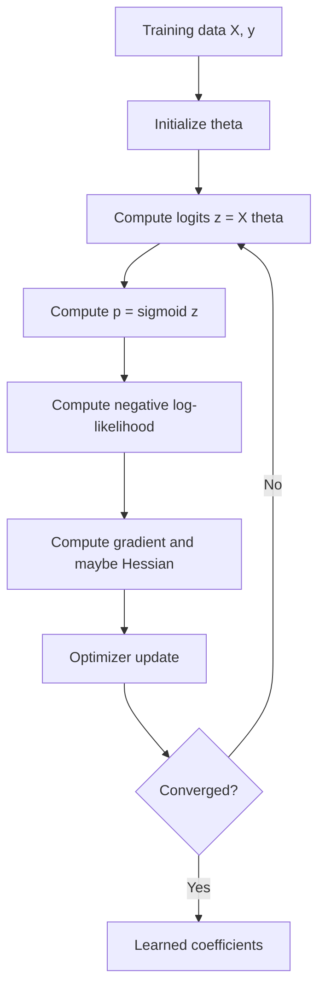
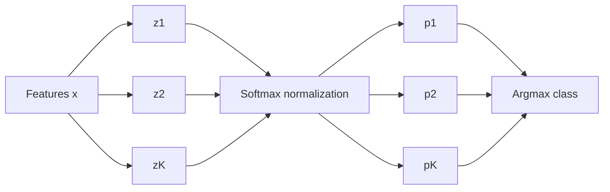

# Logistic Regression

Logistic regression is a probabilistic linear classifier for discrete targets. In the binary case it models the conditional class probability

$$
P(Y=1\mid X=x)
$$

by passing a linear score through the logistic sigmoid. The model is linear in the log-odds, not linear in the probability itself.

```mermaid
flowchart LR
    X[Feature vector x] --> Z[Linear logit z = w^T x + b]
    Z --> S[Sigmoid sigma z]
    S --> P[Probability p = P y=1 | x]
    P --> T{Threshold}
    T --> Y0[Class 0]
    T --> Y1[Class 1]
```

The important point is that logistic regression is not merely "linear regression plus a sigmoid." Its loss, likelihood, curvature, calibration properties, and optimization behavior come from a Bernoulli conditional probability model.

## 1. Problem Setup

Assume a binary classification dataset

$$
\mathcal{D}
=
\{(x_i,y_i)\}_{i=1}^{n},
\qquad
x_i \in \mathbb{R}^{d},
\qquad
y_i \in \{0,1\}.
$$

Include the intercept by either learning a separate scalar $b$ or augmenting the feature vector:

$$
\tilde{x}_i
=
\begin{bmatrix}
1 \\
x_i
\end{bmatrix}
\in \mathbb{R}^{d+1},
\qquad
\theta
=
\begin{bmatrix}
b \\
w
\end{bmatrix}
\in \mathbb{R}^{d+1}.
$$

Then the logit is

$$
z_i
=
\theta^\top \tilde{x}_i
=
b+w^\top x_i.
$$

The model assumes

$$
P(Y_i=1\mid x_i;\theta)
=
\sigma(z_i),
$$

where the sigmoid is

$$
\sigma(z)
=
\frac{1}{1+\exp(-z)}.
$$

Thus

$$
P(Y_i=0\mid x_i;\theta)
=
1-\sigma(z_i).
$$

For compact notation, let

$$
p_i
=
\sigma(\theta^\top \tilde{x}_i).
$$

## 2. Why Linear Regression Is the Wrong Probability Model

A linear regression model

$$
\hat{y}
=
w^\top x+b
$$

is unconstrained:

$$
\hat{y}\in(-\infty,\infty).
$$

But a Bernoulli class probability must satisfy

$$
0 \leq P(Y=1\mid X=x) \leq 1.
$$

Clipping linear predictions into $[0,1]$ does not solve the statistical problem. It creates flat regions with zero gradient, breaks the likelihood interpretation, and still treats the binary target as if it had additive Gaussian noise with constant variance. For binary data, the conditional variance depends on the mean:

$$
\operatorname{Var}(Y\mid X=x)
=
p(x)(1-p(x)).
$$

The logistic model instead uses a Bernoulli distribution whose mean is constrained by the sigmoid:

$$
Y_i\mid x_i
\sim
\operatorname{Bernoulli}(p_i).
$$

## 3. Log-Odds Derivation

Logistic regression can be motivated by assuming the log-odds are linear.

The odds of class $1$ are

$$
\operatorname{odds}(x)
=
\frac{P(Y=1\mid X=x)}{P(Y=0\mid X=x)}
=
\frac{p(x)}{1-p(x)}.
$$

The log-odds, or logit, are

$$
\operatorname{logit}(p(x))
=
\log\frac{p(x)}{1-p(x)}.
$$

Logistic regression assumes

$$
\log\frac{p(x)}{1-p(x)}
=
w^\top x+b.
$$

Let

$$
z=w^\top x+b.
$$

Then

$$
\frac{p}{1-p}
=
\exp(z).
$$

Solve for $p$:

$$
\begin{aligned}
p
&=
\exp(z)(1-p) \\
&=
\exp(z)-p\exp(z),
\end{aligned}
$$

so

$$
p(1+\exp(z))
=
\exp(z).
$$

Therefore

$$
p
=
\frac{\exp(z)}{1+\exp(z)}
=
\frac{1}{1+\exp(-z)}
=
\sigma(z).
$$

This derivation explains the model name: the regression is linear on the logit scale.

## 4. Sigmoid Mechanics

The sigmoid maps real-valued logits to probabilities:

$$
\sigma:\mathbb{R}\rightarrow(0,1).
$$

Important identities:

$$
1-\sigma(z)
=
\sigma(-z),
$$

$$
\frac{\sigma(z)}{1-\sigma(z)}
=
\exp(z),
$$

$$
\sigma'(z)
=
\sigma(z)(1-\sigma(z)).
$$

The derivative follows directly:

$$
\begin{aligned}
\sigma(z)
&=
(1+\exp(-z))^{-1}, \\
\frac{d\sigma}{dz}
&=
-(1+\exp(-z))^{-2}(-\exp(-z)) \\
&=
\frac{\exp(-z)}{(1+\exp(-z))^2}.
\end{aligned}
$$

Since

$$
\sigma(z)
=
\frac{1}{1+\exp(-z)}
$$

and

$$
1-\sigma(z)
=
\frac{\exp(-z)}{1+\exp(-z)},
$$

we get

$$
\sigma'(z)
=
\sigma(z)(1-\sigma(z)).
$$

This derivative is largest at $z=0$ and small in the saturated regions. Thus very confident predictions have small local sensitivity to parameter changes.

## 5. Step-by-Step Execution

For one prediction:

1. Apply the same preprocessing used during training.
2. Compute the logit

$$
z=w^\top x+b.
$$

3. Convert the logit to a probability

$$
p=\sigma(z).
$$

4. Apply a decision threshold $\tau$:

$$
\hat{y}
=
\mathbf{1}[p\geq \tau].
$$

For the usual $\tau=0.5$:

$$
p\geq 0.5
\iff
\sigma(z)\geq 0.5
\iff
z\geq 0.
$$

Therefore the default decision boundary is the hyperplane

$$
w^\top x+b=0.
$$



## 6. Likelihood from First Principles

For a single Bernoulli observation,

$$
P(Y=y_i\mid x_i;\theta)
=
p_i^{y_i}(1-p_i)^{1-y_i}.
$$

This compact expression works because:

If $y_i=1$,

$$
p_i^{y_i}(1-p_i)^{1-y_i}
=
p_i^1(1-p_i)^0
=
p_i.
$$

If $y_i=0$,

$$
p_i^{y_i}(1-p_i)^{1-y_i}
=
p_i^0(1-p_i)^1
=
1-p_i.
$$

Assuming observations are conditionally independent given the features and parameters, the likelihood is

$$
L(\theta)
=
\prod_{i=1}^{n}
p_i^{y_i}(1-p_i)^{1-y_i}.
$$

The log-likelihood is

$$
\ell(\theta)
=
\log L(\theta)
=
\sum_{i=1}^{n}
\left[
y_i\log p_i
+(1-y_i)\log(1-p_i)
\right].
$$

Using

$$
p_i=\sigma(z_i),
\qquad
z_i=\theta^\top \tilde{x}_i,
$$

and the identities

$$
\log\sigma(z)
=
z-\log(1+\exp(z)),
$$

$$
\log(1-\sigma(z))
=
-\log(1+\exp(z)),
$$

the log-likelihood can be written as

$$
\ell(\theta)
=
\sum_{i=1}^{n}
\left[
y_i z_i-\log(1+\exp(z_i))
\right].
$$

This form is useful for derivations, though a numerically stable implementation should use a stable softplus:

$$
\operatorname{softplus}(z)
=
\log(1+\exp(z)).
$$

## 7. Negative Log-Likelihood and Cross-Entropy

Maximum likelihood estimation solves

$$
\hat{\theta}_{\operatorname{MLE}}
=
\arg\max_{\theta}\ell(\theta).
$$

Equivalently, minimize the negative log-likelihood:

$$
J(\theta)
=
-\ell(\theta)
=
\sum_{i=1}^{n}
\left[
-y_i\log p_i
-(1-y_i)\log(1-p_i)
\right].
$$

The average binary cross-entropy is

$$
\mathcal{L}(\theta)
=
\frac{1}{n}J(\theta)
=
-\frac{1}{n}
\sum_{i=1}^{n}
\left[
y_i\log p_i
+(1-y_i)\log(1-p_i)
\right].
$$

For a single example,

$$
\operatorname{BCE}(y,p)
=
-y\log p-(1-y)\log(1-p).
$$

The loss heavily penalizes confident wrong predictions. For example:

$$
\operatorname{BCE}(1,0.99)
=
-\log(0.99)
\approx
0.01005,
$$

but

$$
\operatorname{BCE}(1,0.01)
=
-\log(0.01)
\approx
4.60517.
$$

## 8. Gradient Derivation

Let

$$
X
\in
\mathbb{R}^{n\times (d+1)}
$$

be the design matrix of augmented feature vectors, and let

$$
\theta\in\mathbb{R}^{d+1},
\qquad
z=X\theta,
\qquad
p=\sigma(z).
$$

The negative log-likelihood is

$$
J(\theta)
=
\sum_{i=1}^{n}
\left[
\log(1+\exp(z_i))-y_i z_i
\right].
$$

For one observation,

$$
J_i(\theta)
=
\log(1+\exp(z_i))-y_i z_i.
$$

Differentiate with respect to $z_i$:

$$
\frac{\partial J_i}{\partial z_i}
=
\frac{\exp(z_i)}{1+\exp(z_i)}-y_i
=
\sigma(z_i)-y_i
=
p_i-y_i.
$$

Since

$$
z_i=\theta^\top x_i,
$$

we have

$$
\frac{\partial z_i}{\partial \theta}
=
x_i.
$$

By the chain rule,

$$
\nabla_\theta J_i
=
(p_i-y_i)x_i.
$$

Summing over all examples:

$$
\nabla_\theta J(\theta)
=
\sum_{i=1}^{n}(p_i-y_i)x_i.
$$

In matrix form:

$$
\nabla_\theta J(\theta)
=
X^\top(p-y).
$$

For the average loss:

$$
\nabla_\theta \mathcal{L}(\theta)
=
\frac{1}{n}X^\top(p-y).
$$

The gradient has a simple interpretation: residuals in probability space, $p_i-y_i$, weighted by features.

## 9. Hessian, Convexity, and Newton Updates

Differentiate the gradient again:

$$
\nabla_\theta J(\theta)
=
X^\top(p-y).
$$

Since

$$
\frac{\partial p_i}{\partial z_i}
=
p_i(1-p_i),
$$

define the diagonal weight matrix

$$
W
=
\operatorname{diag}
\left(
p_1(1-p_1),
\dots,
p_n(1-p_n)
\right).
$$

The Hessian is

$$
H(\theta)
=
\nabla_\theta^2 J(\theta)
=
X^\top W X.
$$

For any vector $v$,

$$
v^\top H v
=
v^\top X^\top W Xv
=
(Xv)^\top W(Xv)
=
\sum_{i=1}^{n}
p_i(1-p_i)(x_i^\top v)^2
\geq
0.
$$

Therefore $J(\theta)$ is convex. It is strictly convex when the design has enough rank and the weights are positive in all directions. In practice, perfect separation can still prevent a finite unregularized MLE.

Newton's method minimizes a second-order Taylor approximation:

$$
J(\theta+\Delta)
\approx
J(\theta)
+\nabla J(\theta)^\top\Delta
+\frac{1}{2}\Delta^\top H(\theta)\Delta.
$$

Set the derivative with respect to $\Delta$ to zero:

$$
\nabla J(\theta)+H(\theta)\Delta=0.
$$

Thus

$$
\Delta
=
-H(\theta)^{-1}\nabla J(\theta).
$$

The Newton update is

$$
\theta_{\text{new}}
=
\theta-H(\theta)^{-1}\nabla J(\theta).
$$

For logistic regression this is also called iteratively reweighted least squares when written as a sequence of weighted least-squares problems.

## 10. Regularization and MAP Interpretation

Unregularized logistic regression can overfit, especially with high-dimensional data or separable classes. The most common penalized objective is L2-regularized negative log-likelihood:

$$
J_\lambda(\theta)
=
J(\theta)
+\frac{\lambda}{2}\|w\|_2^2.
$$

The intercept $b$ is usually not penalized:

$$
\|w\|_2^2
=
\sum_{j=1}^{d}w_j^2.
$$

The gradient becomes

$$
\nabla_w J_\lambda
=
X_{\text{features}}^\top(p-y)+\lambda w,
$$

and

$$
\frac{\partial J_\lambda}{\partial b}
=
\sum_{i=1}^{n}(p_i-y_i).
$$

The Hessian block for feature weights receives an added ridge term:

$$
H_\lambda
=
X^\top W X+\lambda R,
$$

where

$$
R
=
\operatorname{diag}(0,1,1,\dots,1)
$$

if the first coordinate is the intercept.

L2 regularization is equivalent to maximum a posteriori estimation under a zero-mean Gaussian prior on $w$:

$$
w\sim\mathcal{N}(0,\lambda^{-1}I).
$$

L1 regularization uses

$$
J_\lambda(\theta)
=
J(\theta)+\lambda\|w\|_1,
$$

where

$$
\|w\|_1
=
\sum_{j=1}^{d}|w_j|.
$$

It encourages sparse coefficients but creates a non-differentiable objective at $w_j=0$, so solvers need coordinate descent, proximal methods, subgradients, or specialized stochastic methods.

Elastic net combines both:

$$
\lambda
\left[
\alpha\|w\|_1
+\frac{1-\alpha}{2}\|w\|_2^2
\right],
\qquad
0\leq\alpha\leq 1.
$$

## 11. Worked Example: One-Dimensional Classification

Suppose the data are:

| Study hours $x$ | Result $y$ |
|---:|---:|
| 2 | 0 |
| 4 | 0 |
| 6 | 1 |
| 8 | 1 |

Let

$$
b=-5,
\qquad
w=1.
$$

Then

$$
z_i=b+wx_i=x_i-5.
$$

The logits and probabilities are:

| $x_i$ | $y_i$ | $z_i$ | $p_i=\sigma(z_i)$ |
|---:|---:|---:|---:|
| 2 | 0 | -3 | 0.0474 |
| 4 | 0 | -1 | 0.2689 |
| 6 | 1 | 1 | 0.7311 |
| 8 | 1 | 3 | 0.9526 |

The per-example losses are:

For $x=2$, $y=0$:

$$
\operatorname{BCE}(0,0.0474)
=
-\log(1-0.0474)
\approx
0.0486.
$$

For $x=4$, $y=0$:

$$
\operatorname{BCE}(0,0.2689)
=
-\log(0.7311)
\approx
0.3133.
$$

For $x=6$, $y=1$:

$$
\operatorname{BCE}(1,0.7311)
=
-\log(0.7311)
\approx
0.3133.
$$

For $x=8$, $y=1$:

$$
\operatorname{BCE}(1,0.9526)
=
-\log(0.9526)
\approx
0.0486.
$$

Total negative log-likelihood:

$$
J
\approx
0.0486+0.3133+0.3133+0.0486
=
0.7238.
$$

The decision boundary at threshold $0.5$ is

$$
b+wx=0.
$$

With $b=-5$ and $w=1$:

$$
x=5.
$$

So the model predicts fail below $5$ hours and pass at or above $5$ hours.

## 12. Worked Example: One Gradient Step

Use the same four examples and augmented features

$$
X
=
\begin{bmatrix}
1 & 2 \\
1 & 4 \\
1 & 6 \\
1 & 8
\end{bmatrix},
\qquad
y
=
\begin{bmatrix}
0 \\
0 \\
1 \\
1
\end{bmatrix}.
$$

Start from

$$
\theta
=
\begin{bmatrix}
0 \\
0
\end{bmatrix}.
$$

Then all logits are zero:

$$
z=X\theta
=
\begin{bmatrix}
0\\0\\0\\0
\end{bmatrix}.
$$

All probabilities are

$$
p
=
\begin{bmatrix}
0.5\\0.5\\0.5\\0.5
\end{bmatrix}.
$$

The residual vector is

$$
p-y
=
\begin{bmatrix}
0.5\\0.5\\-0.5\\-0.5
\end{bmatrix}.
$$

The gradient is

$$
\nabla J
=
X^\top(p-y).
$$

Intercept component:

$$
0.5+0.5-0.5-0.5
=
0.
$$

Slope component:

$$
2(0.5)+4(0.5)+6(-0.5)+8(-0.5)
=
1+2-3-4
=
-4.
$$

Thus

$$
\nabla J
=
\begin{bmatrix}
0\\
-4
\end{bmatrix}.
$$

With learning rate $\eta=0.1$, gradient descent gives

$$
\theta_{\text{new}}
=
\theta-\eta\nabla J
=
\begin{bmatrix}
0\\0
\end{bmatrix}
-0.1
\begin{bmatrix}
0\\-4
\end{bmatrix}
=
\begin{bmatrix}
0\\0.4
\end{bmatrix}.
$$

After this step, larger study hours receive larger logits, which matches the labels.

## 13. Decision Thresholds and Costs

The threshold $\tau=0.5$ is not universally optimal. Suppose false positives cost $C_{\operatorname{FP}}$ and false negatives cost $C_{\operatorname{FN}}$.

Predict class $1$ if its expected cost is lower:

Cost of predicting $1$:

$$
R(1\mid x)
=
C_{\operatorname{FP}}P(Y=0\mid x)
=
C_{\operatorname{FP}}(1-p).
$$

Cost of predicting $0$:

$$
R(0\mid x)
=
C_{\operatorname{FN}}P(Y=1\mid x)
=
C_{\operatorname{FN}}p.
$$

Predict $1$ when

$$
C_{\operatorname{FP}}(1-p)
\leq
C_{\operatorname{FN}}p.
$$

Solving:

$$
C_{\operatorname{FP}}
\leq
(C_{\operatorname{FP}}+C_{\operatorname{FN}})p,
$$

so

$$
p
\geq
\frac{C_{\operatorname{FP}}}
{C_{\operatorname{FP}}+C_{\operatorname{FN}}}.
$$

If false negatives are expensive, the threshold decreases. If false positives are expensive, the threshold increases.

## 14. Multiclass Logistic Regression

For $K$ mutually exclusive classes, multinomial logistic regression uses a softmax:

$$
P(Y=k\mid x)
=
\frac{\exp(w_k^\top x+b_k)}
{\sum_{c=1}^{K}\exp(w_c^\top x+b_c)}.
$$

Let

$$
z_k=w_k^\top x+b_k.
$$

Then

$$
p_k
=
\operatorname{softmax}(z)_k
=
\frac{\exp(z_k)}
{\sum_{c=1}^{K}\exp(z_c)}.
$$

The negative log-likelihood for one example with class label $y$ is

$$
\operatorname{CE}(y,p)
=
-\log p_y.
$$

With one-hot target vector $e_y$, this is

$$
\operatorname{CE}(e_y,p)
=
-\sum_{k=1}^{K}e_{y,k}\log p_k.
$$

The gradient with respect to logits is

$$
\frac{\partial \operatorname{CE}}{\partial z_k}
=
p_k-e_{y,k}.
$$

This is the multiclass analogue of $p-y$ in binary logistic regression.



Binary logistic regression is equivalent to a two-class softmax after fixing one class's parameters to zero. If

$$
z_0=0,
\qquad
z_1=w^\top x+b,
$$

then

$$
P(Y=1\mid x)
=
\frac{\exp(z_1)}{\exp(z_0)+\exp(z_1)}
=
\frac{\exp(z_1)}{1+\exp(z_1)}
=
\sigma(z_1).
$$

## 15. Numerical Stability

### 15.1 Stable Sigmoid

The naive sigmoid

$$
\sigma(z)=\frac{1}{1+\exp(-z)}
$$

can overflow when $z$ is a large negative number because $\exp(-z)$ becomes enormous.

A stable implementation uses branches:

$$
\sigma(z)
=
\begin{cases}
\frac{1}{1+\exp(-z)}, & z\geq 0, \\
\frac{\exp(z)}{1+\exp(z)}, & z<0.
\end{cases}
$$

### 15.2 Stable Binary Cross-Entropy from Logits

Avoid computing

$$
-y\log\sigma(z)-(1-y)\log(1-\sigma(z))
$$

directly. For large $|z|$, probabilities may round to exactly $0$ or $1$, creating $\log(0)$.

The stable logit-space loss is

$$
\operatorname{BCEWithLogits}(y,z)
=
\max(z,0)-yz+\log(1+\exp(-|z|)).
$$

This is algebraically equivalent to BCE but avoids overflow and catastrophic cancellation.

### 15.3 Stable Softmax

For multiclass logits $z$, use

$$
\operatorname{softmax}(z)_k
=
\frac{\exp(z_k-m)}
{\sum_{c=1}^{K}\exp(z_c-m)},
\qquad
m=\max_c z_c.
$$

Subtracting $m$ leaves probabilities unchanged because softmax is shift-invariant:

$$
\operatorname{softmax}(z+c\mathbf{1})
=
\operatorname{softmax}(z).
$$

## 16. Python Implementation from Scratch

The implementation below uses batch gradient descent with L2 regularization on the feature weights but not the intercept.

```python
import numpy as np


class BinaryLogisticRegression:
    def __init__(self, lr=0.1, max_iter=10_000, l2=0.0, tol=1e-8):
        self.lr = lr
        self.max_iter = max_iter
        self.l2 = l2
        self.tol = tol
        self.theta_ = None
        self.loss_history_ = []

    @staticmethod
    def _add_intercept(X):
        X = np.asarray(X, dtype=float)
        ones = np.ones((X.shape[0], 1), dtype=X.dtype)
        return np.hstack([ones, X])

    @staticmethod
    def _sigmoid(z):
        z = np.asarray(z, dtype=float)
        out = np.empty_like(z)

        pos = z >= 0
        neg = ~pos

        out[pos] = 1.0 / (1.0 + np.exp(-z[pos]))
        exp_z = np.exp(z[neg])
        out[neg] = exp_z / (1.0 + exp_z)
        return out

    @staticmethod
    def _bce_with_logits(y, z):
        # Stable form of: -y*log(sigmoid(z)) - (1-y)*log(1-sigmoid(z))
        return np.maximum(z, 0.0) - y * z + np.log1p(np.exp(-np.abs(z)))

    def fit(self, X, y):
        Xb = self._add_intercept(X)
        y = np.asarray(y, dtype=float)

        n, p = Xb.shape
        theta = np.zeros(p, dtype=float)

        prev_loss = np.inf

        for _ in range(self.max_iter):
            z = Xb @ theta
            prob = self._sigmoid(z)

            error = prob - y
            grad = (Xb.T @ error) / n

            # Do not regularize the intercept.
            penalty_grad = np.r_[0.0, theta[1:]]
            grad += self.l2 * penalty_grad

            theta -= self.lr * grad

            data_loss = self._bce_with_logits(y, z).mean()
            reg_loss = 0.5 * self.l2 * np.dot(theta[1:], theta[1:])
            loss = data_loss + reg_loss
            self.loss_history_.append(loss)

            if abs(prev_loss - loss) < self.tol:
                break
            prev_loss = loss

        self.theta_ = theta
        return self

    def decision_function(self, X):
        Xb = self._add_intercept(X)
        return Xb @ self.theta_

    def predict_proba(self, X):
        z = self.decision_function(X)
        p1 = self._sigmoid(z)
        return np.column_stack([1.0 - p1, p1])

    def predict(self, X, threshold=0.5):
        p1 = self.predict_proba(X)[:, 1]
        return (p1 >= threshold).astype(int)
```

Example:

```python
X = np.array([[2.0], [4.0], [6.0], [8.0]])
y = np.array([0, 0, 1, 1])

model = BinaryLogisticRegression(lr=0.05, max_iter=100_000, l2=1e-3)
model.fit(X, y)

print(model.theta_)
print(model.predict_proba([[5.0], [7.0]]))
print(model.predict([[5.0], [7.0]]))
```

### 16.1 Newton Implementation

Newton's method uses curvature and often converges in fewer iterations, but each step is more expensive.

```python
import numpy as np


class NewtonLogisticRegression:
    def __init__(self, max_iter=100, l2=0.0, tol=1e-10):
        self.max_iter = max_iter
        self.l2 = l2
        self.tol = tol
        self.theta_ = None

    @staticmethod
    def _add_intercept(X):
        X = np.asarray(X, dtype=float)
        return np.hstack([np.ones((X.shape[0], 1)), X])

    @staticmethod
    def _sigmoid(z):
        out = np.empty_like(z, dtype=float)
        pos = z >= 0
        neg = ~pos
        out[pos] = 1.0 / (1.0 + np.exp(-z[pos]))
        ez = np.exp(z[neg])
        out[neg] = ez / (1.0 + ez)
        return out

    def fit(self, X, y):
        Xb = self._add_intercept(X)
        y = np.asarray(y, dtype=float)
        n, p = Xb.shape
        theta = np.zeros(p)

        reg = np.eye(p)
        reg[0, 0] = 0.0

        for _ in range(self.max_iter):
            z = Xb @ theta
            prob = self._sigmoid(z)

            grad = Xb.T @ (prob - y) + self.l2 * (reg @ theta)
            s = prob * (1.0 - prob)
            H = Xb.T @ (s[:, None] * Xb) + self.l2 * reg

            # Solve H step = grad instead of explicitly inverting H.
            step = np.linalg.solve(H, grad)
            theta_new = theta - step

            if np.linalg.norm(step, ord=2) < self.tol:
                theta = theta_new
                break

            theta = theta_new

        self.theta_ = theta
        return self

    def predict_proba(self, X):
        Xb = self._add_intercept(X)
        p1 = self._sigmoid(Xb @ self.theta_)
        return np.column_stack([1.0 - p1, p1])
```

Never compute

$$
H^{-1}\nabla J
$$

by explicitly forming $H^{-1}$. Solving the linear system is more accurate and usually faster.

## 17. Equivalent Library Implementations

### 17.1 scikit-learn

```python
from sklearn.linear_model import LogisticRegression
from sklearn.pipeline import make_pipeline
from sklearn.preprocessing import StandardScaler

clf = make_pipeline(
    StandardScaler(),
    LogisticRegression(
        penalty="l2",
        C=1.0,
        solver="lbfgs",
        max_iter=1000,
    ),
)

clf.fit(X_train, y_train)
proba = clf.predict_proba(X_test)
pred = clf.predict(X_test)
```

Important implementation details:

- `LogisticRegression` optimizes a regularized logistic objective by default.
- `C` is inverse regularization strength:

$$
C
\propto
\frac{1}{\lambda}.
$$

- `lbfgs` is a quasi-Newton optimizer. It approximates curvature without forming the full Hessian.
- `newton-cg` uses Hessian-vector products and conjugate gradient.
- `newton-cholesky` explicitly forms a Hessian and solves the Newton system with a Cholesky-based method, which can be useful when $n$ is large relative to $d$ but memory scales poorly with the number of parameters.
- `liblinear` solves binary problems using the LIBLINEAR coordinate-descent style solvers and handles multiclass through one-vs-rest.
- `sag` and `saga` are stochastic average-gradient methods designed for larger datasets; `saga` supports L1 and elastic-net penalties.
- Feature scaling matters for solvers such as SAG, SAGA, and gradient-based methods because poorly scaled features produce ill-conditioned curvature.

For binary classification, `decision_function` returns the learned logit:

$$
z=w^\top x+b.
$$

`predict_proba` applies the sigmoid to obtain class probabilities. For multinomial classification it applies softmax to the class logits.

### 17.2 statsmodels

```python
import statsmodels.api as sm

X_with_intercept = sm.add_constant(X_train)
logit = sm.Logit(y_train, X_with_intercept)
result = logit.fit()

print(result.summary())
params = result.params
proba = result.predict(sm.add_constant(X_test))
```

`statsmodels.Logit` is closer to the statistical MLE formulation. It does not add an intercept automatically; the user must add one. It also emphasizes coefficient inference: standard errors, Wald tests, confidence intervals, and likelihood-based diagnostics.

The standard asymptotic covariance estimate uses the inverse observed information:

$$
\widehat{\operatorname{Cov}}(\hat{\theta})
\approx
H(\hat{\theta})^{-1},
$$

where

$$
H(\hat{\theta})
=
X^\top \widehat{W}X
$$

for the negative log-likelihood.

### 17.3 PyTorch

For neural-network style training, logistic regression is a single linear layer plus BCE-with-logits loss.

```python
import torch
from torch import nn

model = nn.Linear(d, 1)
criterion = nn.BCEWithLogitsLoss()
optimizer = torch.optim.AdamW(model.parameters(), lr=1e-3, weight_decay=1e-4)

for xb, yb in dataloader:
    logits = model(xb).squeeze(-1)
    loss = criterion(logits, yb.float())

    optimizer.zero_grad()
    loss.backward()
    optimizer.step()
```

`BCEWithLogitsLoss` combines the sigmoid and binary cross-entropy in one stable operation. This is preferred over applying `sigmoid` first and then using a probability-space BCE.

## 18. Complexity

Let $n$ be the number of examples and $d$ the number of features.

| Operation | Time | Space |
|---|---:|---:|
| Logits $X\theta$ | $O(nd)$ | $O(n)$ |
| Gradient $X^\top(p-y)$ | $O(nd)$ | $O(d)$ plus data |
| Full Hessian $X^\top W X$ | $O(nd^2)$ | $O(d^2)$ |
| Newton solve | $O(d^3)$ | $O(d^2)$ |
| Prediction for $m$ examples | $O(md)$ | $O(m)$ |

Batch gradient descent has cheap iterations but may need many iterations. Newton methods use expensive iterations but can converge rapidly on moderate-dimensional dense problems. L-BFGS is often a strong default because it captures curvature approximately with limited memory.

## 19. Edge Cases and Pitfalls

### 19.1 Complete or Quasi-Complete Separation

If a hyperplane perfectly separates the classes, the unregularized likelihood may not have a finite maximizer. The optimizer can keep increasing coefficient magnitudes, driving probabilities toward $0$ and $1$.

Symptoms:

- Coefficients become extremely large.
- Standard errors explode.
- Optimization reports convergence problems.
- Predicted probabilities become exactly $0$ or $1$ numerically.

Common fixes:

- Add L2 regularization.
- Use Bayesian priors.
- Remove leakage features.
- Collect overlapping examples if the separation is due to small data.

### 19.2 Feature Scaling

Logistic regression's decision boundary is invariant to a mathematically equivalent rescaling when coefficients adjust accordingly, but optimization is not. Badly scaled features can make the Hessian ill-conditioned:

$$
\kappa(H)
=
\frac{\lambda_{\max}(H)}{\lambda_{\min}(H)}.
$$

Large condition numbers slow first-order methods and can destabilize second-order solves.

### 19.3 Collinearity

Highly correlated features make coefficients unstable. Predictions can remain accurate while individual coefficients become hard to interpret. L2 regularization reduces this variance by shrinking coefficients.

### 19.4 Outliers and High-Leverage Points

The logit

$$
z=w^\top x+b
$$

depends linearly on features, so extreme feature values can exert strong influence on the fitted boundary. Robust preprocessing, clipping, transformations, or regularization may be needed.

### 19.5 Class Imbalance

Class imbalance does not invalidate logistic regression, but default thresholding and unweighted loss may optimize the wrong operational objective. Common approaches:

- Adjust the decision threshold.
- Use class-weighted negative log-likelihood.
- Evaluate precision-recall and cost-sensitive metrics.
- Calibrate probabilities after resampling if resampling changed the class prior.

Weighted BCE is

$$
J(\theta)
=
\sum_{i=1}^{n}
\alpha_{y_i}
\left[
-y_i\log p_i
-(1-y_i)\log(1-p_i)
\right].
$$

### 19.6 Probability Calibration

Logistic regression can be well calibrated when the logit-linear model is approximately correct and regularization is appropriate. But calibration is not guaranteed. Misspecification, class weighting, strong regularization, sampling bias, or distribution shift can distort probabilities.

Calibration can be checked with reliability diagrams and metrics such as the Brier score:

$$
\operatorname{Brier}
=
\frac{1}{n}
\sum_{i=1}^{n}
(p_i-y_i)^2.
$$

## 20. Interpretation

For feature $x_j$, the coefficient $w_j$ is the change in log-odds for a one-unit increase in $x_j$, holding other features fixed:

$$
\log\frac{p(x)}{1-p(x)}
=
b+\sum_{j=1}^{d}w_jx_j.
$$

If $x_j$ increases by $1$, the log-odds change by $w_j$. The odds are multiplied by

$$
\exp(w_j).
$$

For example, if

$$
w_j=0.7,
$$

then

$$
\exp(0.7)\approx 2.01.
$$

So a one-unit increase in $x_j$ approximately doubles the odds, not the probability. The probability change depends on the current value of $p$:

$$
\frac{\partial p}{\partial x_j}
=
\frac{\partial p}{\partial z}
\frac{\partial z}{\partial x_j}
=
p(1-p)w_j.
$$

This derivative is largest near $p=0.5$ and smallest near $0$ or $1$.

## 21. Connections to Related ML Concepts

### 21.1 Generalized Linear Models

Logistic regression is a generalized linear model with:

- Bernoulli conditional distribution.
- Mean parameter $p$.
- Canonical logit link.

The canonical link makes the gradient take the simple residual form:

$$
\nabla J
=
X^\top(p-y).
$$

### 21.2 Maximum Entropy

Multinomial logistic regression is also known as a maximum entropy classifier. Under constraints matching empirical feature expectations, the maximum-entropy distribution belongs to the exponential-family form that leads to softmax probabilities.

### 21.3 Neural Networks

Binary logistic regression is a neural network with no hidden layers:

$$
x\mapsto \sigma(w^\top x+b).
$$

Multiclass logistic regression is a linear layer followed by softmax. Deep classifiers replace the raw input $x$ with learned features $\phi_\psi(x)$:

$$
P(Y=k\mid x)
=
\operatorname{softmax}(W\phi_\psi(x)+b)_k.
$$

### 21.4 Support Vector Machines

Logistic regression and linear SVMs can learn similar linear decision boundaries, but optimize different losses. Logistic regression uses log loss:

$$
\log(1+\exp(-yz)),
$$

for $y\in\{-1,+1\}$, while a linear SVM uses hinge loss:

$$
\max(0,1-yz).
$$

Logistic regression produces probabilities directly; SVM margins require calibration if probabilities are needed.

### 21.5 Naive Bayes

Logistic regression is discriminative:

$$
P(Y\mid X)
$$

is modeled directly. Naive Bayes is generative:

$$
P(X\mid Y)P(Y)
$$

is modeled and converted to a posterior using Bayes' rule. With certain feature distributions, the resulting log-odds are linear, which explains why naive Bayes and logistic regression can sometimes produce similar linear boundaries.

## 22. Limitations

Logistic regression is strong when the log-odds are approximately linear in useful features. It struggles when the decision surface requires complex nonlinear interactions unless those interactions are explicitly engineered.

Main limitations:

- Linear decision boundary in the original feature space.
- Coefficients can be misleading under collinearity.
- Unregularized MLE may fail under separation.
- Sensitive to preprocessing and feature scale for many solvers.
- Probability estimates degrade under distribution shift or severe misspecification.
- The default threshold is rarely the right operational threshold for imbalanced or cost-sensitive tasks.

Feature maps can extend the model:

$$
P(Y=1\mid x)
=
\sigma(w^\top\phi(x)+b),
$$

where $\phi(x)$ may contain polynomial terms, splines, embeddings, or domain-specific transformations. The model is still logistic regression in $\phi(x)$.

## 23. References for Deeper Reading

- Hastie, Tibshirani, and Friedman, *The Elements of Statistical Learning*, Chapter 4.
- Stanford CS229 lecture notes on generalized linear models, logistic regression, and Newton's method.
- scikit-learn documentation for `sklearn.linear_model.LogisticRegression`.
- statsmodels documentation for `statsmodels.discrete.discrete_model.Logit`.
- Bishop, *Pattern Recognition and Machine Learning*, Sections on linear models for classification.
- Murphy, *Machine Learning: A Probabilistic Perspective*, Sections on logistic regression and generalized linear models.
