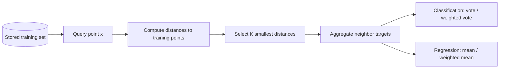
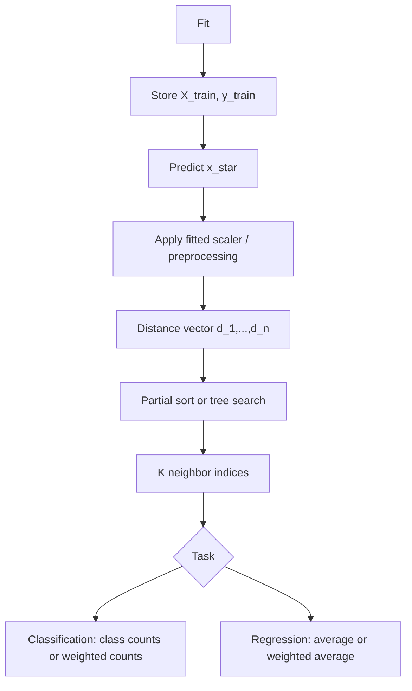
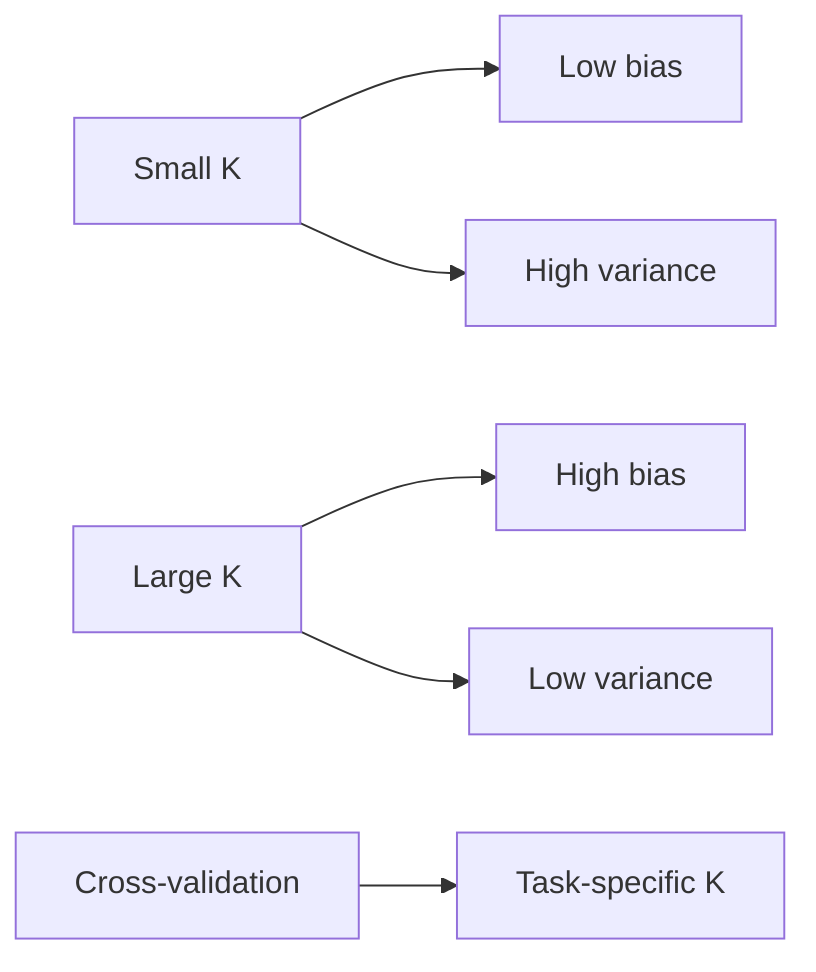
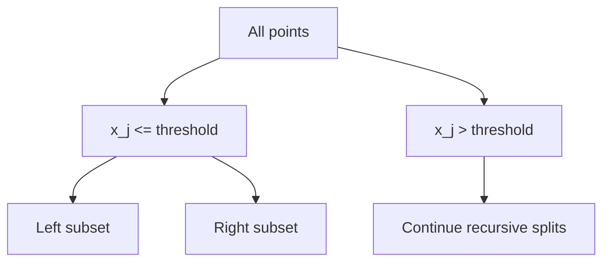
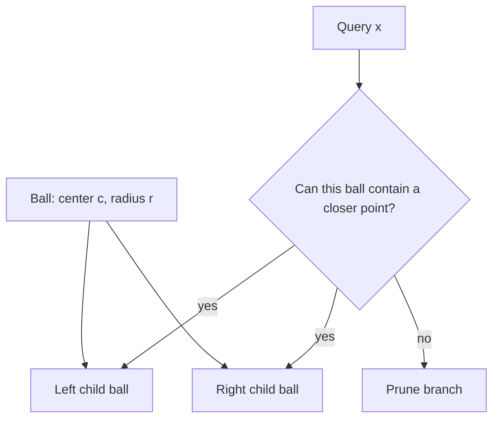

# K-Nearest Neighbors

K-nearest neighbors is a nonparametric supervised learning method for classification and regression. It stores the training set and delays most computation until prediction time. For a query point, it finds the $K$ closest training examples under a chosen metric, then aggregates their labels or targets.

The important idea is not that KNN is "simple"; it is that KNN approximates conditional quantities locally. For classification it estimates local class probabilities $P(Y=c\mid X=x)$. For regression it estimates the conditional mean $\mathbb{E}[Y\mid X=x]$. The neighborhood radius is adaptive: dense regions use small radii, sparse regions use larger radii.



## 1. Problem Setup

Assume a supervised dataset

$$
\mathcal{D}
=
\{(x_i,y_i)\}_{i=1}^{n},
\qquad
x_i \in \mathbb{R}^{d}.
$$

For classification,

$$
y_i \in \mathcal{Y}
=
\{1,\dots,C\}.
$$

For regression,

$$
y_i \in \mathbb{R}
$$

or, for multi-output regression,

$$
y_i \in \mathbb{R}^{m}.
$$

A distance or dissimilarity function

$$
\rho:\mathcal{X}\times\mathcal{X}\rightarrow [0,\infty)
$$

is used to define nearness. In the usual Euclidean case,

$$
\rho(x,z)
=
\|x-z\|_2
=
\sqrt{\sum_{j=1}^{d}(x_j-z_j)^2}.
$$

KNN prediction at a query $x$ depends on the index set of the $K$ nearest training samples:

$$
N_K(x)
=
\operatorname{arg\,topK}_{i\in\{1,\dots,n\}}^{\text{smallest}}
\rho(x,x_i).
$$

Equivalently, if $\pi_x$ is a permutation of $\{1,\dots,n\}$ such that

$$
\rho(x,x_{\pi_x(1)})
\leq
\rho(x,x_{\pi_x(2)})
\leq
\cdots
\leq
\rho(x,x_{\pi_x(n)}),
$$

then

$$
N_K(x)
=
\{\pi_x(1),\dots,\pi_x(K)\}.
$$

Ties must be resolved explicitly in an implementation. Common choices are stable ordering by training index, random tie-breaking, or including all equal-distance points at the boundary and using a secondary rule.

## 2. Step-by-Step Execution

Given a query $x_\star$:

1. Validate that $1 \leq K \leq n$.
2. Apply the same preprocessing used during fitting, especially feature scaling.
3. Compute distances

$$
d_i
=
\rho(x_\star,x_i),
\qquad
i=1,\dots,n.
$$

4. Select the $K$ smallest distances.
5. Convert distances into weights if using distance-weighted KNN.
6. Aggregate labels or targets.
7. Return the predicted class, class probabilities, or regression value.



KNN is therefore a lazy learner. The fit step is mostly memory storage plus optional construction of an index such as a KD-tree or ball tree.

## 3. Distance Metrics

### 3.1 Minkowski Family

The Minkowski distance is

$$
\rho_p(x,z)
=
\left(
\sum_{j=1}^{d}
|x_j-z_j|^p
\right)^{1/p},
\qquad
p\geq 1.
$$

Special cases:

$$
\rho_1(x,z)
=
\sum_{j=1}^{d}|x_j-z_j|
\qquad
\text{Manhattan distance},
$$

$$
\rho_2(x,z)
=
\sqrt{\sum_{j=1}^{d}(x_j-z_j)^2}
\qquad
\text{Euclidean distance},
$$

$$
\rho_\infty(x,z)
=
\max_{1\leq j\leq d}|x_j-z_j|
\qquad
\text{Chebyshev distance}.
$$

The Euclidean square root is monotone, so neighbor ordering is unchanged if squared distances are used:

$$
\operatorname{arg\,sort}_i \|x-x_i\|_2
=
\operatorname{arg\,sort}_i \|x-x_i\|_2^2.
$$

This is useful numerically and computationally because it avoids an unnecessary square root when only rankings are needed.

### 3.2 Standardized Euclidean Distance

If feature $j$ has sample standard deviation $s_j$, standardized Euclidean distance is

$$
\rho_{\text{std}}(x,z)
=
\sqrt{
\sum_{j=1}^{d}
\left(
\frac{x_j-z_j}{s_j}
\right)^2
}.
$$

This is equivalent to applying standardization and then using ordinary Euclidean distance.

### 3.3 Mahalanobis Distance

For correlated features, use a positive definite covariance matrix $\Sigma$:

$$
\rho_{\Sigma}(x,z)
=
\sqrt{
(x-z)^\top \Sigma^{-1}(x-z)
}.
$$

If $\Sigma$ is diagonal, Mahalanobis distance reduces to standardized Euclidean distance. If $\Sigma$ is full, it rescales and rotates the feature space. Let $\Sigma=LL^\top$ be a Cholesky factorization and define

$$
\tilde{x}
=
L^{-1}x.
$$

Then

$$
\rho_{\Sigma}(x,z)
=
\|L^{-1}(x-z)\|_2
=
\|\tilde{x}-\tilde{z}\|_2.
$$

So Mahalanobis KNN is Euclidean KNN after whitening.

### 3.4 Cosine Distance

For high-dimensional sparse vectors such as bag-of-words or embeddings, angle can matter more than magnitude. Cosine similarity is

$$
\operatorname{cos}(x,z)
=
\frac{x^\top z}{\|x\|_2\|z\|_2}.
$$

A common cosine distance is

$$
\rho_{\cos}(x,z)
=
1-\operatorname{cos}(x,z).
$$

If all vectors are normalized to unit norm, then

$$
\|x-z\|_2^2
=
\|x\|_2^2+\|z\|_2^2-2x^\top z
=
2-2\operatorname{cos}(x,z).
$$

Thus cosine nearest neighbors and Euclidean nearest neighbors are equivalent in ordering on unit-normalized vectors.

## 4. KNN Classification

### 4.1 Uniform Voting

For a class $c$, define the empirical local class probability

$$
\hat{p}_c(x)
=
\frac{1}{K}
\sum_{i\in N_K(x)}
\mathbf{1}[y_i=c].
$$

The KNN classifier predicts

$$
\hat{y}(x)
=
\arg\max_{c\in\mathcal{Y}}
\hat{p}_c(x).
$$

This is majority voting. The indicator $\mathbf{1}[y_i=c]$ equals $1$ when neighbor $i$ belongs to class $c$ and $0$ otherwise.

### 4.2 Distance-Weighted Voting

Uniform voting treats all selected neighbors equally. Distance-weighted KNN assigns larger weights to closer points:

$$
w_i(x)
=
\frac{\phi(\rho(x,x_i))}
{\sum_{\ell\in N_K(x)}\phi(\rho(x,x_\ell))},
\qquad
i\in N_K(x).
$$

Typical kernels include inverse distance

$$
\phi(r)
=
\frac{1}{r+\epsilon}
$$

and Gaussian distance weighting

$$
\phi(r)
=
\exp\left(-\frac{r^2}{2h^2}\right).
$$

The weighted class probability estimate is

$$
\hat{p}_c(x)
=
\sum_{i\in N_K(x)}
w_i(x)\mathbf{1}[y_i=c].
$$

The prediction is still

$$
\hat{y}(x)
=
\arg\max_{c\in\mathcal{Y}}\hat{p}_c(x).
$$

If any training point has zero distance from the query, a numerically stable implementation should ignore nonzero-distance neighbors and vote only among exact matches. This avoids infinite inverse-distance weights.

### 4.3 Decision-Theoretic Derivation

Under zero-one loss,

$$
L(a,y)
=
\mathbf{1}[a\neq y],
$$

the conditional risk of predicting class $a$ at location $x$ is

$$
R(a\mid x)
=
\mathbb{E}[\mathbf{1}[a\neq Y]\mid X=x].
$$

Because $\mathbf{1}[a\neq Y]=1-\mathbf{1}[a=Y]$,

$$
\begin{aligned}
R(a\mid x)
&=
1-\mathbb{E}[\mathbf{1}[a=Y]\mid X=x] \\
&=
1-P(Y=a\mid X=x).
\end{aligned}
$$

The Bayes classifier minimizes conditional risk:

$$
h^\star(x)
=
\arg\min_{a}R(a\mid x)
=
\arg\max_{a}P(Y=a\mid X=x).
$$

KNN approximates $P(Y=a\mid X=x)$ by the fraction of labels in a small data-adaptive neighborhood around $x$:

$$
P(Y=a\mid X=x)
\approx
\frac{1}{K}
\sum_{i\in N_K(x)}
\mathbf{1}[y_i=a].
$$

The key assumptions are locality and smoothness: nearby feature vectors have similar conditional label distributions, and the chosen metric reflects task-relevant similarity.

## 5. KNN Regression

### 5.1 Uniform Averaging

For squared error loss,

$$
L(a,y)
=
(y-a)^2,
$$

the conditional risk is

$$
R(a\mid x)
=
\mathbb{E}[(Y-a)^2\mid X=x].
$$

Expand the square:

$$
\begin{aligned}
R(a\mid x)
&=
\mathbb{E}[Y^2-2aY+a^2\mid X=x] \\
&=
\mathbb{E}[Y^2\mid X=x]
-2a\mathbb{E}[Y\mid X=x]
+a^2.
\end{aligned}
$$

Differentiate with respect to $a$:

$$
\frac{\partial R(a\mid x)}{\partial a}
=
-2\mathbb{E}[Y\mid X=x]+2a.
$$

Set the derivative to zero:

$$
a
=
\mathbb{E}[Y\mid X=x].
$$

Therefore the Bayes regression function under squared loss is

$$
f^\star(x)
=
\mathbb{E}[Y\mid X=x].
$$

KNN estimates this conditional mean locally:

$$
\hat{f}_K(x)
=
\frac{1}{K}
\sum_{i\in N_K(x)}y_i.
$$

### 5.2 Weighted Regression

With normalized nonnegative weights,

$$
w_i(x)\geq 0,
\qquad
\sum_{i\in N_K(x)}w_i(x)=1,
$$

the weighted KNN regressor is

$$
\hat{f}_K(x)
=
\sum_{i\in N_K(x)}
w_i(x)y_i.
$$

This is a local constant estimator. It is closely related to the Nadaraya-Watson kernel estimator, except that KNN usually fixes the number of neighbors while kernel regression usually fixes or learns a bandwidth.

## 6. Bias-Variance and the Role of K

The value of $K$ controls the radius of the local neighborhood and therefore the bias-variance tradeoff.

Small $K$:

- Low bias because the estimate is very local.
- High variance because a few noisy labels or targets can dominate.
- For $K=1$, training classification error is often zero if there are no duplicate points with conflicting labels.

Large $K$:

- Lower variance because many samples are averaged.
- Higher bias because the neighborhood may include points from different regions of the function.
- For $K=n$, classification predicts the global majority class and regression predicts the global mean.

For consistency in many settings, $K$ should grow with $n$ but not too quickly:

$$
K \rightarrow \infty,
\qquad
\frac{K}{n}\rightarrow 0
\qquad
\text{as}
\qquad
n\rightarrow\infty.
$$

The first condition reduces variance; the second forces the neighborhood radius to shrink so the estimate remains local.

The common rule

$$
K \approx \sqrt{n}
$$

is only a rough heuristic. In practice, choose $K$ by cross-validation, using the same preprocessing pipeline inside every fold.



## 7. Worked Classification Example

Training data:

| Index | Weight in grams | Fruit |
|---:|---:|---|
| 1 | 100 | Apple |
| 2 | 110 | Apple |
| 3 | 120 | Apple |
| 4 | 180 | Orange |
| 5 | 190 | Orange |

Query:

$$
x_\star=130.
$$

Use one-dimensional Euclidean distance:

$$
\rho(x_\star,x_i)
=
|x_\star-x_i|.
$$

Distances:

| Index | Weight | Fruit | Distance to 130 |
|---:|---:|---|---:|
| 1 | 100 | Apple | $|130-100|=30$ |
| 2 | 110 | Apple | $|130-110|=20$ |
| 3 | 120 | Apple | $|130-120|=10$ |
| 4 | 180 | Orange | $|130-180|=50$ |
| 5 | 190 | Orange | $|130-190|=60$ |

For $K=3$,

$$
N_3(130)=\{3,2,1\}.
$$

Class counts:

$$
\operatorname{count}(\text{Apple})=3,
\qquad
\operatorname{count}(\text{Orange})=0.
$$

Estimated probabilities:

$$
\hat{p}_{\text{Apple}}(130)=\frac{3}{3}=1,
\qquad
\hat{p}_{\text{Orange}}(130)=\frac{0}{3}=0.
$$

Prediction:

$$
\hat{y}(130)=\text{Apple}.
$$

For $K=5$,

$$
\hat{p}_{\text{Apple}}(130)=\frac{3}{5}=0.6,
\qquad
\hat{p}_{\text{Orange}}(130)=\frac{2}{5}=0.4,
$$

so the prediction remains Apple, but the estimated confidence is lower.

## 8. Worked Regression Example

Suppose the target is house price in thousands of dollars.

| Index | Area in square feet | Price |
|---:|---:|---:|
| 1 | 900 | 240 |
| 2 | 1000 | 260 |
| 3 | 1100 | 275 |
| 4 | 1500 | 360 |
| 5 | 1600 | 400 |

Query:

$$
x_\star=1200.
$$

Distances:

| Index | Area | Price | Distance |
|---:|---:|---:|---:|
| 1 | 900 | 240 | 300 |
| 2 | 1000 | 260 | 200 |
| 3 | 1100 | 275 | 100 |
| 4 | 1500 | 360 | 300 |
| 5 | 1600 | 400 | 400 |

For $K=3$, one possible stable tie-breaking order selects indices $\{3,2,1\}$ rather than $\{3,2,4\}$ because indices $1$ and $4$ both have distance $300$.

Uniform KNN prediction:

$$
\hat{f}_3(1200)
=
\frac{275+260+240}{3}
=
\frac{775}{3}
=
258.33.
$$

With inverse-distance weights and $\epsilon=10^{-12}$, selected distances are $100$, $200$, and $300$:

$$
\tilde{w}_3=\frac{1}{100}=0.010000,
\qquad
\tilde{w}_2=\frac{1}{200}=0.005000,
\qquad
\tilde{w}_1=\frac{1}{300}=0.003333.
$$

The normalization constant is

$$
Z
=
0.010000+0.005000+0.003333
=
0.018333.
$$

Normalized weights:

$$
w_3
=
\frac{0.010000}{0.018333}
\approx
0.5455,
$$

$$
w_2
=
\frac{0.005000}{0.018333}
\approx
0.2727,
$$

$$
w_1
=
\frac{0.003333}{0.018333}
\approx
0.1818.
$$

Weighted prediction:

$$
\hat{f}_{3,w}(1200)
=
0.5455(275)
+0.2727(260)
+0.1818(240)
\approx
264.09.
$$

The weighted prediction is pulled toward the closest neighbor's target.

## 9. Why Feature Scaling Matters

KNN is distance-based, so feature units directly affect predictions. Consider two features:

$$
x
=
(\text{age},\text{salary}).
$$

Let

$$
x_\star=(25,500000),
$$

and two training points:

$$
x_1=(26,510000),
\qquad
x_2=(40,501000).
$$

Raw squared Euclidean distances:

$$
\|x_\star-x_1\|_2^2
=
(25-26)^2+(500000-510000)^2
=
1+100000000
=
100000001,
$$

$$
\|x_\star-x_2\|_2^2
=
(25-40)^2+(500000-501000)^2
=
225+1000000
=
1000225.
$$

Even though $x_2$ is much farther in age, salary dominates the distance. If age has standard deviation $10$ and salary has standard deviation $10000$, standardized distances are

$$
\rho_{\text{std}}(x_\star,x_1)^2
=
\left(\frac{-1}{10}\right)^2
+
\left(\frac{-10000}{10000}\right)^2
=
0.01+1
=
1.01,
$$

$$
\rho_{\text{std}}(x_\star,x_2)^2
=
\left(\frac{-15}{10}\right)^2
+
\left(\frac{-1000}{10000}\right)^2
=
2.25+0.01
=
2.26.
$$

After scaling, $x_1$ is correctly considered closer if both standardized features are similarly important.

Preprocessing should be learned on the training fold only. Fitting a scaler on the full dataset before cross-validation leaks validation information into the model.

## 10. Search Algorithms

### 10.1 Brute Force Search

Brute force computes all $n$ distances for each query.

For $q$ query points, dense Euclidean brute force costs approximately

$$
O(qnd)
$$

distance arithmetic, plus neighbor selection. Full sorting costs

$$
O(qn\log n),
$$

but selecting only the $K$ smallest can be done with a heap or partial selection in

$$
O(qn\log K)
$$

or average

$$
O(qn)
$$

selection time after distances are computed.

Brute force is often competitive when $d$ is large, data are sparse, or vectorized BLAS operations are available.

### 10.2 KD-Tree

A KD-tree recursively partitions the feature space using axis-aligned splits. A query descends to a leaf, then backtracks to inspect other branches whose bounding boxes could contain closer points.



KD-trees work best in low to moderate dimensions with axis-aligned structure. They degrade in high dimensions because many bounding boxes must be checked.

### 10.3 Ball Tree

A ball tree recursively partitions points into hyperspheres. Each node stores a center and radius. During query, branches can be pruned when the minimum possible distance from the query to a ball is larger than the current best neighbor distance.



Ball trees can work better than KD-trees for some non-axis-aligned metrics and distributions, but they still suffer from the curse of dimensionality.

### 10.4 Approximate Nearest Neighbors

For very large datasets, exact search may be too slow. Approximate methods such as locality-sensitive hashing, product quantization, HNSW graphs, and inverted indexes trade exactness for speed and memory efficiency. These are common in embedding retrieval systems, recommender systems, and retrieval-augmented generation pipelines.

## 11. Python Implementation from Scratch

The implementation below supports classification, regression, uniform weighting, inverse-distance weighting, Euclidean distance, Manhattan distance, and Minkowski distance.

```python
from __future__ import annotations

from collections import defaultdict
import numpy as np


class KNN:
    """A small educational KNN implementation.

    Parameters
    ----------
    n_neighbors:
        Number of neighbors K.
    task:
        Either "classification" or "regression".
    p:
        Minkowski distance parameter. p=1 is Manhattan, p=2 is Euclidean.
    weights:
        Either "uniform" or "distance".
    eps:
        Small positive value used to avoid division by zero.
    """

    def __init__(
        self,
        n_neighbors: int = 5,
        task: str = "classification",
        p: float = 2.0,
        weights: str = "uniform",
        eps: float = 1e-12,
    ) -> None:
        self.n_neighbors = n_neighbors
        self.task = task
        self.p = p
        self.weights = weights
        self.eps = eps

    def fit(self, X: np.ndarray, y: np.ndarray) -> "KNN":
        X = np.asarray(X, dtype=float)
        y = np.asarray(y)

        if X.ndim != 2:
            raise ValueError("X must have shape (n_samples, n_features).")
        if len(X) != len(y):
            raise ValueError("X and y must contain the same number of samples.")
        if not 1 <= self.n_neighbors <= len(X):
            raise ValueError("n_neighbors must satisfy 1 <= K <= n_samples.")
        if self.task not in {"classification", "regression"}:
            raise ValueError("task must be 'classification' or 'regression'.")
        if self.weights not in {"uniform", "distance"}:
            raise ValueError("weights must be 'uniform' or 'distance'.")
        if self.p < 1:
            raise ValueError("Minkowski p must be >= 1.")

        self.X_train_ = X
        self.y_train_ = y
        self.classes_ = np.unique(y) if self.task == "classification" else None
        return self

    def _distances(self, X: np.ndarray) -> np.ndarray:
        # Broadcasting creates shape (n_queries, n_train, n_features).
        diff = np.abs(X[:, None, :] - self.X_train_[None, :, :])

        if self.p == 1:
            return diff.sum(axis=2)
        if self.p == 2:
            return np.sqrt(np.sum(diff * diff, axis=2))

        return np.sum(diff ** self.p, axis=2) ** (1.0 / self.p)

    def _neighbor_indices(self, distances: np.ndarray) -> np.ndarray:
        k = self.n_neighbors
        # argpartition finds the K smallest entries without fully sorting.
        candidates = np.argpartition(distances, kth=k - 1, axis=1)[:, :k]
        candidate_distances = np.take_along_axis(distances, candidates, axis=1)
        order = np.argsort(candidate_distances, axis=1, kind="stable")
        return np.take_along_axis(candidates, order, axis=1)

    def _weights(self, neighbor_distances: np.ndarray) -> np.ndarray:
        if self.weights == "uniform":
            return np.full_like(neighbor_distances, 1.0 / self.n_neighbors)

        raw = 1.0 / (neighbor_distances + self.eps)

        # If exact matches exist, assign all weight to exact matches only.
        exact = neighbor_distances <= self.eps
        has_exact = exact.any(axis=1, keepdims=True)
        exact_counts = exact.sum(axis=1, keepdims=True)
        exact_weights = exact / np.maximum(exact_counts, 1)

        raw_sum = raw.sum(axis=1, keepdims=True)
        distance_weights = raw / raw_sum
        return np.where(has_exact, exact_weights, distance_weights)

    def predict(self, X: np.ndarray) -> np.ndarray:
        X = np.asarray(X, dtype=float)
        if X.ndim == 1:
            X = X.reshape(1, -1)
        if X.shape[1] != self.X_train_.shape[1]:
            raise ValueError("X has the wrong number of features.")

        distances = self._distances(X)
        neighbor_idx = self._neighbor_indices(distances)
        neighbor_distances = np.take_along_axis(distances, neighbor_idx, axis=1)
        neighbor_targets = self.y_train_[neighbor_idx]
        weights = self._weights(neighbor_distances)

        if self.task == "regression":
            return np.sum(weights * neighbor_targets.astype(float), axis=1)

        predictions = []
        for labels, w in zip(neighbor_targets, weights):
            scores = defaultdict(float)
            for label, weight in zip(labels, w):
                scores[label] += float(weight)

            # Deterministic tie-breaking by class order.
            best_label = max(
                self.classes_,
                key=lambda label: (
                    scores[label],
                    -np.where(self.classes_ == label)[0][0],
                ),
            )
            predictions.append(best_label)

        return np.asarray(predictions)

    def predict_proba(self, X: np.ndarray) -> np.ndarray:
        if self.task != "classification":
            raise ValueError("predict_proba is only defined for classification.")

        X = np.asarray(X, dtype=float)
        if X.ndim == 1:
            X = X.reshape(1, -1)

        distances = self._distances(X)
        neighbor_idx = self._neighbor_indices(distances)
        neighbor_distances = np.take_along_axis(distances, neighbor_idx, axis=1)
        neighbor_targets = self.y_train_[neighbor_idx]
        weights = self._weights(neighbor_distances)

        proba = np.zeros((len(X), len(self.classes_)), dtype=float)
        class_to_col = {label: j for j, label in enumerate(self.classes_)}
        for row, (labels, w) in enumerate(zip(neighbor_targets, weights)):
            for label, weight in zip(labels, w):
                proba[row, class_to_col[label]] += weight

        return proba
```

Example:

```python
X = np.array([[100], [110], [120], [180], [190]], dtype=float)
y = np.array(["Apple", "Apple", "Apple", "Orange", "Orange"])

knn = KNN(n_neighbors=3, task="classification")
knn.fit(X, y)

print(knn.predict(np.array([[130]])))
print(knn.predict_proba(np.array([[130]])))
```

Expected output:

```text
['Apple']
[[1. 0.]]
```

### 11.1 Implementation Notes

The line

```python
diff = np.abs(X[:, None, :] - self.X_train_[None, :, :])
```

uses NumPy broadcasting. If $X$ has shape $(q,d)$ and the training matrix has shape $(n,d)$, then the broadcasted difference has shape

$$
(q,n,d).
$$

This is convenient but memory-heavy:

$$
O(qnd)
$$

temporary memory. For large $q$, predict in batches.

The use of `np.argpartition` avoids a full sort. It guarantees that the first $K$ positions contain the $K$ smallest distances, but not sorted internally. Therefore the code applies `np.argsort` only on the $K$ selected candidates.

The tie-breaking expression in classification is deterministic. Production systems should define tie behavior deliberately because different libraries may resolve ties differently.

## 12. Library Implementations

### 12.1 scikit-learn Classification

```python
import numpy as np
from sklearn.neighbors import KNeighborsClassifier
from sklearn.pipeline import make_pipeline
from sklearn.preprocessing import StandardScaler

X = np.array([[100], [110], [120], [180], [190]], dtype=float)
y = np.array(["Apple", "Apple", "Apple", "Orange", "Orange"])

model = make_pipeline(
    StandardScaler(),
    KNeighborsClassifier(
        n_neighbors=3,
        weights="uniform",
        metric="minkowski",
        p=2,
        algorithm="auto",
    ),
)

model.fit(X, y)
print(model.predict([[130]]))
print(model.predict_proba([[130]]))
```

`KNeighborsClassifier` stores the fitted training data. At prediction time, it calls a neighbor search backend, retrieves neighbor indices, and aggregates labels. With `weights="uniform"`, each selected neighbor contributes equally. With `weights="distance"`, closer neighbors receive larger weight, using inverse distance with special handling for exact matches.

The `algorithm="auto"` option chooses among brute force, KD-tree, and ball tree based on the metric, data shape, and sparsity. Sparse input usually falls back to brute-force search because tree structures are not generally useful for sparse high-dimensional geometry.

### 12.2 scikit-learn Regression

```python
import numpy as np
from sklearn.neighbors import KNeighborsRegressor
from sklearn.pipeline import make_pipeline
from sklearn.preprocessing import StandardScaler

X = np.array([[900], [1000], [1100], [1500], [1600]], dtype=float)
y = np.array([240, 260, 275, 360, 400], dtype=float)

model = make_pipeline(
    StandardScaler(),
    KNeighborsRegressor(
        n_neighbors=3,
        weights="distance",
        metric="minkowski",
        p=2,
    ),
)

model.fit(X, y)
print(model.predict([[1200]]))
```

Internally, `KNeighborsRegressor` retrieves the neighbor targets and applies either a uniform mean or a weighted mean. For multi-output targets, it performs the same weighted average independently for each output dimension.

### 12.3 Radius Neighbors

Instead of fixing $K$, radius neighbors fix a radius $r$:

$$
N_r(x)
=
\{i:\rho(x,x_i)\leq r\}.
$$

Classification then votes over all points inside the radius, and regression averages their targets. Radius methods can be preferable when point density is meaningful, but they need a fallback for empty neighborhoods:

$$
N_r(x)=\varnothing.
$$

Common fallbacks include increasing the radius, using the global prior/mean, or returning an abstention.

## 13. Complexity

Let $n$ be the number of training points, $d$ the number of features, $q$ the number of query points, and $K$ the number of neighbors.

| Method | Fit Time | Query Time | Extra Space | Notes |
|---|---:|---:|---:|---|
| Brute force | $O(nd)$ storage | $O(qnd)$ distances plus selection | $O(nd)$ | Often best for high $d$ or sparse data |
| KD-tree | roughly $O(nd\log n)$ build | near $O(q\log n)$ in favorable low-dimensional cases | $O(nd)$ | Degrades as $d$ grows |
| Ball tree | roughly $O(nd\log n)$ build | distribution-dependent | $O(nd)$ | Metric/distribution dependent |
| Approximate NN | index-dependent | sublinear approximate search | often high | Trades accuracy for speed |

Worst-case exact tree query can still approach

$$
O(qnd).
$$

The curse of dimensionality makes distances less discriminative and pruning less effective. As $d$ increases, the ratio between nearest and farthest neighbor distances often approaches $1$ under many common distributions, weakening the idea of "nearest."

## 14. Numerical Stability and Edge Cases

### 14.1 Zero Distances

If a query exactly equals one or more training points, inverse-distance weights can diverge:

$$
\frac{1}{\rho(x,x_i)}
\rightarrow
\infty
\qquad
\text{as}
\qquad
\rho(x,x_i)\rightarrow 0.
$$

Use exact-match handling:

$$
w_i
=
\begin{cases}
\frac{1}{m}, & \rho(x,x_i)=0 \\
0, & \rho(x,x_i)>0
\end{cases}
$$

where $m$ is the number of exact matches among the selected neighbors.

### 14.2 Missing Values

NaNs break most distance computations. Options include:

- Impute missing values inside a fitted preprocessing pipeline.
- Use a distance defined on observed coordinates only.
- Add missingness indicators when missingness is informative.

Ad hoc row deletion can change the local geometry and reduce density in already sparse regions.

### 14.3 Duplicate Points with Conflicting Labels

If identical feature vectors have different labels, $K=1$ becomes ambiguous. This can happen from label noise, insufficient features, or genuinely stochastic labels. Distance weighting cannot solve the ambiguity because all duplicates have zero distance. Use probabilistic voting, larger $K$, label cleaning, or richer features.

### 14.4 Class Imbalance

Majority voting can favor common classes, especially with large $K$. Possible remedies:

- Use class priors or class-weighted votes.
- Tune decision thresholds from estimated probabilities.
- Choose metrics or representations that improve minority-class neighborhood purity.
- Evaluate with balanced accuracy, macro-F1, precision-recall curves, or task-specific costs rather than accuracy alone.

### 14.5 Feature Leakage

Feature scaling, imputation, PCA, metric learning, and feature selection must be fit only on training data inside each validation fold. The correct scikit-learn pattern is a `Pipeline`.

### 14.6 High-Dimensional Sparse Data

For sparse text-like data, Euclidean distance on raw counts is often poor. Prefer TF-IDF normalization plus cosine distance, or use learned embeddings with approximate nearest neighbor search.

### 14.7 Outliers

KNN can be sensitive to outliers in feature space and target space:

- Classification outliers can create small wrong-label islands for small $K$.
- Regression outliers can strongly affect local averages.

Robust variants use larger $K$, distance weights, median aggregation, trimmed means, or edited nearest-neighbor cleaning.

## 15. Common Implementation Pitfalls

- Forgetting scaling when features have different units.
- Choosing $K$ on the test set instead of through validation.
- Fully sorting all distances when only $K$ neighbors are needed.
- Using inverse-distance weights without zero-distance handling.
- Treating `predict_proba` from KNN as well-calibrated probabilities. They are local empirical proportions and can be poorly calibrated.
- Ignoring tie behavior in classification.
- Applying Euclidean distance to categorical variables without meaningful encoding.
- Assuming KD-trees are always faster than brute force.
- Loading all query-training pairwise distances into memory for large batches.
- Using accuracy on imbalanced datasets.

## 16. Limitations

KNN has several structural limitations:

1. Prediction can be expensive because inference depends on stored training examples.
2. Memory usage grows with the training set.
3. Performance depends strongly on the distance metric and representation.
4. Irrelevant features harm distance quality.
5. High-dimensional distance concentration weakens nearest-neighbor locality.
6. Extrapolation is poor. KNN regression predicts averages of observed targets and cannot naturally extrapolate trends outside the training support.
7. Decision boundaries can be irregular and unstable for small $K$.

## 17. Connections to Related ML Concepts

### 17.1 Kernel Regression

Weighted KNN regression has the form

$$
\hat{f}(x)
=
\sum_{i=1}^{n}w_i(x)y_i.
$$

Kernel regression uses weights

$$
w_i(x)
=
\frac{K_h(x,x_i)}
{\sum_{\ell=1}^{n}K_h(x,x_\ell)}.
$$

KNN can be viewed as an adaptive-bandwidth local constant estimator where the bandwidth is the distance to the $K$-th nearest neighbor.

### 17.2 Local Polynomial Regression

KNN regression predicts a local constant. Local linear regression instead solves a weighted least-squares problem around $x$:

$$
(\hat{\alpha},\hat{\beta})
=
\arg\min_{\alpha,\beta}
\sum_{i=1}^{n}
w_i(x)
\left(
y_i-\alpha-\beta^\top(x_i-x)
\right)^2.
$$

The prediction is $\hat{\alpha}$. Local linear methods reduce boundary bias but cost more per query.

### 17.3 Metric Learning

KNN performance often improves when the metric is learned. A common parameterization is

$$
\rho_M(x,z)
=
\sqrt{(x-z)^\top M(x-z)},
\qquad
M\succeq 0.
$$

If $M=L^\top L$, then

$$
\rho_M(x,z)
=
\|L(x-z)\|_2.
$$

Metric learning methods learn $L$ so same-class points are close and different-class points are separated. Modern contrastive learning and triplet-loss embedding models use the same core idea: learn a representation where nearest-neighbor retrieval is meaningful.

### 17.4 Prototype Methods

KNN stores all training examples. Prototype methods reduce memory by storing representative points, such as centroids or learned prototypes. K-means classifiers, learning vector quantization, and condensed nearest neighbors belong to this family.

### 17.5 Retrieval-Augmented Systems

Embedding retrieval in recommender systems, semantic search, and retrieval-augmented generation is conceptually nearest-neighbor search in a learned vector space. The main differences are scale, approximate indexing, and the fact that the representation is usually learned by a neural model.

## 18. Practical Checklist

1. Define an appropriate representation and metric before tuning $K$.
2. Put scaling, imputation, dimensionality reduction, and KNN in one pipeline.
3. Tune $K$, metric, weighting, and preprocessing by cross-validation.
4. Compare brute force against tree methods empirically.
5. Use cosine distance for normalized sparse or embedding-like features when magnitude should not dominate.
6. Inspect nearest neighbors for sample queries; this often reveals representation problems faster than aggregate metrics.
7. Define tie-breaking, zero-distance behavior, and empty-neighborhood fallback.
8. For large-scale retrieval, use approximate nearest-neighbor libraries rather than exact KNN.

## 19. References and Deeper Reading

- T. M. Cover and P. E. Hart, "Nearest Neighbor Pattern Classification," IEEE Transactions on Information Theory, 1967.
- C. J. Stone, "Consistent Nonparametric Regression," The Annals of Statistics, 1977.
- T. Hastie, R. Tibshirani, and J. Friedman, *The Elements of Statistical Learning*, sections on nearest neighbors and local methods.
- G. James, D. Witten, T. Hastie, R. Tibshirani, and J. Taylor, *An Introduction to Statistical Learning*, sections on KNN classification.
- scikit-learn documentation, "Nearest Neighbors" and API references for `KNeighborsClassifier`, `KNeighborsRegressor`, `NearestNeighbors`, `KDTree`, and `BallTree`.
- SciPy documentation for `scipy.spatial.KDTree`.
