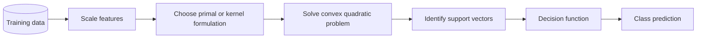
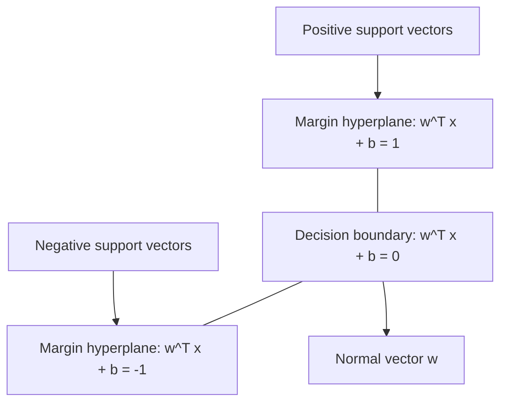
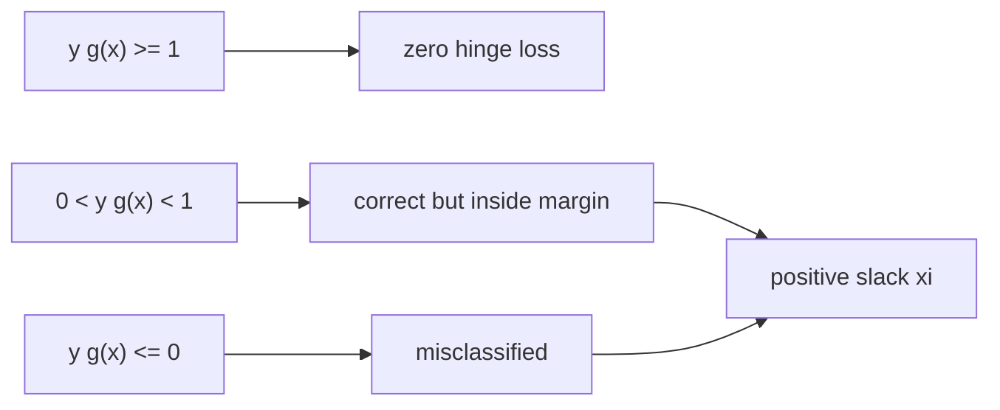
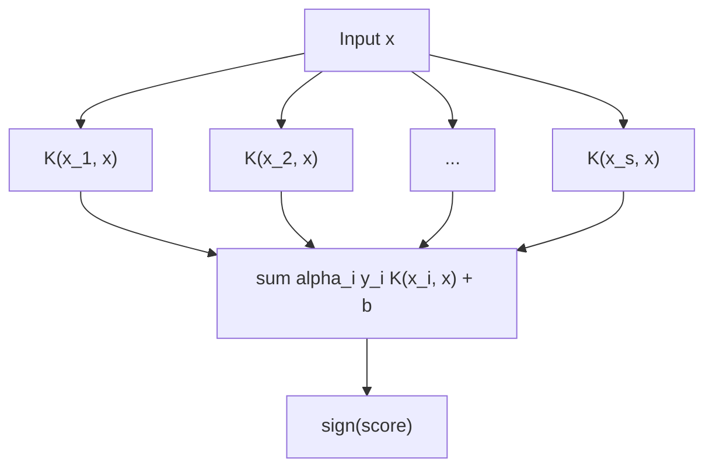
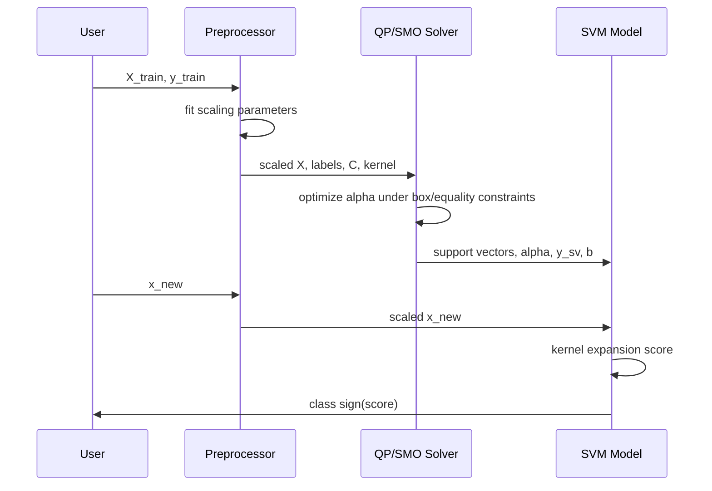

# Support Vector Machines

Support Vector Machines (SVMs) are margin-based supervised learning methods for classification, regression, and novelty detection. The central classifier is simple:

$$
f(x)=\operatorname{sign}(w^\top x+b).
$$

The nontrivial part is how $w$ and $b$ are chosen. Among all separating hyperplanes, the hard-margin SVM chooses the one with maximum geometric margin. For noisy or overlapping classes, the soft-margin SVM trades margin size against hinge-loss violations. With kernels, the same optimization can fit nonlinear decision boundaries while depending only on pairwise similarities.



## 1. Binary Classification Setup

Assume a training set

$$
\mathcal{D}
=
\{(x_i,y_i)\}_{i=1}^{n},
\qquad
x_i\in\mathbb{R}^{d},
\qquad
y_i\in\{-1,+1\}.
$$

A linear classifier uses the affine score

$$
g(x)=w^\top x+b,
\qquad
w\in\mathbb{R}^{d},
\qquad
b\in\mathbb{R}.
$$

The predicted class is

$$
\hat{y}
=
\operatorname{sign}(g(x)).
$$

The decision boundary is the hyperplane

$$
\mathcal{H}
=
\{x\in\mathbb{R}^{d}:w^\top x+b=0\}.
$$

For $d=2$, this is a line. For $d=3$, it is a plane. For general $d$, it is a $(d-1)$-dimensional affine subspace.

Correct classification means

$$
y_i(w^\top x_i+b)>0.
$$

SVMs do not only require correct signs. They choose the separator that maximizes the distance from the boundary to the closest training points.

## 2. Geometry of the Margin

### 2.1 Distance From a Point to a Hyperplane

Let

$$
\mathcal{H}
=
\{x:w^\top x+b=0\}.
$$

For any point $x_0$, the signed distance from $x_0$ to $\mathcal{H}$ is

$$
\frac{w^\top x_0+b}{\lVert w\rVert_2}.
$$

The unsigned distance is

$$
\operatorname{dist}(x_0,\mathcal{H})
=
\frac{|w^\top x_0+b|}{\lVert w\rVert_2}.
$$

Derivation: the closest point on the hyperplane must lie along the normal direction $w$. Write it as

$$
x^\star=x_0-\tau w.
$$

Because $x^\star\in\mathcal{H}$,

$$
w^\top(x_0-\tau w)+b=0.
$$

Solving for $\tau$ gives

$$
\tau
=
\frac{w^\top x_0+b}{w^\top w}
=
\frac{w^\top x_0+b}{\lVert w\rVert_2^2}.
$$

Therefore

$$
\lVert x_0-x^\star\rVert_2
=
\left\lVert
\frac{w^\top x_0+b}{\lVert w\rVert_2^2}w
\right\rVert_2
=
\frac{|w^\top x_0+b|}{\lVert w\rVert_2}.
$$

The vector $w$ is perpendicular to the hyperplane, so changing $w$ rotates the boundary and changing $b$ translates it.

### 2.2 Functional Margin and Geometric Margin

The functional margin of example $i$ is

$$
\hat{\gamma}_i
=
y_i(w^\top x_i+b).
$$

The geometric margin is the signed distance after correcting for the label:

$$
\gamma_i
=
\frac{y_i(w^\top x_i+b)}{\lVert w\rVert_2}.
$$

The dataset margin is the worst-case geometric margin:

$$
\gamma
=
\min_{1\leq i\leq n}
\frac{y_i(w^\top x_i+b)}{\lVert w\rVert_2}.
$$

The functional margin is scale-dependent. If $(w,b)$ is replaced by $(cw,cb)$ for $c>0$, the decision boundary and predictions do not change:

$$
\operatorname{sign}(cw^\top x+cb)
=
\operatorname{sign}(w^\top x+b).
$$

But the functional margin becomes

$$
y_i(cw^\top x_i+cb)
=
c\,y_i(w^\top x_i+b).
$$

The geometric margin is invariant to this scaling:

$$
\frac{y_i(cw^\top x_i+cb)}{\lVert cw\rVert_2}
=
\frac{c\,y_i(w^\top x_i+b)}{c\lVert w\rVert_2}
=
\frac{y_i(w^\top x_i+b)}{\lVert w\rVert_2}.
$$

SVM fixes the scaling by requiring the closest points to satisfy

$$
y_i(w^\top x_i+b)=1.
$$

Then the margin to the closest point is

$$
\gamma
=
\frac{1}{\lVert w\rVert_2}.
$$

The two margin hyperplanes are

$$
w^\top x+b=1,
\qquad
w^\top x+b=-1.
$$

Their separation is

$$
\frac{2}{\lVert w\rVert_2}.
$$

Maximizing the margin is therefore equivalent to minimizing $\lVert w\rVert_2$, usually written as minimizing $\frac{1}{2}\lVert w\rVert_2^2$ because the square is differentiable and convex.



## 3. Hard-Margin Linear SVM

Hard-margin SVM assumes the classes are linearly separable:

$$
\exists (w,b)
\quad
\text{such that}
\quad
y_i(w^\top x_i+b)>0
\quad
\forall i.
$$

After fixing the scaling, the primal optimization problem is

$$
\begin{aligned}
\min_{w,b}
\quad&
\frac{1}{2}\lVert w\rVert_2^2
\\
\text{subject to}
\quad&
y_i(w^\top x_i+b)\geq 1,
\qquad
i=1,\dots,n.
\end{aligned}
$$

This is a convex quadratic program: the objective is convex quadratic, and the constraints are affine.

### 3.1 Lagrangian

Introduce Lagrange multipliers

$$
\alpha_i\geq 0
$$

for the constraints

$$
1-y_i(w^\top x_i+b)\leq 0.
$$

The Lagrangian is

$$
\mathcal{L}(w,b,\alpha)
=
\frac{1}{2}\lVert w\rVert_2^2
+
\sum_{i=1}^{n}\alpha_i
\left(
1-y_i(w^\top x_i+b)
\right).
$$

Expanding:

$$
\mathcal{L}(w,b,\alpha)
=
\frac{1}{2}w^\top w
+
\sum_{i=1}^{n}\alpha_i
-
\sum_{i=1}^{n}\alpha_i y_i w^\top x_i
-
b\sum_{i=1}^{n}\alpha_i y_i.
$$

### 3.2 Stationarity

At the saddle point, derivatives with respect to primal variables vanish.

For $w$:

$$
\frac{\partial \mathcal{L}}{\partial w}
=
w-\sum_{i=1}^{n}\alpha_i y_i x_i
=
0.
$$

Thus

$$
w
=
\sum_{i=1}^{n}\alpha_i y_i x_i.
$$

For $b$:

$$
\frac{\partial \mathcal{L}}{\partial b}
=
-
\sum_{i=1}^{n}\alpha_i y_i
=
0.
$$

Thus

$$
\sum_{i=1}^{n}\alpha_i y_i=0.
$$

### 3.3 Dual Problem

Substitute

$$
w=\sum_{i=1}^{n}\alpha_i y_i x_i
$$

into the Lagrangian. First,

$$
\frac{1}{2}\lVert w\rVert_2^2
=
\frac{1}{2}
\sum_{i=1}^{n}\sum_{j=1}^{n}
\alpha_i\alpha_j y_i y_j x_i^\top x_j.
$$

Also,

$$
\sum_{i=1}^{n}\alpha_i y_i w^\top x_i
=
w^\top
\sum_{i=1}^{n}\alpha_i y_i x_i
=
w^\top w
=
\sum_{i=1}^{n}\sum_{j=1}^{n}
\alpha_i\alpha_j y_i y_j x_i^\top x_j.
$$

The $b$ term vanishes because $\sum_i\alpha_i y_i=0$. Therefore the dual objective is

$$
\begin{aligned}
\max_{\alpha}
\quad&
\sum_{i=1}^{n}\alpha_i
-
\frac{1}{2}
\sum_{i=1}^{n}\sum_{j=1}^{n}
\alpha_i\alpha_j y_i y_j x_i^\top x_j
\\
\text{subject to}
\quad&
\alpha_i\geq 0,
\qquad
i=1,\dots,n,
\\
&
\sum_{i=1}^{n}\alpha_i y_i=0.
\end{aligned}
$$

Only dot products $x_i^\top x_j$ appear. This is the algebraic opening used by kernels.

### 3.4 KKT Conditions

Because the problem is convex and satisfies the usual constraint qualification for separable data, the Karush-Kuhn-Tucker conditions characterize the optimum:

$$
\alpha_i\geq 0,
$$

$$
y_i(w^\top x_i+b)-1\geq 0,
$$

$$
\alpha_i\left(y_i(w^\top x_i+b)-1\right)=0,
$$

$$
w=\sum_{i=1}^{n}\alpha_i y_i x_i,
$$

$$
\sum_{i=1}^{n}\alpha_i y_i=0.
$$

Complementary slackness is the key interpretive condition:

$$
\alpha_i\left(y_i(w^\top x_i+b)-1\right)=0.
$$

If a point is outside the margin, then

$$
y_i(w^\top x_i+b)>1,
$$

so

$$
\alpha_i=0.
$$

If

$$
\alpha_i>0,
$$

then

$$
y_i(w^\top x_i+b)=1.
$$

These points lie exactly on the margin and are called support vectors. The classifier can be written using only support vectors:

$$
g(x)
=
\sum_{i\in\mathcal{S}}
\alpha_i y_i x_i^\top x
+
b,
$$

where

$$
\mathcal{S}
=
\{i:\alpha_i>0\}.
$$

For any support vector $x_s$,

$$
y_s(w^\top x_s+b)=1.
$$

Since $y_s\in\{-1,+1\}$,

$$
b
=
y_s-w^\top x_s.
$$

In practice, $b$ is often averaged over support vectors for numerical robustness:

$$
b
=
\frac{1}{|\mathcal{S}|}
\sum_{s\in\mathcal{S}}
\left(
y_s-\sum_{i\in\mathcal{S}}\alpha_i y_i x_i^\top x_s
\right).
$$

## 4. Worked Hard-Margin Example

Consider one-dimensional data:

$$
(x_1,y_1)=(1,-1),
\qquad
(x_2,y_2)=(3,+1).
$$

Use

$$
g(x)=wx+b.
$$

The margin constraints are

$$
-1(w\cdot 1+b)\geq 1
\quad\Rightarrow\quad
w+b\leq -1,
$$

$$
+1(w\cdot 3+b)\geq 1
\quad\Rightarrow\quad
3w+b\geq 1.
$$

At the maximum-margin solution both points are support vectors:

$$
w+b=-1,
$$

$$
3w+b=1.
$$

Subtract:

$$
2w=2
\quad\Rightarrow\quad
w=1.
$$

Then

$$
b=-2.
$$

The decision boundary is

$$
x-2=0
\quad\Rightarrow\quad
x=2.
$$

The margin width is

$$
\frac{2}{|w|}
=
2.
$$

The negative margin point is at $x=1$, the positive margin point is at $x=3$, and the decision boundary is exactly halfway between them.

Dual check: because the equality constraint is

$$
-\alpha_1+\alpha_2=0,
$$

we have

$$
\alpha_1=\alpha_2=\alpha.
$$

The weight is

$$
w
=
\alpha_1y_1x_1+\alpha_2y_2x_2
=
\alpha(-1)(1)+\alpha(+1)(3)
=
2\alpha.
$$

Since $w=1$,

$$
\alpha=\frac{1}{2}.
$$

For a new point $x_\star=2.6$:

$$
g(2.6)=2.6-2=0.6,
$$

so

$$
\hat{y}=+1.
$$

## 5. Soft-Margin SVM

Hard-margin SVM fails when data is not linearly separable or when a separator exists only because of outliers. Soft-margin SVM introduces slack variables

$$
\xi_i\geq 0
$$

so that constraints become

$$
y_i(w^\top x_i+b)\geq 1-\xi_i.
$$

The primal problem is

$$
\begin{aligned}
\min_{w,b,\xi}
\quad&
\frac{1}{2}\lVert w\rVert_2^2
+
C\sum_{i=1}^{n}\xi_i
\\
\text{subject to}
\quad&
y_i(w^\top x_i+b)\geq 1-\xi_i,
\qquad
i=1,\dots,n,
\\
&
\xi_i\geq 0,
\qquad
i=1,\dots,n.
\end{aligned}
$$

The parameter $C>0$ controls the tradeoff:

- Large $C$: margin violations are expensive, producing a narrower margin and lower training error when possible.
- Small $C$: violations are cheaper, producing a wider margin and stronger regularization.

### 5.1 Connection to Hinge Loss

For fixed $(w,b)$, the smallest feasible slack is

$$
\xi_i
=
\max(0,1-y_i(w^\top x_i+b)).
$$

Substituting this into the primal gives the unconstrained regularized empirical risk

$$
\min_{w,b}
\quad
\frac{1}{2}\lVert w\rVert_2^2
+
C\sum_{i=1}^{n}
\max(0,1-y_i(w^\top x_i+b)).
$$

The loss

$$
\ell_{\text{hinge}}(y,g(x))
=
\max(0,1-y g(x))
$$

is zero when the example is correctly classified with margin at least $1$. It is positive for points inside the margin and for misclassified points.



### 5.2 Soft-Margin Dual

The Lagrangian is

$$
\mathcal{L}(w,b,\xi,\alpha,\mu)
=
\frac{1}{2}\lVert w\rVert_2^2
+
C\sum_{i=1}^{n}\xi_i
+
\sum_{i=1}^{n}\alpha_i
\left(
1-\xi_i-y_i(w^\top x_i+b)
\right)
-
\sum_{i=1}^{n}\mu_i\xi_i,
$$

with

$$
\alpha_i\geq 0,
\qquad
\mu_i\geq 0.
$$

Stationarity with respect to $w$ and $b$ gives

$$
w=\sum_{i=1}^{n}\alpha_i y_i x_i,
$$

$$
\sum_{i=1}^{n}\alpha_i y_i=0.
$$

Stationarity with respect to $\xi_i$ gives

$$
\frac{\partial\mathcal{L}}{\partial \xi_i}
=
C-\alpha_i-\mu_i
=
0.
$$

Because $\mu_i\geq 0$,

$$
0\leq \alpha_i\leq C.
$$

The dual is

$$
\begin{aligned}
\max_{\alpha}
\quad&
\sum_{i=1}^{n}\alpha_i
-
\frac{1}{2}
\sum_{i=1}^{n}\sum_{j=1}^{n}
\alpha_i\alpha_j y_i y_j x_i^\top x_j
\\
\text{subject to}
\quad&
0\leq \alpha_i\leq C,
\qquad
i=1,\dots,n,
\\
&
\sum_{i=1}^{n}\alpha_i y_i=0.
\end{aligned}
$$

The only difference from the hard-margin dual is the upper bound $C$.

### 5.3 Interpreting Soft-Margin Support Vectors

Let

$$
m_i=y_i(w^\top x_i+b).
$$

The KKT conditions imply:

| Region | Condition | Multiplier behavior | Interpretation |
|---|---:|---:|---|
| Outside margin | $m_i>1$ | $\alpha_i=0$ | Not a support vector |
| Exactly on margin | $m_i=1$ | $0<\alpha_i<C$ | Free support vector |
| Inside margin, correct | $0<m_i<1$ | $\alpha_i=C$ | Margin violation |
| Misclassified | $m_i<0$ | $\alpha_i=C$ | Classification error |

Bias $b$ is most reliably computed from free support vectors:

$$
\mathcal{S}_{\text{free}}
=
\{i:0<\alpha_i<C\}.
$$

For such points,

$$
b
=
y_i-\sum_{j=1}^{n}\alpha_j y_j x_j^\top x_i.
$$

If no free support vectors exist because all support vectors are at bounds, implementations use more careful threshold estimates from KKT intervals.

## 6. Kernels and Nonlinear SVMs

Some class boundaries are nonlinear in the original input space. Suppose we map inputs using

$$
\phi:\mathbb{R}^{d}\rightarrow\mathcal{F},
$$

where $\mathcal{F}$ may be high-dimensional or infinite-dimensional. A linear classifier in feature space is

$$
g(x)=w^\top\phi(x)+b.
$$

The dual depends on feature vectors only through inner products:

$$
\phi(x_i)^\top\phi(x_j).
$$

A kernel function computes this inner product without explicitly constructing $\phi$:

$$
K(x_i,x_j)
=
\phi(x_i)^\top\phi(x_j).
$$

The kernelized dual is

$$
\begin{aligned}
\max_{\alpha}
\quad&
\sum_{i=1}^{n}\alpha_i
-
\frac{1}{2}
\sum_{i=1}^{n}\sum_{j=1}^{n}
\alpha_i\alpha_j y_i y_j K(x_i,x_j)
\\
\text{subject to}
\quad&
0\leq \alpha_i\leq C,
\\
&
\sum_{i=1}^{n}\alpha_i y_i=0.
\end{aligned}
$$

The decision function is

$$
g(x)
=
\sum_{i\in\mathcal{S}}
\alpha_i y_i K(x_i,x)
+
b.
$$



For a symmetric kernel matrix

$$
K_{ij}=K(x_i,x_j),
$$

the matrix must be positive semidefinite for the standard convex SVM theory:

$$
c^\top K c\geq 0
\qquad
\forall c\in\mathbb{R}^{n}.
$$

This condition ensures the dual quadratic term is convex when minimized, or concave when written as a maximization.

### 6.1 Common Kernels

Linear kernel:

$$
K(x,z)=x^\top z.
$$

Polynomial kernel:

$$
K(x,z)=(\gamma x^\top z+r)^p.
$$

Radial basis function (RBF) kernel:

$$
K(x,z)=\exp(-\gamma\lVert x-z\rVert_2^2).
$$

Sigmoid kernel:

$$
K(x,z)=\tanh(\gamma x^\top z+r).
$$

The RBF kernel is the most common nonlinear default because it creates localized similarity. If $x$ and $z$ are close, then

$$
\lVert x-z\rVert_2^2\approx 0
\quad\Rightarrow\quad
K(x,z)\approx 1.
$$

If they are far apart,

$$
\lVert x-z\rVert_2^2
\text{ is large}
\quad\Rightarrow\quad
K(x,z)\approx 0.
$$

The parameter $\gamma$ controls locality:

- Large $\gamma$: each support vector has a narrow region of influence; the boundary can become highly irregular.
- Small $\gamma$: similarities decay slowly; the boundary is smoother and more global.

### 6.2 Explicit Feature Map Example

Consider

$$
x=(x_1,x_2),
\qquad
z=(z_1,z_2),
$$

and the degree-2 polynomial kernel

$$
K(x,z)=(x^\top z)^2.
$$

Expanding:

$$
K(x,z)
=
(x_1z_1+x_2z_2)^2
=
x_1^2z_1^2+2x_1x_2z_1z_2+x_2^2z_2^2.
$$

This equals

$$
\phi(x)^\top\phi(z)
$$

for

$$
\phi(x)
=
\begin{bmatrix}
x_1^2 \\
\sqrt{2}x_1x_2 \\
x_2^2
\end{bmatrix}.
$$

Then

$$
\phi(x)^\top\phi(z)
=
x_1^2z_1^2
+
2x_1x_2z_1z_2
+
x_2^2z_2^2.
$$

The kernel trick avoids explicitly forming $\phi(x)$.

## 7. Step-by-Step Training and Prediction

For a kernel soft-margin SVM:

1. Encode labels as $-1$ and $+1$.
2. Apply preprocessing learned on the training set, especially centering and scaling for distance-sensitive kernels.
3. Choose $C$ and kernel hyperparameters.
4. Build or lazily access the Gram matrix

$$
K_{ij}=K(x_i,x_j).
$$

5. Solve the box-constrained quadratic program for $\alpha$.
6. Identify support vectors where

$$
\alpha_i>\epsilon_{\text{sv}}.
$$

7. Estimate $b$, preferably using free support vectors satisfying

$$
\epsilon_{\text{sv}}<\alpha_i<C-\epsilon_{\text{sv}}.
$$

8. Predict a new sample using

$$
g(x_\star)
=
\sum_{i\in\mathcal{S}}\alpha_i y_i K(x_i,x_\star)+b.
$$

9. Return

$$
\hat{y}
=
\operatorname{sign}(g(x_\star)).
$$



## 8. Optimization Mechanics: SMO

General-purpose quadratic programming is possible, but classical SVM implementations usually use decomposition methods. Sequential Minimal Optimization (SMO) repeatedly optimizes two dual variables at a time while keeping all others fixed.

The equality constraint

$$
\sum_{i=1}^{n}\alpha_i y_i=0
$$

means a single $\alpha_i$ cannot be changed independently. SMO chooses a pair $(i,j)$ and updates them jointly.

For a current decision function

$$
g(x)=\sum_{k=1}^{n}\alpha_k y_k K(x_k,x)+b,
$$

define prediction errors

$$
E_i=g(x_i)-y_i,
\qquad
E_j=g(x_j)-y_j.
$$

The second derivative term for the two-variable subproblem is

$$
\eta
=
K(x_i,x_i)+K(x_j,x_j)-2K(x_i,x_j).
$$

For positive definite kernels and distinct points, usually

$$
\eta>0.
$$

The unconstrained update for $\alpha_j$ is

$$
\alpha_j^{\text{new,unc}}
=
\alpha_j^{\text{old}}
+
\frac{y_j(E_i-E_j)}{\eta}.
$$

Then it is clipped to a feasible interval:

$$
\alpha_j^{\text{new}}
=
\min(H,\max(L,\alpha_j^{\text{new,unc}})).
$$

The interval depends on labels. If $y_i\neq y_j$:

$$
L=\max(0,\alpha_j^{\text{old}}-\alpha_i^{\text{old}}),
$$

$$
H=\min(C,C+\alpha_j^{\text{old}}-\alpha_i^{\text{old}}).
$$

If $y_i=y_j$:

$$
L=\max(0,\alpha_i^{\text{old}}+\alpha_j^{\text{old}}-C),
$$

$$
H=\min(C,\alpha_i^{\text{old}}+\alpha_j^{\text{old}}).
$$

The paired update is

$$
\alpha_i^{\text{new}}
=
\alpha_i^{\text{old}}
+
y_i y_j
\left(
\alpha_j^{\text{old}}-\alpha_j^{\text{new}}
\right).
$$

The bias is updated from two candidate thresholds:

$$
b_1
=
b^{\text{old}}
-E_i
-y_i(\alpha_i^{\text{new}}-\alpha_i^{\text{old}})K(x_i,x_i)
-y_j(\alpha_j^{\text{new}}-\alpha_j^{\text{old}})K(x_i,x_j),
$$

$$
b_2
=
b^{\text{old}}
-E_j
-y_i(\alpha_i^{\text{new}}-\alpha_i^{\text{old}})K(x_i,x_j)
-y_j(\alpha_j^{\text{new}}-\alpha_j^{\text{old}})K(x_j,x_j).
$$

If

$$
0<\alpha_i^{\text{new}}<C,
$$

use $b_1$. If

$$
0<\alpha_j^{\text{new}}<C,
$$

use $b_2$. Otherwise use

$$
b^{\text{new}}
=
\frac{b_1+b_2}{2}.
$$

SMO stops when all examples satisfy KKT conditions up to tolerance or when an iteration limit is reached.

## 9. Python Implementation From Scratch

The following implementation is intentionally compact but complete enough to expose the mechanics of a binary soft-margin kernel SVM trained with a simplified SMO loop. It is not a replacement for production solvers: mature libraries use shrinking, cache management, careful working-set selection, stopping rules, class weights, and robust threshold handling.

```python
import numpy as np


class BinarySVM:
    """Binary C-SVM trained with a simplified SMO algorithm."""

    def __init__(
        self,
        C=1.0,
        kernel="rbf",
        gamma="scale",
        degree=3,
        coef0=0.0,
        tol=1e-3,
        max_passes=10,
        max_iter=10_000,
        random_state=0,
    ):
        self.C = float(C)
        self.kernel = kernel
        self.gamma = gamma
        self.degree = int(degree)
        self.coef0 = float(coef0)
        self.tol = float(tol)
        self.max_passes = int(max_passes)
        self.max_iter = int(max_iter)
        self.random_state = random_state

    def _resolve_gamma(self, X):
        if self.gamma == "scale":
            var = X.var()
            return 1.0 / (X.shape[1] * var) if var > 0 else 1.0
        if self.gamma == "auto":
            return 1.0 / X.shape[1]
        return float(self.gamma)

    def _kernel_matrix(self, A, B):
        if self.kernel == "linear":
            return A @ B.T

        if self.kernel == "poly":
            return (self._gamma * (A @ B.T) + self.coef0) ** self.degree

        if self.kernel == "rbf":
            a2 = np.sum(A * A, axis=1)[:, None]
            b2 = np.sum(B * B, axis=1)[None, :]
            sqdist = np.maximum(a2 + b2 - 2.0 * (A @ B.T), 0.0)
            return np.exp(-self._gamma * sqdist)

        raise ValueError(f"Unknown kernel: {self.kernel}")

    def fit(self, X, y):
        X = np.asarray(X, dtype=float)
        y = np.asarray(y, dtype=float)

        unique = np.unique(y)
        if set(unique.tolist()) != {-1.0, 1.0}:
            raise ValueError("This implementation expects labels encoded as -1 and +1.")

        n_samples, n_features = X.shape
        self._gamma = self._resolve_gamma(X)
        K = self._kernel_matrix(X, X)

        alpha = np.zeros(n_samples, dtype=float)
        b = 0.0
        rng = np.random.default_rng(self.random_state)

        def score_at(i):
            return np.sum(alpha * y * K[:, i]) + b

        passes = 0
        iters = 0

        while passes < self.max_passes and iters < self.max_iter:
            num_changed = 0

            for i in range(n_samples):
                E_i = score_at(i) - y[i]
                violates_low = y[i] * E_i < -self.tol and alpha[i] < self.C
                violates_high = y[i] * E_i > self.tol and alpha[i] > 0.0

                if not (violates_low or violates_high):
                    continue

                j = rng.integers(0, n_samples - 1)
                if j >= i:
                    j += 1

                E_j = score_at(j) - y[j]
                alpha_i_old = alpha[i]
                alpha_j_old = alpha[j]

                if y[i] != y[j]:
                    L = max(0.0, alpha[j] - alpha[i])
                    H = min(self.C, self.C + alpha[j] - alpha[i])
                else:
                    L = max(0.0, alpha[i] + alpha[j] - self.C)
                    H = min(self.C, alpha[i] + alpha[j])

                if np.isclose(L, H):
                    continue

                eta = K[i, i] + K[j, j] - 2.0 * K[i, j]
                if eta <= 1e-12:
                    continue

                alpha[j] += y[j] * (E_i - E_j) / eta
                alpha[j] = np.clip(alpha[j], L, H)

                if abs(alpha[j] - alpha_j_old) < 1e-8:
                    continue

                alpha[i] += y[i] * y[j] * (alpha_j_old - alpha[j])

                b1 = (
                    b
                    - E_i
                    - y[i] * (alpha[i] - alpha_i_old) * K[i, i]
                    - y[j] * (alpha[j] - alpha_j_old) * K[i, j]
                )
                b2 = (
                    b
                    - E_j
                    - y[i] * (alpha[i] - alpha_i_old) * K[i, j]
                    - y[j] * (alpha[j] - alpha_j_old) * K[j, j]
                )

                if 0.0 < alpha[i] < self.C:
                    b = b1
                elif 0.0 < alpha[j] < self.C:
                    b = b2
                else:
                    b = 0.5 * (b1 + b2)

                num_changed += 1

            passes = passes + 1 if num_changed == 0 else 0
            iters += 1

        sv_mask = alpha > 1e-7
        self.X_train_ = X
        self.y_train_ = y
        self.alpha_ = alpha
        self.b_ = b
        self.support_ = np.flatnonzero(sv_mask)
        self.support_vectors_ = X[sv_mask]
        self.dual_coef_ = alpha[sv_mask] * y[sv_mask]
        self.n_iter_ = iters

        if self.kernel == "linear":
            self.coef_ = (alpha * y) @ X
        else:
            self.coef_ = None

        return self

    def decision_function(self, X):
        X = np.asarray(X, dtype=float)
        K = self._kernel_matrix(X, self.support_vectors_)
        return K @ self.dual_coef_ + self.b_

    def predict(self, X):
        scores = self.decision_function(X)
        return np.where(scores >= 0.0, 1.0, -1.0)
```

Example:

```python
import numpy as np

X = np.array([
    [0.0, 0.0],
    [0.5, 0.2],
    [1.0, 0.0],
    [2.0, 2.0],
    [2.5, 2.2],
    [3.0, 2.8],
])
y = np.array([-1, -1, -1, +1, +1, +1])

model = BinarySVM(C=10.0, kernel="linear", tol=1e-4, random_state=42)
model.fit(X, y)

print(model.coef_)
print(model.b_)
print(model.support_)
print(model.predict([[1.2, 1.0], [2.7, 2.4]]))
```

Important internal details:

- The vector `alpha * y` stores the signed dual coefficients.
- For a linear kernel, the primal weight is recovered by `(alpha * y) @ X`.
- For an RBF kernel, `coef_` does not exist in input space because the learned hyperplane lives in the implicit feature space.
- The RBF distance computation uses

$$
\lVert a-b\rVert_2^2
=
\lVert a\rVert_2^2+\lVert b\rVert_2^2-2a^\top b,
$$

which vectorizes all pairwise distances.
- `np.maximum(..., 0.0)` guards against tiny negative squared distances caused by floating-point roundoff.

## 10. Equivalent Library Implementations

### 10.1 scikit-learn SVC

```python
from sklearn.pipeline import make_pipeline
from sklearn.preprocessing import StandardScaler
from sklearn.svm import SVC

clf = make_pipeline(
    StandardScaler(),
    SVC(C=1.0, kernel="rbf", gamma="scale")
)

clf.fit(X_train, y_train)
pred = clf.predict(X_test)
scores = clf.decision_function(X_test)
```

`SVC` implements C-support vector classification and is based on LIBSVM. Internally, LIBSVM solves the kernelized dual with an SMO-type decomposition method. The model stores support vectors, dual coefficients, intercepts, and kernel parameters. Prediction evaluates the kernel expansion over support vectors:

$$
g(x)
=
\sum_{i\in\mathcal{S}}\alpha_i y_i K(x_i,x)+b.
$$

`gamma="scale"` uses

$$
\gamma
=
\frac{1}{d\operatorname{Var}(X)}
$$

where $d$ is the number of features and $\operatorname{Var}(X)$ is the variance of the training data passed to `SVC`. `gamma="auto"` uses

$$
\gamma=\frac{1}{d}.
$$

Feature scaling is usually essential because both the margin and kernels are sensitive to coordinate scales.

### 10.2 LinearSVC

```python
from sklearn.pipeline import make_pipeline
from sklearn.preprocessing import StandardScaler
from sklearn.svm import LinearSVC

clf = make_pipeline(
    StandardScaler(),
    LinearSVC(C=1.0, loss="squared_hinge", dual="auto", max_iter=10_000)
)

clf.fit(X_train, y_train)
pred = clf.predict(X_test)
```

`LinearSVC` is for linear SVMs only. It uses LIBLINEAR rather than LIBSVM and optimizes a primal or dual objective specialized for linear models. For large sparse or high-dimensional data, such as text classification, this is often much faster than `SVC(kernel="linear")` because it avoids building an $n\times n$ kernel matrix.

### 10.3 SGDClassifier With Hinge Loss

```python
from sklearn.linear_model import SGDClassifier
from sklearn.pipeline import make_pipeline
from sklearn.preprocessing import StandardScaler

clf = make_pipeline(
    StandardScaler(with_mean=False),
    SGDClassifier(loss="hinge", alpha=1e-4, max_iter=1000, tol=1e-3)
)

clf.fit(X_train_sparse, y_train)
```

This optimizes a linear SVM-like objective with stochastic gradient methods. It does not solve the exact same constrained quadratic program as LIBSVM, but it scales well to very large datasets.

The hinge-loss subgradient for one example is

$$
\nabla_w \max(0,1-y_iw^\top x_i)
=
\begin{cases}
0,
&
y_iw^\top x_i\geq 1,
\\
-y_i x_i,
&
y_iw^\top x_i<1.
\end{cases}
$$

With $\ell_2$ regularization, an SGD update has the form

$$
w
\leftarrow
(1-\eta\lambda)w+\eta y_i x_i
$$

when the margin is violated, and

$$
w
\leftarrow
(1-\eta\lambda)w
$$

otherwise.

## 11. Multiclass SVMs

The derivation above is binary. Common multiclass reductions are:

### 11.1 One-vs-Rest

For $K$ classes, train $K$ binary classifiers. Classifier $k$ treats class $k$ as positive and all others as negative:

$$
y_i^{(k)}
=
\begin{cases}
+1,& y_i=k,\\
-1,& y_i\neq k.
\end{cases}
$$

Prediction uses the largest decision score:

$$
\hat{y}
=
\operatorname{arg\,max}_{k}
g_k(x).
$$

### 11.2 One-vs-One

Train one classifier for every pair of classes:

$$
\frac{K(K-1)}{2}
$$

binary classifiers. Each classifier is trained only on examples from the two corresponding classes. Prediction is usually by voting or pairwise coupling.

LIBSVM-style `SVC` uses one-vs-one internally for multiclass classification, while many linear formulations use one-vs-rest.

### 11.3 Direct Multiclass Margin

Crammer-Singer multiclass SVM learns class weight vectors $w_1,\dots,w_K$ and imposes

$$
w_{y_i}^\top x_i-w_k^\top x_i
\geq
1-\xi_i
\qquad
\forall k\neq y_i.
$$

The corresponding loss is

$$
\ell_i
=
\max_{k\neq y_i}
\left[
1+w_k^\top x_i-w_{y_i}^\top x_i
\right]_+.
$$

This couples classes in a single optimization problem instead of training independent binary models.

## 12. Support Vector Regression

SVMs can also be used for regression. Epsilon-SVR fits a function

$$
f(x)=w^\top x+b
$$

while ignoring errors smaller than $\epsilon$. The epsilon-insensitive loss is

$$
\ell_\epsilon(y,f(x))
=
\max(0,|y-f(x)|-\epsilon).
$$

The primal problem is

$$
\begin{aligned}
\min_{w,b,\xi,\xi^\star}
\quad&
\frac{1}{2}\lVert w\rVert_2^2
+
C\sum_{i=1}^{n}(\xi_i+\xi_i^\star)
\\
\text{subject to}
\quad&
y_i-w^\top x_i-b
\leq
\epsilon+\xi_i,
\\
&
w^\top x_i+b-y_i
\leq
\epsilon+\xi_i^\star,
\\
&
\xi_i,\xi_i^\star\geq 0.
\end{aligned}
$$

The tube

$$
|y_i-f(x_i)|\leq \epsilon
$$

has zero loss. Points outside the tube become support vectors.

## 13. Complexity

Let $n$ be the number of training examples, $d$ the number of features, and $s$ the number of support vectors.

| Model | Training cost | Prediction cost per sample | Memory |
|---|---:|---:|---:|
| Linear primal SVM | roughly $O(nd)$ per first-order pass | $O(d)$ | $O(d)$ |
| Kernel SVM with cached Gram matrix | often between $O(n^2)$ and $O(n^3)$ | $O(sd)$ for RBF distance or $O(s)$ kernel calls | $O(n^2)$ cache worst case |
| LinearSVC / LIBLINEAR | scales near-linearly for sparse data | $O(\operatorname{nnz}(x))$ | $O(d)$ |
| SGD hinge classifier | $O(\operatorname{nnz}(X))$ per epoch | $O(\operatorname{nnz}(x))$ | $O(d)$ |

Kernel SVM prediction can be expensive when $s$ is large:

$$
g(x)
=
\sum_{i=1}^{s}\alpha_i y_i K(x_i,x)+b.
$$

The model must compare each test point to all support vectors. If nearly every training point is a support vector, prediction cost becomes close to comparing against the full training set.

## 14. Numerical Stability and Implementation Pitfalls

### 14.1 Feature Scaling

For a linear SVM, unscaled features distort the margin because $\lVert w\rVert_2$ penalizes coefficients in raw coordinate units. For RBF kernels, unscaled features dominate squared distances:

$$
\lVert x-z\rVert_2^2
=
\sum_{j=1}^{d}(x_j-z_j)^2.
$$

A feature measured in thousands can dominate a feature measured in fractions, even if the smaller-scale feature is more predictive.

### 14.2 Degenerate Kernel Values

For RBF kernels:

- If $\gamma$ is too large, most off-diagonal kernel values are close to zero. The model can memorize.
- If $\gamma$ is too small, most kernel values are close to one. The model can underfit because examples look too similar.

### 14.3 Non-PSD Custom Kernels

If a custom kernel matrix is not positive semidefinite, the dual may become non-convex. Solvers may fail, converge to unstable solutions, or return models with poor generalization.

### 14.4 Bias Estimation

Computing $b$ from support vectors at the box constraint can be unstable. Prefer free support vectors satisfying

$$
0<\alpha_i<C.
$$

In floating-point arithmetic this means using a tolerance, for example

$$
10^{-7}<\alpha_i<C-10^{-7}.
$$

### 14.5 Class Imbalance

With imbalanced classes, a single $C$ may under-penalize errors on the minority class. Class-weighted SVM uses class-specific penalties:

$$
C_i=C\,w_{y_i}.
$$

The dual box constraint becomes

$$
0\leq \alpha_i\leq C_i.
$$

### 14.6 Probability Estimates

SVM decision scores are margins, not probabilities. Probability estimates are usually obtained by calibration, such as Platt scaling:

$$
P(y=1\mid x)
\approx
\frac{1}{1+\exp(A g(x)+B)}.
$$

The parameters $A$ and $B$ are fit on held-out data or by cross-validation. Poor calibration can occur when the calibration set is small or distribution-shifted.

### 14.7 Duplicates and Contradictory Labels

If two identical points have opposite labels, hard-margin SVM is infeasible. Soft-margin SVM can handle this, but both points cannot simultaneously satisfy a positive margin. The solution depends heavily on $C$ and class weights.

### 14.8 Sparse Data

For high-dimensional sparse vectors, avoid dense RBF kernels unless there is a strong reason. Linear SVMs with sparse matrix operations are usually more scalable and often perform very well for text and bag-of-features data.

## 15. Limitations

SVMs are strong when the margin assumption is appropriate and the feature representation is good. Their main limitations are:

- Kernel SVMs scale poorly with the number of samples.
- Hyperparameters $C$, $\gamma$, degree, and class weights can be sensitive.
- The learned model is less interpretable for nonlinear kernels.
- Raw decision scores are not calibrated probabilities.
- Performance depends strongly on preprocessing and feature scaling.
- Kernel choice encodes an implicit similarity assumption; a poor kernel can dominate all other choices.

## 16. Connections to Related ML Concepts

### 16.1 Regularization and Maximum Margin

The soft-margin objective

$$
\frac{1}{2}\lVert w\rVert_2^2
+
C\sum_{i=1}^{n}
\max(0,1-y_i(w^\top x_i+b))
$$

is empirical risk minimization with $\ell_2$ regularization and hinge loss. The norm penalty controls capacity by preferring smoother, lower-norm separators.

### 16.2 Logistic Regression

Logistic regression with labels in $\{-1,+1\}$ minimizes

$$
\log(1+\exp(-y_iw^\top x_i)).
$$

SVM minimizes hinge loss:

$$
\max(0,1-y_iw^\top x_i).
$$

Both penalize small or negative margins. Logistic loss is smooth and probabilistic; hinge loss is piecewise linear and becomes exactly zero after margin $1$.

### 16.3 Perceptron

The perceptron updates only on misclassified examples:

$$
y_iw^\top x_i\leq 0.
$$

SVM updates or penalizes examples that are either misclassified or inside the margin:

$$
y_iw^\top x_i<1.
$$

This is a stronger condition and leads to explicit margin maximization.

### 16.4 Kernel Methods and Gaussian Processes

Kernel SVMs and Gaussian processes both use positive semidefinite kernels to define similarity. The SVM uses the kernel inside a maximum-margin convex optimization problem; a Gaussian process uses the kernel as a covariance function defining a distribution over functions.

### 16.5 Neural Networks

The RBF SVM decision function

$$
g(x)
=
\sum_{i\in\mathcal{S}}\alpha_i y_i
\exp(-\gamma\lVert x_i-x\rVert_2^2)
+
b
$$

resembles a one-hidden-layer radial basis function network where centers are support vectors and output weights are $\alpha_i y_i$. The centers are selected by the optimization problem rather than learned by backpropagation.

## 17. References and Deeper Reading

- Corinna Cortes and Vladimir Vapnik, "Support-Vector Networks", Machine Learning, 1995: https://link.springer.com/article/10.1007/BF00994018
- Bernhard E. Boser, Isabelle M. Guyon, and Vladimir Vapnik, "A Training Algorithm for Optimal Margin Classifiers", COLT, 1992.
- John C. Platt, "Sequential Minimal Optimization: A Fast Algorithm for Training Support Vector Machines", 1998: https://www.microsoft.com/en-us/research/publication/sequential-minimal-optimization-a-fast-algorithm-for-training-support-vector-machines/
- Chih-Chung Chang and Chih-Jen Lin, "LIBSVM: A Library for Support Vector Machines", ACM Transactions on Intelligent Systems and Technology, 2011: https://www.csie.ntu.edu.tw/~cjlin/libsvm/
- scikit-learn documentation: `sklearn.svm.SVC`, `LinearSVC`, and the SVM user guide: https://scikit-learn.org/stable/modules/svm.html
- Andrew Ng, CS229 notes on Support Vector Machines: https://see.stanford.edu/materials/aimlcs229/cs229-notes3.pdf
- Christopher M. Bishop, "Pattern Recognition and Machine Learning", Chapter 7.
- Kevin P. Murphy, "Machine Learning: A Probabilistic Perspective", sections on kernel machines and margin classifiers.
