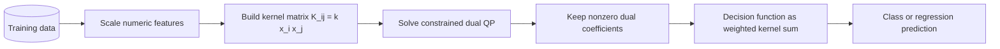
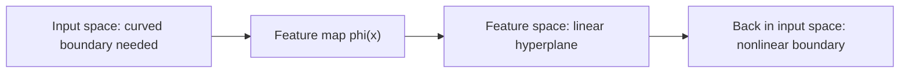
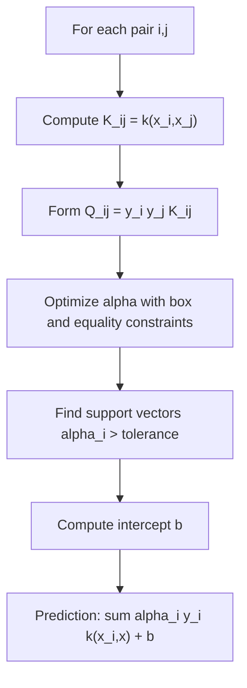
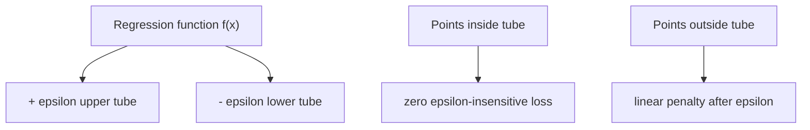

# Kernel SVM and Non-Linear SVR

Kernel methods extend linear margin machines by replacing dot products in an explicit feature space with kernel evaluations. For SVM classification, this gives nonlinear decision boundaries while preserving a convex dual optimization problem. For SVR, the same idea gives nonlinear regression functions with an $\varepsilon$-insensitive tube.

This chapter assumes the linear SVM primal/dual derivation is already familiar. The focus here is the kernelized dual, kernel validity, RBF/polynomial/sigmoid behavior, implementation details, numerical issues, and kernelized support vector regression.



## 1. Why Kernels Are Needed

A linear SVM predicts with

$$
f(x)
=
\operatorname{sign}(w^\top x+b).
$$

The boundary $w^\top x+b=0$ is linear in the input coordinates. If the classes form concentric rings, XOR-like regions, periodic patterns, or curved manifolds, a linear boundary in the original coordinates is structurally wrong.

The direct fix is to map inputs through a nonlinear feature map

$$
\phi:\mathcal{X}\rightarrow \mathcal{H},
$$

and train a linear SVM in $\mathcal{H}$:

$$
f(x)
=
\operatorname{sign}\left(w^\top \phi(x)+b\right).
$$

The boundary is linear in $\phi(x)$ but nonlinear in $x$.



The problem is that useful feature maps may be high-dimensional or infinite-dimensional. The kernel trick avoids explicit construction of $\phi(x)$ whenever the algorithm only needs inner products of mapped examples.

## 2. Kernel Trick from the SVM Dual

Assume binary labels

$$
y_i\in\{-1,+1\},
\qquad
x_i\in\mathbb{R}^{d},
\qquad
i=1,\dots,n.
$$

The soft-margin linear SVM primal in feature space is

$$
\begin{aligned}
\min_{w,b,\xi}
\quad&
\frac{1}{2}\lVert w\rVert_{\mathcal{H}}^2
+
C\sum_{i=1}^{n}\xi_i
\\
\text{subject to}
\quad&
y_i\left(\langle w,\phi(x_i)\rangle_{\mathcal{H}}+b\right)
\geq
1-\xi_i,
\\
&
\xi_i\geq 0.
\end{aligned}
$$

Here:

- $w$ is the separating normal vector in feature space.
- $b$ is the intercept.
- $\xi_i$ is the hinge-loss slack for sample $i$.
- $C>0$ controls the trade-off between margin size and training violations.
- $\lVert w\rVert_{\mathcal{H}}$ and $\langle\cdot,\cdot\rangle_{\mathcal{H}}$ are the norm and inner product of the feature space.

The Lagrangian uses multipliers $\alpha_i\geq 0$ for margin constraints and $\mu_i\geq 0$ for $\xi_i\geq 0$:

$$
\begin{aligned}
\mathcal{L}
&=
\frac{1}{2}\lVert w\rVert_{\mathcal{H}}^2
+
C\sum_{i=1}^{n}\xi_i
-
\sum_{i=1}^{n}\alpha_i
\left[
y_i\left(\langle w,\phi(x_i)\rangle_{\mathcal{H}}+b\right)-1+\xi_i
\right]
-
\sum_{i=1}^{n}\mu_i\xi_i.
\end{aligned}
$$

Stationarity with respect to $w$ gives

$$
\frac{\partial \mathcal{L}}{\partial w}=0
\quad\Longrightarrow\quad
w
=
\sum_{i=1}^{n}\alpha_i y_i\phi(x_i).
$$

Stationarity with respect to $b$ gives

$$
\frac{\partial \mathcal{L}}{\partial b}=0
\quad\Longrightarrow\quad
\sum_{i=1}^{n}\alpha_i y_i=0.
$$

Stationarity with respect to $\xi_i$ gives

$$
\frac{\partial \mathcal{L}}{\partial \xi_i}=0
\quad\Longrightarrow\quad
C-\alpha_i-\mu_i=0.
$$

Since $\mu_i\geq 0$, this implies the box constraint

$$
0\leq \alpha_i\leq C.
$$

Substituting the stationary conditions into the Lagrangian yields the dual:

$$
\begin{aligned}
\max_{\alpha}
\quad&
\sum_{i=1}^{n}\alpha_i
-
\frac{1}{2}
\sum_{i=1}^{n}\sum_{j=1}^{n}
\alpha_i\alpha_j y_i y_j
\langle \phi(x_i),\phi(x_j)\rangle_{\mathcal{H}}
\\
\text{subject to}
\quad&
0\leq \alpha_i\leq C,
\\
&
\sum_{i=1}^{n}\alpha_i y_i=0.
\end{aligned}
$$

The feature vectors appear only through inner products. Define a kernel

$$
k(x_i,x_j)
=
\langle \phi(x_i),\phi(x_j)\rangle_{\mathcal{H}}.
$$

Then the dual becomes

$$
\begin{aligned}
\max_{\alpha}
\quad&
\mathbf{1}^\top \alpha
-
\frac{1}{2}\alpha^\top Q\alpha
\\
\text{subject to}
\quad&
0\leq \alpha_i\leq C,
\\
&
y^\top \alpha=0,
\end{aligned}
$$

where

$$
Q_{ij}
=
y_i y_j k(x_i,x_j).
$$

The decision function is

$$
g(x)
=
\sum_{i=1}^{n}\alpha_i y_i k(x_i,x)+b,
\qquad
\hat{y}
=
\operatorname{sign}(g(x)).
$$

Only examples with $\alpha_i>0$ contribute to prediction. These are the support vectors.

## 3. KKT Interpretation of Support Vectors

The Karush-Kuhn-Tucker complementary slackness condition is

$$
\alpha_i
\left[
y_i g(x_i)-1+\xi_i
\right]
=
0.
$$

This creates three important regimes:

| Dual coefficient | Geometric meaning | Typical role |
|---:|---|---|
| $\alpha_i=0$ | Strictly outside the margin | Does not affect prediction |
| $0<\alpha_i<C$ | Exactly on the margin, $\xi_i=0$ | Free support vector, useful for $b$ |
| $\alpha_i=C$ | Inside margin or misclassified | Bound support vector |

For any free support vector with $0<\alpha_i<C$,

$$
y_i g(x_i)=1.
$$

Therefore

$$
b
=
y_i
-
\sum_{j=1}^{n}\alpha_j y_j k(x_j,x_i).
$$

In numerical implementations, $b$ is usually averaged over all free support vectors:

$$
b
=
\frac{1}{|\mathcal{F}|}
\sum_{i\in\mathcal{F}}
\left[
y_i
-
\sum_{j=1}^{n}\alpha_j y_j k(x_j,x_i)
\right],
\qquad
\mathcal{F}=\{i:0<\alpha_i<C\}.
$$

If no free support vector exists, production solvers estimate the intercept from bounds implied by KKT conditions rather than relying on a single unstable sample.

## 4. Valid Kernels and Mercer Conditions

A function $k:\mathcal{X}\times\mathcal{X}\rightarrow\mathbb{R}$ is a valid positive semidefinite kernel if, for any finite set $\{x_1,\dots,x_n\}$, the Gram matrix

$$
K_{ij}=k(x_i,x_j)
$$

is symmetric positive semidefinite:

$$
K=K^\top,
\qquad
c^\top Kc\geq 0
\quad
\text{for all }c\in\mathbb{R}^{n}.
$$

This condition ensures that $K$ behaves like an inner-product matrix in some Hilbert space. If $K$ is not positive semidefinite, the SVM dual may stop being convex; solvers can converge to poor local behavior or fail numerically.

Useful closure properties:

- If $k_1$ and $k_2$ are kernels, then $k_1+k_2$ is a kernel.
- If $a\geq 0$, then $a k_1$ is a kernel.
- If $k_1$ and $k_2$ are kernels, then $k_1 k_2$ is a kernel.
- If $f$ is any feature map, then $k(x,z)=f(x)^\top f(z)$ is a kernel.

## 5. Common Kernels

### 5.1 Linear Kernel

$$
k(x,z)
=
x^\top z.
$$

This recovers the ordinary linear SVM. It is usually the right choice for very high-dimensional sparse inputs such as bag-of-words or TF-IDF vectors, where explicit nonlinear kernels are too expensive and often unnecessary.

Prediction:

$$
g(x)
=
\sum_{i\in\mathcal{S}}\alpha_i y_i x_i^\top x+b
=
\left(\sum_{i\in\mathcal{S}}\alpha_i y_i x_i\right)^\top x+b.
$$

The sum can be collapsed into a single primal vector $w$, making linear prediction $O(d)$ rather than $O(|\mathcal{S}|d)$.

### 5.2 Polynomial Kernel

$$
k(x,z)
=
\left(\gamma x^\top z+r\right)^p,
\qquad
\gamma>0,
\qquad
p\in\mathbb{N}.
$$

The degree $p$ controls interaction order. For $p=2$, the implicit features include squared terms and pairwise interactions. For $x=(x_1,x_2)$ and $z=(z_1,z_2)$,

$$
(x^\top z+1)^2
=
(x_1z_1+x_2z_2+1)^2.
$$

Expanding:

$$
\begin{aligned}
(x^\top z+1)^2
&=
x_1^2z_1^2+x_2^2z_2^2+1
+2x_1x_2z_1z_2
+2x_1z_1
+2x_2z_2.
\end{aligned}
$$

This equals an inner product between explicit feature vectors:

$$
\phi(x)
=
\begin{bmatrix}
x_1^2 \\
x_2^2 \\
\sqrt{2}x_1x_2 \\
\sqrt{2}x_1 \\
\sqrt{2}x_2 \\
1
\end{bmatrix},
\qquad
\phi(z)
=
\begin{bmatrix}
z_1^2 \\
z_2^2 \\
\sqrt{2}z_1z_2 \\
\sqrt{2}z_1 \\
\sqrt{2}z_2 \\
1
\end{bmatrix}.
$$

The polynomial kernel computes this inner product without explicitly materializing the expanded features.

High-degree polynomial kernels are numerically sensitive because powers can explode for unscaled data. Feature scaling is not optional.

### 5.3 Gaussian RBF Kernel

$$
k(x,z)
=
\exp\left(-\gamma\lVert x-z\rVert_2^2\right),
\qquad
\gamma>0.
$$

The RBF kernel is stationary because it depends only on the difference $x-z$, and radial because it depends only on Euclidean distance.

It is often parameterized by length scale $\sigma$:

$$
k(x,z)
=
\exp\left(-\frac{\lVert x-z\rVert_2^2}{2\sigma^2}\right).
$$

The two parameterizations match when

$$
\gamma
=
\frac{1}{2\sigma^2}.
$$

Small $\gamma$ means large $\sigma$: each support vector has broad influence and the boundary is smooth. Large $\gamma$ means small $\sigma$: influence is local and the boundary can become highly irregular.

The RBF kernel can be rewritten as

$$
k(x,z)
=
\exp(-\gamma\lVert x\rVert^2)
\exp(-\gamma\lVert z\rVert^2)
\exp(2\gamma x^\top z),
$$

and

$$
\exp(2\gamma x^\top z)
=
\sum_{m=0}^{\infty}
\frac{(2\gamma x^\top z)^m}{m!}.
$$

This series shows why RBF corresponds to an infinite-dimensional feature map containing interactions of all orders, with coefficients that decay factorially.

### 5.4 Sigmoid Kernel

$$
k(x,z)
=
\tanh(\gamma x^\top z+r).
$$

This resembles the activation of a two-layer neural network, but it is not positive semidefinite for all parameter choices. It is therefore less robust than linear, polynomial, and RBF kernels. Use it only after validating the Gram matrix or when matching a known historical setup.

### 5.5 Precomputed and Custom Kernels

A precomputed kernel supplies the Gram matrix directly:

$$
K
\in
\mathbb{R}^{n\times n}.
$$

For training, $K_{ij}=k(x_i,x_j)$. For prediction on $m$ test points, the test kernel matrix must have shape

$$
m\times n_{\text{train}},
$$

with entries

$$
K^{\text{test}}_{ij}
=
k(x_i^{\text{test}},x_j^{\text{train}}).
$$

Common uses include graph kernels, string kernels, biological sequence kernels, and kernels built from domain-specific similarity functions.

## 6. Step-by-Step Kernel SVM Execution

Training with a kernel SVM proceeds as follows:

1. Scale features using statistics fit only on the training split.
2. Choose kernel $k$ and hyperparameters such as $C$, $\gamma$, degree, and coefficient offset.
3. Compute or cache entries of the Gram matrix $K_{ij}=k(x_i,x_j)$.
4. Solve the convex dual QP for $\alpha$.
5. Identify support vectors where $\alpha_i$ is numerically nonzero.
6. Estimate $b$ from KKT conditions.
7. Predict with a weighted kernel expansion.

The learned classifier has the form

$$
g(x)
=
\sum_{i\in\mathcal{S}}\alpha_i y_i k(x_i,x)+b.
$$

The boundary is where $g(x)=0$. A point is classified by the sign of $g(x)$, and $|g(x)|$ is a margin score, not a calibrated probability.



## 7. Worked Examples

### 7.1 RBF Similarities

Let

$$
x=(1,2),
\qquad
z=(4,6),
\qquad
\gamma=0.1.
$$

The squared distance is

$$
\lVert x-z\rVert_2^2
=
(1-4)^2+(2-6)^2
=
9+16
=
25.
$$

The RBF similarity is

$$
k(x,z)
=
\exp(-0.1\cdot 25)
=
\exp(-2.5)
\approx
0.0821.
$$

If $\gamma=0.01$ instead,

$$
k(x,z)
=
\exp(-0.25)
\approx
0.7788.
$$

The same pair is considered much more similar because the kernel length scale is larger.

### 7.2 Polynomial Kernel Calculation

Let

$$
x=(2,1),
\qquad
z=(3,-1),
\qquad
k(x,z)=(x^\top z+1)^2.
$$

Compute the dot product:

$$
x^\top z
=
2\cdot 3+1\cdot(-1)
=
5.
$$

Then

$$
k(x,z)
=
(5+1)^2
=
36.
$$

Using the explicit map from Section 5.2:

$$
\phi(x)
=
\begin{bmatrix}
4\\
1\\
2\sqrt{2}\\
2\sqrt{2}\\
\sqrt{2}\\
1
\end{bmatrix},
\qquad
\phi(z)
=
\begin{bmatrix}
9\\
1\\
-3\sqrt{2}\\
3\sqrt{2}\\
-\sqrt{2}\\
1
\end{bmatrix}.
$$

Their inner product is

$$
\begin{aligned}
\phi(x)^\top\phi(z)
&=
4\cdot 9
+1\cdot 1
+(2\sqrt{2})(-3\sqrt{2})
+(2\sqrt{2})(3\sqrt{2})
+(\sqrt{2})(-\sqrt{2})
+1
\\
&=
36+1-12+12-2+1
\\
&=
36.
\end{aligned}
$$

The implicit and explicit calculations match.

### 7.3 Tiny Dual Solution with Two Points

Consider two training examples:

$$
x_1=0,
\quad
y_1=-1,
\qquad
x_2=2,
\quad
y_2=+1.
$$

Use the linear kernel $k(x,z)=xz$ and a large enough $C$ so the hard-margin solution is feasible. The equality constraint is

$$
\alpha_1y_1+\alpha_2y_2=0
\quad\Longrightarrow\quad
-\alpha_1+\alpha_2=0,
$$

so

$$
\alpha_1=\alpha_2=a.
$$

The Gram matrix is

$$
K
=
\begin{bmatrix}
0\cdot 0 & 0\cdot 2 \\
2\cdot 0 & 2\cdot 2
\end{bmatrix}
=
\begin{bmatrix}
0&0\\
0&4
\end{bmatrix}.
$$

The dual objective is

$$
\begin{aligned}
W(a)
&=
\alpha_1+\alpha_2
-
\frac{1}{2}
\sum_{i,j}\alpha_i\alpha_j y_i y_j K_{ij}
\\
&=
2a
-
\frac{1}{2}
a^2
\left[
y_2y_2K_{22}
\right]
\\
&=
2a-2a^2.
\end{aligned}
$$

Differentiate:

$$
\frac{dW}{da}
=
2-4a.
$$

Set to zero:

$$
a=\frac{1}{2}.
$$

Then

$$
w
=
\sum_i \alpha_i y_i x_i
=
\frac{1}{2}(-1)(0)+\frac{1}{2}(1)(2)
=
1.
$$

Use the positive support vector $x_2=2$:

$$
y_2(w x_2+b)=1
\quad\Longrightarrow\quad
1(2+b)=1
\quad\Longrightarrow\quad
b=-1.
$$

The decision boundary is

$$
x-1=0,
$$

so the separating threshold is $x=1$.

## 8. Hyperparameters and Model Behavior

### 8.1 Regularization $C$

The soft-margin objective penalizes slack by

$$
C\sum_i \xi_i.
$$

Large $C$ makes violations expensive. The optimizer tries to classify training points correctly and keep them outside the margin, which can produce high-variance boundaries.

Small $C$ tolerates violations. The margin can widen, producing smoother boundaries and potentially higher bias.

### 8.2 RBF Parameter $\gamma$

For RBF,

$$
k(x,z)=\exp(-\gamma\lVert x-z\rVert^2).
$$

The derivative with respect to squared distance $r^2=\lVert x-z\rVert^2$ is

$$
\frac{\partial k}{\partial r^2}
=
-\gamma\exp(-\gamma r^2).
$$

Large $\gamma$ causes similarity to decay quickly with distance. Faraway points become almost orthogonal, so each support vector controls a small local region. Small $\gamma$ causes slower decay and smoother global behavior.

### 8.3 Coupling Between $C$ and $\gamma$

$C$ and $\gamma$ should be tuned together. A large $\gamma$ can create many small local regions; a large $C$ then forces those regions to fit training labels tightly. A small $\gamma$ with small $C$ can underfit severely.

Useful search grids are logarithmic:

$$
C\in\{2^{-5},2^{-3},\dots,2^{15}\},
\qquad
\gamma\in\{2^{-15},2^{-13},\dots,2^{3}\}.
$$

For scikit-learn's default RBF setting, `gamma="scale"` uses

$$
\gamma
=
\frac{1}{d\operatorname{Var}(X)}.
$$

After standardization to unit feature variance, this is approximately

$$
\gamma\approx \frac{1}{d}.
$$

## 9. From-Scratch Kernel SVM in Python

This implementation solves the dual directly with `scipy.optimize.minimize`. It is educational, not production-grade. Production solvers use decomposition methods such as SMO, working sets, kernel caching, shrinking heuristics, and carefully maintained KKT residuals.

```python
import numpy as np
from scipy.optimize import minimize


def linear_kernel(X, Z):
    """Return K[i, j] = X[i]^T Z[j]."""
    return X @ Z.T


def polynomial_kernel(X, Z, gamma=1.0, coef0=1.0, degree=3):
    """Return K[i, j] = (gamma X[i]^T Z[j] + coef0)^degree."""
    return (gamma * (X @ Z.T) + coef0) ** degree


def rbf_kernel(X, Z, gamma):
    """Return K[i, j] = exp(-gamma ||X[i] - Z[j]||^2)."""
    X_norm = np.sum(X * X, axis=1)[:, None]
    Z_norm = np.sum(Z * Z, axis=1)[None, :]
    sq_dist = np.maximum(X_norm + Z_norm - 2.0 * X @ Z.T, 0.0)
    return np.exp(-gamma * sq_dist)


class KernelSVCFromScratch:
    def __init__(self, C=1.0, kernel="rbf", gamma=None, degree=3, coef0=1.0, tol=1e-6):
        self.C = float(C)
        self.kernel = kernel
        self.gamma = gamma
        self.degree = degree
        self.coef0 = coef0
        self.tol = tol

    def _kernel(self, X, Z):
        if self.kernel == "linear":
            return linear_kernel(X, Z)
        if self.kernel == "poly":
            gamma = 1.0 / X.shape[1] if self.gamma is None else self.gamma
            return polynomial_kernel(X, Z, gamma=gamma, coef0=self.coef0, degree=self.degree)
        if self.kernel == "rbf":
            gamma = 1.0 / X.shape[1] if self.gamma is None else self.gamma
            return rbf_kernel(X, Z, gamma=gamma)
        raise ValueError(f"unknown kernel: {self.kernel}")

    def fit(self, X, y):
        X = np.asarray(X, dtype=float)
        y = np.asarray(y, dtype=float)
        if not np.all(np.isin(y, [-1.0, 1.0])):
            raise ValueError("y must contain labels -1 and +1")

        n_samples = X.shape[0]
        K = self._kernel(X, X)
        Q = (y[:, None] * y[None, :]) * K

        def objective(alpha):
            return 0.5 * alpha @ Q @ alpha - np.sum(alpha)

        def gradient(alpha):
            return Q @ alpha - np.ones_like(alpha)

        constraints = [{"type": "eq", "fun": lambda a: y @ a, "jac": lambda a: y}]
        bounds = [(0.0, self.C) for _ in range(n_samples)]
        alpha0 = np.zeros(n_samples)

        result = minimize(
            objective,
            alpha0,
            jac=gradient,
            bounds=bounds,
            constraints=constraints,
            method="SLSQP",
            options={"ftol": 1e-9, "maxiter": 1000},
        )
        if not result.success:
            raise RuntimeError(result.message)

        alpha = result.x
        sv_mask = alpha > self.tol
        free_mask = (alpha > self.tol) & (alpha < self.C - self.tol)

        self.X_train_ = X
        self.y_train_ = y
        self.alpha_ = alpha
        self.support_mask_ = sv_mask
        self.support_vectors_ = X[sv_mask]
        self.dual_coef_ = alpha[sv_mask] * y[sv_mask]

        decision_train_without_b = K @ (alpha * y)
        if np.any(free_mask):
            self.intercept_ = np.mean(y[free_mask] - decision_train_without_b[free_mask])
        else:
            self.intercept_ = np.mean(y[sv_mask] - decision_train_without_b[sv_mask])

        return self

    def decision_function(self, X):
        X = np.asarray(X, dtype=float)
        K_test = self._kernel(X, self.support_vectors_)
        return K_test @ self.dual_coef_ + self.intercept_

    def predict(self, X):
        scores = self.decision_function(X)
        return np.where(scores >= 0.0, 1.0, -1.0)
```

Example:

```python
from sklearn.datasets import make_circles
from sklearn.model_selection import train_test_split
from sklearn.preprocessing import StandardScaler
from sklearn.pipeline import make_pipeline

X, y01 = make_circles(n_samples=200, factor=0.35, noise=0.08, random_state=0)
y = np.where(y01 == 1, 1.0, -1.0)

X_train, X_test, y_train, y_test = train_test_split(
    X, y, test_size=0.3, random_state=0, stratify=y
)

scaler = StandardScaler()
X_train_s = scaler.fit_transform(X_train)
X_test_s = scaler.transform(X_test)

clf = KernelSVCFromScratch(C=10.0, kernel="rbf", gamma=1.0)
clf.fit(X_train_s, y_train)

accuracy = np.mean(clf.predict(X_test_s) == y_test)
print(accuracy)
print(clf.support_vectors_.shape[0])
```

Important implementation details:

- The RBF kernel computes squared distances using norms and matrix multiplication for vectorization.
- `np.maximum(..., 0.0)` removes tiny negative distances caused by floating-point cancellation.
- Only support vectors are stored for prediction.
- The intercept is most reliable when free support vectors exist.
- Direct dense QP solving requires the full $n\times n$ Gram matrix, so it is unsuitable for large $n$.

## 10. Equivalent Library Implementation

```python
from sklearn.pipeline import make_pipeline
from sklearn.preprocessing import StandardScaler
from sklearn.svm import SVC

model = make_pipeline(
    StandardScaler(),
    SVC(
        kernel="rbf",
        C=10.0,
        gamma=1.0,
        decision_function_shape="ovr",
    ),
)

model.fit(X_train, y_train)
test_accuracy = model.score(X_test, y_test)
```

`sklearn.svm.SVC` is a wrapper around libsvm for kernel SVM classification. Internally, it solves the dual optimization problem using a decomposition method rather than materializing and optimizing over all variables at once. The solver keeps a working set of dual variables, updates them while respecting box and equality constraints, caches kernel evaluations, and uses shrinking heuristics to temporarily remove variables unlikely to violate KKT conditions.

After fitting:

```python
svc = model.named_steps["svc"]

support_vectors = svc.support_vectors_
dual_coef = svc.dual_coef_
intercept = svc.intercept_
support_indices = svc.support_
```

For binary classification, `dual_coef_` stores the signed coefficients $\alpha_i y_i$ for support vectors, so the decision function is effectively

$$
g(x)
=
\sum_{i\in\mathcal{S}}
\texttt{dual\_coef}_i
k(x_i,x)
+
\texttt{intercept}.
$$

For multiclass classification, `SVC` trains one-vs-one binary classifiers internally. With $K$ classes, this creates

$$
\frac{K(K-1)}{2}
$$

binary decision functions. The `decision_function_shape="ovr"` option transforms these scores into an output shaped like one-vs-rest scores for easier downstream use.

Probability estimates from `probability=True` are not native SVM probabilities. They are calibrated afterward, traditionally using Platt scaling and cross-validation, which makes fitting slower and can change numerical behavior.

## 11. Non-Linear Support Vector Regression

SVR solves regression with a margin tube. Instead of penalizing every residual, it ignores errors smaller than $\varepsilon$.

For training data

$$
\{(x_i,y_i)\}_{i=1}^{n},
\qquad
y_i\in\mathbb{R},
$$

the kernel SVR predictor is

$$
f(x)
=
\langle w,\phi(x)\rangle_{\mathcal{H}}+b.
$$

The $\varepsilon$-insensitive loss is

$$
L_\varepsilon(y,f(x))
=
\max\left(0, |y-f(x)|-\varepsilon\right).
$$

It is zero inside the tube:

$$
|y-f(x)|\leq \varepsilon.
$$



### 11.1 Primal Form

The primal uses two slack variables because residuals can violate above or below the tube:

$$
\begin{aligned}
\min_{w,b,\xi,\xi^\star}
\quad&
\frac{1}{2}\lVert w\rVert_{\mathcal{H}}^2
+
C\sum_{i=1}^{n}(\xi_i+\xi_i^\star)
\\
\text{subject to}
\quad&
y_i-\langle w,\phi(x_i)\rangle_{\mathcal{H}}-b
\leq
\varepsilon+\xi_i,
\\
&
\langle w,\phi(x_i)\rangle_{\mathcal{H}}+b-y_i
\leq
\varepsilon+\xi_i^\star,
\\
&
\xi_i\geq 0,
\qquad
\xi_i^\star\geq 0.
\end{aligned}
$$

Here:

- $\xi_i$ penalizes points above the upper tube.
- $\xi_i^\star$ penalizes points below the lower tube.
- $C$ controls the cost of leaving the tube.
- $\varepsilon$ controls the tube width and sparsity of support vectors.

### 11.2 Dual Form

Introduce dual variables $\alpha_i,\alpha_i^\star\in[0,C]$. The SVR dual is

$$
\begin{aligned}
\max_{\alpha,\alpha^\star}
\quad&
-
\frac{1}{2}
\sum_{i=1}^{n}\sum_{j=1}^{n}
(\alpha_i-\alpha_i^\star)(\alpha_j-\alpha_j^\star)
k(x_i,x_j)
\\
&\quad
-
\varepsilon\sum_{i=1}^{n}(\alpha_i+\alpha_i^\star)
+
\sum_{i=1}^{n}y_i(\alpha_i-\alpha_i^\star)
\\
\text{subject to}
\quad&
\sum_{i=1}^{n}(\alpha_i-\alpha_i^\star)=0,
\\
&
0\leq\alpha_i\leq C,
\qquad
0\leq\alpha_i^\star\leq C.
\end{aligned}
$$

The predictor is

$$
f(x)
=
\sum_{i=1}^{n}
(\alpha_i-\alpha_i^\star)k(x_i,x)+b.
$$

Let

$$
\beta_i=\alpha_i-\alpha_i^\star.
$$

Only samples with $\beta_i\neq 0$ contribute to prediction. These are the support vectors for SVR.

### 11.3 Effect of $\varepsilon$

Large $\varepsilon$ creates a wide tube:

- fewer support vectors,
- smoother function,
- more bias,
- lower prediction cost.

Small $\varepsilon$ creates a narrow tube:

- more support vectors,
- lower training error,
- higher variance,
- higher prediction cost.

## 12. From-Scratch Kernel SVR in Python

This implementation solves the SVR dual using SLSQP. It is intended to show the mechanics, not to replace libsvm.

```python
import numpy as np
from scipy.optimize import minimize


class KernelSVRFromScratch:
    def __init__(self, C=1.0, epsilon=0.1, kernel="rbf", gamma=None, degree=3, coef0=1.0, tol=1e-6):
        self.C = float(C)
        self.epsilon = float(epsilon)
        self.kernel = kernel
        self.gamma = gamma
        self.degree = degree
        self.coef0 = coef0
        self.tol = tol

    def _kernel(self, X, Z):
        if self.kernel == "linear":
            return linear_kernel(X, Z)
        if self.kernel == "poly":
            gamma = 1.0 / X.shape[1] if self.gamma is None else self.gamma
            return polynomial_kernel(X, Z, gamma=gamma, coef0=self.coef0, degree=self.degree)
        if self.kernel == "rbf":
            gamma = 1.0 / X.shape[1] if self.gamma is None else self.gamma
            return rbf_kernel(X, Z, gamma=gamma)
        raise ValueError(f"unknown kernel: {self.kernel}")

    def fit(self, X, y):
        X = np.asarray(X, dtype=float)
        y = np.asarray(y, dtype=float)
        n = X.shape[0]
        K = self._kernel(X, X)

        # Variables are packed as z = [alpha, alpha_star].
        def unpack(z):
            return z[:n], z[n:]

        def objective(z):
            alpha, alpha_star = unpack(z)
            beta = alpha - alpha_star
            return (
                0.5 * beta @ K @ beta
                + self.epsilon * np.sum(alpha + alpha_star)
                - y @ beta
            )

        def gradient(z):
            alpha, alpha_star = unpack(z)
            beta = alpha - alpha_star
            common = K @ beta
            grad_alpha = common + self.epsilon - y
            grad_alpha_star = -common + self.epsilon + y
            return np.concatenate([grad_alpha, grad_alpha_star])

        constraints = [
            {
                "type": "eq",
                "fun": lambda z: np.sum(z[:n] - z[n:]),
                "jac": lambda z: np.concatenate([np.ones(n), -np.ones(n)]),
            }
        ]
        bounds = [(0.0, self.C) for _ in range(2 * n)]
        z0 = np.zeros(2 * n)

        result = minimize(
            objective,
            z0,
            jac=gradient,
            bounds=bounds,
            constraints=constraints,
            method="SLSQP",
            options={"ftol": 1e-9, "maxiter": 2000},
        )
        if not result.success:
            raise RuntimeError(result.message)

        alpha, alpha_star = unpack(result.x)
        beta = alpha - alpha_star
        sv_mask = np.abs(beta) > self.tol

        self.X_train_ = X
        self.y_train_ = y
        self.alpha_ = alpha
        self.alpha_star_ = alpha_star
        self.beta_ = beta
        self.support_mask_ = sv_mask
        self.support_vectors_ = X[sv_mask]
        self.dual_coef_ = beta[sv_mask]

        fitted_without_b = K @ beta

        b_candidates = []
        # For 0 < alpha_i < C, y_i - f_without_b(x_i) = epsilon + b.
        free_upper = (alpha > self.tol) & (alpha < self.C - self.tol)
        for i in np.where(free_upper)[0]:
            b_candidates.append(y[i] - fitted_without_b[i] - self.epsilon)

        # For 0 < alpha_i_star < C, f_without_b(x_i) - y_i = epsilon - b.
        free_lower = (alpha_star > self.tol) & (alpha_star < self.C - self.tol)
        for i in np.where(free_lower)[0]:
            b_candidates.append(y[i] - fitted_without_b[i] + self.epsilon)

        if b_candidates:
            self.intercept_ = float(np.mean(b_candidates))
        else:
            residual = y[sv_mask] - fitted_without_b[sv_mask]
            self.intercept_ = float(np.median(residual)) if np.any(sv_mask) else float(np.mean(y))

        return self

    def predict(self, X):
        X = np.asarray(X, dtype=float)
        K_test = self._kernel(X, self.support_vectors_)
        return K_test @ self.dual_coef_ + self.intercept_
```

Example:

```python
from sklearn.model_selection import train_test_split
from sklearn.preprocessing import StandardScaler

rng = np.random.default_rng(0)
X = np.linspace(-3.0, 3.0, 160)[:, None]
y = np.sin(2.5 * X[:, 0]) + 0.15 * rng.normal(size=X.shape[0])

X_train, X_test, y_train, y_test = train_test_split(
    X, y, test_size=0.25, random_state=0
)

scaler = StandardScaler()
X_train_s = scaler.fit_transform(X_train)
X_test_s = scaler.transform(X_test)

svr = KernelSVRFromScratch(C=10.0, epsilon=0.05, kernel="rbf", gamma=0.8)
svr.fit(X_train_s, y_train)

pred = svr.predict(X_test_s)
mae = np.mean(np.abs(pred - y_test))
print(mae)
print(svr.support_vectors_.shape[0])
```

## 13. Equivalent Library SVR

```python
from sklearn.pipeline import make_pipeline
from sklearn.preprocessing import StandardScaler
from sklearn.svm import SVR

svr_model = make_pipeline(
    StandardScaler(),
    SVR(
        kernel="rbf",
        C=10.0,
        epsilon=0.05,
        gamma=0.8,
    ),
)

svr_model.fit(X_train, y_train)
pred = svr_model.predict(X_test)
```

`sklearn.svm.SVR` also uses libsvm-style kernel optimization. Its learned prediction has the same expansion:

$$
f(x)
=
\sum_{i\in\mathcal{S}}\beta_i k(x_i,x)+b.
$$

The fitted estimator exposes:

```python
svr = svr_model.named_steps["svr"]

support_vectors = svr.support_vectors_
dual_coef = svr.dual_coef_
intercept = svr.intercept_
support_indices = svr.support_
```

For SVR, `dual_coef_` stores $\beta_i=\alpha_i-\alpha_i^\star$ for support vectors.

## 14. Complexity

Let:

- $n$ be the number of training samples,
- $d$ be the number of input features,
- $s$ be the number of support vectors,
- $c_k$ be the cost of one kernel evaluation.

| Operation | Typical complexity | Notes |
|---|---:|---|
| Full dense Gram matrix | $O(n^2 c_k)$ time, $O(n^2)$ memory | Often the practical bottleneck |
| Generic dense QP | up to $O(n^3)$ time | Educational direct solvers only |
| Decomposition/SMO training | problem-dependent, often superlinear | Uses working sets and kernel cache |
| Binary prediction | $O(sc_k)$ per query | Expensive if many support vectors |
| Linear SVM prediction | $O(d)$ per query | Can collapse support expansion into $w$ |

For RBF on dense vectors,

$$
c_k=O(d).
$$

For precomputed kernels,

$$
c_k=O(1)
$$

at prediction only if the test-train kernel values are already available.

Kernel SVMs are often excellent for small-to-medium datasets, but they scale poorly to millions of samples because of kernel storage, optimization, and prediction costs.

## 15. Numerical Stability and Practical Pitfalls

### 15.1 Feature Scaling

RBF and polynomial kernels are highly sensitive to feature scale. If one feature has range $[0,10^6]$ and another has range $[0,1]$, Euclidean distances and dot products are dominated by the large-scale feature.

Use:

$$
x_{ij}^{\text{scaled}}
=
\frac{x_{ij}-\mu_j}{s_j},
$$

where $\mu_j$ and $s_j$ are computed from the training set only.

### 15.2 RBF Underflow

If $\gamma\lVert x-z\rVert^2$ is very large,

$$
\exp(-\gamma\lVert x-z\rVert^2)
\approx
0.
$$

This is not necessarily a floating-point bug, but it can make the Gram matrix close to the identity matrix. The model may memorize the training set and generalize poorly.

### 15.3 Nearly Constant RBF Matrix

If $\gamma$ is too small,

$$
k(x_i,x_j)\approx 1
$$

for most pairs. Then the kernel matrix has low effective rank, the classifier behaves almost like a very restricted smooth function, and underfitting is likely.

### 15.4 Polynomial Overflow

For polynomial kernels,

$$
(\gamma x^\top z+r)^p
$$

can become extremely large. Standardization, moderate degree, and cross-validation are essential.

### 15.5 Invalid Custom Kernels

An arbitrary similarity score is not automatically a kernel. Check symmetry and positive semidefiniteness:

```python
eigvals = np.linalg.eigvalsh((K + K.T) / 2.0)
print(eigvals.min())
```

Small negative eigenvalues can occur from numerical error. Large negative eigenvalues indicate that the function is not a valid PSD kernel on the sampled data.

### 15.6 Data Leakage

Scaling, imputation, dimensionality reduction, and kernel parameter selection must be fit inside cross-validation folds. Use pipelines to prevent leakage:

```python
from sklearn.model_selection import GridSearchCV, StratifiedKFold
from sklearn.pipeline import make_pipeline
from sklearn.preprocessing import StandardScaler
from sklearn.svm import SVC

pipe = make_pipeline(StandardScaler(), SVC(kernel="rbf"))

param_grid = {
    "svc__C": [0.1, 1.0, 10.0, 100.0],
    "svc__gamma": [0.01, 0.1, 1.0, 10.0],
}

search = GridSearchCV(
    pipe,
    param_grid=param_grid,
    cv=StratifiedKFold(n_splits=5, shuffle=True, random_state=0),
    scoring="accuracy",
)
search.fit(X_train, y_train)
```

## 16. Edge Cases and Limitations

- Large $n$: kernel SVMs need many pairwise kernel evaluations and can become memory-bound.
- Large $s$: prediction latency grows with the number of support vectors.
- Heavy class imbalance: tune class weights or decision thresholds; accuracy can be misleading.
- Noisy labels: large $C$ can force the model to fit mislabeled points.
- Duplicate samples with conflicting labels: a hard-margin solution is impossible; even soft-margin solutions can become unstable at large $C$.
- High-dimensional sparse text: a linear SVM is often stronger and faster than an RBF SVM.
- Probability outputs: SVM margins are not probabilities without calibration.
- Extrapolation in SVR: RBF SVR extrapolates poorly outside the training distribution because distant kernels decay toward zero, leaving predictions close to the intercept.

## 17. Connections to Related Concepts

### 17.1 Logistic Regression

Logistic regression learns a linear log-odds model:

$$
\log\frac{P(Y=1\mid X=x)}{P(Y=0\mid X=x)}
=
w^\top x+b.
$$

With the sigmoid,

$$
P(Y=1\mid X=x)
=
\frac{1}{1+\exp(-(w^\top x+b))}.
$$

It optimizes log loss:

$$
\ell_{\log}(y,z)
=
\log(1+\exp(-yz)),
\qquad
y\in\{-1,+1\}.
$$

SVM optimizes hinge loss:

$$
\ell_{\text{hinge}}(y,z)
=
\max(0,1-yz).
$$

Both are margin-based linear classifiers in their basic form. Logistic regression gives calibrated probabilities more naturally; SVM focuses on maximum-margin separation. Kernel logistic regression exists, but it typically loses the sparsity pattern of SVM support vectors and requires different optimization.

### 17.2 Kernel Ridge Regression

Kernel ridge regression predicts

$$
f(x)
=
\sum_{i=1}^{n}\alpha_i k(x_i,x),
$$

with squared loss and $\ell_2$ regularization. Its solution is a linear system:

$$
\alpha
=
(K+\lambda I)^{-1}y.
$$

Unlike SVR, kernel ridge usually uses all training points in prediction because squared loss does not create an $\varepsilon$-insensitive sparse tube.

### 17.3 Gaussian Processes

Gaussian processes also use kernels, but as covariance functions:

$$
f\sim\mathcal{GP}(0,k).
$$

The kernel defines prior assumptions about smoothness, length scale, periodicity, and amplitude. SVMs use kernels inside a maximum-margin optimization problem; Gaussian processes use kernels to define a distribution over functions and return posterior uncertainty.

### 17.4 Neural Networks

The RBF SVM decision function

$$
g(x)
=
\sum_{i\in\mathcal{S}} c_i
\exp(-\gamma\lVert x_i-x\rVert^2)
+b
$$

resembles an RBF network with centers at support vectors. The difference is that SVM centers and coefficients are determined by a convex maximum-margin problem, while neural networks usually learn hidden units and weights with nonconvex gradient-based optimization.

## 18. References and Deeper Reading

- Corinna Cortes and Vladimir Vapnik, "Support-Vector Networks," *Machine Learning*, 1995.
- Chih-Chung Chang and Chih-Jen Lin, "LIBSVM: A Library for Support Vector Machines," *ACM Transactions on Intelligent Systems and Technology*, 2011.
- Alex J. Smola and Bernhard Schoelkopf, "A Tutorial on Support Vector Regression," *Statistics and Computing*, 2004.
- Bernhard Schoelkopf and Alexander J. Smola, *Learning with Kernels*, MIT Press, 2002.
- scikit-learn User Guide, ["Support Vector Machines"](https://scikit-learn.org/stable/modules/svm.html).
- scikit-learn API Reference, [`sklearn.svm.SVC`](https://scikit-learn.org/stable/modules/generated/sklearn.svm.SVC.html).
- scikit-learn API Reference, [`sklearn.svm.SVR`](https://scikit-learn.org/stable/modules/generated/sklearn.svm.SVR.html).
- scikit-learn example, ["RBF SVM parameters"](https://scikit-learn.org/stable/auto_examples/svm/plot_rbf_parameters.html).
