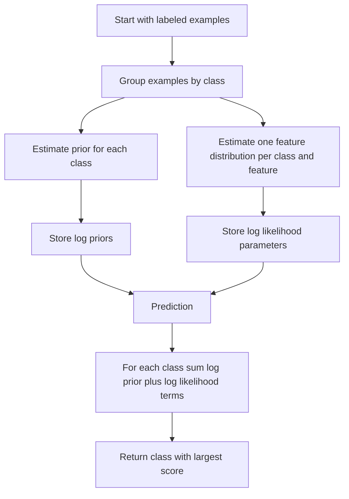

# Naive Bayes and Naive Bayes Classifiers

Naive Bayes is a family of probabilistic classifiers built from Bayes' theorem and a strong conditional-independence assumption. It is a generative classifier: it models how each class could have generated the observed features, then uses Bayes' rule to invert that model into a posterior distribution over classes.

The method is especially important for high-dimensional sparse data such as text because the conditional-independence assumption collapses an otherwise intractable joint likelihood into a product of one-dimensional likelihood terms.

```mermaid
flowchart LR
    D[(Training data)] --> C[Estimate class priors P y]
    D --> L[Estimate feature likelihoods P x_j | y]
    C --> S[Compute log posterior score]
    L --> S
    X[New example x] --> S
    S --> A[argmax over classes]
    A --> Y[Predicted class]
```

## 1. Problem Setup

Assume a supervised classification dataset

$$
\mathcal{D}
=
\{(x_i,y_i)\}_{i=1}^{n},
\qquad
x_i=(x_{i1},\dots,x_{id})\in\mathcal{X},
\qquad
y_i\in\mathcal{C}.
$$

Here:

- $n$ is the number of training examples.
- $d$ is the number of features.
- $\mathcal{C}=\{c_1,\dots,c_K\}$ is the finite class set.
- $x_{ij}$ is the value of feature $j$ for example $i$.

For a new example $x$, the Bayes-optimal classifier under a known data-generating distribution predicts

$$
\hat{y}
=
\arg\max_{c\in\mathcal{C}}
P(Y=c\mid X=x).
$$

Bayes' theorem gives

$$
P(Y=c\mid X=x)
=
\frac{P(X=x\mid Y=c)P(Y=c)}{P(X=x)}.
$$

For classification, the denominator does not depend on $c$, so the decision rule is

$$
\hat{y}
=
\arg\max_{c\in\mathcal{C}}
P(Y=c)P(X=x\mid Y=c).
$$

The difficult term is $P(X=x\mid Y=c)$. Without assumptions, a discrete feature vector with $m$ possible values per feature has $m^d$ possible configurations per class. Estimating that joint distribution directly is impossible for typical high-dimensional problems.

Naive Bayes replaces the full class-conditional joint distribution with a product of per-feature conditional distributions:

$$
P(X=x\mid Y=c)
=
\prod_{j=1}^{d}P(X_j=x_j\mid Y=c).
$$

The resulting classifier is

$$
\hat{y}
=
\arg\max_{c\in\mathcal{C}}
P(Y=c)\prod_{j=1}^{d}P(X_j=x_j\mid Y=c).
$$

The assumption is not marginal independence of features. It is conditional independence given the class:

$$
X_j\perp X_k\mid Y
\qquad
\text{for all }j\neq k.
$$

This distinction matters. Words in emails are not independent in general, but Naive Bayes only assumes that after conditioning on the class label, the remaining feature dependencies can be ignored for prediction.

## 2. Bayes' Theorem from First Principles

For events $A$ and $B$ with $P(B)>0$, conditional probability is defined as

$$
P(A\mid B)
=
\frac{P(A\cap B)}{P(B)}.
$$

Similarly,

$$
P(B\mid A)
=
\frac{P(A\cap B)}{P(A)}
\qquad
\text{when }P(A)>0.
$$

Rearrange the second expression:

$$
P(A\cap B)
=
P(B\mid A)P(A).
$$

Substitute into the first:

$$
P(A\mid B)
=
\frac{P(B\mid A)P(A)}{P(B)}.
$$

In classification, set $A=\{Y=c\}$ and $B=\{X=x\}$:

$$
P(Y=c\mid X=x)
=
\frac{P(X=x\mid Y=c)P(Y=c)}{P(X=x)}.
$$

The terms have precise roles:

- $P(Y=c)$ is the prior probability of class $c$ before observing $x$.
- $P(X=x\mid Y=c)$ is the likelihood of observing $x$ if the class were $c$.
- $P(X=x)$ is the evidence or marginal likelihood of $x$.
- $P(Y=c\mid X=x)$ is the posterior probability after observing $x$.

For discrete classes, the evidence can be expanded using the law of total probability:

$$
P(X=x)
=
\sum_{c'\in\mathcal{C}}
P(X=x\mid Y=c')P(Y=c').
$$

For prediction by $\arg\max_c$, this denominator is unnecessary. For calibrated posterior probabilities, it must be computed or approximated.

## 3. Under-the-Hood Execution

Training Naive Bayes is mostly counting or estimating simple summary statistics.



### Training

1. Count class frequencies:

$$
N_c
=
\sum_{i=1}^{n}\mathbf{1}[y_i=c].
$$

2. Estimate class priors, commonly by maximum likelihood:

$$
\hat{P}(Y=c)
=
\frac{N_c}{n}.
$$

3. For every class $c$ and feature $j$, estimate the parameters of $P(X_j\mid Y=c)$. The exact estimate depends on the event model:

- Gaussian Naive Bayes estimates $\mu_{cj}$ and $\sigma_{cj}^{2}$.
- Multinomial Naive Bayes estimates token probabilities $\theta_{cj}$.
- Bernoulli Naive Bayes estimates binary occurrence probabilities $\theta_{cj}$.
- Categorical Naive Bayes estimates a categorical probability table for each feature.

4. Store parameters in log form when possible.

### Prediction

For each candidate class, compute an unnormalized log posterior score:

$$
s_c(x)
=
\log \hat{P}(Y=c)
+
\sum_{j=1}^{d}\log \hat{P}(X_j=x_j\mid Y=c).
$$

Predict

$$
\hat{y}
=
\arg\max_{c\in\mathcal{C}}s_c(x).
$$

If posterior probabilities are needed, normalize with softmax over class scores:

$$
\hat{P}(Y=c\mid X=x)
=
\frac{\exp(s_c(x))}
{\sum_{c'\in\mathcal{C}}\exp(s_{c'}(x))}.
$$

For numerical stability, compute this as

$$
\hat{P}(Y=c\mid X=x)
=
\frac{\exp(s_c(x)-m)}
{\sum_{c'\in\mathcal{C}}\exp(s_{c'}(x)-m)},
\qquad
m=\max_{c'\in\mathcal{C}}s_{c'}(x).
$$

Subtracting $m$ does not change the probabilities because it multiplies the numerator and denominator by the same constant.

## 4. Why Log Space Is Essential

The product

$$
P(Y=c)\prod_{j=1}^{d}P(X_j=x_j\mid Y=c)
$$

can underflow quickly. If $d=10{,}000$ and many feature probabilities are around $10^{-3}$, the raw product is far below the smallest positive normalized floating-point number.

Using logarithms converts products into sums:

$$
\log\left(P(Y=c)\prod_{j=1}^{d}P(X_j=x_j\mid Y=c)\right)
=
\log P(Y=c)
+
\sum_{j=1}^{d}\log P(X_j=x_j\mid Y=c).
$$

Because $\log(\cdot)$ is strictly increasing, the maximizing class is unchanged:

$$
\arg\max_c a_c
=
\arg\max_c \log a_c
\qquad
\text{for }a_c>0.
$$

## 5. Multinomial Naive Bayes

Multinomial Naive Bayes is the standard model for count vectors, especially bag-of-words text classification. The feature vector is

$$
x=(x_1,\dots,x_V),
\qquad
x_j\in\{0,1,2,\dots\},
$$

where $V$ is vocabulary size and $x_j$ is the count of token $j$ in the document.

### Generative Model

For class $c$:

1. Draw the class:

$$
Y\sim\operatorname{Categorical}(\pi_1,\dots,\pi_K).
$$

2. Given $Y=c$, draw document tokens independently from a class-specific categorical distribution:

$$
W_t\mid Y=c
\sim
\operatorname{Categorical}(\theta_{c1},\dots,\theta_{cV}),
\qquad
\sum_{j=1}^{V}\theta_{cj}=1.
$$

3. Collapse the token sequence into counts $x_j$.

The multinomial likelihood for a document of length $L=\sum_j x_j$ is

$$
P(X=x\mid Y=c)
=
\frac{L!}{\prod_{j=1}^{V}x_j!}
\prod_{j=1}^{V}\theta_{cj}^{x_j}.
$$

The multinomial coefficient

$$
\frac{L!}{\prod_{j=1}^{V}x_j!}
$$

does not depend on the class if the same document $x$ is evaluated under every class. Therefore, for classification:

$$
s_c(x)
=
\log \pi_c
+
\sum_{j=1}^{V}x_j\log\theta_{cj}.
$$

This is why sparse matrix multiplication works so well for text Naive Bayes.

### Maximum-Likelihood Estimation

Let

$$
N_{cj}
=
\sum_{i:y_i=c}x_{ij}
$$

be the total count of token $j$ in class $c$, and let

$$
N_c^{\text{tokens}}
=
\sum_{j=1}^{V}N_{cj}
$$

be the total number of observed tokens in class $c$.

The multinomial likelihood for class $c$ is

$$
\mathcal{L}_c(\theta_c)
=
\prod_{j=1}^{V}\theta_{cj}^{N_{cj}},
\qquad
\sum_{j=1}^{V}\theta_{cj}=1.
$$

The log-likelihood is

$$
\ell_c(\theta_c)
=
\sum_{j=1}^{V}N_{cj}\log\theta_{cj}.
$$

Use a Lagrange multiplier $\lambda$ for the simplex constraint:

$$
\mathcal{J}(\theta_c,\lambda)
=
\sum_{j=1}^{V}N_{cj}\log\theta_{cj}
+
\lambda\left(\sum_{j=1}^{V}\theta_{cj}-1\right).
$$

Differentiate:

$$
\frac{\partial\mathcal{J}}{\partial\theta_{cj}}
=
\frac{N_{cj}}{\theta_{cj}}+\lambda.
$$

Set to zero:

$$
\theta_{cj}
=
-\frac{N_{cj}}{\lambda}.
$$

Apply the constraint:

$$
\sum_{j=1}^{V}\theta_{cj}
=
-\frac{1}{\lambda}\sum_{j=1}^{V}N_{cj}
=
1.
$$

Thus

$$
\lambda=-N_c^{\text{tokens}},
$$

and

$$
\hat{\theta}_{cj}^{\text{MLE}}
=
\frac{N_{cj}}{N_c^{\text{tokens}}}.
$$

### Additive Smoothing

If a token never appears in a class, MLE gives $\hat{\theta}_{cj}=0$. Any test document containing that token then receives likelihood zero for the class. This is usually too brittle.

Additive smoothing estimates

$$
\hat{\theta}_{cj}
=
\frac{N_{cj}+\alpha}
{N_c^{\text{tokens}}+\alpha V},
\qquad
\alpha>0.
$$

When $\alpha=1$, this is Laplace smoothing. More generally, it is the posterior mean under a symmetric Dirichlet prior:

$$
\theta_c
\sim
\operatorname{Dirichlet}(\alpha,\dots,\alpha).
$$

The posterior distribution is

$$
\theta_c\mid\mathcal{D}
\sim
\operatorname{Dirichlet}(N_{c1}+\alpha,\dots,N_{cV}+\alpha),
$$

whose mean is

$$
\mathbb{E}[\theta_{cj}\mid\mathcal{D}]
=
\frac{N_{cj}+\alpha}
{N_c^{\text{tokens}}+\alpha V}.
$$

Small $\alpha$ preserves observed relative frequencies. Large $\alpha$ pulls probabilities toward uniform.

### Worked Multinomial Example

Suppose the vocabulary is

$$
\mathcal{V}=\{\text{free},\text{prize},\text{meeting},\text{project}\}.
$$

Training counts:

| Class | free | prize | meeting | project | Total tokens | Documents |
|---|---:|---:|---:|---:|---:|---:|
| Spam | 8 | 6 | 1 | 1 | 16 | 4 |
| Ham | 1 | 0 | 7 | 8 | 16 | 6 |

Use $\alpha=1$. The priors are

$$
\hat{P}(\text{Spam})=\frac{4}{10}=0.4,
\qquad
\hat{P}(\text{Ham})=\frac{6}{10}=0.6.
$$

The smoothed token probabilities for Spam are

$$
\theta_{\text{Spam},\text{free}}
=
\frac{8+1}{16+4}
=
0.45,
$$

$$
\theta_{\text{Spam},\text{prize}}
=
\frac{6+1}{20}
=
0.35,
$$

$$
\theta_{\text{Spam},\text{meeting}}
=
\theta_{\text{Spam},\text{project}}
=
\frac{1+1}{20}
=
0.10.
$$

For Ham:

$$
\theta_{\text{Ham},\text{free}}
=
\frac{1+1}{20}
=
0.10,
$$

$$
\theta_{\text{Ham},\text{prize}}
=
\frac{0+1}{20}
=
0.05,
$$

$$
\theta_{\text{Ham},\text{meeting}}
=
\frac{7+1}{20}
=
0.40,
$$

$$
\theta_{\text{Ham},\text{project}}
=
\frac{8+1}{20}
=
0.45.
$$

Classify the email "free prize free", represented as

$$
x=(2,1,0,0).
$$

Spam score:

$$
\begin{aligned}
s_{\text{Spam}}
&=
\log 0.4
+2\log 0.45
+1\log 0.35
\\
&\approx
-0.9163
+2(-0.7985)
+(-1.0498)
\\
&=
-3.5631.
\end{aligned}
$$

Ham score:

$$
\begin{aligned}
s_{\text{Ham}}
&=
\log 0.6
+2\log 0.10
+1\log 0.05
\\
&\approx
-0.5108
+2(-2.3026)
+(-2.9957)
\\
&=
-8.1117.
\end{aligned}
$$

Because $s_{\text{Spam}}>s_{\text{Ham}}$, the classifier predicts Spam.

The normalized posterior for Spam is

$$
P(\text{Spam}\mid x)
=
\frac{\exp(-3.5631)}
{\exp(-3.5631)+\exp(-8.1117)}
\approx
0.9895.
$$

The high posterior should not be overinterpreted as perfect calibration. Naive Bayes often gives extreme probabilities because correlated features are counted as if they were independent evidence.

## 6. Bernoulli Naive Bayes

Bernoulli Naive Bayes models binary features:

$$
x_j\in\{0,1\}.
$$

For text, $x_j=1$ means token $j$ appears at least once in the document, and $x_j=0$ means it is absent.

The class-conditional likelihood is

$$
P(X=x\mid Y=c)
=
\prod_{j=1}^{d}
\theta_{cj}^{x_j}
(1-\theta_{cj})^{1-x_j},
$$

where

$$
\theta_{cj}
=
P(X_j=1\mid Y=c).
$$

The log score is

$$
s_c(x)
=
\log\pi_c
+
\sum_{j=1}^{d}
\left[
x_j\log\theta_{cj}
+
(1-x_j)\log(1-\theta_{cj})
\right].
$$

For each class, let

$$
M_{cj}
=
\sum_{i:y_i=c}\mathbf{1}[x_{ij}=1]
$$

be the number of class-$c$ documents where feature $j$ appears. With Beta-style additive smoothing:

$$
\hat{\theta}_{cj}
=
\frac{M_{cj}+\alpha}
{N_c+2\alpha}.
$$

Bernoulli Naive Bayes can use absence as evidence. If "meeting" is absent from an email, the term $\log(1-\theta_{\text{Ham},\text{meeting}})$ contributes to the Ham score.

### Bernoulli vs Multinomial Text Models

| Property | Multinomial NB | Bernoulli NB |
|---|---|---|
| Feature value | Count $x_j$ | Binary occurrence $x_j\in\{0,1\}$ |
| Repeated words | Increase score repeatedly | Count only once |
| Absence terms | Usually ignored in sparse implementation | Explicitly modeled |
| Typical use | Long or frequency-sensitive documents | Short documents, binary indicators |
| Vocabulary effect | Unseen token requires smoothing | Both presence and absence require smoothing |

For spam filtering, "free free free" is stronger evidence under Multinomial NB than "free" because the word count is three. Under Bernoulli NB, both are the same for the "free" feature.

## 7. Gaussian Naive Bayes

Gaussian Naive Bayes is used for continuous features. It assumes

$$
X_j\mid Y=c
\sim
\mathcal{N}(\mu_{cj},\sigma_{cj}^{2}).
$$

The univariate Gaussian density is

$$
p(x_j\mid Y=c)
=
\frac{1}{\sqrt{2\pi\sigma_{cj}^{2}}}
\exp\left(
-\frac{(x_j-\mu_{cj})^2}{2\sigma_{cj}^{2}}
\right).
$$

Under conditional independence:

$$
p(x\mid Y=c)
=
\prod_{j=1}^{d}
\frac{1}{\sqrt{2\pi\sigma_{cj}^{2}}}
\exp\left(
-\frac{(x_j-\mu_{cj})^2}{2\sigma_{cj}^{2}}
\right).
$$

The log score is

$$
s_c(x)
=
\log\pi_c
-
\frac{1}{2}\sum_{j=1}^{d}
\left[
\log(2\pi\sigma_{cj}^{2})
+
\frac{(x_j-\mu_{cj})^2}{\sigma_{cj}^{2}}
\right].
$$

The maximum-likelihood estimates are

$$
\hat{\mu}_{cj}
=
\frac{1}{N_c}\sum_{i:y_i=c}x_{ij},
$$

and

$$
\hat{\sigma}_{cj}^{2}
=
\frac{1}{N_c}\sum_{i:y_i=c}(x_{ij}-\hat{\mu}_{cj})^2.
$$

Many libraries add a small variance floor for stability:

$$
\tilde{\sigma}_{cj}^{2}
=
\hat{\sigma}_{cj}^{2}+\epsilon.
$$

This prevents division by zero when a feature is constant within a class.

### Worked Gaussian Example

Suppose one continuous feature is body temperature in degrees Fahrenheit:

| Class | Prior | Mean | Variance |
|---|---:|---:|---:|
| Flu | $0.10$ | $101.0$ | $1.0$ |
| Healthy | $0.90$ | $98.6$ | $0.25$ |

For a patient with $x=100.0$, the log score for Flu is

$$
\begin{aligned}
s_{\text{Flu}}
&=
\log 0.10
-
\frac{1}{2}
\left[
\log(2\pi\cdot1.0)
+
\frac{(100.0-101.0)^2}{1.0}
\right]
\\
&\approx
-2.3026
-
\frac{1}{2}(1.8379+1)
\\
&=
-3.7216.
\end{aligned}
$$

For Healthy:

$$
\begin{aligned}
s_{\text{Healthy}}
&=
\log 0.90
-
\frac{1}{2}
\left[
\log(2\pi\cdot0.25)
+
\frac{(100.0-98.6)^2}{0.25}
\right]
\\
&\approx
-0.1054
-
\frac{1}{2}(0.4516+7.84)
\\
&=
-4.2512.
\end{aligned}
$$

Even though Flu has a much smaller prior, the observed temperature is sufficiently more likely under the Flu distribution, so the model predicts Flu.

## 8. Categorical Naive Bayes

Categorical Naive Bayes handles features where each $X_j$ takes one of a finite set of categories:

$$
X_j\in\{1,\dots,m_j\}.
$$

For feature $j$, class $c$, and category value $r$, estimate

$$
\theta_{cjr}
=
P(X_j=r\mid Y=c).
$$

With additive smoothing:

$$
\hat{\theta}_{cjr}
=
\frac{N_{cjr}+\alpha}
{N_c+\alpha m_j},
$$

where

$$
N_{cjr}
=
\sum_{i:y_i=c}\mathbf{1}[x_{ij}=r].
$$

The log score is

$$
s_c(x)
=
\log\pi_c
+
\sum_{j=1}^{d}\log\theta_{cjx_j}.
$$

Categorical NB is appropriate for encoded nominal variables such as browser type, country, device category, or education level. It is not equivalent to Gaussian NB on integer-encoded categories; treating category IDs as ordered numeric values usually injects a false geometry.

## 9. Complement Naive Bayes

Complement Naive Bayes is a variant designed for imbalanced text classification. Instead of estimating each class from documents inside the class, it estimates weights from the complement of each class. For class $c$, define complement token counts

$$
\bar{N}_{cj}
=
\sum_{i:y_i\neq c}x_{ij}.
$$

The smoothed complement probability is

$$
\hat{\theta}_{cj}^{\text{comp}}
=
\frac{\bar{N}_{cj}+\alpha}
{\sum_{k=1}^{V}\bar{N}_{ck}+\alpha V}.
$$

A common form uses weights

$$
w_{cj}
=
\log \hat{\theta}_{cj}^{\text{comp}},
$$

with optional normalization. Prediction chooses the class with the smallest complement score:

$$
\hat{y}
=
\arg\min_c
\sum_{j=1}^{V}x_jw_{cj}.
$$

The intuition is that estimating "what is not class $c$" can be more stable than estimating a rare class directly.

## 10. Geometry of the Decision Boundary

For Multinomial NB, the log score is linear in the count vector:

$$
s_c(x)
=
\log\pi_c+x^\top\log\theta_c.
$$

For two classes $a$ and $b$, predict $a$ over $b$ when

$$
s_a(x)-s_b(x)>0.
$$

Expand:

$$
\log\frac{\pi_a}{\pi_b}
+
\sum_{j=1}^{V}x_j\log\frac{\theta_{aj}}{\theta_{bj}}
>
0.
$$

This is a linear boundary in the count-vector representation:

$$
w^\top x+b>0,
$$

where

$$
w_j=\log\frac{\theta_{aj}}{\theta_{bj}},
\qquad
b=\log\frac{\pi_a}{\pi_b}.
$$

This connects Naive Bayes to linear classifiers. Logistic regression learns $w$ discriminatively by maximizing conditional likelihood $P(y\mid x)$. Multinomial NB derives $w$ from a generative model of $P(x\mid y)$ and $P(y)$.

For Gaussian NB with class-specific variances, the log score contains quadratic terms:

$$
-\frac{1}{2}\sum_{j=1}^{d}
\frac{(x_j-\mu_{cj})^2}{\sigma_{cj}^{2}}.
$$

If variances differ by class, decision boundaries can be quadratic. If all classes share the same variance per feature, the quadratic terms cancel between classes, giving linear boundaries.

## 11. From-Scratch Python Implementations

The following implementations are intentionally small but include the important internals: parameter estimation, smoothing, log-space prediction, and stable posterior normalization.

### Multinomial Naive Bayes from Scratch

```python
import numpy as np


class MultinomialNBFromScratch:
    """Multinomial Naive Bayes for nonnegative count features."""

    def __init__(self, alpha=1.0):
        if alpha < 0:
            raise ValueError("alpha must be nonnegative")
        self.alpha = float(alpha)

    def fit(self, X, y):
        X = np.asarray(X, dtype=np.float64)
        y = np.asarray(y)

        if np.any(X < 0):
            raise ValueError("MultinomialNB requires nonnegative counts")

        self.classes_, y_idx = np.unique(y, return_inverse=True)
        n_samples, n_features = X.shape
        n_classes = len(self.classes_)

        class_count = np.bincount(y_idx, minlength=n_classes).astype(np.float64)
        feature_count = np.zeros((n_classes, n_features), dtype=np.float64)

        for c in range(n_classes):
            feature_count[c] = X[y_idx == c].sum(axis=0)

        smoothed_fc = feature_count + self.alpha
        smoothed_cc = smoothed_fc.sum(axis=1, keepdims=True)

        if np.any(smoothed_cc == 0):
            raise ValueError("alpha=0 leaves a class with zero total token count")

        self.class_log_prior_ = np.log(class_count / n_samples)
        self.feature_log_prob_ = np.log(smoothed_fc) - np.log(smoothed_cc)
        return self

    def joint_log_likelihood(self, X):
        X = np.asarray(X, dtype=np.float64)
        return X @ self.feature_log_prob_.T + self.class_log_prior_

    def predict(self, X):
        jll = self.joint_log_likelihood(X)
        return self.classes_[np.argmax(jll, axis=1)]

    def predict_proba(self, X):
        jll = self.joint_log_likelihood(X)
        m = np.max(jll, axis=1, keepdims=True)
        exp_shifted = np.exp(jll - m)
        return exp_shifted / exp_shifted.sum(axis=1, keepdims=True)
```

Example:

```python
X = np.array([
    [3, 1, 0, 0],  # spam
    [2, 2, 0, 0],  # spam
    [0, 0, 3, 2],  # ham
    [0, 1, 2, 3],  # ham
])
y = np.array(["spam", "spam", "ham", "ham"])

model = MultinomialNBFromScratch(alpha=1.0).fit(X, y)

test = np.array([[2, 1, 0, 0]])
print(model.predict(test))
print(model.predict_proba(test))
```

Internally, the core prediction line

```python
X @ self.feature_log_prob_.T + self.class_log_prior_
```

computes

$$
\sum_{j=1}^{V}x_j\log\theta_{cj}+\log\pi_c
$$

for every class at once.

### Bernoulli Naive Bayes from Scratch

```python
import numpy as np


class BernoulliNBFromScratch:
    """Bernoulli Naive Bayes for binary features."""

    def __init__(self, alpha=1.0, binarize=0.0):
        if alpha < 0:
            raise ValueError("alpha must be nonnegative")
        self.alpha = float(alpha)
        self.binarize = binarize

    def fit(self, X, y):
        X = np.asarray(X)
        y = np.asarray(y)
        X_bin = (X > self.binarize).astype(np.float64)

        self.classes_, y_idx = np.unique(y, return_inverse=True)
        n_samples, n_features = X_bin.shape
        n_classes = len(self.classes_)

        class_count = np.bincount(y_idx, minlength=n_classes).astype(np.float64)
        feature_count = np.zeros((n_classes, n_features), dtype=np.float64)

        for c in range(n_classes):
            feature_count[c] = X_bin[y_idx == c].sum(axis=0)

        prob = (feature_count + self.alpha) / (
            class_count[:, None] + 2.0 * self.alpha
        )

        if np.any((prob <= 0.0) | (prob >= 1.0)):
            raise ValueError("alpha=0 can produce probabilities exactly 0 or 1")

        self.class_log_prior_ = np.log(class_count / n_samples)
        self.feature_log_prob_ = np.log(prob)
        self.neg_feature_log_prob_ = np.log1p(-prob)
        return self

    def joint_log_likelihood(self, X):
        X = np.asarray(X)
        X_bin = (X > self.binarize).astype(np.float64)
        positive = X_bin @ self.feature_log_prob_.T
        negative = (1.0 - X_bin) @ self.neg_feature_log_prob_.T
        return positive + negative + self.class_log_prior_

    def predict(self, X):
        jll = self.joint_log_likelihood(X)
        return self.classes_[np.argmax(jll, axis=1)]
```

The absence term is what distinguishes Bernoulli NB:

$$
(1-x_j)\log(1-\theta_{cj}).
$$

In high-dimensional text data this can be expensive if implemented densely. Sparse implementations usually exploit algebraic rearrangements to avoid explicitly iterating over every zero.

### Gaussian Naive Bayes from Scratch

```python
import numpy as np


class GaussianNBFromScratch:
    """Gaussian Naive Bayes for continuous features."""

    def __init__(self, var_smoothing=1e-9):
        if var_smoothing < 0:
            raise ValueError("var_smoothing must be nonnegative")
        self.var_smoothing = float(var_smoothing)

    def fit(self, X, y):
        X = np.asarray(X, dtype=np.float64)
        y = np.asarray(y)

        self.classes_, y_idx = np.unique(y, return_inverse=True)
        n_samples, n_features = X.shape
        n_classes = len(self.classes_)

        self.theta_ = np.zeros((n_classes, n_features), dtype=np.float64)
        self.var_ = np.zeros((n_classes, n_features), dtype=np.float64)
        class_count = np.bincount(y_idx, minlength=n_classes).astype(np.float64)

        for c in range(n_classes):
            X_c = X[y_idx == c]
            self.theta_[c] = X_c.mean(axis=0)
            self.var_[c] = X_c.var(axis=0)

        epsilon = self.var_smoothing * np.var(X, axis=0).max()
        self.var_ += epsilon
        self.class_log_prior_ = np.log(class_count / n_samples)
        return self

    def joint_log_likelihood(self, X):
        X = np.asarray(X, dtype=np.float64)
        log_prob = []

        for c in range(len(self.classes_)):
            log_prior = self.class_log_prior_[c]
            log_likelihood = -0.5 * np.sum(np.log(2.0 * np.pi * self.var_[c]))
            log_likelihood -= 0.5 * np.sum(
                ((X - self.theta_[c]) ** 2) / self.var_[c],
                axis=1,
            )
            log_prob.append(log_prior + log_likelihood)

        return np.vstack(log_prob).T

    def predict(self, X):
        jll = self.joint_log_likelihood(X)
        return self.classes_[np.argmax(jll, axis=1)]
```

The Gaussian implementation computes the diagonal-covariance log density:

$$
-\frac{1}{2}\sum_{j=1}^{d}
\left[
\log(2\pi\sigma_{cj}^{2})
+
\frac{(x_j-\mu_{cj})^2}{\sigma_{cj}^{2}}
\right].
$$

## 12. Library Implementations

### scikit-learn

```python
from sklearn.feature_extraction.text import CountVectorizer
from sklearn.naive_bayes import BernoulliNB, ComplementNB, GaussianNB, MultinomialNB
from sklearn.pipeline import make_pipeline


texts = [
    "free prize winner",
    "free lottery prize",
    "project meeting tomorrow",
    "meeting project update",
]
labels = ["spam", "spam", "ham", "ham"]

clf = make_pipeline(
    CountVectorizer(),
    MultinomialNB(alpha=1.0),
)

clf.fit(texts, labels)
print(clf.predict(["free free prize"]))
print(clf.predict_proba(["free free prize"]))
```

`CountVectorizer` tokenizes text, builds a vocabulary, and returns a document-term matrix $X\in\mathbb{R}^{n\times V}$ where $X_{ij}$ is the count of token $j$ in document $i$. `MultinomialNB.fit` then computes class counts, feature counts per class, smoothed log probabilities, and class log priors. `predict` computes the joint log likelihood matrix and takes `argmax` by class.

Equivalent Gaussian usage:

```python
from sklearn.naive_bayes import GaussianNB


X_train = [
    [100.4, 1.2],
    [101.3, 1.5],
    [98.4, 0.2],
    [98.9, 0.1],
]
y_train = ["flu", "flu", "healthy", "healthy"]

gnb = GaussianNB(var_smoothing=1e-9)
gnb.fit(X_train, y_train)
print(gnb.predict([[100.0, 1.1]]))
print(gnb.predict_proba([[100.0, 1.1]]))
```

Important implementation details:

- `alpha` controls additive smoothing for discrete models.
- `fit_prior=True` estimates priors from data; `fit_prior=False` uses uniform priors.
- `class_prior` can manually override prior probabilities.
- `var_smoothing` in `GaussianNB` adds a fraction of the largest feature variance to every variance estimate.
- `partial_fit` supports streaming or mini-batch updates for large datasets.

### Using TF-IDF with Naive Bayes

Although Multinomial NB is derived for integer counts, it is often used with nonnegative TF-IDF features in practice:

```python
from sklearn.feature_extraction.text import TfidfVectorizer
from sklearn.naive_bayes import MultinomialNB
from sklearn.pipeline import make_pipeline


clf = make_pipeline(
    TfidfVectorizer(norm=None, use_idf=True),
    MultinomialNB(alpha=0.1),
)
```

The probabilistic interpretation is weaker because TF-IDF features are not literal multinomial counts. The classifier can still work because the decision function remains a linear weighted sum over nonnegative features:

$$
s_c(x)
=
\log\pi_c+x^\top\log\theta_c.
$$

## 13. Complexity

Let:

- $n$ be the number of training examples.
- $d$ be the number of features.
- $K$ be the number of classes.
- $\operatorname{nnz}(X)$ be the number of nonzero entries in a sparse feature matrix.

| Model | Training Time | Prediction Time per Example | Parameter Space |
|---|---:|---:|---:|
| Multinomial NB | $O(\operatorname{nnz}(X)+Kd)$ | $O(\operatorname{nnz}(x)K)$ sparse, $O(dK)$ dense | $O(Kd)$ |
| Bernoulli NB | $O(\operatorname{nnz}(X)+Kd)$ with sparse care | $O(\operatorname{nnz}(x)K+Kd)$ unless optimized | $O(Kd)$ |
| Gaussian NB | $O(nd)$ | $O(Kd)$ | $O(Kd)$ |
| Categorical NB | $O(nd)$ | $O(Kd)$ | $O(\sum_j Km_j)$ |

Multinomial NB is extremely efficient for sparse text because both training counts and prediction scores can be computed with sparse matrix operations.

## 14. Numerical Stability and Edge Cases

### Underflow

Direct probability products underflow. Always use log probabilities:

$$
\prod_j p_j
\quad\rightarrow\quad
\sum_j\log p_j.
$$

### Zero Probabilities

Without smoothing, a single unseen feature can force an entire class likelihood to zero:

$$
P(X=x\mid Y=c)=0.
$$

Use additive smoothing for discrete NB unless there is a strong reason not to.

### Zero Variance

In Gaussian NB, if all training examples of class $c$ have the same value for feature $j$, then

$$
\hat{\sigma}_{cj}^{2}=0.
$$

The density becomes undefined. Add a variance floor:

$$
\sigma_{cj}^{2}\leftarrow\max(\sigma_{cj}^{2},\epsilon)
$$

or

$$
\sigma_{cj}^{2}\leftarrow\sigma_{cj}^{2}+\epsilon.
$$

### Missing Features

Naive Bayes formulas assume every feature likelihood term is available. Common strategies:

- Impute missing values before fitting and prediction.
- For Gaussian NB, ignore missing dimensions in the likelihood sum if missingness is assumed independent of class conditional on observed features.
- Add missingness indicators when missingness itself may be predictive.

### Correlated Features

Strongly correlated features can be double-counted. For example, "free" and "prize" may co-occur frequently. Naive Bayes may treat them as independent evidence and produce overconfident posterior probabilities.

This can hurt calibration more than ranking accuracy. If calibrated probabilities matter, consider calibration with Platt scaling, isotonic regression, or a discriminative model.

### Class Imbalance

The prior can dominate when classes are imbalanced:

$$
\log\pi_c
$$

may be large in magnitude for rare classes. Options include:

- Set custom priors.
- Use Complement NB for text.
- Adjust decision thresholds.
- Optimize metrics beyond accuracy, such as macro F1, recall at fixed precision, or AUROC.

### Feature Scaling

Gaussian NB is less sensitive to monotonic scaling than distance-based methods because it estimates per-feature variances, but poor scaling can still interact with variance smoothing and floating-point precision. For Multinomial NB, features must be nonnegative. Centered standardized features are invalid for Multinomial NB because they introduce negative values.

## 15. Common Implementation Pitfalls

- Multiplying raw probabilities instead of summing log probabilities.
- Forgetting smoothing in Multinomial, Bernoulli, or Categorical NB.
- Applying Gaussian NB to arbitrary integer-encoded categorical variables.
- Applying Multinomial NB to features with negative values.
- Treating `predict_proba` from Naive Bayes as well-calibrated without checking.
- Accidentally using document frequency instead of token frequency for Multinomial NB.
- Using Bernoulli NB without understanding that repeated words are discarded after binarization.
- Building the vocabulary on the full dataset before train-test splitting, causing data leakage.
- Ignoring out-of-vocabulary tokens at inference without documenting the behavior.
- Comparing likelihoods across documents of different lengths as if they were normalized scores; longer documents naturally accumulate more log-likelihood terms.

## 16. Intuition

Naive Bayes asks:

> If this class were true, how unsurprising would these features be?

It then combines two forces:

$$
\text{posterior evidence}
=
\text{prior class plausibility}
+
\text{feature evidence}.
$$

In log space:

$$
s_c(x)
=
\log\pi_c
+
\sum_j\log P(x_j\mid c).
$$

Each feature contributes an additive vote for or against a class. In a binary Multinomial NB model, the contribution of token $j$ to class $a$ over class $b$ is the log-likelihood ratio:

$$
\log\frac{\theta_{aj}}{\theta_{bj}}.
$$

If this value is positive, the token supports class $a$. If negative, it supports class $b$. If near zero, the token is not discriminative.

## 17. Connections to Related ML Concepts

### Generative vs Discriminative Learning

Naive Bayes models

$$
P(X\mid Y)P(Y),
$$

then derives

$$
P(Y\mid X).
$$

Logistic regression directly models

$$
P(Y\mid X).
$$

Naive Bayes usually reaches reasonable performance with less data because it imposes stronger assumptions. Logistic regression often wins asymptotically when enough labeled data is available and the decision boundary is well specified.

### Linear Models

Multinomial NB induces a linear classifier in count space:

$$
s_a(x)-s_b(x)
=
b+w^\top x.
$$

This explains why Naive Bayes is often competitive with linear SVMs and logistic regression in sparse text classification, despite its unrealistic generative assumptions.

### Maximum Likelihood and MAP Estimation

MLE estimates parameters from empirical frequencies:

$$
\hat{\theta}_{cj}^{\text{MLE}}
=
\frac{N_{cj}}{\sum_k N_{ck}}.
$$

Smoothing corresponds to Bayesian estimation with conjugate priors. For Multinomial NB, a Dirichlet prior adds pseudo-counts.

### Calibration

A classifier is calibrated if predicted probabilities match empirical frequencies. Naive Bayes can have good accuracy but poor calibration because the independence assumption can exaggerate evidence. Calibration can be evaluated with reliability diagrams, Brier score, and expected calibration error.

### Semi-Supervised Learning

Because Naive Bayes is generative, it can be extended to use unlabeled data through expectation-maximization. The model alternates between estimating soft labels for unlabeled examples and re-estimating class priors and feature likelihoods.

## 18. Practical Model Selection

| Data Type | Recommended Variant |
|---|---|
| Word counts, click counts, frequency vectors | Multinomial NB |
| Binary indicators, token presence | Bernoulli NB |
| Continuous features with roughly bell-shaped class-conditional distributions | Gaussian NB |
| Nominal categorical features | Categorical NB |
| Imbalanced text classification | Complement NB |

For text classification, a strong baseline is:

1. Split data before vectorization.
2. Use `CountVectorizer` or `TfidfVectorizer`.
3. Tune `alpha` over values such as $10^{-3},10^{-2},10^{-1},1,10$.
4. Compare Multinomial NB and Complement NB.
5. Evaluate both accuracy-style metrics and probability calibration if probabilities are consumed downstream.

## 19. Minimal End-to-End Text Classifier

```python
from sklearn.datasets import fetch_20newsgroups
from sklearn.feature_extraction.text import CountVectorizer
from sklearn.metrics import classification_report
from sklearn.model_selection import train_test_split
from sklearn.naive_bayes import ComplementNB, MultinomialNB
from sklearn.pipeline import Pipeline


data = fetch_20newsgroups(
    subset="all",
    categories=["sci.space", "rec.sport.hockey", "comp.graphics"],
    remove=("headers", "footers", "quotes"),
)

X_train, X_test, y_train, y_test = train_test_split(
    data.data,
    data.target,
    test_size=0.25,
    random_state=42,
    stratify=data.target,
)

models = {
    "multinomial": MultinomialNB(alpha=0.1),
    "complement": ComplementNB(alpha=0.1),
}

for name, nb in models.items():
    pipe = Pipeline([
        ("vectorizer", CountVectorizer(min_df=2, stop_words="english")),
        ("classifier", nb),
    ])
    pipe.fit(X_train, y_train)
    pred = pipe.predict(X_test)
    print(f"\n{name}")
    print(classification_report(y_test, pred, target_names=data.target_names))
```

Important internal sequence:

1. `train_test_split` prevents vocabulary leakage from test documents.
2. `CountVectorizer.fit` builds the vocabulary only on training text.
3. `CountVectorizer.transform` converts documents into sparse count vectors.
4. `MultinomialNB.fit` computes smoothed class-token log probabilities.
5. `predict` computes sparse matrix scores and chooses the largest class score.

## 20. References and Deeper Reading

- Christopher D. Manning, Prabhakar Raghavan, and Hinrich Schutze, [*Introduction to Information Retrieval*, Chapter 13: Text classification and Naive Bayes](https://nlp.stanford.edu/IR-book/pdf/13bayes.pdf).
- scikit-learn User Guide, [*Naive Bayes*](https://scikit-learn.org/stable/modules/naive_bayes.html).
- scikit-learn API Reference, [`MultinomialNB`](https://scikit-learn.org/stable/modules/generated/sklearn.naive_bayes.MultinomialNB.html) and [`ComplementNB`](https://scikit-learn.org/stable/modules/generated/sklearn.naive_bayes.ComplementNB.html).
- Andrew Ng, Stanford CS229, [*Generative Learning Algorithms*](https://cs229.stanford.edu/notes2020spring/cs229-notes2.pdf).
- Kevin P. Murphy, *Machine Learning: A Probabilistic Perspective*, sections on generative classifiers and exponential-family models.
- Trevor Hastie, Robert Tibshirani, and Jerome Friedman, *The Elements of Statistical Learning*, sections on discriminant analysis and probabilistic classification.
