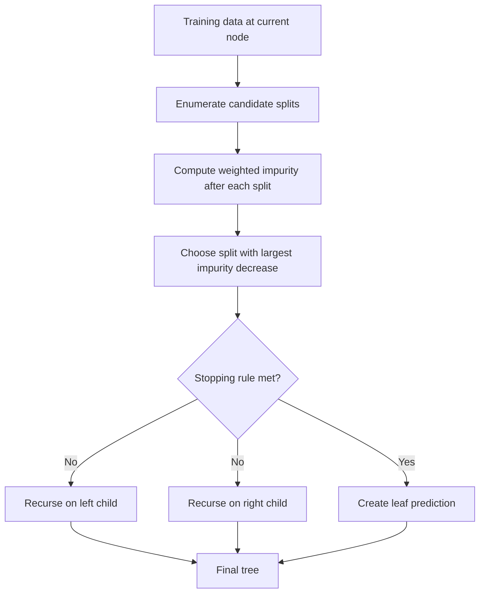
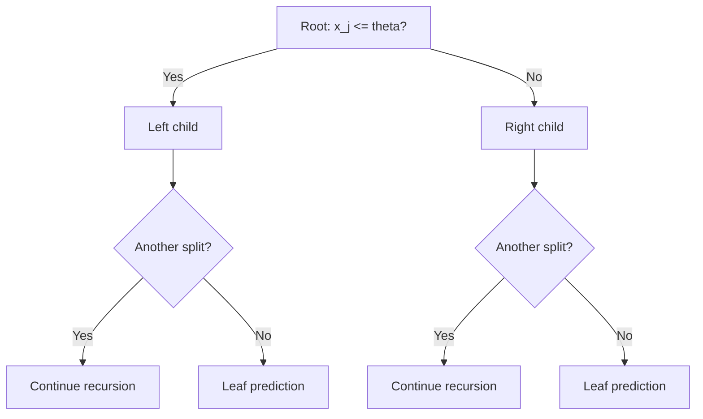
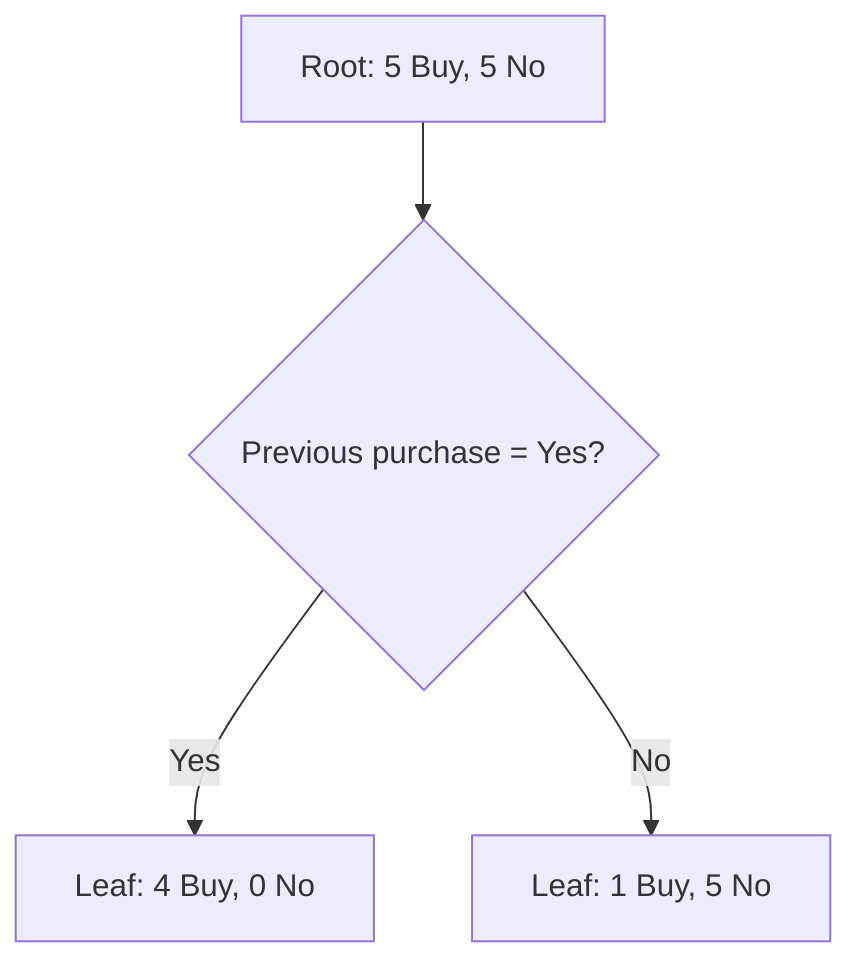
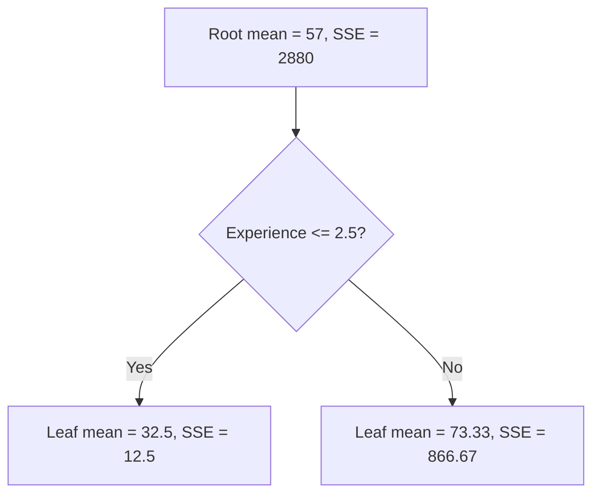
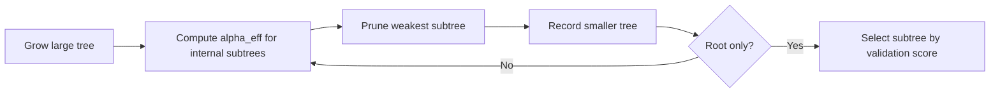
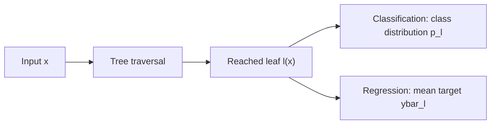
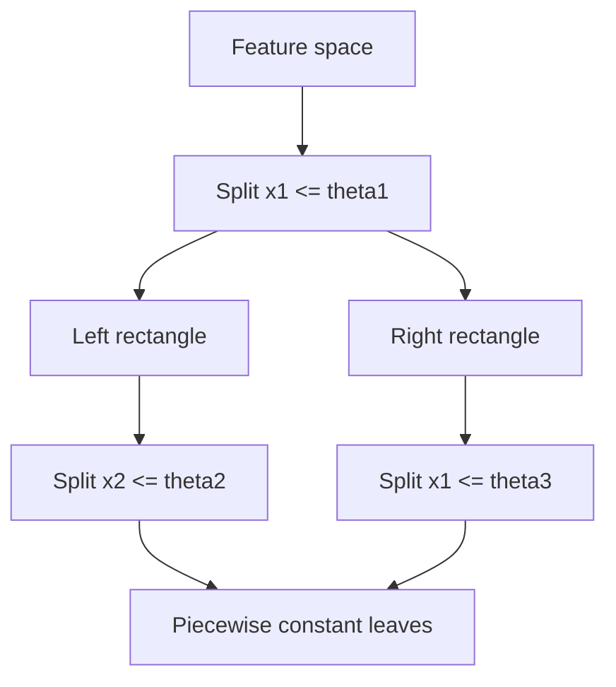
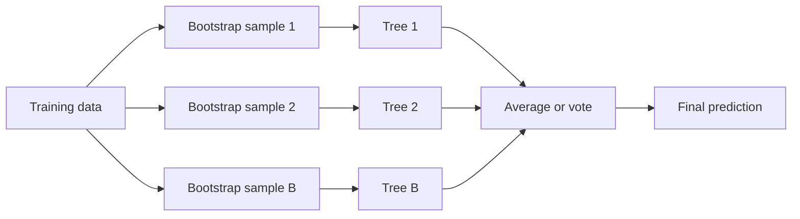

# Decision Trees: Classification, Regression, and CART Internals

Decision trees are non-parametric supervised models that partition the feature space into axis-aligned regions and assign a simple prediction to each region. For classification, the leaf prediction is usually a class distribution or majority class. For regression, the leaf prediction is usually a constant such as the mean target value.

The most common modern formulation is CART: Classification and Regression Trees. CART recursively builds a binary tree by choosing the feature-threshold split that gives the largest reduction in node impurity.



Decision trees are important because they are:

- Interpretable as nested decision rules.
- Able to model nonlinear interactions without explicit feature engineering.
- The base learner behind random forests, extremely randomized trees, gradient boosted trees, and many tabular ML systems.

They are also high-variance greedy learners, so practical tree modeling is mostly about controlling tree growth, split quality, and pruning.

## 1. Problem Setup and Tree Representation

Assume a supervised dataset

$$
\mathcal{D}
=
\{(x_i,y_i)\}_{i=1}^{n},
\qquad
x_i\in\mathbb{R}^{d}.
$$

For classification,

$$
y_i\in\{1,\dots,K\}.
$$

For regression,

$$
y_i\in\mathbb{R}.
$$

A binary decision tree consists of:

- Internal nodes, each storing a split rule.
- Branches, each representing the outcome of a split rule.
- Leaves, each storing a prediction.

For a numeric CART split at node $t$, the rule has the form

$$
x_j \leq \theta.
$$

Here:

- $j$ is the selected feature index.
- $\theta$ is the selected threshold.
- The left child receives samples satisfying $x_{ij}\leq\theta$.
- The right child receives samples satisfying $x_{ij}>\theta$.

Let $I_t$ be the index set of samples reaching node $t$:

$$
I_t
=
\{i:\text{sample }i\text{ reaches node }t\}.
$$

The node sample count is

$$
n_t
=
|I_t|.
$$

For a candidate split $s=(j,\theta)$, define

$$
I_L(s)
=
\{i\in I_t:x_{ij}\leq\theta\},
\qquad
I_R(s)
=
\{i\in I_t:x_{ij}>\theta\}.
$$

The split is valid only if both children satisfy implementation constraints such as minimum leaf size:

$$
|I_L(s)|\geq n_{\min},
\qquad
|I_R(s)|\geq n_{\min}.
$$

The training objective at each node is to find the split that minimizes weighted child impurity:

$$
s^{*}
=
\arg\min_{s\in\mathcal{S}_t}
\left[
\frac{|I_L(s)|}{|I_t|}Q(I_L(s))
+
\frac{|I_R(s)|}{|I_t|}Q(I_R(s))
\right],
$$

where $Q(\cdot)$ is a task-specific impurity criterion. Equivalently, maximize impurity decrease:

$$
\Delta Q(s,t)
=
Q(I_t)
-
\frac{|I_L(s)|}{|I_t|}Q(I_L(s))
-
\frac{|I_R(s)|}{|I_t|}Q(I_R(s)).
$$

The tree prediction is obtained by following split rules from the root to a leaf:



## 2. Under-the-Hood Training Execution

At a high level, recursive tree induction is:

1. Start with all training samples at the root.
2. Compute the current node prediction.
3. Check stopping conditions.
4. If the node can split, search all candidate feature-threshold pairs.
5. Select the split with maximum impurity decrease.
6. Partition samples into left and right children.
7. Recurse independently on both children.

Pseudocode:

```text
build_node(indices, depth):
    prediction = leaf_prediction(indices)

    if stopping_condition(indices, depth):
        return Leaf(prediction)

    best_split = None
    best_gain = 0

    for feature j in candidate_features:
        for threshold theta in candidate_thresholds(j, indices):
            left, right = partition(indices, j, theta)
            gain = impurity(indices) - weighted_impurity(left, right)
            if gain > best_gain:
                best_split = (j, theta, left, right)
                best_gain = gain

    if best_split is None:
        return Leaf(prediction)

    return Node(
        feature=best_split.j,
        threshold=best_split.theta,
        left=build_node(best_split.left, depth + 1),
        right=build_node(best_split.right, depth + 1)
    )
```

Important detail: CART makes greedy local decisions. It does not solve for the globally optimal tree. Finding the globally optimal decision tree is computationally hard in general, so practical algorithms rely on greedy split search plus regularization.

## 3. Classification Trees

At a classification node $t$, define class counts

$$
N_{tk}
=
\sum_{i\in I_t}\mathbf{1}[y_i=k].
$$

The empirical class probability at node $t$ is

$$
\hat{p}_{tk}
=
\frac{N_{tk}}{n_t}.
$$

The leaf stores the full distribution

$$
\hat{p}_t
=
(\hat{p}_{t1},\dots,\hat{p}_{tK}),
$$

and the hard class prediction is

$$
\hat{y}_t
=
\arg\max_{k}\hat{p}_{tk}.
$$

For weighted samples with weights $w_i\geq 0$, replace counts by weighted counts:

$$
W_{tk}
=
\sum_{i\in I_t}w_i\mathbf{1}[y_i=k],
\qquad
W_t
=
\sum_{i\in I_t}w_i,
\qquad
\hat{p}_{tk}
=
\frac{W_{tk}}{W_t}.
$$

Weighted counts are essential for class weighting, boosting, and handling nonuniform sample importance.

## 4. Entropy from First Principles

Entropy measures uncertainty in a categorical distribution. For a node with empirical class probabilities $p_1,\dots,p_K$, entropy is

$$
H(p)
=
-
\sum_{k=1}^{K}p_k\log_2 p_k.
$$

The convention is

$$
0\log 0=0,
$$

which follows from the limit

$$
\lim_{p\to 0^{+}}p\log p=0.
$$

### Derivation from Expected Information

Suppose an event with probability $p$ occurs. The information content, or surprisal, is

$$
I(p)
=
-\log_2 p.
$$

The negative sign makes rare events carry more information:

$$
p\downarrow 0
\quad\Longrightarrow\quad
-\log_2 p\uparrow\infty.
$$

The expected surprisal under the class distribution is

$$
\mathbb{E}[I(Y)]
=
\sum_{k=1}^{K}p_k(-\log_2 p_k)
=
-
\sum_{k=1}^{K}p_k\log_2 p_k.
$$

That expected surprisal is entropy.

### Binary Entropy

For two classes with $p=P(Y=1)$ and $1-p=P(Y=0)$,

$$
H(p)
=
-p\log_2 p-(1-p)\log_2(1-p).
$$

It is zero at pure nodes:

$$
H(0)=H(1)=0.
$$

It is maximized at $p=1/2$:

$$
H(1/2)
=
-\frac{1}{2}\log_2\frac{1}{2}
-
\frac{1}{2}\log_2\frac{1}{2}
=
1.
$$

For multiclass classification, the maximum entropy occurs at the uniform distribution:

$$
p_k=\frac{1}{K}
\quad\Longrightarrow\quad
H(p)=\log_2 K.
$$

### Entropy Split Criterion

For split $s$, the weighted child entropy is

$$
H_{\text{children}}(s)
=
\frac{n_L}{n_t}H(p_L)
+
\frac{n_R}{n_t}H(p_R).
$$

The information gain is

$$
\operatorname{IG}(s,t)
=
H(p_t)-H_{\text{children}}(s).
$$

The best entropy split is

$$
s^{*}
=
\arg\max_{s\in\mathcal{S}_t}\operatorname{IG}(s,t).
$$

Intuition: a split is good if knowing which child a sample falls into makes the class label less uncertain.

## 5. Gini Impurity from First Principles

Gini impurity is

$$
G(p)
=
1-\sum_{k=1}^{K}p_k^2.
$$

It has a useful probabilistic interpretation. If we draw the true class from $p$ and independently guess a class from the same distribution $p$, the probability of a correct guess is

$$
P(\text{correct})
=
\sum_{k=1}^{K}P(Y=k)P(\hat{Y}=k)
=
\sum_{k=1}^{K}p_k^2.
$$

Therefore, the probability of a mismatch is

$$
P(\text{wrong})
=
1-\sum_{k=1}^{K}p_k^2
=
G(p).
$$

For binary classification:

$$
G(p)
=
1-p^2-(1-p)^2
=
2p(1-p).
$$

The maximum is at $p=1/2$:

$$
G(1/2)
=
2\cdot\frac{1}{2}\cdot\frac{1}{2}
=
\frac{1}{2}.
$$

The Gini split objective is

$$
s^{*}
=
\arg\min_{s\in\mathcal{S}_t}
\left[
\frac{n_L}{n_t}G(p_L)
+
\frac{n_R}{n_t}G(p_R)
\right].
$$

Equivalently:

$$
s^{*}
=
\arg\max_{s\in\mathcal{S}_t}
\left[
G(p_t)
-
\frac{n_L}{n_t}G(p_L)
-
\frac{n_R}{n_t}G(p_R)
\right].
$$

### Entropy vs Gini

Both entropy and Gini are concave impurity functions. Both are zero at pure nodes and large near uniform class distributions. They usually choose similar splits.

| Criterion | Formula | Binary maximum | Practical behavior |
| --- | --- | ---: | --- |
| Entropy | $-\sum_k p_k\log_2 p_k$ | $1$ | Slightly more sensitive near low-probability classes |
| Gini | $1-\sum_k p_k^2$ | $0.5$ | Cheaper to compute; default in many CART implementations |
| Misclassification error | $1-\max_k p_k$ | $0.5$ | Useful for evaluation, less sensitive for greedy splitting |

Misclassification error is often too coarse for split search. For example, changing node probabilities from $(0.51,0.49)$ to $(0.99,0.01)$ changes entropy and Gini substantially, but both have the same majority-class prediction.

## 6. Worked Classification Split Example

Consider a binary target $Y\in\{\text{Buy},\text{No}\}$ with $10$ samples:

| Sample | Age group | Previous purchase | Label |
| ---: | --- | --- | --- |
| 1 | Young | Yes | Buy |
| 2 | Young | Yes | Buy |
| 3 | Young | No | Buy |
| 4 | Young | No | No |
| 5 | Old | Yes | Buy |
| 6 | Old | No | No |
| 7 | Old | No | No |
| 8 | Old | No | No |
| 9 | Old | No | No |
| 10 | Old | Yes | Buy |

At the root:

$$
p_{\text{Buy}}
=
\frac{5}{10}
=
0.5,
\qquad
p_{\text{No}}
=
0.5.
$$

Entropy:

$$
H_{\text{root}}
=
-0.5\log_2(0.5)-0.5\log_2(0.5)
=
1.
$$

Gini:

$$
G_{\text{root}}
=
1-0.5^2-0.5^2
=
0.5.
$$

### Candidate Split 1: Age group = Young

Left child: Young samples. Counts are $3$ Buy and $1$ No:

$$
p_L=(0.75,0.25).
$$

Entropy:

$$
H_L
=
-0.75\log_2(0.75)-0.25\log_2(0.25)
\approx
0.8113.
$$

Gini:

$$
G_L
=
1-0.75^2-0.25^2
=
0.375.
$$

Right child: Old samples. Counts are $2$ Buy and $4$ No:

$$
p_R=\left(\frac{2}{6},\frac{4}{6}\right)
=
(0.3333,0.6667).
$$

Entropy:

$$
H_R
=
-\frac{2}{6}\log_2\frac{2}{6}
-
\frac{4}{6}\log_2\frac{4}{6}
\approx
0.9183.
$$

Gini:

$$
G_R
=
1-\left(\frac{2}{6}\right)^2-\left(\frac{4}{6}\right)^2
\approx
0.4444.
$$

Weighted child entropy:

$$
H_{\text{children}}
=
\frac{4}{10}(0.8113)+\frac{6}{10}(0.9183)
\approx
0.8755.
$$

Information gain:

$$
\operatorname{IG}
=
1-0.8755
=
0.1245.
$$

Weighted child Gini:

$$
G_{\text{children}}
=
\frac{4}{10}(0.375)+\frac{6}{10}(0.4444)
\approx
0.4167.
$$

Gini decrease:

$$
\Delta G
=
0.5-0.4167
=
0.0833.
$$

### Candidate Split 2: Previous purchase = Yes

Left child: previous purchase is Yes. Counts are $4$ Buy and $0$ No:

$$
p_L=(1,0),
\qquad
H_L=0,
\qquad
G_L=0.
$$

Right child: previous purchase is No. Counts are $1$ Buy and $5$ No:

$$
p_R=\left(\frac{1}{6},\frac{5}{6}\right).
$$

Entropy:

$$
H_R
=
-\frac{1}{6}\log_2\frac{1}{6}
-
\frac{5}{6}\log_2\frac{5}{6}
\approx
0.6500.
$$

Gini:

$$
G_R
=
1-\left(\frac{1}{6}\right)^2-\left(\frac{5}{6}\right)^2
\approx
0.2778.
$$

Weighted child entropy:

$$
H_{\text{children}}
=
\frac{4}{10}(0)+\frac{6}{10}(0.6500)
=
0.3900.
$$

Information gain:

$$
\operatorname{IG}
=
1-0.3900
=
0.6100.
$$

Weighted child Gini:

$$
G_{\text{children}}
=
\frac{4}{10}(0)+\frac{6}{10}(0.2778)
=
0.1667.
$$

Gini decrease:

$$
\Delta G
=
0.5-0.1667
=
0.3333.
$$

Both criteria prefer the previous-purchase split.



## 7. Regression Trees

For regression, each leaf predicts a real number. With squared-error loss, the best constant prediction in a node is the mean target value.

For node $t$, choose a constant $c$ to minimize sum of squared errors:

$$
L_t(c)
=
\sum_{i\in I_t}(y_i-c)^2.
$$

Differentiate:

$$
\frac{\partial L_t(c)}{\partial c}
=
\sum_{i\in I_t}-2(y_i-c)
=
-2\sum_{i\in I_t}y_i+2n_tc.
$$

Set the derivative to zero:

$$
-2\sum_{i\in I_t}y_i+2n_tc=0.
$$

Therefore,

$$
c^{*}
=
\frac{1}{n_t}\sum_{i\in I_t}y_i
=
\bar{y}_t.
$$

The node impurity for squared-error regression is commonly mean squared error:

$$
Q_{\text{MSE}}(I_t)
=
\frac{1}{n_t}
\sum_{i\in I_t}(y_i-\bar{y}_t)^2.
$$

The total squared error inside node $t$ is

$$
\operatorname{SSE}(I_t)
=
\sum_{i\in I_t}(y_i-\bar{y}_t)^2.
$$

Since $n_t$ is fixed when comparing the impurity of a node, minimizing MSE is equivalent to minimizing SSE.

For a candidate split:

$$
\operatorname{SSE}_{\text{children}}(s)
=
\operatorname{SSE}(I_L(s))
+
\operatorname{SSE}(I_R(s)).
$$

The best regression split is

$$
s^{*}
=
\arg\min_{s\in\mathcal{S}_t}
\left[
\operatorname{SSE}(I_L(s))
+
\operatorname{SSE}(I_R(s))
\right].
$$

Equivalently, maximize variance reduction:

$$
\Delta(s,t)
=
\operatorname{SSE}(I_t)
-
\operatorname{SSE}(I_L(s))
-
\operatorname{SSE}(I_R(s)).
$$

### Alternative Regression Criteria

If the leaf uses absolute-error loss,

$$
L_t(c)
=
\sum_{i\in I_t}|y_i-c|,
$$

then an optimal constant is a median of the targets in the node:

$$
c^{*}
\in
\operatorname{median}\{y_i:i\in I_t\}.
$$

This criterion is more robust to outliers but slower to optimize during split search because medians are harder to update incrementally than sums and squared sums.

For count targets, Poisson deviance can be used when $y_i\geq 0$ and the model is intended to approximate conditional Poisson means. Its split criterion is based on reducing Poisson deviance rather than squared error.

## 8. Worked Regression Split Example

Consider salary prediction from years of experience:

| Sample | Experience | Salary |
| ---: | ---: | ---: |
| 1 | 1 | 30 |
| 2 | 2 | 35 |
| 3 | 3 | 50 |
| 4 | 4 | 80 |
| 5 | 5 | 90 |

The root mean is

$$
\bar{y}
=
\frac{30+35+50+80+90}{5}
=
57.
$$

Root SSE:

$$
\operatorname{SSE}_{\text{root}}
=
(30-57)^2+(35-57)^2+(50-57)^2+(80-57)^2+(90-57)^2.
$$

Compute each term:

$$
\operatorname{SSE}_{\text{root}}
=
729+484+49+529+1089
=
2880.
$$

Candidate split:

$$
\text{Experience}\leq 2.5.
$$

Left child targets:

$$
\{30,35\},
\qquad
\bar{y}_L
=
\frac{30+35}{2}
=
32.5.
$$

Left SSE:

$$
\operatorname{SSE}_L
=
(30-32.5)^2+(35-32.5)^2
=
6.25+6.25
=
12.5.
$$

Right child targets:

$$
\{50,80,90\},
\qquad
\bar{y}_R
=
\frac{50+80+90}{3}
=
73.3333.
$$

Right SSE:

$$
\operatorname{SSE}_R
=
(50-73.3333)^2+(80-73.3333)^2+(90-73.3333)^2.
$$

So

$$
\operatorname{SSE}_R
\approx
544.4444+44.4444+277.7778
=
866.6666.
$$

Child SSE:

$$
\operatorname{SSE}_{\text{children}}
=
12.5+866.6666
=
879.1666.
$$

SSE reduction:

$$
\Delta
=
2880-879.1666
=
2000.8334.
$$

The leaf predictions after this split are:

$$
\hat{y}_L=32.5,
\qquad
\hat{y}_R=73.3333.
$$



## 9. Efficient Split Search for Numeric Features

Naively trying every observed threshold from scratch is expensive. A practical CART implementation sorts samples by each feature and scans candidate split positions.

For a single feature $j$, sort the node samples:

$$
x_{(1)j}\leq x_{(2)j}\leq\cdots\leq x_{(n_t)j}.
$$

Candidate thresholds occur between adjacent distinct feature values:

$$
\theta_m
=
\frac{x_{(m)j}+x_{(m+1)j}}{2},
\qquad
x_{(m)j}<x_{(m+1)j}.
$$

For classification, maintain cumulative class counts while scanning:

$$
N_{Lk}^{(m)}
=
\sum_{r=1}^{m}\mathbf{1}[y_{(r)}=k],
\qquad
N_{Rk}^{(m)}
=
N_{tk}-N_{Lk}^{(m)}.
$$

This gives each candidate's child impurities without repartitioning the data from scratch.

For squared-error regression, maintain cumulative sums:

$$
S_L^{(m)}
=
\sum_{r=1}^{m}y_{(r)},
\qquad
S_{2,L}^{(m)}
=
\sum_{r=1}^{m}y_{(r)}^2.
$$

For a set $A$, the SSE can be computed as

$$
\operatorname{SSE}(A)
=
\sum_{i\in A}y_i^2
-
\frac{\left(\sum_{i\in A}y_i\right)^2}{|A|}.
$$

Derivation:

$$
\begin{aligned}
\sum_{i\in A}(y_i-\bar{y}_A)^2
&=
\sum_{i\in A}(y_i^2-2y_i\bar{y}_A+\bar{y}_A^2)
\\
&=
\sum_{i\in A}y_i^2
-2\bar{y}_A\sum_{i\in A}y_i
+|A|\bar{y}_A^2
\\
&=
\sum_{i\in A}y_i^2
-2|A|\bar{y}_A^2
+|A|\bar{y}_A^2
\\
&=
\sum_{i\in A}y_i^2
-|A|\bar{y}_A^2
\\
&=
\sum_{i\in A}y_i^2
-
\frac{\left(\sum_{i\in A}y_i\right)^2}{|A|}.
\end{aligned}
$$

Thus regression split scanning can update SSE in constant time per candidate once sorted.

## 10. Categorical Features

There are two common ways to handle categorical variables:

1. One-hot encode the categories and use binary numeric splits on the resulting indicators.
2. Search subset splits of the form $x_j\in A$ versus $x_j\notin A$.

For a categorical feature with $q$ categories, exhaustive binary subset search has

$$
2^{q-1}-1
$$

nontrivial partitions, which is expensive for high-cardinality features.

For binary classification, categories can be sorted by class probability and then thresholded in that order. For regression, categories can be sorted by mean target. This reduces the search to $q-1$ ordered splits under common criteria.

Important pitfall: high-cardinality categorical features can create artificially pure leaves by memorizing identifiers. Examples include user ID, product ID, email address, and transaction ID.

## 11. Stopping Rules and Regularization

Decision trees can keep splitting until every leaf is pure or nearly pure. This produces low training error and high variance.

Common pre-pruning controls:

- `max_depth`: maximum root-to-leaf depth.
- `min_samples_split`: minimum samples required to attempt a split.
- `min_samples_leaf`: minimum samples required in each leaf.
- `max_leaf_nodes`: maximum number of terminal leaves.
- `min_impurity_decrease`: minimum impurity reduction required to split.
- `max_features`: number of candidate features considered at each split.

Stopping conditions usually include:

$$
n_t < n_{\text{split}},
$$

or

$$
\operatorname{depth}(t)\geq d_{\max},
$$

or

$$
\max_s\Delta Q(s,t) < \epsilon.
$$

For classification, another stopping condition is node purity:

$$
\max_k \hat{p}_{tk}=1.
$$

For regression, one can stop if target variance is zero:

$$
\frac{1}{n_t}\sum_{i\in I_t}(y_i-\bar{y}_t)^2=0.
$$

## 12. Cost-Complexity Pruning

Post-pruning grows a large tree first, then removes branches that do not justify their complexity.

Let $T$ be a tree and $|T|$ be the number of leaves. Define empirical risk $R(T)$ as the sum of leaf risks. For squared-error regression:

$$
R(T)
=
\sum_{\ell\in\operatorname{leaves}(T)}
\sum_{i\in I_\ell}(y_i-\bar{y}_\ell)^2.
$$

For classification, $R(T)$ can be based on misclassification error, entropy, Gini, or another impurity measure.

Cost-complexity pruning minimizes the penalized objective

$$
R_{\alpha}(T)
=
R(T)+\alpha |T|,
$$

where $\alpha\geq 0$ controls the penalty per leaf.

As $\alpha$ increases, smaller subtrees become optimal. A branch is pruned when the empirical risk reduction it provides is not large enough to pay for the extra leaves.

For an internal node $t$, let $T_t$ be the subtree rooted at $t$. Let $R(t)$ be the risk if the entire subtree were replaced by a single leaf at $t$. The effective alpha for pruning that subtree is

$$
\alpha_{\text{eff}}(t)
=
\frac{R(t)-R(T_t)}{|T_t|-1}.
$$

This value is the per-leaf complexity penalty at which the subtree and the collapsed leaf have equal penalized risk:

$$
R(t)+\alpha
=
R(T_t)+\alpha |T_t|.
$$

Solving:

$$
\alpha
=
\frac{R(t)-R(T_t)}{|T_t|-1}.
$$

Minimal cost-complexity pruning repeatedly prunes the subtree with the smallest $\alpha_{\text{eff}}$ to produce a nested sequence of candidate subtrees. A validation set or cross-validation then selects the best $\alpha$.



## 13. Prediction Mechanics

Prediction for one sample is simple:

1. Start at the root.
2. At internal node $t$, read feature $x_j$.
3. If $x_j\leq\theta$, move left; otherwise move right.
4. Repeat until a leaf is reached.
5. Return the stored leaf prediction.

For classification:

$$
\hat{P}(Y=k\mid x)
=
\hat{p}_{\ell(x)k},
$$

where $\ell(x)$ is the reached leaf. The class prediction is

$$
\hat{y}
=
\arg\max_k \hat{p}_{\ell(x)k}.
$$

For regression:

$$
\hat{y}
=
\bar{y}_{\ell(x)}.
$$

This means decision trees are piecewise constant models:

$$
f(x)
=
\sum_{\ell=1}^{L}c_\ell\mathbf{1}[x\in R_\ell],
$$

where $R_\ell$ is the region associated with leaf $\ell$ and $c_\ell$ is the leaf prediction.



## 14. Geometry and Intuition

Each numeric split creates an axis-aligned half-space:

$$
x_j\leq\theta.
$$

The intersection of decisions along a root-to-leaf path creates a rectangular region:

$$
R_\ell
=
\{x:x_{j_1}\leq\theta_1,\ x_{j_2}>\theta_2,\dots\}.
$$

Therefore, a decision tree approximates complex boundaries by combining many axis-aligned rectangles.

For regression, this produces a step function. A deeper tree can approximate more complex functions, but the approximation may become jagged and unstable.



The main intuition behind impurity reduction:

- A split is useful if child nodes have simpler target distributions than the parent.
- A classification split is good when class probabilities become more concentrated.
- A regression split is good when target values cluster around different child means.

## 15. Python Implementation from Scratch

The following implementation is intentionally compact but complete enough to expose the mechanics of CART for numeric features. It supports:

- Binary recursive splitting.
- Gini and entropy for classification.
- MSE reduction for regression.
- `max_depth`, `min_samples_split`, and `min_samples_leaf`.

### Shared Tree Node

```python
from dataclasses import dataclass
from typing import Optional

import numpy as np


@dataclass
class Node:
    """A binary tree node.

    Internal nodes store feature/threshold and child pointers.
    Leaf nodes store a prediction and no children.
    """

    prediction: object
    feature: Optional[int] = None
    threshold: Optional[float] = None
    left: Optional["Node"] = None
    right: Optional["Node"] = None
    impurity: float = 0.0
    n_samples: int = 0

    @property
    def is_leaf(self) -> bool:
        return self.left is None and self.right is None
```

### Classification Tree from Scratch

```python
class DecisionTreeClassifierScratch:
    def __init__(
        self,
        criterion: str = "gini",
        max_depth: Optional[int] = None,
        min_samples_split: int = 2,
        min_samples_leaf: int = 1,
    ):
        if criterion not in {"gini", "entropy"}:
            raise ValueError("criterion must be 'gini' or 'entropy'")
        self.criterion = criterion
        self.max_depth = max_depth
        self.min_samples_split = min_samples_split
        self.min_samples_leaf = min_samples_leaf
        self.root_: Optional[Node] = None
        self.classes_: Optional[np.ndarray] = None

    def fit(self, X, y):
        X = np.asarray(X, dtype=float)
        y = np.asarray(y)
        self.classes_, y_encoded = np.unique(y, return_inverse=True)
        self.n_classes_ = len(self.classes_)
        self.root_ = self._build(X, y_encoded, depth=0)
        return self

    def predict_proba(self, X):
        X = np.asarray(X, dtype=float)
        return np.vstack([self._traverse(row, self.root_).prediction for row in X])

    def predict(self, X):
        proba = self.predict_proba(X)
        class_indices = np.argmax(proba, axis=1)
        return self.classes_[class_indices]

    def _build(self, X, y, depth: int) -> Node:
        n_samples = len(y)
        counts = np.bincount(y, minlength=self.n_classes_)
        proba = counts / n_samples
        impurity = self._impurity_from_counts(counts)

        node = Node(
            prediction=proba,
            impurity=impurity,
            n_samples=n_samples,
        )

        if self._should_stop(y, depth):
            return node

        split = self._best_split(X, y, parent_impurity=impurity)
        if split is None:
            return node

        feature, threshold, left_mask, right_mask = split
        node.feature = feature
        node.threshold = threshold
        node.left = self._build(X[left_mask], y[left_mask], depth + 1)
        node.right = self._build(X[right_mask], y[right_mask], depth + 1)
        return node

    def _should_stop(self, y, depth: int) -> bool:
        if len(np.unique(y)) == 1:
            return True
        if len(y) < self.min_samples_split:
            return True
        if self.max_depth is not None and depth >= self.max_depth:
            return True
        return False

    def _impurity_from_counts(self, counts) -> float:
        total = counts.sum()
        if total == 0:
            return 0.0
        p = counts[counts > 0] / total
        if self.criterion == "gini":
            return float(1.0 - np.sum(p * p))
        return float(-np.sum(p * np.log2(p)))

    def _best_split(self, X, y, parent_impurity: float):
        n_samples, n_features = X.shape
        best_gain = 0.0
        best_split = None

        for feature in range(n_features):
            values = X[:, feature]
            order = np.argsort(values, kind="mergesort")
            sorted_values = values[order]
            sorted_y = y[order]

            left_counts = np.zeros(self.n_classes_, dtype=int)
            right_counts = np.bincount(sorted_y, minlength=self.n_classes_)

            for pos in range(1, n_samples):
                cls = sorted_y[pos - 1]
                left_counts[cls] += 1
                right_counts[cls] -= 1

                if sorted_values[pos] == sorted_values[pos - 1]:
                    continue
                if pos < self.min_samples_leaf:
                    continue
                if n_samples - pos < self.min_samples_leaf:
                    continue

                left_impurity = self._impurity_from_counts(left_counts)
                right_impurity = self._impurity_from_counts(right_counts)
                weighted = (
                    (pos / n_samples) * left_impurity
                    + ((n_samples - pos) / n_samples) * right_impurity
                )
                gain = parent_impurity - weighted

                if gain > best_gain:
                    threshold = 0.5 * (sorted_values[pos - 1] + sorted_values[pos])
                    left_mask = values <= threshold
                    right_mask = ~left_mask
                    best_gain = gain
                    best_split = (feature, threshold, left_mask, right_mask)

        return best_split

    def _traverse(self, row, node: Node) -> Node:
        while not node.is_leaf:
            if row[node.feature] <= node.threshold:
                node = node.left
            else:
                node = node.right
        return node
```

### Regression Tree from Scratch

```python
class DecisionTreeRegressorScratch:
    def __init__(
        self,
        max_depth: Optional[int] = None,
        min_samples_split: int = 2,
        min_samples_leaf: int = 1,
    ):
        self.max_depth = max_depth
        self.min_samples_split = min_samples_split
        self.min_samples_leaf = min_samples_leaf
        self.root_: Optional[Node] = None

    def fit(self, X, y):
        X = np.asarray(X, dtype=float)
        y = np.asarray(y, dtype=float)
        self.root_ = self._build(X, y, depth=0)
        return self

    def predict(self, X):
        X = np.asarray(X, dtype=float)
        return np.array([self._traverse(row, self.root_).prediction for row in X])

    def _build(self, X, y, depth: int) -> Node:
        n_samples = len(y)
        prediction = float(np.mean(y))
        impurity = self._mse(y)

        node = Node(
            prediction=prediction,
            impurity=impurity,
            n_samples=n_samples,
        )

        if self._should_stop(y, depth):
            return node

        split = self._best_split(X, y)
        if split is None:
            return node

        feature, threshold, left_mask, right_mask = split
        node.feature = feature
        node.threshold = threshold
        node.left = self._build(X[left_mask], y[left_mask], depth + 1)
        node.right = self._build(X[right_mask], y[right_mask], depth + 1)
        return node

    def _should_stop(self, y, depth: int) -> bool:
        if len(y) < self.min_samples_split:
            return True
        if np.allclose(y, y[0]):
            return True
        if self.max_depth is not None and depth >= self.max_depth:
            return True
        return False

    @staticmethod
    def _mse(y) -> float:
        if len(y) == 0:
            return 0.0
        mean = np.mean(y)
        return float(np.mean((y - mean) ** 2))

    @staticmethod
    def _sse_from_sum(n, s, s2) -> float:
        if n == 0:
            return 0.0
        return float(s2 - (s * s) / n)

    def _best_split(self, X, y):
        n_samples, n_features = X.shape
        parent_sse = np.sum((y - np.mean(y)) ** 2)
        best_reduction = 0.0
        best_split = None

        for feature in range(n_features):
            values = X[:, feature]
            order = np.argsort(values, kind="mergesort")
            sorted_values = values[order]
            sorted_y = y[order]

            total_sum = float(np.sum(sorted_y))
            total_sq_sum = float(np.sum(sorted_y * sorted_y))
            left_sum = 0.0
            left_sq_sum = 0.0

            for pos in range(1, n_samples):
                target = float(sorted_y[pos - 1])
                left_sum += target
                left_sq_sum += target * target

                if sorted_values[pos] == sorted_values[pos - 1]:
                    continue
                if pos < self.min_samples_leaf:
                    continue
                if n_samples - pos < self.min_samples_leaf:
                    continue

                right_sum = total_sum - left_sum
                right_sq_sum = total_sq_sum - left_sq_sum

                left_sse = self._sse_from_sum(pos, left_sum, left_sq_sum)
                right_sse = self._sse_from_sum(
                    n_samples - pos,
                    right_sum,
                    right_sq_sum,
                )
                reduction = parent_sse - left_sse - right_sse

                if reduction > best_reduction:
                    threshold = 0.5 * (sorted_values[pos - 1] + sorted_values[pos])
                    left_mask = values <= threshold
                    right_mask = ~left_mask
                    best_reduction = reduction
                    best_split = (feature, threshold, left_mask, right_mask)

        return best_split

    def _traverse(self, row, node: Node) -> Node:
        while not node.is_leaf:
            if row[node.feature] <= node.threshold:
                node = node.left
            else:
                node = node.right
        return node
```

### Scratch Example

```python
X_cls = np.array([
    [0, 1],  # young, previous purchase
    [0, 1],
    [0, 0],
    [0, 0],
    [1, 1],
    [1, 0],
    [1, 0],
    [1, 0],
    [1, 0],
    [1, 1],
])
y_cls = np.array(["Buy", "Buy", "Buy", "No", "Buy", "No", "No", "No", "No", "Buy"])

clf = DecisionTreeClassifierScratch(criterion="entropy", max_depth=2)
clf.fit(X_cls, y_cls)
print(clf.predict([[0, 1], [1, 0]]))
print(clf.predict_proba([[0, 1], [1, 0]]))

X_reg = np.array([[1], [2], [3], [4], [5]], dtype=float)
y_reg = np.array([30, 35, 50, 80, 90], dtype=float)

reg = DecisionTreeRegressorScratch(max_depth=1)
reg.fit(X_reg, y_reg)
print(reg.predict([[1.5], [4.5]]))
```

## 16. Equivalent scikit-learn Implementations

### Classification

```python
from sklearn.tree import DecisionTreeClassifier

clf = DecisionTreeClassifier(
    criterion="entropy",
    max_depth=2,
    min_samples_split=2,
    min_samples_leaf=1,
    random_state=0,
)

clf.fit(X_train, y_train)
y_pred = clf.predict(X_test)
y_proba = clf.predict_proba(X_test)
```

Common classification criteria:

- `criterion="gini"` uses Gini impurity.
- `criterion="entropy"` uses Shannon information gain.
- `criterion="log_loss"` uses a log-loss equivalent formulation for probabilistic classification.

### Regression

```python
from sklearn.tree import DecisionTreeRegressor

reg = DecisionTreeRegressor(
    criterion="squared_error",
    max_depth=4,
    min_samples_leaf=5,
    random_state=0,
)

reg.fit(X_train, y_train)
y_pred = reg.predict(X_test)
```

Common regression criteria:

- `criterion="squared_error"` uses mean squared error reduction.
- `criterion="friedman_mse"` uses a Friedman improvement score useful in gradient boosting contexts.
- `criterion="absolute_error"` uses median leaf predictions.
- `criterion="poisson"` uses Poisson deviance reduction for nonnegative targets.

### What scikit-learn Does Internally

scikit-learn's decision trees are implemented in optimized compiled code for performance. Conceptually, the implementation follows the same structure as the scratch CART implementation:

1. Validate input arrays and convert them to efficient numeric representations.
2. Encode class labels for classification.
3. At each node, select candidate features according to `max_features`.
4. Sort or otherwise scan feature values to find good threshold candidates.
5. Compute impurity improvements using criterion-specific accumulators.
6. Choose the best split under constraints such as `min_samples_leaf` and `min_impurity_decrease`.
7. Store the learned structure in compact arrays.

The fitted estimator exposes the tree through `estimator.tree_`. Important arrays include:

- `children_left`: index of each node's left child.
- `children_right`: index of each node's right child.
- `feature`: splitting feature for each internal node.
- `threshold`: splitting threshold for each internal node.
- `impurity`: impurity value at each node.
- `n_node_samples`: number of samples reaching each node.
- `value`: class counts or regression target summaries at each node.

Example inspection:

```python
tree = clf.tree_

for node_id in range(tree.node_count):
    left = tree.children_left[node_id]
    right = tree.children_right[node_id]

    if left == right:
        print("leaf", node_id, "value=", tree.value[node_id])
    else:
        print(
            "node",
            node_id,
            "if X[:,",
            tree.feature[node_id],
            "] <=",
            tree.threshold[node_id],
            "go to",
            left,
            "else",
            right,
        )
```

Important implementation distinction: scikit-learn does not natively split raw string categorical columns in `DecisionTreeClassifier` or `DecisionTreeRegressor`. Categorical variables usually need preprocessing, such as one-hot encoding or ordinal encoding inside a pipeline.

### Pipeline Example with Categorical and Numeric Features

```python
from sklearn.compose import ColumnTransformer
from sklearn.pipeline import Pipeline
from sklearn.preprocessing import OneHotEncoder
from sklearn.tree import DecisionTreeClassifier

numeric_features = ["age", "salary"]
categorical_features = ["city", "previous_purchase"]

preprocess = ColumnTransformer(
    transformers=[
        ("num", "passthrough", numeric_features),
        ("cat", OneHotEncoder(handle_unknown="ignore"), categorical_features),
    ]
)

model = Pipeline(
    steps=[
        ("preprocess", preprocess),
        (
            "tree",
            DecisionTreeClassifier(
                criterion="gini",
                max_depth=5,
                min_samples_leaf=20,
                random_state=0,
            ),
        ),
    ]
)

model.fit(train_df, y_train)
pred = model.predict(test_df)
```

## 17. Feature Importance

A common tree feature importance measure is mean decrease in impurity. For feature $j$, sum the impurity decreases over all nodes that split on $j$:

$$
\operatorname{Imp}(j)
=
\sum_{t:v(t)=j}
\frac{n_t}{n}
\Delta Q(t),
$$

where:

- $v(t)$ is the feature used at node $t$.
- $n_t/n$ weights deeper nodes by how many samples reach them.
- $\Delta Q(t)$ is the impurity decrease at node $t$.

Normalize importances to sum to one:

$$
\widetilde{\operatorname{Imp}}(j)
=
\frac{\operatorname{Imp}(j)}
{\sum_{m=1}^{d}\operatorname{Imp}(m)}.
$$

Pitfalls:

- Impurity-based importance is biased toward high-cardinality and continuous features.
- Correlated features split importance between themselves unpredictably.
- A feature can be important for prediction but unused if a correlated feature is chosen earlier.

Permutation importance is often more reliable. It measures the drop in validation performance after randomly permuting one feature.

## 18. Time and Space Complexity

Let:

- $n$ be the number of samples.
- $d$ be the number of features.
- $K$ be the number of classes.
- $L$ be the number of leaves.
- $D$ be tree depth.

### Training

For a naive implementation that sorts at each node, numeric split search costs approximately

$$
O(dn_t\log n_t)
$$

at node $t$.

Across a balanced tree, the total can be roughly

$$
O(dn\log^2 n).
$$

With presorting or optimized scanning strategies, practical implementations can reduce repeated sorting overhead. The exact complexity depends on data layout, sparsity, feature subsampling, and implementation details.

For classification, impurity updates also involve class counts. If done directly, each candidate may cost $O(K)$, but cumulative count updates make the per-position update close to constant plus criterion computation.

### Prediction

For one sample, prediction follows one path:

$$
O(D).
$$

For $m$ test samples:

$$
O(mD).
$$

For a balanced tree,

$$
D=O(\log L).
$$

For a degenerate tree,

$$
D=O(L)=O(n).
$$

### Space

The tree stores one record per node. A binary tree with $L$ leaves has

$$
2L-1
$$

total nodes. Space complexity is therefore

$$
O(L).
$$

During training, additional space is needed for sorted indices, masks, or temporary buffers.

## 19. Numerical Stability and Edge Cases

### Entropy and Zero Probabilities

Entropy must avoid computing

$$
\log 0.
$$

The implementation should ignore zero-probability classes:

```python
p = counts[counts > 0] / counts.sum()
entropy = -np.sum(p * np.log2(p))
```

### Floating-Point Thresholds

Thresholds between adjacent values are often computed as

$$
\theta=\frac{a+b}{2}.
$$

If $a$ and $b$ are very large floating-point numbers, this can overflow in extreme cases. A safer formula is

$$
\theta=a+\frac{b-a}{2}.
$$

### Duplicate Feature Values

If adjacent sorted feature values are identical, no threshold between them can separate the samples:

$$
x_{(m)j}=x_{(m+1)j}.
$$

Such split positions should be skipped.

### Empty Children

Splits that put all samples on one side are invalid:

$$
n_L=0
\quad\text{or}\quad
n_R=0.
$$

These often occur with constant features.

### Missing Values

Possible strategies:

- Impute missing values before fitting.
- Learn surrogate splits.
- Route missing values to the child with more samples.
- Treat missingness as a separate category for categorical variables.

The right choice depends on the library and problem. Many tree libraries have explicit missing-value routing, but basic CART implementations often require preprocessing.

### Class Imbalance

With imbalanced classes, impurity reduction may prefer splits that improve the majority class while ignoring minority recall. Remedies include:

- `class_weight`.
- sample weights.
- stratified validation metrics.
- threshold tuning on predicted probabilities.
- ensemble methods with resampling or class-aware objectives.

### Probability Calibration

Tree probability estimates are leaf frequencies. Small leaves can produce overconfident probabilities:

$$
\hat{p}_{\ell k}
=
\frac{N_{\ell k}}{n_\ell}.
$$

If $n_\ell$ is small, this estimate has high variance. Larger `min_samples_leaf`, pruning, bagging, or calibration methods such as Platt scaling and isotonic regression can help.

### Extrapolation Failure in Regression

Regression trees predict leaf averages. Outside the training range, they do not extrapolate linearly:

$$
\hat{f}(x)
=
c_\ell.
$$

This is a serious limitation for trend extrapolation.

## 20. Common Implementation Pitfalls

- Comparing every unique threshold by repartitioning arrays from scratch causes avoidable quadratic behavior.
- Not skipping duplicate feature values can create invalid thresholds or redundant work.
- Computing entropy with zero probabilities produces `nan`.
- Letting `max_depth=None` and `min_samples_leaf=1` can memorize noisy training data.
- One-hot encoding high-cardinality categories can create extremely sparse and unstable trees.
- Applying ordinal encoding to nominal categories can introduce fake order relationships.
- Evaluating tree quality only on training error hides severe overfitting.
- Using impurity-based feature importance as causal evidence is incorrect.
- Forgetting `random_state` makes experiments harder to reproduce when split ties or feature subsampling are involved.

## 21. Limitations

Decision trees have several structural limitations:

1. High variance: small training-set changes can produce different top-level splits.
2. Axis-aligned boundaries: diagonal or smooth boundaries may require many splits.
3. Piecewise constant predictions: regression trees do not naturally extrapolate.
4. Greedy search: early split mistakes can affect the entire subtree.
5. Bias toward high-cardinality features: features with many possible splits can appear more useful.
6. Poor smoothness: predictions jump at split thresholds.

These limitations explain why single decision trees are often used for interpretability, while ensembles are used for accuracy.

## 22. Connection to Random Forests

A random forest reduces tree variance by averaging many decorrelated trees.

For regression:

$$
\hat{f}_{\text{RF}}(x)
=
\frac{1}{B}\sum_{b=1}^{B}\hat{f}_b(x).
$$

For classification:

$$
\hat{P}(Y=k\mid x)
=
\frac{1}{B}\sum_{b=1}^{B}\hat{P}_b(Y=k\mid x).
$$

Random forests create diversity using:

- bootstrap samples of rows.
- random subsets of features at each split.



The average reduces variance when individual tree errors are not perfectly correlated.

## 23. Connection to Gradient Boosted Trees

Gradient boosted trees build trees sequentially. Each new tree fits the negative gradient of the loss with respect to the current model predictions.

For squared-error regression with loss

$$
L(y,F(x))
=
\frac{1}{2}(y-F(x))^2,
$$

the negative gradient is

$$
-\frac{\partial L}{\partial F}
=
y-F(x),
$$

which is the residual. Thus, squared-error gradient boosting repeatedly fits trees to residuals:

$$
F_m(x)
=
F_{m-1}(x)+\eta h_m(x),
$$

where:

- $h_m$ is the new regression tree.
- $\eta$ is the learning rate.

This connects decision trees to algorithms such as gradient boosting machines, XGBoost, LightGBM, and CatBoost.

## 24. Practical Modeling Guidelines

For a single interpretable tree:

- Use shallow `max_depth`.
- Use nontrivial `min_samples_leaf`.
- Use validation or cross-validation for pruning.
- Visualize the tree and inspect leaf sample counts.

For predictive performance on tabular data:

- Prefer random forests or gradient boosted trees.
- Use careful validation splits.
- Tune regularization parameters.
- Handle categorical variables intentionally.
- Check calibration when probabilities matter.

For classification with probabilities, avoid tiny leaves:

$$
n_\ell
\text{ small}
\quad\Longrightarrow\quad
\operatorname{Var}(\hat{p}_{\ell k})
\text{ large}.
$$

For regression with noisy targets, avoid overly deep trees because leaf means become high-variance estimates.

## 25. Summary

A decision tree recursively partitions the feature space and predicts from the empirical target distribution inside each leaf. Classification trees use impurity criteria such as entropy and Gini to create purer class distributions. Regression trees usually use variance or squared-error reduction to create leaves with homogeneous target values.

The core CART loop is:

$$
\text{choose split}
=
\arg\max
\left[
\text{parent impurity}
-
\text{weighted child impurity}
\right].
$$

The mathematical simplicity of this objective is also the reason trees are easy to overfit. Depth limits, minimum leaf sizes, pruning, feature subsampling, bagging, and boosting are all ways of controlling or exploiting the bias-variance behavior of trees.

## 26. References and Deeper Reading

- Leo Breiman, Jerome H. Friedman, Richard A. Olshen, Charles J. Stone, *Classification and Regression Trees*, 1984.
- Trevor Hastie, Robert Tibshirani, Jerome Friedman, *The Elements of Statistical Learning*, Chapter 9 and Chapter 15.
- Christopher M. Bishop, *Pattern Recognition and Machine Learning*, tree-based models and ensemble connections.
- scikit-learn user guide: [Decision Trees](https://scikit-learn.org/stable/modules/tree.html).
- scikit-learn API reference: [DecisionTreeClassifier](https://scikit-learn.org/stable/modules/generated/sklearn.tree.DecisionTreeClassifier.html).
- scikit-learn example: [Post pruning decision trees with cost complexity pruning](https://scikit-learn.org/stable/auto_examples/tree/plot_cost_complexity_pruning.html).
- Tin Kam Ho, "Random Decision Forests", 1995.
- Jerome H. Friedman, "Greedy Function Approximation: A Gradient Boosting Machine", 2001.
