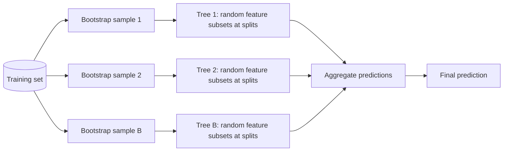
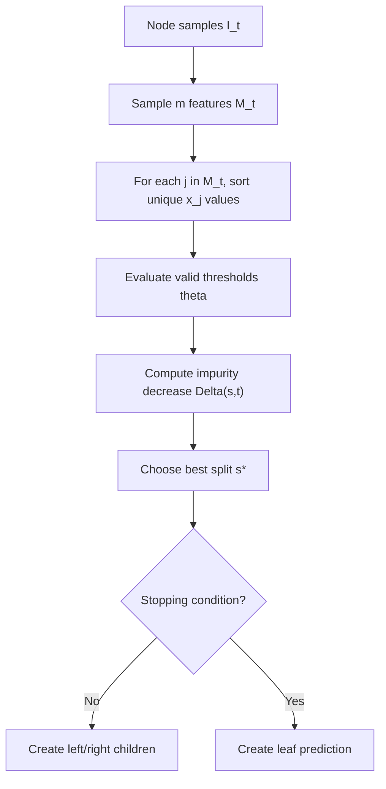

# Random Forests: Bagging, Feature Randomization, OOB Error, and Implementation Internals

Random Forest is an ensemble of randomized decision trees. Each tree is trained on a bootstrap-resampled dataset, and each split is chosen from a random subset of candidate features. The final prediction is an aggregation over trees: majority vote or averaged class probabilities for classification, and arithmetic averaging for regression.

The core reason this works is variance reduction. Fully grown decision trees often have low bias and high variance. Averaging many high-variance predictors reduces variance, but only if the predictors are not perfectly correlated. Random Forest adds feature-level randomness to standard bagging specifically to decorrelate trees.



## 1. Problem Setup

Let the training set be

$$
\mathcal{D}
=
\{(x_i,y_i)\}_{i=1}^{n},
\qquad
x_i\in\mathbb{R}^{d}.
$$

For classification,

$$
y_i\in\{1,\dots,K\}.
$$

For regression,

$$
y_i\in\mathbb{R}.
$$

A Random Forest contains $B$ trees:

$$
\mathcal{F}
=
\{T_b\}_{b=1}^{B}.
$$

Each tree $T_b$ is trained using:

- A bootstrap sample $\mathcal{D}_b^{*}$ drawn with replacement from $\mathcal{D}$.
- Random feature subsets at each candidate split.
- Usually deep, low-pruning CART-style trees.

For regression, the forest prediction is

$$
\hat{f}_{\mathrm{RF}}(x)
=
\frac{1}{B}\sum_{b=1}^{B}T_b(x).
$$

For classification, if tree $b$ predicts a class label $\hat{c}_b(x)$, the majority-vote predictor is

$$
\hat{c}_{\mathrm{RF}}(x)
=
\arg\max_{k\in\{1,\dots,K\}}
\sum_{b=1}^{B}
\mathbf{1}\{\hat{c}_b(x)=k\}.
$$

Many libraries instead average class-probability vectors stored at tree leaves:

$$
\hat{p}_{\mathrm{RF}}(y=k\mid x)
=
\frac{1}{B}\sum_{b=1}^{B}\hat{p}_b(y=k\mid x),
$$

and then predict

$$
\hat{c}_{\mathrm{RF}}(x)
=
\arg\max_{k}\hat{p}_{\mathrm{RF}}(y=k\mid x).
$$

This distinction matters when leaves are not pure or when class weights are used.

## 2. Bootstrap Sampling

For each tree $b$, Random Forest samples $n$ training indices independently and uniformly with replacement:

$$
I_b
=
(I_{b1},\dots,I_{bn}),
\qquad
I_{bm}\sim\operatorname{Uniform}\{1,\dots,n\}.
$$

The bootstrap dataset is

$$
\mathcal{D}_b^{*}
=
\{(x_{I_{bm}},y_{I_{bm}})\}_{m=1}^{n}.
$$

A single original observation can appear zero times, once, or many times in a bootstrap sample. For a fixed observation $i$, the probability that it is absent from a given bootstrap sample is

$$
\Pr(i\notin I_b)
=
\left(1-\frac{1}{n}\right)^n.
$$

Taking the limit,

$$
\lim_{n\rightarrow\infty}
\left(1-\frac{1}{n}\right)^n
=
e^{-1}
\approx
0.3679.
$$

So each tree leaves out about $36.8\%$ of the unique training examples. These are the out-of-bag samples for that tree. Conversely, each tree sees about

$$
1-e^{-1}
\approx
0.6321
$$

of the unique examples, although the bootstrap sample still has size $n$ because some examples are duplicated.

### Worked Bootstrap Probability

Suppose $n=1000$. The probability that a specific row is absent from one bootstrap sample is

$$
\left(1-\frac{1}{1000}\right)^{1000}
=
0.999^{1000}
\approx
0.3677.
$$

If $B=500$, the expected number of trees for which that row is out-of-bag is

$$
500\times0.3677
\approx
183.85.
$$

Thus each training row usually has a large OOB prediction ensemble without needing a separate validation split.

## 3. Tree Construction Inside the Forest

Random Forest usually uses CART-style binary trees. At a node $t$, let $I_t$ be the index multiset of bootstrap samples that reach the node. For a numeric split $s=(j,\theta)$,

$$
I_L(s)
=
\{i\in I_t:x_{ij}\leq\theta\},
\qquad
I_R(s)
=
\{i\in I_t:x_{ij}>\theta\}.
$$

The split objective is to choose the split with maximum impurity decrease:

$$
\Delta(s,t)
=
Q(I_t)
-
\frac{|I_L(s)|}{|I_t|}Q(I_L(s))
-
\frac{|I_R(s)|}{|I_t|}Q(I_R(s)).
$$

Here $Q(\cdot)$ is the node impurity. The best split is

$$
s^{*}
=
\arg\max_{s\in\mathcal{S}_t^{(m)}}\Delta(s,t),
$$

where $\mathcal{S}_t^{(m)}$ is the candidate split set formed using only $m$ randomly selected features at node $t$:

$$
M_t\subseteq\{1,\dots,d\},
\qquad
|M_t|=m.
$$

Only splits whose feature index $j$ belongs to $M_t$ are considered:

$$
\mathcal{S}_t^{(m)}
=
\{(j,\theta):j\in M_t,\theta\in\Theta_{j,t}\}.
$$

Common defaults are:

$$
m=\lfloor\sqrt{d}\rfloor
\quad\text{for classification},
$$

and

$$
m=\max\left(1,\left\lfloor\frac{d}{3}\right\rfloor\right)
\quad\text{for regression in the classical recommendation}.
$$

Some libraries use different defaults. For example, current scikit-learn uses `max_features="sqrt"` by default for `RandomForestClassifier`, while `RandomForestRegressor` defaults to considering all features unless configured otherwise.



## 4. Classification Impurity Derivations

At node $t$, define the empirical class probability

$$
\hat{p}_{tk}
=
\frac{1}{n_t}
\sum_{i\in I_t}\mathbf{1}\{y_i=k\},
\qquad
n_t=|I_t|.
$$

### Gini Impurity

Gini impurity is the probability of misclassification if one draws the true label and a predicted label independently from the node's empirical class distribution:

$$
G(t)
=
\Pr(Y\neq Y')
=
1-\Pr(Y=Y').
$$

Since

$$
\Pr(Y=Y')
=
\sum_{k=1}^{K}\hat{p}_{tk}^{2},
$$

the Gini impurity is

$$
G(t)
=
1-\sum_{k=1}^{K}\hat{p}_{tk}^{2}.
$$

For binary classification with $\hat{p}_{t1}=p$ and $\hat{p}_{t2}=1-p$,

$$
G(t)
=
1-p^2-(1-p)^2
=
2p(1-p).
$$

The impurity is $0$ for a pure node and maximal at $p=1/2$.

### Entropy

Entropy impurity is

$$
H(t)
=
-\sum_{k=1}^{K}\hat{p}_{tk}\log\hat{p}_{tk},
$$

with the convention

$$
0\log0=0.
$$

The split gain under entropy is information gain:

$$
\mathrm{IG}(s,t)
=
H(t)
-
\frac{n_L}{n_t}H(L)
-
\frac{n_R}{n_t}H(R).
$$

Gini and entropy usually produce similar trees. Gini is cheaper because it avoids logarithms; entropy has a direct coding/information interpretation.

### Worked Classification Split

At a node with $10$ samples, suppose class counts are

$$
(n_{t,+},n_{t,-})=(6,4).
$$

The parent Gini impurity is

$$
G(t)
=
1-\left(\frac{6}{10}\right)^2-\left(\frac{4}{10}\right)^2
=
1-0.36-0.16
=
0.48.
$$

Candidate split $s$ gives:

$$
L:(5+,1-),
\qquad
R:(1+,3-).
$$

Left impurity:

$$
G(L)
=
1-\left(\frac{5}{6}\right)^2-\left(\frac{1}{6}\right)^2
=
1-\frac{25}{36}-\frac{1}{36}
=
\frac{10}{36}
\approx
0.2778.
$$

Right impurity:

$$
G(R)
=
1-\left(\frac{1}{4}\right)^2-\left(\frac{3}{4}\right)^2
=
1-\frac{1}{16}-\frac{9}{16}
=
\frac{6}{16}
=
0.375.
$$

Weighted child impurity:

$$
\frac{6}{10}G(L)+\frac{4}{10}G(R)
=
0.6(0.2778)+0.4(0.375)
=
0.3167.
$$

Impurity decrease:

$$
\Delta(s,t)
=
0.48-0.3167
=
0.1633.
$$

The split is useful because it creates children with more concentrated label distributions.

## 5. Regression Impurity Derivation

For regression, CART usually predicts the mean response in a leaf. At node $t$, the constant prediction minimizing squared error is

$$
\hat{c}_t
=
\arg\min_{c\in\mathbb{R}}
\sum_{i\in I_t}(y_i-c)^2.
$$

Differentiate with respect to $c$:

$$
\frac{\partial}{\partial c}
\sum_{i\in I_t}(y_i-c)^2
=
-2\sum_{i\in I_t}(y_i-c).
$$

Set the derivative to zero:

$$
\sum_{i\in I_t}y_i
-
n_tc
=
0.
$$

Thus

$$
\hat{c}_t
=
\frac{1}{n_t}\sum_{i\in I_t}y_i
=
\bar{y}_t.
$$

The corresponding node impurity is the mean squared deviation:

$$
Q(t)
=
\frac{1}{n_t}
\sum_{i\in I_t}(y_i-\bar{y}_t)^2.
$$

Equivalently, when comparing splits at the same parent node, minimizing weighted child variance is equivalent to minimizing child sum of squared errors:

$$
\mathrm{SSE}(t)
=
\sum_{i\in I_t}(y_i-\bar{y}_t)^2.
$$

### Worked Regression Split

Suppose a node has responses

$$
y=(2,4,6,8).
$$

The parent mean is

$$
\bar{y}_t
=
\frac{2+4+6+8}{4}
=
5.
$$

Parent SSE:

$$
(2-5)^2+(4-5)^2+(6-5)^2+(8-5)^2
=
9+1+1+9
=
20.
$$

Candidate split:

$$
L=(2,4),
\qquad
R=(6,8).
$$

The left and right means are

$$
\bar{y}_L=3,
\qquad
\bar{y}_R=7.
$$

Child SSE:

$$
\mathrm{SSE}(L)
=
(2-3)^2+(4-3)^2
=
2,
$$

$$
\mathrm{SSE}(R)
=
(6-7)^2+(8-7)^2
=
2.
$$

The split reduction is

$$
20-(2+2)=16.
$$

The split is strong because it separates low target values from high target values.

## 6. Why Averaging Trees Reduces Variance

Let $Z_b=T_b(x)$ be the prediction of tree $b$ at a fixed input $x$. Assume

$$
\mathbb{E}[Z_b]=\mu,
\qquad
\operatorname{Var}(Z_b)=\sigma^2,
$$

and for distinct trees,

$$
\operatorname{Corr}(Z_b,Z_{b'})
=
\rho.
$$

Then

$$
\operatorname{Cov}(Z_b,Z_{b'})
=
\rho\sigma^2.
$$

The forest average is

$$
\bar{Z}
=
\frac{1}{B}\sum_{b=1}^{B}Z_b.
$$

Its variance is

$$
\operatorname{Var}(\bar{Z})
=
\operatorname{Var}
\left(
\frac{1}{B}\sum_{b=1}^{B}Z_b
\right).
$$

Expanding covariance terms:

$$
\operatorname{Var}(\bar{Z})
=
\frac{1}{B^2}
\left[
\sum_{b=1}^{B}\operatorname{Var}(Z_b)
+
\sum_{b\neq b'}\operatorname{Cov}(Z_b,Z_{b'})
\right].
$$

Substitute $\sigma^2$ and $\rho\sigma^2$:

$$
\operatorname{Var}(\bar{Z})
=
\frac{1}{B^2}
\left[
B\sigma^2
+
B(B-1)\rho\sigma^2
\right].
$$

Therefore

$$
\operatorname{Var}(\bar{Z})
=
\rho\sigma^2
+
\frac{1-\rho}{B}\sigma^2.
$$

This equation is the most important mathematical intuition behind Random Forest:

- Increasing $B$ reduces only the second term.
- The limiting variance as $B\rightarrow\infty$ is $\rho\sigma^2$.
- If trees are highly correlated, adding more trees eventually stops helping.
- Random feature selection reduces $\rho$ by forcing trees to use different predictors and split structures.

Bagging mainly reduces variance by averaging. Random Forest improves bagging by lowering tree correlation.

## 7. Full Training Algorithm

Given $B$, bootstrap size $n$, feature subset size $m$, and tree stopping rules:

1. For $b=1,\dots,B$:
2. Draw bootstrap indices $I_b$ of length $n$ with replacement.
3. Train a decision tree on $\mathcal{D}_b^{*}$.
4. At each node:
5. Randomly sample $m$ feature indices without replacement.
6. Evaluate candidate thresholds only on those $m$ features.
7. Choose the split with maximum impurity decrease.
8. Recurse until a stopping condition holds.
9. Store the trained tree.
10. Aggregate predictions across trees.

Typical stopping conditions include:

- `max_depth`
- `min_samples_split`
- `min_samples_leaf`
- `max_leaf_nodes`
- zero impurity
- no valid split

Random Forest often uses unpruned or weakly constrained trees because the ensemble controls variance. This does not mean tree-growth constraints are unimportant; they are critical for noisy labels, small datasets, severe class imbalance, sparse high-dimensional features, and latency-constrained inference.

## 8. Out-of-Bag Error

For training sample $i$, define the set of trees for which $i$ was not included in the bootstrap sample:

$$
\mathcal{B}_{\mathrm{OOB}}(i)
=
\{b:i\notin I_b\}.
$$

The OOB regression prediction is

$$
\hat{f}_{\mathrm{OOB}}(x_i)
=
\frac{1}{|\mathcal{B}_{\mathrm{OOB}}(i)|}
\sum_{b\in\mathcal{B}_{\mathrm{OOB}}(i)}
T_b(x_i).
$$

The OOB classification vote is

$$
\hat{c}_{\mathrm{OOB}}(x_i)
=
\arg\max_{k}
\sum_{b\in\mathcal{B}_{\mathrm{OOB}}(i)}
\mathbf{1}\{\hat{c}_b(x_i)=k\}.
$$

The OOB classification error is

$$
\mathrm{Err}_{\mathrm{OOB}}
=
\frac{1}{n}
\sum_{i=1}^{n}
\mathbf{1}\{\hat{c}_{\mathrm{OOB}}(x_i)\neq y_i\},
$$

computed over samples with at least one OOB prediction.

OOB error behaves like an internal validation estimate because each OOB prediction for row $i$ uses only trees that did not train on row $i$. It is not exactly the same as cross-validation because the training sets overlap heavily and each OOB ensemble uses about $0.368B$ trees rather than all $B$ trees.

## 9. Feature Importance

Random Forest has two common feature-importance families.

### Mean Decrease in Impurity

Mean decrease in impurity, also called impurity-based importance, accumulates the impurity reductions produced by splits using feature $j$:

$$
I_j
=
\frac{1}{B}
\sum_{b=1}^{B}
\sum_{t\in T_b:v(t)=j}
\frac{n_t}{n}
\Delta(t).
$$

Here:

- $v(t)$ is the feature used at node $t$.
- $n_t/n$ weights node importance by the fraction of training mass reaching the node.
- $\Delta(t)$ is the impurity decrease at the node.

The normalized importance is

$$
\tilde{I}_j
=
\frac{I_j}{\sum_{\ell=1}^{d}I_{\ell}}.
$$

Impurity-based importance is fast because it is collected during training. Its main pitfalls:

- It is biased toward continuous and high-cardinality features because they offer more candidate splits.
- Importance is shared or diluted among correlated predictors.
- It measures training-set split utility, not necessarily causal or out-of-sample relevance.

### Permutation Importance

Permutation importance evaluates the performance drop when feature $j$ is destroyed by shuffling:

$$
\mathrm{PI}_j
=
S(\hat{f},\mathcal{D}_{\mathrm{val}})
-
S(\hat{f},\pi_j(\mathcal{D}_{\mathrm{val}})),
$$

where $S$ is a score where larger is better, and $\pi_j$ denotes randomly permuting feature $j$ across validation rows.

For a loss $L$ where smaller is better, use

$$
\mathrm{PI}_j
=
L(\hat{f},\pi_j(\mathcal{D}_{\mathrm{val}}))
-
L(\hat{f},\mathcal{D}_{\mathrm{val}}).
$$

Permutation importance is more directly tied to generalization performance but is more expensive and can be misleading with strongly correlated features. If two predictors are interchangeable, permuting one may not hurt much because the other remains available.

## 10. Hyperparameters and Their Effects

| Hyperparameter      |                             Main effect | Increasing it usually does                                        |
| ------------------- | --------------------------------------: | ----------------------------------------------------------------- |
| `n_estimators`      |                      Number of trees$B$ | Reduces Monte Carlo variance, increases memory and inference cost |
| `max_features`      |                  Feature subset size$m$ | Increases tree strength but also tree correlation                 |
| `max_depth`         |                      Maximum tree depth | Lowers bias when larger, raises variance and memory               |
| `min_samples_split` |         Minimum samples needed to split | Larger values smooth trees                                        |
| `min_samples_leaf`  |                       Minimum leaf size | Larger values reduce variance and improve probability calibration |
| `bootstrap`         | Whether to sample rows with replacement | Enables OOB estimates and classical bagging                       |
| `class_weight`      |                       Class reweighting | Helps imbalance but changes impurity and probability estimates    |
| `max_samples`       |                   Bootstrap sample size | Smaller values increase diversity and reduce per-tree cost        |

Important interactions:

- Large `max_features` makes trees stronger but more correlated.
- Small `max_features` makes trees diverse but can miss strong predictors at important nodes.
- Very small `min_samples_leaf` gives sharp, high-variance trees and often poorly calibrated probabilities.
- More trees rarely overfit in the classical variance sense, but they can make a bad modeling choice more stable and expensive.

## 11. Random Forest from Scratch in Python

The implementation below is intentionally compact but complete enough to show the core mechanics:

- Binary CART splits for numeric features.
- Gini impurity for classification.
- Bootstrap sampling.
- Random feature subsets at each split.
- Probability averaging for classification.

It omits production features such as sample weights, categorical split handling, sparse matrices, missing-value routing, monotonic constraints, pruning, parallelism, and memory-optimized tree storage.

```python
from __future__ import annotations

from dataclasses import dataclass
import numpy as np


@dataclass
class Node:
    """A binary decision tree node."""

    proba: np.ndarray
    feature: int | None = None
    threshold: float | None = None
    left: "Node | None" = None
    right: "Node | None" = None

    @property
    def is_leaf(self) -> bool:
        return self.feature is None


class RandomizedDecisionTreeClassifier:
    def __init__(
        self,
        max_features: int,
        max_depth: int | None = None,
        min_samples_split: int = 2,
        min_samples_leaf: int = 1,
        n_classes: int | None = None,
        rng: np.random.Generator | None = None,
    ):
        self.max_features = max_features
        self.max_depth = max_depth
        self.min_samples_split = min_samples_split
        self.min_samples_leaf = min_samples_leaf
        self.n_classes_ = n_classes
        self.rng = np.random.default_rng() if rng is None else rng
        self.root_: Node | None = None

    def fit(self, X: np.ndarray, y: np.ndarray) -> "RandomizedDecisionTreeClassifier":
        if self.n_classes_ is None:
            self.n_classes_ = int(np.max(y)) + 1
        self.root_ = self._grow(X, y, depth=0)
        return self

    def predict_proba(self, X: np.ndarray) -> np.ndarray:
        if self.root_ is None:
            raise RuntimeError("Tree is not fitted.")
        return np.vstack([self._predict_one(row, self.root_) for row in X])

    def _predict_one(self, x: np.ndarray, node: Node) -> np.ndarray:
        while not node.is_leaf:
            if x[node.feature] <= node.threshold:
                node = node.left
            else:
                node = node.right
        return node.proba

    def _class_proba(self, y: np.ndarray) -> np.ndarray:
        counts = np.bincount(y, minlength=self.n_classes_).astype(float)
        return counts / counts.sum()

    def _gini(self, y: np.ndarray) -> float:
        p = self._class_proba(y)
        return 1.0 - np.sum(p * p)

    def _grow(self, X: np.ndarray, y: np.ndarray, depth: int) -> Node:
        n_samples, n_features = X.shape
        node = Node(proba=self._class_proba(y))

        pure = np.unique(y).size == 1
        too_small = n_samples < self.min_samples_split
        too_deep = self.max_depth is not None and depth >= self.max_depth
        if pure or too_small or too_deep:
            return node

        feature_count = min(self.max_features, n_features)
        feature_indices = self.rng.choice(n_features, size=feature_count, replace=False)
        split = self._best_split(X, y, feature_indices)

        if split is None:
            return node

        best_feature, best_threshold = split
        left_mask = X[:, best_feature] <= best_threshold
        right_mask = ~left_mask

        node.feature = best_feature
        node.threshold = best_threshold
        node.left = self._grow(X[left_mask], y[left_mask], depth + 1)
        node.right = self._grow(X[right_mask], y[right_mask], depth + 1)
        return node

    def _best_split(
        self,
        X: np.ndarray,
        y: np.ndarray,
        feature_indices: np.ndarray,
    ) -> tuple[int, float] | None:
        parent_gini = self._gini(y)
        best_gain = 0.0
        best_feature = None
        best_threshold = None

        for feature in feature_indices:
            values = np.unique(X[:, feature])
            if values.size <= 1:
                continue

            # Midpoints avoid thresholds that put identical values on both sides.
            thresholds = (values[:-1] + values[1:]) / 2.0

            for threshold in thresholds:
                left_mask = X[:, feature] <= threshold
                n_left = int(left_mask.sum())
                n_right = y.size - n_left

                if n_left < self.min_samples_leaf or n_right < self.min_samples_leaf:
                    continue

                y_left = y[left_mask]
                y_right = y[~left_mask]
                child_gini = (
                    (n_left / y.size) * self._gini(y_left)
                    + (n_right / y.size) * self._gini(y_right)
                )
                gain = parent_gini - child_gini

                if gain > best_gain:
                    best_gain = gain
                    best_feature = int(feature)
                    best_threshold = float(threshold)

        if best_feature is None:
            return None
        return best_feature, best_threshold


class RandomForestClassifierScratch:
    def __init__(
        self,
        n_estimators: int = 100,
        max_features: str | int = "sqrt",
        max_depth: int | None = None,
        min_samples_split: int = 2,
        min_samples_leaf: int = 1,
        random_state: int | None = None,
    ):
        self.n_estimators = n_estimators
        self.max_features = max_features
        self.max_depth = max_depth
        self.min_samples_split = min_samples_split
        self.min_samples_leaf = min_samples_leaf
        self.rng = np.random.default_rng(random_state)
        self.trees_: list[RandomizedDecisionTreeClassifier] = []
        self.bootstrap_indices_: list[np.ndarray] = []
        self.n_classes_: int | None = None

    def _resolve_max_features(self, n_features: int) -> int:
        if self.max_features == "sqrt":
            return max(1, int(np.sqrt(n_features)))
        if self.max_features == "log2":
            return max(1, int(np.log2(n_features)))
        if isinstance(self.max_features, int):
            return max(1, min(self.max_features, n_features))
        raise ValueError(f"Unsupported max_features={self.max_features!r}")

    def fit(self, X: np.ndarray, y: np.ndarray) -> "RandomForestClassifierScratch":
        X = np.asarray(X, dtype=float)
        y = np.asarray(y, dtype=int)
        n_samples, n_features = X.shape
        self.n_classes_ = int(np.max(y)) + 1
        m = self._resolve_max_features(n_features)

        self.trees_.clear()
        self.bootstrap_indices_.clear()

        for _ in range(self.n_estimators):
            indices = self.rng.integers(0, n_samples, size=n_samples)
            tree_rng = np.random.default_rng(self.rng.integers(0, 2**32 - 1))
            tree = RandomizedDecisionTreeClassifier(
                max_features=m,
                max_depth=self.max_depth,
                min_samples_split=self.min_samples_split,
                min_samples_leaf=self.min_samples_leaf,
                n_classes=self.n_classes_,
                rng=tree_rng,
            )
            tree.fit(X[indices], y[indices])
            self.trees_.append(tree)
            self.bootstrap_indices_.append(indices)

        return self

    def predict_proba(self, X: np.ndarray) -> np.ndarray:
        X = np.asarray(X, dtype=float)
        all_proba = np.stack([tree.predict_proba(X) for tree in self.trees_], axis=0)
        return all_proba.mean(axis=0)

    def predict(self, X: np.ndarray) -> np.ndarray:
        return np.argmax(self.predict_proba(X), axis=1)

    def oob_score(self, X: np.ndarray, y: np.ndarray) -> float:
        X = np.asarray(X, dtype=float)
        y = np.asarray(y, dtype=int)
        n_samples = X.shape[0]
        votes = np.zeros((n_samples, self.n_classes_), dtype=float)
        counts = np.zeros(n_samples, dtype=int)

        for tree, bootstrap_indices in zip(self.trees_, self.bootstrap_indices_):
            in_bag = np.zeros(n_samples, dtype=bool)
            in_bag[bootstrap_indices] = True
            oob_mask = ~in_bag
            if not np.any(oob_mask):
                continue

            votes[oob_mask] += tree.predict_proba(X[oob_mask])
            counts[oob_mask] += 1

        valid = counts > 0
        pred = np.argmax(votes[valid] / counts[valid, None], axis=1)
        return float(np.mean(pred == y[valid]))
```

Example usage:

```python
import numpy as np

X = np.array(
    [
        [0.0, 0.1],
        [0.2, 0.4],
        [0.8, 0.7],
        [1.0, 1.2],
        [1.2, 0.9],
        [3.0, 3.2],
        [3.1, 2.9],
        [3.3, 3.0],
        [3.8, 3.5],
        [4.0, 3.9],
    ]
)
y = np.array([0, 0, 0, 0, 0, 1, 1, 1, 1, 1])

forest = RandomForestClassifierScratch(
    n_estimators=50,
    max_features="sqrt",
    max_depth=4,
    min_samples_leaf=1,
    random_state=7,
)
forest.fit(X, y)

print(forest.predict([[0.5, 0.6], [3.5, 3.4]]))
print(forest.predict_proba([[0.5, 0.6], [3.5, 3.4]]))
print(forest.oob_score(X, y))
```

## 12. Equivalent scikit-learn Implementations

### Classification

```python
from sklearn.ensemble import RandomForestClassifier
from sklearn.metrics import accuracy_score, log_loss

clf = RandomForestClassifier(
    n_estimators=500,
    criterion="gini",
    max_features="sqrt",
    bootstrap=True,
    oob_score=True,
    min_samples_leaf=2,
    n_jobs=-1,
    random_state=42,
)

clf.fit(X_train, y_train)

y_pred = clf.predict(X_test)
y_proba = clf.predict_proba(X_test)

print("test accuracy:", accuracy_score(y_test, y_pred))
print("test log loss:", log_loss(y_test, y_proba))
print("OOB score:", clf.oob_score_)
print("MDI importances:", clf.feature_importances_)
```

Internally, this meta-estimator:

- Creates many `DecisionTreeClassifier` instances.
- Draws bootstrap samples when `bootstrap=True`.
- Passes `max_features` into each tree so each split searches only a random feature subset.
- Fits trees independently, parallelized across trees when `n_jobs` allows.
- Stores trained trees in `estimators_`.
- Averages `predict_proba` outputs for classification probabilities.
- Computes `feature_importances_` from normalized impurity decreases averaged over trees.

### Regression

```python
from sklearn.ensemble import RandomForestRegressor
from sklearn.metrics import mean_absolute_error, mean_squared_error

reg = RandomForestRegressor(
    n_estimators=500,
    criterion="squared_error",
    max_features=1.0,
    bootstrap=True,
    oob_score=True,
    min_samples_leaf=3,
    n_jobs=-1,
    random_state=42,
)

reg.fit(X_train, y_train)

y_pred = reg.predict(X_test)

print("MAE:", mean_absolute_error(y_test, y_pred))
print("RMSE:", mean_squared_error(y_test, y_pred) ** 0.5)
print("OOB R^2:", reg.oob_score_)
```

For regression, each tree stores the mean target value in each leaf. The forest prediction is the average of those leaf means.

### Permutation Importance

```python
from sklearn.inspection import permutation_importance

result = permutation_importance(
    clf,
    X_val,
    y_val,
    scoring="accuracy",
    n_repeats=20,
    random_state=42,
    n_jobs=-1,
)

for j in result.importances_mean.argsort()[::-1]:
    print(j, result.importances_mean[j], result.importances_std[j])
```

This repeatedly shuffles one feature at a time and measures the validation-score degradation.

## 13. Computational Complexity

Let:

- $n$ be the number of training samples.
- $d$ be the number of features.
- $B$ be the number of trees.
- $m$ be `max_features`.
- $L$ be the number of leaves per tree.
- $h$ be typical tree depth.

For exact greedy CART, if candidate thresholds are evaluated efficiently after sorting, a rough training cost per balanced tree is

$$
O(mn\log n)
$$

after accounting for split search across levels. Without careful sorting or histogram optimization, naive implementations can be significantly worse, approaching

$$
O(md n^2)
$$

in badly implemented exhaustive threshold search variants. For a forest:

$$
O(Bmn\log n)
$$

is a useful mental model for dense numeric data and balanced trees.

Prediction cost for one sample is

$$
O(Bh),
$$

because each tree traversal follows one path from root to leaf. For balanced trees,

$$
h=O(\log L),
$$

while fully grown unbalanced trees can have

$$
h=O(n).
$$

Memory usage is approximately

$$
O(BL),
$$

because each node stores a feature index, threshold, child pointers or indices, impurity statistics, and leaf prediction values.

## 14. Numerical Stability and Implementation Pitfalls

### Split Thresholds

For continuous features, thresholds are usually midpoints between sorted unique values:

$$
\theta_r
=
\frac{x_{(r)j}+x_{(r+1)j}}{2}.
$$

If feature values are extremely large, the midpoint formula can overflow in low-level languages. A safer equivalent is

$$
\theta_r
=
x_{(r)j}
+
\frac{x_{(r+1)j}-x_{(r)j}}{2}.
$$

### Empty or Tiny Leaves

A split that sends all samples to one child is invalid. Implementations must enforce

$$
n_L\geq n_{\min},
\qquad
n_R\geq n_{\min}.
$$

Without this, trees can create degenerate structures or divide by zero when computing leaf probabilities.

### Probability Calibration

Random Forest class probabilities are averages of empirical leaf frequencies. Fully grown trees often produce extreme leaf probabilities, especially when leaves contain one or a few samples. Averaging helps but does not guarantee calibrated probabilities. Larger `min_samples_leaf`, isotonic calibration, or Platt-style calibration can improve probability quality.

### Class Imbalance

With severe class imbalance, standard impurity criteria may prefer splits that improve the majority class. Remedies include:

- Class weights.
- Balanced bootstrap sampling.
- Threshold tuning on predicted probabilities.
- Metrics such as PR-AUC, recall at fixed precision, or cost-sensitive loss.

### Correlated Features

Correlated predictors can make feature importance unstable. A feature can look unimportant because another correlated feature substitutes for it. Conditional permutation importance or grouped permutation can be more informative.

### Extrapolation

Regression forests average observed training responses in leaves. They usually do not extrapolate outside the training target range:

$$
\min_i y_i
\leq
\hat{f}_{\mathrm{RF}}(x)
\leq
\max_i y_i
$$

when all tree leaves predict means of training responses and the forest averages them. This is a limitation for trend forecasting and physical systems requiring extrapolation.

### Missing Values

Random Forest as an algorithm does not automatically solve missing data in all implementations. Some tree implementations learn missing-value routing at splits; others require imputation before fitting. In scikit-learn's current tree ensembles, missing values can be handled natively by learning whether NaNs should route left or right at a split. In many other libraries and older workflows, explicit imputation is still required.

### High-Cardinality Categorical Variables

One-hot encoding high-cardinality categorical variables can create sparse, fragmented splits. Ordinal encoding can impose fake order. Target encoding can leak target information if not cross-fitted. Libraries with native categorical splitting may be preferable when categorical structure dominates.

## 15. Edge Cases

| Edge case                              | Consequence                                    | Practical response                                                       |
| -------------------------------------- | ---------------------------------------------- | ------------------------------------------------------------------------ |
| $B$ too small                          | High Monte Carlo variance                      | Increase`n_estimators` until validation/OOB metrics stabilize            |
| $m=1$ with many weak features          | Trees may miss informative splits              | Increase`max_features`                                                   |
| $m=d$                                  | Equivalent to bagged trees                     | Useful baseline but higher tree correlation                              |
| Duplicate rows with conflicting labels | Pure leaves impossible                         | Use`min_samples_leaf`, label-noise robust metrics                        |
| Very sparse high-dimensional data      | Split search and memory can dominate           | Tune`max_features`, consider linear models or specialized tree libraries |
| Time-dependent data                    | OOB can leak temporal structure                | Use time-aware validation                                                |
| Grouped observations                   | OOB can put same group in train and validation | Use grouped validation                                                   |

## 16. Random Forest vs Related Methods

### Bagging

Bagging trains base learners on bootstrap samples and averages them. Random Forest is bagging plus random feature selection at each split.

If `max_features=d`, a Random Forest of CART trees becomes close to bagged decision trees.

### Extra Trees

Extremely Randomized Trees add more randomization by choosing split thresholds randomly rather than optimizing every candidate threshold. This can reduce variance and training cost at the price of higher bias.

### Gradient Boosted Trees

Gradient boosting trains trees sequentially, where each tree corrects previous residuals or gradients. Random Forest trains trees independently.

| Property            | Random Forest                               | Gradient Boosted Trees                                    |
| ------------------- | ------------------------------------------- | --------------------------------------------------------- |
| Training            | Parallel trees                              | Sequential trees                                          |
| Main effect         | Variance reduction                          | Bias and variance reduction through additive optimization |
| Overfitting control | Tree diversity, averaging, leaf constraints | Learning rate, depth, regularization, early stopping      |
| Default robustness  | High                                        | More sensitive to tuning                                  |
| Extrapolation       | Poor                                        | Usually poor for tree boosters too                        |

### Bayesian and Kernel Views

Random forests induce adaptive neighborhoods: two points are similar if they often fall into the same leaves. This connects forests to kernel methods through proximity matrices:

$$
K_{\mathrm{RF}}(x,x')
=
\frac{1}{B}
\sum_{b=1}^{B}
\mathbf{1}\{x\text{ and }x'\text{ share a leaf in }T_b\}.
$$

This is not the usual way to train Random Forests, but it helps explain why forests behave like adaptive, data-dependent local averaging methods.

## 17. Practical Tuning Workflow

1. Start with many trees, for example `n_estimators=300` or `500`.
2. Use OOB score or a validation set to estimate generalization.
3. Tune `min_samples_leaf` before over-tuning depth; it often gives smoother and more stable models.
4. Tune `max_features` to trade off tree strength against correlation.
5. Use permutation importance on validation data for interpretation.
6. For probability-sensitive tasks, evaluate calibration, not only accuracy or AUC.
7. For time series, grouped data, or leakage-prone datasets, ignore OOB and use the correct validation design.

## 18. References and Deeper Reading

- Leo Breiman, "Random Forests", Machine Learning, 2001.
- Leo Breiman, "Bagging Predictors", Machine Learning, 1996.
- Trevor Hastie, Robert Tibshirani, Jerome Friedman, "The Elements of Statistical Learning", chapters on trees, bagging, and random forests.
- scikit-learn documentation: `RandomForestClassifier`, `RandomForestRegressor`, `permutation_importance`, and decision tree user guide.
- Gilles Louppe, "Understanding Random Forests: From Theory to Practice", PhD thesis, 2014.
- Pierre Geurts, Damien Ernst, Louis Wehenkel, "Extremely Randomized Trees", Machine Learning, 2006.
