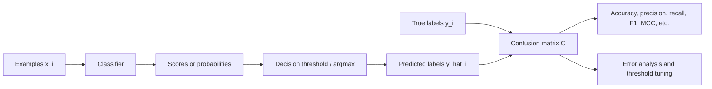
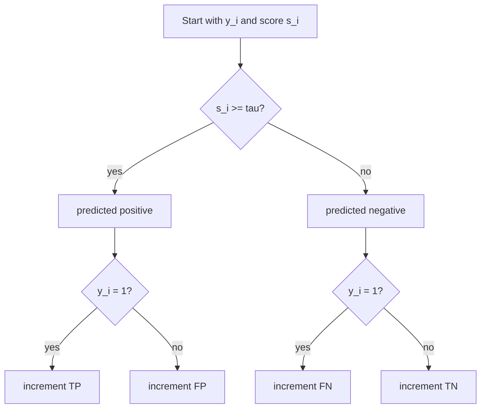
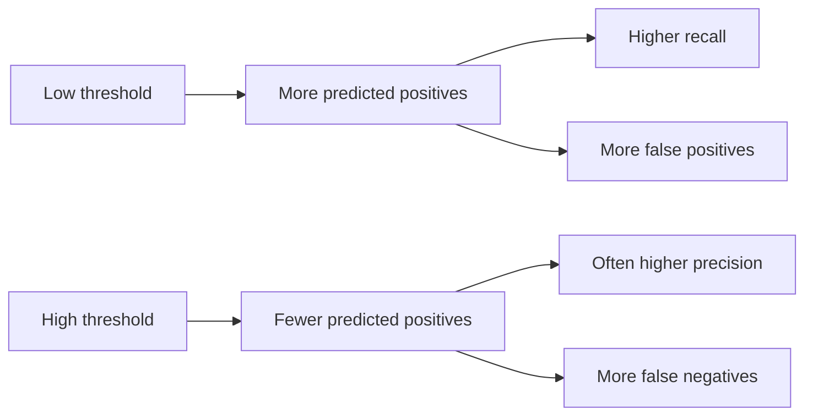

# Confusion Matrix and Classification Metrics

A confusion matrix is the empirical joint count table between ground-truth labels and predicted labels. It is the sufficient object for many deterministic classification metrics: accuracy, error rate, precision, recall, specificity, false-positive rate, F-scores, balanced accuracy, Matthews correlation coefficient, Cohen's kappa, and multiclass macro/micro/weighted averages.

The central reason to use it is that a single scalar score hides the error geometry. Two classifiers can have identical accuracy while making completely different kinds of mistakes. In high-cost domains such as medical screening, fraud detection, moderation, ranking, and retrieval, the type of error often matters more than the total number of errors.



This chapter treats the original notes as the binary-classification starting point, then expands to first-principles derivations, multiclass/multilabel extensions, threshold mechanics, implementation internals, numerical issues, and practical pitfalls.

## 1. Problem Setup

Let the evaluation dataset be

$$
\mathcal{D}
=
\{(x_i,y_i)\}_{i=1}^{n},
$$

where

$$
y_i\in\mathcal{Y}.
$$

For binary classification, use the label set

$$
\mathcal{Y}=\{0,1\},
$$

where $1$ is the positive class and $0$ is the negative class. A classifier produces either a hard label

$$
\hat{y}_i\in\{0,1\},
$$

or a score

$$
s_i=f_\theta(x_i)\in\mathbb{R},
$$

which is converted to a hard label by a threshold $\tau$:

$$
\hat{y}_i(\tau)
=
\mathbf{1}\{s_i\geq \tau\}.
$$

If $s_i$ is a calibrated posterior estimate

$$
s_i\approx p_\theta(y=1\mid x_i),
$$

then $\tau=0.5$ is optimal only under symmetric misclassification costs and equal action utilities. In imbalanced or cost-sensitive settings, the optimal threshold usually differs from $0.5$.

The empirical confusion counts are:

$$
\begin{aligned}
\operatorname{TP}
&=
\sum_{i=1}^{n}
\mathbf{1}\{y_i=1,\hat{y}_i=1\},
\\
\operatorname{TN}
&=
\sum_{i=1}^{n}
\mathbf{1}\{y_i=0,\hat{y}_i=0\},
\\
\operatorname{FP}
&=
\sum_{i=1}^{n}
\mathbf{1}\{y_i=0,\hat{y}_i=1\},
\\
\operatorname{FN}
&=
\sum_{i=1}^{n}
\mathbf{1}\{y_i=1,\hat{y}_i=0\}.
\end{aligned}
$$

They satisfy

$$
n
=
\operatorname{TP}
+\operatorname{TN}
+\operatorname{FP}
+\operatorname{FN}.
$$

The binary confusion matrix is commonly written as:

|  | Predicted positive | Predicted negative |
| --- | ---: | ---: |
| Actual positive | TP | FN |
| Actual negative | FP | TN |

Some libraries, including scikit-learn, return matrices with rows as true labels and columns as predicted labels, ordered by label:

$$
C_{a,b}
=
\sum_{i=1}^{n}
\mathbf{1}\{y_i=a,\hat{y}_i=b\}.
$$

For labels $[0,1]$, this yields

$$
C
=
\begin{bmatrix}
\operatorname{TN} & \operatorname{FP}
\\
\operatorname{FN} & \operatorname{TP}
\end{bmatrix}.
$$

That orientation difference is a frequent source of implementation bugs.

## 2. Step-by-Step Execution

For a fixed threshold $\tau$, evaluating a binary classifier proceeds as follows:

1. Run the model on each input $x_i$ to obtain a score $s_i$ or probability $\hat{p}_i$.
2. Convert scores into labels with $\hat{y}_i=\mathbf{1}\{s_i\geq\tau\}$.
3. Compare each pair $(y_i,\hat{y}_i)$.
4. Increment exactly one of TP, TN, FP, FN.
5. Compute metrics as functions of those four counts.
6. If threshold tuning is required, repeat steps 2 to 5 over candidate thresholds.



For a multiclass classifier with $K$ classes,

$$
\mathcal{Y}=\{1,\dots,K\},
$$

the confusion matrix is

$$
C\in\mathbb{N}^{K\times K},
\qquad
C_{j,k}
=
\sum_{i=1}^{n}
\mathbf{1}\{y_i=j,\hat{y}_i=k\}.
$$

Each row corresponds to an actual class and each column corresponds to a predicted class. Diagonal entries are correct predictions. Off-diagonal entry $C_{j,k}$ is the number of class-$j$ examples misclassified as class $k$.

## 3. Binary Metrics from First Principles

### 3.1 Accuracy and Error Rate

Accuracy estimates the probability that a randomly selected evaluation example is classified correctly:

$$
\operatorname{Accuracy}
=
\frac{\operatorname{TP}+\operatorname{TN}}{n}.
$$

The empirical zero-one loss is the error rate:

$$
\operatorname{Error}
=
\frac{\operatorname{FP}+\operatorname{FN}}{n}
=
1-\operatorname{Accuracy}.
$$

From empirical risk minimization, accuracy is equivalent to minimizing

$$
\hat{R}_{0/1}(h)
=
\frac{1}{n}
\sum_{i=1}^{n}
\mathbf{1}\{h(x_i)\neq y_i\}.
$$

Accuracy is appropriate when class prevalences and error costs are roughly balanced. It is often misleading when the majority class dominates.

### 3.2 Prevalence and Predicted Positive Rate

Class prevalence is the empirical probability of the positive class:

$$
\pi
=
\frac{\operatorname{TP}+\operatorname{FN}}{n}.
$$

The predicted positive rate is

$$
\hat{\pi}
=
\frac{\operatorname{TP}+\operatorname{FP}}{n}.
$$

These two quantities explain why precision is prevalence-sensitive. A model with the same true-positive and false-positive rates can have very different precision across populations with different base rates.

### 3.3 Recall, Sensitivity, and True Positive Rate

Recall is the conditional probability that the classifier predicts positive given that the example is truly positive:

$$
\operatorname{Recall}
=
\operatorname{Sensitivity}
=
\operatorname{TPR}
=
\frac{\operatorname{TP}}{\operatorname{TP}+\operatorname{FN}}.
$$

This is an empirical conditional probability:

$$
\operatorname{TPR}
=
\hat{P}(\hat{Y}=1\mid Y=1).
$$

It answers: among actual positives, what fraction did the model retrieve?

### 3.4 Specificity and False Positive Rate

Specificity is the conditional probability that the classifier predicts negative given that the example is truly negative:

$$
\operatorname{Specificity}
=
\operatorname{TNR}
=
\frac{\operatorname{TN}}{\operatorname{TN}+\operatorname{FP}}.
$$

The false-positive rate is

$$
\operatorname{FPR}
=
\frac{\operatorname{FP}}{\operatorname{FP}+\operatorname{TN}}
=
1-\operatorname{Specificity}.
$$

Thus ROC curves plot

$$
(\operatorname{FPR}(\tau),\operatorname{TPR}(\tau))
$$

as the threshold $\tau$ varies.

### 3.5 Precision and False Discovery Rate

Precision is the conditional probability that an example is actually positive given that the classifier predicted positive:

$$
\operatorname{Precision}
=
\operatorname{PPV}
=
\frac{\operatorname{TP}}{\operatorname{TP}+\operatorname{FP}}.
$$

This is

$$
\operatorname{PPV}
=
\hat{P}(Y=1\mid \hat{Y}=1).
$$

The false discovery rate is

$$
\operatorname{FDR}
=
\frac{\operatorname{FP}}{\operatorname{TP}+\operatorname{FP}}
=
1-\operatorname{Precision}.
$$

Precision depends on prevalence. Using Bayes' rule, if the population-level TPR, FPR, and positive prevalence are $\operatorname{TPR}$, $\operatorname{FPR}$, and $\pi$, then

$$
\operatorname{PPV}
=
P(Y=1\mid \hat{Y}=1)
=
\frac{P(\hat{Y}=1\mid Y=1)P(Y=1)}
{P(\hat{Y}=1)}
$$

and

$$
\operatorname{PPV}
=
\frac{\operatorname{TPR}\pi}
{\operatorname{TPR}\pi+\operatorname{FPR}(1-\pi)}.
$$

This derivation explains why false positives can dominate precision when positives are rare, even if FPR is numerically small.

### 3.6 Negative Predictive Value

Negative predictive value is

$$
\operatorname{NPV}
=
\frac{\operatorname{TN}}{\operatorname{TN}+\operatorname{FN}}
=
\hat{P}(Y=0\mid \hat{Y}=0).
$$

By Bayes' rule,

$$
\operatorname{NPV}
=
\frac{\operatorname{TNR}(1-\pi)}
{\operatorname{TNR}(1-\pi)+(1-\operatorname{TPR})\pi}.
$$

NPV is high in extremely low-prevalence settings even for weak classifiers, so it should not be interpreted without prevalence and recall.

### 3.7 F1 and F-Beta Scores

The F1 score is the harmonic mean of precision and recall:

$$
F_1
=
2
\frac{\operatorname{Precision}\cdot\operatorname{Recall}}
{\operatorname{Precision}+\operatorname{Recall}}.
$$

Substitute

$$
\operatorname{Precision}
=
\frac{\operatorname{TP}}{\operatorname{TP}+\operatorname{FP}},
\qquad
\operatorname{Recall}
=
\frac{\operatorname{TP}}{\operatorname{TP}+\operatorname{FN}}.
$$

Then

$$
\begin{aligned}
F_1
&=
2
\frac{
\frac{\operatorname{TP}}{\operatorname{TP}+\operatorname{FP}}
\frac{\operatorname{TP}}{\operatorname{TP}+\operatorname{FN}}
}
{
\frac{\operatorname{TP}}{\operatorname{TP}+\operatorname{FP}}
+
\frac{\operatorname{TP}}{\operatorname{TP}+\operatorname{FN}}
}
\\
&=
\frac{2\operatorname{TP}}
{2\operatorname{TP}+\operatorname{FP}+\operatorname{FN}}.
\end{aligned}
$$

F1 ignores TN. This is desirable in retrieval-style problems where the negative universe is huge or not very meaningful, but it is a limitation in settings where true negatives matter.

The more general $F_\beta$ score is

$$
F_\beta
=
(1+\beta^2)
\frac{\operatorname{Precision}\cdot\operatorname{Recall}}
{\beta^2\operatorname{Precision}+\operatorname{Recall}}.
$$

In terms of counts,

$$
F_\beta
=
\frac{(1+\beta^2)\operatorname{TP}}
{(1+\beta^2)\operatorname{TP}+\beta^2\operatorname{FN}+\operatorname{FP}}.
$$

When $\beta>1$, recall is weighted more strongly. When $0<\beta<1$, precision is weighted more strongly.

### 3.8 Balanced Accuracy

Balanced accuracy averages sensitivity and specificity:

$$
\operatorname{BalancedAccuracy}
=
\frac{1}{2}
\left(
\frac{\operatorname{TP}}{\operatorname{TP}+\operatorname{FN}}
+
\frac{\operatorname{TN}}{\operatorname{TN}+\operatorname{FP}}
\right).
$$

It is the average per-class recall in the binary case. Unlike raw accuracy, it is less dominated by majority-class prevalence.

### 3.9 Youden's J / Informedness

Youden's $J$ statistic is

$$
J
=
\operatorname{TPR}+\operatorname{TNR}-1
=
\operatorname{TPR}-\operatorname{FPR}.
$$

It measures how much better the classifier is than random guessing in terms of separating the two classes. A common threshold-selection rule is

$$
\tau^\star
=
\arg\max_{\tau}
\left(
\operatorname{TPR}(\tau)-\operatorname{FPR}(\tau)
\right).
$$

This rule is reasonable when sensitivity and specificity are equally important, but it is not necessarily optimal under asymmetric costs.

### 3.10 Matthews Correlation Coefficient

The Matthews correlation coefficient is the Pearson correlation between binary true labels and binary predicted labels:

$$
\operatorname{MCC}
=
\frac{
\operatorname{TP}\operatorname{TN}
-
\operatorname{FP}\operatorname{FN}
}
{
\sqrt{
(\operatorname{TP}+\operatorname{FP})
(\operatorname{TP}+\operatorname{FN})
(\operatorname{TN}+\operatorname{FP})
(\operatorname{TN}+\operatorname{FN})
}
}.
$$

Derivation sketch: encode true and predicted labels as Bernoulli variables $Y,\hat{Y}\in\{0,1\}$. Pearson correlation is

$$
\rho(Y,\hat{Y})
=
\frac{\operatorname{Cov}(Y,\hat{Y})}
{\sqrt{\operatorname{Var}(Y)\operatorname{Var}(\hat{Y})}}.
$$

Using empirical probabilities from the confusion matrix gives

$$
\hat{P}(Y=1,\hat{Y}=1)
=
\frac{\operatorname{TP}}{n},
$$

$$
\hat{P}(Y=1)
=
\frac{\operatorname{TP}+\operatorname{FN}}{n},
$$

$$
\hat{P}(\hat{Y}=1)
=
\frac{\operatorname{TP}+\operatorname{FP}}{n}.
$$

Substitution and cancellation of $n$ yields the MCC formula. MCC is often more informative than F1 when both positive and negative classes matter, especially under imbalance.

### 3.11 Cohen's Kappa

Cohen's kappa compares observed agreement against agreement expected by chance given the marginal label frequencies:

$$
\kappa
=
\frac{p_o-p_e}{1-p_e}.
$$

Observed agreement is accuracy:

$$
p_o
=
\frac{\operatorname{TP}+\operatorname{TN}}{n}.
$$

Expected agreement under independent true and predicted labels with the same marginals is

$$
p_e
=
\frac{(\operatorname{TP}+\operatorname{FN})(\operatorname{TP}+\operatorname{FP})}
{n^2}
+
\frac{(\operatorname{TN}+\operatorname{FP})(\operatorname{TN}+\operatorname{FN})}
{n^2}.
$$

Kappa is useful when raw agreement is inflated by class imbalance, but it can behave unintuitively when prevalence is extreme.

## 4. Worked Binary Example

Suppose 100 patients are tested:

|  | Predicted disease | Predicted healthy |
| --- | ---: | ---: |
| Actual disease | 40 | 10 |
| Actual healthy | 5 | 45 |

Thus

$$
\operatorname{TP}=40,
\quad
\operatorname{FN}=10,
\quad
\operatorname{FP}=5,
\quad
\operatorname{TN}=45,
\quad
n=100.
$$

Accuracy:

$$
\operatorname{Accuracy}
=
\frac{40+45}{100}
=
0.85.
$$

Precision:

$$
\operatorname{Precision}
=
\frac{40}{40+5}
=
\frac{40}{45}
=
0.8889.
$$

Recall:

$$
\operatorname{Recall}
=
\frac{40}{40+10}
=
\frac{40}{50}
=
0.8.
$$

Specificity:

$$
\operatorname{Specificity}
=
\frac{45}{45+5}
=
\frac{45}{50}
=
0.9.
$$

F1:

$$
F_1
=
2
\frac{0.8889\cdot 0.8}{0.8889+0.8}
=
0.8421.
$$

The count-form F1 gives the same result:

$$
F_1
=
\frac{2\cdot 40}{2\cdot 40+5+10}
=
\frac{80}{95}
=
0.8421.
$$

MCC:

$$
\operatorname{MCC}
=
\frac{40\cdot45-5\cdot10}
{\sqrt{(40+5)(40+10)(45+5)(45+10)}}.
$$

The numerator is

$$
40\cdot45-5\cdot10
=
1800-50
=
1750.
$$

The denominator is

$$
\sqrt{45\cdot50\cdot50\cdot55}
=
\sqrt{6187500}
\approx
2487.47.
$$

Therefore

$$
\operatorname{MCC}
\approx
\frac{1750}{2487.47}
\approx
0.7035.
$$

## 5. Why Accuracy Can Be Misleading

Consider a disease dataset with 1000 examples:

| Class | Count |
| --- | ---: |
| Healthy | 990 |
| Disease | 10 |

A degenerate classifier predicts every patient as healthy:

$$
\hat{y}_i=0
\quad
\text{for all }i.
$$

The confusion counts are

$$
\operatorname{TN}=990,
\quad
\operatorname{FN}=10,
\quad
\operatorname{TP}=0,
\quad
\operatorname{FP}=0.
$$

Accuracy is high:

$$
\operatorname{Accuracy}
=
\frac{990}{1000}
=
0.99.
$$

But recall is zero:

$$
\operatorname{Recall}
=
\frac{0}{0+10}
=
0.
$$

The classifier fails at the actual screening objective. This example shows that a metric must match the operational loss. In rare-event detection, useful evaluation usually includes recall, precision, false-positive burden, precision-recall curves, calibration, and explicit decision costs.

## 6. Thresholds, Costs, and Decision Theory

Assume a probabilistic classifier estimates

$$
p(x)
=
P(Y=1\mid X=x).
$$

Let the cost of a false positive be $C_{\operatorname{FP}}>0$, and the cost of a false negative be $C_{\operatorname{FN}}>0$. Assume correct predictions have zero cost.

If we predict positive, the expected conditional cost is

$$
\mathbb{E}[\operatorname{cost}\mid \hat{Y}=1,x]
=
C_{\operatorname{FP}}P(Y=0\mid x)
=
C_{\operatorname{FP}}(1-p(x)).
$$

If we predict negative, the expected conditional cost is

$$
\mathbb{E}[\operatorname{cost}\mid \hat{Y}=0,x]
=
C_{\operatorname{FN}}P(Y=1\mid x)
=
C_{\operatorname{FN}}p(x).
$$

Choose positive when

$$
C_{\operatorname{FP}}(1-p(x))
\leq
C_{\operatorname{FN}}p(x).
$$

Solving:

$$
C_{\operatorname{FP}}
\leq
(C_{\operatorname{FP}}+C_{\operatorname{FN}})p(x),
$$

so

$$
p(x)
\geq
\frac{C_{\operatorname{FP}}}
{C_{\operatorname{FP}}+C_{\operatorname{FN}}}.
$$

Therefore the Bayes-optimal threshold under calibrated probabilities and zero correct-classification cost is

$$
\tau^\star
=
\frac{C_{\operatorname{FP}}}
{C_{\operatorname{FP}}+C_{\operatorname{FN}}}.
$$

If false negatives are much more expensive than false positives, then $C_{\operatorname{FN}}\gg C_{\operatorname{FP}}$ and $\tau^\star$ becomes small. That is why screening systems often use lower thresholds to increase recall.

Confusion matrices are threshold-dependent:

$$
C(\tau)
=
\begin{bmatrix}
\operatorname{TN}(\tau) & \operatorname{FP}(\tau)
\\
\operatorname{FN}(\tau) & \operatorname{TP}(\tau)
\end{bmatrix}.
$$

Lowering $\tau$ generally increases TP and FP while decreasing TN and FN. Raising $\tau$ generally does the opposite.



## 7. ROC and Precision-Recall Curves from Confusion Counts

For each threshold $\tau$, compute:

$$
\operatorname{TPR}(\tau)
=
\frac{\operatorname{TP}(\tau)}
{\operatorname{TP}(\tau)+\operatorname{FN}(\tau)},
$$

$$
\operatorname{FPR}(\tau)
=
\frac{\operatorname{FP}(\tau)}
{\operatorname{FP}(\tau)+\operatorname{TN}(\tau)}.
$$

The ROC curve is the threshold-parametrized curve

$$
\tau
\mapsto
\left(
\operatorname{FPR}(\tau),
\operatorname{TPR}(\tau)
\right).
$$

Precision-recall curves use

$$
\tau
\mapsto
\left(
\operatorname{Recall}(\tau),
\operatorname{Precision}(\tau)
\right).
$$

ROC curves can look optimistic under extreme imbalance because FPR divides by the number of negatives, which may be huge. Precision-recall curves expose the false-positive burden more directly because precision divides by predicted positives.

### Efficient Threshold Sweep

Naively recomputing a confusion matrix for $m$ thresholds costs

$$
O(mn).
$$

A more efficient method sorts examples by descending score:

$$
s_{(1)}\geq s_{(2)}\geq \cdots \geq s_{(n)}.
$$

Start with threshold above all scores, so every example is predicted negative:

$$
\operatorname{TP}=0,
\quad
\operatorname{FP}=0,
\quad
\operatorname{FN}=P,
\quad
\operatorname{TN}=N,
$$

where

$$
P=\sum_i\mathbf{1}\{y_i=1\},
\qquad
N=\sum_i\mathbf{1}\{y_i=0\}.
$$

Move the threshold downward. When a positive example crosses into the predicted-positive set:

$$
\operatorname{TP}\leftarrow \operatorname{TP}+1,
\qquad
\operatorname{FN}\leftarrow \operatorname{FN}-1.
$$

When a negative example crosses:

$$
\operatorname{FP}\leftarrow \operatorname{FP}+1,
\qquad
\operatorname{TN}\leftarrow \operatorname{TN}-1.
$$

Sorting costs

$$
O(n\log n),
$$

and the sweep costs

$$
O(n).
$$

## 8. Multiclass Confusion Matrix

For $K$ classes, the confusion matrix is

$$
C
=
\begin{bmatrix}
C_{1,1} & C_{1,2} & \cdots & C_{1,K}
\\
C_{2,1} & C_{2,2} & \cdots & C_{2,K}
\\
\vdots & \vdots & \ddots & \vdots
\\
C_{K,1} & C_{K,2} & \cdots & C_{K,K}
\end{bmatrix}.
$$

Rows represent actual labels; columns represent predictions.

For class $k$, one-vs-rest counts are:

$$
\operatorname{TP}_k
=
C_{k,k},
$$

$$
\operatorname{FN}_k
=
\sum_{\ell\neq k} C_{k,\ell},
$$

$$
\operatorname{FP}_k
=
\sum_{j\neq k} C_{j,k},
$$

$$
\operatorname{TN}_k
=
\sum_{j\neq k}\sum_{\ell\neq k} C_{j,\ell}.
$$

Equivalently, with row sum

$$
r_k=\sum_{\ell=1}^{K}C_{k,\ell},
$$

column sum

$$
c_k=\sum_{j=1}^{K}C_{j,k},
$$

and total

$$
n=\sum_{j=1}^{K}\sum_{\ell=1}^{K}C_{j,\ell},
$$

the counts are

$$
\operatorname{TP}_k=C_{k,k},
\qquad
\operatorname{FN}_k=r_k-C_{k,k},
\qquad
\operatorname{FP}_k=c_k-C_{k,k},
$$

and

$$
\operatorname{TN}_k=n-r_k-c_k+C_{k,k}.
$$

### Multiclass Worked Example

Suppose classes are:

$$
\mathcal{Y}=\{\text{cat},\text{dog},\text{rabbit}\}.
$$

The confusion matrix is:

| Actual / Predicted | cat | dog | rabbit |
| --- | ---: | ---: | ---: |
| cat | 30 | 4 | 1 |
| dog | 3 | 25 | 2 |
| rabbit | 0 | 5 | 20 |

Total:

$$
n=30+4+1+3+25+2+0+5+20=90.
$$

Accuracy:

$$
\operatorname{Accuracy}
=
\frac{30+25+20}{90}
=
\frac{75}{90}
=
0.8333.
$$

For the class dog:

$$
\operatorname{TP}_{dog}=25.
$$

Dog row sum:

$$
r_{dog}=3+25+2=30.
$$

Dog column sum:

$$
c_{dog}=4+25+5=34.
$$

Thus

$$
\operatorname{FN}_{dog}=30-25=5,
$$

$$
\operatorname{FP}_{dog}=34-25=9,
$$

$$
\operatorname{TN}_{dog}=90-30-34+25=51.
$$

Dog precision:

$$
\operatorname{Precision}_{dog}
=
\frac{25}{25+9}
=
0.7353.
$$

Dog recall:

$$
\operatorname{Recall}_{dog}
=
\frac{25}{25+5}
=
0.8333.
$$

Dog F1:

$$
F_{1,dog}
=
\frac{2\cdot25}{2\cdot25+9+5}
=
\frac{50}{64}
=
0.7813.
$$

## 9. Averaging Schemes

For multiclass or multilabel metrics, the averaging scheme determines what population receives equal weight.

### 9.1 Macro Average

Macro averaging computes a metric independently for each class, then averages:

$$
\operatorname{MacroPrecision}
=
\frac{1}{K}
\sum_{k=1}^{K}
\operatorname{Precision}_k.
$$

Macro recall and macro F1 are analogous.

Macro averaging gives equal weight to each class, regardless of support. It is useful when minority-class performance matters.

### 9.2 Weighted Macro Average

Weighted macro averaging weights each class by its support:

$$
\operatorname{WeightedPrecision}
=
\sum_{k=1}^{K}
\frac{r_k}{n}
\operatorname{Precision}_k.
$$

This accounts for imbalance but can again be dominated by majority classes.

### 9.3 Micro Average

Micro averaging aggregates one-vs-rest counts before computing the metric:

$$
\operatorname{MicroPrecision}
=
\frac{\sum_{k=1}^{K}\operatorname{TP}_k}
{\sum_{k=1}^{K}(\operatorname{TP}_k+\operatorname{FP}_k)}.
$$

For single-label multiclass classification, micro precision, micro recall, micro F1, and accuracy are all equal. The reason is that every incorrect prediction creates exactly one false positive for the predicted class and exactly one false negative for the true class.

### 9.4 Sample Average

Sample averaging is mostly used for multilabel classification. Each example can have multiple true labels and multiple predicted labels:

$$
y_i\subseteq\{1,\dots,K\},
\qquad
\hat{y}_i\subseteq\{1,\dots,K\}.
$$

For each sample, compute a per-sample metric, then average across samples. For example, sample-level precision is

$$
\operatorname{Precision}_i
=
\frac{|y_i\cap \hat{y}_i|}
{|\hat{y}_i|},
$$

with a convention for empty predicted sets.

## 10. Normalization

A raw confusion matrix stores counts. Normalized confusion matrices store conditional or joint empirical probabilities.

Row-normalized:

$$
\tilde{C}_{j,k}^{row}
=
\frac{C_{j,k}}
{\sum_{\ell=1}^{K}C_{j,\ell}}.
$$

This estimates

$$
\hat{P}(\hat{Y}=k\mid Y=j).
$$

It is usually best for seeing which classes each true class gets confused with.

Column-normalized:

$$
\tilde{C}_{j,k}^{col}
=
\frac{C_{j,k}}
{\sum_{\ell=1}^{K}C_{\ell,k}}.
$$

This estimates

$$
\hat{P}(Y=j\mid \hat{Y}=k).
$$

It is useful for understanding the composition of each predicted class.

Global normalization:

$$
\tilde{C}_{j,k}^{all}
=
\frac{C_{j,k}}{n}.
$$

This estimates the empirical joint probability

$$
\hat{P}(Y=j,\hat{Y}=k).
$$

## 11. Python Implementation from Scratch

### 11.1 Binary Confusion Counts

```python
from __future__ import annotations

from dataclasses import dataclass
from math import sqrt
from typing import Iterable


@dataclass(frozen=True)
class BinaryConfusion:
    tp: int
    tn: int
    fp: int
    fn: int

    @property
    def n(self) -> int:
        return self.tp + self.tn + self.fp + self.fn


def binary_confusion_counts(
    y_true: Iterable[int],
    y_pred: Iterable[int],
    positive_label: int = 1,
) -> BinaryConfusion:
    tp = tn = fp = fn = 0

    for yt, yp in zip(y_true, y_pred, strict=True):
        yt_pos = yt == positive_label
        yp_pos = yp == positive_label

        if yt_pos and yp_pos:
            tp += 1
        elif (not yt_pos) and (not yp_pos):
            tn += 1
        elif (not yt_pos) and yp_pos:
            fp += 1
        else:
            fn += 1

    return BinaryConfusion(tp=tp, tn=tn, fp=fp, fn=fn)
```

The function uses `zip(..., strict=True)` so mismatched input lengths raise an exception instead of silently truncating. For Python versions before 3.10, manually compare lengths or convert inputs to arrays.

### 11.2 Safe Division and Metrics

```python
def safe_divide(numerator: float, denominator: float, zero_division: float = 0.0) -> float:
    if denominator == 0:
        return zero_division
    return numerator / denominator


def binary_metrics(cm: BinaryConfusion, zero_division: float = 0.0) -> dict[str, float]:
    tp, tn, fp, fn = cm.tp, cm.tn, cm.fp, cm.fn
    n = cm.n

    accuracy = safe_divide(tp + tn, n, zero_division)
    error_rate = safe_divide(fp + fn, n, zero_division)
    precision = safe_divide(tp, tp + fp, zero_division)
    recall = safe_divide(tp, tp + fn, zero_division)
    specificity = safe_divide(tn, tn + fp, zero_division)
    npv = safe_divide(tn, tn + fn, zero_division)
    fpr = safe_divide(fp, fp + tn, zero_division)
    fnr = safe_divide(fn, fn + tp, zero_division)
    f1 = safe_divide(2 * tp, 2 * tp + fp + fn, zero_division)

    mcc_den = sqrt((tp + fp) * (tp + fn) * (tn + fp) * (tn + fn))
    mcc = safe_divide(tp * tn - fp * fn, mcc_den, zero_division)

    balanced_accuracy = 0.5 * (recall + specificity)
    informedness = recall + specificity - 1

    return {
        "accuracy": accuracy,
        "error_rate": error_rate,
        "precision": precision,
        "recall": recall,
        "specificity": specificity,
        "npv": npv,
        "fpr": fpr,
        "fnr": fnr,
        "f1": f1,
        "mcc": mcc,
        "balanced_accuracy": balanced_accuracy,
        "informedness": informedness,
    }
```

Important details:

- Undefined precision occurs when $\operatorname{TP}+\operatorname{FP}=0$, meaning the classifier never predicts positive.
- Undefined recall occurs when $\operatorname{TP}+\operatorname{FN}=0$, meaning the evaluation set has no positives.
- Undefined specificity occurs when $\operatorname{TN}+\operatorname{FP}=0$, meaning the evaluation set has no negatives.
- MCC is undefined if either true labels or predicted labels have zero variance.

### 11.3 Multiclass Confusion Matrix

```python
import numpy as np


def confusion_matrix_from_scratch(
    y_true: Iterable[object],
    y_pred: Iterable[object],
    labels: list[object] | None = None,
) -> tuple[np.ndarray, list[object]]:
    y_true = list(y_true)
    y_pred = list(y_pred)

    if len(y_true) != len(y_pred):
        raise ValueError("y_true and y_pred must have the same length.")

    if labels is None:
        labels = sorted(set(y_true) | set(y_pred))

    label_to_index = {label: idx for idx, label in enumerate(labels)}
    matrix = np.zeros((len(labels), len(labels)), dtype=np.int64)

    for yt, yp in zip(y_true, y_pred, strict=True):
        if yt not in label_to_index:
            raise ValueError(f"Unknown true label: {yt!r}")
        if yp not in label_to_index:
            raise ValueError(f"Unknown predicted label: {yp!r}")

        row = label_to_index[yt]
        col = label_to_index[yp]
        matrix[row, col] += 1

    return matrix, labels
```

This is exactly the core idea used by library implementations: map labels to contiguous integer indices, allocate a $K\times K$ count matrix, then increment one cell per sample.

### 11.4 Per-Class Metrics from a Matrix

```python
def multiclass_report_from_matrix(
    cm: np.ndarray,
    zero_division: float = 0.0,
) -> dict[str, object]:
    cm = np.asarray(cm)

    if cm.ndim != 2 or cm.shape[0] != cm.shape[1]:
        raise ValueError("cm must be a square 2D array.")

    n_classes = cm.shape[0]
    total = cm.sum()
    row_sums = cm.sum(axis=1)
    col_sums = cm.sum(axis=0)
    diagonal = np.diag(cm)

    per_class = []
    for k in range(n_classes):
        tp = int(diagonal[k])
        fn = int(row_sums[k] - tp)
        fp = int(col_sums[k] - tp)
        tn = int(total - row_sums[k] - col_sums[k] + tp)

        precision = safe_divide(tp, tp + fp, zero_division)
        recall = safe_divide(tp, tp + fn, zero_division)
        f1 = safe_divide(2 * tp, 2 * tp + fp + fn, zero_division)
        support = int(row_sums[k])

        per_class.append(
            {
                "tp": tp,
                "tn": tn,
                "fp": fp,
                "fn": fn,
                "precision": precision,
                "recall": recall,
                "f1": f1,
                "support": support,
            }
        )

    accuracy = safe_divide(float(diagonal.sum()), float(total), zero_division)

    precisions = np.array([item["precision"] for item in per_class], dtype=float)
    recalls = np.array([item["recall"] for item in per_class], dtype=float)
    f1s = np.array([item["f1"] for item in per_class], dtype=float)
    supports = row_sums.astype(float)

    macro = {
        "precision": float(precisions.mean()),
        "recall": float(recalls.mean()),
        "f1": float(f1s.mean()),
    }

    if total == 0:
        weights = np.zeros_like(supports)
    else:
        weights = supports / total

    weighted = {
        "precision": float(np.sum(weights * precisions)),
        "recall": float(np.sum(weights * recalls)),
        "f1": float(np.sum(weights * f1s)),
    }

    return {
        "accuracy": accuracy,
        "per_class": per_class,
        "macro_avg": macro,
        "weighted_avg": weighted,
    }
```

### 11.5 Threshold Sweep from Scratch

```python
def threshold_sweep(y_true: np.ndarray, scores: np.ndarray) -> list[dict[str, float]]:
    y_true = np.asarray(y_true, dtype=np.int64)
    scores = np.asarray(scores, dtype=float)

    if y_true.shape != scores.shape:
        raise ValueError("y_true and scores must have the same shape.")

    order = np.argsort(-scores, kind="mergesort")
    y_sorted = y_true[order]
    s_sorted = scores[order]

    positives = int(np.sum(y_true == 1))
    negatives = int(np.sum(y_true == 0))

    tp = 0
    fp = 0
    fn = positives
    tn = negatives

    points = []
    i = 0
    n = len(y_true)

    while i < n:
        threshold = s_sorted[i]

        # Move all examples with this exact score into the predicted-positive set.
        while i < n and s_sorted[i] == threshold:
            if y_sorted[i] == 1:
                tp += 1
                fn -= 1
            else:
                fp += 1
                tn -= 1
            i += 1

        precision = safe_divide(tp, tp + fp, 0.0)
        recall = safe_divide(tp, tp + fn, 0.0)
        fpr = safe_divide(fp, fp + tn, 0.0)
        f1 = safe_divide(2 * tp, 2 * tp + fp + fn, 0.0)

        points.append(
            {
                "threshold": float(threshold),
                "tp": float(tp),
                "fp": float(fp),
                "tn": float(tn),
                "fn": float(fn),
                "precision": precision,
                "recall": recall,
                "fpr": fpr,
                "f1": f1,
            }
        )

    return points
```

Ties are processed as a block. This matters because thresholds should not depend on arbitrary ordering among samples with identical scores.

## 12. Equivalent Library Implementations

### 12.1 scikit-learn

```python
import numpy as np
from sklearn.metrics import (
    accuracy_score,
    balanced_accuracy_score,
    classification_report,
    confusion_matrix,
    f1_score,
    matthews_corrcoef,
    precision_recall_fscore_support,
    precision_score,
    recall_score,
)

y_true = np.array([1, 1, 1, 0, 0, 0, 1, 0])
y_pred = np.array([1, 0, 1, 0, 1, 0, 1, 0])

cm = confusion_matrix(y_true, y_pred, labels=[0, 1])
print(cm)
# [[3 1]
#  [1 3]]

print(accuracy_score(y_true, y_pred))
print(precision_score(y_true, y_pred, pos_label=1, zero_division=0))
print(recall_score(y_true, y_pred, pos_label=1, zero_division=0))
print(f1_score(y_true, y_pred, pos_label=1, zero_division=0))
print(balanced_accuracy_score(y_true, y_pred))
print(matthews_corrcoef(y_true, y_pred))

precision, recall, f1, support = precision_recall_fscore_support(
    y_true,
    y_pred,
    labels=[0, 1],
    average=None,
    zero_division=0,
)

print(classification_report(y_true, y_pred, zero_division=0))
```

Internally, `confusion_matrix` performs the same conceptual operations as the scratch implementation:

1. Determine or validate the label set.
2. Map labels to integer indices.
3. Accumulate weighted or unweighted counts into a $K\times K$ matrix.
4. Optionally normalize over rows, columns, or all entries.

`precision_recall_fscore_support` computes one-vs-rest counts per class, then applies the requested averaging scheme:

- `average=None`: return per-class metrics.
- `average="binary"`: compute only the selected positive class.
- `average="macro"`: unweighted mean over labels.
- `average="weighted"`: support-weighted mean over labels.
- `average="micro"`: aggregate counts globally before division.
- `average="samples"`: average per instance, mainly for multilabel targets.

### 12.2 PyTorch Example

PyTorch does not require a built-in metric object for basic confusion matrices. For logits with shape $(n,K)$:

```python
import torch


def torch_confusion_matrix(logits: torch.Tensor, y_true: torch.Tensor, num_classes: int) -> torch.Tensor:
    y_pred = torch.argmax(logits, dim=1)

    if y_true.shape != y_pred.shape:
        raise ValueError("y_true and predictions must have shape (n,).")

    indices = y_true * num_classes + y_pred
    counts = torch.bincount(indices, minlength=num_classes * num_classes)
    return counts.reshape(num_classes, num_classes)


logits = torch.tensor(
    [
        [3.0, 0.2, -1.0],
        [0.1, 2.4, 0.3],
        [0.2, 1.0, 1.2],
        [1.5, 0.4, 0.1],
    ]
)
y_true = torch.tensor([0, 1, 2, 1])

cm = torch_confusion_matrix(logits, y_true, num_classes=3)
print(cm)
```

The trick

$$
\operatorname{index}_i
=
y_iK+\hat{y}_i
$$

maps each matrix coordinate $(y_i,\hat{y}_i)$ to a unique flat index. `torch.bincount` then performs vectorized counting.

### 12.3 NumPy Vectorized Confusion Matrix

```python
def numpy_confusion_matrix(y_true: np.ndarray, y_pred: np.ndarray, num_classes: int) -> np.ndarray:
    y_true = np.asarray(y_true, dtype=np.int64)
    y_pred = np.asarray(y_pred, dtype=np.int64)

    if y_true.shape != y_pred.shape:
        raise ValueError("y_true and y_pred must have the same shape.")

    if np.any(y_true < 0) or np.any(y_true >= num_classes):
        raise ValueError("y_true contains labels outside [0, num_classes).")
    if np.any(y_pred < 0) or np.any(y_pred >= num_classes):
        raise ValueError("y_pred contains labels outside [0, num_classes).")

    flat_indices = y_true * num_classes + y_pred
    counts = np.bincount(flat_indices, minlength=num_classes * num_classes)
    return counts.reshape(num_classes, num_classes)
```

This avoids a Python loop and is usually much faster for large arrays.

## 13. Numerical Stability and Edge Cases

### Division by Zero

Metrics based on conditional probabilities can be undefined:

| Metric | Denominator | Undefined when |
| --- | ---: | --- |
| Precision | $\operatorname{TP}+\operatorname{FP}$ | no predicted positives |
| Recall | $\operatorname{TP}+\operatorname{FN}$ | no actual positives |
| Specificity | $\operatorname{TN}+\operatorname{FP}$ | no actual negatives |
| NPV | $\operatorname{TN}+\operatorname{FN}$ | no predicted negatives |
| MCC | product of four marginal sums | true or predicted labels have zero variance |

Do not add a small epsilon blindly unless you explicitly want a smoothed estimate. Epsilon changes the metric definition and can make empty-class metrics look meaningful. Prefer explicit `zero_division` handling and report support.

### Integer Overflow

For very large datasets, counts can exceed 32-bit integer range:

$$
2^{31}-1
=
2147483647.
$$

Use 64-bit integer arrays for confusion matrices:

```python
matrix = np.zeros((num_classes, num_classes), dtype=np.int64)
```

### Label Ordering

Always fix label ordering when reproducibility matters:

```python
confusion_matrix(y_true, y_pred, labels=["cat", "dog", "rabbit"])
```

Otherwise, metric reports can change if a class is absent from a particular split or if labels are sorted differently from the domain convention.

### Missing Classes

A validation fold may contain no examples of a rare class. Macro metrics then depend strongly on the convention for undefined recall. Stratified splitting reduces this risk but cannot eliminate it when classes are extremely rare.

### Thresholded Probabilities vs Logits

For binary logits $z$, the probability is

$$
p=\sigma(z)=\frac{1}{1+\exp(-z)}.
$$

Thresholding $p\geq 0.5$ is equivalent to thresholding $z\geq 0$. But thresholding $p\geq\tau$ is equivalent to thresholding

$$
z\geq \log\frac{\tau}{1-\tau}.
$$

This logit-space threshold avoids computing sigmoid if only a hard decision is needed.

### Multilabel vs Multiclass

Multiclass means exactly one true class per example. Multilabel means any subset of labels can be active. A multiclass confusion matrix is not sufficient to represent all multilabel interactions, because each sample can contribute to multiple binary decisions.

### Data Leakage

Do not tune thresholds on the same test set used for final reporting. A correct workflow is:

1. Train model on training data.
2. Tune threshold on validation data.
3. Report final confusion matrix and metrics on held-out test data.

### Calibration

Threshold formulas based on costs assume calibrated probabilities. Ranking metrics such as ROC AUC only require score ordering; cost-optimal decisions require probability scale. Calibration methods such as Platt scaling, isotonic regression, and temperature scaling can change optimal threshold behavior.

## 14. Complexity

For $n$ examples and $K$ classes:

| Operation | Time | Space |
| --- | ---: | ---: |
| Binary counts | $O(n)$ | $O(1)$ |
| Multiclass confusion matrix | $O(n)$ | $O(K^2)$ |
| Per-class metrics from matrix | $O(K^2)$ or $O(K)$ with row/column sums | $O(K)$ |
| Naive threshold sweep over $m$ thresholds | $O(mn)$ | $O(1)$ excluding outputs |
| Sorted threshold sweep | $O(n\log n)$ | $O(n)$ |
| Multilabel per-class counts for dense labels | $O(nK)$ | $O(K)$ or $O(K^2)$ depending output |

For very large $K$, a dense $K\times K$ confusion matrix can be too large. If only a small fraction of class pairs occurs, use sparse counting:

```python
from collections import Counter

pairs = Counter(zip(y_true, y_pred, strict=True))
```

This stores only nonzero cells and uses

$$
O(\min(n,K^2))
$$

space.

## 15. Common Implementation Pitfalls

- Mixing up matrix orientation. Check whether rows are actual labels or predicted labels.
- Treating class `1` as positive when the domain-positive label is something else.
- Reporting accuracy alone on imbalanced data.
- Reporting macro averages without class support.
- Comparing F1 scores across datasets with very different prevalence.
- Tuning thresholds on the test set.
- Forgetting that F1 ignores true negatives.
- Using ROC AUC alone for rare-event detection where precision-recall behavior is more relevant.
- Failing to process tied scores consistently during threshold sweeps.
- Silently dropping absent classes by not passing an explicit `labels` list.
- Adding epsilon to every denominator and hiding undefined metrics.
- Averaging probabilities or labels incorrectly in multilabel problems.

## 16. Connections to Related ML Concepts

### Loss Functions

Confusion-matrix metrics are usually non-differentiable because they depend on hard thresholded predictions:

$$
\hat{y}
=
\mathbf{1}\{s\geq\tau\}.
$$

Training typically uses differentiable surrogate losses such as logistic loss, cross-entropy, hinge loss, or focal loss. Evaluation then uses thresholded metrics. This mismatch is one reason threshold tuning and calibration matter.

### Imbalanced Learning

Class imbalance changes the relationship between error rates and operational utility. Techniques such as class weighting, resampling, focal loss, anomaly detection objectives, and cost-sensitive thresholds should be evaluated through confusion-matrix metrics aligned with the target cost.

### Calibration and Decision Analysis

A well-calibrated model supports decision-theoretic thresholding. A well-ranked but poorly calibrated model may have strong ROC AUC but poor cost-sensitive decisions at a fixed probability threshold.

### Information Retrieval

Precision, recall, F1, and precision-recall curves are central in retrieval. In ranking settings, related metrics include precision at $k$, recall at $k$, average precision, mean average precision, DCG, and NDCG.

### Statistical Testing and Uncertainty

Metrics computed on finite test sets are random variables. For high-stakes comparisons, report confidence intervals or uncertainty estimates. Bootstrap resampling is a practical general method. For accuracy, a binomial interval may be appropriate when examples are independent and identically distributed.

## 17. References for Deeper Reading

- scikit-learn documentation: `sklearn.metrics.confusion_matrix`, https://scikit-learn.org/stable/modules/generated/sklearn.metrics.confusion_matrix.html
- scikit-learn documentation: `sklearn.metrics.precision_recall_fscore_support`, https://scikit-learn.org/stable/modules/generated/sklearn.metrics.precision_recall_fscore_support.html
- Tom Fawcett, "An Introduction to ROC Analysis", Pattern Recognition Letters, 2006, https://doi.org/10.1016/j.patrec.2005.10.010
- David M. W. Powers, "Evaluation: From Precision, Recall and F-Measure to ROC, Informedness, Markedness and Correlation", Journal of Machine Learning Technologies, 2011, https://arxiv.org/abs/2010.16061
- Christopher M. Bishop, "Pattern Recognition and Machine Learning", sections on decision theory and classification.
- Trevor Hastie, Robert Tibshirani, Jerome Friedman, "The Elements of Statistical Learning", sections on classification and model assessment.
