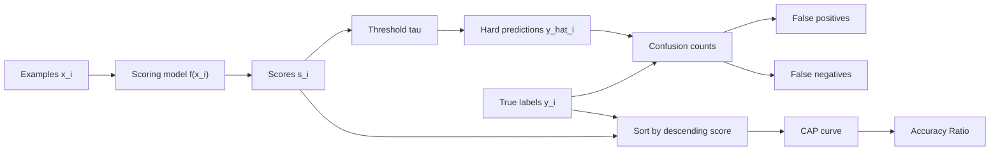
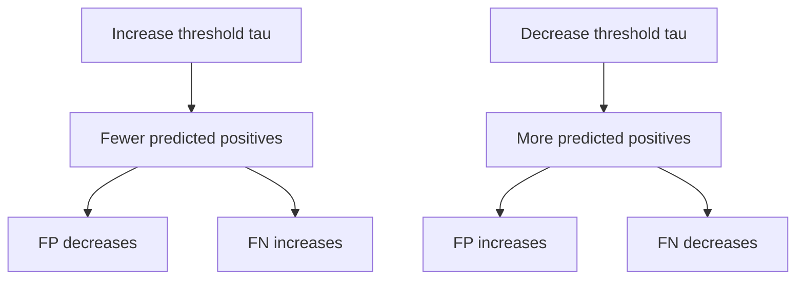
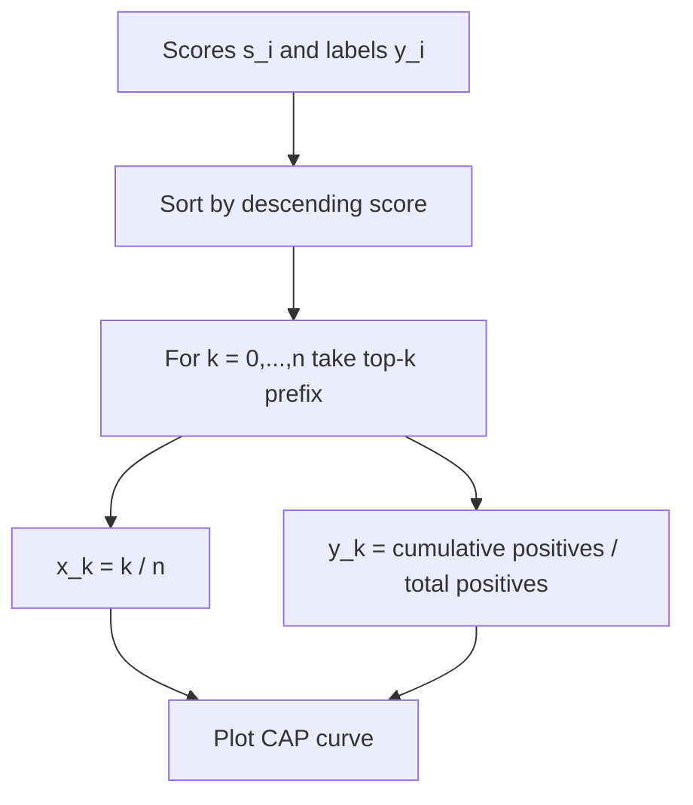
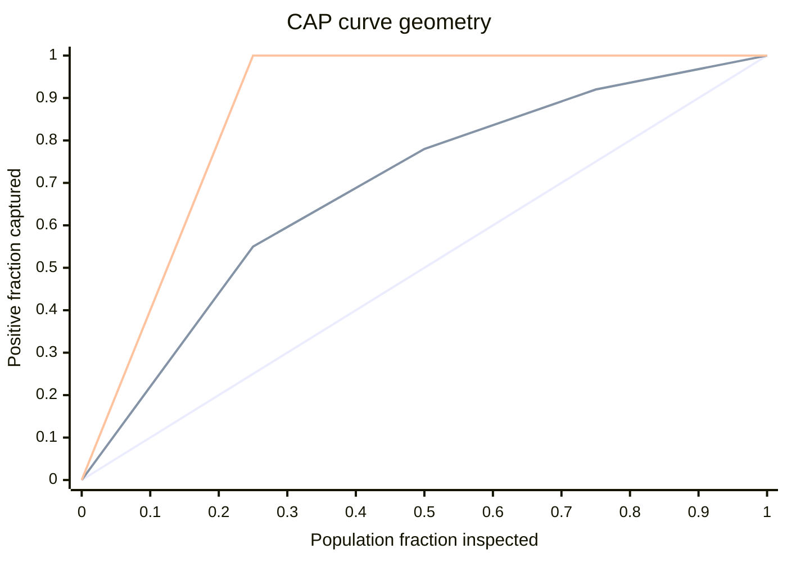

# False Positives, False Negatives, and CAP Curves

False positives and false negatives are not just entries in a confusion matrix. They are the observable consequences of a decision rule, a threshold, and a cost model. CAP curves extend the same binary-classification accounting to ranked predictions: instead of asking "what happens at one threshold?", they ask "how quickly do positives accumulate as we inspect examples from highest score to lowest score?"

This chapter expands the original notes into a technical treatment of:

- False positives and false negatives from first principles.
- Their dependence on thresholds, class prevalence, and misclassification costs.
- CAP curves, perfect/random baselines, Accuracy Ratio, and the connection to ROC-AUC/Gini.
- From-scratch and library implementations.
- Numerical issues, edge cases, and common pitfalls.



## 1. Binary Classification Setup

Let the evaluation set be

$$
\mathcal{D}
=
\{(x_i,y_i)\}_{i=1}^{n},
\qquad
y_i\in\{0,1\}.
$$

Use $y=1$ for the positive class and $y=0$ for the negative class. A probabilistic or scoring classifier produces

$$
s_i
=
f_\theta(x_i)
\in\mathbb{R}.
$$

The score may be:

- A calibrated probability estimate, $s_i\approx \Pr(y_i=1\mid x_i)$.
- A monotone confidence score, such as a logit, margin, anomaly score, or credit-risk score.
- A business score where larger means more likely positive.

A hard classifier is obtained by thresholding:

$$
\hat{y}_i(\tau)
=
\mathbf{1}\{s_i\geq \tau\}.
$$

The threshold $\tau$ is part of the model deployment policy. A fixed trained scoring function can produce many different classifiers depending on $\tau$.

## 2. Confusion Counts from First Principles

For a fixed threshold $\tau$, define:

$$
\begin{aligned}
\operatorname{TP}(\tau)
&=
\sum_{i=1}^{n}
\mathbf{1}\{y_i=1,\hat{y}_i(\tau)=1\},
\\
\operatorname{TN}(\tau)
&=
\sum_{i=1}^{n}
\mathbf{1}\{y_i=0,\hat{y}_i(\tau)=0\},
\\
\operatorname{FP}(\tau)
&=
\sum_{i=1}^{n}
\mathbf{1}\{y_i=0,\hat{y}_i(\tau)=1\},
\\
\operatorname{FN}(\tau)
&=
\sum_{i=1}^{n}
\mathbf{1}\{y_i=1,\hat{y}_i(\tau)=0\}.
\end{aligned}
$$

These four counts partition the dataset:

$$
n
=
\operatorname{TP}
+ \operatorname{TN}
+ \operatorname{FP}
+ \operatorname{FN}.
$$

The binary confusion matrix is:

|  | Predicted positive | Predicted negative |
| --- | ---: | ---: |
| Actual positive | TP | FN |
| Actual negative | FP | TN |

Equivalently, if rows are true labels and columns are predicted labels in label order $(0,1)$, the matrix is:

$$
C
=
\begin{bmatrix}
\operatorname{TN} & \operatorname{FP}
\\
\operatorname{FN} & \operatorname{TP}
\end{bmatrix}.
$$

This row/column convention matters. Many libraries, including scikit-learn, use rows for true labels and columns for predicted labels.

## 3. False Positive and False Negative

### 3.1 False Positive

A false positive occurs when an example is actually negative but is predicted positive:

$$
y_i=0,
\qquad
\hat{y}_i=1.
$$

So:

$$
\operatorname{FP}
=
\sum_{i=1}^{n}
\mathbf{1}\{y_i=0,\hat{y}_i=1\}.
$$

Interpretation:

- Disease screening: healthy patient predicted diseased.
- Spam detection: legitimate email sent to spam.
- Fraud detection: valid transaction blocked.
- Moderation: acceptable content removed.

The false-positive rate conditions on the actual negative population:

$$
\operatorname{FPR}
=
\frac{\operatorname{FP}}
{\operatorname{FP}+\operatorname{TN}}.
$$

The denominator is the number of actual negatives:

$$
N
=
\operatorname{FP}+\operatorname{TN}.
$$

Thus FPR estimates:

$$
\Pr(\hat{y}=1\mid y=0).
$$

### 3.2 False Negative

A false negative occurs when an example is actually positive but is predicted negative:

$$
y_i=1,
\qquad
\hat{y}_i=0.
$$

So:

$$
\operatorname{FN}
=
\sum_{i=1}^{n}
\mathbf{1}\{y_i=1,\hat{y}_i=0\}.
$$

Interpretation:

- Disease screening: sick patient predicted healthy.
- Fraud detection: fraudulent transaction approved.
- Intrusion detection: attack classified as benign.
- Search/retrieval: relevant item omitted.

The false-negative rate conditions on the actual positive population:

$$
\operatorname{FNR}
=
\frac{\operatorname{FN}}
{\operatorname{FN}+\operatorname{TP}}.
$$

The denominator is the number of actual positives:

$$
P
=
\operatorname{TP}+\operatorname{FN}.
$$

Thus FNR estimates:

$$
\Pr(\hat{y}=0\mid y=1).
$$

Since recall, sensitivity, and true-positive rate are:

$$
\operatorname{TPR}
=
\operatorname{Recall}
=
\frac{\operatorname{TP}}{\operatorname{TP}+\operatorname{FN}},
$$

we have:

$$
\operatorname{FNR}
=
1-\operatorname{TPR}.
$$

Similarly, specificity is:

$$
\operatorname{TNR}
=
\frac{\operatorname{TN}}{\operatorname{TN}+\operatorname{FP}},
$$

so:

$$
\operatorname{FPR}
=
1-\operatorname{TNR}.
$$

## 4. Threshold Mechanics

Assume larger scores mean stronger evidence for the positive class:

$$
\hat{y}_i(\tau)
=
\mathbf{1}\{s_i\geq \tau\}.
$$

As $\tau$ decreases:

- More examples are predicted positive.
- TP usually increases or stays the same.
- FP usually increases or stays the same.
- FN usually decreases or stays the same.
- TN usually decreases or stays the same.

As $\tau$ increases:

- Fewer examples are predicted positive.
- FP decreases.
- TP decreases.
- FN increases.
- TN increases.



This is the FP/FN tradeoff. There is no universally correct threshold unless the deployment objective and costs are specified.

## 5. Cost-Sensitive Threshold Derivation

Suppose $s(x)$ is a calibrated posterior:

$$
s(x)
=
\Pr(y=1\mid x).
$$

Let the cost of a false positive be $C_{\operatorname{FP}}>0$ and the cost of a false negative be $C_{\operatorname{FN}}>0$. Assume true positives and true negatives have zero cost. For a given $x$, the expected cost of predicting positive is:

$$
R(\hat{y}=1\mid x)
=
C_{\operatorname{FP}}\Pr(y=0\mid x).
$$

Since

$$
\Pr(y=0\mid x)
=
1-s(x),
$$

we get:

$$
R(\hat{y}=1\mid x)
=
C_{\operatorname{FP}}(1-s(x)).
$$

The expected cost of predicting negative is:

$$
R(\hat{y}=0\mid x)
=
C_{\operatorname{FN}}\Pr(y=1\mid x)
=
C_{\operatorname{FN}}s(x).
$$

Predict positive when:

$$
R(\hat{y}=1\mid x)
\leq
R(\hat{y}=0\mid x).
$$

Substitute:

$$
C_{\operatorname{FP}}(1-s(x))
\leq
C_{\operatorname{FN}}s(x).
$$

Expand:

$$
C_{\operatorname{FP}}
-C_{\operatorname{FP}}s(x)
\leq
C_{\operatorname{FN}}s(x).
$$

Collect terms:

$$
C_{\operatorname{FP}}
\leq
\left(C_{\operatorname{FP}}+C_{\operatorname{FN}}\right)s(x).
$$

Therefore:

$$
s(x)
\geq
\frac{C_{\operatorname{FP}}}
{C_{\operatorname{FP}}+C_{\operatorname{FN}}}.
$$

The Bayes-optimal threshold under these assumptions is:

$$
\tau^\star
=
\frac{C_{\operatorname{FP}}}
{C_{\operatorname{FP}}+C_{\operatorname{FN}}}.
$$

Important implications:

- If false negatives are much more costly, $C_{\operatorname{FN}}\gg C_{\operatorname{FP}}$, then $\tau^\star$ becomes small. The classifier predicts positive aggressively to avoid missed positives.
- If false positives are much more costly, $C_{\operatorname{FP}}\gg C_{\operatorname{FN}}$, then $\tau^\star$ becomes large. The classifier predicts positive conservatively.
- The familiar $\tau=0.5$ arises only when $C_{\operatorname{FP}}=C_{\operatorname{FN}}$ and scores are calibrated posteriors.

If true-positive and true-negative utilities are nonzero, replace each action cost with the full conditional expected utility. The same decision-theoretic derivation applies.

## 6. Worked Example: Confusion Counts and Costs

Consider 10 scored examples:

| Example | True label $y$ | Score $s$ |
| ---: | ---: | ---: |
| 1 | 1 | 0.95 |
| 2 | 0 | 0.90 |
| 3 | 1 | 0.86 |
| 4 | 1 | 0.75 |
| 5 | 0 | 0.70 |
| 6 | 0 | 0.55 |
| 7 | 1 | 0.40 |
| 8 | 0 | 0.35 |
| 9 | 0 | 0.20 |
| 10 | 0 | 0.10 |

Use threshold:

$$
\tau=0.50.
$$

Predicted positives are examples with $s_i\geq 0.50$:

$$
\{1,2,3,4,5,6\}.
$$

Now count:

- TP: examples $1,3,4$, so $\operatorname{TP}=3$.
- FP: examples $2,5,6$, so $\operatorname{FP}=3$.
- FN: example $7$, so $\operatorname{FN}=1$.
- TN: examples $8,9,10$, so $\operatorname{TN}=3$.

The confusion matrix in true-label row order $(0,1)$ and predicted-label column order $(0,1)$ is:

$$
C
=
\begin{bmatrix}
3 & 3
\\
1 & 3
\end{bmatrix}.
$$

The main rates are:

$$
\operatorname{Recall}
=
\frac{3}{3+1}
=
0.75.
$$

$$
\operatorname{FNR}
=
\frac{1}{3+1}
=
0.25.
$$

$$
\operatorname{FPR}
=
\frac{3}{3+3}
=
0.50.
$$

$$
\operatorname{Specificity}
=
\frac{3}{3+3}
=
0.50.
$$

Suppose false negatives cost $10$ and false positives cost $1$:

$$
C_{\operatorname{FN}}=10,
\qquad
C_{\operatorname{FP}}=1.
$$

The cost-sensitive posterior threshold is:

$$
\tau^\star
=
\frac{1}{1+10}
=
\frac{1}{11}
\approx
0.0909.
$$

If the scores were calibrated probabilities, this cost model would justify predicting nearly every uncertain case as positive. That may be appropriate for high-recall medical screening, but inappropriate for low-cost, high-volume operational settings where every false alarm requires expensive manual review.

## 7. CAP Curve: Definition and Motivation

A CAP curve, or Cumulative Accuracy Profile curve, evaluates how concentrated the actual positives are near the top of a model's ranking.

It is common in:

- Credit scoring.
- Default prediction.
- Churn targeting.
- Direct marketing.
- Fraud triage.
- Any workflow where a limited review budget examines the highest-risk examples first.

The model does not need a fixed threshold. Instead, sort examples by descending score and ask:

> If we inspect the top $q$ fraction of the population, what fraction of all positives have we captured?

For example, if the top $20\%$ of customers contains $80\%$ of all defaulters, the ranking is highly concentrated.

## 8. CAP Curve Construction

Let:

$$
P
=
\sum_{i=1}^{n} y_i
$$

be the number of positives, and let:

$$
\pi
=
\frac{P}{n}
$$

be the empirical prevalence.

Sort the examples in descending score order. Let $(i_1,\dots,i_n)$ be a permutation such that:

$$
s_{i_1}
\geq
s_{i_2}
\geq
\dots
\geq
s_{i_n}.
$$

For each prefix length $k\in\{0,1,\dots,n\}$, define:

$$
x_k
=
\frac{k}{n},
$$

the fraction of the total population inspected, and:

$$
y_k
=
\frac{1}{P}
\sum_{j=1}^{k}y_{i_j},
$$

the fraction of all positives captured by that prefix.

The CAP curve is the piecewise-linear curve through:

$$
\{(x_k,y_k)\}_{k=0}^{n}.
$$



The CAP curve always starts at:

$$
(0,0),
$$

and, if $P>0$, ends at:

$$
(1,1).
$$

## 9. Random and Perfect CAP Curves

### 9.1 Random Model

Under random ordering, the expected fraction of positives captured equals the inspected population fraction:

$$
y_{\operatorname{random}}(x)
=
x.
$$

The random CAP curve is the diagonal from $(0,0)$ to $(1,1)$.

The area under the random CAP curve is:

$$
A_{\operatorname{random}}
=
\int_0^1 x\,dx
=
\frac{1}{2}.
$$

### 9.2 Perfect Model

A perfect ranking places all positives before all negatives. Since the positive prevalence is $\pi=P/n$, all positives are captured after inspecting the first $\pi$ fraction of the population.

The perfect CAP curve is:

$$
y_{\operatorname{perfect}}(x)
=
\begin{cases}
\dfrac{x}{\pi}, & 0\leq x\leq \pi,\\
1, & \pi < x\leq 1.
\end{cases}
$$

Its area is:

$$
\begin{aligned}
A_{\operatorname{perfect}}
&=
\int_0^\pi \frac{x}{\pi}\,dx
+
\int_\pi^1 1\,dx
\\
&=
\left[\frac{x^2}{2\pi}\right]_0^\pi
+
(1-\pi)
\\
&=
\frac{\pi}{2}+1-\pi
\\
&=
1-\frac{\pi}{2}.
\end{aligned}
$$

The rarer the positive class, the higher the perfect CAP area can be. If $\pi=0.01$, a perfect model captures all positives in the first $1\%$ of the population and then stays at $y=1$ for the remaining $99\%$.



## 10. Accuracy Ratio

The Accuracy Ratio measures how much of the possible improvement over random ranking the model achieves:

$$
\operatorname{AR}
=
\frac{
A_{\operatorname{model}}-A_{\operatorname{random}}
}{
A_{\operatorname{perfect}}-A_{\operatorname{random}}
}.
$$

Using the area values above:

$$
A_{\operatorname{random}}
=
\frac{1}{2},
\qquad
A_{\operatorname{perfect}}
=
1-\frac{\pi}{2}.
$$

Therefore:

$$
\operatorname{AR}
=
\frac{
A_{\operatorname{model}}-\frac{1}{2}
}{
\left(1-\frac{\pi}{2}\right)-\frac{1}{2}
}
=
\frac{
A_{\operatorname{model}}-\frac{1}{2}
}{
\frac{1-\pi}{2}
}.
$$

Interpretation:

| Accuracy Ratio | Meaning |
| ---: | --- |
| $1$ | Perfect ranking |
| $0$ | Random-ranking performance |
| $<0$ | Worse than random; reversing scores may improve ranking |

Rules of thumb such as "$0.5$ is good" or "$0.8$ is excellent" are domain-dependent. They should not be used without considering prevalence, sample size, operating constraints, calibration, and validation design.

## 11. CAP Area and ROC-AUC Relationship

The CAP curve is closely related to the ROC curve.

For a threshold $\tau$, define:

$$
\operatorname{TPR}(\tau)
=
\Pr(s\geq \tau\mid y=1),
$$

and:

$$
\operatorname{FPR}(\tau)
=
\Pr(s\geq \tau\mid y=0).
$$

The population fraction predicted positive at threshold $\tau$ is:

$$
x(\tau)
=
\Pr(s\geq \tau).
$$

By the law of total probability:

$$
x(\tau)
=
\Pr(s\geq \tau\mid y=1)\Pr(y=1)
+
\Pr(s\geq \tau\mid y=0)\Pr(y=0).
$$

Using $\pi=\Pr(y=1)$:

$$
x(\tau)
=
\pi\operatorname{TPR}(\tau)
+
(1-\pi)\operatorname{FPR}(\tau).
$$

The CAP ordinate is:

$$
y(\tau)
=
\operatorname{TPR}(\tau).
$$

The CAP area can be written as:

$$
A_{\operatorname{CAP}}
=
\int y\,dx.
$$

Substitute:

$$
dx
=
\pi\,d\operatorname{TPR}
+
(1-\pi)\,d\operatorname{FPR}.
$$

Then:

$$
\begin{aligned}
A_{\operatorname{CAP}}
&=
\int \operatorname{TPR}
\left(
\pi\,d\operatorname{TPR}
+
(1-\pi)\,d\operatorname{FPR}
\right)
\\
&=
\pi\int_0^1 \operatorname{TPR}\,d\operatorname{TPR}
+
(1-\pi)
\int_0^1
\operatorname{TPR}\,d\operatorname{FPR}
\\
&=
\frac{\pi}{2}
+
(1-\pi)\operatorname{AUC}_{\operatorname{ROC}}.
\end{aligned}
$$

Because:

$$
\int_0^1
\operatorname{TPR}\,d\operatorname{FPR}
=
\operatorname{AUC}_{\operatorname{ROC}}.
$$

Substitute this into the Accuracy Ratio:

$$
\begin{aligned}
\operatorname{AR}
&=
\frac{
\left(\frac{\pi}{2}+(1-\pi)\operatorname{AUC}_{\operatorname{ROC}}\right)
-\frac{1}{2}
}{
\frac{1-\pi}{2}
}
\\
&=
\frac{
(1-\pi)\operatorname{AUC}_{\operatorname{ROC}}
-\frac{1-\pi}{2}
}{
\frac{1-\pi}{2}
}
\\
&=
2\operatorname{AUC}_{\operatorname{ROC}}-1.
\end{aligned}
$$

Thus, under the usual interpolation conventions and with compatible score ordering:

$$
\operatorname{AR}
=
2\operatorname{AUC}_{\operatorname{ROC}}-1.
$$

This is also the binary Gini coefficient commonly reported in credit scoring:

$$
G
=
2\operatorname{AUC}_{\operatorname{ROC}}-1.
$$

The equality is exact for the population curves and for empirical curves when the same tie handling and interpolation conventions are used.

## 12. Worked Example: CAP Curve and Accuracy Ratio

Use the same 10 examples sorted by descending score:

| Rank $k$ | True label $y_{i_k}$ | Cumulative positives | $x_k=k/n$ | $y_k=\text{cum positives}/P$ |
| ---: | ---: | ---: | ---: | ---: |
| 0 | - | 0 | 0.0 | 0.00 |
| 1 | 1 | 1 | 0.1 | 0.25 |
| 2 | 0 | 1 | 0.2 | 0.25 |
| 3 | 1 | 2 | 0.3 | 0.50 |
| 4 | 1 | 3 | 0.4 | 0.75 |
| 5 | 0 | 3 | 0.5 | 0.75 |
| 6 | 0 | 3 | 0.6 | 0.75 |
| 7 | 1 | 4 | 0.7 | 1.00 |
| 8 | 0 | 4 | 0.8 | 1.00 |
| 9 | 0 | 4 | 0.9 | 1.00 |
| 10 | 0 | 4 | 1.0 | 1.00 |

Here:

$$
n=10,
\qquad
P=4,
\qquad
\pi=\frac{4}{10}=0.4.
$$

The model CAP area using trapezoidal integration is:

$$
\begin{aligned}
A_{\operatorname{model}}
&=
0.1
\left(
\frac{0+0.25}{2}
+\frac{0.25+0.25}{2}
+\frac{0.25+0.50}{2}
+\frac{0.50+0.75}{2}
\right.
\\
&\qquad
\left.
+\frac{0.75+0.75}{2}
+\frac{0.75+0.75}{2}
+\frac{0.75+1.00}{2}
+\frac{1.00+1.00}{2}
+\frac{1.00+1.00}{2}
+\frac{1.00+1.00}{2}
\right)
\\
&=
0.675.
\end{aligned}
$$

The random CAP area is:

$$
A_{\operatorname{random}}
=
0.5.
$$

The perfect CAP area is:

$$
A_{\operatorname{perfect}}
=
1-\frac{\pi}{2}
=
1-\frac{0.4}{2}
=
0.8.
$$

Therefore:

$$
\operatorname{AR}
=
\frac{0.675-0.5}{0.8-0.5}
=
\frac{0.175}{0.3}
\approx
0.5833.
$$

The equivalent ROC-AUC predicted by the AR relation is:

$$
\operatorname{AUC}_{\operatorname{ROC}}
=
\frac{\operatorname{AR}+1}{2}
=
\frac{0.5833+1}{2}
\approx
0.7917.
$$

We can verify by pairwise ranking. There are:

$$
P( n-P )
=
4\cdot 6
=
24
$$

positive-negative pairs. Count how often a positive has a larger score than a negative:

- Positive score $0.95$ beats all $6$ negatives.
- Positive score $0.86$ beats $5$ negatives.
- Positive score $0.75$ beats $5$ negatives.
- Positive score $0.40$ beats $3$ negatives.

Total correctly ordered positive-negative pairs:

$$
6+5+5+3
=
19.
$$

Thus:

$$
\operatorname{AUC}_{\operatorname{ROC}}
=
\frac{19}{24}
\approx
0.7917.
$$

## 13. From-Scratch Python Implementation

### 13.1 Confusion Counts

```python
from __future__ import annotations

import numpy as np


def confusion_counts_binary(y_true, y_score=None, y_pred=None, threshold=0.5):
    """
    Compute TN, FP, FN, TP for binary labels {0, 1}.

    Exactly one of y_score or y_pred should be provided.
    If y_score is provided, predictions are y_score >= threshold.
    """
    y_true = np.asarray(y_true)

    if y_true.ndim != 1:
        raise ValueError("y_true must be one-dimensional")

    if not np.all((y_true == 0) | (y_true == 1)):
        raise ValueError("y_true must contain only 0 and 1")

    if (y_score is None) == (y_pred is None):
        raise ValueError("provide exactly one of y_score or y_pred")

    if y_pred is None:
        y_score = np.asarray(y_score, dtype=float)
        if y_score.shape != y_true.shape:
            raise ValueError("y_score and y_true must have the same shape")
        y_pred = (y_score >= threshold).astype(int)
    else:
        y_pred = np.asarray(y_pred)
        if y_pred.shape != y_true.shape:
            raise ValueError("y_pred and y_true must have the same shape")
        if not np.all((y_pred == 0) | (y_pred == 1)):
            raise ValueError("y_pred must contain only 0 and 1")

    tp = int(np.sum((y_true == 1) & (y_pred == 1)))
    tn = int(np.sum((y_true == 0) & (y_pred == 0)))
    fp = int(np.sum((y_true == 0) & (y_pred == 1)))
    fn = int(np.sum((y_true == 1) & (y_pred == 0)))

    return {"tn": tn, "fp": fp, "fn": fn, "tp": tp}


def safe_divide(num, den, zero_division=np.nan):
    """Return num / den, with explicit behavior for zero denominators."""
    return zero_division if den == 0 else num / den


def binary_rates_from_counts(counts):
    tn, fp, fn, tp = counts["tn"], counts["fp"], counts["fn"], counts["tp"]

    return {
        "recall_tpr": safe_divide(tp, tp + fn),
        "fnr": safe_divide(fn, tp + fn),
        "specificity_tnr": safe_divide(tn, tn + fp),
        "fpr": safe_divide(fp, tn + fp),
        "precision": safe_divide(tp, tp + fp),
        "accuracy": safe_divide(tp + tn, tp + tn + fp + fn),
    }


y_true = np.array([1, 0, 1, 1, 0, 0, 1, 0, 0, 0])
y_score = np.array([0.95, 0.90, 0.86, 0.75, 0.70, 0.55, 0.40, 0.35, 0.20, 0.10])

counts = confusion_counts_binary(y_true, y_score=y_score, threshold=0.5)
rates = binary_rates_from_counts(counts)

print(counts)
print(rates)
```

Expected counts:

```text
{'tn': 3, 'fp': 3, 'fn': 1, 'tp': 3}
```

### 13.2 CAP Curve and Accuracy Ratio

```python
import numpy as np


def cap_curve(y_true, y_score, *, sample_weight=None, stable=True):
    """
    Compute empirical CAP curve points.

    Parameters
    ----------
    y_true:
        Binary labels in {0, 1}.
    y_score:
        Scores where larger means more likely positive.
    sample_weight:
        Optional nonnegative weights. If provided, population fraction and
        positive fraction are weighted.
    stable:
        Use stable mergesort so tied scores preserve input order.

    Returns
    -------
    x:
        Population fraction inspected.
    y:
        Fraction of positives captured.
    order:
        Descending-score index order used for the curve.
    """
    y_true = np.asarray(y_true)
    y_score = np.asarray(y_score, dtype=float)

    if y_true.ndim != 1 or y_score.ndim != 1:
        raise ValueError("y_true and y_score must be one-dimensional")
    if y_true.shape != y_score.shape:
        raise ValueError("y_true and y_score must have the same shape")
    if len(y_true) == 0:
        raise ValueError("empty inputs are not supported")
    if not np.all((y_true == 0) | (y_true == 1)):
        raise ValueError("y_true must contain only 0 and 1")
    if np.any(~np.isfinite(y_score)):
        raise ValueError("y_score must be finite")

    if sample_weight is None:
        weight = np.ones_like(y_score, dtype=float)
    else:
        weight = np.asarray(sample_weight, dtype=float)
        if weight.shape != y_score.shape:
            raise ValueError("sample_weight must have the same shape")
        if np.any(weight < 0) or np.any(~np.isfinite(weight)):
            raise ValueError("sample_weight must be finite and nonnegative")

    total_weight = np.sum(weight)
    positive_weight = np.sum(weight * y_true)

    if total_weight <= 0:
        raise ValueError("total sample weight must be positive")
    if positive_weight <= 0:
        raise ValueError("CAP curve is undefined when there are no positives")

    # np.argsort sorts ascending. Negating scores gives descending order.
    kind = "mergesort" if stable else "quicksort"
    order = np.argsort(-y_score, kind=kind)

    sorted_y = y_true[order]
    sorted_w = weight[order]

    cum_population = np.cumsum(sorted_w)
    cum_positives = np.cumsum(sorted_w * sorted_y)

    x = np.concatenate([[0.0], cum_population / total_weight])
    y = np.concatenate([[0.0], cum_positives / positive_weight])

    return x, y, order


def cap_auc(x, y):
    """Trapezoidal area under the CAP curve."""
    return float(np.trapezoid(y, x))


def accuracy_ratio_from_cap(y_true, y_score, sample_weight=None):
    x, y, order = cap_curve(y_true, y_score, sample_weight=sample_weight)

    area_model = cap_auc(x, y)

    if sample_weight is None:
        prevalence = float(np.mean(y_true))
    else:
        weight = np.asarray(sample_weight, dtype=float)
        prevalence = float(np.sum(weight * y_true) / np.sum(weight))

    area_random = 0.5
    area_perfect = 1.0 - prevalence / 2.0
    denominator = area_perfect - area_random

    if denominator <= 0:
        raise ValueError("accuracy ratio is undefined when prevalence is 1")

    ar = (area_model - area_random) / denominator

    return {
        "x": x,
        "y": y,
        "order": order,
        "area_model": area_model,
        "area_random": area_random,
        "area_perfect": area_perfect,
        "accuracy_ratio": float(ar),
    }


result = accuracy_ratio_from_cap(y_true, y_score)
print(result["area_model"])
print(result["accuracy_ratio"])
```

Expected values:

```text
0.675
0.5833333333333334
```

### 13.3 Pairwise ROC-AUC from Scratch

ROC-AUC has a useful probabilistic interpretation:

$$
\operatorname{AUC}
=
\Pr(s^+ > s^-)
+
\frac{1}{2}\Pr(s^+=s^-),
$$

where $s^+$ is the score of a randomly chosen positive and $s^-$ is the score of a randomly chosen negative.

```python
def roc_auc_pairwise(y_true, y_score):
    """
    O(PN) pairwise ROC-AUC implementation.

    Ties receive half credit.
    This is simple and transparent, but too slow for large datasets.
    """
    y_true = np.asarray(y_true)
    y_score = np.asarray(y_score, dtype=float)

    pos = y_score[y_true == 1]
    neg = y_score[y_true == 0]

    if len(pos) == 0 or len(neg) == 0:
        raise ValueError("ROC-AUC is undefined unless both classes are present")

    wins = 0.0
    for ps in pos:
        wins += np.sum(ps > neg)
        wins += 0.5 * np.sum(ps == neg)

    return float(wins / (len(pos) * len(neg)))


auc = roc_auc_pairwise(y_true, y_score)
gini_or_ar = 2 * auc - 1

print(auc)
print(gini_or_ar)
```

Expected values:

```text
0.7916666666666666
0.5833333333333333
```

The pairwise implementation is mathematically clear but inefficient. Production implementations sort scores once and accumulate counts, reducing complexity from $O(PN)$ to $O(n\log n)$.

## 14. Equivalent Library Implementations

### 14.1 scikit-learn Confusion Matrix

```python
import numpy as np
from sklearn.metrics import confusion_matrix

y_pred = (y_score >= 0.5).astype(int)

cm = confusion_matrix(y_true, y_pred, labels=[0, 1])
tn, fp, fn, tp = cm.ravel()

print(cm)
print(tn, fp, fn, tp)
```

Output:

```text
[[3 3]
 [1 3]]
3 3 1 3
```

Internally, scikit-learn's `confusion_matrix`:

- Validates that `y_true` and `y_pred` have compatible classification targets.
- Determines or uses the provided label order.
- Encodes labels into integer indices.
- Accumulates counts for pairs `(true_label, predicted_label)`.
- Returns an array where entry $C_{i,j}$ is the number of examples with true label `labels[i]` and predicted label `labels[j]`.

Using `labels=[0, 1]` is a good habit in binary classification because it makes the meaning of `cm.ravel()` unambiguous.

### 14.2 scikit-learn ROC-AUC and Accuracy Ratio

```python
from sklearn.metrics import roc_auc_score

auc = roc_auc_score(y_true, y_score)
ar = 2 * auc - 1

print(auc)
print(ar)
```

Output:

```text
0.7916666666666666
0.5833333333333333
```

scikit-learn does not expose a dedicated CAP curve function in the same way it exposes ROC and precision-recall curves. A common workflow is:

1. Use `roc_auc_score` for the threshold-free ranking statistic.
2. Convert to Accuracy Ratio/Gini with:

$$
\operatorname{AR}
=
2\operatorname{AUC}-1.
$$

3. Build the CAP curve explicitly when the business audience needs population-fraction plots.

### 14.3 scikit-learn ROC Curve Internals

```python
from sklearn.metrics import roc_curve, auc

fpr, tpr, thresholds = roc_curve(y_true, y_score)
roc_area = auc(fpr, tpr)

print(fpr)
print(tpr)
print(thresholds)
print(roc_area)
```

At a high level, `roc_curve`:

- Sorts examples by descending score.
- Sweeps thresholds from high to low.
- Accumulates true positives and false positives.
- Normalizes false positives by the number of negatives to get FPR.
- Normalizes true positives by the number of positives to get TPR.
- Optionally drops intermediate thresholds that do not change the plotted ROC shape.

Recent scikit-learn versions include an initial threshold of `np.inf` representing the classifier that predicts no examples as positive. This gives the initial ROC point $(0,0)$.

The trapezoidal `auc(x, y)` function then computes:

$$
\sum_{k=1}^{m}
\frac{y_k+y_{k-1}}{2}
(x_k-x_{k-1}).
$$

For monotone ROC coordinates, this is the usual empirical ROC-AUC.

## 15. How Library Functions Work Internally

### 15.1 Confusion Matrix Accumulation

The essential operation is a two-dimensional bincount. Given encoded labels:

$$
a_i\in\{0,\dots,K-1\}
$$

for true labels and:

$$
b_i\in\{0,\dots,K-1\}
$$

for predicted labels, the confusion matrix is:

$$
C_{u,v}
=
\sum_{i=1}^{n}
w_i\mathbf{1}\{a_i=u,b_i=v\},
$$

where $w_i$ is an optional sample weight. Without weights, $w_i=1$.

A vectorized implementation maps each pair $(a_i,b_i)$ to one flat index:

$$
z_i
=
K a_i+b_i.
$$

Then it computes:

$$
\operatorname{bincount}(z)
$$

and reshapes the result to $K\times K$.

This is why confusion-matrix construction is linear in the number of examples once labels are encoded.

### 15.2 ROC/CAP Sorting

Ranking curves are driven by sorted scores. The core primitive is:

$$
\operatorname{argsort}(-s).
$$

After sorting, cumulative sums produce all prefix statistics:

$$
\operatorname{cumTP}_k
=
\sum_{j=1}^{k} y_{i_j},
$$

$$
\operatorname{cumFP}_k
=
\sum_{j=1}^{k} (1-y_{i_j}).
$$

Then:

$$
\operatorname{TPR}_k
=
\frac{\operatorname{cumTP}_k}{P},
$$

$$
\operatorname{FPR}_k
=
\frac{\operatorname{cumFP}_k}{N},
$$

and:

$$
\operatorname{CAP}_y(k)
=
\frac{\operatorname{cumTP}_k}{P}.
$$

For CAP, the x-axis is:

$$
\operatorname{CAP}_x(k)
=
\frac{k}{n}.
$$

With sample weights:

$$
\operatorname{CAP}_x(k)
=
\frac{\sum_{j=1}^{k}w_{i_j}}{\sum_{i=1}^{n}w_i},
$$

and:

$$
\operatorname{CAP}_y(k)
=
\frac{\sum_{j=1}^{k}w_{i_j}y_{i_j}}{\sum_{i=1}^{n}w_i y_i}.
$$

### 15.3 Tie Handling

Ties are common when scores are rounded, bucketed, or produced by shallow trees. A tie occurs when:

$$
s_i=s_j.
$$

For threshold curves, all examples with the same score should cross the threshold together. Otherwise, the curve depends on arbitrary input order.

For ROC-AUC, the standard pairwise convention gives half credit to tied positive-negative pairs:

$$
\Pr(s^+ > s^-)
+
\frac{1}{2}\Pr(s^+=s^-).
$$

For CAP curves, if tied examples are split across prefixes, the visible curve may depend on tie order. Practical options:

- Use deterministic stable sorting for reproducibility.
- Aggregate tied score blocks and plot only block endpoints.
- Add domain-specific secondary sort keys only if they are available at prediction time and are part of the deployed ranking policy.

## 16. Complexity

Let $n$ be the number of examples and $K$ the number of classes.

| Operation | Time complexity | Space complexity | Notes |
| --- | ---: | ---: | --- |
| Binary confusion counts | $O(n)$ | $O(1)$ | Four Boolean masks or one pass |
| Multiclass confusion matrix | $O(n+K^2)$ | $O(K^2)$ | Dense matrix can be large when $K$ is large |
| CAP curve by sorting | $O(n\log n)$ | $O(n)$ | Sorting dominates |
| CAP from pre-sorted scores | $O(n)$ | $O(n)$ | Useful in streaming/reporting pipelines |
| Pairwise ROC-AUC | $O(PN)$ | $O(1)$ to $O(P+N)$ | Simple but slow |
| Sort-based ROC-AUC | $O(n\log n)$ | $O(n)$ | Standard implementation style |

For very large $n$, exact sorting may be expensive. Approximate alternatives include:

- Histogram/binning of scores.
- Quantile sketches.
- Distributed sorting.
- Approximate AUC from sampled positive-negative pairs.

These approximations should be validated carefully because small ranking errors near operational cutoffs can be costly.

## 17. Numerical Stability and Edge Cases

### 17.1 Division by Zero

Some metrics are undefined when a denominator is zero:

$$
\operatorname{Precision}
=
\frac{\operatorname{TP}}{\operatorname{TP}+\operatorname{FP}}
$$

is undefined when no examples are predicted positive.

$$
\operatorname{Recall}
=
\frac{\operatorname{TP}}{\operatorname{TP}+\operatorname{FN}}
$$

is undefined when there are no actual positives.

Do not silently replace undefined values with $0$ unless that behavior is explicitly part of the reporting contract. Use `np.nan`, raise an exception, or expose a `zero_division` parameter.

### 17.2 No Positives or No Negatives

CAP is undefined when:

$$
P=0.
$$

ROC-AUC is undefined unless both classes are present:

$$
P>0
\quad\text{and}\quad
N>0.
$$

Accuracy Ratio is also degenerate when:

$$
\pi=1,
$$

because the perfect and random CAP curves coincide:

$$
A_{\operatorname{perfect}}
=
A_{\operatorname{random}}
=
\frac{1}{2}.
$$

### 17.3 Score Direction

All formulas above assume larger scores mean more likely positive. If larger scores mean safer, healthier, or less risky, then the ranking direction must be reversed:

$$
s_i^{\prime}
=
-s_i.
$$

A common sign error produces:

$$
\operatorname{AUC}<0.5,
\qquad
\operatorname{AR}<0,
$$

even when the score is informative in the opposite direction.

### 17.4 Floating-Point Thresholds

The rule:

$$
\hat{y}_i
=
\mathbf{1}\{s_i\geq \tau\}
$$

is not the same as:

$$
\hat{y}_i
=
\mathbf{1}\{s_i> \tau\}.
$$

The difference matters when many scores equal the threshold. Libraries document their convention; deployment systems should match it exactly.

### 17.5 Sample Weights

If examples have weights $w_i$, counts become weighted sums:

$$
\operatorname{FP}
=
\sum_{i=1}^{n}
w_i\mathbf{1}\{y_i=0,\hat{y}_i=1\}.
$$

Weighted CAP curves should use weighted population fractions and weighted positive capture fractions. Mixing weighted model metrics with unweighted CAP plots is a frequent reporting bug.

### 17.6 Dataset Shift

False-positive and false-negative rates estimate conditional error probabilities on the evaluation distribution. If deployment prevalence, feature distribution, or labeling policy shifts, the observed FP/FN counts can change even when the model score distribution conditional on class is stable.

The expected number of false positives in deployment is approximately:

$$
\mathbb{E}[\operatorname{FP}_{\operatorname{deploy}}]
\approx
n_{\operatorname{deploy}}
\Pr_{\operatorname{deploy}}(y=0)
\operatorname{FPR}_{\operatorname{deploy}}.
$$

The expected number of false negatives is:

$$
\mathbb{E}[\operatorname{FN}_{\operatorname{deploy}}]
\approx
n_{\operatorname{deploy}}
\Pr_{\operatorname{deploy}}(y=1)
\operatorname{FNR}_{\operatorname{deploy}}.
$$

Even a small FPR can create many false positives when negatives dominate the population.

## 18. Limitations of CAP Analysis

CAP is useful, but it is not a complete evaluation.

### 18.1 CAP Evaluates Ranking, Not Calibration

CAP depends only on score order. Any strictly increasing transformation leaves the CAP curve unchanged:

$$
s_i^\prime
=
g(s_i),
\qquad
g\ \text{strictly increasing}.
$$

Therefore CAP cannot tell whether:

$$
s_i
\approx
\Pr(y_i=1\mid x_i).
$$

For probability quality, use calibration curves, Brier score, log loss, or expected calibration error.

### 18.2 CAP Does Not Choose the Operating Threshold

CAP can show that positives are concentrated near the top, but deployment still needs an action rule:

- Review top $k$ cases.
- Predict positive above threshold $\tau$.
- Review until budget $B$ is exhausted.
- Use different thresholds per segment.

The correct rule depends on costs, capacity, and downstream interventions.

### 18.3 CAP Can Look Strong Under Severe Imbalance

When positives are rare, a model may capture a high percentage of positives in a small population slice but still produce many false positives. For operational planning, inspect:

$$
\operatorname{Precision@}k,
\qquad
\operatorname{Recall@}k,
\qquad
\operatorname{FP@}k,
\qquad
\operatorname{Workload@}k.
$$

### 18.4 CAP Comparisons Require Same Evaluation Population

Because the perfect curve depends on prevalence $\pi$, CAP area comparisons across datasets with different prevalence can be misleading. Accuracy Ratio normalizes by the random-perfect gap, but validation design still matters.

## 19. Common Implementation Pitfalls

1. Confusing matrix layout.
   In scikit-learn binary output with `labels=[0,1]`, the matrix is:

   $$
   \begin{bmatrix}
   \operatorname{TN} & \operatorname{FP}
   \\
   \operatorname{FN} & \operatorname{TP}
   \end{bmatrix}.
   $$

2. Using accuracy when FP and FN costs are asymmetric.
   Accuracy weights all errors equally:

   $$
   \operatorname{Accuracy}
   =
   \frac{\operatorname{TP}+\operatorname{TN}}{n}.
   $$

   It does not encode business or clinical cost.

3. Treating $\tau=0.5$ as universally correct.
   That threshold is justified only under specific calibration and cost assumptions.

4. Computing CAP with ascending scores.
   CAP must sort from highest positive-risk score to lowest positive-risk score.

5. Ignoring ties.
   Arbitrary tie ordering can make prefix metrics unstable.

6. Reporting CAP without prevalence.
   The perfect curve and AR denominator depend on $\pi$.

7. Evaluating on training data.
   CAP and AR are ranking metrics and can be badly overfit.

8. Mixing probabilities and labels.
   CAP and ROC require scores, not hard class labels. Hard labels provide only one operating point and destroy ranking information.

9. Using post-outcome variables in scores.
   Leakage can produce unrealistically perfect CAP curves.

10. Ignoring confidence intervals.
    Small evaluation sets can produce noisy FP/FN rates and unstable AR estimates.

## 20. Connections to Related Concepts

### 20.1 ROC Curve

ROC plots:

$$
\operatorname{TPR}(\tau)
\quad\text{against}\quad
\operatorname{FPR}(\tau).
$$

It is insensitive to prevalence in its axes because both axes condition on actual class. CAP uses population fraction on the x-axis, so it is often more intuitive for business-review workloads.

### 20.2 Precision-Recall Curve

Precision-recall curves plot:

$$
\operatorname{Precision}(\tau)
=
\frac{\operatorname{TP}(\tau)}
{\operatorname{TP}(\tau)+\operatorname{FP}(\tau)}
$$

against:

$$
\operatorname{Recall}(\tau)
=
\frac{\operatorname{TP}(\tau)}
{\operatorname{TP}(\tau)+\operatorname{FN}(\tau)}.
$$

PR curves are often more informative than ROC curves when positives are rare and the main question is the purity of flagged cases.

### 20.3 Lift Curve

The lift at population fraction $x$ is:

$$
\operatorname{Lift}(x)
=
\frac{\text{positive rate in top }x\text{ fraction}}
{\text{overall positive rate}}.
$$

If the CAP curve at $x$ is $y(x)$, then the positive rate in the top $x$ fraction is:

$$
\frac{y(x)P}{xn}
=
\frac{y(x)\pi}{x}.
$$

Dividing by the overall positive rate $\pi$ gives:

$$
\operatorname{Lift}(x)
=
\frac{y(x)}{x}.
$$

Thus CAP and lift curves contain closely related information.

### 20.4 Precision@k and Recall@k

For a ranked list, let the top-$k$ set be:

$$
S_k
=
\{i_1,\dots,i_k\}.
$$

Then:

$$
\operatorname{Precision@}k
=
\frac{1}{k}
\sum_{j=1}^{k} y_{i_j},
$$

and:

$$
\operatorname{Recall@}k
=
\frac{1}{P}
\sum_{j=1}^{k} y_{i_j}.
$$

The CAP y-value at:

$$
x=\frac{k}{n}
$$

is exactly:

$$
\operatorname{Recall@}k.
$$

### 20.5 Calibration

Threshold optimization based on expected costs requires calibrated posteriors. A score can have excellent CAP/ROC-AUC but poor calibration. Common calibration methods include:

- Platt scaling.
- Isotonic regression.
- Temperature scaling for neural networks.

Calibration should be fit on validation data distinct from the model-training data.

### 20.6 Neyman-Pearson Perspective

In some applications, one error rate is constrained and the other is optimized. For example:

$$
\operatorname{FPR}(\tau)
\leq
\alpha
$$

while maximizing:

$$
\operatorname{TPR}(\tau).
$$

This is natural in screening and detection problems where the false-alarm budget is fixed.

## 21. Minimal Plotting Example

```python
import matplotlib.pyplot as plt

cap = accuracy_ratio_from_cap(y_true, y_score)
x, y = cap["x"], cap["y"]
pi = np.mean(y_true)

x_perfect = np.array([0.0, pi, 1.0])
y_perfect = np.array([0.0, 1.0, 1.0])

plt.figure(figsize=(7, 5))
plt.plot([0, 1], [0, 1], "--", label="Random")
plt.plot(x_perfect, y_perfect, ":", label="Perfect")
plt.plot(x, y, marker="o", label=f"Model (AR={cap['accuracy_ratio']:.3f})")
plt.xlabel("Fraction of population inspected")
plt.ylabel("Fraction of positives captured")
plt.title("Cumulative Accuracy Profile")
plt.legend()
plt.grid(alpha=0.3)
plt.tight_layout()
plt.show()
```

## 22. Practical Checklist

Before reporting FP/FN counts or CAP curves:

- Confirm which class is positive.
- Confirm whether higher scores mean higher positive risk.
- Specify threshold for confusion counts.
- Specify score column for CAP/ROC/PR curves.
- Report prevalence $\pi$.
- Use validation or test data, not training data.
- Decide how ties are handled.
- Use sample weights consistently.
- Report confidence intervals or bootstrap variability when decisions are high-stakes.
- Translate rates into expected counts under deployment volume.

## 23. Summary

A false positive is a negative example predicted positive:

$$
y=0,
\qquad
\hat{y}=1.
$$

A false negative is a positive example predicted negative:

$$
y=1,
\qquad
\hat{y}=0.
$$

Their relative importance depends on the application cost model. If scores are calibrated probabilities and only FP/FN costs matter, the optimal threshold is:

$$
\tau^\star
=
\frac{C_{\operatorname{FP}}}
{C_{\operatorname{FP}}+C_{\operatorname{FN}}}.
$$

A CAP curve evaluates ranking quality by sorting examples from highest score to lowest score and plotting:

$$
\text{population fraction inspected}
\quad\text{vs.}\quad
\text{fraction of positives captured}.
$$

The random CAP area is:

$$
\frac{1}{2},
$$

and the perfect CAP area is:

$$
1-\frac{\pi}{2}.
$$

The Accuracy Ratio is:

$$
\operatorname{AR}
=
\frac{
A_{\operatorname{model}}-\frac{1}{2}
}{
\left(1-\frac{\pi}{2}\right)-\frac{1}{2}
}.
$$

Under standard ranking-curve conventions:

$$
\operatorname{AR}
=
2\operatorname{AUC}_{\operatorname{ROC}}-1.
$$

CAP is excellent for explaining ranking concentration and review efficiency, but it does not replace threshold selection, calibration analysis, cost-sensitive evaluation, or deployment monitoring.

## References and Deeper Reading

- scikit-learn documentation: [`confusion_matrix`](https://scikit-learn.org/stable/modules/generated/sklearn.metrics.confusion_matrix.html), [`roc_curve`](https://scikit-learn.org/stable/modules/generated/sklearn.metrics.roc_curve.html), [`roc_auc_score`](https://scikit-learn.org/stable/modules/generated/sklearn.metrics.roc_auc_score.html), and [`auc`](https://scikit-learn.org/stable/modules/generated/sklearn.metrics.auc.html).
- scikit-learn source: [`sklearn.metrics._classification`](https://github.com/scikit-learn/scikit-learn/blob/main/sklearn/metrics/_classification.py) and [`sklearn.metrics._ranking`](https://github.com/scikit-learn/scikit-learn/blob/main/sklearn/metrics/_ranking.py).
- Cumulative Accuracy Profile overview: [Wikipedia, "Cumulative accuracy profile"](https://en.wikipedia.org/wiki/Cumulative_accuracy_profile).
- ROC overview: [Wikipedia, "Receiver operating characteristic"](https://en.wikipedia.org/wiki/Receiver_operating_characteristic).
- Fawcett, T. (2006). "An introduction to ROC analysis." Pattern Recognition Letters.
- Hand, D. J., and Till, R. J. (2001). "A simple generalisation of the area under the ROC curve for multiple class classification problems." Machine Learning.
- Provost, F., and Fawcett, T. (2013). "Data Science for Business."
- Siddiqi, N. (2017). "Intelligent Credit Scoring: Building and Implementing Better Credit Risk Scorecards."
- Murphy, K. P. (2022). "Probabilistic Machine Learning: An Introduction."
