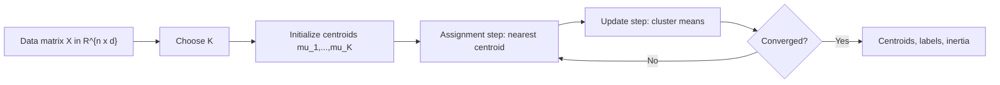
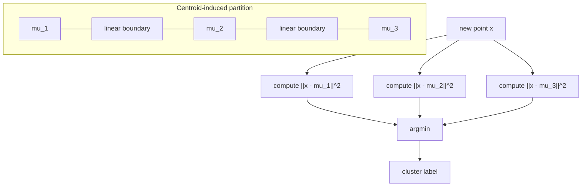
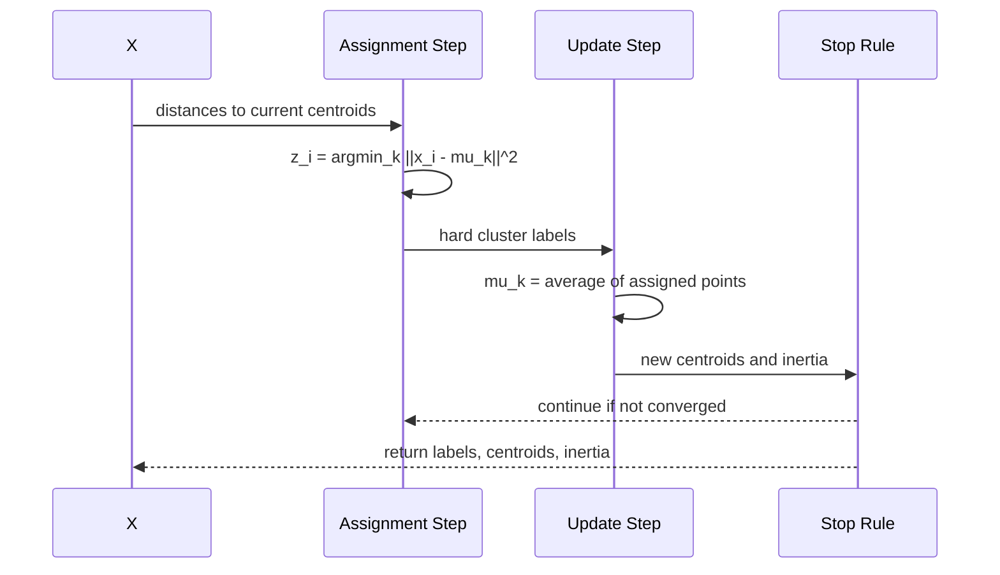

# K-Means Clustering

K-Means is the canonical prototype-based clustering algorithm for Euclidean vector data. Given observations $x_1,\dots,x_n \in \mathbb{R}^d$ and a requested number of clusters $K$, it partitions the data into $K$ groups and represents each group by its centroid. The fitted model is therefore a set of centroids plus an assignment rule: send each new point to the closest centroid.

The algorithm is simple, but the details matter. K-Means optimizes a non-convex objective, is sensitive to initialization and scaling, and encodes a strong geometric bias toward compact, roughly spherical clusters of comparable variance. This chapter treats the original notes as an outline and expands the mathematics, implementation mechanics, and practical failure modes.



## 1. Problem Setup

Let the dataset be

$$
X
=
\{x_i\}_{i=1}^{n},
\qquad
x_i \in \mathbb{R}^{d}.
$$

K-Means seeks:

- A partition of the indices $\{1,\dots,n\}$ into $K$ non-empty clusters $C_1,\dots,C_K$.
- A centroid $\mu_k \in \mathbb{R}^{d}$ for each cluster.

The standard squared Euclidean K-Means objective is

$$
J(C,\mu)
=
\sum_{k=1}^{K}
\sum_{i \in C_k}
\lVert x_i - \mu_k \rVert_2^2.
$$

This quantity is also called within-cluster sum of squares, WCSS, distortion, quantization error, or inertia. In scikit-learn, `KMeans.inertia_` is this objective value after fitting.

Important assumptions encoded by this objective:

- Distance is measured by squared Euclidean distance.
- All features contribute through their numeric scale, so feature scaling changes the solution.
- A cluster is represented by a mean, not a medoid or density mode.
- The objective favors low-variance, convex, roughly isotropic groups.
- $K$ is fixed before optimization.

## 2. Geometry of the Assignment Rule

Given centroids $\mu_1,\dots,\mu_K$, K-Means assigns each point to the nearest centroid:

$$
z_i
=
\arg\min_{1 \leq k \leq K}
\lVert x_i - \mu_k \rVert_2^2.
$$

Here $z_i \in \{1,\dots,K\}$ is the cluster label for $x_i$. Using squared distance instead of distance does not change the nearest centroid because the square root is monotone:

$$
\arg\min_k \lVert x_i-\mu_k\rVert_2
=
\arg\min_k \lVert x_i-\mu_k\rVert_2^2.
$$

The assignment regions form a Voronoi tessellation. Cluster $k$ owns the region

$$
V_k
=
\left\{
x \in \mathbb{R}^{d}
:
\lVert x-\mu_k\rVert_2^2
\leq
\lVert x-\mu_j\rVert_2^2
\ \forall j
\right\}.
$$

The boundary between centroids $\mu_a$ and $\mu_b$ is a hyperplane. Starting from

$$
\lVert x-\mu_a\rVert_2^2
=
\lVert x-\mu_b\rVert_2^2,
$$

expand both sides:

$$
x^\top x - 2x^\top\mu_a + \mu_a^\top\mu_a
=
x^\top x - 2x^\top\mu_b + \mu_b^\top\mu_b.
$$

Cancel $x^\top x$ and rearrange:

$$
2x^\top(\mu_b-\mu_a)
=
\mu_b^\top\mu_b - \mu_a^\top\mu_a.
$$

Therefore the decision boundary is linear in $x$:

$$
x^\top(\mu_b-\mu_a)
=
\frac{1}{2}
\left(
\lVert \mu_b\rVert_2^2
-
\lVert \mu_a\rVert_2^2
\right).
$$

This is why K-Means cannot directly model crescent-shaped, nested, or highly non-convex clusters.



## 3. Deriving the Centroid Update

Assume the assignments $C_1,\dots,C_K$ are fixed. The objective separates over clusters:

$$
J(C,\mu)
=
\sum_{k=1}^{K}
J_k(\mu_k),
\qquad
J_k(\mu_k)
=
\sum_{i \in C_k}
\lVert x_i-\mu_k\rVert_2^2.
$$

For one cluster $C_k$, minimize $J_k$ with respect to $\mu_k$. Expand:

$$
J_k(\mu_k)
=
\sum_{i \in C_k}
(x_i-\mu_k)^\top(x_i-\mu_k).
$$

$$
J_k(\mu_k)
=
\sum_{i \in C_k}
\left(
x_i^\top x_i
-2x_i^\top\mu_k
+\mu_k^\top\mu_k
\right).
$$

Differentiate with respect to $\mu_k$:

$$
\nabla_{\mu_k}J_k
=
\sum_{i \in C_k}
\left(
-2x_i
+2\mu_k
\right).
$$

Let $n_k = |C_k|$. Then

$$
\nabla_{\mu_k}J_k
=
-2\sum_{i \in C_k}x_i
+2n_k\mu_k.
$$

Set the gradient to zero:

$$
-2\sum_{i \in C_k}x_i
+2n_k\mu_k
=
0.
$$

Hence

$$
\mu_k
=
\frac{1}{n_k}
\sum_{i \in C_k}x_i.
$$

So, for squared Euclidean distance, the optimal representative of a fixed cluster is its arithmetic mean.

The Hessian is

$$
\nabla_{\mu_k}^{2}J_k
=
2n_k I_d,
$$

which is positive definite when $n_k > 0$. Therefore the mean is the unique minimizer for a non-empty cluster.

## 4. Lloyd's Algorithm

The standard batch K-Means algorithm is usually Lloyd's algorithm:

1. Initialize $K$ centroids.
2. Assign each point to the closest centroid.
3. Replace each centroid by the mean of its assigned points.
4. Repeat until convergence or a maximum iteration count is reached.

The key property is monotonic descent. With fixed centroids, the assignment step chooses the best cluster for each point and cannot increase $J$. With fixed assignments, the update step chooses the optimal centroid for each cluster and cannot increase $J$. Therefore:

$$
J^{(0)}
\geq
J^{(1)}
\geq
J^{(2)}
\geq
\cdots
\geq
0.
$$

Because there are finitely many possible hard assignments, the algorithm eventually reaches a fixed point if ties are handled deterministically. However, the objective is non-convex in the joint variables $(C,\mu)$, so the fixed point may be a poor local optimum.



## 5. Matrix Form

Let $X \in \mathbb{R}^{n \times d}$ be the data matrix. Define an assignment matrix $R \in \{0,1\}^{n \times K}$:

$$
R_{ik}
=
\begin{cases}
1, & z_i=k,\\
0, & \text{otherwise}.
\end{cases}
$$

Each row has exactly one active entry:

$$
\sum_{k=1}^{K} R_{ik}
=
1.
$$

Let $M \in \mathbb{R}^{K \times d}$ contain centroids as rows. The objective can be written as

$$
J(R,M)
=
\lVert X - RM \rVert_F^2.
$$

For fixed $R$, solve

$$
\min_M \lVert X - RM \rVert_F^2.
$$

The least-squares normal equation is

$$
R^\top R M
=
R^\top X.
$$

Since $R^\top R$ is diagonal with cluster sizes:

$$
R^\top R
=
\operatorname{diag}(n_1,\dots,n_K),
$$

the centroid matrix is

$$
M
=
(R^\top R)^{-1}R^\top X,
$$

provided all clusters are non-empty. Row $k$ of $M$ is exactly the mean of cluster $k$.

This matrix view makes the connection to alternating minimization explicit:

$$
\min_{R \in \mathcal{R}, M}
\lVert X-RM\rVert_F^2,
$$

where $\mathcal{R}$ is the set of one-hot assignment matrices.

## 6. Probabilistic Interpretation

K-Means can be viewed as a limiting case of a Gaussian mixture model with:

- Equal mixing weights, or ignored priors.
- Isotropic covariance matrices.
- Shared variance $\sigma^2 I_d$.
- Hard assignments.
- $\sigma^2 \to 0$.

For a Gaussian component,

$$
p(x_i \mid z_i=k)
=
(2\pi\sigma^2)^{-d/2}
\exp
\left(
-
\frac{1}{2\sigma^2}
\lVert x_i-\mu_k\rVert_2^2
\right).
$$

The negative log-likelihood for hard assignments, up to constants independent of $\mu$, is

$$
\mathcal{L}
=
\frac{1}{2\sigma^2}
\sum_{i=1}^{n}
\lVert x_i-\mu_{z_i}\rVert_2^2.
$$

Minimizing this hard-assignment likelihood is equivalent to minimizing K-Means inertia. This interpretation clarifies the spherical-cluster bias: K-Means is matched to equal-variance isotropic Gaussian-like clusters.

## 7. Worked Example: Two Iterations by Hand

Consider six 2D points:

$$
x_1=(1,1),\quad
x_2=(1.5,2),\quad
x_3=(3,4),
$$

$$
x_4=(5,7),\quad
x_5=(3.5,5),\quad
x_6=(4.5,5).
$$

Let $K=2$ and initialize

$$
\mu_1^{(0)}=(1,1),
\qquad
\mu_2^{(0)}=(5,7).
$$

### 7.1 Assignment Step

Compute squared distances:

| Point | $\lVert x_i-\mu_1^{(0)}\rVert_2^2$ | $\lVert x_i-\mu_2^{(0)}\rVert_2^2$ | Assignment |
| --- | ---: | ---: | --- |
| $(1,1)$ | $0$ | $(1-5)^2+(1-7)^2=52$ | $C_1$ |
| $(1.5,2)$ | $(0.5)^2+1^2=1.25$ | $(-3.5)^2+(-5)^2=37.25$ | $C_1$ |
| $(3,4)$ | $2^2+3^2=13$ | $(-2)^2+(-3)^2=13$ | tie |
| $(5,7)$ | $4^2+6^2=52$ | $0$ | $C_2$ |
| $(3.5,5)$ | $2.5^2+4^2=22.25$ | $(-1.5)^2+(-2)^2=6.25$ | $C_2$ |
| $(4.5,5)$ | $3.5^2+4^2=28.25$ | $(-0.5)^2+(-2)^2=4.25$ | $C_2$ |

Suppose ties are assigned to the smaller index. Then

$$
C_1^{(0)}
=
\{x_1,x_2,x_3\},
\qquad
C_2^{(0)}
=
\{x_4,x_5,x_6\}.
$$

### 7.2 Update Step

The new centroid for cluster 1 is

$$
\mu_1^{(1)}
=
\frac{1}{3}
\left[
(1,1)+(1.5,2)+(3,4)
\right]
=
\left(
\frac{5.5}{3},
\frac{7}{3}
\right)
=
(1.8333,2.3333).
$$

The new centroid for cluster 2 is

$$
\mu_2^{(1)}
=
\frac{1}{3}
\left[
(5,7)+(3.5,5)+(4.5,5)
\right]
=
\left(
\frac{13}{3},
\frac{17}{3}
\right)
=
(4.3333,5.6667).
$$

### 7.3 Inertia After Update

Cluster 1 contribution:

$$
\begin{aligned}
\lVert (1,1)-(1.8333,2.3333)\rVert_2^2
&\approx
2.4722,\\
\lVert (1.5,2)-(1.8333,2.3333)\rVert_2^2
&\approx
0.2222,\\
\lVert (3,4)-(1.8333,2.3333)\rVert_2^2
&\approx
4.1389.
\end{aligned}
$$

So

$$
J_1
\approx
2.4722+0.2222+4.1389
=
6.8333.
$$

Cluster 2 contribution:

$$
\begin{aligned}
\lVert (5,7)-(4.3333,5.6667)\rVert_2^2
&\approx
2.2222,\\
\lVert (3.5,5)-(4.3333,5.6667)\rVert_2^2
&\approx
1.1389,\\
\lVert (4.5,5)-(4.3333,5.6667)\rVert_2^2
&\approx
0.4722.
\end{aligned}
$$

Thus

$$
J_2
\approx
2.2222+1.1389+0.4722
=
3.8333.
$$

Total inertia:

$$
J
\approx
6.8333+3.8333
=
10.6666.
$$

One more assignment step with $\mu_1^{(1)}$ and $\mu_2^{(1)}$ gives the same assignments, so the algorithm has converged for this initialization.

## 8. K-Means++ Initialization

Randomly choosing $K$ points as centroids can put several initial centroids in the same natural group. K-Means++ reduces this risk by sampling later centroids with probability proportional to the squared distance from the nearest already chosen centroid.

Let $D(x_i)^2$ be the squared distance from $x_i$ to its closest selected centroid:

$$
D(x_i)^2
=
\min_{\mu \in \mathcal{M}}
\lVert x_i-\mu\rVert_2^2,
$$

where $\mathcal{M}$ is the set of centroids already chosen.

The K-Means++ procedure:

1. Choose the first centroid uniformly at random from the data points.
2. For each point, compute $D(x_i)^2$.
3. Sample the next centroid from the data with probability

$$
p_i
=
\frac{D(x_i)^2}
{\sum_{j=1}^{n}D(x_j)^2}.
$$

4. Repeat until $K$ centroids are chosen.
5. Run standard Lloyd iterations.

The intuition is that points far from existing centers are more likely to become centers. This spreads the initial centers across the dataset while preserving randomness.


Arthur and Vassilvitskii showed that K-Means++ seeding gives an expected $O(\log K)$ approximation guarantee relative to the optimal K-Means objective before Lloyd refinement. In practice, it also often reduces the number of Lloyd iterations and improves stability across random seeds.

### Greedy K-Means++ in scikit-learn

scikit-learn's `KMeans(init="k-means++")` uses a greedy variant. At each seeding step it draws multiple candidate centers according to the K-Means++ distribution and keeps the candidate that most reduces inertia. This is still K-Means++-style seeding, but it is not the minimal one-candidate version in the original paper.

## 9. Choosing K

K-Means requires $K$ before fitting. There is no universally correct $K$ because clustering is partly an inductive bias and partly an application decision.

### 9.1 Elbow Method

Fit K-Means for several values of $K$ and plot inertia:

$$
J_K
=
\sum_{k=1}^{K}
\sum_{i \in C_k}
\lVert x_i-\mu_k\rVert_2^2.
$$

As $K$ increases, $J_K$ is non-increasing. A larger $K$ can always emulate a smaller $K$ by leaving extra centroids unused conceptually, and in practical non-empty clustering it can split clusters to reduce or maintain WCSS.

The elbow heuristic chooses a value of $K$ where the marginal decrease becomes small:

$$
\Delta_K
=
J_{K-1}-J_K.
$$

If $\Delta_K$ sharply drops after $K=3$, then $K=3$ is a plausible choice.

Example:

| $K$ | Inertia $J_K$ | Marginal improvement $J_{K-1}-J_K$ |
| ---: | ---: | ---: |
| 1 | $1000$ | - |
| 2 | $600$ | $400$ |
| 3 | $300$ | $300$ |
| 4 | $200$ | $100$ |
| 5 | $180$ | $20$ |
| 6 | $170$ | $10$ |

The elbow is around $K=3$ or $K=4$, depending on the downstream cost of extra clusters.

### 9.2 Silhouette Score

For point $i$, let $a_i$ be its average distance to points in its own cluster and $b_i$ be the smallest average distance to points in another cluster:

$$
a_i
=
\frac{1}{|C_{z_i}|-1}
\sum_{\substack{j \in C_{z_i}\\j\neq i}}
\lVert x_i-x_j\rVert_2.
$$

$$
b_i
=
\min_{\ell \neq z_i}
\frac{1}{|C_{\ell}|}
\sum_{j \in C_{\ell}}
\lVert x_i-x_j\rVert_2.
$$

The silhouette coefficient is

$$
s_i
=
\frac{b_i-a_i}
{\max(a_i,b_i)}.
$$

It lies in $[-1,1]$ when distances are non-negative:

- $s_i \approx 1$: well matched to its own cluster.
- $s_i \approx 0$: near a boundary.
- $s_i < 0$: closer on average to another cluster.

The mean silhouette can guide $K$, but it has its own geometric bias toward separated convex clusters.

### 9.3 Gap Statistic

The gap statistic compares observed inertia to inertia under a null reference distribution:

$$
\operatorname{Gap}(K)
=
\mathbb{E}_{X^\ast}
\left[
\log J_K^\ast
\right]
-
\log J_K.
$$

Here $X^\ast$ is sampled from a reference distribution with no cluster structure, often uniform over the data bounding box or a PCA-aligned box. Larger gap means the observed clustering is much better than random structure.

### 9.4 Stability-Based Selection

Run K-Means on bootstrap samples or perturbations and measure how stable assignments are. If $K$ is meaningful, nearby samples should produce similar partitions. Stability can be measured using adjusted Rand index, normalized mutual information, or assignment consistency after centroid matching.

## 10. From-Scratch Python Implementation

The implementation below is intentionally explicit. It supports random and K-Means++ initialization, multiple restarts, deterministic seeding, empty-cluster handling, and both inertia and centroid-shift stopping.

```python
import numpy as np


def squared_euclidean_distances(X, C):
    """
    Compute all squared distances between rows of X and rows of C.

    X: shape (n_samples, n_features)
    C: shape (n_clusters, n_features)
    returns: shape (n_samples, n_clusters)
    """
    X = np.asarray(X, dtype=np.float64)
    C = np.asarray(C, dtype=np.float64)

    # ||x - c||^2 = ||x||^2 + ||c||^2 - 2 x^T c
    X_norm = np.sum(X * X, axis=1, keepdims=True)
    C_norm = np.sum(C * C, axis=1)[None, :]
    distances = X_norm + C_norm - 2.0 * X @ C.T

    # Roundoff can produce tiny negative values such as -1e-12.
    return np.maximum(distances, 0.0)


def init_random(X, k, rng):
    n_samples = X.shape[0]
    indices = rng.choice(n_samples, size=k, replace=False)
    return X[indices].copy()


def init_kmeans_plus_plus(X, k, rng, n_local_trials=None):
    """
    K-Means++ initialization with optional greedy local trials.

    n_local_trials=None gives a common greedy default similar in spirit to
    scikit-learn: 2 + log(k) candidates per center.
    n_local_trials=1 gives the original one-candidate sampling procedure.
    """
    n_samples, n_features = X.shape
    centers = np.empty((k, n_features), dtype=np.float64)

    first = rng.integers(n_samples)
    centers[0] = X[first]

    closest_dist_sq = squared_euclidean_distances(X, centers[[0]]).ravel()
    current_potential = closest_dist_sq.sum()

    if n_local_trials is None:
        n_local_trials = 2 + int(np.log(k))

    for center_id in range(1, k):
        if current_potential <= 0.0:
            # All points are identical to an existing center.
            # Fill remaining centers by sampling unique points if possible.
            centers[center_id:] = init_random(X, k - center_id, rng)
            break

        probs = closest_dist_sq / current_potential
        candidate_ids = rng.choice(
            n_samples,
            size=n_local_trials,
            replace=True,
            p=probs,
        )

        best_candidate = None
        best_dist_sq = None
        best_potential = np.inf

        for candidate_id in candidate_ids:
            candidate = X[[candidate_id]]
            candidate_dist_sq = squared_euclidean_distances(X, candidate).ravel()
            new_dist_sq = np.minimum(closest_dist_sq, candidate_dist_sq)
            new_potential = new_dist_sq.sum()

            if new_potential < best_potential:
                best_candidate = candidate_id
                best_dist_sq = new_dist_sq
                best_potential = new_potential

        centers[center_id] = X[best_candidate]
        closest_dist_sq = best_dist_sq
        current_potential = best_potential

    return centers


def recompute_centers(X, labels, k, old_centers, rng):
    centers = np.empty_like(old_centers)
    counts = np.bincount(labels, minlength=k)

    for cluster_id in range(k):
        mask = labels == cluster_id

        if counts[cluster_id] > 0:
            centers[cluster_id] = X[mask].mean(axis=0)
        else:
            # Empty cluster: move it to the point currently farthest from
            # its assigned centroid. This usually decreases large errors.
            distances = squared_euclidean_distances(X, old_centers)
            min_distances = distances[np.arange(X.shape[0]), labels]
            farthest = np.argmax(min_distances)
            centers[cluster_id] = X[farthest]

    return centers


def kmeans_single_run(
    X,
    k,
    init="k-means++",
    max_iter=300,
    tol=1e-4,
    random_state=None,
):
    X = np.asarray(X, dtype=np.float64)

    if X.ndim != 2:
        raise ValueError("X must be a 2D array")

    n_samples, n_features = X.shape

    if not 1 <= k <= n_samples:
        raise ValueError("k must satisfy 1 <= k <= n_samples")

    rng = np.random.default_rng(random_state)

    if init == "random":
        centers = init_random(X, k, rng)
    elif init == "k-means++":
        centers = init_kmeans_plus_plus(X, k, rng)
    else:
        centers = np.asarray(init, dtype=np.float64).copy()
        if centers.shape != (k, n_features):
            raise ValueError("custom init must have shape (k, n_features)")

    previous_inertia = None

    for iteration in range(1, max_iter + 1):
        distances = squared_euclidean_distances(X, centers)
        labels = np.argmin(distances, axis=1)
        inertia = distances[np.arange(n_samples), labels].sum()

        new_centers = recompute_centers(X, labels, k, centers, rng)
        center_shift_sq = np.sum((new_centers - centers) ** 2)

        centers = new_centers

        if previous_inertia is not None and (
            abs(previous_inertia - inertia) <= tol * max(previous_inertia, 1.0)
        ):
            break

        if center_shift_sq <= tol:
            break

        previous_inertia = inertia

    distances = squared_euclidean_distances(X, centers)
    labels = np.argmin(distances, axis=1)
    inertia = distances[np.arange(n_samples), labels].sum()

    return {
        "cluster_centers": centers,
        "labels": labels,
        "inertia": inertia,
        "n_iter": iteration,
    }


def kmeans(
    X,
    k,
    init="k-means++",
    n_init=10,
    max_iter=300,
    tol=1e-4,
    random_state=None,
):
    rng = np.random.default_rng(random_state)
    best = None

    for _ in range(n_init):
        seed = rng.integers(np.iinfo(np.int32).max)
        result = kmeans_single_run(
            X,
            k,
            init=init,
            max_iter=max_iter,
            tol=tol,
            random_state=seed,
        )

        if best is None or result["inertia"] < best["inertia"]:
            best = result

    return best
```

### Example Run

```python
X = np.array(
    [
        [1.0, 1.0],
        [1.5, 2.0],
        [3.0, 4.0],
        [5.0, 7.0],
        [3.5, 5.0],
        [4.5, 5.0],
    ]
)

result = kmeans(X, k=2, init="k-means++", n_init=20, random_state=0)

print(result["cluster_centers"])
print(result["labels"])
print(result["inertia"])
print(result["n_iter"])
```

Expected centroids may be permuted because cluster labels are arbitrary. A solution equivalent to the hand calculation is:

$$
\mu_1
\approx
(1.8333,2.3333),
\qquad
\mu_2
\approx
(4.3333,5.6667).
$$

## 11. Implementation with scikit-learn

```python
import numpy as np
from sklearn.cluster import KMeans
from sklearn.preprocessing import StandardScaler
from sklearn.pipeline import make_pipeline


X = np.array(
    [
        [1.0, 1.0],
        [1.5, 2.0],
        [3.0, 4.0],
        [5.0, 7.0],
        [3.5, 5.0],
        [4.5, 5.0],
    ]
)

kmeans_model = KMeans(
    n_clusters=2,
    init="k-means++",
    n_init="auto",
    max_iter=300,
    tol=1e-4,
    random_state=0,
    algorithm="lloyd",
)

labels = kmeans_model.fit_predict(X)

print(kmeans_model.cluster_centers_)
print(labels)
print(kmeans_model.inertia_)
print(kmeans_model.n_iter_)
```

For real tabular data, scaling is often essential:

```python
model = make_pipeline(
    StandardScaler(),
    KMeans(
        n_clusters=5,
        init="k-means++",
        n_init="auto",
        random_state=0,
    ),
)

labels = model.fit_predict(X)
```

### What `fit` Does Internally

At a high level, `KMeans.fit(X)`:

1. Validates and converts the input array.
2. Optionally centers data internally for more accurate distance computations.
3. Initializes centroids using `init`.
4. Runs Lloyd iterations or the Elkan variant depending on `algorithm`.
5. Repeats the whole run `n_init` times when requested.
6. Keeps the run with the lowest inertia.
7. Stores `cluster_centers_`, `labels_`, `inertia_`, and `n_iter_`.

The major vectorized distance identity is:

$$
\lVert x_i-\mu_k\rVert_2^2
=
\lVert x_i\rVert_2^2
+\lVert \mu_k\rVert_2^2
-2x_i^\top\mu_k.
$$

This avoids an explicit Python loop over all pairs and maps the expensive part to matrix multiplication.

### Lloyd vs Elkan

The Lloyd variant computes distances from each point to each centroid in each iteration. Elkan's algorithm uses triangle inequality bounds to avoid some distance computations:

$$
\lVert x-\mu_b\rVert_2
\geq
\lVert \mu_a-\mu_b\rVert_2
-
\lVert x-\mu_a\rVert_2.
$$

If a point is already known to be close enough to its assigned centroid, many competing centroids can be ruled out without computing exact distances. Elkan can be faster for well-separated dense clusters, but it uses extra memory for bounds and is less attractive for sparse data or very high $K$.

## 12. Mini-Batch K-Means

Mini-Batch K-Means approximates batch K-Means using small random batches. For a sampled point $x_i$ assigned to cluster $k$, update the centroid with an online mean:

$$
\mu_k^{(t+1)}
=
(1-\eta_{k,t})\mu_k^{(t)}
+\eta_{k,t}x_i.
$$

If $c_{k,t}$ is the number of updates made to centroid $k$, a common learning rate is

$$
\eta_{k,t}
=
\frac{1}{c_{k,t}}.
$$

For a batch $B_t$, assign all points in the batch and update affected centroids. This reduces per-iteration cost from all $n$ samples to a batch size $b$, which is useful when $n$ is large or streaming.

Tradeoffs:

- Much faster wall-clock time for large datasets.
- Usually slightly worse final inertia than full batch K-Means.
- Sensitive to batch size, initialization, and data order.
- Naturally supports incremental updates.

```python
from sklearn.cluster import MiniBatchKMeans

mini = MiniBatchKMeans(
    n_clusters=100,
    batch_size=4096,
    init="k-means++",
    n_init="auto",
    random_state=0,
)

labels = mini.fit_predict(X_large)
```

## 13. Complexity

Let:

- $n$ be the number of samples.
- $d$ be the number of features.
- $K$ be the number of clusters.
- $T$ be the number of Lloyd iterations.
- $R$ be the number of restarts.

For standard dense Lloyd K-Means:

$$
\text{time}
=
O(RTnKd).
$$

The assignment step dominates:

$$
O(nKd)
$$

per iteration.

The centroid update requires accumulating sums:

$$
O(nd)
$$

plus centroid normalization:

$$
O(Kd).
$$

Memory:

- Data matrix: $O(nd)$.
- Centroids: $O(Kd)$.
- Labels: $O(n)$.
- Full distance matrix if materialized: $O(nK)$.

To reduce memory, production implementations often compute distances in chunks instead of storing all $nK$ distances at once.

K-Means++ initialization costs:

$$
O(nKd)
$$

for the original one-trial version, and

$$
O(nKdL)
$$

if $L$ local candidates are evaluated per center in a greedy variant.

## 14. Numerical Stability and Performance Details

### 14.1 Squared Distance Cancellation

The identity

$$
\lVert x-c\rVert_2^2
=
\lVert x\rVert_2^2
+\lVert c\rVert_2^2
-2x^\top c
$$

is fast but can produce small negative values due to floating-point roundoff. Implementations commonly clamp:

$$
d_{ik}^2
\leftarrow
\max(d_{ik}^2,0).
$$

This is a numerical repair, not a mathematical change.

### 14.2 Feature Scaling

If one feature has scale $10^6$ and another has scale $1$, the large-scale feature dominates Euclidean distance:

$$
\lVert x_i-x_j\rVert_2^2
=
\sum_{m=1}^{d}
(x_{im}-x_{jm})^2.
$$

Standardization changes the metric from raw Euclidean distance to Euclidean distance in standardized coordinates:

$$
\tilde{x}_{im}
=
\frac{x_{im}-\hat{\mu}_m}{\hat{\sigma}_m}.
$$

This is equivalent to a diagonal Mahalanobis distance in the original coordinates:

$$
\lVert \tilde{x}_i-\tilde{x}_j\rVert_2^2
=
\sum_{m=1}^{d}
\frac{(x_{im}-x_{jm})^2}{\hat{\sigma}_m^2}.
$$

### 14.3 Empty Clusters

An empty cluster means $n_k=0$, so

$$
\mu_k
=
\frac{1}{n_k}
\sum_{i \in C_k}x_i
$$

is undefined. Common strategies:

- Reinitialize the empty centroid to a random data point.
- Move it to the point with largest current assignment error.
- Split the highest-variance cluster.
- Reduce $K$ if empty clusters repeatedly occur.

The farthest-point strategy often repairs the cluster while targeting a large contribution to inertia.

### 14.4 Duplicate Points

If many rows are identical and $K$ exceeds the number of distinct points, some centroids must duplicate or become empty. A robust implementation should either reject this configuration or handle repeated centers gracefully.

### 14.5 Outliers

Because the objective squares distances, outliers can dominate inertia:

$$
\lVert x-\mu\rVert_2^2
$$

grows quadratically with distance. A single extreme point can pull a centroid far away from the dense part of a cluster. Alternatives include K-Medoids, trimmed K-Means, robust scaling, outlier removal, or density-based clustering.

### 14.6 Label Non-Identifiability

Cluster labels are arbitrary. If two runs produce labels swapped between cluster 0 and cluster 1, the clusterings are equivalent. Never compare K-Means labels directly across runs without alignment or a label-invariant metric.

## 15. Edge Cases and Pitfalls

| Issue | Symptom | Practical fix |
| --- | --- | --- |
| Unscaled features | Clusters reflect units rather than structure | Standardize, whiten, or use a meaningful metric |
| Bad initialization | High inertia, unstable labels | Use K-Means++, multiple restarts |
| Wrong $K$ | Over-merged or fragmented clusters | Use elbow, silhouette, stability, domain constraints |
| Non-convex clusters | Poor geometric separation | Use spectral clustering, DBSCAN, HDBSCAN, kernel methods |
| Unequal densities | Small dense clusters swallowed by broad clusters | Try GMMs, density methods, or reweighting |
| Outliers | Centroids pulled away | Robust preprocessing or K-Medoids |
| High dimensionality | Distances concentrate | PCA, feature selection, representation learning |
| Categorical features | Means are not meaningful | K-Modes, Gower distance, embeddings |
| Missing values | Distance undefined | Impute, model missingness, or use algorithms supporting missing values |

## 16. Image Compression Example

K-Means can quantize colors. Treat each pixel as an RGB vector:

$$
x_i
=
(R_i,G_i,B_i)
\in
\mathbb{R}^{3}.
$$

Fit K-Means with $K$ colors. Replace every pixel by its centroid:

$$
\hat{x}_i
=
\mu_{z_i}.
$$

The compressed image stores:

- A palette of $K$ RGB centroids.
- One cluster index per pixel.

```python
import numpy as np
from sklearn.cluster import MiniBatchKMeans
from PIL import Image


image = Image.open("input.png").convert("RGB")
pixels = np.asarray(image, dtype=np.float64) / 255.0
h, w, channels = pixels.shape

X_pixels = pixels.reshape(-1, channels)

quantizer = MiniBatchKMeans(
    n_clusters=32,
    batch_size=8192,
    n_init="auto",
    random_state=0,
)

labels = quantizer.fit_predict(X_pixels)
palette = quantizer.cluster_centers_

compressed_pixels = palette[labels].reshape(h, w, channels)
compressed_pixels = np.clip(compressed_pixels * 255.0, 0, 255).astype(np.uint8)

Image.fromarray(compressed_pixels).save("compressed.png")
```

The objective here minimizes squared RGB error, not perceptual color difference. For perceptual quality, transform to a perceptually better color space such as CIELAB before clustering.

## 17. Relation to Vector Quantization and PCA

K-Means is a vector quantization method. It replaces a continuous vector $x$ by a codeword $\mu_{z(x)}$ from a finite codebook:

$$
q(x)
=
\mu_{z(x)}.
$$

The quantization distortion is

$$
\mathbb{E}
\left[
\lVert X-q(X)\rVert_2^2
\right],
$$

estimated empirically by K-Means inertia divided by $n$.

There is also a relationship to PCA. PCA finds a low-dimensional linear subspace minimizing squared reconstruction error. K-Means finds a finite set of points minimizing squared reconstruction error:

$$
x_i
\approx
\mu_{z_i}.
$$

PCA gives linear continuous codes; K-Means gives discrete nearest-codeword assignments.

## 18. Relation to EM for Gaussian Mixtures

Gaussian mixture EM alternates between:

1. Soft responsibility computation:

$$
\gamma_{ik}
=
\frac{
\pi_k \mathcal{N}(x_i;\mu_k,\Sigma_k)
}{
\sum_{\ell=1}^{K}
\pi_\ell \mathcal{N}(x_i;\mu_\ell,\Sigma_\ell)
}.
$$

2. Parameter updates:

$$
\mu_k
=
\frac{
\sum_{i=1}^{n}\gamma_{ik}x_i
}{
\sum_{i=1}^{n}\gamma_{ik}
}.
$$

K-Means replaces soft responsibilities with hard one-hot assignments:

$$
\gamma_{ik}
\in
\{0,1\}.
$$

As the shared isotropic variance $\sigma^2$ approaches zero, the largest Gaussian density corresponds to the nearest centroid, and soft responsibilities collapse toward hard assignments.

## 19. Variants and Alternatives

### 19.1 K-Medoids

K-Medoids represents each cluster by an actual data point:

$$
m_k
\in
\{x_i\}_{i=1}^{n}.
$$

It can use arbitrary pairwise distances and is more robust to outliers, but it is typically more expensive than K-Means.

### 19.2 Kernel K-Means

Kernel K-Means performs K-Means in an implicit feature space $\phi(x)$:

$$
\lVert \phi(x)-\mu_k\rVert_{\mathcal{H}}^2.
$$

Distances can be expressed using kernel evaluations:

$$
K(x_i,x_j)
=
\langle \phi(x_i),\phi(x_j)\rangle.
$$

This allows non-linear cluster boundaries but costs memory and time for kernel matrices.

### 19.3 Spectral Clustering

Spectral clustering embeds points using eigenvectors of a graph Laplacian, then runs K-Means in that embedding. It can separate non-convex clusters when the graph captures neighborhood structure.

### 19.4 DBSCAN and HDBSCAN

Density-based clustering groups high-density regions and labels sparse points as noise. These methods do not require spherical clusters and can discover non-convex shapes, but they depend strongly on density parameters and distance metrics.

## 20. Practical Checklist

Before fitting K-Means:

1. Decide whether Euclidean distance in the chosen feature space is meaningful.
2. Scale or transform features.
3. Remove or handle outliers if they should not define clusters.
4. Try multiple $K$ values.
5. Use K-Means++ and multiple restarts.
6. Inspect inertia, silhouette, cluster sizes, and domain-level interpretability.
7. Test stability across seeds and data perturbations.
8. Remember that labels are arbitrary and clusters are descriptive, not causal.

## 21. Complete Library Workflow

```python
import numpy as np
from sklearn.cluster import KMeans
from sklearn.metrics import silhouette_score
from sklearn.pipeline import make_pipeline
from sklearn.preprocessing import StandardScaler


def fit_kmeans_grid(X, k_values, random_state=0):
    rows = []

    for k in k_values:
        model = make_pipeline(
            StandardScaler(),
            KMeans(
                n_clusters=k,
                init="k-means++",
                n_init="auto",
                max_iter=300,
                tol=1e-4,
                random_state=random_state,
            ),
        )

        labels = model.fit_predict(X)
        kmeans_step = model.named_steps["kmeans"]

        if len(np.unique(labels)) > 1:
            score = silhouette_score(
                model.named_steps["standardscaler"].transform(X),
                labels,
            )
        else:
            score = np.nan

        rows.append(
            {
                "k": k,
                "inertia": kmeans_step.inertia_,
                "silhouette": score,
                "n_iter": kmeans_step.n_iter_,
                "cluster_sizes": np.bincount(labels, minlength=k),
            }
        )

    return rows
```

This workflow deliberately computes silhouette in the same scaled feature space used by K-Means. Computing diagnostics in a different representation can lead to contradictory conclusions.

## 22. References and Deeper Reading

- J. MacQueen, "Some Methods for Classification and Analysis of Multivariate Observations," Proceedings of the Fifth Berkeley Symposium on Mathematical Statistics and Probability, 1967: https://projecteuclid.org/download/pdf_1/euclid.bsmsp/1200512992.
- S. Lloyd, "Least Squares Quantization in PCM," IEEE Transactions on Information Theory, 1982: https://ieeexplore.ieee.org/document/1056489.
- D. Arthur and S. Vassilvitskii, "k-means++: The Advantages of Careful Seeding," SODA, 2007: https://theory.stanford.edu/~sergei/papers/kMeansPP-soda.pdf.
- scikit-learn documentation: `sklearn.cluster.KMeans`: https://scikit-learn.org/stable/modules/generated/sklearn.cluster.KMeans.html.
- scikit-learn User Guide: clustering and K-Means: https://scikit-learn.org/stable/modules/clustering.html#k-means.
- C. M. Bishop, *Pattern Recognition and Machine Learning*, sections on mixture models and EM.
- T. Hastie, R. Tibshirani, and J. Friedman, *The Elements of Statistical Learning*, clustering chapters.

## 23. Interview Summary

K-Means partitions $n$ points into $K$ clusters by alternating between nearest-centroid assignment and centroid recomputation. It minimizes within-cluster squared Euclidean distance:

$$
\sum_{k=1}^{K}
\sum_{i \in C_k}
\lVert x_i-\mu_k\rVert_2^2.
$$

For fixed assignments, the optimal centroid is the arithmetic mean. For fixed centroids, the optimal assignment is the nearest centroid. Alternating these two steps monotonically decreases inertia but only guarantees convergence to a local optimum. K-Means++ improves initialization by sampling new centers with probability proportional to squared distance from the nearest existing center. In practice, the most important issues are feature scaling, choice of $K$, initialization, outliers, empty clusters, and the mismatch between K-Means' spherical-cluster bias and real data geometry.
