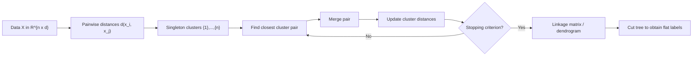
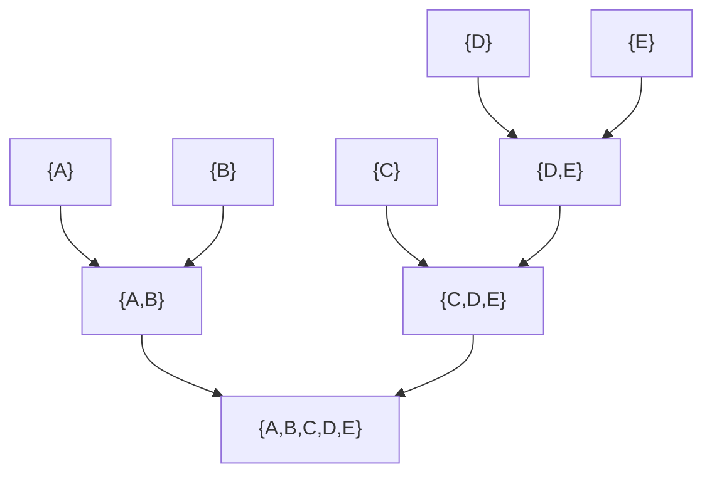
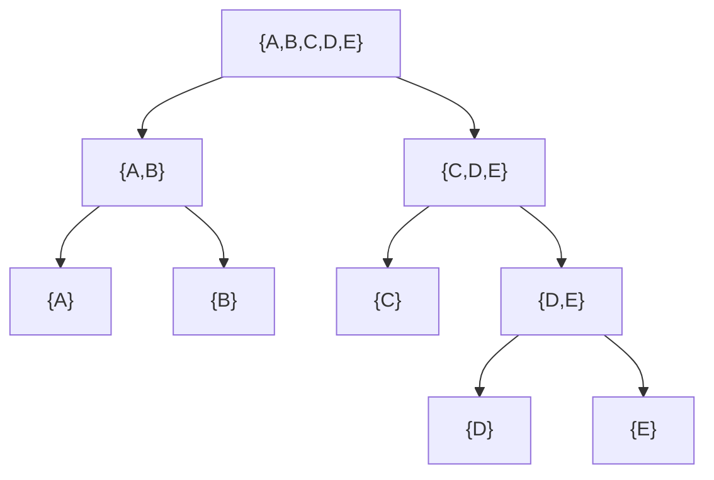
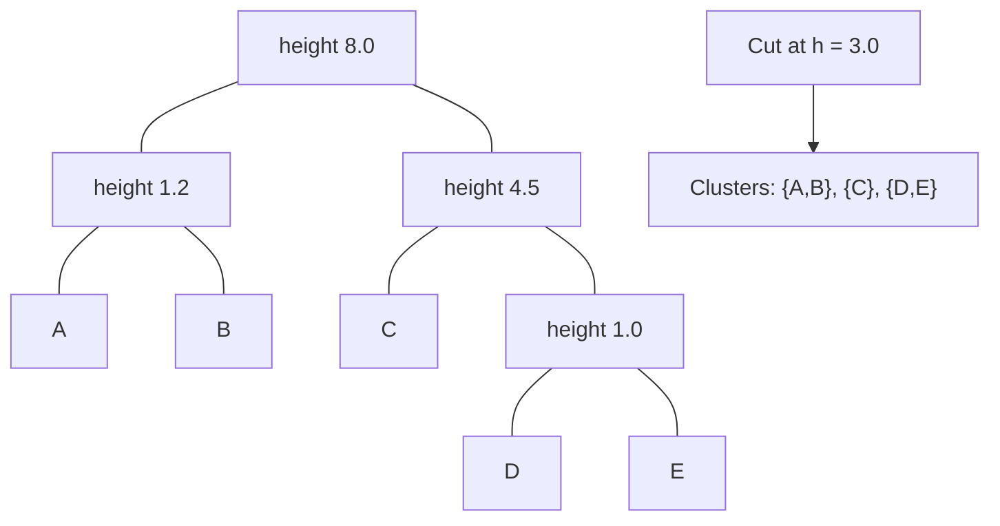
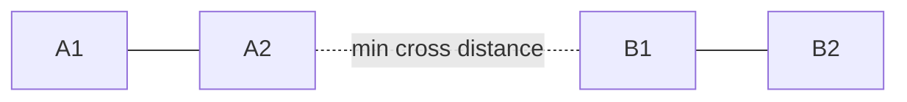

# Hierarchical Clustering

Hierarchical clustering constructs a nested family of clusters rather than a single flat partition. The output is a binary merge tree for agglomerative methods or a split tree for divisive methods. A horizontal cut through this tree gives an ordinary clustering with a chosen number of groups or a chosen dissimilarity threshold.

The practical value is that the hierarchy exposes cluster structure at multiple resolutions. The practical cost is that exact hierarchical clustering usually requires at least the pairwise distance matrix, so memory and time become limiting before many centroid-based methods such as k-means.



## 1. Mathematical Setup

Let the observations be

$$
X
=
\{x_1,\dots,x_n\},
\qquad
x_i \in \mathbb{R}^{d}.
$$

A flat clustering is a partition

$$
\mathcal{P}
=
\{C_1,\dots,C_K\},
$$

where every cluster is non-empty, clusters are disjoint, and they cover all sample indices:

$$
C_a \cap C_b = \varnothing
\quad
\text{for } a \neq b,
\qquad
\bigcup_{k=1}^{K} C_k
=
\{1,\dots,n\}.
$$

Agglomerative hierarchical clustering produces a sequence of partitions

$$
\mathcal{P}_n,\mathcal{P}_{n-1},\dots,\mathcal{P}_1,
$$

where $\mathcal{P}_m$ contains $m$ clusters. Initially,

$$
\mathcal{P}_n
=
\{\{1\},\{2\},\dots,\{n\}\}.
$$

At each step, two clusters $A$ and $B$ are selected and replaced by their union:

$$
\mathcal{P}_{m-1}
=
\left(
\mathcal{P}_{m}
\setminus
\{A,B\}
\right)
\cup
\{A \cup B\}.
$$

The selection rule is

$$
(A^\star,B^\star)
=
\arg\min_{A \neq B}
D(A,B),
$$

where $D(A,B)$ is a cluster-level dissimilarity. The point-level distance $d(x_i,x_j)$ is not enough by itself; the linkage criterion defines how point distances are lifted to distances between sets.

## 2. Agglomerative Hierarchical Clustering

Agglomerative hierarchical clustering, abbreviated AHC, is the bottom-up version. It is the default interpretation of "hierarchical clustering" in most ML libraries and interviews.

### 2.1 Step-by-Step Execution

Given a point metric $d$ and linkage $D$:

1. Start with $n$ clusters, one per point.
2. Compute all pairwise cluster dissimilarities. For singleton clusters,

$$
D(\{i\},\{j\})
=
d(x_i,x_j).
$$

3. Select the closest pair:

$$
(A^\star,B^\star)
=
\arg\min_{A \neq B}
D(A,B).
$$

4. Merge:

$$
U
=
A^\star \cup B^\star.
$$

5. Compute $D(U,C)$ for every remaining cluster $C$.
6. Store the merge as an internal tree node with height $D(A^\star,B^\star)$.
7. Repeat until there is one cluster or until the required number of clusters is reached.



### 2.2 Greedy Irreversibility

AHC is greedy. Once $A$ and $B$ are merged, the algorithm never later splits $A \cup B$. This makes the method interpretable and deterministic under a fixed distance, linkage, and tie-breaking rule, but it also means early noisy merges can contaminate the entire upper tree.

The greedy objective is local:

$$
\min_{A \neq B}
D(A,B)
\quad
\text{at the current step}.
$$

It is not generally equivalent to optimizing a global clustering objective over all possible dendrograms. Ward linkage is the important exception in the sense that each greedy step minimizes the immediate increase in within-cluster sum of squares, but even Ward does not solve the globally optimal $K$-means objective for every $K$.

## 3. Divisive Hierarchical Clustering

Divisive hierarchical clustering is the top-down counterpart:

1. Start with all points in one cluster.
2. Choose a cluster to split.
3. Split it into two subclusters.
4. Repeat until singleton clusters or a stopping rule.



Divisive methods need a rule for selecting which cluster to split and a binary partitioning method for performing the split. Common choices include:

- Split the cluster with largest diameter.
- Split the cluster with largest within-cluster sum of squares.
- Use $2$-means recursively inside the chosen cluster.
- Use spectral bisection on a similarity graph.

Divisive methods can be more expensive than agglomerative methods because an exact search over all binary splits is combinatorial. In practice, divisive clustering is usually implemented with a heuristic splitter.

## 4. Dendrogram Semantics

A dendrogram is a visualization of the merge tree. It records:

- Which clusters were merged.
- The order of merges.
- The merge height.
- The flat clustering induced by every horizontal cut.

If we cut the dendrogram at height $h$, all merges with height at most $h$ are accepted, while merges above $h$ are rejected. The connected components below the cut become clusters.



The common largest vertical gap heuristic cuts through a range of heights with no merges. It is a visual stability heuristic:

$$
h^\star
\in
\arg\max_{r}
\left(
h_{r+1} - h_r
\right),
$$

where $h_r$ are sorted merge heights. A large gap suggests a scale separation: many local merges happened below the gap, and the next merge joins comparatively distant structures.

This heuristic can fail when:

- The linkage has dendrogram inversions.
- Cluster densities vary substantially.
- Distances are poorly scaled.
- The data has no hierarchical structure.
- Ties or near-ties make merge order unstable.

## 5. Point-Level Distance Metrics

The metric $d(x,y)$ compares individual observations. Linkage then turns point distances into cluster distances.

### 5.1 Euclidean Distance

For $x,y \in \mathbb{R}^{d}$,

$$
d_2(x,y)
=
\lVert x-y\rVert_2
=
\sqrt{
\sum_{\ell=1}^{d}
(x_{\ell}-y_{\ell})^2
}.
$$

Euclidean distance is appropriate when feature axes are comparable, continuous, and geometrically meaningful. Ward, centroid, and median linkage are fundamentally Euclidean methods because their update rules depend on centroids and squared Euclidean geometry.

### 5.2 Squared Euclidean Distance

Squared Euclidean distance is

$$
d_2^2(x,y)
=
\lVert x-y\rVert_2^2
=
\sum_{\ell=1}^{d}
(x_{\ell}-y_{\ell})^2.
$$

It avoids the square root and appears naturally in variance decompositions. It is not a metric because it violates the triangle inequality, but it is often the right quantity inside Ward's derivation.

### 5.3 Manhattan Distance

The Manhattan distance is

$$
d_1(x,y)
=
\lVert x-y\rVert_1
=
\sum_{\ell=1}^{d}
|x_{\ell}-y_{\ell}|.
$$

It is less dominated by a single large coordinate difference than squared Euclidean distance. It is often useful for sparse, count-like, or grid-like data.

### 5.4 Minkowski Distance

For $p \geq 1$,

$$
d_p(x,y)
=
\left(
\sum_{\ell=1}^{d}
|x_{\ell}-y_{\ell}|^p
\right)^{1/p}.
$$

Special cases:

$$
d_1(x,y)
=
\text{Manhattan distance},
\qquad
d_2(x,y)
=
\text{Euclidean distance}.
$$

As $p$ increases, the largest coordinate deviations dominate more strongly.

### 5.5 Cosine Distance

For nonzero vectors $x$ and $y$,

$$
\operatorname{cosine\_distance}(x,y)
=
1
-
\frac{x^\top y}{\lVert x\rVert_2 \lVert y\rVert_2}.
$$

Cosine distance is common for text vectors and embeddings where direction matters more than magnitude. It is usually paired with average, complete, or single linkage, not Ward linkage.

## 6. Linkage Criteria

Let $A$ and $B$ be clusters containing indices. Define

$$
|A|
=
\text{number of points in } A.
$$

The linkage criterion defines $D(A,B)$.

### 6.1 Single Linkage

Single linkage uses the nearest cross-cluster pair:

$$
D_{\text{single}}(A,B)
=
\min_{i \in A,\ j \in B}
d(x_i,x_j).
$$

Intuition: two clusters are close if any bridge connects them.

Single linkage can recover elongated or non-convex structures because it only needs local connectivity. Its main failure mode is chaining: a sequence of noisy intermediate points can join two otherwise separate clusters.



### 6.2 Complete Linkage

Complete linkage uses the farthest cross-cluster pair:

$$
D_{\text{complete}}(A,B)
=
\max_{i \in A,\ j \in B}
d(x_i,x_j).
$$

Intuition: merge two clusters only if every point in one cluster is reasonably close to every point in the other cluster.

Complete linkage tends to produce compact clusters with small diameter. Its main failure mode is sensitivity to outliers because one far point can dominate $D(A,B)$.

### 6.3 Average Linkage

Average linkage uses the mean cross-cluster distance:

$$
D_{\text{average}}(A,B)
=
\frac{1}{|A||B|}
\sum_{i \in A}
\sum_{j \in B}
d(x_i,x_j).
$$

Average linkage is a compromise: it is less brittle than complete linkage and less prone to chaining than single linkage. It still depends heavily on scale and on the chosen point metric.

### 6.4 Weighted Linkage

Weighted linkage, also called McQuitty linkage, averages cluster distances without weighting by cluster size:

$$
D_{\text{weighted}}(A \cup B,C)
=
\frac{1}{2}
D(A,C)
+
\frac{1}{2}
D(B,C).
$$

This gives the two child clusters equal influence even if one contains many more points.

### 6.5 Centroid Linkage

Centroid linkage compares cluster centroids:

$$
\mu_A
=
\frac{1}{|A|}
\sum_{i \in A}
x_i,
\qquad
\mu_B
=
\frac{1}{|B|}
\sum_{j \in B}
x_j.
$$

Then

$$
D_{\text{centroid}}(A,B)
=
\lVert \mu_A - \mu_B \rVert_2.
$$

Centroid linkage can be computationally efficient for vector data because it stores centroids, but it can produce dendrogram inversions. An inversion occurs when a later merge has smaller height than an earlier merge:

$$
h_{t+1} < h_t.
$$

This violates the usual visual interpretation that height monotonically increases as clusters become larger.

### 6.6 Median Linkage

Median linkage is related to centroid linkage, but it gives equal weight to the two merged clusters when forming the new representative:

$$
\mu_{A \cup B}^{\text{median}}
=
\frac{1}{2}
\mu_A
+
\frac{1}{2}
\mu_B.
$$

Unlike the true centroid, this representative is not the arithmetic mean of all points when $|A| \neq |B|$. Median linkage can also produce inversions.

### 6.7 Ward Linkage

Ward linkage chooses the merge that minimally increases within-cluster sum of squares. For a cluster $C$, define its centroid

$$
\mu_C
=
\frac{1}{|C|}
\sum_{i \in C}
x_i,
$$

and within-cluster sum of squares

$$
W(C)
=
\sum_{i \in C}
\lVert x_i - \mu_C \rVert_2^2.
$$

The total within-cluster objective for a partition $\mathcal{P}$ is

$$
W(\mathcal{P})
=
\sum_{C \in \mathcal{P}}
W(C).
$$

When merging $A$ and $B$, the increase in objective is

$$
\Delta(A,B)
=
W(A \cup B) - W(A) - W(B).
$$

Ward linkage merges the pair with smallest $\Delta(A,B)$:

$$
(A^\star,B^\star)
=
\arg\min_{A \neq B}
\Delta(A,B).
$$

## 7. Ward Derivation from First Principles

Ward's criterion follows from a variance decomposition identity.

Let

$$
m = |A|,
\qquad
n = |B|,
\qquad
\mu_A
=
\frac{1}{m}
\sum_{i \in A} x_i,
\qquad
\mu_B
=
\frac{1}{n}
\sum_{j \in B} x_j.
$$

The centroid of the merged cluster $U = A \cup B$ is

$$
\mu_U
=
\frac{m\mu_A+n\mu_B}{m+n}.
$$

Start with

$$
W(U)
=
\sum_{i \in A}
\lVert x_i - \mu_U \rVert_2^2
+
\sum_{j \in B}
\lVert x_j - \mu_U \rVert_2^2.
$$

For points in $A$,

$$
x_i - \mu_U
=
(x_i-\mu_A) + (\mu_A-\mu_U).
$$

Therefore,

$$
\sum_{i \in A}
\lVert x_i-\mu_U\rVert_2^2
=
\sum_{i \in A}
\lVert (x_i-\mu_A)+(\mu_A-\mu_U)\rVert_2^2.
$$

Expanding the squared norm:

$$
\sum_{i \in A}
\lVert x_i-\mu_U\rVert_2^2
=
\sum_{i \in A}
\lVert x_i-\mu_A\rVert_2^2
+
2
\left(
\sum_{i \in A}
(x_i-\mu_A)
\right)^\top
(\mu_A-\mu_U)
+
m\lVert \mu_A-\mu_U\rVert_2^2.
$$

The middle term vanishes because

$$
\sum_{i \in A}
(x_i-\mu_A)
=
0.
$$

Thus,

$$
\sum_{i \in A}
\lVert x_i-\mu_U\rVert_2^2
=
W(A)
+
m\lVert \mu_A-\mu_U\rVert_2^2.
$$

Similarly,

$$
\sum_{j \in B}
\lVert x_j-\mu_U\rVert_2^2
=
W(B)
+
n\lVert \mu_B-\mu_U\rVert_2^2.
$$

So

$$
W(U)
=
W(A)+W(B)
+
m\lVert \mu_A-\mu_U\rVert_2^2
+
n\lVert \mu_B-\mu_U\rVert_2^2.
$$

Now compute the centroid offsets:

$$
\mu_A-\mu_U
=
\mu_A
-
\frac{m\mu_A+n\mu_B}{m+n}
=
\frac{n}{m+n}
(\mu_A-\mu_B),
$$

and

$$
\mu_B-\mu_U
=
\mu_B
-
\frac{m\mu_A+n\mu_B}{m+n}
=
-\frac{m}{m+n}
(\mu_A-\mu_B).
$$

Substitute:

$$
\Delta(A,B)
=
m
\left(
\frac{n}{m+n}
\right)^2
\lVert \mu_A-\mu_B\rVert_2^2
+
n
\left(
\frac{m}{m+n}
\right)^2
\lVert \mu_A-\mu_B\rVert_2^2.
$$

Factor the common squared distance:

$$
\Delta(A,B)
=
\left(
\frac{mn^2}{(m+n)^2}
+
\frac{nm^2}{(m+n)^2}
\right)
\lVert \mu_A-\mu_B\rVert_2^2.
$$

Simplify:

$$
\Delta(A,B)
=
\frac{mn(m+n)}{(m+n)^2}
\lVert \mu_A-\mu_B\rVert_2^2
=
\frac{mn}{m+n}
\lVert \mu_A-\mu_B\rVert_2^2.
$$

Therefore Ward's merge cost is

$$
\boxed{
\Delta(A,B)
=
\frac{|A||B|}{|A|+|B|}
\lVert \mu_A-\mu_B\rVert_2^2
}.
$$

### 7.1 Intuition Behind Ward

The factor

$$
\frac{|A||B|}{|A|+|B|}
$$

penalizes merging two large clusters more than merging small clusters at the same centroid distance. The squared centroid distance penalizes far-apart cluster centers. Ward therefore prefers merges that are both geometrically close and variance-preserving.

This is why Ward often returns compact, roughly spherical clusters. It is also why Ward performs poorly when the true clusters are non-convex, highly anisotropic, or connected by density structure that is not captured by squared Euclidean variance.

## 8. Lance-Williams Recurrence

Naively recomputing $D(A \cup B,C)$ from all point pairs after every merge is expensive. Many linkage methods admit a recurrence of the form

$$
D(A \cup B,C)
=
\alpha_A D(A,C)
+
\alpha_B D(B,C)
+
\beta D(A,B)
+
\gamma
\left|
D(A,C)-D(B,C)
\right|.
$$

This is the Lance-Williams update. The constants depend on the linkage method.

| Linkage | $\alpha_A$ | $\alpha_B$ | $\beta$ | $\gamma$ |
| --- | ---: | ---: | ---: | ---: |
| Single | $\frac{1}{2}$ | $\frac{1}{2}$ | $0$ | $-\frac{1}{2}$ |
| Complete | $\frac{1}{2}$ | $\frac{1}{2}$ | $0$ | $\frac{1}{2}$ |
| Average | $\frac{|A|}{|A|+|B|}$ | $\frac{|B|}{|A|+|B|}$ | $0$ | $0$ |
| Weighted | $\frac{1}{2}$ | $\frac{1}{2}$ | $0$ | $0$ |
| Centroid, squared form | $\frac{|A|}{|A|+|B|}$ | $\frac{|B|}{|A|+|B|}$ | $-\frac{|A||B|}{(|A|+|B|)^2}$ | $0$ |

For single linkage:

$$
\frac{1}{2}D(A,C)
+
\frac{1}{2}D(B,C)
-
\frac{1}{2}
|D(A,C)-D(B,C)|
=
\min(D(A,C),D(B,C)).
$$

For complete linkage:

$$
\frac{1}{2}D(A,C)
+
\frac{1}{2}D(B,C)
+
\frac{1}{2}
|D(A,C)-D(B,C)|
=
\max(D(A,C),D(B,C)).
$$

The recurrence is important because it allows distance updates using stored inter-cluster distances and cluster sizes instead of scanning all pairs of points each time.

## 9. Worked Example

Consider four one-dimensional points:

$$
x_A = 0,
\qquad
x_B = 2,
\qquad
x_C = 5,
\qquad
x_D = 10.
$$

Use Euclidean distance on the line:

$$
d(x_i,x_j)
=
|x_i-x_j|.
$$

The initial distance matrix is

| Pair | Distance |
| --- | ---: |
| $A,B$ | $2$ |
| $A,C$ | $5$ |
| $A,D$ | $10$ |
| $B,C$ | $3$ |
| $B,D$ | $8$ |
| $C,D$ | $5$ |

The closest pair is $A,B$, so merge them:

$$
AB = \{A,B\}.
$$

The centroid is

$$
\mu_{AB}
=
\frac{0+2}{2}
=
1.
$$

### 9.1 Single Linkage Continuation

Distances from $AB$:

$$
D_{\text{single}}(AB,C)
=
\min(d(A,C),d(B,C))
=
\min(5,3)
=
3.
$$

$$
D_{\text{single}}(AB,D)
=
\min(d(A,D),d(B,D))
=
\min(10,8)
=
8.
$$

The remaining distance $D(C,D)=5$. The next merge is $AB$ with $C$ at height $3$. Then $ABC$ merges with $D$:

$$
D_{\text{single}}(ABC,D)
=
\min(10,8,5)
=
5.
$$

Merge heights:

$$
2,\ 3,\ 5.
$$

### 9.2 Complete Linkage Continuation

Distances from $AB$:

$$
D_{\text{complete}}(AB,C)
=
\max(5,3)
=
5.
$$

$$
D_{\text{complete}}(AB,D)
=
\max(10,8)
=
10.
$$

Since $D(C,D)=5$, there is a tie between merging $AB$ with $C$ and merging $C$ with $D$. The final dendrogram depends on deterministic tie-breaking. If we merge $AB$ with $C$ next:

$$
D_{\text{complete}}(ABC,D)
=
\max(10,8,5)
=
10.
$$

Merge heights:

$$
2,\ 5,\ 10.
$$

### 9.3 Average Linkage Continuation

Distances from $AB$:

$$
D_{\text{average}}(AB,C)
=
\frac{d(A,C)+d(B,C)}{2}
=
\frac{5+3}{2}
=
4.
$$

$$
D_{\text{average}}(AB,D)
=
\frac{d(A,D)+d(B,D)}{2}
=
\frac{10+8}{2}
=
9.
$$

Since $D(C,D)=5$, the next merge is $AB$ with $C$ at height $4$. Then

$$
D_{\text{average}}(ABC,D)
=
\frac{d(A,D)+d(B,D)+d(C,D)}{3}
=
\frac{10+8+5}{3}
=
\frac{23}{3}
\approx
7.667.
$$

Merge heights:

$$
2,\ 4,\ 7.667.
$$

### 9.4 Ward Linkage Continuation

After merging $A$ and $B$, compare Ward costs.

For $AB$ and $C$:

$$
|AB|=2,
\qquad
|C|=1,
\qquad
\mu_{AB}=1,
\qquad
\mu_C=5.
$$

Then

$$
\Delta(AB,C)
=
\frac{2 \cdot 1}{2+1}
(1-5)^2
=
\frac{2}{3}
\cdot
16
=
\frac{32}{3}
\approx
10.667.
$$

For $C$ and $D$:

$$
\Delta(C,D)
=
\frac{1 \cdot 1}{1+1}
(5-10)^2
=
\frac{25}{2}
=
12.5.
$$

For $AB$ and $D$:

$$
\Delta(AB,D)
=
\frac{2 \cdot 1}{3}
(1-10)^2
=
54.
$$

The next merge is $AB$ with $C$. The new centroid is

$$
\mu_{ABC}
=
\frac{0+2+5}{3}
=
\frac{7}{3}.
$$

The final Ward cost is

$$
\Delta(ABC,D)
=
\frac{3 \cdot 1}{4}
\left(
\frac{7}{3}-10
\right)^2
=
\frac{3}{4}
\left(
-\frac{23}{3}
\right)^2
=
\frac{529}{12}
\approx
44.083.
$$

Ward merge costs:

$$
2,\ 10.667,\ 44.083
$$

when reported as variance increases. Some libraries report a transformed Ward distance rather than $\Delta$ itself; the merge order is the same when the transformation is monotone.

## 10. Linkage Matrix Representation

Many libraries represent a dendrogram with a linkage matrix $Z \in \mathbb{R}^{(n-1) \times 4}$. Row $t$ stores the $t$-th merge:

$$
Z_t
=
\left[
a_t,\ b_t,\ h_t,\ s_t
\right].
$$

The meanings are:

- $a_t$ and $b_t$ are the ids of the two merged clusters.
- $h_t$ is the merge height.
- $s_t$ is the number of original observations in the newly formed cluster.

Original observations have ids $0,\dots,n-1$. The cluster created at row $t$ receives id

$$
n+t.
$$

For example, with $n=4$:

| Row | Merge | New id |
| ---: | --- | ---: |
| $0$ | original ids $0$ and $1$ | $4$ |
| $1$ | original id $2$ and cluster id $4$ | $5$ |
| $2$ | cluster id $5$ and original id $3$ | $6$ |

This representation is compact, but it is not a full tree object. Dendrogram drawing, cutting, and cluster label extraction are downstream operations on $Z$.

## 11. From-Scratch Python Implementation

The implementation below prioritizes correctness and clarity over asymptotic performance. It supports single, complete, average, centroid, and Ward linkage on Euclidean vector data.

```python
from __future__ import annotations

from dataclasses import dataclass
from typing import Literal

import numpy as np


Linkage = Literal["single", "complete", "average", "centroid", "ward"]


@dataclass
class Cluster:
    """Cluster state needed for linkage updates."""

    members: list[int]
    centroid: np.ndarray
    wcss: float


def squared_euclidean(a: np.ndarray, b: np.ndarray) -> float:
    diff = a - b
    return float(np.dot(diff, diff))


def euclidean(a: np.ndarray, b: np.ndarray) -> float:
    return float(np.sqrt(squared_euclidean(a, b)))


def cluster_wcss(points: np.ndarray, members: list[int]) -> float:
    values = points[members]
    center = values.mean(axis=0)
    residuals = values - center
    return float(np.sum(residuals * residuals))


def linkage_distance(
    X: np.ndarray,
    clusters: dict[int, Cluster],
    id_a: int,
    id_b: int,
    method: Linkage,
) -> float:
    A = clusters[id_a]
    B = clusters[id_b]

    if method == "centroid":
        return euclidean(A.centroid, B.centroid)

    if method == "ward":
        m = len(A.members)
        n = len(B.members)
        return (m * n / (m + n)) * squared_euclidean(A.centroid, B.centroid)

    distances = [
        euclidean(X[i], X[j])
        for i in A.members
        for j in B.members
    ]

    if method == "single":
        return float(np.min(distances))

    if method == "complete":
        return float(np.max(distances))

    if method == "average":
        return float(np.mean(distances))

    raise ValueError(f"Unknown linkage: {method}")


def merge_clusters(
    X: np.ndarray,
    clusters: dict[int, Cluster],
    id_a: int,
    id_b: int,
) -> Cluster:
    members = clusters[id_a].members + clusters[id_b].members
    values = X[members]
    centroid = values.mean(axis=0)
    wcss = cluster_wcss(X, members)
    return Cluster(members=members, centroid=centroid, wcss=wcss)


def agglomerative_linkage(
    X: np.ndarray,
    method: Linkage = "ward",
) -> np.ndarray:
    """Return a SciPy-like linkage matrix.

    The merge height for ward is the increase in within-cluster sum of squares.
    SciPy's ward linkage reports a related distance scale, so exact numeric
    heights can differ while merge order remains aligned for the same criterion.
    """

    X = np.asarray(X, dtype=float)
    if X.ndim != 2:
        raise ValueError("X must be a 2D array of shape (n_samples, n_features)")

    n_samples = X.shape[0]
    if n_samples < 2:
        raise ValueError("At least two samples are required")

    clusters: dict[int, Cluster] = {
        i: Cluster(members=[i], centroid=X[i].copy(), wcss=0.0)
        for i in range(n_samples)
    }

    active_ids = list(range(n_samples))
    next_id = n_samples
    Z = np.zeros((n_samples - 1, 4), dtype=float)

    for step in range(n_samples - 1):
        best_pair: tuple[int, int] | None = None
        best_distance = np.inf

        # Deterministic tie-breaking follows the active id order.
        for pos_a in range(len(active_ids)):
            for pos_b in range(pos_a + 1, len(active_ids)):
                id_a = active_ids[pos_a]
                id_b = active_ids[pos_b]
                dist = linkage_distance(X, clusters, id_a, id_b, method)
                if dist < best_distance:
                    best_distance = dist
                    best_pair = (id_a, id_b)

        if best_pair is None:
            raise RuntimeError("No merge candidate found")

        id_a, id_b = best_pair
        new_cluster = merge_clusters(X, clusters, id_a, id_b)

        Z[step] = [
            id_a,
            id_b,
            best_distance,
            len(new_cluster.members),
        ]

        active_ids = [
            cluster_id
            for cluster_id in active_ids
            if cluster_id not in (id_a, id_b)
        ]
        clusters[next_id] = new_cluster
        active_ids.append(next_id)
        next_id += 1

    return Z


def cut_tree_from_linkage(Z: np.ndarray, n_clusters: int) -> np.ndarray:
    """Cut a linkage matrix to produce flat labels."""

    n_samples = Z.shape[0] + 1
    if not 1 <= n_clusters <= n_samples:
        raise ValueError("n_clusters must be between 1 and n_samples")

    clusters: dict[int, set[int]] = {
        i: {i}
        for i in range(n_samples)
    }
    active = set(range(n_samples))

    for row_idx, (a, b, _height, _size) in enumerate(Z):
        if len(active) <= n_clusters:
            break

        id_a = int(a)
        id_b = int(b)
        new_id = n_samples + row_idx

        merged = clusters[id_a] | clusters[id_b]
        clusters[new_id] = merged

        active.remove(id_a)
        active.remove(id_b)
        active.add(new_id)

    labels = np.empty(n_samples, dtype=int)
    for label, cluster_id in enumerate(sorted(active)):
        for sample_id in clusters[cluster_id]:
            labels[sample_id] = label

    return labels


if __name__ == "__main__":
    X = np.array([[0.0], [2.0], [5.0], [10.0]])

    Z = agglomerative_linkage(X, method="average")
    labels = cut_tree_from_linkage(Z, n_clusters=2)

    print(Z)
    print(labels)
```

### 11.1 What the Scratch Implementation Does Internally

At each iteration, the implementation:

1. Enumerates every active cluster pair.
2. Computes linkage distance for that pair.
3. Selects the smallest distance.
4. Builds a new cluster state containing members, centroid, and WCSS.
5. Appends one row to the linkage matrix.
6. Removes the two child ids from the active set and inserts the new id.

The bottleneck is the nested scan over cluster pairs. For average, single, and complete linkage, the implementation also recomputes point-pair distances repeatedly. Production implementations avoid this by storing a condensed distance matrix and applying update recurrences.

## 12. More Efficient Implementation Sketch

The condensed distance matrix stores only the upper triangle of the $n \times n$ distance matrix. Since a symmetric matrix has

$$
\frac{n(n-1)}{2}
$$

off-diagonal entries, condensed storage has $O(n^2)$ memory but avoids a factor of two and avoids the diagonal.

A production implementation usually:

1. Precomputes or accepts condensed pairwise distances.
2. Maintains active cluster ids and cluster sizes.
3. Finds the nearest admissible pair.
4. Updates distances using Lance-Williams recurrence.
5. Marks inactive clusters without physically reallocating the full matrix each step.

For reducible linkages such as single, complete, average, weighted, and Ward, nearest-neighbor chain algorithms can reduce time substantially in practice and often achieve $O(n^2)$ time with $O(n^2)$ memory. Single linkage has a special minimum-spanning-tree interpretation.

## 13. Library Implementations

### 13.1 SciPy

SciPy exposes hierarchical clustering through `scipy.cluster.hierarchy.linkage`.

```python
import numpy as np
from scipy.cluster.hierarchy import dendrogram, fcluster, linkage

X = np.array([[0.0], [2.0], [5.0], [10.0]])

Z = linkage(X, method="ward", metric="euclidean")
labels = fcluster(Z, t=2, criterion="maxclust")

print(Z)
print(labels)
```

Internally, `linkage` either accepts raw observations or a condensed distance matrix. If raw observations are passed, pairwise distances are computed according to `metric`. The output linkage matrix has four columns:

$$
[cluster_1,\ cluster_2,\ distance,\ sample_count].
$$

Important details:

- `method="single"` can be implemented through a minimum spanning tree strategy.
- `method` values such as `complete`, `average`, `weighted`, and `ward` can use nearest-neighbor chain algorithms.
- `centroid` and `median` can produce inversions.
- All exact methods require $O(n^2)$ memory for pairwise dissimilarities or equivalent state.
- Ward, centroid, and median should be used with Euclidean geometry.

### 13.2 scikit-learn

scikit-learn exposes agglomerative clustering through `sklearn.cluster.AgglomerativeClustering`.

```python
import numpy as np
from sklearn.cluster import AgglomerativeClustering

X = np.array([[0.0], [2.0], [5.0], [10.0]])

model = AgglomerativeClustering(
    n_clusters=2,
    metric="euclidean",
    linkage="ward",
)

labels = model.fit_predict(X)
print(labels)
```

The estimator returns flat labels directly rather than a SciPy-style linkage matrix by default. Useful parameters:

- `n_clusters`: desired number of clusters.
- `distance_threshold`: stop merging once distances exceed this value.
- `linkage`: one of `ward`, `complete`, `average`, or `single`.
- `metric`: distance metric; with `linkage="ward"`, Euclidean is required.
- `connectivity`: optional sparse graph restricting which samples or clusters may merge.
- `compute_distances`: stores distances between merged clusters, useful for dendrogram-like inspection.

Under the hood, scikit-learn recursively merges cluster pairs according to linkage distance. With a connectivity graph, only neighboring components are considered. This makes structured clustering possible, such as spatially constrained image segmentation or graph-constrained clustering.

```python
from sklearn.feature_extraction.image import grid_to_graph
from sklearn.cluster import AgglomerativeClustering

# Example for a 20 x 20 image grid: only adjacent pixels can merge early.
connectivity = grid_to_graph(n_x=20, n_y=20)

model = AgglomerativeClustering(
    n_clusters=10,
    linkage="ward",
    connectivity=connectivity,
)
```

### 13.3 fastcluster

The `fastcluster` package provides optimized hierarchical clustering routines for Python and R. It implements common linkages with careful memory handling and efficient algorithms. It is useful when SciPy-compatible output is desired but performance matters.

```python
import numpy as np
from fastcluster import linkage

X = np.array([[0.0], [2.0], [5.0], [10.0]])
Z = linkage(X, method="average")
```

Its output is compatible with SciPy's dendrogram and flat-cluster utilities.

## 14. Numerical Stability

### 14.1 Distance Overflow and Precision

Squared Euclidean distances can overflow for very large feature magnitudes:

$$
\lVert x-y\rVert_2^2
=
\sum_{\ell=1}^{d}
(x_\ell-y_\ell)^2.
$$

If coordinates are around $10^{200}$, squaring exceeds double precision. Even at smaller scales, subtracting nearly equal large numbers can lose precision.

Practical mitigations:

- Standardize or robust-scale features.
- Use `float64` for distance computations.
- Avoid unnecessary squaring unless the criterion requires it.
- Check for `NaN` and infinite values before clustering.

### 14.2 Ward Updates and Negative Rounding

Ward updates based on squared distances can produce tiny negative values inside a square root due to roundoff:

$$
z
=
a+b-c
\approx
-10^{-15}.
$$

Production code often clips:

$$
z
\leftarrow
\max(z,0).
$$

This is a numerical repair, not a modeling change, when the negative value is at floating-point noise scale.

### 14.3 Ties

If several pairs have exactly the same distance, the dendrogram is not unique:

$$
D(A,B)
=
D(C,D).
$$

Different libraries or even different data orderings can produce different but equally valid merge trees. This matters for discrete features, duplicated observations, low-precision distances, and thresholded distances.

## 15. Complexity

Let $n$ be the number of samples and $d$ the number of features.

| Implementation | Time | Space | Notes |
| --- | ---: | ---: | --- |
| Naive scratch implementation | $O(n^3 d)$ or worse | $O(n^2 + nd)$ | Recomputes many distances |
| Condensed matrix with simple scan | $O(n^3)$ | $O(n^2)$ | Avoids repeated point-distance computation |
| Single linkage via MST | $O(n^2)$ | $O(n^2)$ | Exact dense-distance setting |
| Nearest-neighbor chain methods | often $O(n^2)$ | $O(n^2)$ | Used for several standard linkages |
| Connectivity-constrained AHC | depends on graph sparsity | graph-dependent | Can be much cheaper on sparse graphs |

The dominant memory term is usually

$$
O(n^2),
$$

because pairwise distances require

$$
\frac{n(n-1)}{2}
$$

entries. With $n=100{,}000$, this is about $5 \times 10^9$ distances, which is usually infeasible in memory even before algorithmic overhead.

## 16. Edge Cases and Pitfalls

### 16.1 Feature Scaling

Distance-based clustering is not scale-invariant. If

$$
x
=
(\text{age},\ \text{income}),
$$

then income can dominate Euclidean distance unless features are scaled.

### 16.2 Outliers

Outliers can:

- Form singleton clusters until very high dendrogram levels.
- Distort complete linkage through maximum distances.
- Distort Ward linkage by increasing squared deviations.
- Create chains under single linkage.

Robust preprocessing or outlier handling is often necessary.

### 16.3 Duplicates

Duplicate points create zero-distance merges:

$$
d(x_i,x_j)=0.
$$

This is valid, but it increases tie frequency. Dendrogram topology among duplicates is arbitrary.

### 16.4 Non-Euclidean Distances with Ward

Ward's derivation depends on centroids and squared Euclidean distances. Using arbitrary precomputed distances with Ward breaks the variance interpretation. Libraries commonly enforce Euclidean metric for Ward.

### 16.5 Dendrogram Inversions

Centroid and median linkage can produce inversions:

$$
h_{t+1}<h_t.
$$

This makes horizontal cuts harder to interpret because merge height no longer behaves like a monotone cluster dissimilarity.

### 16.6 High Dimensionality

In high dimensions, pairwise distances can concentrate:

$$
\frac{\max_{i,j} d(x_i,x_j) - \min_{i,j} d(x_i,x_j)}
{\min_{i,j} d(x_i,x_j)}
\to
0
$$

under many common distributions as $d$ grows. When distances concentrate, nearest and farthest neighbors become less distinguishable, weakening the signal for linkage decisions.

### 16.7 Categorical Features

Euclidean distance on arbitrary integer-encoded categories is usually meaningless. Use a suitable dissimilarity such as Hamming, Jaccard, Gower, or domain-specific distances.

## 17. Choosing a Linkage

| Linkage | Best When | Main Failure Mode |
| --- | --- | --- |
| Single | Connectivity and non-convex shapes matter | Chaining through noise |
| Complete | Compact clusters are desired | Outliers dominate |
| Average | Balanced default for generic distances | Can blur unequal-density structure |
| Ward | Compact Euclidean clusters, variance objective | Poor for non-convex or anisotropic clusters |
| Centroid | Centroid representation is important | Inversions |
| Weighted | Child clusters should have equal influence | Ignores cluster size imbalance |

Practical defaults:

- Use Ward with standardized continuous features when compact Euclidean clusters are plausible.
- Use average linkage when using cosine, Manhattan, or domain-specific distances.
- Use single linkage when the target notion is connected components under a distance scale.
- Avoid interpreting one dendrogram as definitive; compare linkages and validate stability.

## 18. Relation to Other ML Concepts

### 18.1 K-Means

Ward linkage and k-means both involve within-cluster sum of squares:

$$
\sum_{k=1}^{K}
\sum_{i \in C_k}
\lVert x_i-\mu_k\rVert_2^2.
$$

The difference is algorithmic:

- k-means fixes $K$ and alternates assignment and centroid updates.
- Ward AHC starts with $n$ clusters and greedily merges.
- k-means can revise assignments.
- Ward cannot undo merges.

Ward can be interpreted as producing a hierarchy of greedy approximations to the k-means objective for all $K$.

### 18.2 Minimum Spanning Trees

Single linkage is closely related to the minimum spanning tree of the complete graph whose edge weights are pairwise distances. Cutting the largest edges of the MST yields single-linkage clusters at corresponding thresholds.

This explains both its strength and weakness:

- It captures connectivity.
- It is vulnerable to thin bridges.

### 18.3 DBSCAN and Density Clustering

Single linkage with a distance threshold resembles connected components in an $\epsilon$-neighborhood graph. DBSCAN adds density conditions through `min_samples`, which helps distinguish dense clusters from chains of isolated points.

### 18.4 Spectral Clustering

Spectral clustering builds a graph similarity matrix, computes eigenvectors of a graph Laplacian, and clusters in the spectral embedding. It can capture non-convex structure more robustly than Ward, but it requires choosing graph construction and number of clusters.

### 18.5 Gaussian Mixture Models

GMMs are probabilistic and model clusters as mixture components:

$$
p(x)
=
\sum_{k=1}^{K}
\pi_k
\mathcal{N}(x \mid \mu_k,\Sigma_k).
$$

Hierarchical clustering does not estimate a density and does not provide posterior cluster probabilities by default.

## 19. Validation and Model Selection

Hierarchical clustering is often inspected visually, but quantitative validation is still useful.

Common internal metrics:

- Silhouette score.
- Calinski-Harabasz index.
- Davies-Bouldin index.
- Cophenetic correlation.

The cophenetic distance between two points is the dendrogram height at which they first become members of the same cluster. If the original dissimilarity is $d(i,j)$ and the cophenetic distance is $c(i,j)$, cophenetic correlation measures how faithfully the dendrogram preserves pairwise distances:

$$
\rho
=
\operatorname{corr}
\left(
\{d(i,j)\}_{i<j},
\{c(i,j)\}_{i<j}
\right).
$$

A high value means the hierarchy is a good ultrametric summary of the original distances. It does not necessarily mean the clusters are semantically correct.

## 20. Summary

Hierarchical clustering builds a tree of nested clusters. Agglomerative clustering starts from singleton points and repeatedly merges the closest clusters according to a linkage criterion. The main design choices are the point metric and the linkage rule. Single linkage emphasizes connectivity, complete linkage emphasizes compact diameter, average linkage averages cross-cluster dissimilarities, centroid linkage compares representatives, and Ward linkage greedily minimizes the increase in within-cluster variance.

The key mathematical result for Ward linkage is

$$
\Delta(A,B)
=
\frac{|A||B|}{|A|+|B|}
\lVert \mu_A-\mu_B\rVert_2^2.
$$

This formula explains why Ward prefers compact, balanced, Euclidean clusters and why it should not be treated as a generic precomputed-distance method.

In implementation, exact hierarchical clustering is dominated by pairwise-distance storage and repeated nearest-pair selection. Production libraries use condensed distance matrices, Lance-Williams updates, nearest-neighbor chain methods, and specialized algorithms such as MST-based single linkage. The method is interpretable and powerful at moderate scale, but it is sensitive to scaling, outliers, tie-breaking, distance concentration, and irreversible early merges.

## References and Deeper Reading

- Joe H. Ward Jr., "Hierarchical Grouping to Optimize an Objective Function", Journal of the American Statistical Association, 1963.
- Daniel Müllner, "Modern hierarchical, agglomerative clustering algorithms", 2011.
- SciPy documentation: `scipy.cluster.hierarchy.linkage`.
- scikit-learn documentation: `sklearn.cluster.AgglomerativeClustering`.
- fastcluster documentation and source package for optimized hierarchical clustering routines.
- Hastie, Tibshirani, and Friedman, *The Elements of Statistical Learning*, sections on clustering.
- Kaufman and Rousseeuw, *Finding Groups in Data: An Introduction to Cluster Analysis*.
