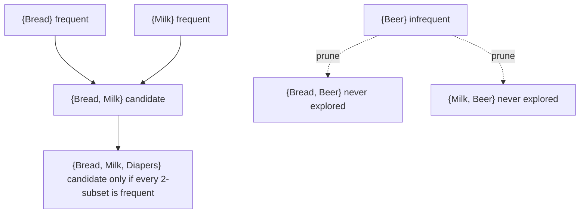
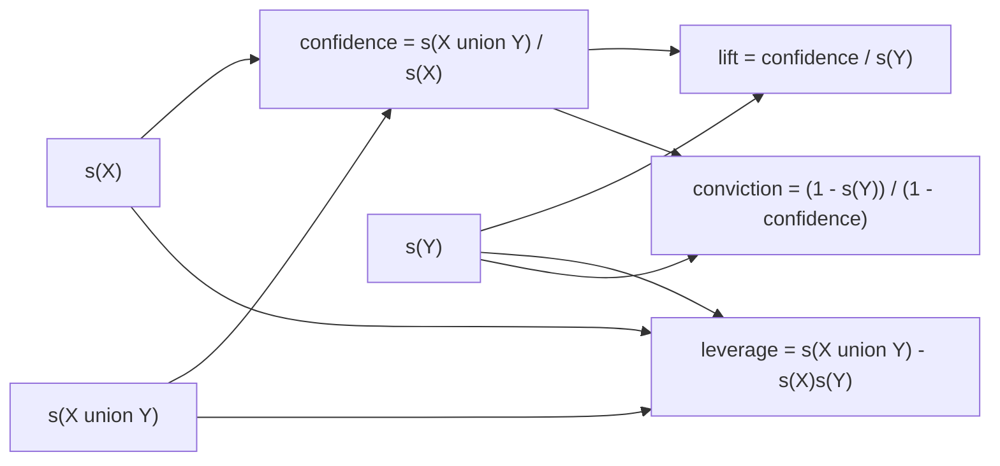
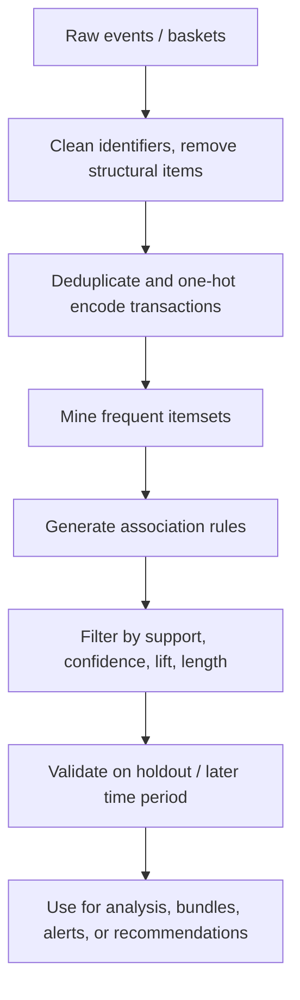

# Association Rule Learning and Apriori

Association rule learning discovers co-occurrence structure in transactional data. A transaction is a set of discrete items, and the goal is to find itemsets that occur frequently enough and rules whose consequents occur unusually often given their antecedents. The canonical application is market basket analysis, but the same machinery appears in clickstream mining, clinical co-occurrence analysis, recommender systems, alert correlation, and feature interaction discovery.

The central objects are:

- A transaction database $\mathcal{D} = \{T_1,\dots,T_n\}$.
- A finite item universe $\mathcal{I} = \{i_1,\dots,i_m\}$.
- Itemsets $X \subseteq \mathcal{I}$.
- Rules $X \rightarrow Y$ where $X,Y \subseteq \mathcal{I}$, $X \cap Y = \varnothing$, and $Y \neq \varnothing$.

The Apriori algorithm solves the frequent-itemset part by exploiting downward closure: if an itemset is frequent, every subset of it must also be frequent. Equivalently, if an itemset is infrequent, every superset of it is infrequent.

```mermaid
flowchart LR
    D["Transaction database"] --> E["One-hot / set representation"]
    E --> L1["Find frequent 1-itemsets L_1"]
    L1 --> C2["Join and prune candidates C_2"]
    C2 --> S2["Scan database and count support"]
    S2 --> L2["Keep frequent itemsets L_2"]
    L2 --> Ck["Repeat for k = 3, 4, ..."]
    Ck --> F["All frequent itemsets"]
    F --> R["Generate rules X -> Y"]
    R --> M["Filter by confidence, lift, etc."]
```



## 1. Transaction Data Model

Let

$$
\mathcal{D}
=
\{T_1,\dots,T_n\},
\qquad
T_t \subseteq \mathcal{I}.
$$

Each transaction $T_t$ is a set, not an ordered sequence. If a customer buys two units of milk, the standard association-rule formulation records only whether milk is present:

$$
\mathbf{1}\{ \text{milk} \in T_t \}.
$$

This binary assumption is important. Apriori does not model quantities, order, time gaps, prices, or continuous-valued features unless the data are transformed first.

A convenient matrix representation is

$$
A \in \{0,1\}^{n \times m},
\qquad
A_{tj}
=
\mathbf{1}\{ i_j \in T_t \}.
$$

For an itemset $X \subseteq \mathcal{I}$, define its transaction indicator:

$$
I_X(t)
=
\mathbf{1}\{ X \subseteq T_t \}
=
\prod_{i_j \in X} A_{tj}.
$$

The product works because $A_{tj}$ is binary. If every item in $X$ is present, every factor is $1$; otherwise at least one factor is $0$.

## 2. Support

The support count of an itemset $X$ is

$$
\sigma(X)
=
\sum_{t=1}^{n}
\mathbf{1}\{X \subseteq T_t\}.
$$

The normalized support is

$$
s(X)
=
\frac{\sigma(X)}{n}
=
\frac{1}{n}
\sum_{t=1}^{n}
\mathbf{1}\{X \subseteq T_t\}.
$$

Interpreting a transaction sampled uniformly at random from $\mathcal{D}$, support is the empirical probability

$$
s(X)
=
\widehat{\mathbb{P}}(X \subseteq T).
$$

For a rule $X \rightarrow Y$, the rule support is the joint support:

$$
s(X \rightarrow Y)
=
s(X \cup Y)
=
\widehat{\mathbb{P}}(X \subseteq T, Y \subseteq T).
$$

An itemset is frequent at minimum support threshold $\tau$ if

$$
s(X) \geq \tau.
$$

Equivalently, using support counts, the itemset is frequent if

$$
\sigma(X) \geq \lceil n \tau \rceil.
$$

The ceiling appears because $\sigma(X)$ is an integer count.

## 3. Confidence

Confidence measures the empirical conditional probability of the consequent given the antecedent:

$$
c(X \rightarrow Y)
=
\frac{s(X \cup Y)}{s(X)}
=
\frac{\sigma(X \cup Y)}{\sigma(X)}
=
\widehat{\mathbb{P}}(Y \subseteq T \mid X \subseteq T),
$$

provided $s(X) > 0$.

The derivation is the empirical version of conditional probability:

$$
\mathbb{P}(Y \mid X)
=
\frac{\mathbb{P}(X \cap Y)}{\mathbb{P}(X)}.
$$

Here $X$ and $Y$ are shorthand for the events "transaction contains all items in $X$" and "transaction contains all items in $Y$".

Confidence is directional:

$$
c(X \rightarrow Y)
\neq
c(Y \rightarrow X)
$$

in general, because the denominators differ:

$$
c(X \rightarrow Y)
=
\frac{s(X \cup Y)}{s(X)},
\qquad
c(Y \rightarrow X)
=
\frac{s(X \cup Y)}{s(Y)}.
$$

Confidence is useful but biased toward frequent consequents. If $Y$ appears in nearly every transaction, then many unrelated antecedents will have high confidence for $X \rightarrow Y$.

## 4. Lift

Lift corrects confidence by comparing it to the baseline probability of the consequent:

$$
\ell(X \rightarrow Y)
=
\frac{c(X \rightarrow Y)}{s(Y)}
=
\frac{s(X \cup Y)}{s(X)s(Y)}.
$$

Under empirical independence of $X$ and $Y$,

$$
s(X \cup Y)
\approx
s(X)s(Y),
$$

so

$$
\ell(X \rightarrow Y)
\approx
1.
$$

Interpretation:

- $\ell = 1$: $X$ and $Y$ co-occur about as often as expected under independence.
- $\ell > 1$: positive association; $Y$ is more likely when $X$ occurs.
- $\ell < 1$: negative association; $Y$ is less likely when $X$ occurs.

Lift is symmetric at the itemset level:

$$
\ell(X \rightarrow Y)
=
\ell(Y \rightarrow X),
$$

because

$$
\frac{s(X \cup Y)}{s(X)s(Y)}
=
\frac{s(Y \cup X)}{s(Y)s(X)}.
$$

Confidence is directional; lift is not.

## 5. Other Interestingness Measures

Support, confidence, and lift are the usual minimum set. In practice, additional measures are useful because each metric has a different failure mode.

| Metric | Formula | Interpretation |
| --- | --- | --- |
| Support | $s(X \cup Y)$ | Frequency of the full rule itemset |
| Confidence | $\frac{s(X \cup Y)}{s(X)}$ | Empirical probability of $Y$ given $X$ |
| Lift | $\frac{s(X \cup Y)}{s(X)s(Y)}$ | Multiplicative departure from independence |
| Leverage | $s(X \cup Y) - s(X)s(Y)$ | Additive departure from independence |
| Conviction | $\frac{1 - s(Y)}{1 - c(X \rightarrow Y)}$ | How strongly $X$ implies absence of counterexamples |

Leverage is zero under independence:

$$
\lambda(X \rightarrow Y)
=
s(X \cup Y) - s(X)s(Y).
$$

Conviction compares the expected frequency of wrong predictions if $X$ and $Y$ were independent to the observed frequency of wrong predictions:

$$
\operatorname{conv}(X \rightarrow Y)
=
\frac{1 - s(Y)}
{1 - c(X \rightarrow Y)}.
$$

If $c(X \rightarrow Y)=1$, the denominator is zero and conviction is infinite. Implementations usually represent this as `inf`.

## 6. Worked Example

Consider five transactions:

| Transaction | Items |
| --- | --- |
| $T_1$ | Bread, Milk |
| $T_2$ | Bread, Diapers, Beer |
| $T_3$ | Milk, Diapers, Beer |
| $T_4$ | Bread, Milk, Diapers, Beer |
| $T_5$ | Bread, Milk |

Let

$$
n = 5.
$$

Single-item supports:

$$
\sigma(\{\text{Bread}\}) = 4,
\qquad
s(\{\text{Bread}\}) = \frac{4}{5} = 0.8.
$$

$$
\sigma(\{\text{Milk}\}) = 4,
\qquad
s(\{\text{Milk}\}) = \frac{4}{5} = 0.8.
$$

$$
\sigma(\{\text{Diapers}\}) = 3,
\qquad
s(\{\text{Diapers}\}) = \frac{3}{5} = 0.6.
$$

$$
\sigma(\{\text{Beer}\}) = 3,
\qquad
s(\{\text{Beer}\}) = \frac{3}{5} = 0.6.
$$

For the rule $\{\text{Bread}\} \rightarrow \{\text{Milk}\}$:

$$
\sigma(\{\text{Bread},\text{Milk}\}) = 3,
\qquad
s(\{\text{Bread},\text{Milk}\}) = \frac{3}{5} = 0.6.
$$

Confidence:

$$
c(\text{Bread} \rightarrow \text{Milk})
=
\frac{s(\{\text{Bread},\text{Milk}\})}
{s(\{\text{Bread}\})}
=
\frac{0.6}{0.8}
=
0.75.
$$

Lift:

$$
\ell(\text{Bread} \rightarrow \text{Milk})
=
\frac{c(\text{Bread} \rightarrow \text{Milk})}
{s(\{\text{Milk}\})}
=
\frac{0.75}{0.8}
=
0.9375.
$$

The confidence is high, but lift is below $1$. This means milk is common overall, and bread does not increase milk purchase probability relative to the baseline.

For the rule $\{\text{Diapers}\} \rightarrow \{\text{Beer}\}$:

$$
\sigma(\{\text{Diapers},\text{Beer}\}) = 3,
\qquad
s(\{\text{Diapers},\text{Beer}\}) = \frac{3}{5} = 0.6.
$$

$$
c(\text{Diapers} \rightarrow \text{Beer})
=
\frac{0.6}{0.6}
=
1.
$$

$$
\ell(\text{Diapers} \rightarrow \text{Beer})
=
\frac{1}{0.6}
=
1.6667.
$$

Here all observed diaper transactions also contain beer, and the rule improves substantially over the beer baseline.

## 7. The Combinatorial Problem

With $m$ possible items, the number of non-empty itemsets is

$$
2^m - 1.
$$

The number of possible rules is larger. For each itemset $Z$ with $|Z| = k$, any non-empty proper subset can be the antecedent, with the remaining items as consequent:

$$
2^k - 2
$$

rules for itemset $Z$. Across all itemsets:

$$
\sum_{k=2}^{m}
\binom{m}{k}(2^k - 2)
=
3^m - 2^{m+1} + 1.
$$

Derivation:

$$
\sum_{k=0}^{m}
\binom{m}{k}2^k
=
(1+2)^m
=
3^m.
$$

Remove $k=0$ and $k=1$ terms, and subtract the invalid empty/full antecedent choices. The final expression grows exponentially, so brute force becomes infeasible quickly.

Apriori reduces this search space by pruning candidates before counting them.

## 8. Apriori Property

If $X \subseteq Y$, then every transaction containing $Y$ also contains $X$:

$$
Y \subseteq T_t
\implies
X \subseteq T_t.
$$

Therefore

$$
\mathbf{1}\{Y \subseteq T_t\}
\leq
\mathbf{1}\{X \subseteq T_t\}
$$

for every transaction $T_t$. Summing over transactions:

$$
\sigma(Y)
\leq
\sigma(X).
$$

After dividing by $n$:

$$
s(Y)
\leq
s(X).
$$

This is anti-monotonicity of support:

$$
X \subseteq Y
\implies
s(X) \geq s(Y).
$$

Consequences:

1. If $Y$ is frequent, then every subset $X \subseteq Y$ is frequent.
2. If $X$ is infrequent, then every superset $Y \supseteq X$ is infrequent.

The second form is the pruning rule used by Apriori.



## 9. Apriori Algorithm

Let $L_k$ be the set of frequent $k$-itemsets and $C_k$ be the candidate $k$-itemsets.

### 9.1 Step-by-Step Execution

1. Scan the database and count every single item.
2. Keep items whose support is at least $\tau$:

$$
L_1
=
\{X \subseteq \mathcal{I} : |X|=1,\ s(X) \geq \tau\}.
$$

3. For $k=2,3,\dots$, generate candidates $C_k$ by joining frequent $(k-1)$-itemsets.
4. Prune any candidate whose $(k-1)$-subsets are not all in $L_{k-1}$.
5. Scan the database and count supports for candidates in $C_k$.
6. Keep candidates meeting minimum support:

$$
L_k
=
\{X \in C_k : s(X) \geq \tau\}.
$$

7. Stop when $L_k = \varnothing$.
8. Return

$$
L
=
\bigcup_{k \geq 1} L_k.
$$

### 9.2 Candidate Join

Represent each itemset as a sorted tuple. Two frequent $(k-1)$-itemsets can be joined if their first $k-2$ items match:

$$
(a_1,\dots,a_{k-2},a_{k-1})
$$

and

$$
(a_1,\dots,a_{k-2},b_{k-1}).
$$

Their union is a candidate $k$-itemset:

$$
(a_1,\dots,a_{k-2},a_{k-1},b_{k-1}).
$$

This avoids generating the same candidate multiple times.

### 9.3 Candidate Pruning

For candidate $C$ with $|C|=k$, every $(k-1)$-subset must be frequent:

$$
\forall x \in C,
\qquad
C \setminus \{x\} \in L_{k-1}.
$$

If any subset is missing from $L_{k-1}$, $C$ cannot be frequent by anti-monotonicity.

### 9.4 Pseudocode

```text
APRIORI(D, min_support):
    L_1 = frequent 1-itemsets in D
    L = L_1
    k = 2

    while L_{k-1} is not empty:
        C_k = APRIORI_GEN(L_{k-1})
        count each candidate in C_k by scanning D
        L_k = candidates in C_k with support >= min_support
        L = L union L_k
        k = k + 1

    return L
```

## 10. Rule Generation from Frequent Itemsets

Frequent itemset mining finds itemsets $Z$ such that $s(Z) \geq \tau$. Rule generation then splits each frequent itemset into antecedent and consequent.

For a frequent itemset $Z$, every non-empty proper subset $X \subset Z$ can be an antecedent:

$$
X \rightarrow Z \setminus X.
$$

The confidence is

$$
c(X \rightarrow Z \setminus X)
=
\frac{s(Z)}{s(X)}.
$$

Because $X \subset Z$, $X$ is also frequent, so $s(X)$ is available from the frequent-itemset table. This avoids rescanning the database during rule generation.

For fixed $Z$, confidence is anti-monotone with respect to the consequent size. If the consequent grows, the antecedent shrinks and its support usually grows, which can lower confidence. Many implementations use this property to prune low-confidence rule candidates.

## 11. Computational Graph for Rule Metrics

For a rule $X \rightarrow Y$, all common metrics can be computed from three support values:

$$
s(X),
\qquad
s(Y),
\qquad
s(X \cup Y).
$$



This is why most libraries first compute frequent itemsets with support, then generate rules by table lookup.

## 12. Larger Worked Apriori Example

Use the dataset:

| TID | Items |
| --- | --- |
| $T_1$ | Bread, Milk |
| $T_2$ | Bread, Beer |
| $T_3$ | Milk, Beer |
| $T_4$ | Bread, Milk, Beer |
| $T_5$ | Bread, Milk |

Let the minimum support be

$$
\tau = 0.6.
$$

With $n=5$, the minimum support count is

$$
\lceil n\tau \rceil
=
\lceil 5 \cdot 0.6 \rceil
=
3.
$$

### 12.1 Frequent 1-Itemsets

Counts:

| Itemset | Count | Support | Frequent? |
| --- | ---: | ---: | --- |
| $\{\text{Bread}\}$ | 4 | $0.8$ | yes |
| $\{\text{Milk}\}$ | 4 | $0.8$ | yes |
| $\{\text{Beer}\}$ | 3 | $0.6$ | yes |

Thus

$$
L_1
=
\{
\{\text{Bread}\},
\{\text{Milk}\},
\{\text{Beer}\}
\}.
$$

### 12.2 Candidate 2-Itemsets

Join $L_1$ with itself:

$$
C_2
=
\{
\{\text{Bread},\text{Milk}\},
\{\text{Bread},\text{Beer}\},
\{\text{Milk},\text{Beer}\}
\}.
$$

Counts:

| Itemset | Transactions | Count | Support | Frequent? |
| --- | --- | ---: | ---: | --- |
| $\{\text{Bread},\text{Milk}\}$ | $T_1,T_4,T_5$ | 3 | $0.6$ | yes |
| $\{\text{Bread},\text{Beer}\}$ | $T_2,T_4$ | 2 | $0.4$ | no |
| $\{\text{Milk},\text{Beer}\}$ | $T_3,T_4$ | 2 | $0.4$ | no |

Therefore

$$
L_2
=
\{
\{\text{Bread},\text{Milk}\}
\}.
$$

### 12.3 Candidate 3-Itemsets

No 3-itemset can be generated because the only frequent 2-itemset is $\{\text{Bread},\text{Milk}\}$. Also, $\{\text{Bread},\text{Milk},\text{Beer}\}$ would be pruned because its subsets $\{\text{Bread},\text{Beer}\}$ and $\{\text{Milk},\text{Beer}\}$ are infrequent.

### 12.4 Generated Rules

From $Z=\{\text{Bread},\text{Milk}\}$:

$$
\text{Bread} \rightarrow \text{Milk},
\qquad
\text{Milk} \rightarrow \text{Bread}.
$$

For $\text{Bread} \rightarrow \text{Milk}$:

$$
c
=
\frac{s(\{\text{Bread},\text{Milk}\})}
{s(\{\text{Bread}\})}
=
\frac{0.6}{0.8}
=
0.75.
$$

$$
\ell
=
\frac{0.75}{0.8}
=
0.9375.
$$

For $\text{Milk} \rightarrow \text{Bread}$:

$$
c
=
\frac{0.6}{0.8}
=
0.75.
$$

$$
\ell
=
\frac{0.75}{0.8}
=
0.9375.
$$

In this small dataset the two directions match because bread and milk have equal support. In general, confidence differs by direction.

## 13. From-Scratch Python Implementation

The following implementation prioritizes clarity. It represents transactions as `frozenset` objects, itemsets as sorted tuples, and support lookup as a dictionary.

```python
from __future__ import annotations

from collections import Counter
from itertools import combinations
from math import ceil, isclose
from typing import Dict, FrozenSet, Iterable, List, Sequence, Tuple


Item = str
Transaction = FrozenSet[Item]
Itemset = Tuple[Item, ...]


def normalize_transactions(transactions: Iterable[Iterable[Item]]) -> List[Transaction]:
    """Convert transactions to duplicate-free frozensets."""
    return [frozenset(t) for t in transactions]


def support_count(itemset: Itemset, transactions: Sequence[Transaction]) -> int:
    """Count transactions containing all items in itemset."""
    items = frozenset(itemset)
    return sum(items.issubset(t) for t in transactions)


def candidate_join(prev_frequents: Sequence[Itemset], k: int) -> List[Itemset]:
    """Generate candidate k-itemsets from frequent (k-1)-itemsets."""
    prev = sorted(prev_frequents)
    candidates = set()

    for i in range(len(prev)):
        for j in range(i + 1, len(prev)):
            a, b = prev[i], prev[j]

            # Join only itemsets with the same length-(k-2) prefix.
            if a[: k - 2] != b[: k - 2]:
                break

            union = tuple(sorted(set(a) | set(b)))
            if len(union) == k:
                candidates.add(union)

    return sorted(candidates)


def has_frequent_subsets(candidate: Itemset, prev_frequent_set: set[Itemset]) -> bool:
    """Apriori prune: every (k-1)-subset must be frequent."""
    k = len(candidate)
    return all(
        tuple(subset) in prev_frequent_set
        for subset in combinations(candidate, k - 1)
    )


def apriori(
    raw_transactions: Iterable[Iterable[Item]],
    min_support: float,
) -> Dict[Itemset, float]:
    """
    Mine all frequent itemsets using Apriori.

    Returns a dictionary mapping itemset tuple -> normalized support.
    """
    if not 0 < min_support <= 1:
        raise ValueError("min_support must be in (0, 1].")

    transactions = normalize_transactions(raw_transactions)
    n = len(transactions)
    if n == 0:
        return {}

    min_count = ceil(n * min_support)

    # L1: count single items.
    item_counter: Counter[Item] = Counter()
    for transaction in transactions:
        item_counter.update(transaction)

    Lk = sorted(
        (item,)
        for item, count in item_counter.items()
        if count >= min_count
    )

    frequent_supports: Dict[Itemset, float] = {
        itemset: item_counter[itemset[0]] / n
        for itemset in Lk
    }

    k = 2
    while Lk:
        candidates = candidate_join(Lk, k)
        prev_frequent_set = set(Lk)
        candidates = [
            cand
            for cand in candidates
            if has_frequent_subsets(cand, prev_frequent_set)
        ]

        counts: Counter[Itemset] = Counter()
        for transaction in transactions:
            # Count only candidates that are subsets of the current transaction.
            for cand in candidates:
                if frozenset(cand).issubset(transaction):
                    counts[cand] += 1

        Lk = sorted(
            cand
            for cand, count in counts.items()
            if count >= min_count
        )

        for itemset in Lk:
            frequent_supports[itemset] = counts[itemset] / n

        k += 1

    return frequent_supports


def generate_rules(
    frequent_supports: Dict[Itemset, float],
    min_confidence: float = 0.0,
    min_lift: float = 0.0,
) -> List[dict]:
    """Generate association rules from frequent itemsets."""
    rules = []

    for itemset, itemset_support in frequent_supports.items():
        if len(itemset) < 2:
            continue

        itemset_frozen = frozenset(itemset)
        for r in range(1, len(itemset)):
            for antecedent_items in combinations(itemset, r):
                antecedent = tuple(sorted(antecedent_items))
                consequent = tuple(sorted(itemset_frozen - frozenset(antecedent)))

                antecedent_support = frequent_supports[antecedent]
                consequent_support = frequent_supports[consequent]

                confidence = itemset_support / antecedent_support
                lift = confidence / consequent_support
                leverage = itemset_support - antecedent_support * consequent_support

                if isclose(confidence, 1.0):
                    conviction = float("inf")
                else:
                    conviction = (1 - consequent_support) / (1 - confidence)

                if confidence >= min_confidence and lift >= min_lift:
                    rules.append(
                        {
                            "antecedent": antecedent,
                            "consequent": consequent,
                            "support": itemset_support,
                            "antecedent_support": antecedent_support,
                            "consequent_support": consequent_support,
                            "confidence": confidence,
                            "lift": lift,
                            "leverage": leverage,
                            "conviction": conviction,
                        }
                    )

    return sorted(
        rules,
        key=lambda row: (row["lift"], row["confidence"], row["support"]),
        reverse=True,
    )


transactions = [
    ["Bread", "Milk"],
    ["Bread", "Diapers", "Beer"],
    ["Milk", "Diapers", "Beer"],
    ["Bread", "Milk", "Diapers", "Beer"],
    ["Bread", "Milk"],
]

frequent_itemsets = apriori(transactions, min_support=0.6)
rules = generate_rules(frequent_itemsets, min_confidence=0.7)

print("Frequent itemsets")
for itemset, support in sorted(frequent_itemsets.items(), key=lambda x: (len(x[0]), x[0])):
    print(f"{itemset}: support={support:.3f}")

print("\nRules")
for rule in rules:
    print(
        f"{rule['antecedent']} -> {rule['consequent']}: "
        f"support={rule['support']:.3f}, "
        f"confidence={rule['confidence']:.3f}, "
        f"lift={rule['lift']:.3f}"
    )
```

Expected output:

```text
Frequent itemsets
('Beer',): support=0.600
('Bread',): support=0.800
('Diapers',): support=0.600
('Milk',): support=0.800
('Beer', 'Diapers'): support=0.600
('Bread', 'Milk'): support=0.600

Rules
('Beer',) -> ('Diapers',): support=0.600, confidence=1.000, lift=1.667
('Diapers',) -> ('Beer',): support=0.600, confidence=1.000, lift=1.667
('Bread',) -> ('Milk',): support=0.600, confidence=0.750, lift=0.938
('Milk',) -> ('Bread',): support=0.600, confidence=0.750, lift=0.938
```

### 13.1 Implementation Notes

The candidate counting loop above is simple but not optimal:

```python
for transaction in transactions:
    for cand in candidates:
        if frozenset(cand).issubset(transaction):
            counts[cand] += 1
```

It costs roughly $O(n|C_k|k)$ at level $k$, because every candidate subset test may inspect up to $k$ items. Faster implementations generate all $k$-subsets of each transaction and intersect them with the candidate set:

```python
candidate_set = set(candidates)
for transaction in transactions:
    for subset in combinations(sorted(transaction), k):
        if subset in candidate_set:
            counts[subset] += 1
```

This is better when transactions are short and $|C_k|$ is large, because it costs approximately

$$
O\left(
\sum_{t=1}^{n}
\binom{|T_t|}{k}
\right)
$$

membership checks rather than $O(n|C_k|)$ candidate checks.

## 14. Vectorized One-Hot Implementation

For moderate item universes, store the transaction database as a boolean matrix:

$$
A \in \{0,1\}^{n \times m}.
$$

The support count for itemset $X=\{j_1,\dots,j_k\}$ can be computed as:

$$
\sigma(X)
=
\sum_{t=1}^{n}
\prod_{r=1}^{k}
A_{t j_r}.
$$

In NumPy:

```python
import numpy as np


def one_hot_transactions(transactions):
    items = sorted({item for transaction in transactions for item in transaction})
    item_to_col = {item: j for j, item in enumerate(items)}

    A = np.zeros((len(transactions), len(items)), dtype=bool)
    for row, transaction in enumerate(transactions):
        for item in transaction:
            A[row, item_to_col[item]] = True

    return A, items, item_to_col


def support_from_matrix(A, columns):
    """Support for a tuple/list of column indices."""
    if len(columns) == 0:
        raise ValueError("itemset must be non-empty")
    return A[:, columns].all(axis=1).mean()


A, items, item_to_col = one_hot_transactions(transactions)
cols = [item_to_col["Bread"], item_to_col["Milk"]]
print(support_from_matrix(A, cols))
```

Internally, `A[:, columns].all(axis=1)` computes the transaction indicator $I_X(t)$ for every transaction. The final `.mean()` divides by $n$, producing normalized support.

For very sparse transactional data, a dense boolean matrix wastes memory. Use a compressed sparse row matrix if $n$ and $m$ are large and each transaction contains only a small fraction of all possible items.

## 15. Library Implementation with mlxtend

`mlxtend` is the most common Python library for frequent pattern mining. Its `TransactionEncoder` converts a list of transactions into a one-hot encoded array, and `frequent_patterns.apriori` expects a one-hot encoded pandas DataFrame. The `association_rules` function then derives rule metrics from the frequent itemset support table.

```python
import pandas as pd
from mlxtend.frequent_patterns import apriori, association_rules
from mlxtend.preprocessing import TransactionEncoder


transactions = [
    ["Bread", "Milk"],
    ["Bread", "Diapers", "Beer"],
    ["Milk", "Diapers", "Beer"],
    ["Bread", "Milk", "Diapers", "Beer"],
    ["Bread", "Milk"],
]

encoder = TransactionEncoder()
encoded = encoder.fit(transactions).transform(transactions)

df = pd.DataFrame(encoded, columns=encoder.columns_)

frequent_itemsets = apriori(
    df,
    min_support=0.6,
    use_colnames=True,
)

rules = association_rules(
    frequent_itemsets,
    metric="confidence",
    min_threshold=0.7,
)

print(frequent_itemsets)
print(rules[["antecedents", "consequents", "support", "confidence", "lift"]])
```

Conceptually, `TransactionEncoder.fit` scans all transactions, collects unique items, sorts them into columns, and builds a mapping from item to column index. `transform` fills a boolean matrix where row $t$ and column $j$ is true exactly when item $i_j$ appears in transaction $T_t$.

Conceptually, `apriori` then:

1. Computes supports of single columns.
2. Keeps columns meeting `min_support`.
3. Generates larger candidate column combinations using the Apriori property.
4. Computes support by taking row-wise logical `AND` over candidate columns.
5. Returns a DataFrame with `support` and `itemsets`.

Conceptually, `association_rules`:

1. Iterates over frequent itemsets with at least two items.
2. Enumerates antecedent/consequent splits.
3. Looks up antecedent, consequent, and union supports.
4. Computes metrics such as confidence, lift, leverage, and conviction.
5. Filters by `metric` and `min_threshold`.

The library implementation is more optimized and handles pandas integration, sparse inputs, column names, and common metrics. It still inherits Apriori's fundamental limitation: candidate generation can explode on dense data or low support thresholds.

## 16. Complexity

Let:

- $n$ be the number of transactions.
- $m$ be the number of unique items.
- $C_k$ be the candidate $k$-itemsets.
- $L_k$ be the frequent $k$-itemsets.
- $\bar{b}$ be the average transaction length.

### 16.1 Worst-Case Candidate Count

In the worst case, every itemset is frequent. Then

$$
|C_k|
=
\binom{m}{k}.
$$

The total number of itemsets is

$$
\sum_{k=1}^{m}
\binom{m}{k}
=
2^m - 1.
$$

No exact frequent-itemset mining algorithm can avoid exponential output size in the worst case, because the output itself may be exponential.

### 16.2 Counting Complexity

With naive candidate scanning:

$$
T_k
=
O(n |C_k| k).
$$

Across all levels:

$$
T
=
O\left(
n
\sum_{k \geq 2}
n |C_k| k
\right).
$$

With transaction subset generation:

$$
T_k
=
O\left(
\sum_{t=1}^{n}
\binom{|T_t|}{k}
\right)
$$

hash lookups, plus candidate generation and pruning costs.

### 16.3 Space Complexity

Dense one-hot storage:

$$
O(nm).
$$

Transaction-set storage:

$$
O\left(
\sum_{t=1}^{n}
|T_t|
\right).
$$

Candidate and frequent itemset storage:

$$
O\left(
\sum_k |C_k|k
+
\sum_k |L_k|k
\right).
$$

The bottleneck is often candidate storage at a level where many combinations survive pruning.

## 17. Numerical Stability and Statistical Reliability

Association rule metrics are simple ratios, but several numerical and statistical issues matter.

### 17.1 Division by Zero

For generated rules from frequent itemsets, $s(X)>0$ by construction. If a custom pipeline generates arbitrary rules, guard against:

$$
s(X) = 0
$$

for confidence and:

$$
s(Y) = 0
$$

for lift.

### 17.2 Floating-Point Thresholds

Support is a rational number $\sigma/n$. Comparing floats can create boundary surprises:

```python
support = count / n
if support >= min_support:
    ...
```

For exact thresholding, compare integer counts:

```python
from math import ceil

min_count = ceil(n * min_support)
if count >= min_count:
    ...
```

This matches the mathematical condition $s(X) \geq \tau$ without relying on floating-point equality.

### 17.3 Low Support and False Discoveries

Rules can look impressive because many candidates are tested. With thousands of items, millions of rules may be evaluated. High lift on tiny support can be noise:

$$
s(X \cup Y)
=
\frac{1}{n}
$$

may produce a large lift if $s(X)$ and $s(Y)$ are also tiny. Practical pipelines often impose:

- minimum support,
- minimum antecedent support,
- minimum consequent support,
- maximum rule length,
- validation on a held-out period,
- statistical tests or confidence intervals.

### 17.4 Non-Causal Interpretation

The rule

$$
\text{Diapers} \rightarrow \text{Beer}
$$

does not mean diapers cause beer purchases. Association rules are descriptive. They identify dependence or co-occurrence patterns, not interventions.

## 18. Edge Cases and Pitfalls

### 18.1 Duplicate Items Within a Transaction

The standard model treats transactions as sets:

$$
\{\text{Milk}, \text{Milk}, \text{Bread}\}
\mapsto
\{\text{Milk}, \text{Bread}\}.
$$

Failing to deduplicate can inflate support in custom code.

### 18.2 Empty Transactions

Empty transactions affect the denominator $n$ but contribute no item counts. They lower all supports. This may or may not be desired; for abandoned carts, empty sessions may need separate handling.

### 18.3 Very Common Items

Items like "shipping", "tax", or "store bag" may dominate confidence and generate uninformative rules. Remove structural items or use lift/leverage filters.

### 18.4 Rare Items

Rare but high-value items may be pruned by support. If rare-item discovery matters, global minimum support can be too blunt. Alternatives include item-specific support thresholds, weighted association rules, or targeted rule mining.

### 18.5 Dense Transactions

If transactions are dense and the support threshold is low, Apriori can generate a huge number of candidates. FP-growth or Eclat is usually better in this regime.

### 18.6 Train/Test Leakage in Recommendation

When association rules are used for recommendation, mining rules on all data and evaluating on the same transactions overestimates quality. Use chronological splits or user-level splits.

### 18.7 Directional Misinterpretation

Lift is symmetric:

$$
\ell(X \rightarrow Y)
=
\ell(Y \rightarrow X).
$$

Confidence is not. For recommendation, the direction matters because the observed basket is the antecedent and the recommendation is the consequent.

## 19. Apriori vs Eclat vs FP-Growth

| Method | Data representation | Candidate generation | Main operation | Strength | Weakness |
| --- | --- | --- | --- | --- | --- |
| Apriori | Horizontal transactions | Yes | Repeated database scans | Simple, interpretable, easy to implement | Candidate explosion |
| Eclat | Vertical TID sets | Yes, depth-first | TID-set intersection | Fast support counting for sparse data | TID sets can become memory-heavy |
| FP-Growth | Compressed FP-tree | No explicit candidate generation | Recursive conditional trees | Efficient for many dense pattern tasks | More complex implementation |

Eclat stores each itemset with the transaction IDs containing it:

$$
\operatorname{TID}(X)
=
\{t : X \subseteq T_t\}.
$$

Then

$$
\operatorname{TID}(X \cup Y)
=
\operatorname{TID}(X)
\cap
\operatorname{TID}(Y),
$$

and

$$
\sigma(X \cup Y)
=
|\operatorname{TID}(X) \cap \operatorname{TID}(Y)|.
$$

FP-growth compresses transactions into a prefix tree ordered by item frequency and mines conditional pattern bases. It avoids explicit generation of all candidates $C_k$, which is why it often outperforms Apriori on large dense datasets.

## 20. Practical Workflow



A reasonable production workflow:

1. Define the transaction boundary: basket, session, patient visit, user-day, account-week, etc.
2. Remove items that encode artifacts rather than meaningful behavior.
3. Deduplicate items within each transaction.
4. Choose minimum support from business or statistical constraints.
5. Mine frequent itemsets.
6. Generate rules and rank by a metric aligned with the objective.
7. Validate rules on a later time window.
8. Monitor drift, because item popularity and co-occurrence patterns change over time.

## 21. Recommendation from Association Rules

Suppose a user has a current basket $B$. A rule $X \rightarrow Y$ is applicable if

$$
X \subseteq B
$$

and

$$
Y \nsubseteq B.
$$

A simple scoring function is:

$$
\operatorname{score}(Y \mid B)
=
\sum_{X \subseteq B}
w(X \rightarrow Y),
$$

where $w$ may be confidence, lift, leverage, or a calibrated combination. For example:

$$
w(X \rightarrow Y)
=
c(X \rightarrow Y)
\log(1 + \sigma(X \cup Y))
\max(0,\ell(X \rightarrow Y)-1).
$$

The support term reduces sensitivity to tiny, noisy high-lift rules. The lift term rewards departure from baseline popularity.

## 22. Limitations

Association rule learning is useful when interpretability and set co-occurrence are central. It is less suitable when the main signal depends on:

- sequence order,
- time intervals,
- continuous features,
- user/item embeddings,
- complex context,
- causal effects,
- long-range personalization.

For these cases, consider sequential pattern mining, Markov models, factorization methods, graph-based recommenders, contextual bandits, or neural recommenders.

## 23. Connections to Related ML Concepts

- Frequent itemset mining is discrete pattern discovery; it is not clustering or classification.
- Support is an empirical probability estimate.
- Confidence is maximum-likelihood conditional probability under the empirical distribution.
- Lift is a normalized dependence measure related to the ratio between joint probability and the product of marginals.
- Leverage is covariance between binary itemset indicators:

$$
\operatorname{Cov}(I_X, I_Y)
=
\mathbb{E}[I_X I_Y]
-
\mathbb{E}[I_X]\mathbb{E}[I_Y]
=
s(X \cup Y) - s(X)s(Y).
$$

- Apriori's pruning relies on anti-monotonicity, a common theme in branch-and-bound and constraint-based search.
- Eclat resembles inverted-index retrieval because each item maps to posting lists of transaction IDs.
- FP-growth resembles compressed prefix-tree mining.

## 24. References and Deeper Reading

- Rakesh Agrawal, Tomasz Imielinski, and Arun Swami, "Mining Association Rules Between Sets of Items in Large Databases", SIGMOD 1993.
- Rakesh Agrawal and Ramakrishnan Srikant, "Fast Algorithms for Mining Association Rules", VLDB 1994.
- Jiawei Han, Jian Pei, and Yiwen Yin, "Mining Frequent Patterns without Candidate Generation", SIGMOD 2000.
- Mohammed J. Zaki, "Scalable Algorithms for Association Mining", IEEE Transactions on Knowledge and Data Engineering, 2000.
- `mlxtend.frequent_patterns.apriori` documentation: frequent itemset mining with pandas one-hot encoded DataFrames.
- `mlxtend.frequent_patterns.association_rules` documentation: rule generation and metrics from frequent itemsets.
- `mlxtend.preprocessing.TransactionEncoder` documentation: transaction-list to one-hot encoding.
