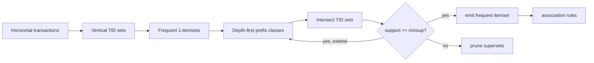
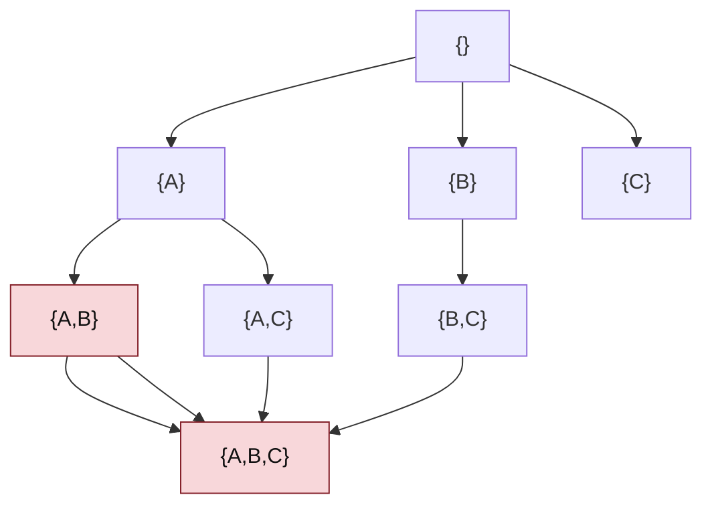
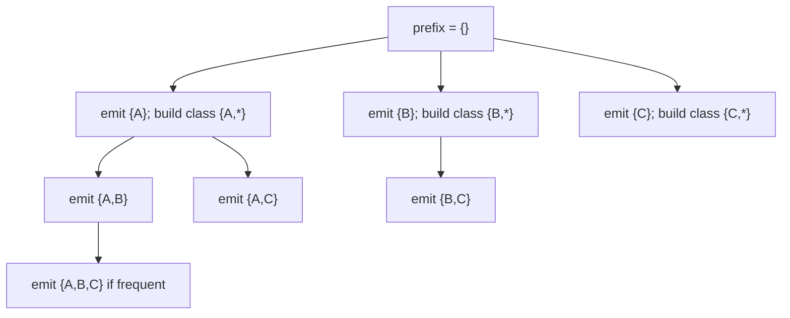

# Eclat: Vertical Frequent Itemset Mining

Eclat is a depth-first frequent itemset mining algorithm. It solves the expensive part of association rule learning: enumerate all itemsets whose empirical support is at least a user-defined threshold. After those frequent itemsets are known, rules such as `{bread} -> {milk}` are derived by evaluating confidence, lift, leverage, conviction, or other interestingness measures.

The key distinction from Apriori is representation. Apriori usually keeps the database in horizontal transaction form and repeatedly counts candidates against transactions. Eclat converts the database once into a vertical representation: each itemset is associated with the set of transaction ids containing it. Support is then obtained by set intersection.

The acronym is commonly used for "Equivalence Class Transformation" in the original vertical mining literature. Many tutorials also describe it as "Equivalence Class Clustering and bottom-up Lattice Traversal", which captures the same operational idea: partition the itemset lattice into prefix-based equivalence classes and traverse each class bottom-up.



## 1. Problem Setup

Let the transaction database be

$$
\mathcal{D}
=
\{T_1,\dots,T_n\},
\qquad
T_t \subseteq \mathcal{I},
$$

where $\mathcal{I}=\{i_1,\dots,i_m\}$ is the finite item universe.

For an itemset $X \subseteq \mathcal{I}$, define the event

$$
X \subseteq T_t
$$

to mean that transaction $T_t$ contains every item in $X$. The support count is

$$
\sigma(X)
=
\sum_{t=1}^{n}\mathbf{1}\{X \subseteq T_t\},
$$

and normalized support is

$$
s(X)
=
\frac{\sigma(X)}{n}.
$$

Given a minimum support threshold $\tau \in (0,1]$, $X$ is frequent if

$$
s(X) \geq \tau.
$$

Equivalently, for an integer threshold

$$
\theta = \lceil n\tau \rceil,
$$

$X$ is frequent if

$$
\sigma(X) \geq \theta.
$$

The frequent itemset mining objective is

$$
\mathcal{F}_{\theta}
=
\{X \subseteq \mathcal{I}: \sigma(X) \geq \theta\}.
$$

The power set has size $2^m$, so the worst-case search space is exponential. Every practical frequent itemset miner relies on pruning, compact representation, or both.

## 2. Vertical TID-Set Representation

Eclat represents each itemset by its transaction id set:

$$
\operatorname{tid}(X)
=
\{t \in \{1,\dots,n\}: X \subseteq T_t\}.
$$

The support count is simply

$$
\sigma(X)
=
|\operatorname{tid}(X)|.
$$

For singleton itemsets,

$$
\operatorname{tid}(\{i\})
=
\{t: i \in T_t\}.
$$

For a larger itemset $X \cup Y$,

$$
\operatorname{tid}(X \cup Y)
=
\operatorname{tid}(X) \cap \operatorname{tid}(Y).
$$

### 2.1 Derivation of the Intersection Identity

By definition,

$$
t \in \operatorname{tid}(X \cup Y)
\iff
X \cup Y \subseteq T_t.
$$

The union $X \cup Y$ is contained in $T_t$ exactly when both $X$ and $Y$ are contained in $T_t$:

$$
X \cup Y \subseteq T_t
\iff
X \subseteq T_t
\;\land\;
Y \subseteq T_t.
$$

Therefore,

$$
t \in \operatorname{tid}(X \cup Y)
\iff
t \in \operatorname{tid}(X)
\;\land\;
t \in \operatorname{tid}(Y),
$$

which gives

$$
\operatorname{tid}(X \cup Y)
=
\operatorname{tid}(X) \cap \operatorname{tid}(Y).
$$

This is the computational core of Eclat.

## 3. Anti-Monotonicity and Pruning

Frequent itemset mining relies on downward closure:

$$
X \subseteq Y
\implies
\sigma(Y) \leq \sigma(X).
$$

Proof:

If $Y$ appears in a transaction, every subset $X \subseteq Y$ also appears in that transaction. Hence

$$
\operatorname{tid}(Y)
\subseteq
\operatorname{tid}(X).
$$

Taking cardinalities,

$$
|\operatorname{tid}(Y)|
\leq
|\operatorname{tid}(X)|.
$$

Thus, if $X$ is infrequent, every superset $Y \supseteq X$ is infrequent:

$$
\sigma(X) < \theta
\land
X \subseteq Y
\implies
\sigma(Y) < \theta.
$$

In Eclat, this pruning happens immediately after a TID-set intersection. If the intersection is too small, the entire descendant subtree is skipped.



If `{A,B}` is infrequent, `{A,B,C}` is automatically infrequent and need not be counted.

## 4. Equivalence Classes and Depth-First Traversal

Eclat avoids generating arbitrary candidates globally. It organizes itemsets into prefix-equivalence classes.

Assume a fixed total order over items:

$$
i_1 < i_2 < \dots < i_m.
$$

For a prefix $P$, define its suffix candidates as items larger than the last item in $P$:

$$
S(P)
=
\{j \in \mathcal{I}: j > \max(P)\},
$$

with $S(\varnothing)=\mathcal{I}$.

The recursive state is a prefix $P$ and a list of extensions

$$
\mathcal{L}_P
=
\{(x, \operatorname{tid}(P \cup \{x\})): x \in S(P)\}.
$$

At each recursive call:

1. Pick an extension $x$.
2. Emit $P \cup \{x\}$ as frequent.
3. For every later extension $y$, compute

$$
\operatorname{tid}(P \cup \{x,y\})
=
\operatorname{tid}(P \cup \{x\})
\cap
\operatorname{tid}(P \cup \{y\}).
$$

4. Keep only intersections with support at least $\theta$.
5. Recurse with prefix $P \cup \{x\}$ and the surviving suffix list.



This is a lexicographic depth-first traversal of the itemset lattice. The ordering prevents duplicates: `{A,B,C}` is explored only through prefix `{A,B}` and extension `C`, not again through `{A,C}` and `B`.

## 5. Step-by-Step Execution

Given transactions and minimum support:

1. Normalize each transaction to a set. Remove duplicates inside each transaction.
2. Build singleton TID sets by scanning the database once.
3. Remove singleton items with support below $\theta$.
4. Sort remaining items using a deterministic ordering. Common choices are lexicographic order or increasing support.
5. Call recursive Eclat on the root prefix $\varnothing$ and frequent singleton TID sets.
6. At each node, intersect the current TID set with later TID sets.
7. Emit every frequent child.
8. Stop when a prefix has no frequent extensions.
9. Generate association rules from the discovered frequent itemsets if needed.

The algorithm can be written as:

$$
\operatorname{Eclat}(P, \mathcal{L}_P):
$$

where $\mathcal{L}_P = [(x_1,T_1),\dots,(x_r,T_r)]$ and $T_a=\operatorname{tid}(P \cup \{x_a\})$.

For each $a=1,\dots,r$:

$$
Q = P \cup \{x_a\},
$$

emit $Q$, then build

$$
\mathcal{L}_Q
=
\left[
\left(
x_b,
T_a \cap T_b
\right)
:
b>a,\ |T_a \cap T_b| \geq \theta
\right].
$$

Then recurse:

$$
\operatorname{Eclat}(Q,\mathcal{L}_Q).
$$

## 6. Worked Example

Use the database:

| TID | Items |
| --- | --- |
| 1 | bread, milk |
| 2 | bread, beer |
| 3 | milk, beer |
| 4 | bread, milk, beer |
| 5 | bread, milk, diapers |
| 6 | milk, diapers |

Let

$$
n=6,
\qquad
\tau=\frac{1}{3},
\qquad
\theta=\lceil 6 \cdot \frac{1}{3} \rceil = 2.
$$

### 6.1 Singleton TID Sets

| Item | TID set | Support count | Support |
| --- | --- | ---: | ---: |
| beer | $\{2,3,4\}$ | $3$ | $0.5000$ |
| bread | $\{1,2,4,5\}$ | $4$ | $0.6667$ |
| diapers | $\{5,6\}$ | $2$ | $0.3333$ |
| milk | $\{1,3,4,5,6\}$ | $5$ | $0.8333$ |

All singleton itemsets are frequent.

Assume lexicographic order:

$$
\text{beer} < \text{bread} < \text{diapers} < \text{milk}.
$$

### 6.2 Root Extension: beer

Candidate `{beer,bread}`:

$$
\operatorname{tid}(\{\text{beer}\})
\cap
\operatorname{tid}(\{\text{bread}\})
=
\{2,3,4\}
\cap
\{1,2,4,5\}
=
\{2,4\}.
$$

So

$$
\sigma(\{\text{beer},\text{bread}\})=2.
$$

Candidate `{beer,diapers}`:

$$
\{2,3,4\}
\cap
\{5,6\}
=
\varnothing.
$$

This is pruned because support count is $0$.

Candidate `{beer,milk}`:

$$
\{2,3,4\}
\cap
\{1,3,4,5,6\}
=
\{3,4\}.
$$

So

$$
\sigma(\{\text{beer},\text{milk}\})=2.
$$

The recursive class under prefix `{beer}` is:

| Itemset | TID set |
| --- | --- |
| beer,bread | $\{2,4\}$ |
| beer,milk | $\{3,4\}$ |

Now intersect those to test `{beer,bread,milk}`:

$$
\{2,4\}\cap\{3,4\}=\{4\}.
$$

Its support count is $1$, so it is pruned.

### 6.3 Root Extension: bread

Candidate `{bread,diapers}`:

$$
\{1,2,4,5\}\cap\{5,6\}=\{5\}.
$$

Prune because $1 < 2$.

Candidate `{bread,milk}`:

$$
\{1,2,4,5\}\cap\{1,3,4,5,6\}=\{1,4,5\}.
$$

So

$$
\sigma(\{\text{bread},\text{milk}\})=3,
\qquad
s(\{\text{bread},\text{milk}\})=\frac{3}{6}=0.5.
$$

### 6.4 Root Extension: diapers

Candidate `{diapers,milk}`:

$$
\{5,6\}\cap\{1,3,4,5,6\}=\{5,6\}.
$$

So

$$
\sigma(\{\text{diapers},\text{milk}\})=2.
$$

### 6.5 Frequent Itemsets

The frequent itemsets are:

| Itemset | Support count | Support |
| --- | ---: | ---: |
| beer | $3$ | $0.5000$ |
| bread | $4$ | $0.6667$ |
| diapers | $2$ | $0.3333$ |
| milk | $5$ | $0.8333$ |
| beer,bread | $2$ | $0.3333$ |
| beer,milk | $2$ | $0.3333$ |
| bread,milk | $3$ | $0.5000$ |
| diapers,milk | $2$ | $0.3333$ |

No frequent 3-itemset exists at $\theta=2$.

## 7. Association Rule Generation

Eclat itself mines frequent itemsets. Association rules are a post-processing step.

For a frequent itemset $Z$, every non-empty proper subset $X \subset Z$ can be an antecedent, with consequent

$$
Y = Z \setminus X.
$$

The rule is

$$
X \rightarrow Y,
\qquad
X \cap Y = \varnothing.
$$

### 7.1 Support

Rule support is joint support:

$$
s(X \rightarrow Y)
=
s(X \cup Y).
$$

### 7.2 Confidence

Confidence is empirical conditional probability:

$$
c(X \rightarrow Y)
=
\frac{s(X \cup Y)}{s(X)}
=
\frac{\sigma(X \cup Y)}{\sigma(X)}.
$$

This follows from

$$
\widehat{\mathbb{P}}(Y \subseteq T \mid X \subseteq T)
=
\frac{
\widehat{\mathbb{P}}(X \subseteq T,\ Y \subseteq T)
}{
\widehat{\mathbb{P}}(X \subseteq T)
}.
$$

### 7.3 Lift

Lift compares confidence to the consequent base rate:

$$
\operatorname{lift}(X \rightarrow Y)
=
\frac{c(X \rightarrow Y)}{s(Y)}
=
\frac{s(X \cup Y)}{s(X)s(Y)}.
$$

If $X$ and $Y$ were independent under the empirical distribution, then

$$
s(X \cup Y)=s(X)s(Y),
$$

so lift would be $1$.

### 7.4 Leverage and Conviction

Leverage measures absolute deviation from independence:

$$
\operatorname{lev}(X \rightarrow Y)
=
s(X \cup Y)-s(X)s(Y).
$$

Conviction penalizes rules whose consequents often fail when antecedents occur:

$$
\operatorname{conv}(X \rightarrow Y)
=
\frac{1-s(Y)}{1-c(X \rightarrow Y)}.
$$

Conviction is undefined when $c(X \rightarrow Y)=1$ unless represented as $+\infty$.

### 7.5 Worked Rule Example

For `{bread} -> {milk}`:

$$
\sigma(\{\text{bread}\})=4,
\qquad
\sigma(\{\text{milk}\})=5,
\qquad
\sigma(\{\text{bread},\text{milk}\})=3.
$$

Thus

$$
s(\{\text{bread}\})=\frac{4}{6},
\qquad
s(\{\text{milk}\})=\frac{5}{6},
\qquad
s(\{\text{bread},\text{milk}\})=\frac{3}{6}.
$$

Confidence:

$$
c(\{\text{bread}\}\rightarrow\{\text{milk}\})
=
\frac{3/6}{4/6}
=
\frac{3}{4}
=
0.75.
$$

Lift:

$$
\operatorname{lift}
=
\frac{0.75}{5/6}
=
0.9.
$$

The rule has high confidence but lift below $1$, meaning milk is so common that observing bread does not increase milk occurrence above baseline.

## 8. Python Implementation From Scratch

The implementation below uses Python sets for clarity. It is not the fastest representation, but it mirrors the mathematical algorithm.

```python
from __future__ import annotations

from itertools import combinations
from math import ceil, inf
from typing import Iterable


Transaction = Iterable[str]
Itemset = frozenset[str]
TidSet = frozenset[int]


def build_vertical_tidsets(transactions: list[Transaction]) -> dict[str, TidSet]:
    """Convert horizontal transactions into singleton TID sets."""
    mutable: dict[str, set[int]] = {}

    for tid, transaction in enumerate(transactions):
        # set(transaction) removes duplicate items inside one transaction.
        for item in set(transaction):
            mutable.setdefault(item, set()).add(tid)

    return {item: frozenset(tids) for item, tids in mutable.items()}


def eclat(
    transactions: list[Transaction],
    min_support: float | int,
    *,
    sort_by_support: bool = True,
) -> dict[Itemset, int]:
    """Mine frequent itemsets with Eclat.

    min_support can be:
    - float in (0, 1]: normalized support threshold
    - int >= 1: absolute support-count threshold
    """
    n = len(transactions)
    if n == 0:
        return {}

    if isinstance(min_support, float):
        if not (0.0 < min_support <= 1.0):
            raise ValueError("float min_support must be in (0, 1]")
        min_count = ceil(n * min_support)
    else:
        if min_support < 1:
            raise ValueError("integer min_support must be >= 1")
        min_count = min_support

    singleton_tidsets = build_vertical_tidsets(transactions)

    # Keep only frequent singleton itemsets.
    items: list[tuple[str, TidSet]] = [
        (item, tids)
        for item, tids in singleton_tidsets.items()
        if len(tids) >= min_count
    ]

    # A deterministic order is required to avoid duplicate itemsets.
    if sort_by_support:
        # Increasing support often shrinks projected TID sets earlier.
        items.sort(key=lambda pair: (len(pair[1]), pair[0]))
    else:
        items.sort(key=lambda pair: pair[0])

    frequent: dict[Itemset, int] = {}

    def recurse(prefix: tuple[str, ...], suffix: list[tuple[str, TidSet]]) -> None:
        for i, (item, item_tids) in enumerate(suffix):
            new_prefix = prefix + (item,)
            itemset = frozenset(new_prefix)
            frequent[itemset] = len(item_tids)

            projected: list[tuple[str, TidSet]] = []
            for next_item, next_tids in suffix[i + 1 :]:
                joined_tids = item_tids & next_tids
                if len(joined_tids) >= min_count:
                    projected.append((next_item, joined_tids))

            if projected:
                recurse(new_prefix, projected)

    recurse(tuple(), items)
    return frequent


def generate_association_rules(
    frequent_itemsets: dict[Itemset, int],
    n_transactions: int,
    *,
    min_confidence: float = 0.0,
    min_lift: float = 0.0,
) -> list[dict[str, object]]:
    """Generate rules from frequent itemsets and compute common metrics."""
    rules: list[dict[str, object]] = []

    for itemset, itemset_count in frequent_itemsets.items():
        if len(itemset) < 2:
            continue

        items = tuple(sorted(itemset))
        for r in range(1, len(items)):
            for antecedent_tuple in combinations(items, r):
                antecedent = frozenset(antecedent_tuple)
                consequent = itemset - antecedent

                antecedent_count = frequent_itemsets.get(antecedent)
                consequent_count = frequent_itemsets.get(consequent)
                if antecedent_count is None or consequent_count is None:
                    # Should not happen if frequent_itemsets is downward closed.
                    continue

                support = itemset_count / n_transactions
                antecedent_support = antecedent_count / n_transactions
                consequent_support = consequent_count / n_transactions

                confidence = itemset_count / antecedent_count
                lift = confidence / consequent_support
                leverage = support - antecedent_support * consequent_support
                conviction = (
                    inf if confidence == 1.0
                    else (1.0 - consequent_support) / (1.0 - confidence)
                )

                if confidence >= min_confidence and lift >= min_lift:
                    rules.append(
                        {
                            "antecedent": antecedent,
                            "consequent": consequent,
                            "support": support,
                            "confidence": confidence,
                            "lift": lift,
                            "leverage": leverage,
                            "conviction": conviction,
                        }
                    )

    rules.sort(
        key=lambda row: (
            -row["confidence"],
            -row["lift"],
            tuple(sorted(row["antecedent"])),
            tuple(sorted(row["consequent"])),
        )
    )
    return rules
```

Example run:

```python
transactions = [
    ["bread", "milk"],
    ["bread", "beer"],
    ["milk", "beer"],
    ["bread", "milk", "beer"],
    ["bread", "milk", "diapers"],
    ["milk", "diapers"],
]

freq = eclat(transactions, min_support=2)

for itemset, count in sorted(freq.items(), key=lambda x: (len(x[0]), sorted(x[0]))):
    print(set(itemset), count)

rules = generate_association_rules(
    freq,
    n_transactions=len(transactions),
    min_confidence=0.6,
)

for rule in rules:
    print(rule)
```

Expected frequent itemsets:

```text
{'beer'} 3
{'bread'} 4
{'diapers'} 2
{'milk'} 5
{'beer', 'bread'} 2
{'beer', 'milk'} 2
{'bread', 'milk'} 3
{'diapers', 'milk'} 2
```

## 9. Bitset Implementation

Python sets store boxed integers and hash tables. For large transaction ids, this can be memory-heavy. A common optimization is to store each TID set as a bit vector. In Python, an arbitrary-precision integer can act as a compact bitset:

$$
\operatorname{bitset}(X)
=
\sum_{t \in \operatorname{tid}(X)} 2^t.
$$

Intersection becomes bitwise AND:

$$
\operatorname{bitset}(X \cup Y)
=
\operatorname{bitset}(X)\ \&\ \operatorname{bitset}(Y).
$$

Support count becomes population count:

$$
\sigma(X)
=
\operatorname{popcount}(\operatorname{bitset}(X)).
$$

```python
from __future__ import annotations

from math import ceil


def build_vertical_bitsets(transactions: list[list[str]]) -> dict[str, int]:
    bitsets: dict[str, int] = {}
    for tid, transaction in enumerate(transactions):
        mask = 1 << tid
        for item in set(transaction):
            bitsets[item] = bitsets.get(item, 0) | mask
    return bitsets


def eclat_bitset(
    transactions: list[list[str]],
    min_support: float | int,
) -> dict[frozenset[str], int]:
    n = len(transactions)
    if n == 0:
        return {}

    min_count = ceil(n * min_support) if isinstance(min_support, float) else min_support
    if min_count < 1:
        raise ValueError("minimum support count must be >= 1")

    singleton_bitsets = build_vertical_bitsets(transactions)
    suffix = [
        (item, bits)
        for item, bits in singleton_bitsets.items()
        if bits.bit_count() >= min_count
    ]
    suffix.sort(key=lambda pair: (pair[1].bit_count(), pair[0]))

    frequent: dict[frozenset[str], int] = {}

    def recurse(prefix: tuple[str, ...], candidates: list[tuple[str, int]]) -> None:
        for i, (item, bits) in enumerate(candidates):
            new_prefix = prefix + (item,)
            frequent[frozenset(new_prefix)] = bits.bit_count()

            projected: list[tuple[str, int]] = []
            for next_item, next_bits in candidates[i + 1 :]:
                joined = bits & next_bits
                if joined.bit_count() >= min_count:
                    projected.append((next_item, joined))

            if projected:
                recurse(new_prefix, projected)

    recurse(tuple(), suffix)
    return frequent
```

Internally this replaces hash-set intersection with word-level bit operations. If there are $n$ transactions and the machine word size is $w$, an intersection costs approximately

$$
O\left(\left\lceil \frac{n}{w}\right\rceil\right)
$$

word operations. Python's integer implementation stores digits in base $2^b$, so the exact constant depends on the interpreter, but the same packed-bit principle applies.

## 10. Equivalent Library Implementations

### 10.1 PyFIM

PyFIM exposes Borgelt's frequent itemset mining implementations to Python. Its `eclat` function delegates the core mining work to optimized native code, so its internal mechanics are closer to production Eclat than a pure-Python educational implementation.

```python
# pip install pyfim
from fim import eclat

transactions = [
    ["bread", "milk"],
    ["bread", "beer"],
    ["milk", "beer"],
    ["bread", "milk", "beer"],
    ["bread", "milk", "diapers"],
    ["milk", "diapers"],
]

# supp is usually given as a percentage in Borgelt-style interfaces.
itemsets = eclat(
    transactions,
    target="s",      # frequent itemsets
    supp=100 * 2 / len(transactions),
    report="a",      # absolute support
)

print(itemsets)
```

Under the hood, optimized Eclat implementations typically:

1. Convert transactions into a vertical structure.
2. Reorder items by frequency or another heuristic.
3. Represent TID sets as sorted arrays, bit vectors, or sparse bit matrices.
4. Traverse prefix-equivalence classes recursively.
5. Use intersections to count support.
6. Optionally mine closed, maximal, generator, or rule targets instead of all frequent itemsets.

### 10.2 pyECLAT

`pyECLAT` is a simpler Python package aimed at association analysis from tabular data.

```python
# pip install pyECLAT
import pandas as pd
from pyECLAT import ECLAT

df = pd.DataFrame(
    [
        ["bread", "milk", None],
        ["bread", "beer", None],
        ["milk", "beer", None],
        ["bread", "milk", "beer"],
        ["bread", "milk", "diapers"],
        ["milk", "diapers", None],
    ]
)

model = ECLAT(data=df)
indexes, supports = model.fit(min_support=2 / len(df), min_combination=1, max_combination=3)

print(supports)
```

This interface is convenient, but it is less useful for studying the recursive lattice traversal because the package exposes results rather than the internal projected TID-set recursion.

### 10.3 mlxtend for Rule Generation

`mlxtend` does not provide a canonical Eclat miner in its `frequent_patterns` module, but its `association_rules` function can consume frequent itemsets produced by any algorithm if they are converted into a DataFrame with columns `support` and `itemsets`.

```python
import pandas as pd
from mlxtend.frequent_patterns import association_rules

freq = eclat(transactions, min_support=2)

frequent_df = pd.DataFrame(
    [
        {"itemsets": itemset, "support": count / len(transactions)}
        for itemset, count in freq.items()
    ]
)

rules_df = association_rules(
    frequent_df,
    metric="confidence",
    min_threshold=0.6,
)

print(rules_df[["antecedents", "consequents", "support", "confidence", "lift"]])
```

Internally, rule generation does not need the original transaction database if all required frequent itemset supports are available. For each frequent itemset $Z$, it enumerates candidate antecedents $X \subset Z$, sets $Y=Z\setminus X$, looks up $s(Z)$, $s(X)$, and $s(Y)$, and computes metrics such as confidence and lift.

## 11. Complexity

Let:

- $n$ be the number of transactions.
- $m$ be the number of distinct items.
- $|\mathcal{F}|$ be the number of frequent itemsets.
- $\ell(X)=|\operatorname{tid}(X)|$ be the TID-set length of itemset $X$.

### 11.1 Search Complexity

The worst-case number of frequent itemsets is exponential:

$$
|\mathcal{F}| \leq 2^m - 1.
$$

This bound is achieved when every item appears in every transaction and $\theta \leq n$; then every non-empty itemset is frequent.

The total running time is approximately

$$
O\left(
\sum_{\text{tested joins }(X,Y)}
\operatorname{cost}\left(
\operatorname{tid}(X)\cap\operatorname{tid}(Y)
\right)
\right).
$$

With sorted TID arrays,

$$
\operatorname{cost}(A\cap B)=O(|A|+|B|).
$$

With dense bitsets,

$$
\operatorname{cost}(A\cap B)
=
O\left(\left\lceil\frac{n}{w}\right\rceil\right),
$$

where $w$ is the machine word size.

With hash sets, expected intersection time is roughly

$$
O(\min(|A|,|B|))
$$

if the implementation iterates over the smaller set and probes the larger one.

### 11.2 Space Complexity

The initial vertical database requires

$$
O\left(\sum_{i \in \mathcal{I}} \sigma(\{i\})\right)
$$

stored transaction references for sparse TID sets. This is the total number of item occurrences in the database.

During recursion, projected TID sets can dominate memory. If all intermediate intersections are materialized, memory can approach

$$
O\left(\sum_{X \in \mathcal{F}} |\operatorname{tid}(X)|\right).
$$

Depth-first traversal helps because it stores only one recursion path and its local candidate lists, rather than all candidates at a level as in breadth-first Apriori.

## 12. Numerical Stability and Thresholding

Eclat is mostly integer set arithmetic, so it avoids the numerical issues common in floating-point optimization. The main numerical pitfalls are threshold conversion and metric division.

Use integer support counts internally:

$$
\theta=\lceil n\tau\rceil.
$$

Then compare

$$
\sigma(X) \geq \theta
$$

instead of comparing floating-point supports directly.

For rule metrics:

- Confidence is undefined if $\sigma(X)=0$, but antecedents from frequent itemsets always have positive support.
- Lift is undefined if $s(Y)=0$, but consequents from frequent itemsets also have positive support.
- Conviction has division by $1-c(X\rightarrow Y)$ and should be represented as $+\infty$ when confidence is $1$.
- Extremely low support thresholds can create many rules with unstable empirical probabilities.

## 13. Edge Cases

| Case | Correct handling |
| --- | --- |
| Empty database | Return no frequent itemsets or raise a clear error. |
| Empty transactions | They contribute to $n$ but no singleton TID set. |
| Duplicate items in a transaction | Convert each transaction to a set before counting. |
| `min_support` as float | Convert with $\lceil n\tau\rceil$. |
| `min_support=0` | Usually invalid because every itemset would be frequent. |
| Very high threshold | Frequent itemsets may contain only universal items or none. |
| Ties in item ordering | Use deterministic secondary ordering to make output reproducible. |
| Missing values in tabular data | Do not treat `NaN` or `None` as real items unless intended. |

## 14. Common Implementation Pitfalls

1. Generating duplicate itemsets because recursive suffix ordering is not enforced.
2. Comparing normalized floating-point support instead of integer support counts.
3. Forgetting to remove duplicate items inside each transaction.
4. Materializing too many projected TID sets at once.
5. Using Python `set` for large dense data where bitsets would be much faster.
6. Sorting by item name when support-based ordering would reduce intersections earlier.
7. Assuming high confidence implies positive association; use lift or leverage to compare against baseline rates.
8. Treating association rules as causal claims. They are empirical co-occurrence statements.
9. Using Eclat on extremely sparse high-dimensional data with a very low support threshold and expecting compact output.
10. Reporting all frequent itemsets when the downstream task only needs closed or maximal itemsets.

## 15. Limitations

Eclat is efficient when intersections are cheap and the frequent itemset output is not too large. It becomes difficult when the pattern set itself explodes.

The fundamental bottleneck is output size:

$$
|\mathcal{F}|
$$

can be exponential. No exact algorithm can avoid outputting exponentially many itemsets if the user asks for all of them.

Other limitations:

- It assumes binary item presence, not quantities or continuous values.
- It ignores order and time unless transactions are engineered to encode them.
- TID sets can consume substantial memory.
- Frequent itemsets may be statistically uninteresting if the threshold is chosen mechanically.
- Rules can be redundant; closed itemsets, maximal itemsets, or non-redundant rule bases may be preferable.

## 16. Variants and Optimizations

### 16.1 Item Ordering

Ordering items by increasing support often reduces intermediate TID-set sizes earlier:

$$
\sigma(i_a) \leq \sigma(i_b)
\implies
|\operatorname{tid}(P \cup \{i_a\})|
\leq
|\operatorname{tid}(P \cup \{i_b\})|
$$

in expectation, though not as a strict guarantee for every prefix.

### 16.2 Diffsets

Diffsets store differences between parent and child TID sets instead of full child TID sets. They are useful when itemsets are frequent and TID sets are large.

For prefix $P$ and extension $x$, define

$$
d(Px)
=
\operatorname{tid}(P)
\setminus
\operatorname{tid}(Px).
$$

Then

$$
\sigma(Px)
=
\sigma(P)-|d(Px)|.
$$

For two extensions $x$ and $y$ in the same prefix class, the child under prefix $Px$ has diffset

$$
d(Pxy)
=
\operatorname{tid}(Px)
\setminus
\operatorname{tid}(Pxy).
$$

Since

$$
\operatorname{tid}(Pxy)
=
\operatorname{tid}(Px)\cap\operatorname{tid}(Py),
$$

we get

$$
d(Pxy)
=
\operatorname{tid}(Px)
\setminus
\operatorname{tid}(Py).
$$

Using parent-level diffsets,

$$
\operatorname{tid}(Px)=\operatorname{tid}(P)\setminus d(Px),
\qquad
\operatorname{tid}(Py)=\operatorname{tid}(P)\setminus d(Py).
$$

Therefore,

$$
d(Pxy)
=
d(Py)\setminus d(Px).
$$

And support is updated by

$$
\sigma(Pxy)
=
\sigma(Px)-|d(Pxy)|.
$$

Diffsets can be much smaller than TID sets for dense data, but they complicate implementation and may be worse for sparse data.

### 16.3 Closed and Maximal Itemsets

A frequent itemset $X$ is closed if no strict superset has the same support:

$$
\nexists Y \supset X
\quad
\text{such that}
\quad
\sigma(Y)=\sigma(X).
$$

A frequent itemset $X$ is maximal if no strict superset is frequent:

$$
\nexists Y \supset X
\quad
\text{such that}
\quad
\sigma(Y)\geq\theta.
$$

Closed itemsets preserve exact support information for all frequent itemsets through closure relationships. Maximal itemsets are more compact but lose support information for subsets.

## 17. Eclat vs Apriori vs FP-Growth

| Property | Apriori | Eclat | FP-Growth |
| --- | --- | --- | --- |
| Main representation | Horizontal transactions | Vertical TID sets | Prefix tree |
| Traversal style | Breadth-first | Depth-first | Recursive conditional trees |
| Counting mechanism | Database scans or candidate hash tree | TID intersections | Tree projection/counting |
| Candidate explosion | Often high | Reduced by prefix classes | Avoids explicit candidate generation |
| Memory pressure | Candidate sets | TID sets and projected intersections | FP-tree and conditional trees |
| Strong use case | Simple baseline, sparse data, moderate size | Fast intersections, dense or medium data | Large compressed transactional data |

Eclat and Apriori rely on the same anti-monotonic support property. The difference is not the definition of support; it is the physical execution plan.

## 18. Connections to Related ML Concepts

- Sparse matrix operations: the vertical database is a column-oriented sparse binary matrix, and support of an itemset is a column-wise logical AND followed by a count.
- Inverted indexes: TID sets are posting lists; itemset support is posting-list intersection, similar to information retrieval query evaluation.
- Graph clique search: frequent itemset enumeration over pairwise-compatible extensions resembles recursive clique enumeration with pruning.
- Feature interaction mining: frequent itemsets can be interpreted as high-support Boolean feature conjunctions.
- Probabilistic modeling: support estimates empirical probabilities, while lift estimates deviation from empirical independence.
- Rule learning: association rules are unordered, non-causal implication patterns; they differ from supervised decision rules because there is no fixed target variable.
- Closed pattern mining: closure operators compress redundant frequent itemsets with identical support.

## 19. Practical Guidance

Use Eclat when:

- the transaction database fits in memory after verticalization;
- support thresholds are not so low that the output explodes;
- intersections are faster than repeated horizontal scans;
- you need all frequent itemsets, closed itemsets, maximal itemsets, or rule candidates.

Prefer FP-Growth or specialized closed/maximal miners when:

- the database is very large and compresses well into a prefix tree;
- output size must be controlled;
- repeated TID-set materialization becomes memory-bound.

Prefer approximate or sampling-based methods when:

- exact support is unnecessary;
- the item universe is huge;
- the minimum support threshold is exploratory and likely too low.

## 20. References and Deeper Reading

- Mohammed J. Zaki, Srinivasan Parthasarathy, Mitsunori Ogihara, and Wei Li, "New Algorithms for Fast Discovery of Association Rules", KDD 1997: https://cdn.aaai.org/KDD/1997/KDD97-060.pdf
- Mohammed J. Zaki, "Scalable Algorithms for Association Mining", IEEE TKDE 2000: https://www.philippe-fournier-viger.com/spmf/zaki2000.pdf
- Mohammed J. Zaki and Karam Gouda, "Fast Vertical Mining Using Diffsets", KDD 2003: https://cs.rpi.edu/~zaki/PaperDir/SIGKDD03-diffsets.pdf
- Christian Borgelt, Eclat implementation and documentation: https://borgelt.net/eclat.html
- PyFIM documentation: https://borgelt.net/pyfim.html
- R `arules::eclat` documentation: https://search.r-project.org/CRAN/refmans/arules/html/eclat.html
- SPMF Eclat and dEclat documentation: https://www.philippe-fournier-viger.com/spmf/Eclat_dEclat.php
- mlxtend association rule documentation: https://rasbt.github.io/mlxtend/user_guide/frequent_patterns/association_rules/
