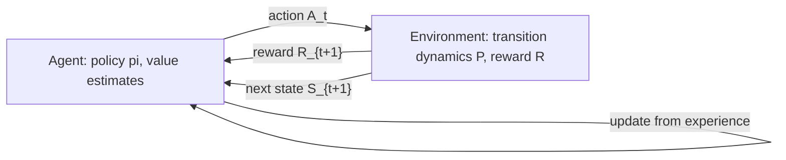
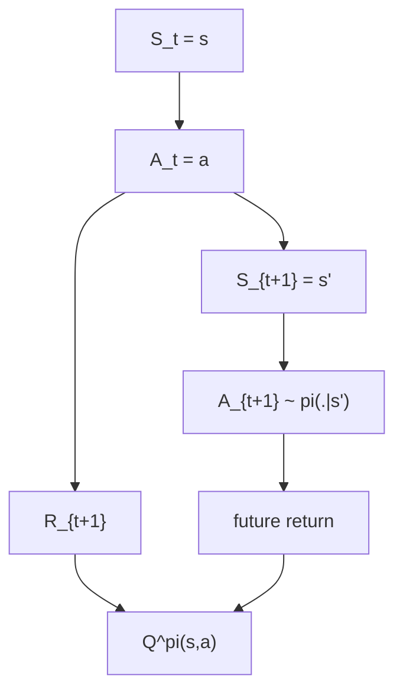
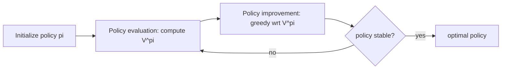
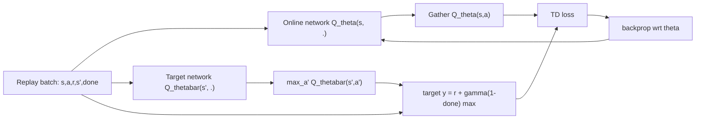

# Reinforcement Learning Foundations

Reinforcement learning studies sequential decision making under feedback. An agent repeatedly observes a state, chooses an action, receives a scalar reward, and moves to a new state. The central technical difficulty is delayed credit assignment: an action can be locally costly but globally useful, or locally rewarding but globally harmful.

The mathematical object behind the standard single-agent setting is the Markov decision process, abbreviated MDP. The algorithmic object is an agent-environment loop that samples trajectories from that MDP and updates a policy or value estimate from the sampled experience.



## 1. Agent-Environment Interface

At discrete time $t$, the interaction is:

$$
S_t \xrightarrow{\text{agent chooses } A_t} (R_{t+1}, S_{t+1}).
$$

The indexing convention is important:

- $S_t$ is the state before the action.
- $A_t$ is the action selected in that state.
- $R_{t+1}$ is the reward caused by $A_t$ after the environment responds.
- $S_{t+1}$ is the next state.

A trajectory, or episode when it terminates, has the form

$$
\tau
=
(S_0,A_0,R_1,S_1,A_1,R_2,\dots,S_T).
$$

The notes' chess example fits this template:

- State: board position, side to move, castling rights, en-passant status, repetition information, clock if relevant.
- Action: legal move.
- Reward: often sparse, for example $+1$ for win, $0$ for draw, $-1$ for loss.
- Episode termination: checkmate, stalemate, draw rule, resignation, or fixed search horizon.

The fact that chess rewards can arrive only at the end is precisely why RL cannot be reduced to ordinary one-step supervised learning without constructing targets from long-term outcomes.

## 2. Markov Decision Processes

An infinite-horizon discounted finite MDP is a tuple

$$
\mathcal{M}
=
(\mathcal{S},\mathcal{A},P,r,\gamma,\rho_0),
$$

where:

- $\mathcal{S}$ is the state space.
- $\mathcal{A}$ is the action space.
- $P(s' \mid s,a)$ is the transition probability of next state $s'$ after action $a$ in state $s$.
- $r(s,a,s')$ is the immediate reward associated with transition $(s,a,s')$.
- $\gamma \in [0,1)$ is the discount factor for infinite-horizon discounted problems.
- $\rho_0(s)$ is the initial-state distribution.

For state-dependent legal actions, write $\mathcal{A}(s) \subseteq \mathcal{A}$. Most derivations below assume a finite action set and use $\sum_a$; for continuous actions the corresponding sums become integrals.

### 2.1 Markov Assumption

The Markov assumption states that the conditional distribution of the future depends on the past only through the current state and action:

$$
\Pr(S_{t+1}=s',R_{t+1}=r_t \mid S_0,A_0,R_1,\dots,S_t=s,A_t=a)
=
\Pr(S_{t+1}=s',R_{t+1}=r_t \mid S_t=s,A_t=a).
$$

Equivalently, $S_t$ must contain all information needed for optimal prediction and control. If an observation omits relevant hidden variables, the process is not an MDP over observations; it is a partially observable MDP.

### 2.2 Reward Function Variants

Some texts define the reward as a random variable jointly distributed with $S_{t+1}$:

$$
p(s',r \mid s,a).
$$

Then the expected immediate reward is

$$
r(s,a)
=
\mathbb{E}[R_{t+1}\mid S_t=s,A_t=a]
=
\sum_{s'}\sum_{r} r \, p(s',r \mid s,a).
$$

If rewards are deterministic functions of $(s,a,s')$, then

$$
r(s,a)
=
\sum_{s'} P(s'\mid s,a) r(s,a,s').
$$

Both notations describe the same computational problem when only expected returns are optimized.

## 3. Policies

A policy is the agent's decision rule. A stochastic Markov policy is

$$
\pi(a\mid s)
=
\Pr(A_t=a\mid S_t=s),
$$

with constraints

$$
\pi(a\mid s) \geq 0,
\qquad
\sum_{a\in\mathcal{A}(s)} \pi(a\mid s)=1.
$$

A deterministic policy is a special case:

$$
\mu(s) \in \mathcal{A}(s),
\qquad
\pi(a\mid s)=\mathbf{1}\{a=\mu(s)\}.
$$

Policies can also be history-dependent, nonstationary, or parameterized by neural networks. The classical Bellman equations below assume stationary Markov policies because MDP optimal control admits an optimal stationary deterministic policy in finite discounted MDPs.

## 4. Return and Discounting

The return from time $t$ is the discounted sum of future rewards:

$$
G_t
=
R_{t+1}
+\gamma R_{t+2}
+\gamma^2 R_{t+3}
+\cdots
=
\sum_{k=0}^{\infty}\gamma^k R_{t+k+1}.
$$

For finite episodic tasks terminating at $T$,

$$
G_t
=
\sum_{k=0}^{T-t-1}\gamma^k R_{t+k+1}.
$$

### 4.1 Recursive Return Identity

Start from the infinite series:

$$
G_t
=
R_{t+1}
+\gamma R_{t+2}
+\gamma^2 R_{t+3}
+\cdots.
$$

Factor out $\gamma$ from every term after the first:

$$
G_t
=
R_{t+1}
+\gamma
\left(
R_{t+2}
+\gamma R_{t+3}
+\gamma^2 R_{t+4}
+\cdots
\right).
$$

The parenthesized expression is $G_{t+1}$, so

$$
G_t
=
R_{t+1}
+\gamma G_{t+1}.
$$

This identity is the source of every one-step bootstrapping update in dynamic programming, temporal-difference learning, SARSA, and Q-learning.

### 4.2 Why Discount?

Discounting has three roles:

1. Mathematical convergence: if rewards are bounded, $|R_t|\leq R_{\max}$, and $\gamma<1$, then

$$
|G_t|
\leq
\sum_{k=0}^{\infty}\gamma^k R_{\max}
=
\frac{R_{\max}}{1-\gamma}.
$$

2. Preference modeling: earlier rewards can be valued more than later rewards.
3. Algorithmic contraction: Bellman operators become contractions under the max norm, which gives uniqueness and convergence guarantees.

The edge case $\gamma=0$ makes the agent myopic:

$$
G_t=R_{t+1}.
$$

The case $\gamma \approx 1$ gives long-horizon behavior but increases variance and slows value propagation.

## 5. Value Functions

The state-value function of policy $\pi$ is

$$
V^\pi(s)
=
\mathbb{E}_\pi[G_t\mid S_t=s].
$$

The action-value function is

$$
Q^\pi(s,a)
=
\mathbb{E}_\pi[G_t\mid S_t=s,A_t=a].
$$

The expectation $\mathbb{E}_\pi$ is over:

- stochastic action choices from $\pi$,
- transition randomness from $P$,
- reward randomness if rewards are stochastic,
- future trajectory randomness induced recursively by all of the above.

### 5.1 Relationship Between $V^\pi$ and $Q^\pi$

Condition on the first action under $\pi$:

$$
V^\pi(s)
=
\mathbb{E}_\pi[G_t\mid S_t=s].
$$

By the law of total expectation,

$$
V^\pi(s)
=
\sum_{a}\Pr(A_t=a\mid S_t=s)
\mathbb{E}_\pi[G_t\mid S_t=s,A_t=a].
$$

Substitute the definitions:

$$
V^\pi(s)
=
\sum_{a}\pi(a\mid s)Q^\pi(s,a).
$$

For a deterministic policy $\mu$,

$$
V^\mu(s)
=
Q^\mu(s,\mu(s)).
$$

## 6. Bellman Expectation Equations

The Bellman expectation equation decomposes long-term value into immediate reward plus discounted next-state value.

### 6.1 Derivation for $V^\pi$

Start from the definition:

$$
V^\pi(s)
=
\mathbb{E}_\pi[G_t\mid S_t=s].
$$

Use the recursive return:

$$
V^\pi(s)
=
\mathbb{E}_\pi[R_{t+1}+\gamma G_{t+1}\mid S_t=s].
$$

Expand over the first action and next state:

$$
V^\pi(s)
=
\sum_a \pi(a\mid s)
\sum_{s'} P(s'\mid s,a)
\left[
r(s,a,s')+\gamma \mathbb{E}_\pi[G_{t+1}\mid S_{t+1}=s']
\right].
$$

The final conditional expectation is $V^\pi(s')$, so

$$
V^\pi(s)
=
\sum_a \pi(a\mid s)
\sum_{s'} P(s'\mid s,a)
\left[
r(s,a,s')+\gamma V^\pi(s')
\right].
$$

If $r(s,a)$ is already the expected immediate reward, then

$$
V^\pi(s)
=
\sum_a \pi(a\mid s)
\left[
r(s,a)
+\gamma \sum_{s'}P(s'\mid s,a)V^\pi(s')
\right].
$$

### 6.2 Derivation for $Q^\pi$

Start with

$$
Q^\pi(s,a)
=
\mathbb{E}_\pi[R_{t+1}+\gamma G_{t+1}\mid S_t=s,A_t=a].
$$

Expand the next state and next action:

$$
Q^\pi(s,a)
=
\sum_{s'}P(s'\mid s,a)
\left[
r(s,a,s')
+\gamma
\sum_{a'}\pi(a'\mid s')Q^\pi(s',a')
\right].
$$

This equation says: after the first action is fixed to $a$, future actions follow $\pi$.



## 7. Matrix Form of Policy Evaluation

For a finite MDP with $n=|\mathcal{S}|$, define the policy-induced transition matrix

$$
P_\pi(s,s')
=
\sum_a \pi(a\mid s)P(s'\mid s,a),
$$

and policy-induced expected reward vector

$$
r_\pi(s)
=
\sum_a \pi(a\mid s)\sum_{s'}P(s'\mid s,a)r(s,a,s').
$$

The Bellman expectation equation becomes

$$
V^\pi
=
r_\pi+\gamma P_\pi V^\pi.
$$

Move all value terms to the left:

$$
(I-\gamma P_\pi)V^\pi
=
r_\pi.
$$

If $\gamma<1$, then $I-\gamma P_\pi$ is invertible because the spectral radius of $P_\pi$ is at most $1$, so the spectral radius of $\gamma P_\pi$ is less than $1$. Therefore,

$$
V^\pi
=
(I-\gamma P_\pi)^{-1}r_\pi.
$$

This is exact policy evaluation. In practice, explicitly inverting the matrix is usually avoided; one solves the linear system or uses iterative Bellman backups.

## 8. Optimal Value Functions

The optimal state-value function is

$$
V^\star(s)
=
\max_\pi V^\pi(s).
$$

The optimal action-value function is

$$
Q^\star(s,a)
=
\max_\pi Q^\pi(s,a).
$$

For finite discounted MDPs,

$$
V^\star(s)=\max_a Q^\star(s,a).
$$

### 8.1 Bellman Optimality Equation for $V^\star$

The optimal agent chooses the best first action, then behaves optimally afterward:

$$
V^\star(s)
=
\max_a
\sum_{s'}P(s'\mid s,a)
\left[
r(s,a,s')+\gamma V^\star(s')
\right].
$$

### 8.2 Bellman Optimality Equation for $Q^\star$

After choosing $a$ in $s$, the next state is random. From that next state, the optimal continuation chooses the best next action:

$$
Q^\star(s,a)
=
\sum_{s'}P(s'\mid s,a)
\left[
r(s,a,s')
+\gamma\max_{a'}Q^\star(s',a')
\right].
$$

An optimal greedy policy is then

$$
\pi^\star(s)
\in
\arg\max_a Q^\star(s,a).
$$

If multiple actions tie, any tie-breaking rule gives an optimal deterministic policy, though deterministic tie-breaking can introduce systematic bias in learning experiments.

## 9. Bellman Operators and Contraction

Define the Bellman expectation operator

$$
(\mathcal{T}^\pi V)(s)
=
\sum_a \pi(a\mid s)
\sum_{s'}P(s'\mid s,a)
\left[
r(s,a,s')+\gamma V(s')
\right].
$$

Then $V^\pi$ is the fixed point:

$$
V^\pi=\mathcal{T}^\pi V^\pi.
$$

Define the Bellman optimality operator

$$
(\mathcal{T}^\star V)(s)
=
\max_a
\sum_{s'}P(s'\mid s,a)
\left[
r(s,a,s')+\gamma V(s')
\right].
$$

Then $V^\star$ is the fixed point:

$$
V^\star=\mathcal{T}^\star V^\star.
$$

### 9.1 Contraction Proof Sketch

For any two value functions $U,V$ and fixed policy $\pi$,

$$
\begin{aligned}
|(\mathcal{T}^\pi U)(s)-(\mathcal{T}^\pi V)(s)|
&=
\gamma
\left|
\sum_a \pi(a\mid s)\sum_{s'}P(s'\mid s,a)
\left(U(s')-V(s')\right)
\right| \\
&\leq
\gamma
\sum_a \pi(a\mid s)\sum_{s'}P(s'\mid s,a)
|U(s')-V(s')| \\
&\leq
\gamma \|U-V\|_\infty.
\end{aligned}
$$

Taking the maximum over $s$:

$$
\|\mathcal{T}^\pi U-\mathcal{T}^\pi V\|_\infty
\leq
\gamma \|U-V\|_\infty.
$$

So $\mathcal{T}^\pi$ is a $\gamma$-contraction. The optimality operator is also a $\gamma$-contraction; the key inequality is

$$
|\max_a x_a-\max_a y_a|
\leq
\max_a |x_a-y_a|.
$$

The contraction property implies unique fixed points and convergence of repeated Bellman backups.

## 10. Dynamic Programming Algorithms

Dynamic programming assumes the model $P$ and $r$ are known. It computes values by applying Bellman equations directly.

### 10.1 Iterative Policy Evaluation

Given a fixed policy $\pi$, initialize arbitrary $V_0$. Repeat

$$
V_{k+1}(s)
\leftarrow
\sum_a \pi(a\mid s)
\sum_{s'}P(s'\mid s,a)
\left[
r(s,a,s')+\gamma V_k(s')
\right].
$$

Stop when

$$
\max_s |V_{k+1}(s)-V_k(s)| < \epsilon.
$$

### 10.2 Policy Improvement

Given $V^\pi$, construct a greedy policy

$$
\pi_{\text{new}}(s)
\in
\arg\max_a
\sum_{s'}P(s'\mid s,a)
\left[
r(s,a,s')+\gamma V^\pi(s')
\right].
$$

The policy improvement theorem states that if

$$
Q^\pi(s,\pi_{\text{new}}(s)) \geq V^\pi(s)
\quad
\text{for all } s,
$$

then

$$
V^{\pi_{\text{new}}}(s)\geq V^\pi(s)
\quad
\text{for all } s.
$$

Intuitively, improving the first action everywhere and then following the old policy cannot hurt; recursively applying the improved policy cannot hurt either.

### 10.3 Policy Iteration



Policy iteration alternates:

1. Evaluate current policy $\pi_k$.
2. Improve greedily to get $\pi_{k+1}$.
3. Stop when the policy no longer changes.

### 10.4 Value Iteration

Value iteration combines partial evaluation and improvement:

$$
V_{k+1}(s)
\leftarrow
\max_a
\sum_{s'}P(s'\mid s,a)
\left[
r(s,a,s')+\gamma V_k(s')
\right].
$$

Once values converge, extract the policy:

$$
\pi(s)
\in
\arg\max_a
\sum_{s'}P(s'\mid s,a)
\left[
r(s,a,s')+\gamma V(s')
\right].
$$

Policy iteration performs more complete policy evaluation; value iteration performs cheaper optimality backups. Both converge in finite discounted MDPs.

## 11. Model-Free Prediction: Monte Carlo and TD

When $P$ and $r$ are unknown, the agent must learn from samples.

### 11.1 Monte Carlo Policy Evaluation

For each visited state $S_t=s$, after the episode finishes compute the realized return

$$
G_t
=
\sum_{k=0}^{T-t-1}\gamma^k R_{t+k+1}.
$$

Maintain an average:

$$
V(s)
\leftarrow
V(s)+\alpha\left(G_t-V(s)\right).
$$

If $\alpha=1/N(s)$ after the $N(s)$-th visit, this is the sample mean of observed returns.

Monte Carlo is unbiased for episodic returns but can have high variance and cannot update until enough future rewards are observed.

### 11.2 Temporal-Difference Prediction

TD(0) uses the one-step target

$$
Y_t^{\text{TD}}
=
R_{t+1}+\gamma V(S_{t+1}).
$$

The update is

$$
V(S_t)
\leftarrow
V(S_t)
+\alpha
\left[
R_{t+1}+\gamma V(S_{t+1})-V(S_t)
\right].
$$

The temporal-difference error is

$$
\delta_t
=
R_{t+1}+\gamma V(S_{t+1})-V(S_t).
$$

TD is biased because the target uses the current estimate $V(S_{t+1})$, but it usually has lower variance and supports online learning.

## 12. Model-Free Control: SARSA and Q-Learning

Control means learning a policy that improves behavior, usually through action values.

### 12.1 SARSA

SARSA is on-policy. It updates from the tuple

$$
(S_t,A_t,R_{t+1},S_{t+1},A_{t+1}).
$$

The target is

$$
Y_t^{\text{SARSA}}
=
R_{t+1}+\gamma Q(S_{t+1},A_{t+1}),
$$

and the update is

$$
Q(S_t,A_t)
\leftarrow
Q(S_t,A_t)
+\alpha
\left[
R_{t+1}
+\gamma Q(S_{t+1},A_{t+1})
-Q(S_t,A_t)
\right].
$$

Because $A_{t+1}$ is sampled from the behavior policy, SARSA learns the value of the policy actually being executed.

### 12.2 Q-Learning

Q-learning is off-policy. It can behave exploratorily while learning the greedy optimal action-value function.

The target is

$$
Y_t^{\text{Q}}
=
R_{t+1}+\gamma\max_{a'}Q(S_{t+1},a').
$$

The update is

$$
Q(S_t,A_t)
\leftarrow
Q(S_t,A_t)
+\alpha
\left[
R_{t+1}
+\gamma\max_{a'}Q(S_{t+1},a')
-Q(S_t,A_t)
\right].
$$

For terminal $S_{t+1}$, the bootstrap term is omitted:

$$
Y_t^{\text{terminal}}
=
R_{t+1}.
$$

### 12.3 Off-Policy Meaning

Let $b(a\mid s)$ be the behavior policy that generates data and $\pi(a\mid s)$ be the target policy being learned. Q-learning can use an exploratory $b$, such as $\epsilon$-greedy, while its target uses the greedy policy:

$$
\pi(s)\in\arg\max_a Q(s,a).
$$

The behavior policy must still explore enough. In finite tabular settings, standard convergence requires conditions such as:

- every state-action pair is visited infinitely often,
- learning rates satisfy Robbins-Monro conditions,

$$
\sum_{t=1}^{\infty}\alpha_t=\infty,
\qquad
\sum_{t=1}^{\infty}\alpha_t^2<\infty,
$$

- rewards are bounded,
- the MDP is stationary.

## 13. Exploration

Greedy action selection can get stuck because early estimates are noisy. A common exploration policy is $\epsilon$-greedy:

$$
\pi(a\mid s)
=
\begin{cases}
1-\epsilon+\frac{\epsilon}{|\mathcal{A}(s)|},
& a \in \arg\max_b Q(s,b), \text{ with deterministic tie chosen},\\
\frac{\epsilon}{|\mathcal{A}(s)|},
& \text{otherwise}.
\end{cases}
$$

If ties are broken uniformly among all greedy actions $\mathcal{G}(s)$, then

$$
\pi(a\mid s)
=
\frac{1-\epsilon}{|\mathcal{G}(s)|}\mathbf{1}\{a\in\mathcal{G}(s)\}
+\frac{\epsilon}{|\mathcal{A}(s)|}.
$$

Boltzmann, or softmax, exploration uses

$$
\pi(a\mid s)
=
\frac{\exp(Q(s,a)/\tau)}
{\sum_b \exp(Q(s,b)/\tau)},
$$

where $\tau>0$ is a temperature. As $\tau\to 0$, the distribution concentrates on maximum-$Q$ actions; as $\tau\to\infty$, it approaches uniform random behavior.

For numerical stability, compute softmax as

$$
\pi(a\mid s)
=
\frac{\exp((Q(s,a)-m)/\tau)}
{\sum_b \exp((Q(s,b)-m)/\tau)},
\qquad
m=\max_b Q(s,b).
$$

## 14. Worked Example: Two-State MDP

Consider states $\mathcal{S}=\{0,1\}$ and actions $\mathcal{A}=\{0,1\}$. State $1$ is terminal. Discount $\gamma=0.9$.

From state $0$:

- action $0$ gives reward $1$ and stays in state $0$ with probability $1$,
- action $1$ gives reward $5$ and transitions to terminal state $1$ with probability $1$.

Terminal state value is $V(1)=0$.

### 14.1 Value of Two Deterministic Policies

Policy $\pi_0$ always takes action $0$ in state $0$:

$$
V^{\pi_0}(0)
=
1+0.9V^{\pi_0}(0).
$$

Solve:

$$
0.1V^{\pi_0}(0)=1
\quad\Rightarrow\quad
V^{\pi_0}(0)=10.
$$

Policy $\pi_1$ always takes action $1$ in state $0$:

$$
V^{\pi_1}(0)
=
5+0.9V^{\pi_1}(1)
=
5.
$$

Although action $1$ gives a larger immediate reward, action $0$ is better for $\gamma=0.9$ because it creates repeated reward:

$$
1+0.9+0.9^2+\cdots=10.
$$

### 14.2 Optimality Equation

The optimal value satisfies

$$
V^\star(0)
=
\max
\left\{
1+0.9V^\star(0),
5
\right\}.
$$

Candidate $V^\star(0)=10$ makes the first branch equal $10$ and second branch $5$, so it is self-consistent:

$$
V^\star(0)=10,
\qquad
\pi^\star(0)=0.
$$

This example captures the key RL intuition: the best action need not maximize immediate reward.

## 15. Worked Example: One Q-Learning Update

Suppose

$$
\gamma=0.9,
\qquad
\alpha=0.2,
$$

and the current table has

$$
Q(s,a)=3.0,
\qquad
Q(s',0)=4.0,
\qquad
Q(s',1)=7.0.
$$

The agent takes action $a$ in state $s$, receives

$$
R_{t+1}=2,
$$

and lands in nonterminal state $s'$.

The Q-learning target is

$$
Y
=
2+0.9\max(4,7)
=
2+0.9\cdot 7
=
8.3.
$$

The TD error is

$$
\delta
=
Y-Q(s,a)
=
8.3-3.0
=
5.3.
$$

The new value is

$$
Q_{\text{new}}(s,a)
=
3.0+0.2\cdot 5.3
=
4.06.
$$

The update does not set $Q(s,a)$ directly to $8.3$; it moves partway according to $\alpha$.

## 16. Python From Scratch: Finite MDP Utilities

The following implementation uses a small tabular MDP representation:

- `P[s][a]` is a list of `(probability, next_state, reward, terminated)` transitions.
- `policy[s]` is a probability vector over actions.
- terminal transitions do not bootstrap.

```python
from __future__ import annotations

from dataclasses import dataclass
from typing import Dict, List, Sequence, Tuple

import numpy as np


Transition = Tuple[float, int, float, bool]


@dataclass(frozen=True)
class TabularMDP:
    n_states: int
    n_actions: int
    transitions: Dict[int, Dict[int, List[Transition]]]
    gamma: float

    def step_distribution(self, state: int, action: int) -> List[Transition]:
        return self.transitions[state][action]


def policy_evaluation(
    mdp: TabularMDP,
    policy: np.ndarray,
    tol: float = 1e-10,
    max_iter: int = 100_000,
) -> np.ndarray:
    """Iterative Bellman expectation backups for a fixed tabular policy."""
    V = np.zeros(mdp.n_states, dtype=np.float64)

    for _ in range(max_iter):
        old = V.copy()

        for s in range(mdp.n_states):
            v = 0.0
            for a in range(mdp.n_actions):
                action_prob = policy[s, a]
                if action_prob == 0.0:
                    continue

                for prob, s_next, reward, terminated in mdp.step_distribution(s, a):
                    bootstrap = 0.0 if terminated else mdp.gamma * old[s_next]
                    v += action_prob * prob * (reward + bootstrap)

            V[s] = v

        if np.max(np.abs(V - old)) < tol:
            break

    return V


def one_step_lookahead(mdp: TabularMDP, V: np.ndarray, state: int) -> np.ndarray:
    """Compute q(s, .) from a candidate value function V."""
    q = np.zeros(mdp.n_actions, dtype=np.float64)

    for a in range(mdp.n_actions):
        for prob, s_next, reward, terminated in mdp.step_distribution(state, a):
            bootstrap = 0.0 if terminated else mdp.gamma * V[s_next]
            q[a] += prob * (reward + bootstrap)

    return q


def value_iteration(
    mdp: TabularMDP,
    tol: float = 1e-10,
    max_iter: int = 100_000,
) -> tuple[np.ndarray, np.ndarray]:
    """Bellman optimality backups followed by greedy policy extraction."""
    V = np.zeros(mdp.n_states, dtype=np.float64)

    for _ in range(max_iter):
        old = V.copy()
        for s in range(mdp.n_states):
            V[s] = np.max(one_step_lookahead(mdp, old, s))

        if np.max(np.abs(V - old)) < tol:
            break

    policy = np.zeros((mdp.n_states, mdp.n_actions), dtype=np.float64)
    for s in range(mdp.n_states):
        q = one_step_lookahead(mdp, V, s)
        greedy_actions = np.flatnonzero(q == np.max(q))
        policy[s, greedy_actions] = 1.0 / len(greedy_actions)

    return V, policy
```

### 16.1 Running the Two-State Example

```python
mdp = TabularMDP(
    n_states=2,
    n_actions=2,
    gamma=0.9,
    transitions={
        0: {
            0: [(1.0, 0, 1.0, False)],
            1: [(1.0, 1, 5.0, True)],
        },
        1: {
            0: [(1.0, 1, 0.0, True)],
            1: [(1.0, 1, 0.0, True)],
        },
    },
)

always_repeat = np.array(
    [
        [1.0, 0.0],
        [0.5, 0.5],
    ],
    dtype=np.float64,
)

V_pi = policy_evaluation(mdp, always_repeat)
V_star, pi_star = value_iteration(mdp)

print(V_pi)      # approximately [10.0, 0.0]
print(V_star)    # approximately [10.0, 0.0]
print(pi_star)   # state 0 puts probability 1 on action 0
```

Implementation details:

- The policy evaluation loop uses a copy `old` so the update is synchronous. In-place Gauss-Seidel updates often converge faster but are order-dependent.
- Terminal transitions set `bootstrap = 0.0`; otherwise terminal states can leak arbitrary initialized values.
- Greedy extraction splits probability uniformly across exact ties. For floating-point values, practical code often uses `np.isclose`.

## 17. Python From Scratch: Q-Learning on a Grid

The next example implements a small deterministic grid world. The agent starts at the top-left, tries to reach a goal, and receives a step penalty.

```python
from __future__ import annotations

from dataclasses import dataclass
from typing import Tuple

import numpy as np


@dataclass
class GridWorld:
    height: int = 4
    width: int = 4
    start: Tuple[int, int] = (0, 0)
    goal: Tuple[int, int] = (3, 3)
    step_penalty: float = -1.0
    goal_reward: float = 0.0

    def __post_init__(self) -> None:
        self.n_states = self.height * self.width
        self.n_actions = 4  # up, right, down, left
        self.pos = self.start

    def state_id(self, pos: Tuple[int, int]) -> int:
        row, col = pos
        return row * self.width + col

    def reset(self) -> int:
        self.pos = self.start
        return self.state_id(self.pos)

    def step(self, action: int) -> tuple[int, float, bool]:
        row, col = self.pos

        if action == 0:
            row -= 1
        elif action == 1:
            col += 1
        elif action == 2:
            row += 1
        elif action == 3:
            col -= 1
        else:
            raise ValueError(f"invalid action: {action}")

        row = min(max(row, 0), self.height - 1)
        col = min(max(col, 0), self.width - 1)
        self.pos = (row, col)

        terminated = self.pos == self.goal
        reward = self.goal_reward if terminated else self.step_penalty
        return self.state_id(self.pos), reward, terminated


def epsilon_greedy_action(
    rng: np.random.Generator,
    q_values: np.ndarray,
    epsilon: float,
) -> int:
    if rng.random() < epsilon:
        return int(rng.integers(len(q_values)))

    max_value = np.max(q_values)
    greedy_actions = np.flatnonzero(q_values == max_value)
    return int(rng.choice(greedy_actions))


def train_q_learning(
    env: GridWorld,
    episodes: int = 5_000,
    alpha: float = 0.1,
    gamma: float = 0.99,
    epsilon_start: float = 1.0,
    epsilon_end: float = 0.05,
    seed: int = 0,
) -> np.ndarray:
    rng = np.random.default_rng(seed)
    Q = np.zeros((env.n_states, env.n_actions), dtype=np.float64)

    for episode in range(episodes):
        frac = episode / max(episodes - 1, 1)
        epsilon = epsilon_start + frac * (epsilon_end - epsilon_start)

        state = env.reset()

        for _ in range(1_000):
            action = epsilon_greedy_action(rng, Q[state], epsilon)
            next_state, reward, terminated = env.step(action)

            target = reward
            if not terminated:
                target += gamma * np.max(Q[next_state])

            td_error = target - Q[state, action]
            Q[state, action] += alpha * td_error

            state = next_state
            if terminated:
                break

    return Q


env = GridWorld()
Q = train_q_learning(env)

greedy_actions = np.argmax(Q, axis=1).reshape(env.height, env.width)
print(greedy_actions)
```

The learned greedy policy should move mostly right and down. Because each nonterminal step costs $-1$, the optimal policy minimizes path length to the goal.

### 17.1 Internal Mechanics of the Loop

Each training step performs:

1. Sample behavior action:

$$
A_t \sim b(\cdot\mid S_t),
$$

where $b$ is $\epsilon$-greedy with respect to the current table.

2. Query the environment:

$$
(S_{t+1},R_{t+1},\text{terminated})
\leftarrow
\operatorname{step}(S_t,A_t).
$$

3. Build a bootstrapped target:

$$
Y_t
=
\begin{cases}
R_{t+1}, & \text{if terminal},\\
R_{t+1}+\gamma\max_{a'}Q(S_{t+1},a'), & \text{otherwise}.
\end{cases}
$$

4. Apply stochastic approximation:

$$
Q(S_t,A_t)
\leftarrow
(1-\alpha)Q(S_t,A_t)+\alpha Y_t.
$$

The last form shows that the update is an exponential moving average of noisy targets.

## 18. Equivalent Library Implementations

### 18.1 Gymnasium Environment Loop

Gymnasium standardizes the environment side of the RL interface. Modern `Env.step(action)` returns

```text
observation, reward, terminated, truncated, info
```

and `Env.reset()` returns

```text
observation, info
```

`terminated` means the MDP reached a terminal state. `truncated` means the episode was stopped by an external condition, such as a time limit. Bootstrapping should generally stop on `terminated`, but time-limit truncation requires care because the final observation may still have nonzero continuation value.

```python
import gymnasium as gym
import numpy as np


env = gym.make("FrozenLake-v1", is_slippery=False)
rng = np.random.default_rng(0)

n_states = env.observation_space.n
n_actions = env.action_space.n
Q = np.zeros((n_states, n_actions), dtype=np.float64)

alpha = 0.1
gamma = 0.99
epsilon = 0.1

for episode in range(10_000):
    state, info = env.reset(seed=episode)

    while True:
        if rng.random() < epsilon:
            action = env.action_space.sample()
        else:
            action = int(np.argmax(Q[state]))

        next_state, reward, terminated, truncated, info = env.step(action)

        target = reward
        if not terminated:
            target += gamma * np.max(Q[next_state])

        Q[state, action] += alpha * (target - Q[state, action])
        state = next_state

        if terminated or truncated:
            break

env.close()
```

Important internal points:

- `gym.make(...)` constructs an environment and often wraps it with utility wrappers.
- `observation_space` and `action_space` define valid observations and actions; tabular code can use `.n` only for `Discrete` spaces.
- `env.action_space.sample()` samples from the action space distribution, not from the agent's learned policy.
- Seeding the environment and seeding the action space are separate concerns in many experiments.
- Treating `terminated or truncated` as a single `done` flag is convenient for control flow but can be wrong for bootstrapped targets.

### 18.2 Stable-Baselines3 DQN

For neural-network approximated Q-learning, a common library baseline is DQN:

```python
import gymnasium as gym
from stable_baselines3 import DQN


env = gym.make("CartPole-v1")

model = DQN(
    policy="MlpPolicy",
    env=env,
    learning_rate=1e-3,
    buffer_size=50_000,
    learning_starts=1_000,
    batch_size=64,
    gamma=0.99,
    target_update_interval=1_000,
    verbose=1,
)

model.learn(total_timesteps=100_000)

obs, info = env.reset()
for _ in range(1_000):
    action, state = model.predict(obs, deterministic=True)
    obs, reward, terminated, truncated, info = env.step(action)
    if terminated or truncated:
        obs, info = env.reset()

env.close()
```

Internally, DQN replaces the table $Q(s,a)$ with a neural network $Q_\theta(s,a)$. It minimizes a squared TD error over replayed transitions:

$$
\mathcal{L}(\theta)
=
\mathbb{E}_{(s,a,r,s',d)\sim \mathcal{D}}
\left[
\left(
y-Q_\theta(s,a)
\right)^2
\right],
$$

where the target is

$$
y
=
r+\gamma(1-d)\max_{a'}Q_{\bar{\theta}}(s',a').
$$

Here $d\in\{0,1\}$ is a terminal indicator and $\bar{\theta}$ denotes target-network parameters, copied periodically or updated slowly from $\theta$. The replay buffer $\mathcal{D}$ breaks short-range temporal correlations and reuses data. Gradient clipping limits extreme parameter updates caused by large TD errors. Standard DQN assumes a discrete action space because the target requires enumerating $\max_{a'}Q_{\bar{\theta}}(s',a')$.

The loss is not a supervised-learning loss with fixed labels. The target $y$ changes as the target network changes, and the data distribution changes as the behavior policy changes.

## 19. Computational Graph for DQN



With a Huber loss, often used for stability,

$$
\ell_\kappa(\delta)
=
\begin{cases}
\frac{1}{2}\delta^2, & |\delta|\leq \kappa,\\
\kappa\left(|\delta|-\frac{1}{2}\kappa\right), & |\delta|>\kappa,
\end{cases}
$$

where

$$
\delta
=
y-Q_\theta(s,a).
$$

The Huber loss behaves quadratically near zero and linearly for large errors, reducing sensitivity to outliers.

## 20. Complexity

Let

$$
S=|\mathcal{S}|,
\qquad
A=|\mathcal{A}|,
\qquad
K=\max_{s,a}|\{s':P(s'\mid s,a)>0\}|.
$$

| Method | Per update / sweep time | Space | Notes |
|---|---:|---:|---|
| Exact linear policy evaluation | $O(S^3)$ dense solve | $O(S^2)$ | Sparse solvers can be much better |
| Iterative policy evaluation | $O(SAK)$ per sweep | $O(S)$ plus model | Number of sweeps depends on $\gamma$ and tolerance |
| Value iteration | $O(SAK)$ per sweep | $O(S)$ plus model | Contraction slows as $\gamma\to 1$ |
| Tabular Q-learning | $O(A)$ per environment step | $O(SA)$ | $O(A)$ comes from $\max_{a'}Q(s',a')$ |
| DQN | $O(B C_\theta)$ per gradient step | replay plus network | $B$ batch size, $C_\theta$ network forward/backward cost |

For tabular Q-learning, the $O(A)$ max can be reduced with cached greedy actions, but maintaining correct caches under updates complicates the implementation and rarely matters unless $A$ is large.

## 21. Numerical Stability and Implementation Pitfalls

### 21.1 Discount Near One

When $\gamma$ is close to $1$, values scale like

$$
O\left(\frac{R_{\max}}{1-\gamma}\right).
$$

Large value magnitudes can cause:

- slow convergence,
- large TD errors,
- sensitivity to reward scale,
- neural-network instability.

Reward normalization, reward clipping, smaller learning rates, and multi-step targets can help, but each changes the optimization problem or bias-variance tradeoff.

### 21.2 Terminal Versus Truncated

For a terminal transition:

$$
y=r.
$$

For a time-limit truncation in an infinite-horizon task, the theoretically appropriate target may still bootstrap:

$$
y=r+\gamma V(s').
$$

Collapsing both cases into `done=True` silently biases value estimates downward near time limits.

### 21.3 Maximization Bias

Q-learning uses

$$
\max_a Q(s,a).
$$

If each action-value estimate has noise, the maximum tends to overestimate the true maximum. Double Q-learning reduces this by decoupling action selection and action evaluation:

$$
y
=
r+\gamma
Q_{\theta^-}
\left(
s',
\arg\max_{a'} Q_\theta(s',a')
\right).
$$

### 21.4 Floating-Point Tie Handling

Using

```python
np.argmax(Q[state])
```

always picks the first maximum. Early in training, many actions have identical values, so this can create a directional bias. Prefer random tie-breaking:

```python
max_value = np.max(Q[state])
actions = np.flatnonzero(np.isclose(Q[state], max_value))
action = rng.choice(actions)
```

### 21.5 Incomplete Exploration

With fixed low $\epsilon$, some state-action pairs may almost never be visited. With rapidly decayed $\epsilon$, the agent can freeze around a bad early policy. For tabular convergence theory, exploration must persist enough that all relevant state-action pairs are sampled repeatedly.

### 21.6 Nonstationarity

Standard Bellman equations assume stationary dynamics and rewards. In production systems, environment dynamics can drift because users, markets, sensors, opponents, or simulators change. Learned values then become stale; monitoring and continual evaluation are required.

### 21.7 Reward Hacking

The agent optimizes the specified reward, not the designer's intent. Sparse, delayed, misspecified, or manipulable rewards can produce policies that score well while violating the intended behavior.

## 22. Edge Cases and Limitations

### 22.1 Sparse Rewards

If rewards are zero almost everywhere, random exploration may almost never discover successful trajectories. Common remedies include:

- curriculum learning,
- reward shaping,
- demonstrations,
- goal-conditioned RL,
- hindsight experience replay,
- better exploration bonuses.

Potential-based reward shaping preserves optimal policies when the shaping reward has the form

$$
F(s,a,s')
=
\gamma\Phi(s')-\Phi(s),
$$

for some potential function $\Phi$.

### 22.2 Large or Continuous State Spaces

Tables require $O(SA)$ memory. For images, text, continuous control, or high-dimensional observations, $S$ is effectively enormous. Function approximation is necessary, but it breaks many tabular convergence guarantees.

### 22.3 Continuous Actions

The Bellman optimality backup

$$
\max_{a'}Q(s',a')
$$

can be hard when $a'$ is continuous. Algorithms such as DDPG, TD3, and SAC learn a policy network to approximate the maximizing action or optimize an entropy-regularized objective.

### 22.4 Partial Observability

If observations $O_t$ are not Markov, value functions over $O_t$ alone can be suboptimal. Practical fixes include:

- frame stacking,
- recurrent networks,
- belief-state filtering,
- explicitly modeling the problem as a POMDP.

### 22.5 Offline Data

Naive off-policy bootstrapping on a fixed dataset can overestimate actions that are out of distribution. Offline RL methods constrain learned policies or value estimates to avoid unsupported actions.

## 23. Connections to Related ML Concepts

### 23.1 Supervised Learning

Supervised learning assumes fixed input-target pairs. RL targets are endogenous: the agent's policy changes the data distribution, and bootstrapped targets depend on the current model.

### 23.2 Imitation Learning

Imitation learning uses expert demonstrations to learn a policy. Behavior cloning is supervised learning on $(s,a)$ pairs:

$$
\min_\theta
\mathbb{E}_{(s,a)\sim\mathcal{D}}
\left[
-\log \pi_\theta(a\mid s)
\right].
$$

It avoids reward design but suffers from distribution shift when the learned policy visits states absent from demonstrations.

### 23.3 Bandits

Multi-armed bandits are one-state RL problems without state transitions. Contextual bandits add observed context but still lack long-term state dynamics. RL generalizes bandits by introducing delayed effects through $S_{t+1}$.

### 23.4 Planning and Search

Dynamic programming uses a known model for full-width Bellman backups. Monte Carlo tree search uses sampled lookahead. Model-based RL learns an approximate model and then plans with it.

### 23.5 Probabilistic Inference

Entropy-regularized RL connects control with inference. A common maximum-entropy objective is

$$
J(\pi)
=
\mathbb{E}_\pi
\left[
\sum_{t=0}^{\infty}
\gamma^t
\left(
R_{t+1}
+\alpha \mathcal{H}(\pi(\cdot\mid S_t))
\right)
\right].
$$

This encourages both high reward and high action entropy, forming the basis of algorithms such as soft actor-critic.

## 24. Summary

The core RL pipeline is:

1. Formalize the task as an MDP or approximate MDP.
2. Define return $G_t$ and discount $\gamma$.
3. Use a policy $\pi(a\mid s)$ to generate behavior.
4. Estimate $V^\pi(s)$ or $Q^\pi(s,a)$ from Bellman equations or sampled returns.
5. Improve the policy using greedy, soft-greedy, or gradient-based updates.
6. Manage exploration, bootstrapping, variance, numerical stability, and reward design.

The most important equations are:

$$
G_t=R_{t+1}+\gamma G_{t+1},
$$

$$
V^\pi(s)
=
\sum_a \pi(a\mid s)
\sum_{s'}P(s'\mid s,a)
\left[
r(s,a,s')+\gamma V^\pi(s')
\right],
$$

$$
Q^\pi(s,a)
=
\sum_{s'}P(s'\mid s,a)
\left[
r(s,a,s')
+\gamma
\sum_{a'}\pi(a'\mid s')Q^\pi(s',a')
\right],
$$

$$
V^\star(s)
=
\max_a
\sum_{s'}P(s'\mid s,a)
\left[
r(s,a,s')+\gamma V^\star(s')
\right],
$$

$$
Q^\star(s,a)
=
\sum_{s'}P(s'\mid s,a)
\left[
r(s,a,s')
+\gamma\max_{a'}Q^\star(s',a')
\right],
$$

$$
Q(S_t,A_t)
\leftarrow
Q(S_t,A_t)
+\alpha
\left[
R_{t+1}
+\gamma\max_{a'}Q(S_{t+1},a')
-Q(S_t,A_t)
\right].
$$

## 25. References for Deeper Reading

- Richard S. Sutton and Andrew G. Barto, *Reinforcement Learning: An Introduction*, 2nd edition: https://incompleteideas.net/book/the-book.html
- Martin L. Puterman, *Markov Decision Processes: Discrete Stochastic Dynamic Programming*.
- Dimitri P. Bertsekas, *Dynamic Programming and Optimal Control*.
- Csaba Szepesvari, *Algorithms for Reinforcement Learning*.
- David Silver, *Reinforcement Learning Course*.
- Gymnasium documentation: environment API, basic usage, custom environments, wrappers, and time-limit handling: https://gymnasium.farama.org/api/env/
- Stable-Baselines3 documentation: DQN, replay buffers, target networks, and practical RL tips: https://stable-baselines3.readthedocs.io/en/master/modules/dqn.html
- Volodymyr Mnih et al., "Human-level control through deep reinforcement learning", *Nature*, 2015.
- Hado van Hasselt, Arthur Guez, and David Silver, "Deep Reinforcement Learning with Double Q-learning", 2016.
