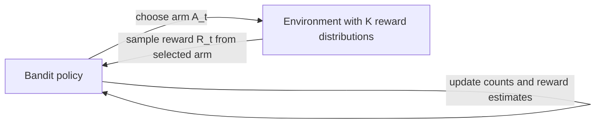
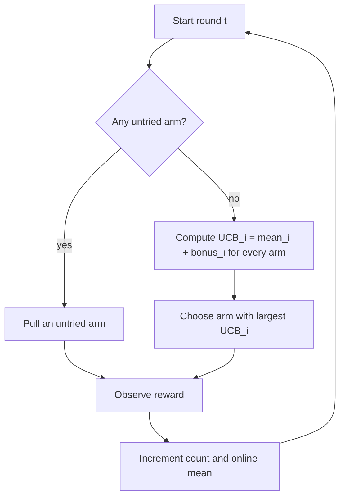
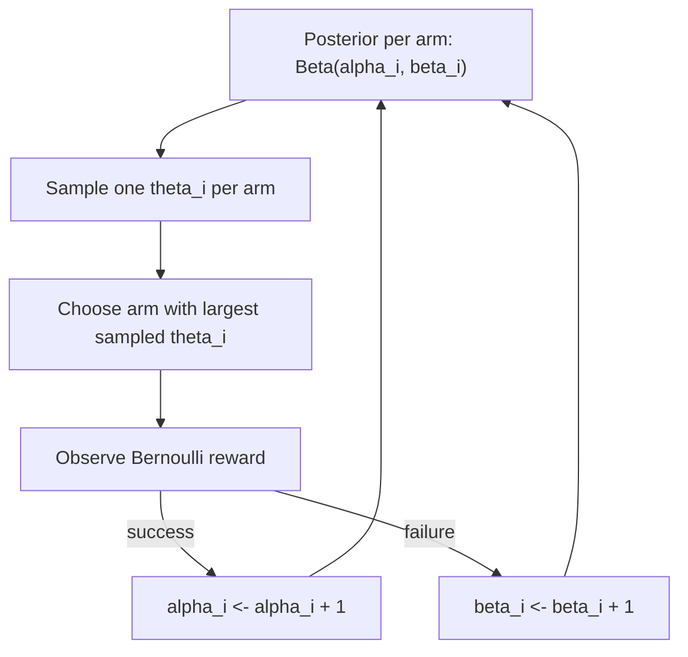

# Multi-Armed Bandits and Upper Confidence Bound

The multi-armed bandit problem is the simplest reinforcement learning setting where exploration is unavoidable. There is no state transition model, no delayed credit assignment, and no value propagation across time. The entire difficulty is that each action has an unknown reward distribution, and the learner must earn reward while estimating those distributions.

The notes' casino example maps directly to modern ML systems:

- Arm: slot machine, ad creative, recommendation policy, treatment, price point, model variant.
- Pull: one decision or exposure.
- Reward: click, conversion, revenue, clinical outcome, retention event, or any scalar utility.
- Objective: maximize accumulated reward, equivalently minimize regret against always choosing the best arm in hindsight under the true reward means.



## 1. Formal Stochastic Bandit Setup

Assume $K$ arms indexed by $i \in \{1,\dots,K\}$. Pulling arm $i$ at time $t$ returns a random reward

$$
R_t \sim \nu_i,
$$

where $\nu_i$ is an unknown reward distribution with finite mean

$$
\mu_i = \mathbb{E}[R_t \mid A_t=i].
$$

The learner chooses an arm $A_t$ using only the history before time $t$:

$$
H_{t-1}
=
(A_1,R_1,\dots,A_{t-1},R_{t-1}).
$$

The optimal arm is

$$
i^\star \in \arg\max_{i} \mu_i,
\qquad
\mu^\star = \max_i \mu_i.
$$

The pseudo-regret after $T$ rounds is

$$
\mathcal{R}_T
=
T\mu^\star
-
\mathbb{E}\left[\sum_{t=1}^T R_t\right].
$$

Equivalently, let

$$
N_i(T)
=
\sum_{t=1}^T \mathbf{1}\{A_t=i\}
$$

be the number of pulls of arm $i$, and define the optimality gap

$$
\Delta_i
=
\mu^\star - \mu_i.
$$

Then, using linearity of expectation,

$$
\mathcal{R}_T
=
\sum_{i=1}^K \Delta_i \, \mathbb{E}[N_i(T)].
$$

This identity is central: regret is caused only by pulling suboptimal arms, and the cost of pulling arm $i$ is exactly its gap $\Delta_i$.

### Assumptions

Classical UCB analysis usually assumes rewards are independent over time conditional on the chosen arm, stationary, and bounded. A common normalization is

$$
R_t \in [0,1].
$$

For non-binary bounded rewards, rescale if necessary:

$$
\tilde{R}_t
=
\frac{R_t-a}{b-a}
\qquad
\text{when}
\qquad
R_t \in [a,b].
$$

Unbounded rewards require different concentration bounds or robust estimators.

## 2. Empirical Means and Incremental Updates

For arm $i$, after $N_i(t)$ pulls, the empirical mean is

$$
\hat{\mu}_i(t)
=
\frac{1}{N_i(t)}
\sum_{s=1}^{t}
\mathbf{1}\{A_s=i\}R_s.
$$

The naive update recomputes the full sum. The numerically and computationally preferred online update is

$$
\hat{\mu}_{i,n}
=
\hat{\mu}_{i,n-1}
+
\frac{r_n-\hat{\mu}_{i,n-1}}{n},
$$

where $n$ is the new count for arm $i$, and $r_n$ is the newly observed reward from that arm.

Derivation:

$$
\hat{\mu}_{i,n}
=
\frac{1}{n}\sum_{j=1}^{n} r_j
=
\frac{1}{n}
\left(
\sum_{j=1}^{n-1}r_j + r_n
\right).
$$

Since

$$
\sum_{j=1}^{n-1}r_j
=
(n-1)\hat{\mu}_{i,n-1},
$$

we get

$$
\hat{\mu}_{i,n}
=
\frac{(n-1)\hat{\mu}_{i,n-1}+r_n}{n}
=
\hat{\mu}_{i,n-1}
+
\frac{r_n-\hat{\mu}_{i,n-1}}{n}.
$$

This update uses $O(1)$ time and memory per observation.

## 3. Greedy and Epsilon-Greedy Baselines

The greedy policy chooses

$$
A_t
\in
\arg\max_i \hat{\mu}_i(t-1).
$$

It is sample efficient when estimates are already accurate, but it can permanently commit to a bad arm after unlucky early observations.

Epsilon-greedy injects exploration:

$$
A_t =
\begin{cases}
\text{uniform random arm}, & \text{with probability } \epsilon, \\
\arg\max_i \hat{\mu}_i(t-1), & \text{with probability } 1-\epsilon.
\end{cases}
$$

With constant $\epsilon$, every arm continues to be sampled, but regret grows linearly because exploration does not vanish:

$$
\mathcal{R}_T = \Theta(T)
\quad
\text{for fixed } \epsilon>0
\quad
\text{in generic problems.}
$$

With decaying $\epsilon_t$, exploration can shrink, but the schedule is problem-sensitive. UCB replaces hand-scheduled random exploration with uncertainty-driven optimistic exploration.

## 4. Upper Confidence Bound

UCB chooses the arm with the largest optimistic estimate:

$$
A_t
\in
\arg\max_i
\left[
\hat{\mu}_i(t-1)
+
c_i(t-1)
\right],
$$

where $c_i(t)$ is a confidence radius. The notes use the form

$$
\operatorname{UCB}_i(t)
=
\hat{\mu}_i(t)
+
\sqrt{
\frac{3}{2}
\frac{\ln t}{N_i(t)}
}.
$$

A common textbook variant is

$$
\operatorname{UCB}_i(t)
=
\hat{\mu}_i(t)
+
c
\sqrt{
\frac{\ln t}{N_i(t)}
},
$$

where $c>0$ controls exploration. Another classical UCB1 form uses

$$
\operatorname{UCB1}_i(t)
=
\hat{\mu}_i(t)
+
\sqrt{
\frac{2\ln t}{N_i(t)}
}.
$$

All variants have the same structure:

$$
\text{optimism}
=
\text{empirical reward}
+
\text{uncertainty bonus}.
$$

### Step-by-Step Execution

At each round:

1. If some arm has never been pulled, pull it once. This avoids division by zero and gives every arm an initial estimate.
2. For each arm $i$, compute the empirical mean $\hat{\mu}_i$.
3. Compute an uncertainty bonus that decreases as $N_i$ increases and increases slowly as total time $t$ increases.
4. Select the arm with the largest empirical mean plus bonus.
5. Observe reward $R_t$.
6. Update $N_i$ and $\hat{\mu}_i$ for the selected arm only.



### Why the Bonus Has This Shape

For bounded rewards $R \in [0,1]$, Hoeffding's inequality gives

$$
\Pr\left(
\hat{\mu}_{i,n} - \mu_i \geq \epsilon
\right)
\leq
\exp(-2n\epsilon^2).
$$

The same bound applies to the lower tail:

$$
\Pr\left(
\mu_i - \hat{\mu}_{i,n} \geq \epsilon
\right)
\leq
\exp(-2n\epsilon^2).
$$

We want a radius $c_i(t)$ such that the true mean is below the upper bound with high probability:

$$
\Pr\left(
\mu_i
>
\hat{\mu}_i(t) + c_i(t)
\right)
\leq
\delta_t.
$$

Using Hoeffding:

$$
\exp\left(-2N_i(t)c_i(t)^2\right)
=
\delta_t.
$$

Taking logs:

$$
-2N_i(t)c_i(t)^2
=
\ln \delta_t.
$$

Therefore

$$
c_i(t)
=
\sqrt{
\frac{\ln(1/\delta_t)}{2N_i(t)}
}.
$$

If we choose a time-dependent failure probability such as

$$
\delta_t = t^{-4},
$$

then

$$
\ln(1/\delta_t)
=
4\ln t,
$$

and

$$
c_i(t)
=
\sqrt{
\frac{2\ln t}{N_i(t)}
}.
$$

This recovers the standard UCB1 bonus. The constants differ across derivations because authors choose different confidence schedules, tail bounds, and reward assumptions. The important dependencies are:

$$
c_i(t)
\propto
\sqrt{
\frac{\ln t}{N_i(t)}
}.
$$

### Mathematical Intuition

The empirical mean has standard error proportional to $1/\sqrt{N_i}$. An arm with few samples has a wide plausible range of true means, so UCB temporarily gives it the benefit of the doubt. The $\ln t$ term prevents the algorithm from becoming overconfident forever: as time grows, the algorithm demands stronger statistical evidence before abandoning an uncertain arm.

UCB is optimistic in the face of uncertainty. If an arm could plausibly be optimal, it may be pulled. If it is repeatedly bad, $N_i$ grows, the bonus shrinks, and its upper bound falls below the best arm.

## 5. Worked UCB Example

Suppose there are two ads:

| Arm | Empirical mean | Pulls |
| --- | ---: | ---: |
| A | $8$ | $100$ |
| B | $7$ | $5$ |

Assume total pulls

$$
t = 105.
$$

Using the notes' formula,

$$
\operatorname{UCB}_i
=
\hat{\mu}_i
+
\sqrt{
\frac{3}{2}
\frac{\ln t}{N_i}
}.
$$

Since

$$
\ln(105) \approx 4.65396,
$$

for arm A:

$$
\sqrt{
\frac{3}{2}
\frac{\ln 105}{100}
}
=
\sqrt{
\frac{1.5 \cdot 4.65396}{100}
}
=
\sqrt{0.06981}
\approx
0.2642.
$$

Thus

$$
\operatorname{UCB}_A
\approx
8 + 0.2642
=
8.2642.
$$

For arm B:

$$
\sqrt{
\frac{3}{2}
\frac{\ln 105}{5}
}
=
\sqrt{
\frac{1.5 \cdot 4.65396}{5}
}
=
\sqrt{1.39619}
\approx
1.1816.
$$

Thus

$$
\operatorname{UCB}_B
\approx
7 + 1.1816
=
8.1816.
$$

In this case, UCB still chooses A because $8.2642 > 8.1816$. But if B had empirical mean $7.2$, then

$$
\operatorname{UCB}_B
\approx
7.2 + 1.1816
=
8.3816,
$$

and UCB would choose B despite its lower empirical mean.

## 6. Regret Behavior of UCB

The regret decomposition was

$$
\mathcal{R}_T
=
\sum_{i=1}^K
\Delta_i
\mathbb{E}[N_i(T)].
$$

For a suboptimal arm $i$, UCB stops pulling it frequently once its confidence interval is separated from the optimal arm. Informally, arm $i$ is unlikely to be chosen when all of the following are true:

$$
\hat{\mu}_{i^\star}
\approx
\mu^\star,
\qquad
\hat{\mu}_i
\approx
\mu_i,
\qquad
c_i(t)
<
\frac{\Delta_i}{2}.
$$

The last condition implies

$$
\sqrt{
\frac{2\ln t}{N_i(t)}
}
<
\frac{\Delta_i}{2}.
$$

Squaring both sides:

$$
\frac{2\ln t}{N_i(t)}
<
\frac{\Delta_i^2}{4}.
$$

Rearranging:

$$
N_i(t)
>
\frac{8\ln t}{\Delta_i^2}.
$$

So a suboptimal arm with gap $\Delta_i$ needs only $O(\ln T / \Delta_i^2)$ pulls before UCB can confidently reject it. Multiplying by regret per pull $\Delta_i$ gives the familiar gap-dependent order:

$$
\mathcal{R}_T
=
O\left(
\sum_{i:\Delta_i>0}
\frac{\ln T}{\Delta_i}
\right).
$$

This is logarithmic in horizon $T$ for fixed gaps, unlike constant-$\epsilon$ exploration.

## 7. Thompson Sampling

Thompson sampling is a Bayesian alternative. Instead of constructing an explicit upper confidence bound, it samples a plausible mean for each arm from the posterior and chooses the arm with the largest sampled value.

For Bernoulli rewards,

$$
R_t \in \{0,1\},
\qquad
R_t \mid \theta_i \sim \operatorname{Bernoulli}(\theta_i).
$$

Use a Beta prior:

$$
\theta_i \sim \operatorname{Beta}(\alpha_i,\beta_i).
$$

The Beta density is

$$
p(\theta_i)
=
\frac{\Gamma(\alpha_i+\beta_i)}
{\Gamma(\alpha_i)\Gamma(\beta_i)}
\theta_i^{\alpha_i-1}
(1-\theta_i)^{\beta_i-1},
\qquad
0 \leq \theta_i \leq 1.
$$

After observing $s_i$ successes and $f_i$ failures, conjugacy gives

$$
\theta_i \mid \mathcal{D}
\sim
\operatorname{Beta}(\alpha_i+s_i,\beta_i+f_i).
$$

### Posterior Derivation

The Bernoulli likelihood for $s$ successes and $f$ failures is

$$
p(\mathcal{D}\mid \theta)
=
\theta^s(1-\theta)^f.
$$

The prior is

$$
p(\theta)
\propto
\theta^{\alpha-1}(1-\theta)^{\beta-1}.
$$

Bayes' rule gives

$$
p(\theta\mid\mathcal{D})
\propto
p(\mathcal{D}\mid\theta)p(\theta).
$$

Therefore

$$
p(\theta\mid\mathcal{D})
\propto
\theta^s(1-\theta)^f
\theta^{\alpha-1}(1-\theta)^{\beta-1}.
$$

Combining powers:

$$
p(\theta\mid\mathcal{D})
\propto
\theta^{\alpha+s-1}
(1-\theta)^{\beta+f-1}.
$$

This is exactly

$$
\operatorname{Beta}(\alpha+s,\beta+f).
$$

### Thompson Sampling Execution

At round $t$:

1. For each arm $i$, sample

$$
\tilde{\theta}_i
\sim
\operatorname{Beta}(\alpha_i,\beta_i).
$$

2. Choose

$$
A_t
\in
\arg\max_i \tilde{\theta}_i.
$$

3. Observe reward $R_t$.
4. If $R_t=1$, set $\alpha_{A_t} \leftarrow \alpha_{A_t}+1$.
5. If $R_t=0$, set $\beta_{A_t} \leftarrow \beta_{A_t}+1$.



UCB explores because the confidence radius is wide. Thompson sampling explores because uncertain posteriors have high variance, so they occasionally produce optimistic samples.

## 8. Scratch Python Implementation

The following code implements a Bernoulli bandit environment, greedy, epsilon-greedy, UCB, and Thompson sampling without using bandit libraries.

```python
from __future__ import annotations

from dataclasses import dataclass
from typing import Protocol

import numpy as np


class Policy(Protocol):
    def select_arm(self, t: int) -> int:
        ...

    def update(self, arm: int, reward: float) -> None:
        ...


@dataclass
class BernoulliBandit:
    """Stationary Bernoulli bandit with known probabilities only to the simulator."""

    probabilities: np.ndarray
    rng: np.random.Generator

    def pull(self, arm: int) -> int:
        if arm < 0 or arm >= len(self.probabilities):
            raise IndexError(f"arm {arm} is outside [0, {len(self.probabilities)})")
        return int(self.rng.random() < self.probabilities[arm])

    @property
    def best_mean(self) -> float:
        return float(np.max(self.probabilities))


class IncrementalMeanPolicy:
    """Shared count and online-mean machinery."""

    def __init__(self, n_arms: int, rng: np.random.Generator | None = None):
        self.n_arms = n_arms
        self.counts = np.zeros(n_arms, dtype=np.int64)
        self.means = np.zeros(n_arms, dtype=np.float64)
        self.rng = rng if rng is not None else np.random.default_rng()

    def update(self, arm: int, reward: float) -> None:
        self.counts[arm] += 1
        n = self.counts[arm]
        self.means[arm] += (reward - self.means[arm]) / n

    def _random_argmax(self, values: np.ndarray) -> int:
        """Break ties uniformly instead of always choosing the smallest index."""
        max_value = np.max(values)
        candidates = np.flatnonzero(values == max_value)
        return int(self.rng.choice(candidates))


class GreedyPolicy(IncrementalMeanPolicy):
    def select_arm(self, t: int) -> int:
        untried = np.flatnonzero(self.counts == 0)
        if len(untried) > 0:
            return int(self.rng.choice(untried))
        return self._random_argmax(self.means)


class EpsilonGreedyPolicy(IncrementalMeanPolicy):
    def __init__(self, n_arms: int, epsilon: float, rng: np.random.Generator | None = None):
        super().__init__(n_arms, rng)
        if not 0.0 <= epsilon <= 1.0:
            raise ValueError("epsilon must be in [0, 1]")
        self.epsilon = epsilon

    def select_arm(self, t: int) -> int:
        untried = np.flatnonzero(self.counts == 0)
        if len(untried) > 0:
            return int(self.rng.choice(untried))
        if self.rng.random() < self.epsilon:
            return int(self.rng.integers(self.n_arms))
        return self._random_argmax(self.means)


class UCBPolicy(IncrementalMeanPolicy):
    def __init__(
        self,
        n_arms: int,
        exploration: float = 2.0,
        rng: np.random.Generator | None = None,
    ):
        super().__init__(n_arms, rng)
        if exploration <= 0:
            raise ValueError("exploration must be positive")
        self.exploration = exploration

    def select_arm(self, t: int) -> int:
        untried = np.flatnonzero(self.counts == 0)
        if len(untried) > 0:
            return int(self.rng.choice(untried))

        total_pulls = max(1, int(np.sum(self.counts)))
        bonus = np.sqrt(self.exploration * np.log(total_pulls) / self.counts)
        ucb_values = self.means + bonus
        return self._random_argmax(ucb_values)


class ThompsonBernoulliPolicy:
    def __init__(
        self,
        n_arms: int,
        alpha0: float = 1.0,
        beta0: float = 1.0,
        rng: np.random.Generator | None = None,
    ):
        if alpha0 <= 0 or beta0 <= 0:
            raise ValueError("Beta prior parameters must be positive")
        self.n_arms = n_arms
        self.alpha = np.full(n_arms, alpha0, dtype=np.float64)
        self.beta = np.full(n_arms, beta0, dtype=np.float64)
        self.rng = rng if rng is not None else np.random.default_rng()

    def select_arm(self, t: int) -> int:
        samples = self.rng.beta(self.alpha, self.beta)
        max_value = np.max(samples)
        candidates = np.flatnonzero(samples == max_value)
        return int(self.rng.choice(candidates))

    def update(self, arm: int, reward: float) -> None:
        if reward not in (0, 1):
            raise ValueError("Bernoulli Thompson sampling expects rewards in {0, 1}")
        if reward == 1:
            self.alpha[arm] += 1.0
        else:
            self.beta[arm] += 1.0


def run_bandit(
    bandit: BernoulliBandit,
    policy: Policy,
    horizon: int,
) -> dict[str, np.ndarray]:
    rewards = np.zeros(horizon, dtype=np.float64)
    chosen_arms = np.zeros(horizon, dtype=np.int64)
    instantaneous_regret = np.zeros(horizon, dtype=np.float64)

    for t in range(1, horizon + 1):
        arm = policy.select_arm(t)
        reward = bandit.pull(arm)
        policy.update(arm, reward)

        idx = t - 1
        chosen_arms[idx] = arm
        rewards[idx] = reward
        instantaneous_regret[idx] = bandit.best_mean - bandit.probabilities[arm]

    return {
        "chosen_arms": chosen_arms,
        "rewards": rewards,
        "cumulative_reward": np.cumsum(rewards),
        "cumulative_regret": np.cumsum(instantaneous_regret),
    }


if __name__ == "__main__":
    seed_sequence = np.random.SeedSequence(7)
    probabilities = np.array([0.02, 0.05, 0.08, 0.12, 0.20])
    horizon = 10_000

    for name, make_policy in {
        "epsilon_greedy": lambda rng: EpsilonGreedyPolicy(
            len(probabilities), epsilon=0.1, rng=rng
        ),
        "ucb": lambda rng: UCBPolicy(len(probabilities), exploration=2.0, rng=rng),
        "thompson": lambda rng: ThompsonBernoulliPolicy(len(probabilities), rng=rng),
    }.items():
        env_seed, policy_seed = seed_sequence.spawn(2)
        bandit = BernoulliBandit(
            probabilities=probabilities,
            rng=np.random.default_rng(env_seed),
        )
        policy = make_policy(np.random.default_rng(policy_seed))
        result = run_bandit(bandit, policy, horizon)
        print(
            name,
            "reward=", int(result["cumulative_reward"][-1]),
            "regret=", round(float(result["cumulative_regret"][-1]), 2),
        )
```

### Implementation Notes

The scratch implementation deliberately separates environment and policy. The policy never reads the true probabilities; it only receives sampled rewards.

Important details:

- Untried arms are selected first to avoid $N_i=0$ in UCB.
- Ties are broken randomly. Deterministic tie-breaking can bias experiments toward lower-indexed arms.
- Regret is computed using simulator-known means. In production, regret is usually unobserved because $\mu^\star$ and $\mu_i$ are unknown.
- The UCB implementation uses `total_pulls = sum(counts)` rather than the loop variable `t`, which is safer if warm-started from historical data.

## 9. Vectorized Simulation for Algorithm Comparison

Single-run bandit curves are noisy. A reliable comparison averages over many independently sampled runs.

```python
import numpy as np


def evaluate_many_runs(
    probabilities: np.ndarray,
    policy_factory,
    horizon: int = 5_000,
    n_runs: int = 200,
    seed: int = 0,
) -> tuple[np.ndarray, np.ndarray]:
    all_rewards = np.zeros((n_runs, horizon), dtype=np.float64)
    all_regret = np.zeros((n_runs, horizon), dtype=np.float64)
    seed_sequence = np.random.SeedSequence(seed)

    for run_id, child_seed in enumerate(seed_sequence.spawn(n_runs)):
        env_seed, policy_seed = child_seed.spawn(2)
        bandit = BernoulliBandit(
            probabilities=probabilities,
            rng=np.random.default_rng(env_seed),
        )
        policy = policy_factory(np.random.default_rng(policy_seed))
        result = run_bandit(bandit, policy, horizon)
        all_rewards[run_id] = result["cumulative_reward"]
        all_regret[run_id] = result["cumulative_regret"]

    mean_reward = all_rewards.mean(axis=0)
    mean_regret = all_regret.mean(axis=0)
    return mean_reward, mean_regret


probabilities = np.array([0.05, 0.06, 0.07, 0.10, 0.13])
horizon = 5_000

ucb_reward, ucb_regret = evaluate_many_runs(
    probabilities,
    lambda rng: UCBPolicy(len(probabilities), exploration=2.0, rng=rng),
    horizon=horizon,
)

ts_reward, ts_regret = evaluate_many_runs(
    probabilities,
    lambda rng: ThompsonBernoulliPolicy(len(probabilities), rng=rng),
    horizon=horizon,
)

print("Final average UCB regret:", ucb_regret[-1])
print("Final average Thompson regret:", ts_regret[-1])
```

For fair benchmarking, use independent random streams per run and report confidence intervals across runs, not just a single seed.

## 10. Equivalent Implementations with Libraries

### NumPy

NumPy is enough for most custom bandit research prototypes:

- `np.random.Generator.random` samples uniform random numbers.
- `np.random.Generator.beta` samples from Beta distributions for Thompson sampling.
- `np.argmax` finds greedy choices, but it returns the first maximum, so random tie-breaking should be added when symmetry matters.
- Array operations let you compute all UCB scores at once:

```python
import numpy as np


def choose_ucb_arm(means: np.ndarray, counts: np.ndarray, t: int, c: float = 2.0) -> int:
    untried = np.flatnonzero(counts == 0)
    if len(untried) > 0:
        return int(np.random.default_rng().choice(untried))
    scores = means + np.sqrt(c * np.log(t) / counts)
    return int(np.argmax(scores))
```

Internally, the important operation is elementwise broadcasting:

$$
\texttt{scores}[i]
=
\texttt{means}[i]
+
\sqrt{
c\ln(t)/\texttt{counts}[i]
}.
$$

NumPy computes this in compiled vectorized loops rather than Python loops over arms.

### SciPy for Beta-Bernoulli Thompson Sampling

SciPy's `scipy.stats.beta` exposes the Beta distribution object. It is useful when you need density, cumulative probabilities, quantiles, or frozen distributions in addition to random sampling.

```python
import numpy as np
from scipy.stats import beta


alpha = np.array([10.0, 3.0, 1.0])
beta_param = np.array([5.0, 4.0, 1.0])

# Draw one posterior sample per arm.
posterior_samples = beta.rvs(alpha, beta_param, random_state=np.random.default_rng(123))
arm = int(np.argmax(posterior_samples))

# Posterior mean and a 95% equal-tailed credible interval for arm 0.
posterior_mean = alpha[0] / (alpha[0] + beta_param[0])
lower, upper = beta.ppf([0.025, 0.975], alpha[0], beta_param[0])
```

The `beta.rvs` call samples random variates from the Beta distribution. The `beta.ppf` call evaluates the inverse cumulative distribution function, so it returns quantiles $q$ satisfying

$$
\Pr(\Theta \leq q) = p.
$$

For Thompson sampling itself, `np.random.Generator.beta` is usually faster and simpler. SciPy is better when diagnostic probability calculations matter.

### MABWiser

MABWiser is a Python library for context-free and contextual multi-armed bandits. Its API follows an estimator-like workflow: construct a `MAB`, fit it from historical arm-reward data, then predict decisions.

```python
import numpy as np
from mabwiser.mab import MAB, LearningPolicy


arms = ["A", "B", "C"]
historical_decisions = np.array(["A", "A", "B", "C", "C", "C"])
historical_rewards = np.array([0, 1, 0, 1, 1, 0])

mab = MAB(
    arms=arms,
    learning_policy=LearningPolicy.UCB1(alpha=1.25),
    seed=123,
)

mab.fit(decisions=historical_decisions, rewards=historical_rewards)
next_arm = mab.predict()

print(next_arm)
```

Conceptually, a UCB library implementation stores per-arm counts and reward aggregates, computes empirical expectations, adds a policy-specific confidence term, and returns the arm with the highest score. A Thompson implementation stores posterior parameters or bootstrap samples, draws one randomized score per arm, and returns the maximum.

Library advantages:

- less boilerplate for production experiments,
- contextual bandit variants,
- parallel simulation utilities,
- tested API for warm starts, arm management, and prediction.

Library pitfalls:

- defaults may use a different UCB constant than your derivation,
- reward assumptions may differ across policies,
- contextual and non-contextual APIs can look similar but optimize different estimators,
- offline `fit` on logged bandit data is biased unless the logging policy and propensities are handled correctly.

## 11. Numerical Stability and Edge Cases

### Zero Counts

UCB has a division by $N_i(t)$. Handle untried arms explicitly:

$$
N_i(t)=0
\quad
\Rightarrow
\quad
\operatorname{UCB}_i(t)=+\infty
$$

or pull every arm once before applying the formula.

### Logarithm at Early Times

Since $\ln(1)=0$, the confidence bonus is zero at $t=1$. In practice, initialization handles this. If using warm starts, compute with

$$
t = \max\left(2,\sum_i N_i\right)
$$

to avoid degenerate bonuses.

### Reward Scaling

The Hoeffding-derived UCB radius assumes bounded rewards, commonly $[0,1]$. If rewards are revenue values with heavy tails, the confidence interval can be badly miscalibrated. Options include:

- clipping or winsorizing rewards,
- robust UCB variants,
- variance-aware UCB,
- modeling rewards with a parametric likelihood,
- optimizing a transformed objective such as log revenue.

### Nonstationarity

If $\mu_i$ changes over time, vanilla empirical means overweight stale data. Common fixes:

- sliding-window UCB,
- discounted UCB,
- change-point detection followed by reset,
- contextual bandits if apparent nonstationarity is explained by observed context.

### Delayed Rewards

Ad clicks may arrive immediately, but purchases may arrive days later. Updating only when rewards arrive introduces delayed feedback. Naively treating missing rewards as zero biases estimates downward. Use pending-outcome accounting, censoring-aware estimators, or define a fixed attribution window.

### Batched Decisions

If decisions are made in batches, the policy may send many users to the same apparently best arm before observing updated rewards. This increases regret and reduces effective adaptivity. Batch bandit algorithms or conservative exploration constraints may be required.

### Ties and Determinism

Always choosing the first `argmax` can create artificial arm preferences. Random tie-breaking is usually preferable in simulations and online systems unless deterministic reproducibility is required.

### Offline Evaluation

Historical logs usually contain data from a previous policy. Estimating a new policy's value from those logs requires counterfactual evaluation. If the old policy rarely chose an arm, there may be little information about how the new policy would perform. Inverse propensity scoring and doubly robust estimators are standard tools, but variance can be high.

## 12. Complexity

For $K$ arms and horizon $T$:

| Algorithm | Per-round time | Memory | Main operation |
| --- | ---: | ---: | --- |
| Greedy | $O(K)$ | $O(K)$ | max empirical mean |
| Epsilon-greedy | $O(K)$ | $O(K)$ | random choice or max empirical mean |
| UCB | $O(K)$ | $O(K)$ | compute $K$ confidence scores |
| Thompson sampling | $O(K)$ | $O(K)$ | sample $K$ posterior values |

With very large $K$, exact scoring can be expensive. Practical systems use candidate generation, approximate nearest-neighbor retrieval for contextual bandits, hierarchical bandits, or periodic score refreshes.

## 13. Common Implementation Pitfalls

- Comparing algorithms on a single random seed.
- Forgetting to initialize untried arms in UCB.
- Using cumulative reward alone when arms have different opportunity costs or traffic mix.
- Applying Bernoulli Thompson sampling to continuous rewards without changing the likelihood model.
- Letting `np.argmax` introduce deterministic index bias.
- Updating all arms with the observed reward instead of only the selected arm.
- Confusing observed reward regret with pseudo-regret.
- Evaluating online policies offline without correcting for the logging policy.
- Keeping old samples forever in nonstationary environments.
- Using UCB constants copied from normalized rewards on unnormalized rewards.

## 14. Connections to Related ML Concepts

### Reinforcement Learning

Bandits are one-state RL problems. If there is only one state and no delayed transition structure, then action values reduce to arm means:

$$
Q(a)
=
\mathbb{E}[R\mid A=a]
=
\mu_a.
$$

There is no Bellman backup because there is no future state value.

### A/B Testing

Classical A/B testing separates exploration and decision: collect data, run a hypothesis test, deploy the winner. Bandits interleave data collection and decision making. This improves cumulative reward but complicates statistical inference because samples are adaptively collected.

### Bayesian Optimization

UCB-style acquisition functions also appear in Bayesian optimization:

$$
\alpha_{\operatorname{UCB}}(x)
=
m(x) + \kappa s(x),
$$

where $m(x)$ is a surrogate posterior mean and $s(x)$ is posterior standard deviation. The bandit UCB formula is the discrete-arm, concentration-bound analogue.

### Contextual Bandits

In contextual bandits, the learner observes context $X_t$ before choosing:

$$
A_t \sim \pi(\cdot \mid X_t).
$$

The reward mean is arm- and context-dependent:

$$
\mu_i(x)
=
\mathbb{E}[R_t \mid A_t=i, X_t=x].
$$

Linear UCB, logistic bandits, neural bandits, and doubly robust policy learning extend the same exploration problem to feature-conditioned decisions.

### Active Learning

Both bandits and active learning allocate data collection adaptively. The difference is objective: active learning primarily seeks informative labels for model improvement, while bandits optimize reward during data collection.

## 15. Summary

The multi-armed bandit problem isolates the exploration-exploitation trade-off. Greedy selection exploits empirical means but can lock onto bad arms. Epsilon-greedy explores randomly but wastes samples on arms that are already statistically implausible. UCB adds a confidence bonus:

$$
\operatorname{UCB}_i(t)
=
\hat{\mu}_i(t)
+
O\left(
\sqrt{\frac{\ln t}{N_i(t)}}
\right),
$$

so uncertain arms are explored only while they could plausibly be optimal. Thompson sampling reaches a similar balance by posterior randomization. For Bernoulli rewards, its Beta posterior updates are closed form and extremely simple.

The key engineering rule is to keep the statistical assumptions visible. UCB's guarantees depend on stationarity, bounded rewards, and correct uncertainty scaling. Thompson sampling depends on a likelihood-prior model. In real systems, delayed feedback, nonstationarity, logging bias, batching, and reward scaling often matter more than the textbook algorithm.

## References and Further Reading

- Peter Auer, Nicolo Cesa-Bianchi, and Paul Fischer, "Finite-time Analysis of the Multiarmed Bandit Problem," Machine Learning, 2002: <https://people.eecs.berkeley.edu/~russell/classes/cs294/s11/readings/Auer%2Bal%3A2002.pdf>
- Richard S. Sutton and Andrew G. Barto, "Reinforcement Learning: An Introduction," 2nd ed., Chapter 2: <https://web.stanford.edu/class/psych209/Readings/SuttonBartoIPRLBook2ndEd.pdf>
- Tor Lattimore and Csaba Szepesvari, "Bandit Algorithms," Cambridge University Press, 2020.
- Sebastien Bubeck and Nicolo Cesa-Bianchi, "Regret Analysis of Stochastic and Nonstochastic Multi-armed Bandit Problems," Foundations and Trends in Machine Learning, 2012.
- SciPy documentation for `scipy.stats.beta` and statistical distributions: <https://docs.scipy.org/doc/scipy/reference/stats.html>
- MABWiser documentation for context-free and contextual bandit APIs: <https://fidelity.github.io/mabwiser/>
