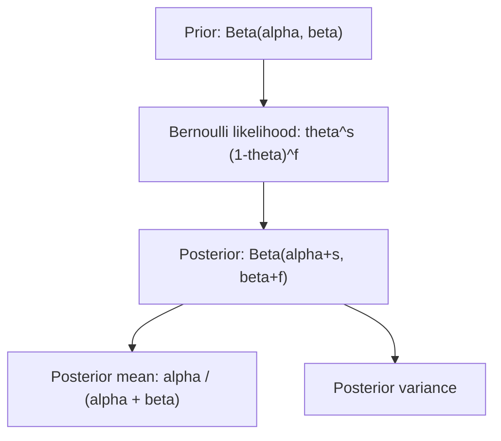
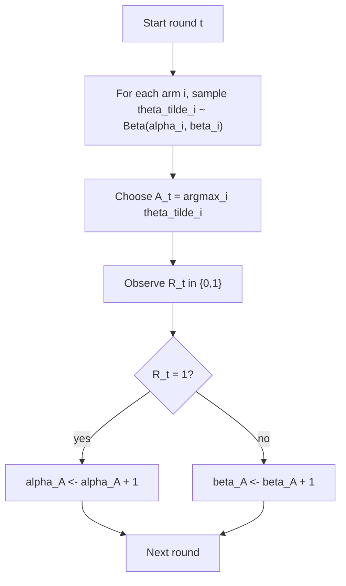

# Thompson Sampling

Thompson Sampling is a Bayesian probability-matching algorithm for sequential decision problems. In the Bernoulli multi-armed bandit setting, each arm has an unknown success probability, and the learner repeatedly chooses one arm, observes a binary reward, and updates its posterior belief about that arm.

The key difference from UCB is philosophical:

- UCB chooses the arm with the highest optimistic confidence bound.
- Thompson Sampling samples one plausible world from the posterior and acts optimally in that sampled world.

This makes exploration automatic. Arms with high posterior mean are sampled often because they look good; arms with high posterior uncertainty are sampled occasionally because they might still be good.


## 1. Bandit Setup

Assume $K$ arms indexed by $i \in \{1,\dots,K\}$. At time $t$, the policy selects an arm

$$
A_t \in \{1,\dots,K\}.
$$

For a Bernoulli bandit, the reward from arm $i$ is

$$
R_t \mid A_t=i,\theta_i \sim \operatorname{Bernoulli}(\theta_i),
$$

where

$$
\theta_i = \mathbb{P}(R_t=1 \mid A_t=i)
$$

is the unknown success probability of arm $i$. In an advertising example, $\theta_i$ is the click-through rate of ad $i$.

The stochastic bandit assumptions are:

- Rewards are conditionally independent given the selected arm and its parameter.
- Each arm's reward distribution is stationary.
- The learner observes only the reward of the selected arm.
- The objective is to maximize cumulative reward, or equivalently minimize regret.

Let

$$
\theta^\star = \max_i \theta_i
$$

and define the optimality gap of arm $i$ as

$$
\Delta_i = \theta^\star - \theta_i.
$$

The expected pseudo-regret after $T$ rounds is

$$
\mathcal{R}_T
=
T\theta^\star
-
\mathbb{E}\left[\sum_{t=1}^{T}R_t\right].
$$

If

$$
N_i(T)=\sum_{t=1}^{T}\mathbf{1}\{A_t=i\},
$$

then

$$
\mathcal{R}_T
=
\sum_{i=1}^{K}\Delta_i \, \mathbb{E}[N_i(T)].
$$

So a bandit algorithm is good when it quickly reduces pulls of arms with large positive gaps while still gathering enough evidence to avoid premature commitment.

## 2. Bayesian Model

Thompson Sampling treats each unknown arm probability $\theta_i$ as a random variable. The randomness does not mean the true parameter physically changes over time. It represents epistemic uncertainty: uncertainty due to limited data.

For each arm $i$, place a Beta prior on $\theta_i$:

$$
\theta_i \sim \operatorname{Beta}(\alpha_i,\beta_i),
$$

with density

$$
p(\theta_i)
=
\frac{1}{B(\alpha_i,\beta_i)}
\theta_i^{\alpha_i-1}
(1-\theta_i)^{\beta_i-1},
\qquad
0 < \theta_i < 1,
$$

where

$$
B(\alpha,\beta)
=
\frac{\Gamma(\alpha)\Gamma(\beta)}
{\Gamma(\alpha+\beta)}.
$$

Here:

- $\alpha_i > 0$ controls prior success mass.
- $\beta_i > 0$ controls prior failure mass.
- $B(\alpha,\beta)$ is the normalizing constant.
- $\Gamma(\cdot)$ is the Gamma function, with $\Gamma(n)=(n-1)!$ for positive integers.

The common uninformative initialization is

$$
\theta_i \sim \operatorname{Beta}(1,1).
$$

Because

$$
p(\theta_i)=1
\qquad
\text{for}
\qquad
0<\theta_i<1,
$$

$\operatorname{Beta}(1,1)$ is the uniform distribution on $[0,1]$.

## 3. Beta-Bernoulli Conjugacy

The main reason the Beta distribution is used for Bernoulli Thompson Sampling is conjugacy: after observing Bernoulli rewards, the posterior remains a Beta distribution.

Suppose for one arm we observe $s$ successes and $f$ failures. The likelihood is

$$
p(D \mid \theta)
=
\theta^s(1-\theta)^f.
$$

The Beta prior is

$$
p(\theta)
=
\frac{1}{B(\alpha,\beta)}
\theta^{\alpha-1}(1-\theta)^{\beta-1}.
$$

By Bayes' rule,

$$
p(\theta \mid D)
=
\frac{p(D \mid \theta)p(\theta)}
{p(D)}.
$$

As a function of $\theta$, ignoring constants that do not depend on $\theta$,

$$
p(\theta \mid D)
\propto
\theta^s(1-\theta)^f
\theta^{\alpha-1}(1-\theta)^{\beta-1}.
$$

Collecting powers gives

$$
p(\theta \mid D)
\propto
\theta^{\alpha+s-1}
(1-\theta)^{\beta+f-1}.
$$

This is the kernel of a Beta distribution:

$$
\theta \mid D
\sim
\operatorname{Beta}(\alpha+s,\beta+f).
$$

Therefore the online update is just:

$$
\alpha \leftarrow \alpha + R_t,
$$

$$
\beta \leftarrow \beta + (1-R_t).
$$

For binary rewards, this update is exact and uses only two sufficient statistics per arm.



## 4. Posterior Mean, Variance, and Mode

For

$$
\theta \sim \operatorname{Beta}(\alpha,\beta),
$$

the posterior mean is

$$
\mathbb{E}[\theta]
=
\frac{\alpha}{\alpha+\beta}.
$$

The posterior variance is

$$
\operatorname{Var}(\theta)
=
\frac{\alpha\beta}
{(\alpha+\beta)^2(\alpha+\beta+1)}.
$$

When $\alpha>1$ and $\beta>1$, the mode is

$$
\operatorname{mode}(\theta)
=
\frac{\alpha-1}{\alpha+\beta-2}.
$$

For a prior $\operatorname{Beta}(\alpha_0,\beta_0)$ and observations $s,f$:

$$
\mathbb{E}[\theta \mid D]
=
\frac{\alpha_0+s}{\alpha_0+\beta_0+s+f}.
$$

For the common $\operatorname{Beta}(1,1)$ prior:

$$
\mathbb{E}[\theta \mid D]
=
\frac{s+1}{s+f+2}.
$$

This is a smoothed estimate of the empirical success rate. The empirical rate is

$$
\hat{\theta}
=
\frac{s}{s+f},
$$

while the posterior mean behaves as if one prior success and one prior failure were already present.

### Intuition

The quantity

$$
\alpha+\beta
$$

acts like an effective sample size. As $\alpha+\beta$ grows, the posterior variance shrinks. Thompson Sampling uses this variance directly through sampling:

- A narrow posterior rarely produces extreme samples.
- A wide posterior sometimes produces optimistic samples.
- Arms that are both promising and uncertain get explored naturally.

## 5. Thompson Sampling Algorithm

For Bernoulli rewards:

1. Initialize each arm with prior parameters $\alpha_i,\beta_i$.
2. At each round $t$, sample one candidate success probability for every arm:

$$
\tilde{\theta}_{i,t}
\sim
\operatorname{Beta}(\alpha_i,\beta_i).
$$

3. Select the arm with the largest sampled value:

$$
A_t
\in
\arg\max_i \tilde{\theta}_{i,t}.
$$

4. Observe reward:

$$
R_t \in \{0,1\}.
$$

5. Update only the selected arm:

$$
\alpha_{A_t}
\leftarrow
\alpha_{A_t}+R_t,
$$

$$
\beta_{A_t}
\leftarrow
\beta_{A_t}+1-R_t.
$$

6. Repeat.



### Probability Matching View

Thompson Sampling chooses each arm with probability equal to its posterior probability of being optimal:

$$
\mathbb{P}(A_t=i \mid H_{t-1})
=
\mathbb{P}
\left(
\theta_i = \max_j \theta_j
\mid H_{t-1}
\right),
$$

up to tie-handling for continuous posteriors. This follows because the algorithm samples a complete parameter vector

$$
\tilde{\theta}_t
=
(\tilde{\theta}_{1,t},\dots,\tilde{\theta}_{K,t})
$$

from the posterior and chooses the arm that is optimal under that sampled vector.

This is the cleanest intuition for why Thompson Sampling balances exploration and exploitation. If an arm has a $20\%$ posterior chance of being best, it is selected about $20\%$ of the time. As evidence accumulates, that probability concentrates on the truly best arm.

## 6. Step-by-Step Worked Example

Consider three ads with a uniform prior:

$$
\theta_A,\theta_B,\theta_C
\sim
\operatorname{Beta}(1,1).
$$

After some observations:

| Arm | Successes | Failures | Posterior |
|---|---:|---:|---|
| A | 10 | 2 | $\operatorname{Beta}(11,3)$ |
| B | 5 | 2 | $\operatorname{Beta}(6,3)$ |
| C | 1 | 1 | $\operatorname{Beta}(2,2)$ |

The posterior means are:

$$
\mathbb{E}[\theta_A \mid D]
=
\frac{11}{11+3}
=
0.7857.
$$

$$
\mathbb{E}[\theta_B \mid D]
=
\frac{6}{6+3}
=
0.6667.
$$

$$
\mathbb{E}[\theta_C \mid D]
=
\frac{2}{2+2}
=
0.5000.
$$

The posterior variances are:

$$
\operatorname{Var}(\theta_A)
=
\frac{11 \cdot 3}{14^2 \cdot 15}
=
\frac{33}{2940}
=
0.01122.
$$

$$
\operatorname{Var}(\theta_B)
=
\frac{6 \cdot 3}{9^2 \cdot 10}
=
\frac{18}{810}
=
0.02222.
$$

$$
\operatorname{Var}(\theta_C)
=
\frac{2 \cdot 2}{4^2 \cdot 5}
=
\frac{4}{80}
=
0.05000.
$$

Arm A has the highest posterior mean, but arm C has the highest uncertainty. A possible Thompson Sampling round might draw:

| Arm | Posterior | Sample |
|---|---|---:|
| A | $\operatorname{Beta}(11,3)$ | $0.74$ |
| B | $\operatorname{Beta}(6,3)$ | $0.82$ |
| C | $\operatorname{Beta}(2,2)$ | $0.48$ |

The selected arm is

$$
A_t = B.
$$

If the observed reward is a click:

$$
R_t=1,
$$

then

$$
\alpha_B \leftarrow 6+1=7,
$$

$$
\beta_B \leftarrow 3.
$$

The new posterior for B is

$$
\theta_B \mid D
\sim
\operatorname{Beta}(7,3).
$$

If instead the user does not click:

$$
R_t=0,
$$

then

$$
\alpha_B \leftarrow 6,
$$

$$
\beta_B \leftarrow 3+1=4.
$$

The new posterior becomes

$$
\theta_B \mid D
\sim
\operatorname{Beta}(6,4).
$$

## 7. Why Sampling Produces Exploration

Suppose two arms have these posteriors:

$$
\theta_A \sim \operatorname{Beta}(101,51),
$$

$$
\theta_B \sim \operatorname{Beta}(6,3).
$$

Their posterior means are:

$$
\mathbb{E}[\theta_A]
=
\frac{101}{152}
=
0.6645,
$$

$$
\mathbb{E}[\theta_B]
=
\frac{6}{9}
=
0.6667.
$$

The means are similar, but the variances differ:

$$
\operatorname{Var}(\theta_A)
=
\frac{101 \cdot 51}
{152^2 \cdot 153}
\approx
0.00145,
$$

$$
\operatorname{Var}(\theta_B)
=
\frac{6 \cdot 3}
{9^2 \cdot 10}
=
0.02222.
$$

Arm B is much less certain. A greedy policy based on posterior means would treat B as only slightly better than A. Thompson Sampling realizes that B could plausibly be far better or far worse. Its wide posterior generates large samples more often, so B receives more evidence. If B is actually bad, failures move $\beta_B$ upward and its posterior stops producing competitive samples.

This is exploration without an explicit exploration parameter.

## 8. Mathematical Derivation of the Decision Rule

Let the unknown reward parameters be

$$
\theta=(\theta_1,\dots,\theta_K).
$$

Under independent priors and independent arm observations, the posterior factorizes:

$$
p(\theta \mid H_{t-1})
=
\prod_{i=1}^{K}
p(\theta_i \mid H_{t-1}).
$$

For Bernoulli arms:

$$
p(\theta_i \mid H_{t-1})
=
\operatorname{Beta}(\alpha_i(t),\beta_i(t)).
$$

Define the optimal action under a known parameter vector:

$$
a^\star(\theta)
\in
\arg\max_i \theta_i.
$$

Thompson Sampling samples

$$
\tilde{\theta}_t
\sim
p(\theta \mid H_{t-1})
$$

and chooses

$$
A_t = a^\star(\tilde{\theta}_t).
$$

Therefore, for any arm $i$:

$$
\mathbb{P}(A_t=i \mid H_{t-1})
=
\int
\mathbf{1}
\left\{
i = a^\star(\theta)
\right\}
p(\theta \mid H_{t-1})\,d\theta.
$$

The integral is exactly the posterior probability that arm $i$ is optimal:

$$
\mathbb{P}(A_t=i \mid H_{t-1})
=
\mathbb{P}
\left(
i = a^\star(\theta)
\mid H_{t-1}
\right).
$$

For two Bernoulli arms, this probability is

$$
\mathbb{P}(\theta_1 > \theta_2 \mid H)
=
\int_0^1
f_1(x)F_2(x)\,dx,
$$

where $f_1$ is the Beta density of arm 1 and $F_2$ is the Beta CDF of arm 2. Thompson Sampling avoids computing this integral explicitly. It estimates the same event implicitly through posterior sampling.

## 9. Regret Behavior

For Bernoulli bandits, Thompson Sampling is known to achieve logarithmic frequentist regret under standard stochastic assumptions. Informally, for each suboptimal arm $i$:

$$
\mathbb{E}[N_i(T)]
=
O
\left(
\frac{\log T}
{\operatorname{KL}(\theta_i,\theta^\star)}
\right),
$$

where the Bernoulli KL divergence is

$$
\operatorname{KL}(p,q)
=
p\log\frac{p}{q}
+
(1-p)\log\frac{1-p}{1-q}.
$$

The corresponding regret scaling is

$$
\mathcal{R}_T
=
O
\left(
\sum_{i:\Delta_i>0}
\frac{\Delta_i \log T}
{\operatorname{KL}(\theta_i,\theta^\star)}
\right).
$$

The important implementation-level interpretation is not the proof but the behavior:

- Bad arms are not sampled forever at a constant rate.
- Ambiguous arms near the optimum require more samples.
- The closer $\theta_i$ is to $\theta^\star$, the smaller the KL separation and the harder the statistical problem.

## 10. From-Scratch Python Implementation

The core Bernoulli Thompson Sampling implementation is short because the posterior update is conjugate.

```python
from __future__ import annotations

import random
from dataclasses import dataclass
from typing import Iterable, List, Sequence


@dataclass
class BernoulliThompsonSampling:
    """Beta-Bernoulli Thompson Sampling for K binary-reward arms."""

    n_arms: int
    alpha0: float = 1.0
    beta0: float = 1.0
    seed: int | None = None

    def __post_init__(self) -> None:
        if self.n_arms <= 0:
            raise ValueError("n_arms must be positive")
        if self.alpha0 <= 0 or self.beta0 <= 0:
            raise ValueError("Beta parameters must be positive")

        self.alpha: List[float] = [self.alpha0 for _ in range(self.n_arms)]
        self.beta: List[float] = [self.beta0 for _ in range(self.n_arms)]
        self.rng = random.Random(self.seed)

    def sample_scores(self) -> List[float]:
        """Draw one posterior sample per arm."""
        return [
            self.rng.betavariate(a, b)
            for a, b in zip(self.alpha, self.beta)
        ]

    def select_arm(self) -> int:
        """Return the arm with the largest posterior sample."""
        samples = self.sample_scores()
        return max(range(self.n_arms), key=samples.__getitem__)

    def update(self, arm: int, reward: int) -> None:
        """Update the posterior for the selected arm."""
        if not 0 <= arm < self.n_arms:
            raise IndexError("arm index out of range")
        if reward not in (0, 1):
            raise ValueError("Bernoulli reward must be 0 or 1")

        self.alpha[arm] += reward
        self.beta[arm] += 1 - reward

    def posterior_means(self) -> List[float]:
        return [
            a / (a + b)
            for a, b in zip(self.alpha, self.beta)
        ]

    def posterior_variances(self) -> List[float]:
        return [
            (a * b) / ((a + b) ** 2 * (a + b + 1))
            for a, b in zip(self.alpha, self.beta)
        ]


class BernoulliBanditEnvironment:
    """Stationary Bernoulli bandit simulator."""

    def __init__(self, probabilities: Sequence[float], seed: int | None = None) -> None:
        if not probabilities:
            raise ValueError("probabilities must be non-empty")
        if any(p < 0.0 or p > 1.0 for p in probabilities):
            raise ValueError("probabilities must lie in [0, 1]")

        self.probabilities = list(probabilities)
        self.rng = random.Random(seed)

    def pull(self, arm: int) -> int:
        return int(self.rng.random() < self.probabilities[arm])


def run_simulation(
    probabilities: Sequence[float],
    horizon: int,
    seed: int = 0,
) -> dict[str, object]:
    env = BernoulliBanditEnvironment(probabilities, seed=seed)
    policy = BernoulliThompsonSampling(
        n_arms=len(probabilities),
        seed=seed + 1,
    )

    counts = [0 for _ in probabilities]
    rewards = [0 for _ in probabilities]
    total_reward = 0
    best_mean = max(probabilities)
    cumulative_regret = []

    for t in range(1, horizon + 1):
        arm = policy.select_arm()
        reward = env.pull(arm)
        policy.update(arm, reward)

        counts[arm] += 1
        rewards[arm] += reward
        total_reward += reward

        regret = t * best_mean - total_reward
        cumulative_regret.append(regret)

    return {
        "counts": counts,
        "rewards": rewards,
        "total_reward": total_reward,
        "posterior_alpha": policy.alpha,
        "posterior_beta": policy.beta,
        "posterior_means": policy.posterior_means(),
        "cumulative_regret": cumulative_regret,
    }


if __name__ == "__main__":
    result = run_simulation([0.03, 0.05, 0.04], horizon=10_000, seed=7)
    print("Pull counts:", result["counts"])
    print("Posterior means:", result["posterior_means"])
    print("Total reward:", result["total_reward"])
```

This implementation uses Python's `random.betavariate`. In CPython, the Beta variate is generated using Gamma variates internally. Mathematically, if

$$
X \sim \operatorname{Gamma}(\alpha,1),
$$

$$
Y \sim \operatorname{Gamma}(\beta,1),
$$

independently, then

$$
\frac{X}{X+Y}
\sim
\operatorname{Beta}(\alpha,\beta).
$$

The scale parameter cancels as long as both Gamma variables use the same scale.

## 11. Implementing Beta Sampling Through Gamma Sampling

To see the mechanism more directly, we can write the Beta sampler as a Gamma-ratio sampler.

```python
from __future__ import annotations

import math
import random


def standard_normal(rng: random.Random) -> float:
    """Box-Muller transform for a standard normal draw."""
    u1 = max(rng.random(), 1e-300)
    u2 = rng.random()
    return math.sqrt(-2.0 * math.log(u1)) * math.cos(2.0 * math.pi * u2)


def gamma_mt(shape: float, rng: random.Random) -> float:
    """Marsaglia-Tsang sampler for Gamma(shape, scale=1).

    For shape < 1, use the boosting identity:
    if X ~ Gamma(shape + 1, 1) and U ~ Uniform(0, 1),
    then X * U ** (1 / shape) ~ Gamma(shape, 1).
    """
    if shape <= 0:
        raise ValueError("shape must be positive")

    if shape < 1.0:
        u = max(rng.random(), 1e-300)
        return gamma_mt(shape + 1.0, rng) * (u ** (1.0 / shape))

    d = shape - 1.0 / 3.0
    c = 1.0 / math.sqrt(9.0 * d)

    while True:
        z = standard_normal(rng)
        v = (1.0 + c * z) ** 3
        if v <= 0.0:
            continue

        u = rng.random()

        # Squeeze test: fast acceptance for most candidates.
        if u < 1.0 - 0.0331 * (z ** 4):
            return d * v

        # Full logarithmic acceptance test.
        if math.log(max(u, 1e-300)) < 0.5 * z * z + d * (1.0 - v + math.log(v)):
            return d * v


def beta_from_gamma(alpha: float, beta: float, rng: random.Random) -> float:
    """Sample Beta(alpha, beta) through independent Gamma draws."""
    x = gamma_mt(alpha, rng)
    y = gamma_mt(beta, rng)
    total = x + y
    if total == 0.0:
        # Extremely defensive; underflow can occur only for pathological inputs.
        return 0.5
    return x / total
```

Production libraries use heavily optimized versions of these ideas, with careful branching for parameter regimes, vectorization, and high-quality pseudo-random number generators.

## 12. Vectorized NumPy Implementation

For simulations or production serving over many arms, vectorization is cleaner and faster.

```python
from __future__ import annotations

import numpy as np


class NumpyBernoulliThompsonSampling:
    def __init__(
        self,
        n_arms: int,
        alpha0: float = 1.0,
        beta0: float = 1.0,
        seed: int | None = None,
    ) -> None:
        if n_arms <= 0:
            raise ValueError("n_arms must be positive")
        if alpha0 <= 0 or beta0 <= 0:
            raise ValueError("Beta parameters must be positive")

        self.alpha = np.full(n_arms, alpha0, dtype=np.float64)
        self.beta = np.full(n_arms, beta0, dtype=np.float64)
        self.rng = np.random.default_rng(seed)

    def select_arm(self) -> int:
        samples = self.rng.beta(self.alpha, self.beta)
        return int(np.argmax(samples))

    def update(self, arm: int, reward: int) -> None:
        if reward not in (0, 1):
            raise ValueError("reward must be 0 or 1")
        self.alpha[arm] += reward
        self.beta[arm] += 1 - reward

    @property
    def posterior_mean(self) -> np.ndarray:
        return self.alpha / (self.alpha + self.beta)

    @property
    def posterior_variance(self) -> np.ndarray:
        total = self.alpha + self.beta
        return (self.alpha * self.beta) / (total * total * (total + 1.0))
```

`np.random.default_rng` creates a modern NumPy random generator. Its `beta` method accepts scalar or array parameters. When arrays are passed, NumPy broadcasts the parameter arrays and returns one Beta draw per broadcasted element. Conceptually, each Beta draw is still generated from shape parameters $\alpha_i,\beta_i$; implementation details are optimized in compiled code.

Important detail: `np.argmax` returns the first maximum. For continuous Beta samples, exact ties are rare, but they can happen numerically. If tie fairness matters, randomize among tied maxima.

## 13. SciPy Implementation for Diagnostics

SciPy's `scipy.stats.beta` is useful when you need densities, CDFs, quantiles, credible intervals, or posterior visualizations.

```python
from __future__ import annotations

import numpy as np
from scipy.stats import beta


alpha = np.array([11.0, 6.0, 2.0])
beta_param = np.array([3.0, 3.0, 2.0])

means = beta.mean(alpha, beta_param)
variances = beta.var(alpha, beta_param)
lower = beta.ppf(0.025, alpha, beta_param)
upper = beta.ppf(0.975, alpha, beta_param)
samples = beta.rvs(alpha, beta_param, random_state=np.random.default_rng(0))

for i in range(len(alpha)):
    print(
        i,
        "mean=", means[i],
        "var=", variances[i],
        "95% interval=", (lower[i], upper[i]),
        "sample=", samples[i],
    )
```

Internally, `scipy.stats.beta` exposes the Beta distribution as a continuous random variable object. The important user-facing operations are:

- `pdf`: evaluates the density.
- `cdf`: evaluates cumulative probability.
- `ppf`: evaluates inverse CDF, useful for credible intervals.
- `rvs`: generates random samples.
- `mean` and `var`: compute analytical moments.

For Thompson Sampling itself, NumPy's generator is usually enough. SciPy becomes useful when debugging, plotting posterior uncertainty, computing credible intervals, or comparing exact probabilities.

## 14. UCB vs Thompson Sampling

| Property | UCB | Thompson Sampling |
|---|---|---|
| Decision principle | Optimism under uncertainty | Posterior probability matching |
| Score | Mean plus confidence bonus | Random posterior sample |
| Exploration parameter | Confidence radius constant or bound choice | Prior and posterior uncertainty |
| Determinism | Deterministic after tie-breaking | Randomized |
| Natural Bayesian prior | No | Yes |
| Works cleanly for Bernoulli rewards | Yes | Yes |
| Common extension path | Concentration bounds | Posterior approximations |

UCB computes a deterministic index such as

$$
\operatorname{UCB}_i(t)
=
\hat{\mu}_i(t)
+
\sqrt{
\frac{2\log t}{N_i(t)}
}.
$$

Thompson Sampling instead draws

$$
\tilde{\theta}_{i,t}
\sim
\operatorname{Beta}(\alpha_i(t),\beta_i(t))
$$

and chooses the largest sample.

The practical difference:

- UCB explores arms because their confidence radius is large.
- Thompson Sampling explores arms because their posterior still assigns mass to high reward values.

When an uncertain arm is also implausibly optimal, Thompson Sampling tends to stop wasting trials on it. This is often a practical advantage over overly mechanical exploration schedules.

## 15. Priors and Cold Start

The prior matters most early and fades as data accumulates.

With prior

$$
\operatorname{Beta}(\alpha_0,\beta_0),
$$

the prior mean is

$$
m_0
=
\frac{\alpha_0}{\alpha_0+\beta_0}.
$$

The prior effective sample size is

$$
n_0
=
\alpha_0+\beta_0.
$$

Given a desired prior mean $m_0$ and strength $n_0$, choose

$$
\alpha_0 = m_0 n_0,
$$

$$
\beta_0 = (1-m_0)n_0.
$$

Example: if historical CTR is $5\%$ and we want the prior to count like $20$ pseudo-observations:

$$
\alpha_0 = 0.05 \cdot 20 = 1,
$$

$$
\beta_0 = 0.95 \cdot 20 = 19.
$$

So the prior is

$$
\operatorname{Beta}(1,19).
$$

This is much more realistic for online advertising than $\operatorname{Beta}(1,1)$ when true CTRs are typically small. A uniform prior over $[0,1]$ says that $70\%$ CTR is initially just as plausible as $3\%$ CTR, which is often an unreasonable cold-start assumption.

## 16. Non-Binary Rewards

The Beta-Bernoulli model is exact only for binary rewards. For non-binary rewards, common options include:

1. Normalize bounded rewards to $[0,1]$ and use a Bernoulli-style update with randomized rounding.
2. Use a Gaussian reward model with a Normal or Normal-Inverse-Gamma posterior.
3. Use a Bayesian generalized linear model for contextual or non-Gaussian rewards.
4. Use bootstrap Thompson Sampling or approximate posterior sampling.

### Gaussian Rewards With Known Variance

Assume arm $i$ has rewards

$$
R \mid \mu_i
\sim
\mathcal{N}(\mu_i,\sigma^2),
$$

with known $\sigma^2$. Use a Normal prior:

$$
\mu_i
\sim
\mathcal{N}(m_{0,i},v_{0,i}).
$$

After $n$ observations with sample mean $\bar{r}$, the posterior is

$$
\mu_i \mid D
\sim
\mathcal{N}(m_{n,i},v_{n,i}),
$$

where the posterior precision is prior precision plus data precision:

$$
\frac{1}{v_{n,i}}
=
\frac{1}{v_{0,i}}
+
\frac{n}{\sigma^2}.
$$

The posterior mean is the precision-weighted average:

$$
m_{n,i}
=
v_{n,i}
\left(
\frac{m_{0,i}}{v_{0,i}}
+
\frac{n\bar{r}}{\sigma^2}
\right).
$$

Thompson Sampling then draws

$$
\tilde{\mu}_{i,t}
\sim
\mathcal{N}(m_{i,t},v_{i,t})
$$

and selects the arm with largest sampled mean.

## 17. Contextual Thompson Sampling

In contextual bandits, each round includes a feature vector $x_{t,i}$ for each arm. A linear reward model assumes

$$
\mathbb{E}[R_t \mid x_{t,i},\theta]
=
x_{t,i}^{\top}\theta.
$$

With Gaussian noise,

$$
R_t
=
x_{t,A_t}^{\top}\theta
+
\varepsilon_t,
\qquad
\varepsilon_t \sim \mathcal{N}(0,\sigma^2).
$$

Using a Gaussian prior

$$
\theta \sim \mathcal{N}(m_0,\Sigma_0),
$$

Bayesian linear regression gives posterior covariance and mean:

$$
\Sigma_t^{-1}
=
\Sigma_0^{-1}
+
\frac{1}{\sigma^2}
\sum_{s=1}^{t}
x_{s,A_s}x_{s,A_s}^{\top},
$$

$$
m_t
=
\Sigma_t
\left(
\Sigma_0^{-1}m_0
+
\frac{1}{\sigma^2}
\sum_{s=1}^{t}
x_{s,A_s}R_s
\right).
$$

Contextual Thompson Sampling samples

$$
\tilde{\theta}_t
\sim
\mathcal{N}(m_t,\Sigma_t)
$$

and chooses

$$
A_t
\in
\arg\max_i
x_{t,i}^{\top}\tilde{\theta}_t.
$$


This is the bridge from simple A/B testing to personalized recommendations, ranking, pricing, and adaptive model selection.

## 18. Computational Complexity

For Bernoulli Thompson Sampling with $K$ arms:

### Per Round

Sampling one Beta variable per arm:

$$
O(K).
$$

Taking the argmax:

$$
O(K).
$$

Updating the selected arm:

$$
O(1).
$$

Total per round:

$$
O(K).
$$

### Memory

Store two parameters per arm:

$$
O(K).
$$

For $T$ rounds:

$$
O(TK)
$$

time if every round scores every arm. In very large action spaces, this becomes too expensive, and production systems often use candidate generation, approximate top-$k$ retrieval, hierarchical action sets, or contextual scoring models.

## 19. Numerical Stability

### Large Counts

If $\alpha_i$ and $\beta_i$ become extremely large, the posterior variance becomes tiny:

$$
\operatorname{Var}(\theta_i)
=
\frac{\alpha_i\beta_i}
{(\alpha_i+\beta_i)^2(\alpha_i+\beta_i+1)}.
$$

Direct moment calculations can suffer overflow if implemented with low precision integer types. Use `float64` or store successes and failures as Python integers and convert carefully when computing moments.

### Tiny or Zero Prior Parameters

Beta parameters must satisfy:

$$
\alpha > 0,
\qquad
\beta > 0.
$$

Values near zero create highly concentrated density near boundaries and can make sampling numerically delicate. Avoid priors like $\operatorname{Beta}(10^{-9},10^{-9})$ unless there is a specific reason.

### Boundary Rewards

For Bernoulli rewards, the reward must be exactly $0$ or $1$. If the application reward is revenue, dwell time, rating, or conversion value, forcing it into a Bernoulli update discards information or creates a misspecified model.

### Delayed Feedback

In real systems, rewards can arrive late. If the policy updates only on observed rewards, it may over-sample arms with faster feedback. Delayed-feedback bandits require pending-event accounting or models for censored observations.

### Nonstationarity

If $\theta_i$ changes over time, the posterior can become overconfident in outdated data. Remedies include:

- Sliding-window Thompson Sampling.
- Exponential discounting of old successes and failures.
- Change-point detection.
- Hierarchical priors with time-varying parameters.

With exponential discounting:

$$
\alpha_i \leftarrow \alpha_0 + \lambda(\alpha_i-\alpha_0),
$$

$$
\beta_i \leftarrow \beta_0 + \lambda(\beta_i-\beta_0),
$$

where

$$
0 < \lambda < 1.
$$

Then apply the new observation update. This keeps the posterior adaptive, but it no longer corresponds to the exact posterior of a stationary Bernoulli model.

## 20. Edge Cases and Implementation Pitfalls

### Incorrect Prior Initialization

If true CTRs are around $1\%$ and every arm starts with $\operatorname{Beta}(1,1)$, early posterior samples may be unrealistically large. This is not always harmful, but it can increase early exploration cost. Domain-informed priors are often better.

### Updating All Arms

Only the selected arm receives the observed reward. Updating unselected arms is incorrect unless the environment reveals counterfactual rewards.

### Treating Posterior Mean as the Thompson Score

Choosing

$$
\arg\max_i \mathbb{E}[\theta_i \mid D]
$$

is greedy Bayesian selection, not Thompson Sampling. The random posterior sample is essential.

### Reusing One Random Sample Forever

Sampling once at initialization and then always choosing the same arm is not Thompson Sampling. A fresh posterior sample is drawn each decision round.

### Ignoring Exposure Bias

Observed rewards are policy-dependent. If a recommendation system uses Thompson Sampling to collect data, the dataset is biased toward arms the policy selected. Offline evaluation requires inverse propensity scoring, doubly robust estimators, replay evaluation, or randomized logging.

### Naive Offline A/B Replay

If historical logs were generated by another policy, you cannot simply run Thompson Sampling over the logged rows as though it had chosen those actions. You only observe the reward for the logged action. A replay evaluator must skip events where the candidate policy would have chosen a different action, or use a valid off-policy estimator.

### Batch Updates

In batched serving, many decisions are made before feedback arrives. If thousands of users are assigned using the same stale posterior, the algorithm can over-explore. Practical systems use smaller batches, posterior perturbations, or within-batch allocation caps.

## 21. Library Function Internals

### NumPy `Generator.beta`

NumPy's `Generator.beta(a, b, size=None)` draws samples from a Beta distribution. Conceptually, it samples Gamma variates and returns their normalized ratio:

$$
X \sim \operatorname{Gamma}(a,1),
$$

$$
Y \sim \operatorname{Gamma}(b,1),
$$

$$
Z = \frac{X}{X+Y}.
$$

Then

$$
Z \sim \operatorname{Beta}(a,b).
$$

In vectorized calls, NumPy broadcasts `a` and `b`, generates the required random variates in compiled code, and returns an array of samples.

### SciPy `scipy.stats.beta`

SciPy's `beta` object represents the full continuous distribution family. It provides analytical and numerical methods:

- Density evaluation through the Beta PDF.
- CDF and inverse CDF through special functions.
- Random variate generation through the configured random backend.
- Moments using closed-form formulas.

For the bandit loop, use random sampling directly. For analysis, uncertainty intervals, and validation, use the distribution object.

## 22. Comparing Posterior Sampling and Credible Intervals

A $95\%$ credible interval for an arm is

$$
\left[
F^{-1}(0.025),
F^{-1}(0.975)
\right],
$$

where $F^{-1}$ is the inverse CDF of the arm's Beta posterior.

UCB-like policies often turn uncertainty into a deterministic upper score:

$$
\text{score}_i
=
\text{posterior mean}_i
+
c \cdot \text{posterior standard deviation}_i.
$$

Thompson Sampling does not compute such a score. It samples from the entire posterior. This matters when posteriors are skewed, near boundaries, or non-Gaussian. A single standard deviation bonus may not represent the true upper tail well, but posterior sampling automatically reflects the posterior shape.

## 23. Small Manual Simulation

Consider two arms with true probabilities:

$$
\theta_1=0.3,
\qquad
\theta_2=0.5.
$$

Both start with:

$$
\operatorname{Beta}(1,1).
$$

Suppose the following trajectory occurs:

| Round | Sample arm 1 | Sample arm 2 | Chosen | Reward | Posterior arm 1 | Posterior arm 2 |
|---:|---:|---:|---:|---:|---|---|
| 1 | $0.62$ | $0.41$ | 1 | 0 | $\operatorname{Beta}(1,2)$ | $\operatorname{Beta}(1,1)$ |
| 2 | $0.22$ | $0.76$ | 2 | 1 | $\operatorname{Beta}(1,2)$ | $\operatorname{Beta}(2,1)$ |
| 3 | $0.37$ | $0.68$ | 2 | 0 | $\operatorname{Beta}(1,2)$ | $\operatorname{Beta}(2,2)$ |
| 4 | $0.51$ | $0.44$ | 1 | 1 | $\operatorname{Beta}(2,2)$ | $\operatorname{Beta}(2,2)$ |
| 5 | $0.29$ | $0.61$ | 2 | 1 | $\operatorname{Beta}(2,2)$ | $\operatorname{Beta}(3,2)$ |

After round 5:

$$
\mathbb{E}[\theta_1 \mid D]
=
\frac{2}{4}
=
0.5,
$$

$$
\mathbb{E}[\theta_2 \mid D]
=
\frac{3}{5}
=
0.6.
$$

The estimates are noisy, but arm 2 is beginning to receive more probability mass near higher values. Future posterior samples will choose arm 2 more often, while still occasionally checking arm 1.

## 24. Production Considerations

### Reward Definition

The algorithm optimizes the reward it sees. A click reward can select clickbait. A conversion reward can ignore long-term retention. A revenue reward can over-favor high-price items. The reward should match the product objective, or the bandit will optimize the wrong behavior efficiently.

### Guardrails

Real deployments often constrain Thompson Sampling:

- Minimum traffic allocation for safety or measurement.
- Maximum traffic allocation for unproven arms.
- Business rules and eligibility filters.
- Budget constraints.
- Fairness or compliance constraints.

These constraints change the pure probability-matching behavior but are often necessary.

### Hierarchical Priors

When many arms have little data, independent priors waste shared information. A hierarchical model can share statistical strength:

$$
\theta_i \mid \alpha,\beta
\sim
\operatorname{Beta}(\alpha,\beta),
$$

where $\alpha,\beta$ are estimated from all arms. This is useful for large ad catalogs, product recommendations, or cold-start experiments.

### Monitoring

Track at least:

- Pull count per arm.
- Reward count per arm.
- Posterior mean per arm.
- Posterior uncertainty per arm.
- Cumulative reward.
- Estimated regret in simulation.
- Allocation entropy.
- Delayed-feedback backlog.

Allocation entropy can be computed as:

$$
H_t
=
-
\sum_{i=1}^{K}
p_{i,t}\log p_{i,t},
$$

where $p_{i,t}$ is the recent fraction of traffic assigned to arm $i$. Collapsing entropy can be good if one arm is clearly best, but dangerous if it happens too early.

## 25. Limitations

Thompson Sampling is powerful, but not magic.

- It relies on a model. A bad likelihood or prior can produce bad exploration.
- Exact Bayesian updates are unavailable for many realistic reward models.
- Posterior approximation quality matters in neural or contextual versions.
- It assumes the observed reward is a valid learning signal.
- It can be unsafe when exploration has high cost.
- It can be biased by delayed, censored, or missing feedback.
- It does not solve confounding in observational data by itself.

The Bernoulli-Beta version is best viewed as the canonical exact case. More complex systems preserve the same idea: maintain uncertainty over reward models, sample a plausible model, then act greedily under that sampled model.

## 26. Connections to Related ML Concepts

### Bayesian Inference

Thompson Sampling is Bayesian inference plus decision-making. The posterior distribution is not just used for reporting uncertainty; it directly drives actions.

### Reinforcement Learning

Multi-armed bandits are one-step reinforcement learning problems with no state transitions. Thompson Sampling generalizes to posterior sampling for reinforcement learning, where the agent samples an MDP model or value function and follows the policy optimal for that sample.

### Bayesian Optimization

Bayesian optimization also maintains uncertainty over an unknown function. Acquisition functions such as expected improvement and UCB are alternatives to Thompson-style function sampling.

### Online Learning

Bandits are online learning with partial feedback. Unlike supervised learning, the learner does not observe labels for actions it did not take.

### Causal Inference

Bandit data is adaptively collected experimental data. Because action probabilities are policy-controlled, logged propensities can support valid off-policy evaluation. Without propensities, offline analysis becomes much harder.

## 27. Summary

Thompson Sampling for Bernoulli bandits maintains one Beta posterior per arm:

$$
\theta_i \mid D_i
\sim
\operatorname{Beta}(\alpha_i,\beta_i).
$$

At each round it samples

$$
\tilde{\theta}_{i,t}
\sim
\operatorname{Beta}(\alpha_i,\beta_i)
$$

for every arm and selects

$$
A_t
\in
\arg\max_i \tilde{\theta}_{i,t}.
$$

After observing reward $R_t$, it updates:

$$
\alpha_{A_t}
\leftarrow
\alpha_{A_t}+R_t,
$$

$$
\beta_{A_t}
\leftarrow
\beta_{A_t}+1-R_t.
$$

The algorithm explores because uncertain arms have wider posteriors and can still generate high samples. It exploits because arms with consistently high rewards have posteriors concentrated near high values. This probability-matching mechanism gives a compact, mathematically principled, and highly practical approach to exploration-exploitation tradeoffs.

## References

- William R. Thompson, ["On the Likelihood that One Unknown Probability Exceeds Another in View of the Evidence of Two Samples"](https://gwern.net/doc/statistics/decision/1933-thompson.pdf), Biometrika, 1933.
- Olivier Chapelle and Lihong Li, ["An Empirical Evaluation of Thompson Sampling"](https://proceedings.neurips.cc/paper/2011/file/e53a0a2978c28872a4505bdb51db06dc-Paper.pdf), NeurIPS, 2011.
- Emilie Kaufmann, Nathaniel Korda, and Remi Munos, ["Thompson Sampling: An Asymptotically Optimal Finite-Time Analysis"](https://arxiv.org/abs/1205.4217), ALT, 2012.
- Daniel J. Russo, Benjamin Van Roy, Abbas Kazerouni, Ian Osband, and Zheng Wen, ["A Tutorial on Thompson Sampling"](https://arxiv.org/abs/1707.02038), Foundations and Trends in Machine Learning, 2018.
- Shipra Agrawal and Navin Goyal, ["Thompson Sampling for Contextual Bandits with Linear Payoffs"](https://proceedings.mlr.press/v28/agrawal13.html), ICML, 2013.
- NumPy documentation: [`numpy.random.Generator.beta`](https://numpy.org/doc/stable/reference/random/generated/numpy.random.Generator.beta.html).
- SciPy documentation: [`scipy.stats.beta`](https://docs.scipy.org/doc/scipy/reference/generated/scipy.stats.beta.html).
