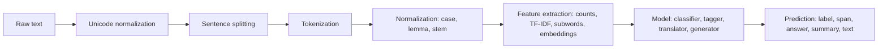
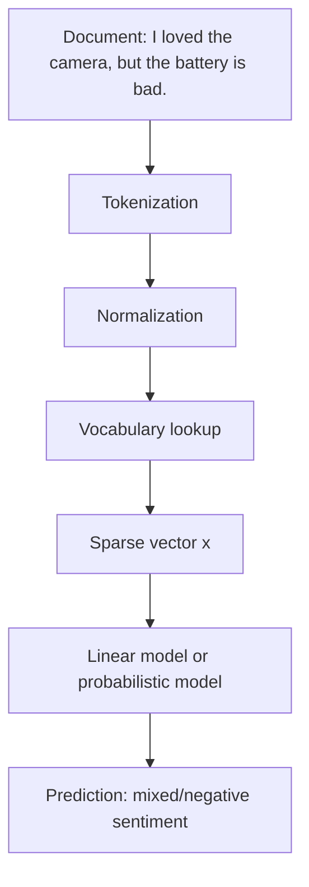
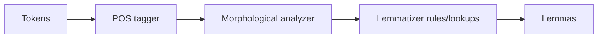
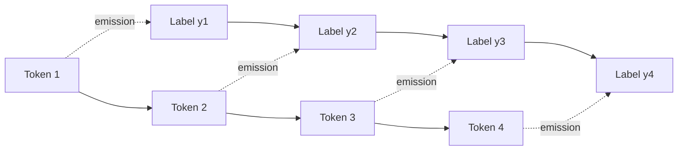
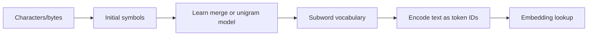

# Natural Language Processing: Classical Pipelines, Text Normalization, and Tokenization

Natural Language Processing (NLP) turns raw language into computational objects: tokens, features, probabilities, latent states, labels, spans, actions, or generated text. At the engineering level, an NLP system is mostly a sequence of lossy transformations. The core question is not "how do we clean text?", but "which information should be preserved for the downstream objective, and which variation should be intentionally collapsed?"

This chapter expands the basic NLP outline into the mechanics behind:

- text preprocessing and normalization,
- tokenization from words to subwords,
- classical feature extraction,
- probabilistic and discriminative text classifiers,
- entity extraction and sequence labeling,
- implementation details in Python, scikit-learn, NLTK, spaCy, and Hugging Face tokenizers.

The discussion assumes familiarity with probability, optimization, linear algebra, and Python.



## 1. What NLP Systems Compute

An NLP dataset usually consists of examples

$$
\mathcal{D}
=
\{(x_i,y_i)\}_{i=1}^{n},
$$

where $x_i$ is a sequence of characters, tokens, or speech-derived text, and $y_i$ can be:

- a document label, as in spam detection or sentiment analysis;
- a token-level label sequence, as in named entity recognition;
- another sequence, as in translation, summarization, or text generation;
- an answer span, as in extractive question answering;
- a scalar score, as in ranking or toxicity estimation.

Raw text is not naturally a vector in $\mathbb{R}^d$. A pipeline defines a representation map

$$
\phi : \mathcal{X} \rightarrow \mathbb{R}^{d},
$$

then learns a predictor

$$
f_\theta : \mathbb{R}^{d} \rightarrow \mathcal{Y}.
$$

Classical NLP spends much of its complexity in $\phi$. Modern neural NLP learns much of $\phi$ through embeddings and deep networks, but still depends on tokenization and normalization decisions.

### Common NLP Tasks

| Task | Input | Output | Typical model family |
|---|---:|---:|---|
| Text classification | Document | Class label | Naive Bayes, linear models, transformers |
| Sentiment analysis | Sentence/document | Polarity or score | Linear classifier, encoder model |
| Machine translation | Source sequence | Target sequence | Encoder-decoder transformer |
| Named entity recognition | Token sequence | Token labels/spans | CRF, BiLSTM-CRF, transformer tagger |
| Question answering | Question + context | Span or generated answer | Reader/ranker, encoder-decoder |
| Summarization | Long document | Short document | Extractive ranker, encoder-decoder |
| Speech recognition | Audio | Text | Acoustic model + language model, encoder-decoder |
| Text generation | Prompt | Continuation | Autoregressive language model |

The same preprocessing choice can be useful for one task and destructive for another. Lowercasing can improve data efficiency for topic classification, but it can destroy entity cues in NER. Stop-word removal can help sparse retrieval, but it can remove negation words that matter for sentiment.

## 2. Classical NLP Pipeline

A classical supervised text pipeline usually executes:

1. Read raw text and labels.
2. Normalize Unicode and whitespace.
3. Segment into sentences if needed.
4. Tokenize into word, character, or subword units.
5. Optionally remove or transform tokens.
6. Convert tokens into numerical features.
7. Fit a model.
8. Calibrate, evaluate, and deploy the same preprocessing at inference time.



The critical invariant is train-serving consistency. If training applies one tokenizer and inference applies another, the model sees a different feature space:

$$
\phi_{\text{train}}(x)
\neq
\phi_{\text{serve}}(x).
$$

That mismatch often creates silent production failures because shapes still match while semantics change.

## 3. Unicode, Normalization, and Text Cleaning

Before tokenization, raw text must be converted to a canonical representation. Unicode allows visually similar strings to have different code-point sequences. For example, a character with an accent may be represented as one composed code point or as a base character plus a combining mark.

Let $s$ be a string represented as a sequence of Unicode code points:

$$
s = (c_1,c_2,\dots,c_m).
$$

A Unicode normalization function $N$ maps equivalent surface forms into a canonical sequence:

$$
N(s) = (c'_1,c'_2,\dots,c'_{m'}).
$$

The main forms are:

- NFC: canonical composition.
- NFD: canonical decomposition.
- NFKC: compatibility decomposition followed by composition.
- NFKD: compatibility decomposition.

For many ML pipelines, NFKC is useful because it normalizes compatibility variants, but it can also change semantic distinctions in specialized domains. Never normalize blindly for legal text, code, chemical names, usernames, or languages where orthographic distinctions are task-relevant.

### Practical Cleaning Rules

Cleaning should be a deterministic function:

$$
\operatorname{clean}: \Sigma^\star \rightarrow \Sigma^\star.
$$

Useful operations include:

- replacing repeated whitespace with a single space;
- removing zero-width characters when they are artifacts;
- standardizing quotes only when typography is irrelevant;
- preserving URLs, emails, hashtags, mentions, and numbers as structured tokens if they carry signal;
- keeping the original raw text for auditability.

Bad cleaning usually deletes information before the model can decide whether it matters.

## 4. Tokenization

Tokenization maps a character sequence to a sequence of units:

$$
\tau(x)
=
(t_1,t_2,\dots,t_L).
$$

The unit $t_j$ can be a word, punctuation mark, byte, character, or subword. Tokenization determines the model's alphabet and therefore its inductive bias.

### 4.1 Rule-Based Word Tokenization

For simple English text, a tokenizer can be described by regular-expression rules:

1. Split around whitespace.
2. Separate punctuation.
3. Preserve contractions or split them according to downstream conventions.
4. Optionally treat URLs, numbers, and dates as atomic tokens.

Example:

```text
"Elon Musk founded SpaceX in 2002."
```

One possible tokenization is:

```text
["Elon", "Musk", "founded", "SpaceX", "in", "2002", "."]
```

Another is:

```text
["Elon", "Musk", "founded", "Space", "X", "in", "2002", "."]
```

The first is usually better for NER. The second may be better if the tokenizer has no vocabulary entry for "SpaceX" and wants compositional subwords.

### 4.2 Why Tokenization Is Not Trivial

Whitespace is not a universal word boundary. Chinese and Japanese may not separate words with spaces. German compounds can pack multiple semantic units into one surface word. Social-media text contains hashtags, emojis, repeated letters, mentions, URLs, and creative spelling. Code-mixed text can switch scripts and languages within one sentence.

Tokenization is therefore an approximation to a latent segmentation:

$$
z^\star
=
\arg\max_z p(z \mid x),
$$

where $z$ is a candidate segmentation of the character sequence $x$. Rule-based tokenizers hard-code this argmax. Statistical tokenizers estimate it.

### 4.3 Sentence Segmentation

Sentence segmentation is another boundary-detection problem. Let $b_i \in \{0,1\}$ indicate whether position $i$ is a sentence boundary. A probabilistic splitter can model:

$$
p(b_i=1 \mid x, i).
$$

The difficulty is ambiguity:

```text
Dr. Rao arrived at 3 p.m. He left early.
```

The period after `Dr.` is not a sentence boundary, while the period after `p.m.` may be followed by a true boundary depending on context. Production systems usually combine abbreviation lists, punctuation rules, capitalization features, and statistical models.

## 5. Stop Words

Stop words are frequent tokens often removed in sparse retrieval and classical classification:

```text
the, is, are, was, of, and, to
```

Let the vocabulary be $V$ and a stop-word set be $S \subset V$. Stop-word removal applies:

$$
\tau'(x)
=
(t_j : t_j \in \tau(x),\ t_j \notin S).
$$

This reduces dimensionality from $|V|$ to $|V \setminus S|$ and often reduces noise in bag-of-words models.

The danger is task dependence. In sentiment analysis, negation words are not disposable:

```text
"not good" -> ["good"]
```

After removing `not`, the sentiment flips. In authorship attribution, function words are highly informative. In legal or medical text, short words can be crucial.

### Corpus-Specific Stop Words

A more principled approach uses document frequency. For token $w$, define

$$
\operatorname{df}(w)
=
\sum_{i=1}^{n}
\mathbf{1}\{w \in x_i\}.
$$

A corpus-specific high-frequency stop set is:

$$
S_{\alpha}
=
\left\{
w \in V :
\frac{\operatorname{df}(w)}{n} > \alpha
\right\}.
$$

Here $\alpha$ might be $0.8$ or $0.9$. This says: remove tokens appearing in more than $\alpha$ fraction of documents. scikit-learn's `CountVectorizer(max_df=...)` implements exactly this kind of document-frequency filtering.

## 6. Stemming

Stemming reduces surface forms to crude stems:

```text
playing, played, plays -> play
```

Formally, a stemmer is a deterministic many-to-one map:

$$
g_{\text{stem}} : V \rightarrow V_{\text{stem}},
$$

where many inflected forms share the same output:

$$
g_{\text{stem}}(\text{playing})
=
g_{\text{stem}}(\text{played})
=
g_{\text{stem}}(\text{plays})
=
\text{play}.
$$

The benefit is variance reduction: sparse features become denser. The cost is bias: semantically different words may collapse.

### 6.1 Porter-Style Suffix Stripping

The Porter stemmer is a sequence of rewrite rules. A simplified rule looks like:

$$
\texttt{sses} \rightarrow \texttt{ss}.
$$

So:

```text
caresses -> caress
```

Another rule:

$$
\texttt{ies} \rightarrow \texttt{i}.
$$

So:

```text
ponies -> poni
```

The output need not be a dictionary word. This is intentional: stemming is not morphological analysis; it is conflation for retrieval and sparse learning.

### 6.2 Measure in Porter Stemming

Porter stemming uses a measure $m$ based on consonant-vowel sequences. A word stem is represented as:

$$
[C](VC)^m[V],
$$

where:

- $C$ is a sequence of consonants,
- $V$ is a sequence of vowels,
- $m$ counts the number of vowel-consonant transitions.

Some suffix rules only apply when $m$ exceeds a threshold. This prevents aggressive stripping of short words.

For a schematic rule:

$$
\text{if } m(\text{stem}) > 0,\quad
\texttt{EED} \rightarrow \texttt{EE}.
$$

The condition protects words where removing the suffix would overtruncate.

### 6.3 Stemming Failure Modes

Two classic errors:

- overstemming: unrelated words collapse, such as `universe` and `university`;
- understemming: related words fail to collapse, such as `alumnus` and `alumni`.

Stemming is usually appropriate for information retrieval and some classical classifiers. It is usually inappropriate for modern transformer pipelines, where pretrained tokenizers and embeddings expect their own input conventions.

## 7. Lemmatization

Lemmatization maps a word form to a dictionary base form, or lemma:

```text
better -> good
was -> be
running -> run
```

Unlike stemming, lemmatization usually depends on part of speech:

$$
g_{\text{lemma}}(w, p)
=
\ell,
$$

where $w$ is the surface word, $p$ is a POS tag, and $\ell$ is the lemma.

Example:

```text
"saw" as noun -> saw
"saw" as verb -> see
```

Thus a lemmatizer often requires a pipeline:



### 7.1 Rule-Based Lemmatization

A rule-based lemmatizer combines:

- lookup tables for irregular forms;
- suffix rules conditioned on POS and morphology;
- fallback identity mapping.

Let $I$ be an irregular dictionary:

$$
I[(\text{better}, \text{ADJ})] = \text{good}.
$$

Let $R_p$ be a set of POS-conditioned suffix rules. Then:

$$
g_{\text{lemma}}(w,p)
=
\begin{cases}
I[(w,p)] & \text{if } (w,p) \in \operatorname{dom}(I), \\
\operatorname{apply}(R_p,w) & \text{if a rule matches}, \\
w & \text{otherwise}.
\end{cases}
$$

The dependency on POS creates error propagation: a wrong POS tag can produce a wrong lemma.

## 8. Feature Extraction: Bag of Words

After tokenization, classical NLP maps tokens to vectors. Let the vocabulary be:

$$
V
=
\{v_1,v_2,\dots,v_d\}.
$$

For document $x_i$, define the count vector $c_i \in \mathbb{N}^{d}$:

$$
c_{ij}
=
\sum_{t \in \tau(x_i)}
\mathbf{1}\{t=v_j\}.
$$

The document-term matrix is:

$$
X
=
\begin{bmatrix}
c_{11} & c_{12} & \cdots & c_{1d} \\
c_{21} & c_{22} & \cdots & c_{2d} \\
\vdots & \vdots & \ddots & \vdots \\
c_{n1} & c_{n2} & \cdots & c_{nd}
\end{bmatrix}.
$$

Most entries are zero, so $X$ should be stored as a sparse matrix.

### Worked Example: Count Vectorization

Documents:

```text
d1 = "I love NLP"
d2 = "I love machine learning"
d3 = "NLP loves learning"
```

Lowercase tokens:

```text
d1: [i, love, nlp]
d2: [i, love, machine, learning]
d3: [nlp, loves, learning]
```

Vocabulary in alphabetical order:

```text
[i, learning, love, loves, machine, nlp]
```

Count matrix:

$$
X
=
\begin{bmatrix}
1 & 0 & 1 & 0 & 0 & 1 \\
1 & 1 & 1 & 0 & 1 & 0 \\
0 & 1 & 0 & 1 & 0 & 1
\end{bmatrix}.
$$

Bag-of-words discards order. Therefore:

```text
"dog bites man"
"man bites dog"
```

have identical unigram count vectors. N-grams partially restore local order.

## 9. N-Grams

An $n$-gram is a contiguous sequence of $n$ tokens:

$$
(t_j,t_{j+1},\dots,t_{j+n-1}).
$$

For:

```text
not very good
```

unigrams:

```text
not, very, good
```

bigrams:

```text
not very, very good
```

trigrams:

```text
not very good
```

N-grams improve linear models by introducing local phrase features. They also increase vocabulary size. If $|V|=d$, the theoretical number of possible bigrams is $d^2$, although only observed n-grams are stored.

### Complexity

For a document of length $L$, extracting all n-grams for $n \in \{1,\dots,N\}$ costs:

$$
O(NL)
$$

time, ignoring hashing/string construction costs. The memory cost is proportional to the number of distinct observed n-grams.

## 10. TF-IDF

Raw counts overemphasize frequent terms. TF-IDF rescales token counts by corpus-level rarity.

Term frequency:

$$
\operatorname{tf}(w,d)
=
c(w,d).
$$

Document frequency:

$$
\operatorname{df}(w)
=
\sum_{i=1}^{n}
\mathbf{1}\{w \in d_i\}.
$$

Inverse document frequency:

$$
\operatorname{idf}(w)
=
\log
\frac{n}{\operatorname{df}(w)}.
$$

A smoothed version used in many libraries is:

$$
\operatorname{idf}(w)
=
\log
\frac{1+n}{1+\operatorname{df}(w)}
+ 1.
$$

TF-IDF feature:

$$
x_{dw}
=
\operatorname{tf}(w,d)\operatorname{idf}(w).
$$

### Intuition

The term frequency says: "How much does this document discuss the term?"

The inverse document frequency says: "How surprising is this term across the corpus?"

A term that appears in every document gets small IDF. A term that appears in a few documents gets large IDF.

### Worked Example: TF-IDF

Using the three documents above, the token `learning` appears in $2$ of $3$ documents:

$$
\operatorname{df}(\text{learning})=2.
$$

With smoothed IDF:

$$
\operatorname{idf}(\text{learning})
=
\log\frac{1+3}{1+2}+1
=
\log\frac{4}{3}+1.
$$

Since:

$$
\log\frac{4}{3}
\approx
0.2877,
$$

we get:

$$
\operatorname{idf}(\text{learning})
\approx
1.2877.
$$

The token `machine` appears in one document:

$$
\operatorname{idf}(\text{machine})
=
\log\frac{4}{2}+1
=
\log 2 + 1
\approx
1.6931.
$$

So `machine` receives more weight than `learning`.

## 11. Multinomial Naive Bayes for Text Classification

Naive Bayes is a strong baseline for sparse text classification because word counts are naturally modeled as class-conditional multinomial observations.

Let $y \in \{1,\dots,K\}$ be the class. For a document represented by count vector $x \in \mathbb{N}^{d}$, multinomial Naive Bayes assumes:

$$
p(x \mid y=k)
=
\frac{(\sum_{j=1}^{d}x_j)!}{\prod_{j=1}^{d}x_j!}
\prod_{j=1}^{d}
\theta_{kj}^{x_j},
$$

where:

- $\theta_{kj}=p(w_j \mid y=k)$,
- $\theta_{kj} \geq 0$,
- $\sum_{j=1}^{d}\theta_{kj}=1$.

The posterior is:

$$
p(y=k \mid x)
=
\frac{p(y=k)p(x \mid y=k)}
{\sum_{r=1}^{K}p(y=r)p(x \mid y=r)}.
$$

For classification, we only need the argmax:

$$
\hat{y}
=
\arg\max_k
p(y=k)p(x \mid y=k).
$$

Taking logs:

$$
\hat{y}
=
\arg\max_k
\left[
\log p(y=k)
+
\sum_{j=1}^{d}
x_j \log \theta_{kj}
\right].
$$

The multinomial coefficient disappears because it does not depend on $k$.

### 11.1 Maximum Likelihood Estimate

Let $N_{kj}$ be the total count of word $j$ in class $k$:

$$
N_{kj}
=
\sum_{i:y_i=k}x_{ij}.
$$

Let:

$$
N_k
=
\sum_{j=1}^{d}N_{kj}.
$$

The MLE solves:

$$
\max_{\theta_k}
\sum_{j=1}^{d}N_{kj}\log\theta_{kj}
\quad
\text{subject to}
\quad
\sum_{j=1}^{d}\theta_{kj}=1.
$$

Construct the Lagrangian:

$$
\mathcal{L}(\theta_k,\lambda)
=
\sum_{j=1}^{d}N_{kj}\log\theta_{kj}
+
\lambda
\left(
\sum_{j=1}^{d}\theta_{kj}-1
\right).
$$

Differentiate:

$$
\frac{\partial \mathcal{L}}{\partial \theta_{kj}}
=
\frac{N_{kj}}{\theta_{kj}}
+\lambda.
$$

Set to zero:

$$
\frac{N_{kj}}{\theta_{kj}}
+\lambda
=0.
$$

Thus:

$$
\theta_{kj}
=
-\frac{N_{kj}}{\lambda}.
$$

Use the constraint:

$$
\sum_{j=1}^{d}\theta_{kj}
=
-\frac{1}{\lambda}
\sum_{j=1}^{d}N_{kj}
=1.
$$

So:

$$
\lambda=-N_k.
$$

Therefore:

$$
\hat{\theta}_{kj}
=
\frac{N_{kj}}{N_k}.
$$

If $N_{kj}=0$, then $\log \hat{\theta}_{kj}=-\infty$. This is why smoothing is necessary.

### 11.2 Laplace Smoothing

With a symmetric Dirichlet prior:

$$
\theta_k
\sim
\operatorname{Dirichlet}(\alpha,\dots,\alpha),
$$

the posterior mean estimate is:

$$
\hat{\theta}_{kj}
=
\frac{N_{kj}+\alpha}{N_k+\alpha d}.
$$

For $\alpha=1$, this is Laplace smoothing. For $0<\alpha<1$, it is weaker additive smoothing.

### Worked Example: Spam Classification

Training data:

```text
spam: "win money"
spam: "win prize"
ham:  "team meeting"
ham:  "project meeting"
```

Vocabulary:

```text
[meeting, money, prize, project, team, win]
```

Class counts:

$$
p(\text{spam})=\frac{2}{4}=\frac{1}{2},
\qquad
p(\text{ham})=\frac{2}{4}=\frac{1}{2}.
$$

Spam token counts:

$$
N_{\text{spam}}
=
4.
$$

With $\alpha=1$ and $d=6$:

$$
\hat{\theta}_{\text{spam},\text{win}}
=
\frac{2+1}{4+6}
=
0.3.
$$

$$
\hat{\theta}_{\text{spam},\text{meeting}}
=
\frac{0+1}{4+6}
=
0.1.
$$

Ham token counts:

$$
N_{\text{ham}}=4.
$$

$$
\hat{\theta}_{\text{ham},\text{meeting}}
=
\frac{2+1}{4+6}
=
0.3.
$$

For test document:

```text
"win money"
```

The spam log score is:

$$
\log 0.5 + \log 0.3 + \log 0.2.
$$

The ham log score is:

$$
\log 0.5 + \log 0.1 + \log 0.1.
$$

Numerically:

$$
\log 0.5 + \log 0.3 + \log 0.2
\approx
-0.6931 - 1.2040 - 1.6094
=
-3.5065.
$$

$$
\log 0.5 + \log 0.1 + \log 0.1
\approx
-0.6931 - 2.3026 - 2.3026
=
-5.2983.
$$

Since $-3.5065 > -5.2983$, the prediction is spam.

## 12. Logistic Regression for Text

For sparse text vectors, logistic regression is often stronger than Naive Bayes because it learns discriminative weights directly.

For binary labels $y_i \in \{0,1\}$:

$$
p(y_i=1 \mid x_i)
=
\sigma(w^\top x_i + b),
$$

where:

$$
\sigma(z)
=
\frac{1}{1+\exp(-z)}.
$$

The negative log-likelihood is:

$$
\mathcal{L}(w,b)
=
-
\sum_{i=1}^{n}
\left[
y_i\log p_i
+
(1-y_i)\log(1-p_i)
\right],
$$

where:

$$
p_i
=
\sigma(w^\top x_i+b).
$$

With L2 regularization:

$$
\mathcal{J}(w,b)
=
\mathcal{L}(w,b)
+
\frac{\lambda}{2}\|w\|_2^2.
$$

### Gradient Derivation

Let:

$$
z_i=w^\top x_i+b,
\qquad
p_i=\sigma(z_i).
$$

The derivative of sigmoid is:

$$
\frac{d\sigma}{dz}
=
\sigma(z)(1-\sigma(z)).
$$

For one example:

$$
\ell_i
=
-
\left[
y_i\log p_i
+
(1-y_i)\log(1-p_i)
\right].
$$

Differentiate with respect to $z_i$:

$$
\frac{\partial \ell_i}{\partial z_i}
=
p_i-y_i.
$$

Then:

$$
\nabla_w \mathcal{J}
=
\sum_{i=1}^{n}
(p_i-y_i)x_i
+
\lambda w.
$$

$$
\frac{\partial \mathcal{J}}{\partial b}
=
\sum_{i=1}^{n}
(p_i-y_i).
$$

For sparse $x_i$, the update touches only nonzero features plus the regularization term.

### Intuition

Naive Bayes estimates how likely words are under each class. Logistic regression estimates how much each feature moves the log-odds:

$$
\log
\frac{p(y=1 \mid x)}{p(y=0 \mid x)}
=
w^\top x+b.
$$

If $w_j>0$, feature $j$ pushes toward class $1$. If $w_j<0$, it pushes toward class $0$.

## 13. Named Entity Recognition

Named Entity Recognition identifies spans such as people, organizations, locations, dates, and products.

Example:

```text
Elon Musk founded SpaceX.
```

Entities:

```text
Elon Musk -> PERSON
SpaceX -> ORG
```

NER is usually formulated as sequence labeling. Let:

$$
x=(t_1,\dots,t_L),
\qquad
y=(y_1,\dots,y_L).
$$

A common label scheme is BIO:

- `B-PER`: beginning of a person span;
- `I-PER`: inside a person span;
- `O`: outside any entity.

For the example:

| Token | Label |
|---|---|
| Elon | B-PER |
| Musk | I-PER |
| founded | O |
| SpaceX | B-ORG |
| . | O |

### 13.1 Linear-Chain CRF

A linear-chain Conditional Random Field models the whole label sequence:

$$
p(y \mid x)
=
\frac{1}{Z(x)}
\exp
\left(
\sum_{t=1}^{L}
s_t(y_t,x)
+
\sum_{t=2}^{L}
A_{y_{t-1},y_t}
\right),
$$

where:

- $s_t(y_t,x)$ is the emission score for assigning label $y_t$ at position $t$;
- $A_{a,b}$ is the transition score from label $a$ to label $b$;
- $Z(x)$ normalizes over all possible label sequences.

The partition function is:

$$
Z(x)
=
\sum_{y' \in \mathcal{Y}^{L}}
\exp
\left(
\sum_{t=1}^{L}
s_t(y'_t,x)
+
\sum_{t=2}^{L}
A_{y'_{t-1},y'_t}
\right).
$$

Naively this sum costs $O(|\mathcal{Y}|^L)$. Dynamic programming computes it in:

$$
O(L|\mathcal{Y}|^2).
$$

The Viterbi algorithm uses a max instead of a sum to find:

$$
\hat{y}
=
\arg\max_y
\left(
\sum_{t=1}^{L}
s_t(y_t,x)
+
\sum_{t=2}^{L}
A_{y_{t-1},y_t}
\right).
$$



Modern NER systems often replace hand-built emission features with transformer embeddings and optionally keep a CRF decoding layer.

## 14. Subword Tokenization

Modern neural NLP rarely uses pure word tokenization. A fixed word vocabulary has an out-of-vocabulary problem:

$$
w \notin V
\quad
\Rightarrow
\quad
\text{unknown token}.
$$

Subword tokenization decomposes rare words into reusable pieces:

```text
unbelievable -> un, believ, able
```

The goal is a finite vocabulary that can represent nearly any string while keeping sequence length manageable.



### 14.1 Byte Pair Encoding

Byte Pair Encoding (BPE) starts with small symbols, usually characters or bytes, and repeatedly merges the most frequent adjacent pair.

Initial corpus:

```text
low
lower
newest
widest
```

Represent each word as characters plus an end marker:

```text
l o w </w>
l o w e r </w>
n e w e s t </w>
w i d e s t </w>
```

At each step:

1. Count adjacent symbol pairs.
2. Choose the most frequent pair $(a,b)$.
3. Add merged symbol $ab$ to the vocabulary.
4. Replace all occurrences of $(a,b)$ with $ab$.

If `(l, o)` is most frequent:

```text
l o -> lo
```

Then:

```text
lo w </w>
lo w e r </w>
n e w e s t </w>
w i d e s t </w>
```

After enough merges, frequent morpheme-like units emerge. The learned merge list is order-sensitive: encoding applies merges in the order learned during training.

### 14.2 WordPiece

WordPiece is similar to BPE but chooses merges using a likelihood-inspired score rather than raw pair frequency. A common description of the merge score is:

$$
\operatorname{score}(a,b)
=
\frac{f(ab)}{f(a)f(b)}.
$$

This favors pairs that occur together more than expected from their individual frequencies. WordPiece tokenizers often mark continuation pieces with a prefix such as `##`.

Example:

```text
unaffable -> un ##aff ##able
```

### 14.3 Unigram Language Model Tokenization

Unigram tokenization begins with a large candidate vocabulary and prunes it. It assumes a word can be generated by many possible segmentations:

$$
p(x)
=
\sum_{s \in \mathcal{S}(x)}
\prod_{u \in s}
p(u),
$$

where:

- $\mathcal{S}(x)$ is the set of possible segmentations of string $x$;
- $u$ is a subword unit;
- $p(u)$ is the probability of unit $u$.

Training estimates subword probabilities and removes pieces that least hurt likelihood. Encoding often chooses the most likely segmentation:

$$
\hat{s}
=
\arg\max_{s \in \mathcal{S}(x)}
\sum_{u \in s}
\log p(u).
$$

This argmax is computed by dynamic programming.

### 14.4 Token IDs and Embeddings

After tokenization, tokens are mapped to integer IDs:

$$
\operatorname{id}: V \rightarrow \{0,1,\dots,|V|-1\}.
$$

The embedding matrix is:

$$
E \in \mathbb{R}^{|V| \times h}.
$$

For token ID $i$, the embedding is row $E_i$:

$$
e_i = E[i,:].
$$

Subword tokenization therefore directly controls the size of the embedding table:

$$
\operatorname{parameters}(E)
=
|V|h.
$$

Larger vocabularies shorten sequences but increase embedding parameters. Smaller vocabularies reduce embedding parameters but lengthen sequences and increase attention cost. For transformer self-attention, sequence length $L$ matters because vanilla attention costs:

$$
O(L^2h).
$$

## 15. Question Answering, Translation, Summarization, and Generation

The original notes list high-level tasks. Their mathematical forms differ mainly in the output space.

### Text Classification

$$
f_\theta(x) \in \{1,\dots,K\}.
$$

Examples: spam detection, topic classification, sentiment.

### Sequence Labeling

$$
f_\theta(x_1,\dots,x_L)
=
(y_1,\dots,y_L).
$$

Examples: NER, POS tagging.

### Sequence-to-Sequence Modeling

$$
p_\theta(y \mid x)
=
\prod_{t=1}^{T}
p_\theta(y_t \mid y_{<t}, x).
$$

Examples: translation, abstractive summarization.

### Autoregressive Generation

$$
p_\theta(x)
=
\prod_{t=1}^{T}
p_\theta(x_t \mid x_{<t}).
$$

Example: prompt continuation.

### Extractive Question Answering

Given context tokens $c_1,\dots,c_L$ and question $q$, predict start and end indices:

$$
p(s,e \mid q,c)
=
p(s \mid q,c)p(e \mid q,c).
$$

The answer span is:

$$
\hat{a}
=
(c_{\hat{s}},\dots,c_{\hat{e}}),
\qquad
\hat{s},\hat{e}
=
\arg\max_{s \leq e}
p(s \mid q,c)p(e \mid q,c).
$$

## 16. Python from Scratch

The following implementation intentionally avoids heavyweight NLP libraries. It is not a replacement for production tokenizers; it exposes the mechanics.

```python
from __future__ import annotations

import math
import re
import unicodedata
from collections import Counter, defaultdict
from dataclasses import dataclass
from typing import Iterable


TOKEN_RE = re.compile(r"https?://\S+|[\w']+|[^\w\s]", re.UNICODE)


def normalize_text(text: str, *, lowercase: bool = True) -> str:
    """Deterministic Unicode and whitespace normalization."""
    text = unicodedata.normalize("NFKC", text)
    text = re.sub(r"\s+", " ", text).strip()
    if lowercase:
        text = text.lower()
    return text


def tokenize(text: str) -> list[str]:
    """Regex tokenizer that keeps punctuation as separate tokens."""
    return TOKEN_RE.findall(text)


def simple_stem(token: str) -> str:
    """Small illustrative suffix stripper, not a full Porter stemmer."""
    if len(token) <= 3:
        return token
    for suffix, repl in [
        ("sses", "ss"),
        ("ies", "i"),
        ("ing", ""),
        ("ed", ""),
        ("s", ""),
    ]:
        if token.endswith(suffix) and len(token) - len(suffix) >= 3:
            return token[: -len(suffix)] + repl
    return token


IRREGULAR_LEMMAS = {
    ("was", "VERB"): "be",
    ("were", "VERB"): "be",
    ("better", "ADJ"): "good",
    ("best", "ADJ"): "good",
}


def simple_lemmatize(token: str, pos: str = "NOUN") -> str:
    """Toy POS-conditioned lemmatizer."""
    key = (token, pos)
    if key in IRREGULAR_LEMMAS:
        return IRREGULAR_LEMMAS[key]
    if pos == "VERB" and token.endswith("ing") and len(token) > 4:
        base = token[:-3]
        # running -> run
        if len(base) >= 2 and base[-1] == base[-2]:
            base = base[:-1]
        return base
    if pos == "NOUN" and token.endswith("s") and len(token) > 3:
        return token[:-1]
    return token


def preprocess(text: str, stop_words: set[str] | None = None) -> list[str]:
    text = normalize_text(text)
    tokens = tokenize(text)
    if stop_words:
        tokens = [t for t in tokens if t not in stop_words]
    return tokens


@dataclass
class CountVectorizerScratch:
    min_df: int = 1
    max_df_ratio: float = 1.0
    vocabulary_: dict[str, int] | None = None

    def fit(self, documents: Iterable[str]) -> "CountVectorizerScratch":
        docs = list(documents)
        df = Counter()

        for doc in docs:
            df.update(set(preprocess(doc)))

        vocab = []
        n_docs = len(docs)
        for token, freq in sorted(df.items()):
            if freq >= self.min_df and freq / n_docs <= self.max_df_ratio:
                vocab.append(token)

        self.vocabulary_ = {token: j for j, token in enumerate(vocab)}
        return self

    def transform(self, documents: Iterable[str]) -> list[dict[int, int]]:
        if self.vocabulary_ is None:
            raise ValueError("fit must be called before transform")

        rows = []
        for doc in documents:
            counts = Counter(preprocess(doc))
            row = {}
            for token, count in counts.items():
                j = self.vocabulary_.get(token)
                if j is not None:
                    row[j] = count
            rows.append(row)
        return rows

    def fit_transform(self, documents: Iterable[str]) -> list[dict[int, int]]:
        return self.fit(documents).transform(documents)


@dataclass
class TfidfTransformerScratch:
    idf_: list[float] | None = None

    def fit(self, X: list[dict[int, int]], n_features: int) -> "TfidfTransformerScratch":
        n_docs = len(X)
        df = [0] * n_features
        for row in X:
            for j in row:
                df[j] += 1

        self.idf_ = [
            math.log((1 + n_docs) / (1 + df_j)) + 1.0
            for df_j in df
        ]
        return self

    def transform(self, X: list[dict[int, int]], *, l2_normalize: bool = True) -> list[dict[int, float]]:
        if self.idf_ is None:
            raise ValueError("fit must be called before transform")

        rows = []
        for row in X:
            tfidf = {j: count * self.idf_[j] for j, count in row.items()}
            if l2_normalize:
                norm = math.sqrt(sum(value * value for value in tfidf.values()))
                if norm > 0.0:
                    tfidf = {j: value / norm for j, value in tfidf.items()}
            rows.append(tfidf)
        return rows


@dataclass
class MultinomialNBScratch:
    alpha: float = 1.0
    classes_: list[str] | None = None
    log_prior_: dict[str, float] | None = None
    log_likelihood_: dict[str, list[float]] | None = None

    def fit(self, X: list[dict[int, int]], y: list[str], n_features: int) -> "MultinomialNBScratch":
        classes = sorted(set(y))
        class_doc_counts = Counter(y)
        token_counts = {cls: [0.0] * n_features for cls in classes}
        total_counts = {cls: 0.0 for cls in classes}

        for row, cls in zip(X, y):
            for j, count in row.items():
                token_counts[cls][j] += count
                total_counts[cls] += count

        n_docs = len(y)
        self.classes_ = classes
        self.log_prior_ = {
            cls: math.log(class_doc_counts[cls] / n_docs)
            for cls in classes
        }
        self.log_likelihood_ = {}

        for cls in classes:
            denom = total_counts[cls] + self.alpha * n_features
            self.log_likelihood_[cls] = [
                math.log((token_counts[cls][j] + self.alpha) / denom)
                for j in range(n_features)
            ]
        return self

    def predict_one(self, row: dict[int, int]) -> str:
        if self.classes_ is None or self.log_prior_ is None or self.log_likelihood_ is None:
            raise ValueError("fit must be called before predict")

        best_cls = None
        best_score = -math.inf
        for cls in self.classes_:
            score = self.log_prior_[cls]
            ll = self.log_likelihood_[cls]
            for j, count in row.items():
                score += count * ll[j]
            if score > best_score:
                best_cls = cls
                best_score = score
        assert best_cls is not None
        return best_cls

    def predict(self, X: list[dict[int, int]]) -> list[str]:
        return [self.predict_one(row) for row in X]


if __name__ == "__main__":
    docs = [
        "Win money now",
        "Win a cash prize",
        "Team meeting today",
        "Project meeting schedule",
    ]
    labels = ["spam", "spam", "ham", "ham"]

    vectorizer = CountVectorizerScratch()
    X = vectorizer.fit_transform(docs)
    n_features = len(vectorizer.vocabulary_)

    clf = MultinomialNBScratch(alpha=1.0)
    clf.fit(X, labels, n_features)

    X_test = vectorizer.transform(["win money", "project meeting"])
    print(clf.predict(X_test))
```

Expected output:

```text
['spam', 'ham']
```

## 17. Library Implementations

### 17.1 scikit-learn CountVectorizer and TfidfVectorizer

```python
from sklearn.feature_extraction.text import CountVectorizer, TfidfVectorizer
from sklearn.naive_bayes import MultinomialNB
from sklearn.pipeline import make_pipeline

docs = [
    "Win money now",
    "Win a cash prize",
    "Team meeting today",
    "Project meeting schedule",
]
labels = ["spam", "spam", "ham", "ham"]

model = make_pipeline(
    CountVectorizer(
        lowercase=True,
        token_pattern=r"(?u)\b\w\w+\b",
        ngram_range=(1, 2),
        min_df=1,
    ),
    MultinomialNB(alpha=1.0),
)

model.fit(docs, labels)
print(model.predict(["win money", "project meeting"]))
```

Internally, `CountVectorizer`:

1. builds a preprocessing function;
2. tokenizes each document using either a regex analyzer or a custom analyzer;
3. counts terms per document;
4. builds a vocabulary mapping token strings to integer column indices;
5. returns a SciPy compressed sparse row matrix.

`TfidfVectorizer` is equivalent to:

```python
CountVectorizer(...) -> TfidfTransformer(...)
```

where `TfidfTransformer` computes smoothed IDF and usually L2-normalizes rows.

```python
from sklearn.feature_extraction.text import TfidfVectorizer
from sklearn.linear_model import LogisticRegression
from sklearn.pipeline import make_pipeline

clf = make_pipeline(
    TfidfVectorizer(
        lowercase=True,
        ngram_range=(1, 2),
        max_df=0.95,
        min_df=1,
        sublinear_tf=True,
    ),
    LogisticRegression(max_iter=1000),
)

clf.fit(docs, labels)
print(clf.predict(["cash prize", "team schedule"]))
```

With `sublinear_tf=True`, term frequency is transformed as:

$$
\operatorname{tf}(w,d)
=
1+\log c(w,d)
\quad
\text{when}
\quad
c(w,d)>0.
$$

This reduces the dominance of repeated terms.

### 17.2 NLTK Stemming and Lemmatization

```python
from nltk.stem import PorterStemmer, WordNetLemmatizer

stemmer = PorterStemmer()
print([stemmer.stem(w) for w in ["playing", "played", "plays"]])

lemmatizer = WordNetLemmatizer()
print(lemmatizer.lemmatize("better", pos="a"))
print(lemmatizer.lemmatize("was", pos="v"))
```

The Porter stemmer applies ordered suffix-stripping rules. The WordNet lemmatizer uses WordNet's lexical database and POS-conditioned lookup/rules. If the POS is omitted or wrong, lemmatization quality drops.

### 17.3 spaCy Tokenization and Lemmatization

```python
import spacy

nlp = spacy.load("en_core_web_sm")
doc = nlp("Elon Musk founded SpaceX. He was running two companies.")

for token in doc:
    print(token.text, token.pos_, token.lemma_, token.ent_type_)
```

spaCy tokenization is non-destructive: the token sequence preserves enough spacing information to reconstruct the original text. Its pipeline can include tokenization, POS tagging, morphological analysis, dependency parsing, lemmatization, and NER. Lemmatization can use lookup tables or rules conditioned on POS and morphology, depending on the language pipeline.

### 17.4 Hugging Face Tokenizers

```python
from tokenizers import Tokenizer
from tokenizers.models import BPE
from tokenizers.normalizers import NFKC, Lowercase, Sequence
from tokenizers.pre_tokenizers import Whitespace
from tokenizers.trainers import BpeTrainer

tokenizer = Tokenizer(BPE(unk_token="[UNK]"))
tokenizer.normalizer = Sequence([NFKC(), Lowercase()])
tokenizer.pre_tokenizer = Whitespace()

trainer = BpeTrainer(
    vocab_size=1000,
    special_tokens=["[UNK]", "[PAD]", "[CLS]", "[SEP]", "[MASK]"],
)

tokenizer.train_from_iterator(
    [
        "Natural language processing is useful.",
        "Tokenization converts text into tokens.",
        "Subword tokenization handles rare words.",
    ],
    trainer=trainer,
)

encoded = tokenizer.encode("Tokenization handles unseen-ish words.")
print(encoded.tokens)
print(encoded.ids)
```

A modern tokenizer pipeline commonly has:

1. normalizer: Unicode/case/accent normalization;
2. pre-tokenizer: rough splitting into regions;
3. model: BPE, WordPiece, Unigram, or byte-level model;
4. post-processor: add special tokens such as `[CLS]` and `[SEP]`;
5. decoder: convert token pieces back to text.

## 18. Numerical Stability and Implementation Pitfalls

### Log Probabilities

Products of many probabilities underflow:

$$
\prod_{j=1}^{L}p_j
\rightarrow
0
$$

in floating-point arithmetic when $L$ is large. Use sums of logs:

$$
\log
\prod_{j=1}^{L}p_j
=
\sum_{j=1}^{L}\log p_j.
$$

Naive Bayes, CRFs, HMMs, and language models should compute in log space.

### Log-Sum-Exp

For:

$$
\log
\sum_i
\exp(a_i),
$$

use:

$$
m
=
\max_i a_i,
$$

$$
\log
\sum_i
\exp(a_i)
=
m
+
\log
\sum_i
\exp(a_i-m).
$$

This prevents overflow when some $a_i$ are large.

### Sparse Matrices

Dense document-term matrices are usually impossible. If $n=10^6$ documents and $d=10^6$ features, a dense float32 matrix requires:

$$
10^6 \cdot 10^6 \cdot 4
=
4 \cdot 10^{12}
\text{ bytes}
=
4 \text{ TB}.
$$

Sparse CSR storage is proportional to the number of nonzero entries:

$$
O(\operatorname{nnz}(X)).
$$

### Train-Test Leakage

Do not fit tokenizers, vocabularies, IDF weights, feature selectors, or normalization statistics on the test set. For TF-IDF:

$$
\operatorname{idf}_{\text{train}}
\neq
\operatorname{idf}_{\text{train+test}}.
$$

The latter leaks test distribution information.

### Unknown Tokens

Classical word vocabularies discard unseen words unless an OOV bucket exists. Subword and byte-level tokenizers reduce this problem, but do not eliminate semantic uncertainty for rare strings.

### Over-Normalization

Potentially harmful transformations:

- lowercasing for NER or case-sensitive product names;
- removing punctuation in sentiment, because `!` and `?` can carry signal;
- removing numbers in financial, legal, medical, or scientific text;
- stemming before pretrained transformer tokenization;
- stripping accents in multilingual tasks.

### Label Alignment in Token Classification

Subword tokenization breaks word-level labels:

```text
Washington -> Wash ##ing ##ton
```

If the word label is `B-LOC`, one must decide whether to:

- assign `B-LOC` only to the first subword and mask the rest;
- propagate labels to all subwords;
- use a span-level loss.

Incorrect label alignment is a common NER bug.

## 19. Time and Space Complexity

Let:

- $n$ be the number of documents;
- $\bar{L}$ be the average number of tokens per document;
- $d$ be vocabulary size;
- $K$ be number of classes;
- $\operatorname{nnz}(X)$ be the number of nonzero feature entries.

| Operation | Time | Space |
|---|---:|---:|
| Regex tokenization | $O(n\bar{L})$ | $O(\bar{L})$ per document |
| Vocabulary building | $O(n\bar{L})$ average | $O(d)$ |
| Count matrix construction | $O(n\bar{L})$ | $O(\operatorname{nnz}(X))$ |
| TF-IDF fitting | $O(\operatorname{nnz}(X))$ | $O(d)$ |
| Multinomial NB training | $O(\operatorname{nnz}(X)+Kd)$ | $O(Kd)$ |
| Linear classifier epoch | $O(\operatorname{nnz}(X))$ | $O(d)$ or $O(Kd)$ |
| CRF forward/Viterbi | $O(L|\mathcal{Y}|^2)$ | $O(L|\mathcal{Y}|)$ |
| Transformer self-attention | $O(L^2h)$ | $O(L^2)$ attention map |

For classical NLP, the main bottleneck is often vocabulary and sparse matrix construction. For transformer NLP, the bottleneck is usually sequence length and attention memory.

## 20. Edge Cases

### Empty Documents

After cleaning and stop-word removal, a document may have no tokens. Classifiers must define behavior for the zero vector:

$$
x=0.
$$

For logistic regression:

$$
p(y=1 \mid x=0)
=
\sigma(b).
$$

For Naive Bayes, the prediction depends only on class priors:

$$
\hat{y}
=
\arg\max_k \log p(y=k).
$$

### Very Long Documents

Bag-of-words models handle long documents naturally, but raw counts can bias toward long documents. Use normalization, binary indicators, sublinear TF, or length-aware models.

### Domain Shift

A vocabulary learned on product reviews may fail on medical notes. Tokens unseen during training are ignored by classical vectorizers and fragmented by subword tokenizers. Domain-adaptive pretraining or vocabulary adaptation may be necessary.

### Multilingual Text

English-centric tokenization fails for languages without whitespace segmentation, rich morphology, clitics, or compound words. Use language-aware tokenizers or byte/subword methods. Evaluate normalization choices per language.

## 21. Connections to Related ML Concepts

### Information Retrieval

Bag-of-words, stemming, stop words, TF-IDF, and inverted indexes are foundational IR ideas. A document-term matrix is closely related to an inverted index:

$$
w
\mapsto
\{(d,c(w,d))\}.
$$

Search systems optimize retrieval and ranking, while classifiers optimize prediction, but they share the same sparse text foundations.

### Probabilistic Modeling

Naive Bayes is a generative model:

$$
p(x,y)=p(y)p(x \mid y).
$$

Logistic regression is discriminative:

$$
p(y \mid x).
$$

Generative models can work well with little data and strong assumptions. Discriminative models often win with enough labeled data.

### Representation Learning

Embeddings replace sparse one-hot dimensions with dense learned vectors:

$$
e_w \in \mathbb{R}^{h}.
$$

Contextual models make the representation position- and context-dependent:

$$
h_t
=
f_\theta(t_1,\dots,t_L)_t.
$$

Thus `bank` in "river bank" and "bank loan" can receive different vectors.

### Sequence Modeling

NER, translation, summarization, speech recognition, and text generation all model dependencies across positions. The factorization determines the algorithm:

$$
p(y \mid x)
=
\prod_t p(y_t \mid y_{<t},x)
$$

for autoregressive decoding, versus:

$$
p(y_t \mid x)
$$

for independent token classification.

## 22. Practical Checklist

Before training an NLP model:

1. Define the downstream task and what information must be preserved.
2. Choose tokenization appropriate for the model family.
3. Freeze preprocessing inside a reproducible pipeline.
4. Fit vocabulary and IDF only on training data.
5. Inspect examples before and after preprocessing.
6. Include adversarial examples: negation, numbers, casing, punctuation, URLs, multilingual text.
7. Use sparse matrices for classical text features.
8. Use log probabilities for probabilistic sequence models.
9. Check label alignment after subword tokenization.
10. Evaluate on domain-specific and time-shifted data.

## 23. References and Deeper Reading

- Daniel Jurafsky and James H. Martin, *Speech and Language Processing*, 3rd edition draft: https://web.stanford.edu/~jurafsky/slp3/
- Christopher D. Manning, Prabhakar Raghavan, and Hinrich Schutze, *Introduction to Information Retrieval*: https://nlp.stanford.edu/IR-book/
- M. F. Porter, "An algorithm for suffix stripping", *Program*, 1980: https://www.emerald.com/insight/content/doi/10.1108/eb046814/full/html
- scikit-learn `CountVectorizer` and text feature extraction documentation: https://scikit-learn.org/stable/modules/feature_extraction.html
- NLTK stemming documentation: https://www.nltk.org/howto/stem.html
- spaCy linguistic features and lemmatizer documentation: https://spacy.io/usage/linguistic-features
- Hugging Face Tokenizers course, normalization and pre-tokenization: https://huggingface.co/docs/course/main/en/chapter6/4
- Taku Kudo and John Richardson, "SentencePiece: A simple and language independent subword tokenizer and detokenizer for Neural Text Processing", EMNLP 2018: https://aclanthology.org/D18-2012/
